# G30 付録 1/2（図表の生成: 制約の実験・fixture・期待出力）

[G30-diagrams.md](G30-diagrams.md) の付録。付録 A〜D を置く。付録 E〜F（参照実装と検証の手順）は [G30-appendix-reference.md](G30-appendix-reference.md)。出力は、参照実装（付録 E）が fixture（付録 C）から作った**想定出力**で、手で作ったものではなく、参照実装の出力を `mermaid` 12.1.0 と Graphviz 14.1.2 で確かめた（付録 F）。HEAD のコンパイラは図を出せないので、実際の出力ではない。

## 付録 A: Mermaid の制約（公式の文書と実験）

**A.1 版と取得**: `mermaid` は npm の 12.1.0（2026-10-18 に `npm view mermaid version` で最新と確認）。文書は mermaid.js.org の `syntax/flowchart`・`syntax/classDiagram`・`syntax/stateDiagram`・`syntax/sequenceDiagram` を同日に取得した。実験は、Node 24 の上で、`jsdom` に `window`・`document` を作り、`mermaid.parse(text)`（文法の検査）と `mermaid.mermaidAPI.getDiagramFromText(text).db`（DB の中身）を見た。描画（SVG）は jsdom ではできないので、**描画の見た目は確かめていない**。

**A.2 公式の文書の引用**（原文）:

| 文書 | 引用 | G30 の扱い |
| --- | --- | --- |
| flowchart | `If you are using the word "end" in a Flowchart node, capitalize the entire word or any of the letters (e.g., "End" or "END") … Typing "end" in all lowercase letters will break the Flowchart.` | ID を `n<数>` にする |
| flowchart | `If you are using the letter "o" or "x" as the first letter in a connecting Flowchart node, add a space before the letter or capitalize the letter` | 同上 |
| flowchart | `It is possible to put text within quotes in order to render more troublesome characters.`（例 `id1["This is the (text) in the box"]`） | ラベルは必ず `"…"` |
| flowchart | `It is possible to escape characters using the syntax exemplified here.`（例 `A["A double quote:#quot;"] --> B["A dec char:#9829;"]`）`Numbers given are base 10, so # can be encoded as #35;. It is also supported to use HTML character names.` | 6 文字をコードにする |
| flowchart | `` Use double quotes and backticks "` text `" to enclose the markdown text. `` | `` ` `` は `#96;` |
| classDiagram | `class Animal["Animal with a label"]`（Class labels） | クラスは `class n1["label"] {` |
| classDiagram | `In order to denote an item as generic, you enclose that type within ~ (tilde).` | **使わない**（`<`・`>` をコードにする） |
| stateDiagram | `You cannot define transitions between internal states belonging to different composite states` | 変数ごとに別の図 |
| stateDiagram | `These are the current limitations with state diagram classDefs: 1. Cannot be applied to start or end states 2. Cannot be applied to or within composite states` | 同上。`classDef` は最上位の状態だけに付ける |

**A.3 実験**（`mermaid` 12.1.0。入力→結果）:

| 入力 | 結果 |
| --- | --- |
| `n1["… #35; … #quot; … #lt; #gt; #amp;"]` | DB の `text` が `fl°°35¶ß`・`fl°quot¶ß`・`fl°lt¶ß`・`fl°gt¶ß`・`fl°amp¶ß`（描画のときに元の文字に戻る placeholder）。`#40;`・`#41;` も同じ |
| `n2["raw <b>bold</b> a < b > c & d"]` | `<b>bold</b>` は HTML のまま、`a < b > c & d` は `a &lt; b &gt; c &amp; d` になる。**`<`・`>` の素通しは、タグに見える部分を HTML として扱う** |
| `` n2["… back\slash `tick` %% pct \| pipe {brace} (paren) [brack]"] ``（引用の中） | すべてそのまま残る |
| `n1 -->\|"copy; ref"\| n2`・`n2 -.->\|"own"\| n3` | 辺ラベルは引用できる。`;` は書ける |
| `n3(["…"])`・`n4[["…"]]`・`n5[("…")]`・`n6{{"…"}}`・`n7("…")` | 形は `stadium`・`subroutine`・`cylinder`・`hexagon`・`round` |
| `subgraph g1["…"]`・`style g2 …`・`classDef`・`class n1,n2 pure`・`linkStyle 0 …` | parse できる（G30 は subgraph を使わない） |
| classDiagram `class n1["Point"] {` ＋ `<<record>>` ＋ `+x f64` | `label` `Point`、`annotations` `["record"]`、`members` `["\\+x f64"]` |
| classDiagram `+score(ref 'a) i32` | `methods` に `score(ref 'a) : i32` として入る（**括弧があるとメソッド扱い**） |
| classDiagram `+f: i32 -> i32` と `+data Array~Point~` | メンバーとして `-&gt;`・`&lt;` に変換されて残る（`~` は総称の記法） |
| classDiagram `n4 ..> n1 : "for"` | 関係のタイトルに引用符が残る（`"\"for\""`）。**引用しない** |
| classDiagram `class n3["Score#lt;'a#gt;"]` | ラベルは placeholder 化して残る |
| stateDiagram `state "text : string" as v1 { … }` の中の `classDef`・`class` | parse はできる（文書の制限どおり描画で効かない可能性） |
| stateDiagram `note right of v1_1 : moved here #40;moved_here#41;` | parse できる。`#40;` は placeholder |
| stateDiagram `v1_0 --> v1_1 : move L5 -#gt; consume: x` | `:` を 2 つ含む遷移ラベルも parse できる |
| 設定の既定（`node_modules/mermaid/dist/mermaid.js` の 6435〜6436 行） | `"maxTextSize": 5e4`（50,000 文字）、`"maxEdges": 500`。辺が上限を超えると `Edge limit exceeded. N edges found, but the limit is 500.` |

**A.4 負の例**（`tests/diagram.rs::validator_rejects_each_negative_case` と、付録 D の表）: 下の 7 つの入力を、`mermaid` 12.1.0 の `parse` と参照実装の `validate`（付録 E）に通した。

| ファイル | 入力 | `mermaid` 12.1.0 | `validate` |
| --- | --- | --- | --- |
| `end-id.mmd` | `end["b"]` と `n1 --> end` | **失敗**（`Parse error on line 3 … got 'end'`） | 拒否（unknown form） |
| `raw-quote.mmd` | `n1["say "hi" now"]` | **失敗**（`Parse error on line 2 … got 'STR'`） | 拒否（`raw special character in label`） |
| `unquoted-parens.mmd` | `n1[f (x) -> y]` | **失敗**（`Parse error on line 2 … got 'PS'`） | 拒否（unknown form） |
| `bad-arrow.mmd`（stateDiagram） | `s2 -> s1 : reset`（矢印が `->`） | **失敗**（`Parse error on line 6 … got 'INVALID'`） | 拒否（unknown form） |
| `raw-angle.mmd` | `n1["Array<Point>"]` | 通る（ただし `<Point>` は HTML タグとして扱われる） | 拒否（`raw special character in label`） |
| `undeclared-node.mmd` | `n1 --> n2`（`n2` を宣言していない） | 通る（`n2` が暗黙に作られる） | 拒否（`n2 is not declared`） |
| `class-undeclared.mmd`（classDiagram） | `n1 --> n2 : uses`（`n2` を宣言していない） | 通る | 拒否（`n2 is not declared`） |

**A.5 文書の既存の Mermaid**: `grep -rl '^```mermaid' _tsuzuri docs README.md` は 73 ファイル、76 ブロック（`flowchart` 73・`sequenceDiagram` 2・`stateDiagram-v2` 1）。付録 F の harness の `--md` で全部を `parse` した結果は、**1 件の失敗**:

```text
FAIL _tsuzuri/language-reference/built-in-types-and-modules/gpu.md#2: Parse error on line 3: | ...uto のデバイス）"]  call --> usable{"使えるか<br/... got 'CALLBACKNAME'
```

`gpu.md` の 310 行目の ```` ```mermaid ```` の最初の 2 行 `call["Gpu.init / Gpu.map<br/>（Auto のデバイス）"]`・`call --> usable{…}` の `call` が、`click … call …` の予約語。G30 は直さない（`call` を別の ID にすれば通る。完了報告に書く）。

## 付録 B: fixture のソース

`examples/point` は既存のもの（`Main.tz`・`Point.tz`）。ほかの 5 つは新しい小さなプロジェクトで、**`tsuzuri check` が通り、`tsuzuri run` の標準出力は下のとおり**（HEAD `a2313d19` のバイナリで確かめた。`tests/fixtures/diagram/src/<名前>/` に置く）。

**`cycle`**（`check` 0・`run` → `3`。モジュール `A` と `B` が互いの型を使う循環）:

`A.tz`:

```tsuzuri
record A { n: i32 }

def a_of :: B -> i32 = \b -> b.m
```

`B.tz`:

```tsuzuri
record B { m: i32 }

def b_of :: A -> i32 = \a -> a.n
```

`Main.tz`:

```tsuzuri
let a = A { n: 1 }
let b = B { m: 2 }
(A.a_of b) + (B.b_of a)
```

**`shapes`**（`check` 0・`run` → `1`。record・union・class・instance・`deriving`）:

`Main.tz`:

```tsuzuri
let line = Shapes.Line { a: Shapes.Point { x: 0.0, y: 0.0 }, b: Shapes.Point { x: 3.0, y: 4.0 } }
match Shapes.Segment line with
| Shapes.Segment _ -> 1
| _ -> 0
```

`Shapes.tz`:

```tsuzuri
record Point { x: f64, y: f64 } deriving (Eq)

record Line { a: Point, b: Point }

union Shape =
    | Dot of Point
    | Segment of Line
    | Empty

instance Traits.Sized<Point> {
    fn size _point = 2
}
```

`Traits.tt`:

```tsuzuri
class Sized<'a> {
    def size :: ref 'a -> i64
}
```

**`flow`**（`check` 0・`run` → `36`。`Channel`・`Mutex`・`Task.scope`）:

`Main.tz`:

```tsuzuri
let counter = Mutex.create 0i64
match Channel.bounded 8 with
| (sender, receiver) ->
    let _sent = Task.scope (ref sender) 8 (shared -> index -> Worker.feed shared (index + 1))
    Owned.drop sender
    let _seen = Task.scope (ref counter) 4 (shared -> index -> Worker.bump shared index)
    Worker.drain (ref receiver)
```

`Worker.tz`:

```tsuzuri
def feed :: ref Channel.Sender<i64> -> i64 -> i64
fn feed sender n =
    match Channel.send sender n with
    | Result.Ok _unit -> 1
    | Result.Error _item -> 0

def drain :: ref Channel.Receiver<i64> -> i64
fn drain receiver =
    let mut total = 0
    let mut open = true
    while open do
        match Channel.recv receiver with
        | Maybe.Some value -> total = total + value
        | Maybe.None -> open = false
    total

def bump :: ref Mutex<i64> -> i64 -> i64
fn bump counter index =
    Mutex.with_lock counter (value -> {
        deref value = deref value + index;
        index
    })
```

**`own`**（`check` 0・`run` → `14`。借用・移動・解放）:

`Main.tz`:

```tsuzuri
private def peek :: ref string -> i64
fn peek text = text.length

private def consume :: string -> i64
fn consume text = text.length

export def demo :: i64 -> i64
fn demo n =
    let text = "own" + "ed"
    let seen = peek (ref text)
    let owned = consume text
    let label = "kb" + "!"
    let again = peek (ref label)
    seen + owned + again + n

demo 1
```

**`light`**（`check` 0・`run` → `0`。共用体の遷移）:

`Light.tz`:

```tsuzuri
union Light =
    | Red
    | Green
    | Yellow of i64

def next :: Light -> Light
fn next light =
    match light with
    | Red -> Green
    | Green -> Yellow 3
    | Yellow n -> if n > 0 then Yellow (n - 1) else Red

def reset :: Light -> Light
fn reset light =
    match light with
    | Red -> Red
    | _ -> Red
```

`Main.tz`:

```tsuzuri
let a = Light.next Light.Red
let b = Light.reset (Light.next a)
match b with
| Light.Red -> 0
| _ -> 1
```

## 付録 C: fixture の KB の行

**G30 が読むキー**（ほかのキーは無視する。G26 の行にあるが読まないキー: `signature`・`public`・`export`・`doc`・`deprecated`・`span.start`・`span.end`）:

| ファイル | 読むキー（型） |
| --- | --- |
| `symbols.jsonl` | `id`・`kind`・`module`・`name`・`origin`（文字列）、`params`（`[{name, type, conv}]`）、`result`（文字列か `null`）、`pure`（真偽。なければ `false`）、`span`（`{path, line, column}`） |
| `graph.jsonl` | `rel`・`from`・`to`（文字列）、`args`（文字列の配列。`calls` だけ。なければ `[]`）、`span`（`{line, column}`） |
| `facts/<stem>.jsonl` | `id`、`effects`（文字列の配列）、`effects_complete`（真偽）、`ownership`（`[{var, event, to?, span{path, line, column}}]`。なければ「所有権の事実なし」） |
| `layout/<stem>.jsonl` | `id`・`kind`・`type`、`size`・`align`（`[下限, 上限]`）、record は `fields`（`[{name, type, slot}]`）・`reordered`、union は `layout`・`tag_bytes`（整数か `null`）・`niche`（文字列か `null`）・`cases`（`[{name, payload}]`）、`drop_flag` |
| `manifest.json` | `edition`（文字列）、`modules`（`[{name, key, origin, path, source}]`） |

必須のキーがない行は `E2009` `kb_broken`。以下の fixture の行は、読むキーと G26 の行の `signature`・`public`・`export` を持つ（`doc`・`deprecated`・`span.start`・`span.end` は省いた）。`facts.jsonl`・`layout.jsonl` は、全モジュールを 1 ファイルにしたもの（`Input::from_texts` の `facts`・`layouts` に 1 要素として渡す）。`point` は G26 の付録 H1 の行そのもの。`layout` の行は G26 の付録 H6 の行そのもの。

**`point`**

`point/symbols.jsonl`（8 行）:

```jsonl
{"id":"Main","kind":"module","module":"Main","name":"Main","signature":"module Main","params":[],"result":null,"public":true,"export":false,"pure":false,"origin":"project","span":{"path":"Main.tz","line":1,"column":1}}
{"id":"Main.$entry","kind":"def","module":"Main","name":"$entry","signature":"entry :: f64","params":[],"result":"f64","public":false,"export":false,"pure":false,"origin":"project","span":{"path":"Main.tz","line":1,"column":1}}
{"id":"Point","kind":"module","module":"Point","name":"Point","signature":"module Point","params":[],"result":null,"public":true,"export":false,"pure":false,"origin":"project","span":{"path":"Point.tz","line":1,"column":1}}
{"id":"Point.Point","kind":"record","module":"Point","name":"Point","signature":"record Point","params":[],"result":null,"public":true,"export":false,"pure":false,"origin":"project","span":{"path":"Point.tz","line":1,"column":8}}
{"id":"Point.Point.x","kind":"field","module":"Point","name":"x","signature":"x: f64","params":[],"result":"f64","public":true,"export":false,"pure":false,"origin":"project","span":{"path":"Point.tz","line":1,"column":16}}
{"id":"Point.Point.y","kind":"field","module":"Point","name":"y","signature":"y: f64","params":[],"result":"f64","public":true,"export":false,"pure":false,"origin":"project","span":{"path":"Point.tz","line":1,"column":24}}
{"id":"Point.distance","kind":"def","module":"Point","name":"distance","signature":"def distance :: Point -> f64","params":[{"name":"point","type":"Point","conv":"copy"}],"result":"f64","public":true,"export":false,"pure":false,"origin":"project","span":{"path":"Point.tz","line":3,"column":5}}
{"id":"Point.hypotenuse","kind":"def","module":"Point","name":"hypotenuse","signature":"export def hypotenuse :: f64 -> f64 -> f64","params":[{"name":"x","type":"f64","conv":"copy"},{"name":"y","type":"f64","conv":"copy"}],"result":"f64","public":true,"export":true,"pure":false,"origin":"project","span":{"path":"Point.tz","line":6,"column":12}}
```

`point/graph.jsonl`（6 行）:

```jsonl
{"rel":"calls","from":"Main.$entry","to":"Point.distance","args":["copy"],"span":{"path":"Main.tz","line":2,"column":9}}
{"rel":"calls","from":"Point.distance","to":"sqrt","args":["copy"],"span":{"path":"Point.tz","line":4,"column":5}}
{"rel":"calls","from":"Point.hypotenuse","to":"Point.distance","args":["copy"],"span":{"path":"Point.tz","line":7,"column":5}}
{"rel":"uses_type","from":"Main.$entry","to":"Point.Point","span":{"path":"Main.tz","line":1,"column":9}}
{"rel":"uses_type","from":"Point.distance","to":"Point.Point","span":{"path":"Point.tz","line":3,"column":17}}
{"rel":"uses_type","from":"Point.hypotenuse","to":"Point.Point","span":{"path":"Point.tz","line":7,"column":15}}
```

`point/facts.jsonl`（3 行）:

```jsonl
{"id":"Main.$entry","effects":[],"effects_complete":false,"ownership":[]}
{"id":"Point.distance","effects":[],"effects_complete":false,"ownership":[]}
{"id":"Point.hypotenuse","effects":[],"effects_complete":false,"ownership":[]}
```

**`cycle`**

`cycle/symbols.jsonl`（10 行）:

```jsonl
{"id":"A","kind":"module","module":"A","name":"A","signature":"module A","params":[],"result":null,"public":true,"export":false,"pure":false,"origin":"project","span":{"path":"A.tz","line":1,"column":1}}
{"id":"A.A","kind":"record","module":"A","name":"A","signature":"record A","params":[],"result":null,"public":true,"export":false,"pure":false,"origin":"project","span":{"path":"A.tz","line":1,"column":8}}
{"id":"A.A.n","kind":"field","module":"A","name":"n","signature":"n: i32","params":[],"result":"i32","public":true,"export":false,"pure":false,"origin":"project","span":{"path":"A.tz","line":1,"column":14}}
{"id":"A.a_of","kind":"def","module":"A","name":"a_of","signature":"def a_of :: B -> i32","params":[{"name":"b","type":"B","conv":"copy"}],"result":"i32","public":true,"export":false,"pure":false,"origin":"project","span":{"path":"A.tz","line":3,"column":5}}
{"id":"B","kind":"module","module":"B","name":"B","signature":"module B","params":[],"result":null,"public":true,"export":false,"pure":false,"origin":"project","span":{"path":"B.tz","line":1,"column":1}}
{"id":"B.B","kind":"record","module":"B","name":"B","signature":"record B","params":[],"result":null,"public":true,"export":false,"pure":false,"origin":"project","span":{"path":"B.tz","line":1,"column":8}}
{"id":"B.B.m","kind":"field","module":"B","name":"m","signature":"m: i32","params":[],"result":"i32","public":true,"export":false,"pure":false,"origin":"project","span":{"path":"B.tz","line":1,"column":14}}
{"id":"B.b_of","kind":"def","module":"B","name":"b_of","signature":"def b_of :: A -> i32","params":[{"name":"a","type":"A","conv":"copy"}],"result":"i32","public":true,"export":false,"pure":false,"origin":"project","span":{"path":"B.tz","line":3,"column":5}}
{"id":"Main","kind":"module","module":"Main","name":"Main","signature":"module Main","params":[],"result":null,"public":true,"export":false,"pure":false,"origin":"project","span":{"path":"Main.tz","line":1,"column":1}}
{"id":"Main.$entry","kind":"def","module":"Main","name":"$entry","signature":"entry :: i32","params":[],"result":"i32","public":false,"export":false,"pure":false,"origin":"project","span":{"path":"Main.tz","line":1,"column":1}}
```

`cycle/graph.jsonl`（6 行）:

```jsonl
{"rel":"uses_type","from":"A.a_of","to":"B.B","span":{"path":"A.tz","line":3,"column":13}}
{"rel":"uses_type","from":"B.b_of","to":"A.A","span":{"path":"B.tz","line":3,"column":13}}
{"rel":"calls","from":"Main.$entry","to":"A.a_of","args":["copy"],"span":{"path":"Main.tz","line":3,"column":2}}
{"rel":"calls","from":"Main.$entry","to":"B.b_of","args":["copy"],"span":{"path":"Main.tz","line":3,"column":15}}
{"rel":"uses_type","from":"Main.$entry","to":"A.A","span":{"path":"Main.tz","line":1,"column":9}}
{"rel":"uses_type","from":"Main.$entry","to":"B.B","span":{"path":"Main.tz","line":2,"column":9}}
```

`cycle/facts.jsonl`（3 行）:

```jsonl
{"id":"A.a_of","effects":[],"effects_complete":false,"ownership":[]}
{"id":"B.b_of","effects":[],"effects_complete":false,"ownership":[]}
{"id":"Main.$entry","effects":[],"effects_complete":false,"ownership":[]}
```

**`shapes`**

`shapes/symbols.jsonl`（17 行）:

```jsonl
{"id":"Main","kind":"module","module":"Main","name":"Main","signature":"module Main","params":[],"result":null,"public":true,"export":false,"pure":false,"origin":"project","span":{"path":"Main.tz","line":1,"column":1}}
{"id":"Main.$entry","kind":"def","module":"Main","name":"$entry","signature":"entry :: i32","params":[],"result":"i32","public":false,"export":false,"pure":false,"origin":"project","span":{"path":"Main.tz","line":1,"column":1}}
{"id":"Shapes","kind":"module","module":"Shapes","name":"Shapes","signature":"module Shapes","params":[],"result":null,"public":true,"export":false,"pure":false,"origin":"project","span":{"path":"Shapes.tz","line":1,"column":1}}
{"id":"Shapes.Point","kind":"record","module":"Shapes","name":"Point","signature":"record Point","params":[],"result":null,"public":true,"export":false,"pure":false,"origin":"project","span":{"path":"Shapes.tz","line":1,"column":8}}
{"id":"Shapes.Point.x","kind":"field","module":"Shapes","name":"x","signature":"x: f64","params":[],"result":"f64","public":true,"export":false,"pure":false,"origin":"project","span":{"path":"Shapes.tz","line":1,"column":16}}
{"id":"Shapes.Point.y","kind":"field","module":"Shapes","name":"y","signature":"y: f64","params":[],"result":"f64","public":true,"export":false,"pure":false,"origin":"project","span":{"path":"Shapes.tz","line":1,"column":24}}
{"id":"Shapes.Line","kind":"record","module":"Shapes","name":"Line","signature":"record Line","params":[],"result":null,"public":true,"export":false,"pure":false,"origin":"project","span":{"path":"Shapes.tz","line":3,"column":8}}
{"id":"Shapes.Line.a","kind":"field","module":"Shapes","name":"a","signature":"a: Point","params":[],"result":"Point","public":true,"export":false,"pure":false,"origin":"project","span":{"path":"Shapes.tz","line":3,"column":15}}
{"id":"Shapes.Line.b","kind":"field","module":"Shapes","name":"b","signature":"b: Point","params":[],"result":"Point","public":true,"export":false,"pure":false,"origin":"project","span":{"path":"Shapes.tz","line":3,"column":25}}
{"id":"Shapes.Shape","kind":"union","module":"Shapes","name":"Shape","signature":"union Shape","params":[],"result":null,"public":true,"export":false,"pure":false,"origin":"project","span":{"path":"Shapes.tz","line":5,"column":7}}
{"id":"Shapes.Shape.Dot","kind":"case","module":"Shapes","name":"Dot","signature":"Dot of Point","params":[],"result":"Point","public":true,"export":false,"pure":false,"origin":"project","span":{"path":"Shapes.tz","line":6,"column":7}}
{"id":"Shapes.Shape.Segment","kind":"case","module":"Shapes","name":"Segment","signature":"Segment of Line","params":[],"result":"Line","public":true,"export":false,"pure":false,"origin":"project","span":{"path":"Shapes.tz","line":7,"column":7}}
{"id":"Shapes.Shape.Empty","kind":"case","module":"Shapes","name":"Empty","signature":"Empty","params":[],"result":null,"public":true,"export":false,"pure":false,"origin":"project","span":{"path":"Shapes.tz","line":8,"column":7}}
{"id":"instance:Traits.Sized<Shapes.Point>","kind":"instance","module":"Shapes","name":"Traits.Sized<Point>","signature":"instance Traits.Sized<Point>","params":[],"result":null,"public":true,"export":false,"pure":false,"origin":"project","span":{"path":"Shapes.tz","line":10,"column":10}}
{"id":"Traits","kind":"module","module":"Traits","name":"Traits","signature":"module Traits","params":[],"result":null,"public":true,"export":false,"pure":false,"origin":"project","span":{"path":"Traits.tt","line":1,"column":1}}
{"id":"Traits.Sized","kind":"class","module":"Traits","name":"Sized","signature":"class Sized<'a>","params":[],"result":null,"public":true,"export":false,"pure":false,"origin":"project","span":{"path":"Traits.tt","line":1,"column":7}}
{"id":"Traits.Sized.size","kind":"method","module":"Traits","name":"size","signature":"def size :: ref 'a -> i64","params":[{"name":"arg1","type":"ref 'a","conv":"ref"}],"result":"i64","public":true,"export":false,"pure":false,"origin":"project","span":{"path":"Traits.tt","line":2,"column":9}}
```

`shapes/graph.jsonl`（10 行）:

```jsonl
{"rel":"uses_type","from":"Shapes.Line.a","to":"Shapes.Point","span":{"path":"Shapes.tz","line":3,"column":18}}
{"rel":"uses_type","from":"Shapes.Line.b","to":"Shapes.Point","span":{"path":"Shapes.tz","line":3,"column":28}}
{"rel":"uses_type","from":"Shapes.Shape.Dot","to":"Shapes.Point","span":{"path":"Shapes.tz","line":6,"column":14}}
{"rel":"uses_type","from":"Shapes.Shape.Segment","to":"Shapes.Line","span":{"path":"Shapes.tz","line":7,"column":18}}
{"rel":"uses_type","from":"instance:Traits.Sized<Shapes.Point>","to":"Shapes.Point","span":{"path":"Shapes.tz","line":10,"column":23}}
{"rel":"uses_type","from":"Main.$entry","to":"Shapes.Line","span":{"path":"Main.tz","line":1,"column":12}}
{"rel":"uses_type","from":"Main.$entry","to":"Shapes.Point","span":{"path":"Main.tz","line":1,"column":29}}
{"rel":"implements","from":"Shapes.Point","to":"Traits.Sized","span":{"path":"Shapes.tz","line":10,"column":10}}
{"rel":"implements","from":"Shapes.Point","to":"Eq","span":{"path":"Shapes.tz","line":1,"column":43}}
{"rel":"instance_of","from":"instance:Traits.Sized<Shapes.Point>","to":"Traits.Sized","span":{"path":"Shapes.tz","line":10,"column":10}}
```

**`flow`**

`flow/symbols.jsonl`（6 行）:

```jsonl
{"id":"Main","kind":"module","module":"Main","name":"Main","signature":"module Main","params":[],"result":null,"public":true,"export":false,"pure":false,"origin":"project","span":{"path":"Main.tz","line":1,"column":1}}
{"id":"Main.$entry","kind":"def","module":"Main","name":"$entry","signature":"entry :: i64","params":[],"result":"i64","public":false,"export":false,"pure":false,"origin":"project","span":{"path":"Main.tz","line":1,"column":1}}
{"id":"Worker","kind":"module","module":"Worker","name":"Worker","signature":"module Worker","params":[],"result":null,"public":true,"export":false,"pure":false,"origin":"project","span":{"path":"Worker.tz","line":1,"column":1}}
{"id":"Worker.feed","kind":"def","module":"Worker","name":"feed","signature":"def feed :: ref Channel.Sender<i64> -> i64 -> i64","params":[{"name":"sender","type":"ref Channel.Sender<i64>","conv":"ref"},{"name":"n","type":"i64","conv":"copy"}],"result":"i64","public":true,"export":false,"pure":false,"origin":"project","span":{"path":"Worker.tz","line":1,"column":5}}
{"id":"Worker.drain","kind":"def","module":"Worker","name":"drain","signature":"def drain :: ref Channel.Receiver<i64> -> i64","params":[{"name":"receiver","type":"ref Channel.Receiver<i64>","conv":"ref"}],"result":"i64","public":true,"export":false,"pure":false,"origin":"project","span":{"path":"Worker.tz","line":7,"column":5}}
{"id":"Worker.bump","kind":"def","module":"Worker","name":"bump","signature":"def bump :: ref Mutex<i64> -> i64 -> i64","params":[{"name":"counter","type":"ref Mutex<i64>","conv":"ref"},{"name":"index","type":"i64","conv":"copy"}],"result":"i64","public":true,"export":false,"pure":false,"origin":"project","span":{"path":"Worker.tz","line":17,"column":5}}
```

`flow/graph.jsonl`（11 行）:

```jsonl
{"rel":"calls","from":"Main.$entry","to":"Mutex.create","args":["copy"],"span":{"path":"Main.tz","line":1,"column":15}}
{"rel":"calls","from":"Main.$entry","to":"Channel.bounded","args":["copy"],"span":{"path":"Main.tz","line":2,"column":7}}
{"rel":"calls","from":"Main.$entry","to":"Task.scope","args":["ref","copy","copy"],"span":{"path":"Main.tz","line":4,"column":17}}
{"rel":"calls","from":"Main.$entry","to":"Worker.feed","args":["ref","copy"],"span":{"path":"Main.tz","line":4,"column":63}}
{"rel":"calls","from":"Main.$entry","to":"Owned.drop","args":["own"],"span":{"path":"Main.tz","line":5,"column":5}}
{"rel":"calls","from":"Main.$entry","to":"Task.scope","args":["ref","copy","copy"],"span":{"path":"Main.tz","line":6,"column":17}}
{"rel":"calls","from":"Main.$entry","to":"Worker.bump","args":["ref","copy"],"span":{"path":"Main.tz","line":6,"column":64}}
{"rel":"calls","from":"Main.$entry","to":"Worker.drain","args":["ref"],"span":{"path":"Main.tz","line":7,"column":5}}
{"rel":"calls","from":"Worker.feed","to":"Channel.send","args":["ref","copy"],"span":{"path":"Worker.tz","line":3,"column":11}}
{"rel":"calls","from":"Worker.drain","to":"Channel.recv","args":["ref"],"span":{"path":"Worker.tz","line":12,"column":15}}
{"rel":"calls","from":"Worker.bump","to":"Mutex.with_lock","args":["ref","copy"],"span":{"path":"Worker.tz","line":19,"column":5}}
```

`flow/facts.jsonl`（4 行）:

```jsonl
{"id":"Main.$entry","effects":["atomic","task"],"effects_complete":false,"ownership":[]}
{"id":"Worker.feed","effects":["atomic"],"effects_complete":false,"ownership":[]}
{"id":"Worker.drain","effects":["atomic"],"effects_complete":false,"ownership":[]}
{"id":"Worker.bump","effects":["atomic"],"effects_complete":false,"ownership":[]}
```

**`own`**

`own/symbols.jsonl`（5 行）:

```jsonl
{"id":"Main","kind":"module","module":"Main","name":"Main","signature":"module Main","params":[],"result":null,"public":true,"export":false,"pure":false,"origin":"project","span":{"path":"Main.tz","line":1,"column":1}}
{"id":"Main.$entry","kind":"def","module":"Main","name":"$entry","signature":"entry :: i64","params":[],"result":"i64","public":false,"export":false,"pure":false,"origin":"project","span":{"path":"Main.tz","line":16,"column":1}}
{"id":"Main.peek","kind":"def","module":"Main","name":"peek","signature":"def peek :: ref string -> i64","params":[{"name":"text","type":"ref string","conv":"ref"}],"result":"i64","public":false,"export":false,"pure":false,"origin":"project","span":{"path":"Main.tz","line":1,"column":13}}
{"id":"Main.consume","kind":"def","module":"Main","name":"consume","signature":"def consume :: string -> i64","params":[{"name":"text","type":"string","conv":"own"}],"result":"i64","public":false,"export":false,"pure":false,"origin":"project","span":{"path":"Main.tz","line":4,"column":13}}
{"id":"Main.demo","kind":"def","module":"Main","name":"demo","signature":"export def demo :: i64 -> i64","params":[{"name":"n","type":"i64","conv":"copy"}],"result":"i64","public":true,"export":true,"pure":false,"origin":"project","span":{"path":"Main.tz","line":7,"column":12}}
```

`own/facts.jsonl`（1 行）:

```jsonl
{"id":"Main.demo","effects":[],"effects_complete":false,"ownership":[{"var":"text","event":"borrow","to":"Main.peek","span":{"path":"Main.tz","line":10,"column":22}},{"var":"text","event":"move","to":"Main.consume","span":{"path":"Main.tz","line":11,"column":25}},{"var":"label","event":"borrow","to":"Main.peek","span":{"path":"Main.tz","line":13,"column":23}},{"var":"label","event":"drop","span":{"path":"Main.tz","line":14,"column":29}}]}
```

**`light`**

`light/symbols.jsonl`（7 行）:

```jsonl
{"id":"Light","kind":"module","module":"Light","name":"Light","signature":"module Light","params":[],"result":null,"public":true,"export":false,"pure":false,"origin":"project","span":{"path":"Light.tz","line":1,"column":1}}
{"id":"Light.Light","kind":"union","module":"Light","name":"Light","signature":"union Light","params":[],"result":null,"public":true,"export":false,"pure":false,"origin":"project","span":{"path":"Light.tz","line":1,"column":7}}
{"id":"Light.Light.Red","kind":"case","module":"Light","name":"Red","signature":"Red","params":[],"result":null,"public":true,"export":false,"pure":false,"origin":"project","span":{"path":"Light.tz","line":2,"column":7}}
{"id":"Light.Light.Green","kind":"case","module":"Light","name":"Green","signature":"Green","params":[],"result":null,"public":true,"export":false,"pure":false,"origin":"project","span":{"path":"Light.tz","line":3,"column":7}}
{"id":"Light.Light.Yellow","kind":"case","module":"Light","name":"Yellow","signature":"Yellow of i64","params":[],"result":"i64","public":true,"export":false,"pure":false,"origin":"project","span":{"path":"Light.tz","line":4,"column":7}}
{"id":"Light.next","kind":"def","module":"Light","name":"next","signature":"def next :: Light -> Light","params":[{"name":"light","type":"Light","conv":"copy"}],"result":"Light","public":true,"export":false,"pure":false,"origin":"project","span":{"path":"Light.tz","line":6,"column":5}}
{"id":"Light.reset","kind":"def","module":"Light","name":"reset","signature":"def reset :: Light -> Light","params":[{"name":"light","type":"Light","conv":"copy"}],"result":"Light","public":true,"export":false,"pure":false,"origin":"project","span":{"path":"Light.tz","line":13,"column":5}}
```

**`layout`**

`layout/layout.jsonl`（3 行）:

```jsonl
{"id":"Acme::Kb::Shapes.Packed","kind":"record","type":"Shapes.Packed","size":[16,16],"align":[8,8],"fields":[{"name":"a","type":"i8","slot":1},{"name":"n","type":"i64","slot":0},{"name":"b","type":"i8","slot":2}],"reordered":true,"drop_flag":false}
{"id":"Acme::Kb::Shapes.Point","kind":"record","type":"Shapes.Point","size":[16,16],"align":[8,8],"fields":[{"name":"x","type":"f64","slot":0},{"name":"y","type":"f64","slot":1}],"reordered":false,"drop_flag":false}
{"id":"Acme::Kb::Shapes.Shape","kind":"union","type":"Shapes.Shape","size":[16,16],"align":[8,8],"layout":"common","tag_bytes":1,"niche":null,"cases":[{"name":"Circle","payload":"f64"},{"name":"Empty","payload":null}],"drop_flag":false}
```

## 付録 D: 期待出力

ファイル名は `tests/golden/diagram/` の名前（`<fixture>.<kind>.<拡張子>`）。`shapes.views.types.mmd` は `shapes.types.mmd` と、`flow.views.concurrency.mmd` は `flow.concurrency.mmd` と同じ内容（views は同じ図）。下の出力は、参照実装（付録 E の `gen.py`）の出力そのもの。

**D.1 `module`**

`point.module.mmd`（`examples/point`。`Main` が `Point` を `calls` 1 行・`uses_type` 1 行で使うので `×2`）:

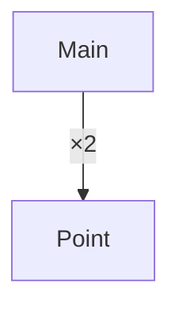

`point.module.dot`:

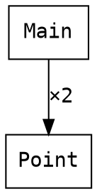

`cycle.module.mmd`（`A`・`B` が循環。`cycle` クラスと赤い辺）:

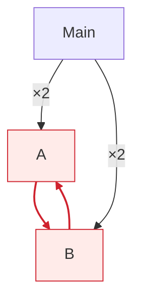

`cycle.module.dot`:

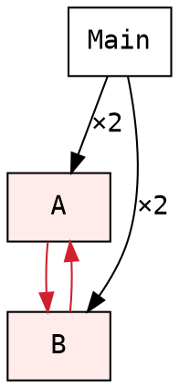

`shapes.views.modules.mmd`:

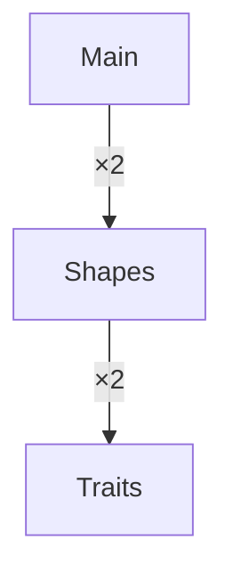

`flow.views.modules.mmd`:

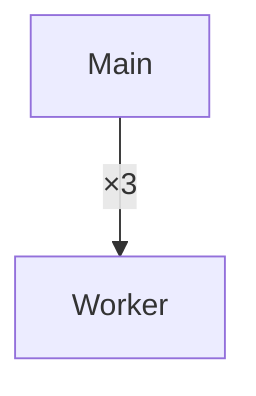

**D.2 `types`**

`shapes.types.mmd`（`Line`→`Point` は 2 本、`Shape` は `Dot`・`Segment`、`Point` は `Eq` を derive、`Sized` の instance）:

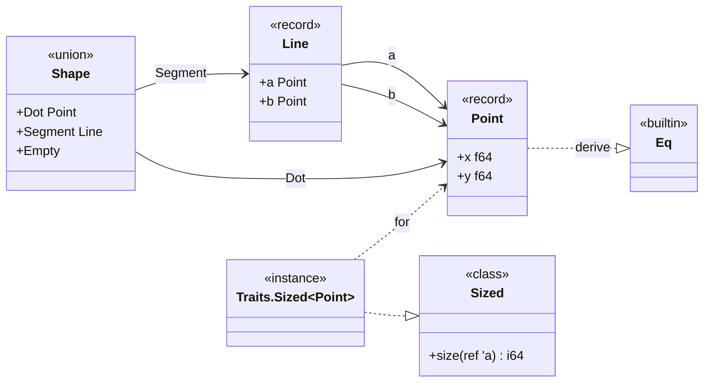

`shapes.types.dot`:

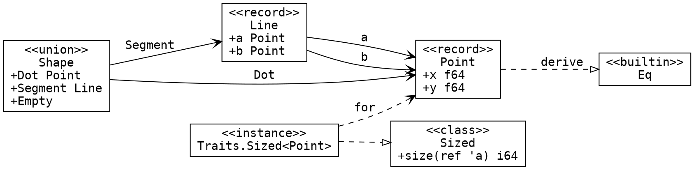

`shapes.types.folded.mmd`（`--max-nodes 5`。6 ノードを 3 グループに）:

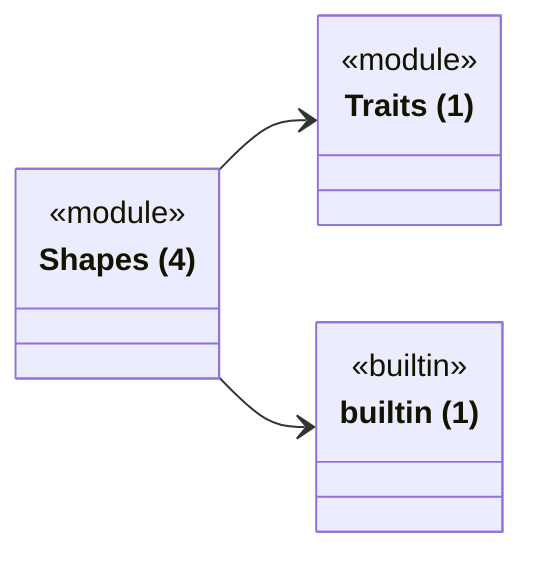

**D.3 `calls`**

`point.calls.mmd`（`Point.hypotenuse`・`--depth 2`。効果の事実が縮退版なのでクラスなし。`sqrt` は外部）:

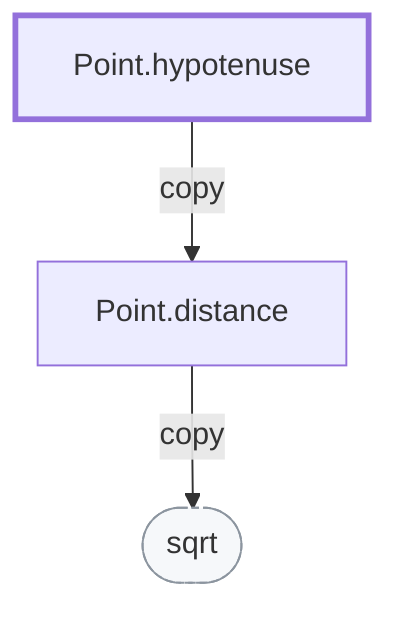

`point.calls.dot`:

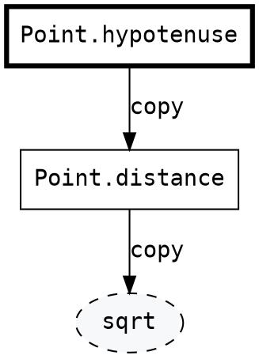

`flow.calls.mmd`（`Main.$entry`・`--depth 2`。`Task.scope` の 2 回の呼び出しは `×2`。`io` と `ext` のクラス）:

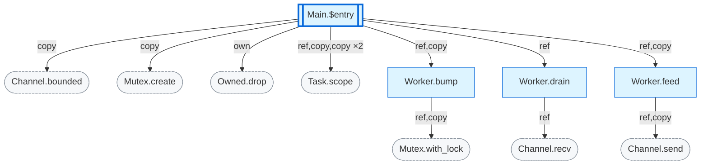

`flow.calls.folded.mmd`（`--max-nodes 5`。起点を残し、モジュール単位に畳む）:

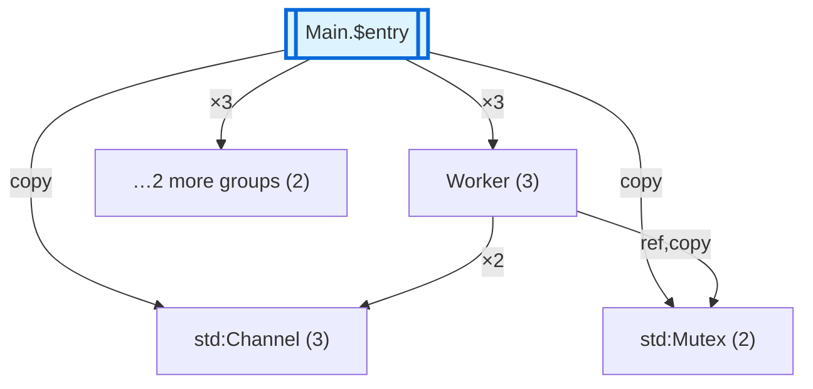

**D.4 `ownership`**（`own` の `Main.demo`。`text` は借用→解放→移動、`label` は借用→解放→drop）

`own.ownership.md`:

````markdown
# Ownership of Main.demo

## text

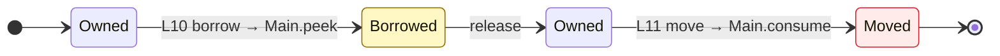

## label

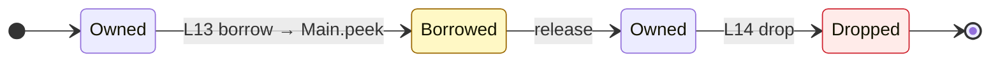

| # | line | var | event | to | diagnostic role |
| --- | --- | --- | --- | --- | --- |
| 1 | 10 | text | borrow | Main.peek | borrowed_here |
| 2 | 11 | text | move | Main.consume | moved_here |
| 3 | 13 | label | borrow | Main.peek | borrowed_here |
| 4 | 14 | label | drop | - | - |
````

**D.5 `concurrency`**

`flow.concurrency.mmd`:

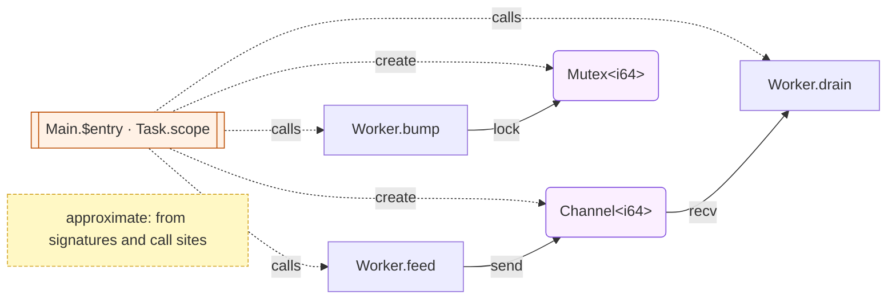

`flow.concurrency.dot`:

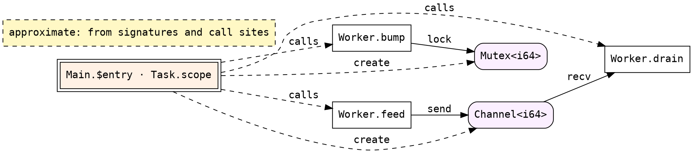

`flow.concurrency.folded.mmd`（`--max-nodes 6`）:

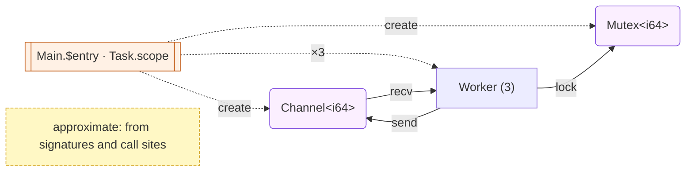

**D.6 `layout`**

`layout.packed.md`（`Acme::Kb::Shapes.Packed`。slot 順に `n`(0)・`a`(8)・`b`(9)、末尾の padding 6）:

```markdown
# Layout of Acme::Kb::Shapes.Packed (native, 64-bit)

| item | value |
| --- | --- |
| kind | record |
| size (bytes) | 16 |
| align (bytes) | 8 |
| reordered | yes |
| drop flag | no |

| slot | field | type | size | align | offset |
| --- | --- | --- | --- | --- | --- |
| 0 | n | i64 | 8 | 8 | 0 |
| 1 | a | i8 | 1 | 1 | 8 |
| 2 | b | i8 | 1 | 1 | 9 |
| - | (tail padding) | - | 6 | - | 10 |

Native only. On wasm32 a pointer is 4 bytes and the `null_pointer` niche does not exist, so these numbers are not valid there for any type that holds a pointer.
```

`layout.shape.md`（`Acme::Kb::Shapes.Shape`。union）:

```markdown
# Layout of Acme::Kb::Shapes.Shape (native, 64-bit)

| item | value |
| --- | --- |
| kind | union |
| size (bytes) | 16 |
| align (bytes) | 8 |
| layout | common |
| tag bytes | 1 |
| niche | none |
| drop flag | no |

| case | payload |
| --- | --- |
| Circle | f64 |
| Empty | - |

Native only. On wasm32 a pointer is 4 bytes and the `null_pointer` niche does not exist, so these numbers are not valid there for any type that holds a pointer.
```

**D.7 `transitions`**（`light` の `Light.Light`。`next` と `reset` の腕から）

構文の抽出（`transitions` の手順 3〜6）の手計算: `next` の `match light with` の腕は `Red -> Green`（`Red`→`Green`）、`Green -> Yellow 3`（`Green`→`Yellow`）、`Yellow n -> if … then Yellow (n - 1) else Red`（`Yellow`→`Yellow`・`Yellow`→`Red`）。`reset` は `Red -> Red`（`Red`→`Red`）、`_ -> Red`（ワイルドカード＝それまでの腕が名指ししていない `Green`・`Yellow`）で `Green`→`Red`・`Yellow`→`Red`。（始点, 終点, 関数）は `(Red,Green,next)`・`(Green,Yellow,next)`・`(Yellow,Yellow,next)`・`(Yellow,Red,next)`・`(Red,Red,reset)`・`(Green,Red,reset)`・`(Yellow,Red,reset)`。`gen.py` はこの 7 つを `transitions_diagram` に渡している。

`light.transitions.mmd`:

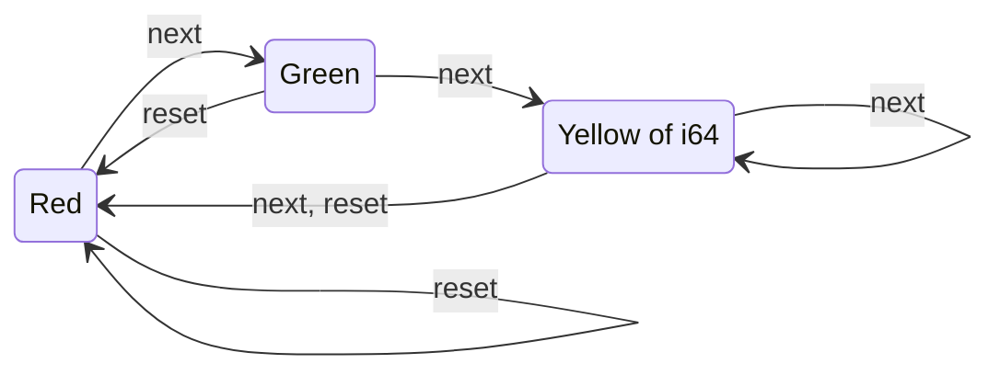

`light.transitions.dot`:

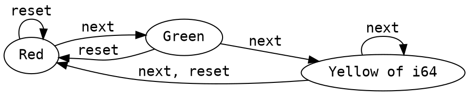

**D.8 負の例**（付録 A.4 の 7 ファイルの中身）:

`end-id.mmd`:

```mermaid
flowchart TD
    n1["a"]
    end["b"]
    n1 --> end
```

`raw-quote.mmd`:

```mermaid
flowchart TD
    n1["say "hi" now"]
    n2["b"]
    n1 --> n2
```

`unquoted-parens.mmd`:

```mermaid
flowchart TD
    n1[f (x) -> y]
    n2["b"]
    n1 --> n2
```

`bad-arrow.mmd`:

```mermaid
stateDiagram-v2
    direction LR
    state "Red" as s1
    state "Green" as s2
    s1 --> s2 : next; then
    s2 -> s1 : reset
```

`raw-angle.mmd`:

```mermaid
flowchart TD
    n1["Array<Point>"]
    n2["b"]
    n1 --> n2
```

`undeclared-node.mmd`:

```mermaid
flowchart TD
    n1["a"]
    n1 --> n2
```

`class-undeclared.mmd`:

```mermaid
classDiagram
    direction LR
    class n1["Point"] {
        <<record>>
        +x f64
    }
    n1 --> n2 : uses
```
