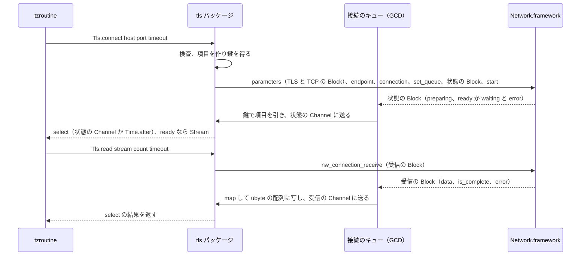

# M14: TLS と HTTP クライアントの公式パッケージ（E09 D13 に沿う。macOS は Network.framework）

| 項目 | 内容 |
| --- | --- |
| ID | M14 |
| 優先度 | P3（HTTPS が要るアプリは今、ハイブリッド構成かシムで URLSession を呼べる。M07 の後は URLSession の宣言を利用者が直接使える。std の外の公式パッケージで、言語とコンパイラを変えない） |
| 規模 | XL（Phase 1〜3。人間が求めない限り Phase 1 だけを実装する） |
| 依存 | [M04](M04-objc-blocks.md), [M09](M09-main-thread-dispatch-and-handles.md), [M20](M20-macos-framework-link-inputs.md), ([W17](W17-link-attribute-dllimport.md)), ([M07](M07-apple-sdk-bindgen-and-package.md))（M09 は Phase 3 の預け先まで要る） |
| 後続 | – |
| 状態 | todo |
| 起票 | 2026-11-26（D-67。利用者の依頼「「どのチケットにもない壁」と「調査中に見つけたコンパイラの不具合（自分で再現済み）」のそれぞれについて @_features/ に開発チケットまたは修正チケットを作成して」から起票。調査で報告した「壁 5（TLS と HTTP が std にもチケットにもない。E09 D13 は公式パッケージにする方針）」に当たる。HEAD `804b7970` で確認） |
| 承認 | [GUIDE D-67](GUIDE.md#d-67-tsuzuri-だけで-macos-のデスクトップアプリを書くm01m22) の分岐 5（公式パッケージの配布の形）と分岐 1（X′）は承認済み（2026-11-26）。W27 の D3・D9 は W27 自身の決定として残る。分岐 5 は決定事項 D4、分岐 1 との関係は D11 に写した（承認済み。D4 のリポジトリの名前とライセンスの表示は要承認のまま）。要承認: 背後の実装の選び方（macOS は Network.framework、ほかの OS は後の Phase）と API の名前。背後の実装は D1、API の名前と形は D2 に写した（どれも要承認）。Phase 3 の背後の実装（Linux は OpenSSL、Windows は SChannel）は D12（要承認）。前提のチケットの承認も要る: M04 の D5（`ObjC.call_block`）と、Block の引数に Block を置く拡張（D10）、M09 の D16（Phase 3 の預け先。鍵で解放する操作を含む。D5） |
| 改善する劣位 | Go（`crypto/tls`・`net/http`）・Rust（`rustls`・`reqwest`）・Swift（Network.framework・URLSession）・C#（`SslStream`・`HttpClient`）比: std の `Net` は平文の TCP と UDP だけで、TLS と HTTP のクライアントがない。HTTPS に要る証明書の検証を、今は Tsuzuri だけで書けない |
| 手本にする既存実装 | `std/Net.tz`（Copy のハンドル `TcpStream { id, … }`、私的な直接の関数 `connect_with`・`read_with`・`write_with` と `IO` を返す公開の関数、`with_connection` の `IO.bind` の組み立て、`error_kind`、host の分類 `numeric_looking`（444 行））、`_tsuzuri/language-reference/built-in-types-and-modules/net.md`（時間制限、ハンドルを閉じる、エラーの読み方、資源上限と安全性、公開 API の表）、E09 の D13、[W27](W27-win32-package-from-winmd.md) の Phase 2 と [M07](M07-apple-sdk-bindgen-and-package.md) の Phase 2（std の外の公式パッケージ）、[M04](M04-objc-blocks.md) の仕様 6 の例（Block から別のスレッドへ値を渡す形）、`select` と `Time.after` の時間制限（`_tsuzuri/language-reference/async-tasks-and-lazy/select.md` の 136 行） |
| 主な影響ファイル | このリポジトリ: `_tsuzuri/language-reference/built-in-types-and-modules/net.md`（7 行の注記）、`docs/language.md`（1484 行の `Net` の段落の注記）、`_tsuzuri/language-reference/languages/why-tsuzuri.md`（139 行の注記）。コンパイラ・std・テストのコードは変えない。パッケージのリポジトリ（このリポジトリの外なので、パスは repo-kb が展開しないよう引用符なしで書く）: tls のリポジトリの Tsuzuri.toml・Tls.tz・tests/tls.mjs・tests/tls/・README（Phase 1）、http のリポジトリの Tsuzuri.toml・Http.tz・tests/・README（Phase 2）、tls の Linux と Windows の背後の実装（Phase 3） |

## 実装者向け早見

- 範囲（Phase 1）: std の外の公式の git パッケージ `tls` の macOS の版。Network.framework の C の API（`nw_connection_create`・`nw_parameters_create_secure_tcp`・`nw_connection_send`・`nw_connection_receive`）を、M04 の Block と、接続ごとの直列の GCD のキュー（`dispatch_queue_create`）で呼ぶ。GCD のスレッドで走るハンドラーの結果は、M09 の Phase 3 の預け先に置いた `Channel` で tzroutine へ渡す。API は std の `Net` に倣う（`Tls.connect`・`Tls.read`・`Tls.write`・`Tls.close`・`Tls.with_connection`、時間制限は `Maybe<i64>` のミリ秒）。証明書の検証の既定はシステムの trust で、信頼を足す形は名前で区別する（`Tls.Trust`）。検証を緩める API は作らない。
- **人間が求めない限り Phase 1 だけを実装する。** Phase 2 は `http` パッケージ（HTTP/1.1 のクライアント。`tls` と `Net` の上に Tsuzuri で書く）、Phase 3 は Linux（OpenSSL）と Windows（SChannel）の背後の実装である。
- 最初に読む: ① 現状 2 の clang の参照（Network.framework の状態とエラーの実測。失敗は `failed` ではなく `waiting` に来る）② 現状 3 の壁（GCD のスレッドの `Anchor` は `WrongThread`、検証の Block は受け取った Block を呼ぶ）③ 仕様の Phase 1 ④ M04 の仕様 2〜5・Phase 2 と M09 の仕様「Phase 3」。
- 最初に書くテスト: パッケージのリポジトリの tests/tls.mjs の `system trust rejects an unknown CA`。テストの中で `/usr/bin/openssl` が作った CA と、その CA が署名した `localhost` の証明書で Node.js の TLS サーバーを立て、`Tls.connect` が `BadCertificate`（領域 `Security` の -9813）を返すことを確かめる。外部のネットワークに依らない。
- 触ってはいけない: std（`Net` を含む。`TLS` という名前のモジュールを足さない）、コンパイラ、利用者のキーチェーンと trust の設定（テストは信頼を OS に足さず、`Tls.Trust` で渡す）。
- 完了の見分け方（Phase 1）: テストの CA の DER を `certs/ca.der` に置き、その CA が署名した `localhost` の証明書を持つローカルの TLS サーバー（`ping` に `pong:ping` を返す）を port 8443 で立てて次の `Main.tz` を実行すると、`pong:ping` を書いて終了コード 0 で終わる。今のコンパイラでは `Tls` がないので、`check` が `error[E1011]: using 'Tls' names no namespace with modules` になる（計画の API。HEAD の開発版で確かめた。仕様の型のとおりに書いた仮の `Tls.tz`（`namespace Tls`）を隣に置くと、この `Main.tz` は `check` を通る）。

```tsuzuri
namespace App

using Tls

def text_of :: own [ubyte] -> string
fn text_of bytes =
    match Utf8String.from_bytes bytes with
    | Maybe.Some text -> String.from_utf8 (ref text)
    | Maybe.None -> "?"

def main :: unit -> i32 = \() ->
    let! ca = File.read_bytes "certs/ca.der"
    match ca with
    | Result.Error _ -> 2
    | Result.Ok der ->
        let! outcome = Tls.with_connection_trusting (Tls.Only [der]) "localhost" 8443 (Maybe.Some 5000) (\stream -> IO {
            let! sent = Tls.write stream (Utf8String.to_bytes u8"ping") (Maybe.Some 5000)
            let! answer = Tls.read stream 64 (Maybe.Some 5000)
            return match (sent, answer) with
                | (Result.Ok _, Result.Ok bytes) -> text_of bytes
                | _ -> "failed"
        })
        match outcome with
        | Result.Ok line ->
            do! IO.writeln line
            0
        | Result.Error error ->
            do! IO.writeln (Tls.message (ref error))
            1
```

## 目的

HTTPS の API を呼ぶ、更新を確かめる、署名したデータを取りに行くといった処理は、デスクトップのアプリでも普通に要る。std の `Net` は TCP と UDP までで、通信は平文である（net.md:7）。E09 の D13 は、TLS と HTTP を std に入れず公式パッケージにすると決めた。その公式パッケージは、まだ計画もない。

TLS は自分で実装すべきものではない。証明書の検証、失効、暗号の選択、プロトコルの版は、OS の実装に任せるのが安全で、OS の更新でも直る。macOS では Network.framework がその実装で、Secure Transport は非推奨になった（現状 2）。

Network.framework の C の API は、ほとんどの結果を Block のハンドラーで、利用者が指定した GCD のキューのスレッドに返す。Tsuzuri から呼ぶには、Block（M04）、ランタイムに参加していないスレッドから tzroutine へ値を渡す仕組み（M09 の Phase 3）、framework のリンク（M20）が要る。このチケットは、それらがそろった上で、`Net` と同じ形の型付きの TLS のクライアントを公式パッケージとして作る。Phase 2 で、その上に HTTP/1.1 のクライアントを Tsuzuri で書く。

## 着手条件と停止条件

### 着手条件

- **人間が求めない限り Phase 1 だけを実装する**（GUIDE §0）。
- **承認が記録されるまで、該当する Phase に着手しない**（GUIDE §0 の 1）。D1（背後の実装）が承認されるまでチケット全体に着手しない（D4 の分岐 5 と D11 の分岐 1 は承認済み（2026-11-26））。D4 のリポジトリの名前とライセンスの表示が承認されるまで、パッケージのリポジトリを作らない。D2（API の名前と形）が承認されるまで手順 3 に着手しない。D10（信頼を足す形の前提）が承認されるまで手順 5 に着手しない。Phase 2 は Phase 2 の API の名前の承認、Phase 3 は D12 の承認の後。
- Phase 1:
  - M04 の Phase 1（`ObjC.Block<F>`・`ObjC.block`。ハンドラーの引数の `Maybe<H>`・`bool`・`i32`）と Phase 2（`ObjC.call_block`。M04 の D5 の承認）が done。加えて、Block の `F` の引数に `ref ObjC.Block<G>` を置けること（検証の Block が受け取る完了の Block。M04 の仕様 5 の表にない。D10）。
  - M09 の Phase 3（どのスレッドからでも引ける預け先。M09 の D16 の承認）が done で、項目を作った関数が戻った後も生かし、鍵で解放できる（D5）。
  - M20 の Phase 2（`@link(framework = "Network")` など）が done。git のパッケージは `[native]` を持てない（packages.md:121）ので、framework のリンクはこれでしか運べない。M20 の Phase 2 は W17 の出荷の後なので、W17 も done である。
  - 確認: `grep -nE "^\| (M04|M09|M20|W17) " _features/README.md` の状態の列と、M04・M09 の Phase の記録。
- M07 は弱い依存。宣言はパッケージの中に C のモードで手で書く（D13）。M07 の生成器で Network.framework の宣言を作れるなら、手書きと比べる参照に使う。
- 手元の macOS（arm64）、Node.js（20 以上。テストの TLS サーバー）、`/usr/bin/openssl`（LibreSSL 3.3.6。`-addext` が使える。現状 2 の手順の `-pkeyopt ec_param_enc:named_curve` と `-sha256` を省くと、作った証明書で握手が失敗する）。

### 停止条件

- **S1** 承認された M09 の Phase 3 の API が、項目を作った関数の外で生かして鍵で解放する操作を持たない。Copy のハンドル（D5）が作れないので、止めて報告する。代わりの形（直接の関数と `Drop` の接続）は D2 の承認をやり直す。
- **S2** M04 の Phase 2 の `ObjC.call_block` が承認されない、または Block の引数の Block を受けられない。信頼を足す形（`Tls.Trust` の `SystemAnd`・`Only`）が作れず、正の E2E（データが流れること）をローカルで確かめられない。PSK や検証を外す私的な経路で代用せず、止めて報告する。
- **S3** tzroutine のスレッドから `nw_connection_send`・`nw_connection_receive` を呼んでよいことを、Apple の文書で確かめられない（`nw_connection` は Sendable の注釈を持たない。現状 2）。そのときは接続の操作をすべて `dispatch_async_f` で接続のキューへ送る形にし、それも作れなければ止める。
- **S4** M09 の Phase 3 の経路で、GCD のスレッドから `Channel` に送った値が tzroutine に届かない。止めて M09 に報告する。
- **S5** コンパイラの変更が要る。このチケットの範囲を出るので止める。
- **S6** パッケージのリポジトリの CI の macOS のランナーで、ローカルの TLS サーバーの E2E が動かない。手元だけで通ったことにせず報告する。
- **S7** GUIDE-LITE §9 の共通の条件。

## 現状（HEAD `804b7970` で確認）

### 1. TLS と HTTP がない

- `_tsuzuri/language-reference/built-in-types-and-modules/net.md:7`: 「通信は暗号化しません。受け取ったデータも送り元のアドレスも、認証されていません。TLS は std に入れず、パッケージとして提供する方針です（E09 の D13）。」。`docs/language.md:1484` も「TLS と HTTP は std に含めません（公式パッケージの対象）」と書く。
- `_features/_completed/E09-network.md:165`: 「D13 | std は TCP・UDP・アドレス・resolve まで。HTTP／TLS は公式パッケージ（E10）。通信は平文」。
- std とコンパイラに TLS の実装はない。次の 2 つは何も出力しない。

```sh
git grep -n -i -E 'tls|ssl|https' 804b7970 -- std
git grep -l -i -E 'SSL_|SecTrust|nw_connection' 804b7970 -- src
```

- 未完了のチケットにも TLS と HTTP を扱うものはない。次のコマンドの当たりのうち、未完了のチケットは W05・W35 の「TLS callback」（スレッドローカルの記憶域）だけである。ほかは GUIDE（Async のスレッドごとの状態、「TLS・HTTP はない（E10）」）、README の完了の表、`_completed/`（E09・E10 などの記録）である（pathspec の `*` は `/` も越える）。git の `-E` は `\b` を解さず、`\b` を含む `-E` の検索は何も当てない（E09 の「TLS」にも当たらない）ので、`-P` を使う。

```sh
git grep -n -P '\bTLS\b|\bHTTPS?\b' 804b7970 -- '_features/*.md'
```

- `Net` の公開 API は TCP と UDP とアドレスと名前解決だけ（net.md の 407〜431 行の表）。

### 2. Network.framework の形（clang の参照。Tsuzuri のコードではない）

macOS 27.2.1 arm64、SDK 27.2、Apple clang 21 で確かめた。テストの CA と 2 つの証明書を作る。

```sh
mkdir -p /tmp/tz-m14/certs && cd /tmp/tz-m14/certs
/usr/bin/openssl req -x509 -newkey ec -pkeyopt ec_paramgen_curve:prime256v1 -pkeyopt ec_param_enc:named_curve \
    -nodes -days 1 -subj /CN=tsuzuri-test-ca -keyout ca.key -out ca.pem \
    -addext basicConstraints=critical,CA:TRUE -addext keyUsage=critical,keyCertSign
/usr/bin/openssl req -newkey ec -pkeyopt ec_paramgen_curve:prime256v1 -pkeyopt ec_param_enc:named_curve \
    -nodes -subj /CN=localhost -keyout server.key -out server.csr
printf 'subjectAltName=DNS:localhost,IP:127.0.0.1\nextendedKeyUsage=serverAuth\nbasicConstraints=CA:FALSE\n' > ext.cnf
/usr/bin/openssl x509 -req -in server.csr -CA ca.pem -CAkey ca.key -CAcreateserial -days 1 -sha256 -out server.pem -extfile ext.cnf
/usr/bin/openssl x509 -in ca.pem -outform DER -out ca.der
/usr/bin/openssl req -x509 -newkey ec -pkeyopt ec_paramgen_curve:prime256v1 -pkeyopt ec_param_enc:named_curve \
    -nodes -days 1 -subj /CN=localhost -keyout self.key -out self.pem -addext subjectAltName=DNS:localhost,IP:127.0.0.1
```

`-pkeyopt ec_param_enc:named_curve` と `-sha256` は LibreSSL 3.3.6 の既定を直すために要る。LibreSSL は EC の鍵を明示の曲線の母数で書く（`openssl ec -text` が `Field Type: prime-field`）ので、2 つを省くと、下のどの接続も `state=1 domain=3 code=-9859`（`errSSLDecodeError`、`SecBase.h:880`）になり、サーバーは `ERR_SSL_TLSV1_ALERT_DECODE_ERROR` を出した。`named_curve` だけを足すと、LibreSSL の `x509 -req` が葉を `ecdsa-with-SHA1` で署名するので、CA を anchor に足しても `verify block: ok=0` と -9808 になった。Homebrew の OpenSSL 3.6.5 は既定で名前付きの曲線と SHA-256 を使い、この手順でも同じ結果になる（どちらでも確かめた）。

ローカルの TLS サーバー（`/tmp/tz-m14/server.mjs`。1 つ目の port は CA が署名した証明書、2 つ目は自己署名の証明書）:

```js
// A local TLS server for the probe: CA-signed leaf on one port, self-signed on another.
import tls from 'node:tls';
import fs from 'node:fs';
const make = (key, cert) => new Promise(resolve => {
  const server = tls.createServer({ key: fs.readFileSync(key), cert: fs.readFileSync(cert) }, socket => {
    socket.on('data', d => socket.end('pong:' + d));
    socket.on('error', () => {});
  });
  server.on('tlsClientError', e => console.error('server tlsClientError:', e.code || e.message));
  server.listen(0, '127.0.0.1', () => resolve(server));
});
const a = await make('certs/server.key', 'certs/server.pem');
const b = await make('certs/self.key', 'certs/self.pem');
console.log(`${a.address().port} ${b.address().port}`);
setTimeout(() => process.exit(0), 20000);
```

C のクライアント（`/tmp/tz-m14/probe.c`。mode 0 はシステムの trust だけ、mode 1 は検証の Block で `certs/ca.der` を anchor に足して `complete` を呼ぶ）:

```c
// Reference for M14: Network.framework TLS from C with blocks. Mode 0: system trust only.
// Mode 1: a verify block that adds the CA in certs/ca.der as an anchor and calls complete().
#include <Network/Network.h>
#include <Security/Security.h>
#include <dispatch/dispatch.h>
#include <stdio.h>
#include <pthread.h>
#include <stdlib.h>
#include <string.h>

static CFDataRef read_file(const char *path) {
    FILE *f = fopen(path, "rb"); unsigned char buf[4096]; size_t n = fread(buf, 1, sizeof buf, f); fclose(f);
    return CFDataCreate(NULL, buf, (CFIndex)n);
}

int main(int argc, char **argv) {
    const char *port = argv[1]; int mode = atoi(argv[2]);
    dispatch_queue_t q = dispatch_queue_create("m14.probe", DISPATCH_QUEUE_SERIAL);
    dispatch_semaphore_t done = dispatch_semaphore_create(0);
    SecCertificateRef ca = SecCertificateCreateWithData(NULL, read_file("certs/ca.der"));
    nw_parameters_configure_protocol_block_t tls_conf = ^(nw_protocol_options_t options) {
        if (mode != 1) return;
        sec_protocol_options_t sec = nw_tls_copy_sec_protocol_options(options);
        sec_protocol_options_set_verify_block(sec, ^(sec_protocol_metadata_t m, sec_trust_t t, sec_protocol_verify_complete_t complete) {
            SecTrustRef trust = sec_trust_copy_ref(t);
            const void *values[1] = { ca };
            CFArrayRef anchors = CFArrayCreate(NULL, values, 1, &kCFTypeArrayCallBacks);
            SecTrustSetAnchorCertificates(trust, anchors);
            SecTrustSetAnchorCertificatesOnly(trust, false);
            CFErrorRef err = NULL;
            bool ok = SecTrustEvaluateWithError(trust, &err);
            printf("verify block: ok=%d main=%d\n", ok, pthread_main_np());
            if (err) CFRelease(err);
            CFRelease(anchors); CFRelease(trust);
            complete(ok);
        }, q);
        nw_release(sec);
    };
    nw_parameters_t params = nw_parameters_create_secure_tcp(tls_conf, NW_PARAMETERS_DEFAULT_CONFIGURATION);
    nw_endpoint_t ep = nw_endpoint_create_host("localhost", port);
    nw_connection_t c = nw_connection_create(ep, params);
    nw_connection_set_queue(c, q);
    nw_connection_set_state_changed_handler(c, ^(nw_connection_state_t state, nw_error_t error) {
        int dom = error ? (int)nw_error_get_error_domain(error) : -1;
        int code = error ? nw_error_get_error_code(error) : 0;
        printf("state=%d domain=%d code=%d\n", (int)state, dom, code);
        if (state == nw_connection_state_ready) {
            dispatch_data_t data = dispatch_data_create("ping", 4, q, DISPATCH_DATA_DESTRUCTOR_DEFAULT);
            nw_connection_send(c, data, NW_CONNECTION_DEFAULT_MESSAGE_CONTEXT, false, ^(nw_error_t e) { printf("sent err=%d\n", e != NULL); });
            nw_connection_receive(c, 1, 64, ^(dispatch_data_t content, nw_content_context_t ctx, bool complete, nw_error_t e) {
                const void *p = NULL; size_t n = 0;
                dispatch_data_t map = content ? dispatch_data_create_map(content, &p, &n) : NULL;
                printf("received %.*s complete=%d err=%d\n", (int)n, (const char *)p, complete, e != NULL);
                nw_connection_cancel(c);
            });
        } else if (state == nw_connection_state_failed || state == nw_connection_state_waiting) {
            nw_connection_cancel(c);
        } else if (state == nw_connection_state_cancelled) {
            dispatch_semaphore_signal(done);
        }
    });
    nw_connection_start(c);
    long r = dispatch_semaphore_wait(done, dispatch_time(DISPATCH_TIME_NOW, 10 * NSEC_PER_SEC));
    printf("finished timeout=%ld\n", r);
    return 0;
}
```

```sh
cd /tmp/tz-m14
clang -fblocks -o probe probe.c -framework Network -framework Security -framework CoreFoundation
node server.mjs > ports.txt 2> server.err &
sleep 1; read A B < ports.txt
perl -e 'alarm 15; exec @ARGV' ./probe $A 0   # CA-signed, system trust only
perl -e 'alarm 15; exec @ARGV' ./probe $A 1   # CA-signed, CA added as an anchor
perl -e 'alarm 15; exec @ARGV' ./probe $B 0   # self-signed, system trust only
perl -e 'alarm 15; exec @ARGV' ./probe $B 1   # self-signed, CA anchor
perl -e 'alarm 15; exec @ARGV' ./probe 1 0    # closed port
```

実際の出力（状態は `nw_connection_state_t`: 1 は waiting、2 は preparing、3 は ready、5 は cancelled。領域は `nw_error_domain_t`: 1 は posix、2 は dns、3 は tls）:

```text
--- CA-signed, system trust only (mode 0)
state=2 domain=-1 code=0
state=1 domain=3 code=-9813
state=5 domain=3 code=-9813
finished timeout=0
--- CA-signed, CA added as anchor (mode 1)
state=2 domain=-1 code=0
verify block: ok=1 main=0
state=3 domain=-1 code=0
sent err=0
received pong:ping complete=0 err=0
state=5 domain=-1 code=0
finished timeout=0
--- self-signed, system trust only (mode 0)
state=2 domain=-1 code=0
state=1 domain=3 code=-9808
state=5 domain=3 code=-9808
finished timeout=0
--- self-signed, CA anchor (mode 1)
state=2 domain=-1 code=0
verify block: ok=0 main=0
state=1 domain=3 code=-9808
state=5 domain=3 code=-9808
finished timeout=0
--- closed port
state=2 domain=-1 code=0
state=1 domain=1 code=61
state=5 domain=1 code=61
finished timeout=0
```

サーバーの標準エラーは `ERR_SSL_TLSV1_ALERT_UNKNOWN_CA`・`ERR_SSL_SSL/TLS_ALERT_BAD_CERTIFICATE`・`ERR_SSL_SSL/TLS_ALERT_CERTIFICATE_UNKNOWN` だった。ホストの名前を `no-such-host.invalid` に変えた版は `state=1 domain=2 code=-65554`（`kDNSServiceErr_NoSuchRecord`）だった（名前解決は OS のリゾルバーに依るので、CI の検査には入れない）。

ここから分かること:

- **失敗は `failed` ではなく `waiting` に来る**。信頼できない証明書、拒否された接続、見つからない名前のどれも、状態 1（waiting）とエラーで知らされた。waiting の接続はネットワークの変化で再試行し続けるので、クライアントが取り消さなければ終わらない。
- エラーの符号は `errSSLNoRootCert`（-9813。`Security.framework/Headers/SecBase.h:820`）、`errSSLBadCert`（-9808。815 行）、`ECONNREFUSED`（61）。`errSSLXCertChainInvalid`（-9807。814 行）、`errSSLCertExpired`（-9814。821 行）、`errSSLHostNameMismatch`（-9843。856 行）も同じ表にある（後の 3 つは実測していない。名前の不一致は、検証の Block の経路では -9808、システムの trust だけでは先に -9813 になり、-9843 は出なかった。下の項目）。
- 検証の Block はメインスレッドでない（`main=0`。指定した直列のキューのスレッド）。
- anchor を足すと（`SecTrustSetAnchorCertificatesOnly(trust, false)`）、テストの CA が署名した証明書が通り、自己署名の証明書は通らない。anchor だけにする形（`true`）でも同じだった（CA が署名した証明書は `pong:ping`、自己署名は -9808）。
- 検証の Block が `complete(false)` を呼ぶと、理由によらず符号は -9808 になる。同じ CA が署名した `other.test` の証明書（名前が合わない。上の手順の `server` の 2 行を `-subj /CN=other.test`・`-keyout self.key`・`-out other.csr` と `subjectAltName=DNS:other.test` の拡張・`-out self.pem` で作り直し、2 つ目の port に置いた）は、検証の Block（`false`・`true` のどちら）でも `verify block: ok=0` と -9808 で、-9843 にはならなかった。システムの trust だけでは、名前を見る前に -9813 になった。`SecTrustEvaluateWithError` は Network.framework が設定した名前の検証の方針のまま名前を拒んだ。
- 上の C の参照の 3 か所を変えても、同じ出力になった: (a) TCP の設定の `NW_PARAMETERS_DEFAULT_CONFIGURATION` を何もしない Block `^(nw_protocol_options_t o) { (void)o; }` に変える (b) 送信の `NW_CONNECTION_DEFAULT_MESSAGE_CONTEXT` を `nw_content_context_create("m14")` に変える (c) anchor の配列を `CFArrayCreate(…, &kCFTypeArrayCallBacks)` から `CFArrayCreateMutable(NULL, 1, NULL)` と `CFArrayAppendValue` に変える。どれもデータシンボルと C のポインターの配列を使わない形である（設計の「宣言」）。

ヘッダーの事実（SDK 27.2）:

- `nw_parameters_create_secure_tcp(configure_tls, configure_tcp)` は 2 つの Block を取る（`Network.framework/Headers/parameters.h:110-111`、Block の型は 69 行）。既定の設定の `NW_PARAMETERS_DEFAULT_CONFIGURATION` はデータシンボル `_nw_parameters_configure_protocol_default_configuration` のマクロ（71〜76 行）。何もしない Block を渡しても同じ結果になった（上の (a)）。
- 受信の完了は `void (^)(dispatch_data_t _Nullable, nw_content_context_t _Nullable, bool, nw_error_t _Nullable)`（`connection.h:373-376`）で、`nw_connection_receive(connection, uint32_t minimum, uint32_t maximum, completion)`（407〜410 行）。送信の文脈 `NW_CONNECTION_DEFAULT_MESSAGE_CONTEXT` もデータシンボル（483 行）。関数 `nw_content_context_create(const char *)`（`content_context.h:68`）と `nw_content_context_set_is_final`（104 行）で、データシンボルなしに文脈を作れる。
- `nw_connection_cancel` は穏やかに閉じ、最後の状態の通知として cancelled を非同期に届ける（`connection.h:270-290` の注釈）。
- 検証の Block は `void (^)(sec_protocol_metadata_t, sec_trust_t, sec_protocol_verify_complete_t)` で、3 つ目の `complete` は `void (^)(bool)` の Block である（`Security.framework/Headers/SecProtocolOptions.h:691`・`710`）。anchor を指定する関数は `sec_protocol_options` にない（検証の Block が唯一の口）。検証を外す `sec_protocol_options_set_peer_authentication_required`（575 行）はある。
- C のモードでは `nw_retain`・`nw_release` は関数（`nw_object.h:155`・`158`）。`nw_connection` は `NW_OBJECT_DECL`（`connection.h:40`）で、`nw_endpoint` の `NW_SENDABLE_OBJECT_DECL`（`endpoint.h:38`）と違い Sendable の注釈を持たない。
- `dispatch_data_create` の `DISPATCH_DATA_DESTRUCTOR_DEFAULT` は NULL で、バッファを複写する（`usr/include/dispatch/data.h:63`・`122`）。`dispatch_data_create_map`（166 行）は連続した領域のアドレスと長さを返す。
- Secure Transport は非推奨: `__SECURETRANSPORT_API_DEPRECATED` は「No longer supported. Use Network.framework.」（`Security.framework/Headers/SecureTransport.h:76-77`）で、`SSLCreateContext` は `macos(10.8, 10.15)`（316〜317 行）。

### 3. Tsuzuri から呼ぶときの壁

1. **GCD のスレッドから `Anchor` は引けない**。次のソースは、Network.framework のハンドラーと同じく GCD のワーカーで走るコールバックから、main の状態を `Anchor` で引く。

```tsuzuri
// M14: a GCD worker reaches the state of main through Anchor, as a Network.framework handler would.
@trusted
extern "dispatch_get_global_queue" def dispatch_get_global_queue :: i64 -> i64u -> i64

@trusted
extern "dispatch_async_f" def dispatch_async_f :: i64 -> i64 -> (i64 -> unit) -> unit

@trusted
extern "pthread_main_np" def pthread_main_np :: unit -> i32

record Shared { total: i64 }

def on_worker :: i64 -> unit = \token ->
    let text = match token |> Anchor.read (\(s: ref Shared) -> s.total) with
        | Result.Ok total -> $"Ok {total}"
        | Result.Error Anchor.WrongThread -> "WrongThread"
        | Result.Error _ -> "other error"
    do! IO.writeln $"GCD worker (main={pthread_main_np ()}): Anchor.read -> {text}"

def main :: unit -> i32 = \() ->
    let state = Anchor.create (Shared { total: 42 })
    let token = Anchor.token (ref state)
    let mine = match token |> Anchor.read (\(s: ref Shared) -> s.total) with
        | Result.Ok total -> $"Ok {total}"
        | Result.Error _ -> "error"
    do! IO.writeln $"main (main={pthread_main_np ()}): Anchor.read -> {mine}"
    dispatch_async_f (dispatch_get_global_queue 0 0i64u) token on_worker
    let! _ = Time.sleep_ms 500
    0
```

```sh
tsuzuri check Main.tz && tsuzuri build Main.tz -o app && perl -e 'alarm 15; exec @ARGV' ./app
```

```text
main (main=1): Anchor.read -> Ok 42
GCD worker (main=0): Anchor.read -> WrongThread
```

`Anchor` は作ったスレッド以外を `WrongThread` にする（anchor.md:84）。別のスレッドから引ける預け先は W23 の対象外（`_features/_completed/W23-anchor-state.md:240`）で、M09 の Phase 3 の案（`Anchor.create_shared`・`shared_token`・`read_shared`。M09 の D16）がそれを足す。
2. **Block は 1 つの鍵しか捕捉しない**（M04 の仕様 2 の `ObjC.block f token`）。ハンドラーが接続の状態と結果の行き先に届くには、鍵からどのスレッドでも引ける預け先が要る（上の 1）。
3. **検証の Block は受け取った Block を呼ぶ**（現状 2）。M04 の仕様 5 の `F` の表に Block の型の引数はなく、受け取った Block を呼ぶ `ObjC.call_block` は M04 の Phase 2 で、M04 の D5（D-59 の資源のハンドルの例外）の承認を待つ。今は手作りの Block（M04 の現状）でしか書けない。
4. **framework のリンク**: HEAD の W17:247 は macOS の framework を対象外にしている。git のパッケージは `[native]` を書けない（`_tsuzuri/language-reference/organizing-tsuzuri/packages.md:121`）。公式パッケージから Network・Security・CoreFoundation をリンクするには M20 の Phase 2 の `@link(framework = "...")` が要る。
5. **`IO` と `Drop`**: `IO` のアクションの中へ `Drop` の値を持ち出すと `E1005`（`_tsuzuri/language-reference/built-in-types-and-modules/io.md:329`）。そのため `Net` のハンドルは Copy で `Drop` を持たない（net.md:186）。`IO.run` は私的（`std/IO.tc:35-36`）なので、パッケージは `IO.bind`・`IO.map` か `IO { … }` の builder で組み立てる（`Net.with_connection` は `connect`・本体・`close` を `IO.bind` でつなぐ。`std/Net.tz:716-726`）。
6. **遅いハンドラーと `main` の終わり**: 実行ファイルでは、`main` が戻った後に呼ばれた Block の包みはトラップする（M04 の仕様 4 の 1。W12 の `@tz.main.done`）。`nw_connection_cancel` の最後の cancelled の通知は非同期に届く（現状 2）ので、待たずに `main` が戻ると遅れた通知がトラップしうる。

### 4. `Net` の形と D-59

- `Net` の公開 API（net.md:407-431）: `connect :: Address -> Maybe<i64> -> IO<Result<TcpStream, Os.Error>>`、`read :: TcpStream -> i64 -> Maybe<i64> -> IO<Result<[ubyte], Os.Error>>`、`write :: TcpStream -> [ubyte] -> Maybe<i64> -> IO<Result<unit, Os.Error>>`、`shutdown`・`close`・`with_connection`。時間制限は呼び出し全体の期限で、`Some n` は 1〜2,147,483,647（net.md の「時間制限」）。`read` の最大長は 16 MiB（「資源上限と安全性」）。
- `Net` は D-59 の資源のハンドルの例外で、ハンドルを先に置く（`tests/std_argument_order.rs:123` の `("Net", Exempt(HANDLE))`、理由の文は 53〜54 行。AGENTS.md の resource handles の一覧）。この検査は `std/` と組み込みだけを見る。
- `Net.resolve` は、アドレスに読める host を OS に渡さず、ASCII 以外を含む host を拒む（net.md の「資源上限と安全性」、`std/Net.tz:444` の `numeric_looking`）。解析の食い違いを突く入力を防ぐためである。

## 変えてはいけない意味

- このチケットは、どのプログラムのコンパイラの出力も変えない。コンパイラと std に触れない。
- std の `Net` の API と意味を変えない。`Tls` は std の予約名にしない。
- 証明書の検証を、利用者が名前で選ばない限り広げない。システムの trust より狭める形（`Only`）と、システムの trust に足す形（`SystemAnd`）は、どちらも名前で書く。検証を外す形は作らない（D3）。
- 利用者のキーチェーンと trust の設定を変えない（テストも含む）。

## 仕様

### Phase の範囲

| Phase | 内容 | 規模 | 前提 |
| --- | --- | --- | --- |
| 1 | `tls` パッケージの macOS の版: 接続・読み・書き・送信の終わり・閉じる・`with_connection`、`Tls.Trust`、エラーの表、時間制限、host と port の検査、ローカルの TLS サーバーの E2E、README | L | M04 の Phase 1・2（と D10 の拡張）、M09 の Phase 3、M20 の Phase 2。D1・D2・D10 の承認と、D4 のリポジトリの名前とライセンスの表示の承認（D4 の分岐 5 と D11 は承認済み） |
| 2 | `http` パッケージ: HTTP/1.1 のクライアント（`https` は `tls`、`http` は `Net`）。Tsuzuri で書く | L | Phase 1。Phase 2 の名前の承認 |
| 3 | `tls` の Linux（OpenSSL）と Windows（SChannel）の背後の実装。API は Phase 1 のまま | L | Phase 1、W17、D12 の承認 |

### Phase 1: パッケージと名前

- このリポジトリと同じ所有者の別の git リポジトリ（名前は D4）。ルートの `Tsuzuri.toml` は `name = "tls"`・`namespace = "Tls"`。公開の API は 1 つのモジュール `Tls.tz`（完全名 `Tls::Tls`）に置く。利用者は `using Tls` の後に `Tls.connect` と書く。
- Network.framework・Security・CoreFoundation・libdispatch の宣言は、同じ `Tls.tz` の中の `private extern def` にする（パッケージの中だけで見える可視性はないので、別のモジュールにすると利用者に見える）。ハンドルの型も `private extern type copy NwConnection` のように private にし、公開の関数の型には出さない（HEAD の開発版で、別のモジュールから `Lib.NwConnection` を書くと `E1022`（`private type 'Lib.NwConnection' is only visible inside module 'Lib'`）になることを確かめた。access-control.md の 10 行の一覧は `extern type` を挙げていないが、コンパイラは受理する）。
- 利用: `tls = { git = "https://…", rev = "<40 桁>", capabilities = ["ffi"] }`（権限のポリシーを有効にするとき）。`[native]` は要らない（M20 の Phase 2 の `@link(framework = …)`）。

### Phase 1: API

| 関数 | 型 | 意味 |
| --- | --- | --- |
| `Tls.connect` | `string -> i64 -> Maybe<i64> -> IO<Result<Stream, Tls.Error>>` | host・port・時間制限。システムの trust で検証する |
| `Tls.connect_trusting` | `Tls.Trust -> string -> i64 -> Maybe<i64> -> IO<Result<Stream, Tls.Error>>` | 信頼の選び方を指定して接続する |
| `Tls.read` | `Stream -> i64 -> Maybe<i64> -> IO<Result<[ubyte], Tls.Error>>` | 最大 `count` バイト（1〜16,777,216）を受け取る。空の配列は相手が送信を終えたこと |
| `Tls.write` | `Stream -> [ubyte] -> Maybe<i64> -> IO<Result<unit, Tls.Error>>` | 全バイトを送り、送信の完了を待つ |
| `Tls.shutdown_write` | `Stream -> IO<Result<unit, Tls.Error>>` | 以後は送らないと相手に伝える（最後の文脈を `is_complete` で送る） |
| `Tls.close` | `Stream -> IO<Result<unit, Tls.Error>>` | `nw_connection_cancel` を呼び、cancelled の通知を待ってから項目を解放する |
| `Tls.with_connection` | `Capture<'a> => string -> i64 -> Maybe<i64> -> (Stream -> IO<'a>) -> IO<Result<'a, Tls.Error>>` | 接続して本体を実行し、結果の成否にかかわらず閉じる（`Net.with_connection` と同じ組み立て） |
| `Tls.with_connection_trusting` | `Capture<'a> => Tls.Trust -> string -> i64 -> Maybe<i64> -> (Stream -> IO<'a>) -> IO<Result<'a, Tls.Error>>` | 同じ。信頼の選び方を指定する |
| `Tls.message` | `ref Tls.Error -> string` | 英語の短い説明（領域と符号を含む） |

- `Stream` は `record Stream { id: i64 }`（Copy。`Drop` を持たない）。`id` は M09 の Phase 3 の預け先の鍵で、接続の状態はすべて預け先の項目にある（D5）。閉じた後の `Stream` を使うと `Closed`（ハンドルを先に解放したネイティブの物体に触れない）。
- 引数の順序: `Tls` は `Net` と同じ資源のハンドルのモジュールとして、ハンドルを先に置く（D2）。パッケージは `tests/std_argument_order.rs` の検査の外なので、README の「引数の順序」の節に分類と理由を書く。
- `Tls.connect` の `string` は host で、TLS の SNI と証明書の名前の検証にもそのまま使われる（Network.framework がエンドポイントの名前を使う。現状 2 の mode 1 で `localhost` の SAN が検証された）。

### Phase 1: 信頼（`Tls.Trust`）

```tsuzuri
union Trust = System | SystemAnd of [[ubyte]] | Only of [[ubyte]]
```

- `System`（`Tls.connect` の既定）: 検証の Block を設定しない。Network.framework の既定の検証（システムの trust と、エンドポイントの名前）だけを使う。
- `SystemAnd ders`: DER の証明書を anchor に足し、システムの trust も使う（`SecTrustSetAnchorCertificatesOnly(trust, false)`）。社内の CA など。
- `Only ders`: DER の証明書だけを anchor にする（`SecTrustSetAnchorCertificatesOnly(trust, true)`）。ピン留めに近い。
- 下げ方: 検証の Block（`sec_protocol_options_set_verify_block`）の中で、`sec_trust_copy_ref` の `SecTrustRef` に anchor を設定し、`SecTrustEvaluateWithError` の結果で `complete` を呼ぶ（現状 2 の mode 1 と同じ）。名前の検証の方針（`SecPolicyCreateSSL`）は Network.framework が設定したものを変えない。
- 空の配列、DER として読めない要素（`SecCertificateCreateWithData` が NULL）は、接続を始めずに `InvalidInput`。
- 検証を外す形（`sec_protocol_options_set_peer_authentication_required(false)`、名前の検証の省略、期限切れの容認）は作らない（D3）。

### Phase 1: 時間制限と取り消し

- 時間制限は `Net` と同じ: `Maybe<i64>` のミリ秒、呼び出し全体の期限、`None` は無期限、範囲外（0・負・2,147,483,648 以上）は何もせずに `InvalidInput`（`code` は 0）。
- `connect`: ready までを待つ。waiting か failed の状態がエラーとともに届いたら、取り消して（`nw_connection_cancel`）そのエラーを返す（D7。現状 2 のとおり失敗は waiting に来る）。エラーのない waiting（ネットワークがない）は期限まで待つ。期限が来たら取り消して `TimedOut`（領域 `Package`、`code` は 0）。
- `read`: 受信を 1 つだけ出す（`minimum` 1、`maximum` は `count`）。期限が来たら `TimedOut` を返し、受信は取り消さない。次の `read` は、残った受信の結果を先に受け取る（データを失わない。D6）。そのとき `count` が前の呼び出しより小さければ、受け取った分の残りを接続の項目に持ち、次の `read` に回す。
- `write`: 期限が来たら `TimedOut`。どこまで送れたかは分からない（`Net.write` と同じ）。
- `close`: cancelled の通知を最大 5 秒待つ。来なければ項目を解放して `TimedOut` を返す。2 回目の `close` は `Closed`。

### Phase 1: エラー

```tsuzuri
union ErrorKind = BadCertificate | HandshakeFailed | TimedOut | ConnectionRefused | ConnectionReset | NameNotFound | Unreachable | Closed | InvalidInput | Unclassified deriving (Eq, Display)
union Domain = Posix | Dns | Security | Package deriving (Eq, Display)
record Error { kind: ErrorKind, domain: Domain, code: i32 }
```

| 領域（`nw_error_domain_t` → `Domain`） | 符号 | `kind` |
| --- | --- | --- |
| tls（3）→ `Security` | -9813・-9808・-9807・-9814・-9843 | `BadCertificate` |
| tls（3）→ `Security` | ほか | `HandshakeFailed` |
| posix（1）→ `Posix` | 61（`ECONNREFUSED`） | `ConnectionRefused` |
| posix（1）→ `Posix` | 54・53・32（`ECONNRESET`・`ECONNABORTED`・`EPIPE`） | `ConnectionReset` |
| posix（1）→ `Posix` | 60（`ETIMEDOUT`） | `TimedOut` |
| posix（1）→ `Posix` | 50・51・64・65（`ENETDOWN`・`ENETUNREACH`・`EHOSTDOWN`・`EHOSTUNREACH`） | `Unreachable` |
| posix（1）→ `Posix` | 89（`ECANCELED`） | `Closed` |
| dns（2）→ `Dns` | どれも | `NameNotFound` |
| パッケージ自身 → `Package` | 0 | 引数の誤りは `InvalidInput`、自分の期限は `TimedOut`、閉じた後は `Closed` |
| 上記以外 | 届いた値 | `Unclassified` |

- `code` は OS の値をそのまま持つ（`errSSL*` の OSStatus、BSD の errno、`DNSServiceErrorType`）。`kind` の表は着手時に実測で確かめ、違えばこの表を直す（-9807・-9814・-9843 は実測していない）。`SystemAnd`・`Only` の検証の Block が拒んだ接続は、理由によらず -9808 になる（現状 2）。そのため、この経路の `kind` は常に `BadCertificate` である。
- `Domain` の case を `Tls` にしない（モジュール `Tls` と同じ名前になり、`Tls.Tls` と読めてしまう）。tls の領域の符号は Security の OSStatus（`SecBase.h`）なので `Security` と呼ぶ。
- `Os.Error` を使わない（D9）。`Os.ErrorKind` に TLS の分類はなく、case を足すのは互換でない変更だからである。
- union に case を足すと網羅的な `match` が壊れる。Phase 3 の OS の値も `code` と `Unclassified` で受け、case を足さない。

### Phase 1: host と port の検査

- host は 1〜253 バイトの ASCII。ASCII 以外を含む host は `InvalidInput`（IDNA の変換をしない。`Net.resolve` と同じ方針）。
- アドレスに読める host（数字と `.`・`:`・`x` だけからなるなど、`Net` の `numeric_looking` と同じ規則）は、`Net.parse_ip 0` が読めたときだけ、その正規の表記（`Net.ip_text`）にして渡す。読めなければ `InvalidInput`。OS の別の解析器（`127.1`・`0x7f000001`）に解釈を任せない。`numeric_looking` は `Net` の私的な関数なので、同じ規則を `Tls.tz` に写し、`Net` の検査の入力の表を同じ期待で流す。
- port は 1〜65535。範囲外は `InvalidInput`。
- host と port は、途中に U+0000 がないことを確かめてから末尾に NUL を足した `utf8string` にして `nw_endpoint_create_host` に渡す（M06 の Phase 2 の `ZUtf8String` があればそれを使う）。

### Phase 1: 資源上限と安全性

- `read` の最大長は 16 MiB（`Net` と同じ）。最後まで読む関数はない。
- 接続ごとに直列のキューを 1 つ作る（`dispatch_queue_create`、属性は NULL）。メインのキューは使わない（`main` が待っている間にハンドラーが走れなくなる）。
- 未完了の受信は接続ごとに 1 つまで。未完了の送信は `write` の呼び出しごとに 1 つで、完了を待ってから戻る。
- ハンドルを閉じ忘れた接続は、プロセスが終わるまで開いたまま（`Net` と同じ。`with_connection` は全部の経路で閉じる）。README に書く。
- TLS の最低の版は Network.framework の既定に任せ、下げる API を作らない。

### Phase 1: スレッドと境界

- ハンドラー（状態の変化・受信・送信の完了・検証）は、接続のキューのスレッドで走る。どれも鍵で預け先の項目を引き（M09 の Phase 3）、結果を項目の `Channel` に `try_send` する。項目が解放されていれば（`Stale`）、結果を捨てて何もしない。
- `Tls.read` などは、項目の `Channel` を `select` で待ち、期限には `Time.after` の腕を使う。tzroutine の中ではその tzroutine だけが待つ。`main` のトップレベルで呼ぶと、そのスレッドが止まる（`Channel` の規則）。GUI のアプリはメインスレッドで呼ばない（README に書く）。
- `close` は cancelled の通知を待つ（D8）。待たずに `main` が戻ると、遅れた通知の包みがトラップする（現状 3 の 6）。

### Phase 2: `http`

- 別の git パッケージ `http`（`namespace = "Http"`、`tls` を git の依存に持つ）。名前と形は Phase 2 の着手の前に承認を受ける。案:

| 関数 | 型 | 意味 |
| --- | --- | --- |
| `Http.get` | `Maybe<i64> -> string -> IO<Result<Http.Response, Http.Error>>` | URL を GET する |
| `Http.send` | `Maybe<i64> -> Http.Request -> IO<Result<Http.Response, Http.Error>>` | 要求を送る |

- `record Request { method: string, url: string, headers: [(string * string)], body: [ubyte] }`、`record Response { status: i64, headers: [(string * string)], body: [ubyte] }`。対象（URL と要求）を最後に置く（D-59。資源のハンドルではない）。
- HTTP/1.1、`Connection: close`（接続の再利用なし）、`Content-Length` と `chunked` の本文、`https` は `tls`・`http` は `Net`、リダイレクトは既定で追わない（追う回数を名前の付いた引数で選ぶ形は承認で決める）。
- 上限: ヘッダーの合計 64 KiB、本文 64 MiB（超えたら `Http.Error`）。URL の解析は厳密にし、ASCII 以外の host を拒む（`tls` と同じ）。
- 対象外: HTTP/2・HTTP/3、cookie、proxy、圧縮の展開、接続の pool。

### Phase 3: Linux・Windows

- API は Phase 1 のまま、背後の実装だけを足す。Linux は OpenSSL（`libssl.so.3`。W17 の `@link("ssl")`）、Windows は SChannel（W17 の `@link("secur32")`）。どちらもメモリーの上で TLS の記録を作り、`Net` のソケットで送る形を第一の案にする（ソケットの記述子を持ち出さずに済む）。
- 信頼の既定は各 OS のシステムの trust（Linux はディストリビューションの CA の束の場所を探す。見つからなければ `BadCertificate` で失敗し、黙って検証を外さない）。
- 判断（D12）は Phase 1 の出荷の後に行い、選んだ形と理由をこのチケットに記録する。

## 設計

### 置き場（`tls` のリポジトリ）

| ファイル | 内容 |
| --- | --- |
| Tsuzuri.toml | `name = "tls"`・`namespace = "Tls"`・版 |
| Tls.tz | 公開の API、`Trust`・`Error`・`ErrorKind`・`Domain`・`Stream`、私的な宣言（下の表）、私的な直接の関数（`connect_with`・`read_with`・`write_with`・`close_with`。`Net` と同じ分け方）、ハンドラーの関数、エラーの写し方、host の検査 |
| tests/tls.mjs・tests/tls/ | E2E（テスト計画）。証明書を作り、Node.js の TLS サーバーを立て、Tsuzuri のテストのプログラムを `-O0`・`-O3` で走らせる |
| README | 使い方、信頼の選び方、時間制限、引数の順序、スレッドの規律、上限、出どころ |

### 宣言（`private extern def`、すべて `@trusted`）

- 型: `private extern type copy NwConnection`・`NwParameters`・`NwEndpoint`・`NwError`・`NwContentContext`・`NwProtocolOptions`・`DispatchQueue`・`DispatchData`・`SecProtocolOptions`・`SecProtocolMetadata`・`SecTrustHandle`・`SecTrustRef`・`SecCertificate`・`CfData`・`CfArray`。解放の要るもの（`nw_*` は `nw_release`、CF は `CFRelease`、dispatch は `dispatch_release`）は、預け先の項目か関数の中で 1 回だけ解放する。`copy` にするのは、預け先の項目が Send と Sync を求めるため（`copy` のハンドルだけが `Send`・`Sync` を満たす。native-interop.md:214・622）。native-interop.md:214 は、解放関数のあるハンドルに `copy` を付けると二重解放になりうるとして、所有しない識別子にだけ使うよう勧めている。ここではその勧めから外れるので、解放を項目の解放の 1 か所に限り、ハンドルを公開の型にも `Stream` にも出さない（落とし穴「`copy` のハンドルの二重解放」）。
- 関数: `nw_parameters_create_secure_tcp`・`nw_endpoint_create_host`・`nw_connection_create`・`nw_connection_set_queue`・`nw_connection_set_state_changed_handler`・`nw_connection_start`・`nw_connection_receive`・`nw_connection_send`・`nw_connection_cancel`・`nw_content_context_create`・`nw_content_context_set_is_final`・`nw_error_get_error_domain`・`nw_error_get_error_code`・`nw_tls_copy_sec_protocol_options`・`sec_protocol_options_set_verify_block`・`sec_trust_copy_ref`・`SecCertificateCreateWithData`・`CFDataCreate`・`CFArrayCreateMutable`（コールバックは NULL）・`CFArrayAppendValue`（要素は評価が終わるまで関数の中で生かす。`CFArrayCreate` は C のポインターの配列 `const void **` を取り、ハンドルはバッファの要素に置けない（docs/language.md の「不透明ハンドル」）ので使わない。現状 2 の (c)）・`SecTrustSetAnchorCertificates`・`SecTrustSetAnchorCertificatesOnly`・`SecTrustEvaluateWithError`（結果の C の `bool` は `i8u` で受けて 0 と比べる。`extern def` の `bool` は `int32_t` に下がるため）・`dispatch_queue_create`・`dispatch_data_create`・`dispatch_data_create_map`・`memcpy`（`ref mut [ubyte]` に写す）・`nw_release`・`CFRelease`・`dispatch_release`。
- データシンボル（`NW_PARAMETERS_DEFAULT_CONFIGURATION`・`NW_CONNECTION_DEFAULT_MESSAGE_CONTEXT`）は使わない。何もしない Block と `nw_content_context_create` で代える（M06 に依らない）。
- `@trusted` を付けるのは、パッケージの保守者が SDK のヘッダーと照らして確かめた宣言だからである（生成した宣言に付けない M07 の D6 とは別。D13）。

### Block の一覧

| Block | 型（M04 の `F`） | 呼ばれるスレッド | 前提 |
| --- | --- | --- | --- |
| TLS の設定 | `(NwProtocolOptions -> unit)` | `nw_parameters_create_secure_tcp` の中か接続のキュー | M04 の Phase 1 |
| TCP の設定（何もしない） | `(NwProtocolOptions -> unit)` | 同じ | M04 の Phase 1 |
| 状態の変化 | `(i32 -> Maybe<NwError> -> unit)` | 接続のキュー | M04 の Phase 1 |
| 受信の完了 | `(Maybe<DispatchData> -> Maybe<NwContentContext> -> bool -> Maybe<NwError> -> unit)` | 接続のキュー | M04 の Phase 1 |
| 送信の完了 | `(Maybe<NwError> -> unit)` | 接続のキュー | M04 の Phase 1 |
| 検証 | `(SecProtocolMetadata -> SecTrustHandle -> ref ObjC.Block<(bool -> unit)> -> unit)` | 接続のキュー | M04 の Phase 2 の `ObjC.call_block` と、引数の Block（D10） |

- どの Block も鍵（`Stream` の `id`）を捕捉する。Block の値は `nw_*` に渡した直後に drop してよい（受け取った側が `_Block_copy` する。M04 の仕様 3）。
- C の `bool` の Block の引数は `i1 zeroext`（M04 の仕様 5）。

### 接続の項目（M09 の Phase 3 の預け先）

- 値は Send と Sync の record: 接続とキューのハンドル、`Trust`（検証の Block が読む）、状態の `Channel`、受信の `Channel`、送信の `Channel`、未完了の受信の印と、`count` を超えて受け取った残り（`Mutex` で守る）。
- `connect` が作り、鍵（`id`）だけを `Stream` に入れて返す。`close` が解放する。項目を作った関数が戻った後も生き、鍵で解放する操作が要る（D5。S1）。

### 呼び出しの流れ（`connect` と `read`）



### 採らなかった案

背後の実装（Secure Transport・URLSession・同梱の OpenSSL）は D1、検証を外す経路（握手の後の自前の検証、私的な PSK の経路）は D3・D10、エラーの型は D9、`Drop` のハンドルは D5 に、採らない理由とともに書いた。ほかに次を採らなかった。

| 案 | 採らなかった理由 |
| --- | --- |
| 鍵を `calloc` の領域のアドレスにし、ハンドラーが `extern view` で結果を書き、`dispatch_semaphore` で待つ | M09 の Phase 3 なしで作れるが、領域の寿命を手で管理し、アドレスの計算に頼る（D-63・D-67 が避ける書き方）。待つ間ワーカーのスレッドを止める |
| 接続ごとにキューを作らず、大域の並行のキューを共有する | 同じ接続のハンドラーが並んで走り、受信と状態の変化の順が崩れる。直列のキューなら Network.framework の順のまま届く |
| データシンボルの既定（`NW_PARAMETERS_DEFAULT_CONFIGURATION` など）を M06 で読む | 何もしない Block と `nw_content_context_create` で同じことができ、M06 への依存が要らない |

## 前提とする他チケットのインターフェース

- [M04](M04-objc-blocks.md): Phase 1 の `ObjC.Block<F>`・`ObjC.block f token`（`f` は型引数のないトップレベルの関数で、最初の引数は鍵の `i64`）、`extern def` の引数 `ref ObjC.Block<F>`、`F` の型の表（`Maybe<H>`・`bool`・整数）、invoke の包みが W12 の入口と出口を通ること。Phase 2 の `ObjC.call_block`（M04 の D5）。加えて、Block の `F` の引数の `ref ObjC.Block<G>`（+0 の借用。M04 の Phase 2 の IMP の引数と同じ扱い）。M04 は「他チケットへ提供するインターフェース」で M14 の `nw_*` のハンドラーを挙げているが、引数の Block は挙げていない（D10）。
- [M09](M09-main-thread-dispatch-and-handles.md)（Phase 3）: どのスレッドからでも引ける預け先（案 `Anchor.create_shared`・`Anchor.shared_token`・`Anchor.read_shared`。名前は M09 の D16 の承認で決まる）。M14 はさらに、項目を作った関数の外で生かし、鍵で解放する操作を求める（D5。M09 の D16 に足すことを提案する）。GCD のスレッドから `read_shared` で得た `Channel` に送れること（M09 の Phase 3 の E2E）。
- [M20](M20-macos-framework-link-inputs.md)（Phase 2）: `@link(framework = "Network")`・`"Security"`・`"CoreFoundation"` を `extern def` に付け、git のパッケージからリンクできること。
- [W17](W17-link-attribute-dllimport.md)（M20 の Phase 2 を通して、と Phase 3）: `@link("ssl")`・`@link("secur32")`。
- [M07](M07-apple-sdk-bindgen-and-package.md)（弱い）: Network.framework の宣言の生成。手書きの宣言と比べる参照。M07 の「他チケットへ提供するインターフェース」は、ObjC のモードでは `nw_*` の型が ObjC の物体になると書いている（M14 は C のモードで書く。D13）。
- std の `Net`（`parse_ip`・`ip_text`、host の規則の入力の表）、`Channel`・`select`・`Time.after`・`Mutex`・`Atomic`。

## 他チケットへ提供するインターフェース

- なし（後続はない）。Phase 2 の `http` は同じチケットの中で `tls` の公開の API だけを使う。
- M09 の D16 への要求（鍵で解放する操作）は、M09 の Phase 3 の承認の議題として渡す。
- M04 への要求（Block の引数の Block）は、M04 の Phase 2 の議題として渡す。

## 実装手順

### Phase 1

1. **変更**: なし（パッケージのリポジトリのブランチ。手元の作業は `target/scratch/m14/`）。**内容**: `node scripts/repo-kb.mjs brief M14`。着手条件の確認。現状 2 の clang の参照と現状 3 の 1 を着手時の SDK と HEAD で再現し、違えばこのチケットに追記する。`nw_connection_send`・`receive` を任意のスレッドから呼んでよいかを Apple の文書で確かめて記録する（S3）。M04 の Phase 2 と M09 の Phase 3 の出荷した名前を確かめ、仕様の名前を合わせる。**確認**: 現状と同じ出力。記録を書いた。
2. **変更**: Tls.tz（宣言と型）。**内容**: 設計の「宣言」と、`Error`・`Trust`・`Stream`。**確認**: パッケージを依存にした空のプロジェクトの `check` が通る。宣言の C の型を SDK のヘッダーと 1 つずつ照らした表を PR に書く。
3. **変更**: Tls.tz（検査とエラー）。**内容**: host・port・時間制限の検査、エラーの写し方（D2 の承認の後）。**確認**: Tls.tz の `test`（ネットワークに触れない）: `Net` の host の検査の表と同じ入力で同じ判定、範囲外の時間制限と port と count が `InvalidInput`、エラーの表の各行。
4. **変更**: Tls.tz（接続・読み・書き・閉じる）。**内容**: `Trust.System` だけの経路。預け先の項目、Block、`select` の待ち、`close` の待ち。**確認**: E2E の `system trust rejects an unknown CA`・`a self-signed server is rejected`・`a closed port is refused`・`close twice`。プロセスが残らない。
5. **変更**: Tls.tz（検証の Block）。**内容**: `SystemAnd`・`Only`（D10 の承認の後）。**確認**: E2E の `an added CA lets data flow`・`only the given anchors`・`a timed-out read keeps its data`・`a large transfer`・`many connections`。
6. **変更**: tests/tls.mjs・パッケージの CI。**内容**: テスト計画の全体を `-O0`・`-O3`、Apple の ld と同梱の zig で。**確認**: 手元と CI の macOS のジョブで通る（S6）。
7. **変更**: README、このリポジトリの文書（「ドキュメント」）。**確認**: このリポジトリで `node scripts/check-docs.mjs <変更したページ>`。`target/scratch/m14/` を消す。

### Phase 2

1. 名前の承認の後、`http` のリポジトリ。URL の解析と要求の組み立て（ネットワークなしの `test`）。
2. 応答の解析（`Content-Length`・`chunked`・上限）。Node.js の HTTP と HTTPS のサーバーを立てる E2E（テストの CA を `Tls.Only` で渡す）。

### Phase 3

- D12 の承認の後、Linux と Windows の背後の実装。Phase 1 の E2E を同じ期待で両方の OS の CI に流す。

## テスト計画

パッケージのリポジトリの検査である。このリポジトリには Rust のテストも node の suite も足さない。外部のネットワークに依らない（ローカルの TLS サーバーだけ）。

| 検査 | 内容 | 期待 |
| --- | --- | --- |
| Tls.tz の `test`（ネットワークなし） | host・port・時間制限・`count`・空の anchor の検査、エラーの表 | `InvalidInput` などの表のとおり |
| `system trust rejects an unknown CA` | テストの CA が署名した `localhost` の証明書のサーバーに `Tls.connect` | `BadCertificate`、領域 `Security`、`code` -9813 |
| `a self-signed server is rejected` | 自己署名のサーバーに `Tls.connect_trusting (Tls.Only [ca])` | `BadCertificate`、`code` -9808 |
| `an added CA lets data flow` | `Tls.connect_trusting (Tls.SystemAnd [ca])` で `ping` を送り読む | `pong:ping` |
| `only the given anchors` | `Tls.Only [ca]` で同じ | `pong:ping` |
| `a closed port is refused` | 開いていない port | `ConnectionRefused`、領域 `Posix`、`code` 61 |
| `a connect deadline` | TCP は受けるが TLS を話さないサーバー（Node.js の `net`） | 期限で `TimedOut`（領域 `Package`）、プロセスが残らない |
| `a timed-out read keeps its data` | 接続後に黙り、300 ms 後に送るサーバー。100 ms の `read` の後に `read` | 1 回目は `TimedOut`、2 回目は送られたデータ |
| `end of stream` | 送って閉じるサーバー | データの後に空の配列 |
| `close twice` | `close` を 2 回、閉じた後の `read` | 1 回目は成功、2 回目と `read` は `Closed` |
| `a large transfer` | 1 MiB を送り返すサーバー | バイト列が一致 |
| `many connections` | 8 つの tzroutine がそれぞれ接続して往復 | すべて成功 |
| `main ends after close` | `with_connection` の後にすぐ `main` が戻る | 終了コード 0（遅れた通知でトラップしない） |
| `-O0`・`-O3`、Apple の ld と同梱の zig | 上のすべて | 同じ結果 |

- 証明書はテストの中で `/usr/bin/openssl` で作る（現状 2 の手順。`-pkeyopt ec_param_enc:named_curve` と `-sha256` を付ける。有効期限は 1 日）。秘密鍵と証明書はリポジトリに入れない。
- 名前解決の失敗（`NameNotFound`）は、OS のリゾルバーと外のネットワークに依るので CI の検査に入れない。手元の記録だけにする。
- 利用者のキーチェーンと trust の設定を変える検査（`security add-trusted-cert`）はしない。
- 時間に依る検査は余裕を大きく取り、速さの閾値を置かない（AGENTS.md）。

## ドキュメント

- パッケージの README: 目的（E09 の D13 の公式パッケージ）、使い方（git の依存と `capabilities = ["ffi"]`）、関数の表、信頼の選び方（`System`・`SystemAnd`・`Only` と、検証を外す API がない理由）、時間制限と取り消し、エラーの表、引数の順序（`Net` と同じ資源のハンドルの分類）、スレッドの規律（メインスレッドで待たない）、上限、対応環境（Phase 1 は macOS arm64 だけ）、出どころ。
- このリポジトリの net.md:7、`docs/language.md:1484`、why-tsuzuri.md:139: パッケージが公開されたら、「パッケージとして提供する方針」の文を、公式パッケージ `tls` へのリンクと対応環境に置き換える。公開されるまでは変えない。std の機能ではないことを明記する。
- `node scripts/check-docs.mjs <変更したページ>`。std の公開 API は変わらないので、`node scripts/gen-docs.mjs` と `node scripts/check-cli-docs.mjs` の対象はない。

## 受け入れ条件

- [ ] D1・D2・D4・D10・D11 の承認と、M04 の D5・M09 の D16 の承認の記録がある。
- [ ] コンパイラ・std・このリポジトリのテストのコードを変えていない（`git diff --stat` が文書だけ）。
- [ ] `tls` のリポジトリに Phase 1 の API があり、テスト計画の表がすべて `-O0`・`-O3`、Apple の ld と同梱の zig で通る。パッケージの CI の macOS のジョブで通る。
- [ ] 検証を外す API と私的な経路がない（`sec_protocol_options_set_peer_authentication_required` を呼んでいない）。
- [ ] 期限の切れた `read` がデータを失わず、`close` が cancelled を待ち、`main` の後にトラップしない。
- [ ] 外部のネットワークと利用者の trust の設定に依らない。プロセスが残らない。
- [ ] README とこのリポジトリの文書が、パッケージを std の機能として書いていない。`node scripts/check-docs.mjs` が通る。
- [ ] `target/scratch/m14/` を消した。

## 落とし穴

- **失敗は waiting に来る**: 信頼できない証明書も、拒否された接続も、見つからない名前も、状態 waiting とエラーで届く（現状 2）。failed だけを待つと、`connect` が期限まで戻らない。エラーのある waiting は失敗として取り消す。
- **cancelled を待つ**: `nw_connection_cancel` の最後の通知は非同期に届く。待たずに `main` が戻ると、遅れた Block の包みが `@tz.main.done` でトラップする（現状 3 の 6）。
- **メインのキューを使わない**: ハンドラーをメインのキューに置くと、メインスレッドで `Tls.read` を待っている間、ハンドラーが走らずに止まる。接続ごとの直列のキューを使う。
- **`Anchor` は GCD のスレッドで引けない**: ハンドラーの中の状態は M09 の Phase 3 の預け先で引く（現状 3 の 1）。
- **`copy` のハンドルの二重解放**: `extern type copy` は複製できるので、`nw_release` を呼ぶ場所を項目の解放の 1 か所に限る。ハンドルを `Stream` や公開の型に入れない。閉じた `Stream` は鍵が `Stale` になり、解放済みのハンドルに届かない。
- **C の `bool` の結果**: `SecTrustEvaluateWithError` の `bool` を `extern def ... -> bool` で受けない（`int32_t` に下がる。D-67 の事実 1）。`i8u` で受ける。Block の引数の `bool` は M04 の `i1 zeroext` で正しい。
- **データシンボル**: `NW_PARAMETERS_DEFAULT_CONFIGURATION` と `NW_CONNECTION_*_CONTEXT` はマクロに見えてデータシンボルである（現状 2）。何もしない Block と `nw_content_context_create` を使う。
- **host の解析の食い違い**: Network.framework にアドレスらしい文字列（`127.1`）をそのまま渡すと、`Net` と違う解釈になりうる。`Net.parse_ip` の結果だけを渡す。
- **CF の配列のコールバック**: `CFArrayCreateMutable` に NULL のコールバックを渡すと、`CFArrayAppendValue` は要素を retain しない。評価が終わるまで証明書を生かす。`&kCFTypeArrayCallBacks` はデータシンボルのアドレスで、M06 なしには取れない。`CFArrayCreate` はポインターの C の配列を取るので使えない（設計の「宣言」）。
- **テストの証明書は LibreSSL の既定で作らない**: `/usr/bin/openssl`（LibreSSL 3.3.6）は EC の鍵を明示の曲線の母数で書き、`x509 -req` を SHA-1 で署名する。`-pkeyopt ec_param_enc:named_curve` と `-sha256` を省くと、すべての接続が -9859 か -9808 で失敗し、検査が何も確かめない（現状 2）。
- **自己署名の検査の符号**: CA が署名した証明書をシステムの trust だけで検証すると -9813、自己署名は -9808 だった（現状 2）。どちらも `BadCertificate` にする。

## 対象外

- std への同梱（E09 の D13）と、コンパイラの組み込みのモジュール。
- サーバーの TLS（`nw_listener` と識別情報）、クライアント証明書。
- HTTP/2・HTTP/3、WebSocket、QUIC、DTLS。
- URLSession（ObjC の高水準の API。M07 の宣言で利用者が直接使える）。
- 検証を外す・緩める API（期限切れの容認、名前の検証の省略、任意の証明書の容認）。
- 証明書のピン留めの公開鍵の照合（`Only` で CA を限るところまで）、失効の検査の設定、ALPN（Phase 2 の HTTP/1.1 は要らない）。
- wasm（`Net` の wasm の経路は Node.js のソケットで、TLS は Node.js の `tls` の別のグルーになる。必要になれば別のチケット）。
- iOS・Mac Catalyst。

## 決定事項

- **D1（要承認）背後の実装（macOS）**: 決定（推奨）: Network.framework の C の API。Block（M04）と接続ごとの直列のキュー（`dispatch_queue_create`）を使い、結果は M09 の Phase 3 の預け先と `Channel` で tzroutine に渡す。ほかの OS は Phase 3。採らない案: Secure Transport（非推奨で「No longer supported」。現状 2）、URLSession（TLS の層を出さない）、同梱の OpenSSL（システムの trust を使えず、更新の責任を負う）。理由: macOS で非推奨でないシステムの TLS は Network.framework だけで、検証はシステムの trust と MDM の設定に従う。承認前はチケット全体に着手しない。
- **D2（要承認）API の形と名前**: 決定（推奨）: `Net` に倣う（`Tls.connect`・`connect_trusting`・`read`・`write`・`shutdown_write`・`close`・`with_connection`・`with_connection_trusting`・`message`、`IO<Result<T, Tls.Error>>`、時間制限は `Maybe<i64>` のミリ秒、`read` の最大は 16 MiB）。接続は資源のハンドルで、`Net` と同じ分類（D-59 の資源のハンドルの例外）としてハンドルを先に置く。パッケージは `tests/std_argument_order.rs` の外なので、分類は README に書く（AGENTS.md の一覧は std と組み込みの記録で、変えない）。採らない案: 対象を最後に置く（`Net` と順が逆になり、`Net` から移る利用者が誤る）、`connect` に信頼の引数を必須にする（既定のシステムの trust を書かせる手間が増える）。理由: 公開の API になり、後から変えると利用者のコードが壊れる。承認前は手順 3 に着手しない。
- **D3（既定案）検証を緩める API**: 決定: 作らない。信頼は `Tls.Trust` の `System`・`SystemAnd`・`Only` の 3 つで、どれも名前で選ぶ。将来どうしても要るなら、名前に `insecure` を含む別の関数として別に承認を受ける。採らない案: `Trust.None`・`skip_verification` の引数・環境変数で外す。理由: AGENTS.md の安全の方針（暗黙に緩めない）と net.md の「平文の TCP で秘密を送らないでください」の延長。検証を外す経路は、誤りが入ると黙って安全が消える。
- **D4（承認済み（2026-11-26。D-67 の分岐 5））配布の形（D-67 の分岐 5）**: 決定: std の外の公式の git パッケージを 2 つ（`tls`・`http`。`http` は `tls` を git の依存に持つ）、このリポジトリと同じ所有者の別のリポジトリに置く。リポジトリの名前とライセンスの表示は承認で決める（要承認のまま。承認前はリポジトリを作らない）。採らない案: std（E09 の D13）、1 つのパッケージにまとめる（HTTP の要らない利用者も HTTP のモジュールを型検査する）、`apple` のリポジトリに置く（Phase 3 で macOS だけのリポジトリでなくなる）。理由: E09 の D13 の方針を形にする。M07 の D8 と同じ分岐 5 の決定。起票のときは W27 の D3・D9 とも共有するとしたが、承認では W27 の D3・D9 は W27 自身の決定として残った（W27 は変えない）。
- **D5（既定案）ハンドルの形**: 決定: `Stream` は `record Stream { id: i64 }` の Copy の値で、`Drop` を持たない。接続の状態は M09 の Phase 3 の預け先の項目にあり、`close` が鍵で解放する。M09 の D16 に「作った関数の外で項目を生かし、鍵で解放する操作」を足すことを求める。採らない案: `Drop` の `Stream`（`IO` に持ち出せない。io.md:329）、ハンドルに `NwConnection` を直接入れる（閉じた後の複製が解放済みの物体に届く）。理由: `Net` のハンドルと同じく `let!` をまたげ、閉じた後の使用を `Closed` にできる。M09 が応じなければ S1。
- **D6（既定案）期限の切れた `read`**: 決定: 受信を取り消さずに `TimedOut` を返し、次の `read` が残った結果を先に受け取る。`count` を超えた分は項目に持ち越す。採らない案: 期限で接続を取り消す（`Net` は期限の後も同じハンドルで続けられる）、受信の結果を捨てる（データを失う）。理由: Network.framework に受信ごとの取り消しはない。`Net` の「ソケットは壊れていないので、同じハンドルで続けられる」に合わせる。
- **D7（既定案）waiting の扱い**: 決定: エラーのある waiting は失敗として取り消し、そのエラーを返す。エラーのない waiting は期限まで待つ。採らない案: failed だけを失敗にする（信頼できない証明書でも期限まで待つ。現状 2）、waiting を常に失敗にする（一時的にネットワークがないだけの接続も失敗する）。理由: 実測で、確定した失敗はすべてエラー付きの waiting で届いた。
- **D8（既定案）`close` の待ち**: 決定: cancelled の通知を最大 5 秒待ち、来なければ項目を解放して `TimedOut` を返す。採らない案: 待たない（`main` の後の通知がトラップする）、無期限に待つ（壊れた接続で止まる）。理由: W12 の `@tz.main.done` の規則と、`Net.close` が戻ればハンドルが無効になるという約束の両立。
- **D9（既定案）エラーの型**: 決定: `Tls.Error { kind, domain, code }`。`code` は OS の値をそのまま持ち、`kind` は仕様の表で分類する。採らない案: `Os.Error`（`Os.ErrorKind` に TLS の分類がなく、case を足すのは互換でない変更）、`kind` だけ（原因を調べる手がかりを失う）。理由: `Net.error_kind` と同じく、よく使う分類と OS の値の両方を利用者に渡す。
- **D10（要承認）信頼を足す形の前提**: 決定（推奨）: Phase 1 に `SystemAnd`・`Only` を入れ、そのために M04 の Phase 2 の `ObjC.call_block`（M04 の D5）と、Block の `F` の引数に `ref ObjC.Block<G>` を置く拡張を前提にする。拡張は M04 の Phase 2 に足すことを提案する（M04 の仕様 5 の表にない）。採らない案: Phase 1 は `System` だけにする（正の E2E をローカルで確かめられず、データの経路が検査されない）、私的な PSK の経路で検査する（使う経路を検査しない）、握手の後に自分で検証する（検証を外した経路を持つ。D3）。理由: anchor を設定する口は検証の Block だけで、それは受け取った `complete` を呼ぶ（現状 2）。承認前は手順 5 に着手しない。承認されなければ S2。
- **D11（承認済み（2026-11-26。D-67 の分岐 1））D-67 の分岐 1 との関係**: 決定: X′ を前提にする（M04 の `ObjC.Block` が要る。Network.framework のほぼすべての API が Block を取る）。選ばれなかった Y′・Z′ では M04 がないので、計画し直す（Block を作る手段が決まるまで着手しない）はずだった。
- **D12（要承認）Phase 3 の背後の実装**: 決定: Linux は OpenSSL、Windows は SChannel を第一の案とし、どちらもメモリーの上で TLS の記録を作って `Net` で送る形を調べる。Phase 1 の出荷の後に、選んだ形と理由を記録して承認を受ける。採らない案: 先に Phase 3 の形を決める（Phase 1 の API が固まる前に OS ごとの制約で縛る）。理由: 背後の実装の選び方は承認の対象（分岐 5 と同じ議題。2026-11-26 の分岐 5 の承認は配布の形だけで、背後の実装の選び方を含まない）。
- **D13（既定案）宣言の書き方**: 決定: Network.framework・Security・CoreFoundation・libdispatch の宣言を `Tls.tz` の中に C のモードで手で書き（`extern type copy` と `nw_release`・`CFRelease`）、保守者が SDK のヘッダーと照らして `@trusted` を付ける。採らない案: M07 の生成物を使う（ObjC のモードでは `nw_*` の型が ObjC の物体になり、M01・M02 の所有の規則が混ざる。生成した宣言には `@trusted` が付かない）。理由: 使う関数は 30 ほどで、C のモードの `nw_retain`・`nw_release` は関数として呼べる（現状 2）。`apple` パッケージへの依存を持たずに済む。
