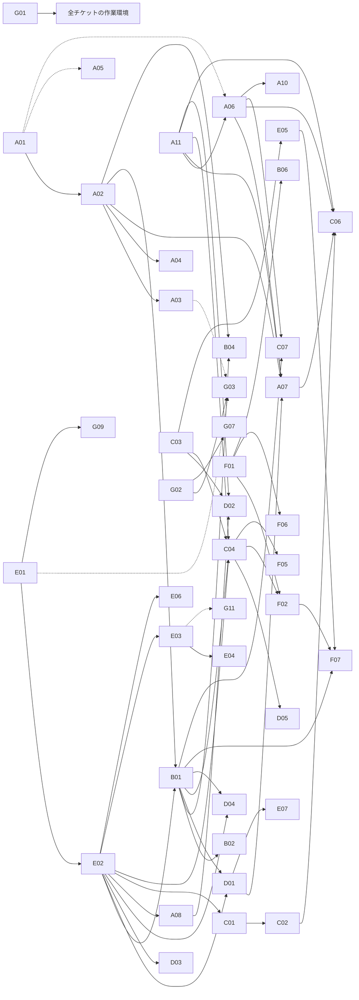
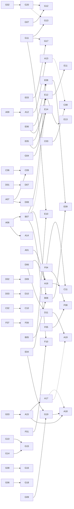
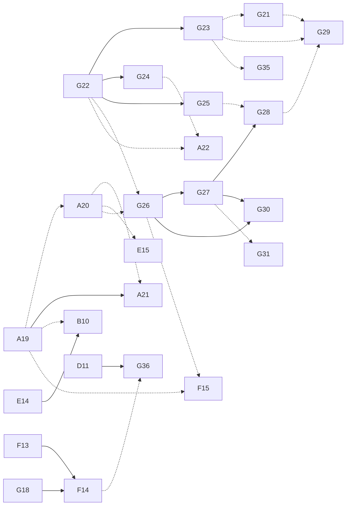

# Tsuzuri 機能実装チケット

Tsuzuri 0.1 の次に実装すべき言語機能・標準ライブラリ・ツールを、1 機能 = 1 ファイルのチケットにまとめています。
**全チケット共通の前提・コードマップ・テスト方法・設計決定は [GUIDE.md](GUIDE.md) にあります。着手前に必ず読んでください。**

- 調査時点: コミット `19d8cdd`（2026-09-23）
- 状態: `todo`（未着手）／`doing`（実装中）／`done`（完了）／`blocked`（依存待ち・要判断）
- 配置: `done` のチケットは [_completed/](_completed/) に移動し、それ以外はこのディレクトリ直下に置きます。起票時点の一覧や件数ではなく、以下の各表を現在の状態と配置の正とします。
- 優先度: **P0** 他機能の前提・早期に必要、**P1** 標準ライブラリと実用化に必要、**P2** 中期、**P3** 長期
- 規模: **S** 1〜2 日、**M** 3〜5 日、**L** 1〜3 週、**XL** 1 か月以上（分割前提）
- 「依存」は着手前に完了が必要なチケット。括弧付きは一部の機能だけが依存する弱い依存です。

## P1 実装・総合検証

P1の25件を実装し、すべて`done`へ更新しました。仕様上の選択は各チケットとGUIDEの設計決定台帳に記録しています。

- `check-runtime-includes.sh`（15ファイル）、`cargo fmt --all -- --check`、`cargo clippy --all-targets -- -D warnings`、Rust全テストが成功。
- README記載の全E2Eがnative/WASM O0/O3で成功。追加feature 3721ケース、整数intrinsic 263182参照ケース、Math 771862参照ケース、Unicode全scalar・表示解析・所有heap・タスク・サンプルを検証。
- Mathは基本745486件と256-bit参照の超越26376件。非NaNのbit一致、NaN分類、heap非確保、trap-info、関数値と評価順を検証。
- C/C++・Rust・C#・JavaScriptの36種目を`run-managed.mjs --quick`で照合。Task／Parallelのquickと整数mixも成功。短縮実行の時間は性能の証拠として扱いません。
- ASan／TSan等の追加検証と性能の実測条件・退行は担当チケットと`docs/benchmarks.md`を参照。P2/P3の機能はこの完了範囲に含めません。

## P2 実装・総合検証

P2の14件を各チケットの実装範囲で完了し、すべて`done`へ更新しました。判断は各チケットとGUIDEに記録しています。

- runtime同梱チェック16ファイル、fmt/clippy、全Rustテストと最新release buildが成功。
- README記載の全E2Eがnative/WASM O0/O3で成功。featureは4911ケース、整数intrinsicは263182参照、型変換は1585参照を検証。
- MathはFMAを含む基本759675件と超越26376件の計786051参照が一致。CのFMA20513参照はASan/UBSanでも成功。
- SIMD有無・generic/native・CPU dispatch、host import、DWARF検証、doc golden/出力保護、LSP UTF8/UTF16実セッションが成功。
- Map/Set26、Seq26、借用record10ケースはASanでも成功。全featureで所有heap回収とWASMメモリ上限を確認。
- CE/SIMD/dispatchのquick比較と整数mix100000反復のチェックサムが一致。短縮時間は性能の根拠にしない。
- A09は完全指定の借用fieldと単一regionの名前付き契約まで。独立した複数record regionは第2期のA12で実装した。
- F05のx86経路はクロスコンパイル済みで、対応実機での実行・速度は未検証。ARM baselineは実行検証済み。P3には着手していません。

## P3 実装・総合検証

P3の全7件に実装を追加しました。各チケットの初期段階の範囲で6件を`done`とし、G10だけはWindows実行ゲート未確認のため`blocked`でした。G10は2026-10-13にWindows x64の実行ゲートを通して`done`になりました（[G10](_completed/G10-windows.md)）。

- E04: strict manifestとローカルpath依存、namespace/循環/出力保護。git/registry/lockfile解決は対象外。
- F06: Node Workerの共有メモリ・独立stack・atomic queue・thread-safe heap。既定WASMはimportなし。Browser本番glueは対象外。
- F07: kernel抽出・CPU参照・strict i32/i32u WGSL・WebGPU host試作。実Metal adapterで783参照が一致。float/64-bit GPU、通常言語runtimeへの自動接続は対象外。
- A10: 明示kind付きrank-1 HKT、部分適用、default/generic methodと通常単相化。HKT aliases/標準Functor導入は対象外。
- B06: Task.parallel_results、最小indexのerror、未開始停止・全開始済みjoin・所有値回収。ASan/UBSan/TSanも成功。
- G11: SHA-256のwhole-build cache、no-cache、破損/同時保存/eviction、tool/source/依存/sidecar検証。parse/check/IR cacheは対象外。
- G10: MSVC ABI・Win32 runtime・safe hardlink保護・専用CIを実装。実Windows SDKでO0/O3 COFF/PE linkとRust全targetのcross checkは成功。Windows上のcargo test・native実行・file置換は、2026-10-13にGitHubの`windows-2022`で確認した（[G10](_completed/G10-windows.md)）。
- runtime19ファイル、fmt/clippy、全Rustテスト、READMEの全ローカルE2Eが成功。feature4928、Task41結果/4trap、整数intrinsic263182、型変換1585、Math786051参照を検証。
- 36種目の多言語quick、Task/Parallel、CE/SIMD/dispatch、cache/GPU参照quickが成功。短縮時間は性能優位の根拠にしません。比較harnessのMix入力は独立したrootへ修正しました。

## 第2期: 他言語比較で見える劣位の改善計画

[なぜ Tsuzuri か（起票時の版）](https://github.com/tatsuya-midorikawa/Tsuzuri/blob/c82c13e1e3dd1f02f78694aa1d26d39b3f793504/_docs/learn/why-tsuzuri.md) が挙げる C/C++・Rust・C#/F# に対する劣位点と、同ページに記載のない劣位点を調べ、改善を機能ごとのチケット 38 件にまとめました（2026-09-29 起票）。現在の比較は [なぜ Tsuzuri なのか](../_tsuzuri/language-reference/languages/why-tsuzuri.md) にあります。

- 対象: A12–A16、B07–B08、C08–C11、D07–D11、E08–E14、F08–F13、G12–G20。G12・G14・G20 は `done`（Phase 1）、A12 は `done`（Phase 1・2）、A13 は `done`（Phase 1・2）、A15 は `done`（Phase 1・2）、B07 は `done`（Phase 1・2）、B08 は `done`（Phase 1・2・3）、C09 は `done`（Phase 1・2）、D07 は `done`（Phase 1・2）、E08 は `done`（Phase 1 の段 A–C と Phase 2。Windows を除く）、E12 は `done`（Phase 1 の段 A–D）、E14 は `done`（Phase 1・2・3）、F11 は `done`（Phase 1・2）、F12 は `done`（Phase 0・1。Phase 2 は実測で不要と判断）、C08・A16・A14 は `done`（Phase 1・2）、F13・F08 は `done`（Phase 1・2・3）、C10・D08・D09・E11・E13・E10 は `done`（Phase 1・2）、G16・G18 は `done`（Phase 1・2・3）、G17 は `done`（Phase 1・3。Phase 2 は実測で見送り）、G13 は `done`（Phase 1・2。Phase 3 の JIT は再検討して採用しない）、E09・F09 は `done`（Phase 1・2・3）、F10・C11 は `done`（Phase 1・2）、D10・D11・G15・G19 は `done`（Phase 1・2。2026-10-11、D-45）、ほかは `todo` です。第2期の 38 件はすべて `done` になりました。
- 調査時点はコミット `9012e92`。各チケットの「現状」は同時点のコード・文書・生成コードで確認しています。
- 第2期のチケットは設計の方向性と第 1 段階を示す計画です。独立レビューは未実施で、着手前に GUIDE §0 の手順 2 に従ってレビューします。
- 予約語・診断コード・std モジュールの割り当ては [GUIDE の D-30](GUIDE.md#d-30-第2期計画の仮割り当て未承認) に仮登録しています（未承認）。
- 言語の意味や既存の設計決定を変える提案（C08 の D-13 変更、A16 の `[T; N]` 再導入、C10 Phase 2 の参照カウント、D11 Phase 2 の static データ）は、着手前に人間の承認が必要です。C08・A16 は D-39、C10 は D-40、D11 Phase 2 は D-45 で承認済みです。

### 改善の方針

- AGENTS.md の原則を変えない。数値・評価順序・トラップ・所有権の意味を保ち、ハードウェア依存の経路には能力確認と明示的なエラーを持たせる。
- 新しいホスト機能（WASI、乱数 seed、非同期、GPU）は明示的な opt-in とし、既定の WASM の import なしを保つ（D-18）。
- 劣位の解消を名目に GC、例外による巻き戻し、暗黙の fast-math、黙った fallback を導入しない。
- 性能の改善は計測と生成コードの確認を先に行い、実装済みと計画を区別して文書に書く。
- 既定の出力を変えない。新しい機能を使わないプログラムの IR・import・ABI が同一であることを各チケットの受け入れ条件に含める。

### why-tsuzuri に記載された劣位と対応

| 比較対象 | 劣位点 | 対応チケット |
|---|---|---|
| C/C++ | ポインター・メモリ配置・allocator・任意の外部 ABI の制御の自由度 | E12, F13, A16, E11 |
| C/C++ | OS・デバイス・既存ライブラリとの接続にホスト実装が必要 | E08, E09, E11, E12 |
| C/C++ | 既存の C/C++ コードをそのまま取り込めない | E11, E12 |
| C/C++ | 対応プラットフォーム・最適化済みライブラリ・デバッガー・長期運用の実績 | G15（実装済み。Windows の x64 は G10 の job が実行して確かめた）, C11, F08, G16, G19 |
| C/C++ | GPU が実験段階 | F09 |
| C/C++ | 安全検査・所有値の複製・ホスト境界の変換のコスト | F12, A15, A16, E13 |
| Rust | 排他スライス（C08）、排他借用フィールド（A13）、レコード内の独立した複数 region（A12）は実装済み。要素単位の排他借用と region 間の outlives はない | C08, A13, A12 |
| Rust | Copy のコストモデル（配列・捕捉の深い複製）。複製の可視化（A15）と、ヒープを使わない固定長配列 `[T; N]`（A16）は実装済み | A15, A16, C10 |
| Rust | Cargo／crates.io・非同期 I/O・低水準 API・開発ツールの成熟度 | E10, B08, E12, F13, G12, G14, G18 |
| C#/F# | .NET の標準ライブラリ・NuGet・GUI／Web／DB・ファイル／ネットワーク API | E08, E09, E10, E13, D08, D09, C09 |
| C#/F# | GC に任せられる共有データ・循環構造 | C10, A14 |
| C#/F# | async／await、対話環境、IDE 支援 | B08, G13, G12, G20 |

### why-tsuzuri に記載のない劣位と対応

| 劣位点 | 比較の基準 | 対応チケット |
|---|---|---|
| native ホストへ組み込んだ関数のトラップでホストのプロセス全体が終了し、スタック枯渇は理由なしに異常終了する | Rust の `catch_unwind`、C# の例外 | E14 |
| WASM の線形メモリが stack・data・heap 合計 16 MiB に固定 | Rust／C++ の wasm32（最大 4 GiB） | F11 |
| 実行時多相がなく、異種コレクションを作れず、単相化のコードサイズと特殊化上限を避けられない | C++ の仮想関数、Rust の `dyn`、C# のインターフェース | A14 |
| 長さを型に含む値型の配列がない | C/C++ の `T[N]`、Rust の `[T; N]` | A16 |
| メモリ以外の資源を所有値として解放できない | Rust の `Drop`、C++ の RAII、C# の `IDisposable` | B07 |
| ハッシュ表がなく、Map の挿入・削除が O(n) | C# の `Dictionary`、Rust の `HashMap` | C09 |
| 文字列補間・書式指定・直列化・正規表現がない | C#/F#、Rust | D07, D08, D09 |
| 既存の C 関数を直接呼べず（`tsuzuri_host_` 名の shim が必要）、実行ファイルへホストのライブラリをリンクする CLI がない | C/C++、Rust の FFI | E12 |
| 関数内のエラーから回復しないため、一度に得られる診断が少ない | rustc、C# コンパイラ | G20 |
| 毎回の全体コンパイルと固定上限（特殊化 1,024、ソース 1 MiB など） | C/C++ の分割コンパイル、Rust の増分コンパイル | G17 |
| VS Code 拡張以外では LLVM・Clang・LLD の導入が必要 | rustup、.NET SDK | G14 |
| 利用者コードのベンチマーク・カバレッジ・プロパティテストがない | cargo bench、BenchmarkDotNet、coverlet | G18 |
| f16 が常にソフトウェア演算 | C/C++ の `_Float16` | D10 |
| コンパイル時評価の範囲が狭い | C++ の `constexpr`、Rust の `const fn` | D11 |
| 共有状態・パイプラインの並行プリミティブがない | C++、Rust、C# | F10 |
| ホストバインディングの生成と、ブラウザー向けの WASM threads glue がない | wasm-bindgen、Emscripten | E13 |
| 言語版・非推奨の管理と公開 API の差分検査がない | Rust の edition、C# の言語版 | G19 |

### 採用しない改善

| 候補 | 理由 |
|---|---|
| GC・サイクルコレクター | 所有権による決定的な解放という設計目標と矛盾する。循環は C10 の Arena／Handle と Weak で扱う |
| 例外と巻き戻し、`?` 演算子 | D-10 の方針。ホスト境界の失敗は E14 の opt-in 境界で返し、言語内の失敗は Maybe／Result で表す |
| 暗黙の fast-math・再結合、GPU・SIMD での黙った精度変更 | 数値の意味を変える。緩い演算は名前で区別した別 API にする（F09、C11） |
| `unsafe` ブロック・生ポインター型 | 安全性の目標と矛盾する。低水準の処理はホストに置き、E12 の不透明ハンドルで受け渡す |
| 利用者が境界検査を無効にするオプション・unchecked API | 安全性を下げる。検査のコストは F12 の証明と計測で減らす |
| .NET／JVM ランタイム互換、クラス継承、型プロバイダー | 言語の対象外（[対応状況（旧版）](https://github.com/tatsuya-midorikawa/Tsuzuri/blob/c82c13e1e3dd1f02f78694aa1d26d39b3f793504/_docs/feature-status.md)）。.NET からの利用は E13 のバインディングで行う |
| GUI・Web フレームワークの同梱 | ホストの責務。E13 の生成 glue で既存のフレームワークと接続する |

## 一覧

### A. 型システム

| ID | チケット | 優先 | 規模 | 依存 | 状態 |
|---|---|---|---|---|---|
| A01 | [型適用とジェネリックなレコード](_completed/A01-generic-records.md) | P0 | L | – | done |
| A02 | [判別共用体（union）と列挙型](_completed/A02-union-types.md) | P0 | XL | A01 | done |
| A03 | [match の網羅性・到達不能節の検査](_completed/A03-match-exhaustiveness.md) | P0 | M | A02 | done |
| A04 | [再帰的なヒープ型（木・AST）](_completed/A04-recursive-types.md) | P1 | L | A02 | done |
| A05 | [型別名](_completed/A05-type-aliases.md) | P1 | S | (A01) | done |
| A06 | [型クラスの拡張（条件付きインスタンス・スーパークラス・デフォルトメソッド）](_completed/A06-typeclass-extensions.md) | P1 | L | A11, (A01) | done |
| A07 | [deriving（Eq／Ord／Display／Hash／Default の自動導出）](_completed/A07-deriving.md) | P1 | M | A11, A06, A02, D01 | done |
| A08 | [char（UTF-16）型と utf8char（Unicode スカラー）型](_completed/A08-char-type.md) | P1 | M | E02, (B01) | done |
| A09 | [名前付きライフタイムと借用フィールド](_completed/A09-named-lifetimes.md) | P2 | XL | – | done |
| A10 | [高階型（HKT）](_completed/A10-higher-kinded-types.md) | P3 | XL | A01, A06 | done |
| A11 | [比較演算の非消費化（Eq／Ord の借用シグネチャ）](_completed/A11-borrowed-comparisons.md) | P1 | M | – | done |
| A12 | [レコード内の独立した複数 region と region 付き関数値型](_completed/A12-multiple-regions.md) | P2 | XL | A09 | done |
| A13 | [排他借用フィールドと参照経由の更新](_completed/A13-exclusive-borrow-fields.md) | P2 | L | A12 | done |
| A14 | [型クラスによる動的ディスパッチ（dyn 値）](_completed/A14-dynamic-dispatch.md) | P2 | L | A06, (B07) | done |
| A15 | [暗黙の深いコピーの可視化](_completed/A15-copy-cost-visibility.md) | P2 | M | G03, (G12) | done |
| A16 | [固定長配列と const ジェネリクス](_completed/A16-fixed-arrays.md) | P2 | XL | A01, D06, (F04) | done |
| A17 | [暗黙の複製の除去（最終使用の move と所有する scrutinee の match 束縛の move）](_completed/A17-last-use-move.md) | P1 | L | A15 | done |
| A18 | [引数規約: 読み取りを既定にする（`own`、edition 2027）](_completed/A18-parameter-conventions.md) | P2 | XL | A15, G19, (A17) | done（Phase 1〜4、2026-10-24。[PR48](https://github.com/tatsuya-midorikawa/Tsuzuri/pull/48)、未マージ） |
| A19 | [純粋関数 `pure def`（副作用のない関数を署名で保証。引数は共有借用か `own`）](_completed/A19-pure-functions.md) | P2 | L | D11, A15, B07, F10, C10, (A17) | done（全 Phase） |
| A20 | [効果の要約と検査付き関数属性（`@no_alloc`・`@no_copy`・`@no_trap`・`@terminates`）](A20-effect-summary-and-checked-attributes.md) | P1 | XL | (A19), (G22) | todo（承認済み） |
| A21 | [契約 `@requires`／`@ensures`（off／check／test／prove）](A21-contracts-requires-ensures.md) | P2 | XL | A19, (A20), (G22) | todo（承認済み） |
| A22 | [edition 2027 の正準形（`..<`／`..=`・接尾辞・借用の表記・旧ラムダ）と移行](A22-edition-2027-canonical-forms.md) | P1 | L | (G22), (G24) | todo（承認済み） |
| A23 | [整数の折り返しの意図（`Int.wrapping_*`・`--overflow-report`・`tsuzuri test` の既定）](A23-integer-overflow-intent.md) | P2 | L | PR02, (G22) | todo（承認済み） |

### B. エラー処理・制御

| ID | チケット | 優先 | 規模 | 依存 | 状態 |
|---|---|---|---|---|---|
| B01 | [Maybe／Result 標準型](_completed/B01-option-result.md) | P0 | M | A02, E02 | done |
| B02 | [Maybe／Result ビルダーによる早期伝播](_completed/B02-result-propagation.md) | P1 | M | B01 | done |
| B03 | [break／continue](_completed/B03-break-continue.md) | P1 | M | – | done |
| B04 | [アクティブパターンの拡張（Maybe 返却・複数ケース）](_completed/B04-active-pattern-extensions.md) | P1 | M | B01, A02 | done |
| B05 | [コンピュテーション式の拡張（match!／and!／use／try）](_completed/B05-computation-expression-extensions.md) | P2 | M | (B01) | done |
| B06 | [タスクのキャンセルと失敗の伝播](_completed/B06-task-cancellation.md) | P3 | L | B01, F01 | done |
| B07 | [ユーザー定義の解放処理（Drop）とリソース型](_completed/B07-user-drop.md) | P1 | L | A06 | done |
| B08 | [非同期計算（Async）とホスト駆動の実行](_completed/B08-async.md) | P3 | XL | B05, B07, (E08), (E13) | done |
| B09 | [ローカルな再帰関数（let rec）](_completed/B09-local-let-rec.md) | P2 | L | – | done |
| B10 | [トラップのバックトレースとクラッシュレポート、純粋関数の失敗の閉じ込め（`Domain`）](B10-trap-backtrace-and-domains.md) | P2 | XL | E14, (A19) | todo（承認済み） |

### C. コレクション・データ

| ID | チケット | 優先 | 規模 | 依存 | 状態 |
|---|---|---|---|---|---|
| C01 | [所有権に基づく関数的更新（一意所有時は in-place）](_completed/C01-consuming-update.md) | P1 | M | E02 | done |
| C02 | [伸縮可能な配列 Vec](_completed/C02-growable-vec.md) | P1 | L | E02, C01, B01 | done |
| C03 | [スライス（`&xs[a..b]`）](_completed/C03-slices.md) | P1 | L | – | done |
| C04 | [配列の一括操作 API](_completed/C04-bulk-array-api.md) | P1 | M | A11, E02, C03, B01 | done |
| C05 | [レコードのコピーと更新 `{ p with x = … }`](_completed/C05-record-update-syntax.md) | P1 | S | (A01) | done |
| C06 | [Map／Set](_completed/C06-map-set.md) | P2 | L | A11, A02, A06, A07, C02, B01 | done |
| C07 | [ユーザー定義の反復プロトコル](_completed/C07-iteration-protocol.md) | P2 | L | B01, A06 | done |
| C08 | [可変スライスと要素のその場更新](_completed/C08-mutable-slices.md) | P2 | L | C03, (A13) | done |
| C09 | [HashMap／HashSet](_completed/C09-hash-map.md) | P1 | M | A07, C02, C06 | done |
| C10 | [共有所有と循環構造（Arena・Handle・Rc／Arc）](_completed/C10-shared-ownership.md) | P2 | XL | C02, (B07), (F10) | done |
| C11 | [多次元配列と数値カーネル](_completed/C11-multidimensional-arrays.md) | P3 | L | A16, F02, F04, (C08), (F08) | done（Phase 1・2） |
| C12 | [`Map`／`Set` の更新を対数時間に近づける（チャンク化したソート配列）](C12-ordered-map-set-chunked.md) | P1 | M | – | todo（承認済み） |

### D. 文字列・数値・組み込み関数

| ID | チケット | 優先 | 規模 | 依存 | 状態 |
|---|---|---|---|---|---|
| D01 | [表示・解析・書式化（Display／Parse／to_string）](_completed/D01-display-parse-format.md) | P0 | M | E02, B01 | done |
| D02 | [文字列ライブラリ](_completed/D02-string-library.md) | P1 | M | E02, A08, A11, C03, B01, (C02) | done |
| D03 | [数学関数の型汎用化と拡充](_completed/D03-generic-math.md) | P1 | M | E02 | done |
| D04 | [整数 intrinsic（min/max/popcount/rotate/checked など）](_completed/D04-integer-intrinsics.md) | P1 | M | E02, B01 | done |
| D05 | [明示 FMA と順序を定めた集計 API](_completed/D05-fma-ordered-reductions.md) | P2 | S | E02, C04 | done |
| D06 | [コンパイル時定数（const）](_completed/D06-compile-time-constants.md) | P2 | M | – | done |
| D07 | [文字列補間と書式指定](_completed/D07-string-interpolation.md) | P1 | M | D01 | done |
| D08 | [構造化データの直列化（JSON）と Encode／Decode の導出](_completed/D08-json-serialization.md) | P2 | L | A07, D02, (C09) | done |
| D09 | [正規表現と Unicode テキスト処理](_completed/D09-regex-unicode.md) | P2 | L | D02, A08 | done |
| D10 | [f16 のハードウェア演算経路](_completed/D10-f16-hardware.md) | P3 | M | D03 | done（Phase 1・2） |
| D11 | [コンパイル時評価の拡張（const 関数・表の生成）](_completed/D11-const-evaluation.md) | P3 | L | D06, (A16) | done（Phase 1・2） |
| D12 | [ランタイム IR と生成コードの intrinsic 宣言の重複の修正](_completed/D12-intrinsic-declaration-duplicates.md) | P1 | S | D04 | done |
| D13 | [補間の穴の一時値（`{s.length}` の `E1013` の解消）](_completed/D13-interpolation-hole-temporaries.md) | P1 | S | – | done（2026-10-23。全 Phase・検証済み） |
| D14 | [`Text` クラス（`String`／`Utf8String` の API の統一）](D14-text-class.md) | P2 | L | – | todo（承認済み） |

### E. モジュール・ホスト連携

| ID | チケット | 優先 | 規模 | 依存 | 状態 |
|---|---|---|---|---|---|
| E01 | [可視性制御（private）](_completed/E01-visibility.md) | P0 | S | – | done |
| E02 | [標準ライブラリの同梱機構](_completed/E02-standard-library-infrastructure.md) | P0 | M | E01 | done |
| E03 | [階層モジュール・サブディレクトリ](_completed/E03-hierarchical-modules.md) | P2 | L | E02 | done |
| E04 | [パッケージと依存管理](_completed/E04-packages.md) | P3 | XL | E03 | done |
| E05 | [ホスト ABI の拡張（バッファ・スカラーレコード）](_completed/E05-host-abi-buffers.md) | P1 | L | C03 | done |
| E06 | [ホスト関数のインポート](_completed/E06-host-imports.md) | P2 | L | E02 | done |
| E07 | [デバッグ出力（Debug.print／trace）](_completed/E07-debug-output.md) | P1 | S | D01, E02 | done |
| E08 | [標準 OS API（ファイル・環境・時刻・乱数・プロセス）](_completed/E08-os-api.md) | P1 | XL | B07, E06 | done |
| E09 | [ネットワーク API](_completed/E09-network.md) | P3 | XL | E08, B08 | done |
| E10 | [git／registry 依存・lockfile・版解決](_completed/E10-package-registry.md) | P2 | XL | E04, G11 | done |
| E11 | [C ヘッダーからの extern 生成](_completed/E11-c-bindgen.md) | P2 | L | E12 | done |
| E12 | [FFI の拡張（リンク名・ホストのリンク指定・不透明ハンドル・コールバック）](_completed/E12-ffi-extensions.md) | P1 | L | E05, E06, (B07) | done |
| E13 | [ホスト言語バインディングと Web glue の生成](_completed/E13-host-bindings.md) | P2 | L | E05, E12, (F06), (F11) | done |
| E14 | [埋め込み時のトラップ境界とスタック枯渇の報告](_completed/E14-trap-boundary.md) | P1 | L | G04, E05, (B06) | done |
| E15 | [信頼境界と権限（`@trusted`・`tsuzuri audit`・`[capabilities]`）](E15-trust-boundary-and-capabilities.md) | P2 | L | (A20) | todo（承認済み） |

### F. 並列・性能バックエンド

| ID | チケット | 優先 | 規模 | 依存 | 状態 |
|---|---|---|---|---|---|
| F01 | [常駐ワーカープール](_completed/F01-worker-pool.md) | P1 | M | – | done |
| F02 | [データ並列 API（Parallel.init／map／reduce）](_completed/F02-data-parallel-api.md) | P1 | M | F01, C03, C04 | done |
| F03 | [WASM SIMD128](_completed/F03-wasm-simd128.md) | P2 | M | – | done |
| F04 | [移植可能な SIMD ベクトル型](_completed/F04-portable-simd-types.md) | P2 | L | E02, (F03) | done |
| F05 | [実行時の CPU 命令セット判定と関数の複数版](_completed/F05-runtime-cpu-dispatch.md) | P2 | L | C04 | done |
| F06 | [WASM threads バックエンド](_completed/F06-wasm-threads.md) | P3 | L | F01 | done |
| F07 | [GPU バックエンド](_completed/F07-gpu-backend.md) | P3 | XL | F02, E05, B01 | done |
| F08 | [256／512-bit SIMD と関数単位の CPU 多版化](_completed/F08-wide-simd-multiversioning.md) | P2 | XL | F04, F05, (C08) | done |
| F09 | [GPU の浮動小数点・64-bit カーネルと実行時接続](_completed/F09-gpu-float-runtime.md) | P3 | XL | F07, (C11) | done（Phase 1・2・3） |
| F10 | [並行処理プリミティブ（Atomic・Mutex・Channel）](_completed/F10-concurrency-primitives.md) | P3 | XL | F01, B07, (A13), (C10) | done |
| F11 | [WASM メモリ上限の設定と拡張](_completed/F11-wasm-memory-limit.md) | P1 | M | – | done |
| F12 | [境界検査の除去と検査コストの計測](_completed/F12-bounds-check-elimination.md) | P2 | L | – | done |
| F13 | [アロケーターの差し替え・確保統計・freestanding 出力](_completed/F13-custom-allocators.md) | P2 | L | (F11), (E12), (E14) | done |
| F14 | [構造的な性能表明（確保数のテスト用 API と `bench` の確保数）](F14-structural-performance-assertions.md) | P1 | L | F13, G18 | todo（承認済み） |
| F15 | [逐次と同一の結果を保証するデータ並列（`Monoid` の還元・純粋性・提案だけの自動化）](F15-sequential-equivalent-data-parallel.md) | P3 | L | (A19), (G22), (G26) | todo（承認済み） |

### G. ツール・開発体験

| ID | チケット | 優先 | 規模 | 依存 | 状態 |
|---|---|---|---|---|---|
| G01 | [ランタイム IR ファイルの Git 追跡漏れの修正](_completed/G01-runtime-ir-tracking.md) | P0 | S | – | done |
| G02 | [複数エラーの同時報告](_completed/G02-multiple-diagnostics.md) | P0 | M | – | done |
| G03 | [警告（未使用・到達不能・シャドーイング）](_completed/G03-warnings.md) | P1 | M | G02, (A03), (E01) | done |
| G04 | [トラップ発生位置の報告](_completed/G04-trap-locations.md) | P1 | M | – | done |
| G05 | [フォーマッター（tsuzuri fmt）](_completed/G05-formatter.md) | P1 | M | – | done |
| G06 | [言語内テスト（test 宣言と tsuzuri test）](_completed/G06-test-runner.md) | P1 | M | (D01) | done |
| G07 | [LSP（言語サーバー）](_completed/G07-lsp.md) | P2 | L | G02 | done |
| G08 | [デバッグ情報（DWARF／WASM）](_completed/G08-debug-info.md) | P2 | M | – | done |
| G09 | [ドキュメントコメントと API 文書生成](_completed/G09-doc-comments.md) | P2 | S | E01 | done |
| G10 | [Windows ネイティブ対応](_completed/G10-windows.md) | P3 | M | – | done |
| G11 | [増分ビルド・キャッシュ](_completed/G11-incremental-build.md) | P3 | L | (E03) | done |
| G12 | [LSP の拡張（補完・rename・参照・整形・inlay hints）](_completed/G12-lsp-extensions.md) | P1 | L | G07, G20 | done |
| G13 | [REPL とスクリプト実行](_completed/G13-repl.md) | P2 | L | G11, (G20), (G17) | done |
| G14 | [自己完結ツールチェーンの配布](_completed/G14-toolchain-distribution.md) | P1 | M | (G10) | done |
| G15 | [対応ターゲットの拡張とクロスコンパイル](_completed/G15-platform-targets.md) | P3 | XL | G10, G14, (F13) | done（Phase 1・2） |
| G16 | [デバッガー体験（型の表示・PDB）](_completed/G16-debugger-experience.md) | P2 | M | G08, (G10), (G14) | done |
| G17 | [モジュール単位の増分コンパイルと規模上限の見直し](_completed/G17-incremental-compilation.md) | P2 | XL | G11, E03, (G20) | done |
| G18 | [ベンチマーク・カバレッジ・プロパティテスト](_completed/G18-bench-coverage.md) | P2 | M | G06, (D07), (E08) | done |
| G19 | [言語版（edition）と互換性・非推奨の管理](_completed/G19-editions-compatibility.md) | P3 | M | E04, G09, (E10) | done（Phase 1・2） |
| G20 | [関数内の型・所有権エラーからの回復](_completed/G20-error-recovery.md) | P1 | L | G02 | done |
| G21 | [AI ガイドパック（`tsuzuri guide`、`tsuzuri new` の `AGENTS.md`・`llms.txt`）](G21-ai-guide-pack.md) | P1 | L | (G23) | todo（承認済み） |
| G22 | [診断 v2 の基盤（関連位置・help・fix・expected/found。所有権の移動元・借用元）](G22-diagnostic-v2.md) | P0 | L | G20, G12 | todo（承認済み） |
| G23 | [診断の kind・`tsuzuri explain`・ヒント DB](G23-diagnostic-kinds-explain-hints.md) | P1 | L | G22 | todo（承認済み） |
| G24 | [`tsuzuri fix`（機械的な修正の適用と edition の移行基盤）](G24-tsuzuri-fix.md) | P1 | L | G22 | todo（承認済み） |
| G25 | [型つき穴 `?` と `tsuzuri find`（型でのシグネチャ検索）、未解決名の候補](G25-typed-holes-and-find.md) | P2 | L | G22, (G24) | todo（承認済み） |
| G26 | [Facts モデル（コンパイラの事実の機械可読な定義と exporter）](G26-facts-model.md) | P1 | XL | (G22), (A20) | todo（承認済み） |
| G27 | [ビルド時の KB（`target/tz/kb`、brief カード、増分、鮮度）](G27-build-time-kb.md) | P1 | L | G26 | todo（承認済み） |
| G28 | [`tsuzuri kb` の照会と `impact`（facts の差分）](G28-kb-query-and-impact.md) | P1 | L | G27, G26, (G25) | todo（承認済み） |
| G29 | [`tsuzuri mcp`（MCP サーバー）](G29-mcp-server.md) | P2 | L | (G21), (G23), (G26), (G27), (G28) | todo（承認済み） |
| G30 | [図表の生成（Mermaid。モジュール・型・呼び出し・所有権・並行・レイアウト・状態遷移）](G30-diagrams.md) | P2 | L | G26, G27 | todo（承認済み） |
| G31 | [AI 作業コスト指標（入力量と往復数を決定的に測る）](_completed/G31-ai-cost-metrics.md) | P1 | M | (G21), (G22), (G24), (G27), (G28), (G29) | done（Phase 1〜3） |
| G32 | [開発リポジトリの KB と `ticket-brief`（小さいモデルへ渡す文脈の自動生成）](G32-repo-kb-and-ticket-brief.md) | P0 | M | – | todo（承認済み） |
| G33 | [仕様の規則 ID と適合性スイート](G33-spec-rule-ids-conformance.md) | P2 | L | – | todo（承認済み） |
| G34 | [doc-test（`///` の例を実行する）と std の例](G34-doc-tests.md) | P2 | M | – | todo（承認済み） |
| G35 | [生成物による文書の単一情報源化（診断コード表・std 索引・benchmarks の JSON 化）](G35-generated-docs-single-source.md) | P2 | L | (G23) | todo（承認済み） |
| G36 | [言語全体の差分ファズ（プログラム生成型。コンパイル時評価を参照実装に）](G36-language-differential-fuzz.md) | P2 | L | D11, (F14) | todo（承認済み） |

## 推奨フェーズ

依存関係と価値の順に並べています。同じフェーズ内でも、上に書いたものから着手してください。

| フェーズ | 目的 | チケット（推奨順） |
|---|---|---|
| 0. 準備 | 誰でもビルドできる状態にする | G01 |
| 1. 基盤 | データを型で表し、失敗を値で扱い、診断を改善する | A01 → A02 → A03、E01 → E02 → B01、G02、A05、C05、B03 |
| 2. 最小標準ライブラリ | 文字列・数値・配列を実用的に扱う | D01、D03、D04、A08、A11、C03、C01、C04、D02、A06 → A07、B02、B04、G04、E07 |
| 3. 実用化・性能 | ホスト連携・並列・ツール | E05、F01 → F02、C02、G05、G06、G03、A04、D06 |
| 4. エコシステム | 大規模開発と高度な最適化 | G07、G08、E03、C06、C07、A09、F03、F04、F05、E06、B05、D05、G09 |
| 5. 長期 | 研究開発を伴う大型機能 | E04、F06、F07、A10、B06、G10、G11 |
| 6. 第2期・導入障壁 | 既存アプリへの組み込みと日常の開発を妨げる劣位を除く | G20 → G12、G14、F11、E12、E14、B07 → E08、C09、D07 |
| 7. 第2期・表現力と性能 | 所有権モデルの表現力・性能・エコシステムの差を縮める | A15、A12 → A13 → C08、A14、A16、F12、F13、F08、C10、D08、D09、E11、E13、E10、G16、G18、G17、G13 |
| 8. 第2期・長期 | 研究開発や外部環境の整備を伴う機能 | B08 → E09、F09、F10、C11、D10、D11、G15、G19（すべて完了） |
| 9. 追加（2026-10-07） | 言語リファレンスの執筆で見つけた不具合を直し、ローカルな再帰を書けるようにする | D12、B09（すべて完了） |
| 10. 追加（2026-10-13） | 暗黙の複製のコストを減らし、読むだけの引数に `ref` を書かずに済むようにし、副作用のない関数を署名で保証する | A17 → A18（全 Phase 承認・実装済み、PR48 は未マージ）。A19（`pure def`。承認済み）は A17・A18 から独立 |
| 11. 追加（2026-10-18） | AI と人間が少ない暗黙ルールで堅牢かつ高速に書けるようにする（引く: 知識を決定的に渡す／縛る: 性質を署名と検査で固定する／直す: 診断から機械的に直す） | ① G32・D13・C12・F14・G31 → ② G22 → G23・G24・G21 → ③ G26 → G27 → G28 → G30・G29 → ④ A19（既存）→ A20 → A21・E15、A22、A23 → ⑤ G25・G33〜G36・D14・B10・F15。詳細は [追加チケット（2026-10-18）](#追加チケット2026-10-18) |

## 依存関係図

第2期のチケットの主な依存です。第1期のチケットはすべて完了しています。点線は弱い依存です。

## 運用ルール

- 着手時に状態を `doing`、完了時に `done` にする。判断待ちは `blocked` にして、チケットの「未決事項」に理由を書く。
- 機能を追加・変更・修正・削除するプルリクエスト（Phase ごとの PR や、チケットのない修正を含む）は、同じ PR で
  `_tsuzuri/language-reference/` の関連ページを最新にし、`node scripts/check-docs.mjs <変更したページ>` を通す（[GUIDE §8](GUIDE.md#8-ドキュメント更新規約)）。
- `done` にしたチケットは `git mv` で `_completed/` へ移動し、この一覧のリンクとチケット内の相対リンクを更新する。`_tsuzuri/language-reference/` に
  このチケットを指す「計画中」の注記やリンクが残っていれば、実装した振る舞いの説明に置き換える。
- 実装中に仕様・設計を変えた場合は、チケット本文と [GUIDE.md の設計決定台帳](GUIDE.md#9-設計決定台帳チケット横断) を同時に更新する。
- 1 チケットが大きすぎる場合（特に XL）は、チケット内の「段階」ごとに別のプルリクエストにする。

## レビュー状況（2026-09-23）

- **P0 と P1 の全チケット**（A01–A08、A11、B01–B04、C01–C05、D01–D04、E01、E02、E05、E07、F01、F02、G01–G06）は、
  作成後に実コードと突き合わせた独立レビューを受け、指摘（誤ったコード参照、健全性の穴、チケット間のインターフェース不一致、
  実行できない検証手順など）を反映済み。
- **P2／P3 のチケット**は設計の方向性と第 1 段階を示すもので、独立レビューは未実施。着手前に、その時点のコードに対して
  レビュー（GUIDE §0 の手順 2）を必ず行う。
- 人間による承認（2026-09-23）: D-20（比較演算は非消費。A11）と D-11（浮動小数点は最短往復表現で表示し、
  コンソール出力も揃える。D01）を承認済み。P2／P3 は着手前に再レビューする運用で合意済み。
- **第2期のチケット**（A12–A16、B07–B08、C08–C11、D07–D11、E08–E14、F08–F13、G12–G20、2026-09-29 起票）は、コミット `9012e92` 時点のコードと文書を調べて書いた計画です。
  独立レビューと人間の承認は未実施です。着手前に GUIDE §0 の手順 2 のレビューを行い、[D-30](GUIDE.md#d-30-第2期計画の仮割り当て未承認) の仮割り当てを確定してから実装します。
- レビューで確定した横断的な決定は GUIDE の台帳に追加済み: D-20（比較は非消費、A11）、D-21（`unreachable`）、
  D-22（関数の由来情報 `FunctionOrigin`）、D-03（型名の正規マングリング）、D-07（参照元に応じた名前解決、組み込みと std の関係）、
  D-10（網羅性検査後の方針）。

## 第2期チケットの詳細化（2026-09-29）

第2期の 38 件と G10 を、HEAD `f8dc655` のコードと突き合わせて、小さいモデルでも設計判断なしに実装できる粒度まで詳細化しました
（性能チケット `_perfs/` の 27 件も同様）。各チケットには次があります。

- 着手条件と停止条件（即興で回避せず止めて報告する条件）、grep で確認したコード参照、段ごとの変更表。
- 手順ごとの確認コマンドと期待結果、名前付きの Rust テストと E2E の suite、独立した参照による期待値。
- 「未決事項」を置き換えた「決定事項」。各項目は「既定案（実装者はこの案に従う）」か「要承認（承認前は該当 Phase に着手しない）」。

共通の手順は [GUIDE](GUIDE.md) の §0・§3.1・§11.1・§12・§13・§14 に追加しました。仮に決めた名前（CLI・環境変数・std・構文）は
[D-30](GUIDE.md#d-30-第2期計画の仮割り当て未承認) の台帳にあります。承認が必要な決定は次のとおりです（承認なしの Phase 1 から
着手できるチケットは F12・G10・G12・G16・G20・D10 など、表にないものと「Phase 2 以降」の行のもの）。

| チケット | 要承認の決定 |
| --- | --- |
| [A12](_completed/A12-multiple-regions.md) | D10（region の上限を 64 へ下げる）、D13（Phase 2）。承認済みで実装済み（2026-10-03。D10 は 128 を正式な上限にする見直し案を採用） |
| [A13](_completed/A13-exclusive-borrow-fields.md) | D1（D-28「排他参照 field は禁止」の変更。チケット全体）、D5。承認済みで実装済み（2026-10-06。Phase 2 も実装。D-38） |
| [A14](_completed/A14-dynamic-dispatch.md) | D1（`dyn`・`Dyn.of`・`E1028`）。承認済みで実装済み（2026-10-06。Phase 2 も実装。D-39） |
| [A15](_completed/A15-copy-cost-visibility.md) | D3（`--warn implicit-copy` と `W1006`）。承認済みで実装済み（2026-10-03） |
| [A16](_completed/A16-fixed-arrays.md) | D1（`[T; N]` の再導入）、D10（Phase 2）。承認済みで実装済み（2026-10-06。D-39） |
| [B07](_completed/B07-user-drop.md) | D1（`Drop`）、D2（`drop` の引数を `ref mut`）、D4（Drop 型からの move の禁止）、Phase 2（`use`・`use!`、`Owned` の早期解放と関数値）。すべて承認済みで実装済み（2026-10-02） |
| [B08](_completed/B08-async.md) | D1（`Async`）、D10（Phase 2）、Phase 3 と旧計画の再検討。すべて承認済みで実装済み（2026-10-09、D-42） |
| [C08](_completed/C08-mutable-slices.md) | D1（D-13 の変更。チケット全体）、D11（Phase 2）。承認済みで実装済み（2026-10-06。D-39） |
| C09 | Phase 2 以降だけ（C09 D11） |
| [C10](_completed/C10-shared-ownership.md) | D13（参照カウントの導入）、D14（`Rc`／`Arc`）。承認済みで実装済み（2026-10-07。Phase 1 も実装。D-40） |
| [C11](_completed/C11-multidimensional-arrays.md) | D9（Phase 2 の GPU との連携）。承認済みで実装済み（2026-10-10。Phase 1・2、D-44。行列積の GPU kernel は作らず、`Matrix.as_array`／`of_array` と `Gpu` の組み合わせだけ） |
| [D07](_completed/D07-string-interpolation.md) | D1（`$"..."`・`u8$"..."`）、D9（`numeric.ll` の増分） |
| [D08](_completed/D08-json-serialization.md) | D1（`Json`・`Encode`／`Decode`）。承認済みで実装済み（2026-10-07。Phase 2 も実装。D-40） |
| [D09](_completed/D09-regex-unicode.md) | D1（`Regex`・`Unicode` の予約）、D11（Phase 2）。承認済みで実装済み（2026-10-07。D-40） |
| [D11](_completed/D11-const-evaluation.md) | D10（Phase 2 の static データ）。承認済みで実装済み（2026-10-11。D-45。平たいデータの定数だけを静的データにし、D-28 の「static lifetime を導入しない」を改めた） |
| [E08](_completed/E08-os-api.md) | D1（7 つの std 名）、D9（`IO<i32>` の終了コード）、D10（`--wasm-host wasi`）、D12（段 B の `File.Handle` と B07 D5） |
| [E09](_completed/E09-network.md) | D1（`Net`）、D11（wasm32 の opt-in `--wasm-feature net`）、全フェーズ。すべて承認済みで実装済み（2026-10-10） |
| [E10](_completed/E10-package-registry.md) | D1（`tsuzuri fetch` と `git`、`E2007`、D-29 の E04 記録の更新）、D10（Phase 2）。承認済みで実装済み（2026-10-07。D-40） |
| [E11](_completed/E11-c-bindgen.md) | D1（`bindgen` と `W2002`）。承認済みで実装済み（2026-10-07。Phase 2 も実装。D-40） |
| [E12](_completed/E12-ffi-extensions.md) | D1（`extern "symbol" def`）、D3（`extern type` の意味）、D6（`--link`・`-l`・`-L`）、D8（コールバックを Phase 1 に含める）。すべて承認済みで実装済み |
| [E14](_completed/E14-trap-boundary.md) | D6・D7（`--trap-mode return`、確保 listと worker）、D9（signal handler）。すべて実装済み（2026-10-02 の包括承認） |
| G13・G14 | Phase 2 以降だけ（F11 の Phase 2 は承認済みで実装済み）。[G13](_completed/G13-repl.md) の D12（Phase 2）と D13（Phase 3）は承認済み（2026-10-08、D-41）。D12 は実装済み、D13 は再検討して JIT を採用しない |
| [E13](_completed/E13-host-bindings.md) | D11（Phase 2）。承認済みで実装済み（2026-10-07。D-40） |
| [F08](_completed/F08-wide-simd-multiversioning.md) | D7（Phase 2 の 256-bit 型）、D8（Phase 3 の `@cpu` 構文）、D9（AVX-512・SVE）。承認済みで実装済み（2026-10-06。D-39） |
| [F13](_completed/F13-custom-allocators.md) | D9（Phase 2・Phase 3）。承認済みで実装済み（2026-10-06。D-39） |
| [F09](_completed/F09-gpu-float-runtime.md) | D1（relaxed f32 の契約と名前）、D9・D10（Phase 2・3）。承認済みで実装済み（2026-10-10、統合時に D-44。D10 は SPIR-V を独自の emitter で作り、strict の `f32` に適合プローブを足した） |
| [F10](_completed/F10-concurrency-primitives.md) | D1（`Atomic`・`Mutex`・`Sync`・`AtomicValue`・`Task.scope`）、D10（Phase 2 の `Channel`）。すべて承認済みで実装済み（2026-10-10、統合時に D-44） |
| [G15](_completed/G15-platform-targets.md) | D8（CI の `targets.yml`）と Phase 2 の全体。承認済みで実装済み（2026-10-11。D-45。native の triple は 6 個から 22 個へ、実行器 `TSUZURI_RUNNER` を足した） |
| [G17](_completed/G17-incremental-compilation.md) | D5（`check`・`test`・`doc` の既定の cache）、D10・D11（Phase 2・3）。承認済み（2026-10-08、D-41）。D5・D11 は実装済み、D10 は実測で見送り |
| [G18](_completed/G18-bench-coverage.md) | D1（予約語 `bench`）。承認済みで実装済み（2026-10-08、D-41。Phase 2・3 も実装） |
| [G19](_completed/G19-editions-compatibility.md) | D1（manifest の `edition`）、D4（`@deprecated` と `W1005`）、D9（Phase 2）。すべて承認済みで実装済み（2026-10-11。D-45） |

詳細化の過程で見つけた、チケット外の食い違い: G10 の記録と `README.md`・`_features/README.md`・`docs/architecture.md`・`_docs/tools/build-and-cache.md` は
Windows 専用の CI があるように書いているが、`.github/workflows/windows.yml` は `16d4fa9` で削除されている（G10 の手順で復元する。2026-10-13 に復元した）。

## 追加チケット（2026-10-07）

言語リファレンス（[_tsuzuri/language-reference/](../_tsuzuri/language-reference/index.md)）を HEAD `5b896b7` の実装と突き合わせて書いた際に、
次の 2 件を起票しました。どちらも第2期の詳細化と同じ粒度（着手条件と停止条件、grep で確認したコード参照、段ごとの変更表、
名前付きのテスト、決定事項）で書いています。

| チケット | 種別 | 概要 | 承認 |
| --- | --- | --- | --- |
| [D12](_completed/D12-intrinsic-declaration-duplicates.md) | 不具合 | 数値の表示や文字列化と一緒に `i32` の `Int.min`・`Int.max`、`i32`／`i32u` の `Int.leading_zeros` を使うと、生成コードと `numeric.ll` が同じ intrinsic を宣言し、clang が `invalid redefinition of function` で失敗する。native と WASM の両方で起きる。**実装済み（2026-10-12）**: 連結後の IR の `declare` をシンボル名ごとに最初の 1 つだけ残し、テストの一意性検査もシンボル名で行う | 不要 |
| [B09](_completed/B09-local-let-rec.md) | 機能 | 関数本体・ブロック・コンピュテーション式の中で `let rec go = \n -> ...` と書けるようにする。現在、再帰はモジュールの `def rec`（署名と実装を分ける形の `let rec`・`fn rec` を含む）でしか書けない。**実装済み（2026-10-12。Phase 1 と、承認済みの Phase 2 の両方）**: `let rec`（`and` で相互再帰）は自分・グループ・前や外側の `let rec` 関数を直接呼び、捕捉は値か共有借用で渡し、末尾呼び出しは `-O0` でもループになる | Phase 1 は不要。Phase 2（相互再帰、解放処理を持つ値の捕捉、ほかの `let rec` 関数の参照）の D9 は、人間の依頼（2026-10-12。最善の案を選ぶ包括許可）で承認済み |

## 追加チケット（2026-10-13）

「GC・`new`/`delete` ではない、より良いメモリ管理の戦略」の検討（所有権は据え置き、エイリアスの表し方を引数規約に替える案）から A17・A18 を、続く「純粋関数の構文 `def pure` を前提にすると方針は変わるか」の検討と人間の指示（`pure` は引数を共有借用で受け取り、`ref` を省略でき、構文は `pure def`。続けて、`own` でも純粋性が保たれることが保証されるなら `own` も許容する）から A19 を、起票しました。
A17・A18 は HEAD `2282fd96`、A19 は HEAD `cef6c67f` の実装と突き合わせて、着手条件と停止条件、コード参照、段ごとの変更表、名前付きのテスト、決定事項を、第2期の詳細化と同じ粒度で書いています。
検討で測った数（`ref` の使用、暗黙の複製の位置、時間）は各チケットの「現状と計測」にあります。

- 棚卸しの道具 `tests/copy_inventory.rs`（`cargo test --locked --test copy_inventory -- --ignored --nocapture`）と、A17 の回帰用の fixture `tests/fixtures/last_use/Main.tz`・suite `last_use`（`tests/features.mjs`。102 件。HEAD で通る）を、起票と同時に足しました。どちらもコンパイラの動作を変えません。
- 順序: A17（意味を変えない。Phase 1・2 は 2026-10-15 に完了）→ A18（意味を変える。要承認）。A17 は PM07 の Phase 2（[PM07](../_perfs/_completed/PM07-copy-elision.md)）を置き換えます。
  A19（`pure def`）は A17・A18 から独立していて、着手の順を問いません（A17 を先に入れると、`pure def` の中のローカル可変のループと `own` の蓄積引数が実用の速さになります）。A18 とは、`pure def` の引数を A19 の規則で補完し、A18 の補完の対象にしないこと（A18 の D11、A19 の D13）と、`own` の前置きの構文を共有すること（A19 が `pure def` の引数だけで先に導入し、A18 が受理する位置を広げる。A19 の D16、A18 の D2・D11）で整合させました。

| チケット | 種別 | 概要 | 承認 |
| --- | --- | --- | --- |
| [A17](_completed/A17-last-use-move.md) | 性能・機能 | 値をもう読まない位置では、Copy の配列・リストを複製せず移動する。`for` が 1 つあるだけで関数の全局所が複製になる規則、分岐の両腕で最後に読む形、`match` の Copy の束縛（`Result.Ok bytes` が配列全体を複製する）を、型付き IR の逆向きの生存解析で直す。100 万要素の `[i64]` を `for` で `xs = Array.update_at .. xs` する 2 万回が 4.0 秒（1 回 0.2 ms の全複製）、移動を許した試作では 0.02 秒。意味・構文・診断コードは変えず、`W1006` の位置は実際に複製する位置に保つ。Phase 1・2 を実装・検証済み | 不要（言語の意味・構文・診断コードを変えない） |
| [A18](_completed/A18-parameter-conventions.md) | 機能 | edition 2027 の読み取り既定、`own`、checked migration、ジェネリック／関数の引数規約、`mut T` と射影代入。`LATEST` と std は 2027、版なし manifest は 2026 を維持する | D1〜D4 と全 Phase を 2026-10-23 に利用者が承認。2026-10-24 に Phase 1〜4 完了・アーカイブ済み。最終実装 head は Rust 1772 件・features 19740 件・CI 14 項目 green、Copilot の未解決指摘なし。文書移動後の結果は [PR48](https://github.com/tatsuya-midorikawa/Tsuzuri/pull/48) で確認する。未マージ |
| [A19](_completed/A19-pure-functions.md) | 機能 | `pure def` と `pure (T -> U)` の契約を有界な到達可能性解析で検証する。引数は共有借用か平たいデータの `own`。generic、純粋 callback、呼び出し段階、class／instance、`@cpu`、遅延 `IO` の構築、閉じた明示 `Task`／`Parallel`、Char・PCG の明示契約に対応する。不明な効果・外部状態・`ref mut`・利用者の `Drop` は `E1029`。通常の `def` の `own` は A18 の契約を維持する。`api-diff --effective` は解決後の契約を比較し、既定の構文比較は変えない。最適化は別途 `memory(none)` を証明できた同一基本ブロックの整数呼び出しの再利用だけで、最初の呼び出しを残す。自動 offload、所有結果の共有、グローバル memo cache は導入しない。速度向上は未計測 | 2026-10-23 の依頼で全 Phase を承認済み。旧 Phase 1 の制約との差は README とチケットに記録 |

## 追加チケット（2026-10-18）

「AI と人間が、少ない暗黙ルールで堅牢かつ高パフォーマンスなプログラムを書ける」という目標に対して、現在の実装と仕様に何が不足し、何が妨げになっているかを洗い出し（HEAD `a2313d19`。4 つの観点の調査を、実際に実行して確かめた）、人間の指示（「すべての改善案の設計を詰める。複数 Phase のものは全 Phase を設計する。判断が要るものは最善の案を採用してよい。あとから小さいモデルが実装しても大きいモデルと遜色ない内容にする」）から、27 件を起票しました。**コンパイラ本体・テスト・言語リファレンスは変えていません**（チケットと台帳だけ）。

- 骨子は 3 つの動詞です。**引く**（コンパイラが持つ事実を、決定的に KB・ガイド・MCP で渡し、AI がコードベースを探索し直さずに済むようにする）、**縛る**（性質を署名と検査で固定する）、**直す**（診断から機械的に直せるようにする）。加えて、edition 2027 の正準形（A22）、性能の構造的な保証（C12・D13・D14・F14・F15）、仕様の単一情報源（G33〜G36）、失敗の可観測性（B10）。
- 共通の決定は GUIDE の [D-50〜D-58](GUIDE.md#d-50-第3期計画ai堅牢性性能27-チケットの起票) です。**小さいモデルは [GUIDE-LITE.md](GUIDE-LITE.md) と担当のチケットだけを読めば着手できます**（GUIDE のほかの節は、チケットが指定したときだけ読む）。
- 各チケットは、着手条件・停止条件・実装者向け早見・段ごとの変更表・名前付きのテスト・決定事項と、検証に使った付録（`<ID>-appendix*.md`。試作で確かめた全文のコード・fixture・期待値）を持ちます。多くは作業ツリーの複製で試作して設計を実測しました（G22 は既存の 1,490 件のテストが通り、D13 は 18 件、A21 は z3 との差分 3,312 件が一致、G29 は公式の MCP の schema で検証）。
- **全 Phase を設計しました。着手する Phase は人間が指示します（指示がなければ Phase 1 だけ）。** Phase は順に積めて、それぞれ独立に実装・検証・マージできます。
- 承認: 人間の包括許可（2026-10-18）で、各チケットの決定事項はすべて承認済みです。**A18 の D1〜D4 は含みません**（A18 は独立に判断します。A22 は A18 に依存せず、edition `2027` の足場だけを共有し、先に実装した方が足します）。
- 守った方針: 「採用しない改善」（GC・例外・`unsafe`・境界検査の無効化・暗黙の fast-math）は変えない。新しい予約語・crate・`unsafe`・既定の WASM の import を足さない。共有 CI に速度の合否の閾値を置かない。native と WASM の `-O0`／`-O3` を保つ。

実装の推奨順（依存を満たす範囲で並行してよい）: ① G32・D13・C12・F14・G31（基準値）→ ② G22 → G23・G24・G21 → ③ G26 → G27 → G28 → G30・G29 → ④ A19（既存）→ A20 → A21・E15、A22、A23 → ⑤ G25・G33〜G36・D14・B10・F15。

| チケット | 種別 | 概要 | 承認 |
| --- | --- | --- | --- |
| [G32](G32-repo-kb-and-ticket-brief.md) | ツール（P0） | `scripts/repo-kb.mjs`: チケット・GUIDE の決定・診断コード・名前を決定的に索引し、`brief <ID>` が実装に要る文脈（要点・停止条件・仕様・指定 Phase の手順・テスト・受け入れ条件・依存先のインターフェース・GUIDE-LITE）を 24,000 字以内で出す。GUIDE-LITE と台帳の食い違いも検査する。小さいモデルが GUIDE（約 15.5 万字）とチケット全体を読まずに着手できる。**第3期で最初に入れる** | 承認済み |
| [G22](G22-diagnostic-v2.md) | 診断（P0・基盤） | 診断に関連位置（移動元・借用元・期待の原因など）・`help`・`fixes`・`expected`／`found`・`candidates`・`scope` を足す。JSON はキーを足すだけで、追加の情報を持たない診断は 1 byte も変わらない。`Diagnostic` を 8 bytes の `Box` にして stack の余裕を保つ（フィールドを直に足すと GUIDE §3.1 の stack の回帰テストが溢れることを実測）。所有権の 7 か所と型の不一致に付け、LSP の `relatedInformation`・`quickfix` に接続する | 承認済み |
| [G21](G21-ai-guide-pack.md) | 知識 | `tsuzuri guide`（L0 6,000 字・L1 20,000 字・std のページと 1 行索引。英語。コンパイラの表と実行を通った例から生成。`--json` あり）と、`tsuzuri new` が書く `AGENTS.md`・`llms.txt`。落とし穴の表は G23 のヒント DB と共有する | 承認済み |
| [G23](G23-diagnostic-kinds-explain-hints.md) | 診断 | 粗い 47 コードを原因ごとの kind（653）に分け（enum とマクロの登録簿。`Diagnostic::of`）、`tsuzuri explain`（47 コードと厳選した 84 kind のページ、`--catalog --json`）と、`pair.0`・`Display.to_string` のように AI が繰り返す誤りに「どう書くか」を返すヒント DB を足す。発行 1,077 か所を `#[deprecated]` とモジュールごとの `deny` で段階的に移行する | 承認済み |
| [G24](G24-tsuzuri-fix.md) | 診断 | `tsuzuri fix [PATH]`: `fixes` の `certain` を既定で適用し（`--applicability likely` なら `likely` も）、適用後に再検査して新しい誤りが出れば何も書かない（`E2008`）。`--dry-run` は差分だけで、`maybe` は `--dry-run` のときだけ。`--edition 2027` で edition を移行する（A22 が使う）。編集の適用は LSP の quickfix と共有する（`apply_edits`） | 承認済み |
| [G25](G25-typed-holes-and-find.md) | 診断・検索 | 型つき穴 `?`（`E1030`: 期待する型と、スコープの束縛・その型を作れる候補を出す）、`tsuzuri find 'ref [i64] -> i64'`（型でのシグネチャ検索。`kb find` と同じ実装）、未解決名の候補（`unknown value 'length'` に近い名前） | 承認済み |
| [G26](G26-facts-model.md) | 知識（事実） | コンパイラが内部に持つ事実（シンボル・呼び出し・効果・複製・確保・トラップ・所有権の出来事・再帰・ループ・特殊化・型のレイアウト）を `tz-facts/1` の JSON Lines として定義し、`check` の解析だけから決定的に書き出す exporter。Phase 1〜6 は独立に出荷でき、A20 が揃うまで `effects_complete`・`alloc_complete` は `false` | 承認済み |
| [G27](G27-build-time-kb.md) | 知識（KB） | `check`・`build`・`run`・`test` が `target/tz/kb/`（`tz-kb/1`。シンボル・グラフ・facts・brief カード・図）を既定で書く。入力の SHA-256 で増分と鮮度（`E2009`）を判定し、`--no-kb`・`TSUZURI_KB=0` で止められる。brief カードは L0 2,400 字・L1 1,600 字・L2 700 字。`tsuzuri new` の `.gitignore` に `target/` を足す | 承認済み |
| [G28](G28-kb-query-and-impact.md) | 知識（照会） | `tsuzuri kb`（`show`・`brief`・`callers`・`callees`・`uses`・`search`・`tests-for`・`find`。1 項目 1〜3 行で、`--budget` で字数を抑える）と `kb impact`（2 つの KB・git の版の差を、署名・所有権の渡し方・効果・テストで分類し、回すべきテストを出す） | 承認済み |
| [G29](G29-mcp-server.md) | 知識（接続口） | `tsuzuri mcp`: stdio の MCP サーバー（プロトコルは 2025-06-18 だけ）。読み取り専用で型つきの 11 ツール（`tz_check`・`tz_guide`・`tz_explain`・`tz_symbol`・`tz_brief`・`tz_search`・`tz_callers`・`tz_find`・`tz_impact`・`tz_fix_plan`・`tz_diagram`）。ファイルは書き換えず、`tz_fix_plan` は計画だけを返す | 承認済み |
| [G30](G30-diagrams.md) | 知識（図） | `tsuzuri kb diagram KIND`: モジュールの依存・型・呼び出し・所有権・並行・メモリのレイアウト・状態遷移を、facts から決定的に Mermaid（と DOT）で出す（`views/*.mmd` も KB に置く）。ノード数の上限（`--max-nodes`）と、文書の Mermaid を検査する harness | 承認済み |
| [G31](_completed/G31-ai-cost-metrics.md) | 計測 | **Phase 1〜3 実装済み**。`node benchmarks/ai/run.mjs` が LLM・ネットワークなしで字数・往復数・推定トークンを決定的に数える（6 型 37 件）。grep・chunk・window・docs・診断 v1、外部実測の取り込み、静的サイズ上限と能力別アダプターを実装し、[基準値 104 行](../docs/ai-cost.md)を公開済み。G21・G27・G28・G29 本体は未実装で、ガイド・KB・MCP の実測行はない。診断 v2・`fix` もコンパイラの能力がなければ理由つきで省略し、改善値を捏造しない | 承認済み・実装済み（Phase 1〜3） |
| [A20](A20-effect-summary-and-checked-attributes.md) | 検査付き属性 | `@no_alloc`・`@no_copy`・`@no_trap`・`@terminates` を署名の約束として検査する（`E1031`）。関数ごとの効果の要約（14 個の効果の閉じた語彙。呼び出しグラフ上の不動点）を `src/effects.rs` に作る。属性は IR を変えない表明。A19 が未実装なら、本チケットが `pure def` の基盤を先に作る（経路 B） | 承認済み |
| [A21](A21-contracts-requires-ensures.md) | 契約 | `@requires`・`@ensures` を `def` の本体の先頭に書き、`--contracts off`／`check`／`test`／`prove` で、実行時検査（`run`・`test` の既定）・性質テスト（`Arbitrary`・`Gen.for_all_where`）・静的検証（外部ソルバー。`E1034`）につなぐ。契約を最適化の前提に使うモード（assume）は作らない | 承認済み |
| [A22](A22-edition-2027-canonical-forms.md) | edition | 同じ意味の複数の書き方を edition `2027` の正準形に絞る: `for` の範囲は `..<`・`..=`、数値の接尾辞は型名、借用は `ref`／`ref mut`／`deref`、旧ラムダ `x -> e` は廃止。正準形は全 edition が受理し、2026 では `W1007`（既定は無効）、2027 では `E0004` で拒否する。`tsuzuri fix --edition 2027` が移行する。`..` の意味は edition で変えず、`LATEST` は `2026` のまま | 承認済み |
| [A23](A23-integer-overflow-intent.md) | 数値 | `Int.wrapping_add`・`wrapping_sub`・`wrapping_mul`・`wrapping_neg`（折り返しの意図を明示）と、範囲の証明で溢れないと示せない整数演算を計装する `--overflow-report`（報告して、折り返した値で続ける。意味は変えない）。`tsuzuri test` は既定で報告し、折り返したテストを失敗にする（`--allow-overflow` で警告にとどめる） | 承認済み |
| [B10](B10-trap-backtrace-and-domains.md) | 失敗の可観測性 | `E2005` にトラップのバックトレース（`at Main.level2 (./Main.tz:5:15)`。`llvm-symbolizer` で解決）と、配布した実行ファイルのクラッシュレポート（`TSUZURI_TRAP_REPORT`）を足す（Phase 1）。純粋関数の失敗を値として受ける `Domain`（E14 の追跡確保と `sigsetjmp` で、計算 1 件の失敗をプロセスを失わずに閉じ込める。Phase 2。`E1038`） | 承認済み |
| [C12](C12-ordered-map-set-chunked.md) | 性能 | `Map`／`Set` の更新を、1 本のソート済み `Vec` の O(n) のずらし（ランダムな 10^5 件の挿入が約 1.3 秒、10^6 件が約 200 秒）から、チャンク化したソート配列で対数時間に近づける。Rust のコンパイラは変えず `std/Map.tz`・`std/Set.tz` を置き換える。README の「平衡二分探索木」の説明を実装に合わせる | 承認済み |
| [D13](_completed/D13-interpolation-hole-temporaries.md) | 不具合（修正済み） | 補間の穴を型付けした場所・参照・一時値に分類し、`$"len = {s.length}"`・文字列の添字・呼び出し結果の射影を受理する。明示の不正な借用と所有権の拒否規則は維持し、既存コーパス 114 件の IR は byte 一致 | done（2026-10-23） |
| [D14](D14-text-class.md) | 標準ライブラリ | 型クラス `Text`（21 メソッド）を `String`／`Utf8String` の instance にして、同名の 20 関数を 1 つの名前で書けるようにする。ジェネリックな関数が両方の型を受けられ、単相化で直接呼び出しになる（ゼロコスト）。opt-in の `RegexText` も足す。既存の `String.*`・`Utf8String.*` は非推奨にしない | 承認済み |
| [E15](E15-trust-boundary-and-capabilities.md) | 信頼 | `extern` の信頼を人が表明する `@trusted`（`E1037`・`W1010`・`--warn untrusted-extern`）、依存パッケージの権限を `Tsuzuri.toml` の `[capabilities]` で制限して検査する（`E1036`。語彙は `stdio`・`fs`・`env`・`time`・`random`・`process`・`net`・`gpu`・`ffi`）、`tsuzuri audit`。宣言がなければ何も変わらない（opt-in） | 承認済み |
| [F14](F14-structural-performance-assertions.md) | 性能の保証 | 確保数をテストで確かめる `Alloc`（`snapshot`・`since`・`measure`）、`tsuzuri test` の自動の counting heap、`tsuzuri bench --allocs`、std の確保の契約 42 件。時間でなく構造（確保しない・償却で対数）を表明し、共有 CI に速度の閾値を置かない | 承認済み |
| [F15](F15-sequential-equivalent-data-parallel.md) | 性能・安全 | 逐次と同じ結果を保証するデータ並列: 型クラス `Monoid` による還元（浮動小数点の instance は `E1039`）、逐次との等価のテスト、並列化できる箇所を**提案するだけ**の `--report parallel`。黙った自動並列化は採らない | 承認済み |
| [G33](G33-spec-rule-ids-conformance.md) | 仕様 | 仕様の規則に ID（`OWN-012` の形、15 領域）を付け、規則・文書のマーカー・適合性テストの対応を `scripts/check-spec.mjs` で検査する。適合性スイートは規則ごとのプログラムと期待（`spec/`・`tests/conformance/`）。OWN から始め、全 228 規則を Phase で足す | 承認済み |
| [G34](G34-doc-tests.md) | 仕様・文書 | `///` の中の `tsuzuri` のフェンスを実行する `tsuzuri test --doc`（記法の誤りは `E2011`）と、例が 1 つもない std の公開関数への例の追加（Phase 3） | 承認済み |
| [G35](G35-generated-docs-single-source.md) | 文書 | 手書きと生成物の二重管理をなくす: 診断コード表・std 索引・計算量の表（`@complexity`・`@since`・`@see`）を生成物にし、`docs/benchmarks.md`（952 KB のうち 52% が HTML の 2 ブロック）を JSON 化して diff・レビューできる形にし、README の旗・サブコマンドの表を検査する。`_specs/`（初期設計）は `_specs/_archive/` へ移す | 承認済み |
| [G36](G36-language-differential-fuzz.md) | テスト | `tests/progfuzz.mjs`: 乱数から型つきのプログラムを作り、コンパイル時評価・native と wasm32 の `-O0`／`-O3` の結果を、JS の BigInt の評価器と突き合わせる差分ファズ。所有権つきの値の解放の漏れ（`owned`）も見る。壊した評価器（変異）を検出できることを自己テストで確かめる | 承認済み |

チケットの外で見つけた不具合・食い違い（起票時点。いずれもこの起票では直していません）:

- 補間の穴に `ref` の値を書くと `E1005`（`Display<ref i32>`）になる（`let n = 5; let r = ref n; $"{r}"`。D13 が報告。D13 の範囲外）。
- `src/parser.rs` の `index_or_slice` が `stop_at_slice_dotdot` を立てるため、添字の中に `for` の範囲を書けない（G36 の `KB1`）。
- `_tsuzuri/language-reference/built-in-types-and-modules/gpu.md` の Mermaid のノード ID `call` が予約語で、Mermaid 12.1.0 で parse できない（文書の 76 個のうち 1 個。G30）。
- `_completed/` の G13・G16・G17・G18 は、チケット自身の状態の欄が `todo` のまま（この README の一覧は `done`。G32 の検査が報告する）。
- `tsuzuri new` の `.gitignore` は `.tsuzuri/` だけで `target/` がない（G27 が足す）。
