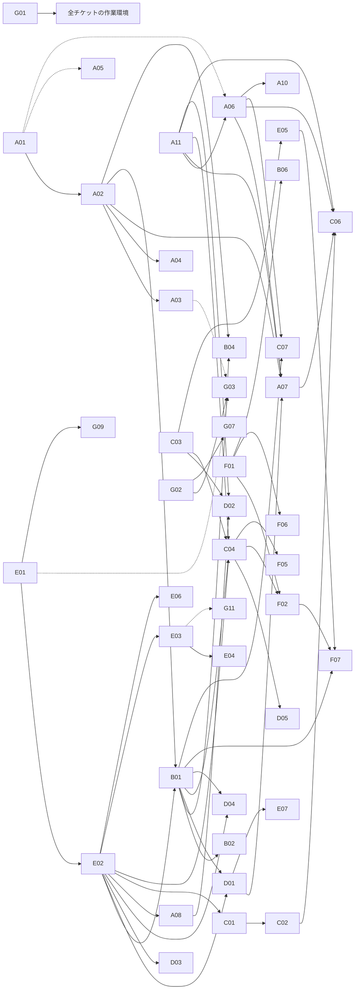
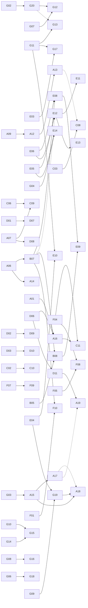
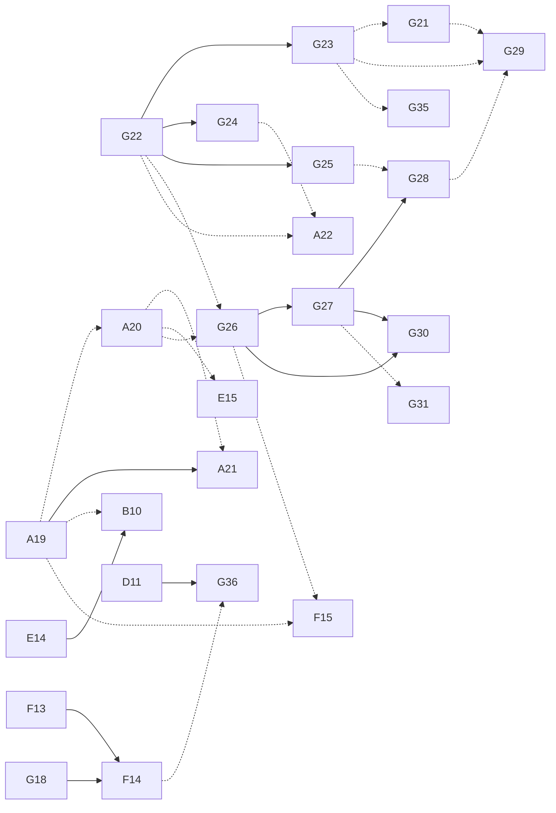
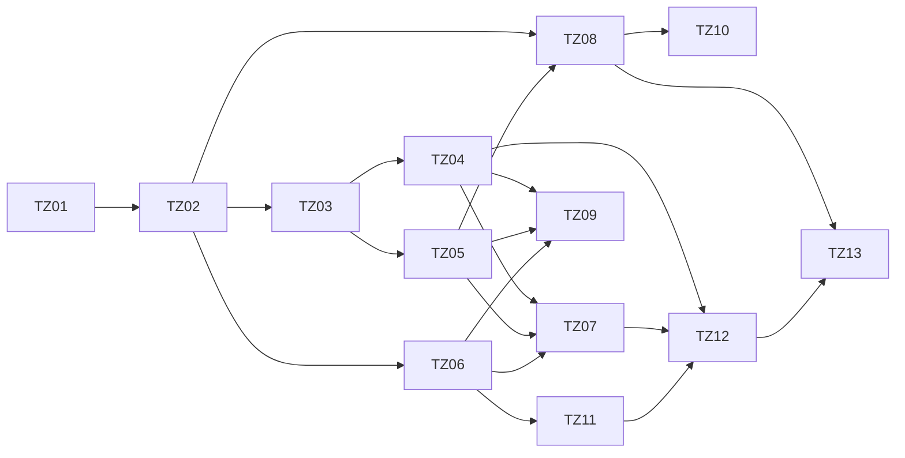
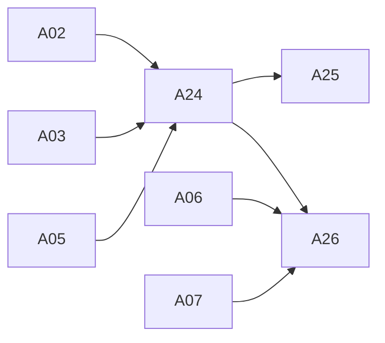
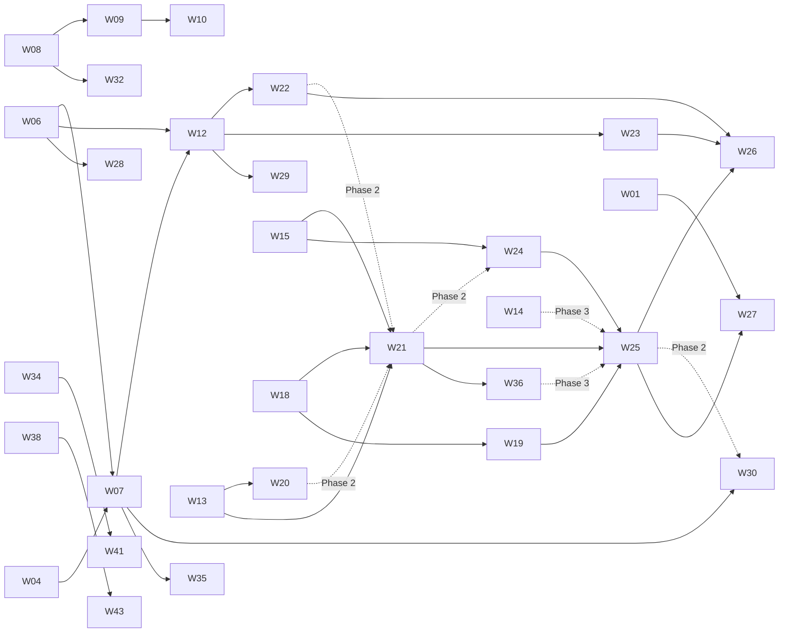
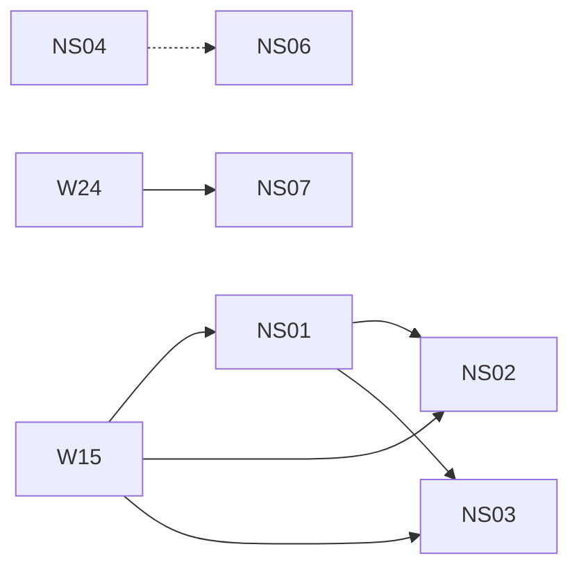
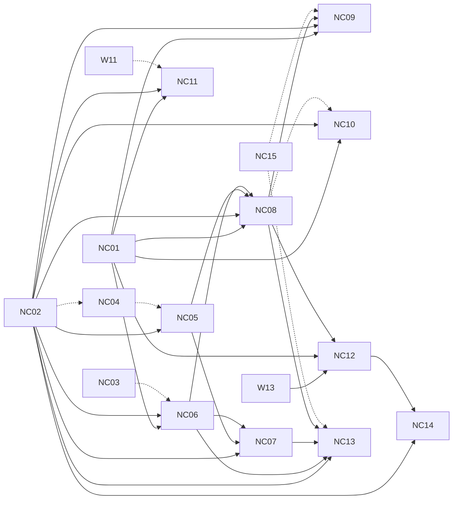
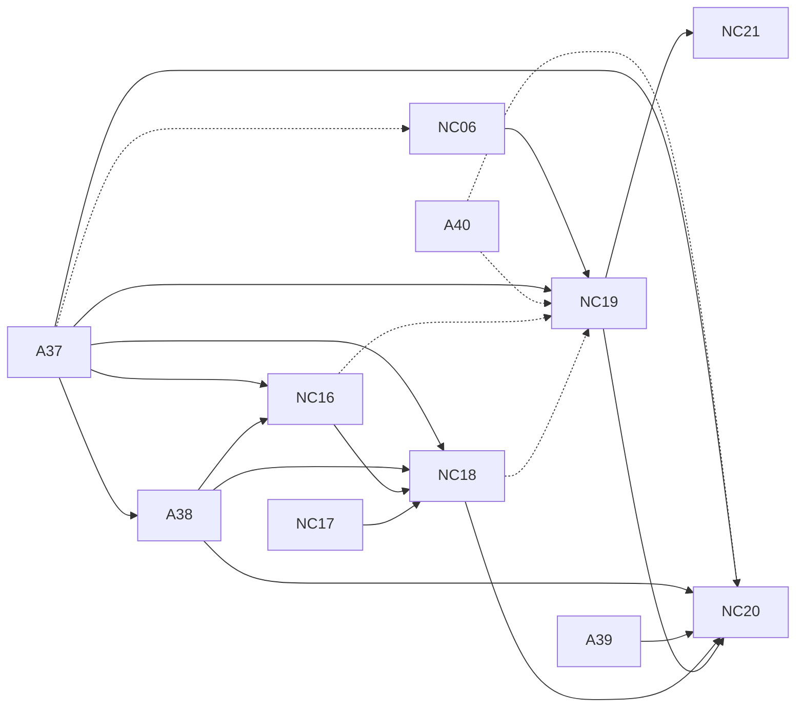
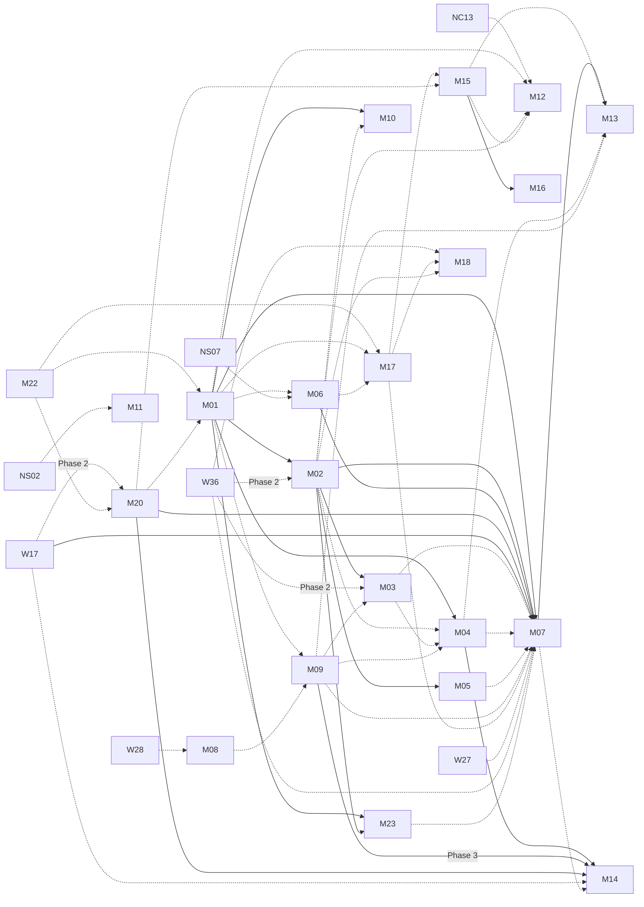

# Tsuzuri 機能実装チケット

Tsuzuri 0.1 の次に実装すべき言語機能・標準ライブラリ・ツールを、1 機能 = 1 ファイルのチケットにまとめています。
**全チケット共通の前提・コードマップ・テスト方法・設計決定は [GUIDE.md](GUIDE.md) にあります。着手前に必ず読んでください。**

- 調査時点: コミット `19d8cdd`（2026-09-23）
- 状態: `todo`（未着手）／`doing`（実装中）／`done`（完了）／`blocked`（依存待ち・要判断）
- 配置: `done` のチケットは [_completed/](_completed/) に移動し、それ以外はこのディレクトリ直下に置きます。起票時点の一覧や件数ではなく、以下の各表を現在の状態と配置の正とします。
- 優先度: **P0** 他機能の前提・早期に必要、**P1** 標準ライブラリと実用化に必要、**P2** 中期、**P3** 長期
- 規模: **S** 1〜2 日、**M** 3〜5 日、**L** 1〜3 週、**XL** 1 か月以上（分割前提）
- 「依存」は着手前に完了が必要なチケット。括弧付きは一部の機能だけが依存する弱い依存です。

## P1 実装・総合検証

P1の25件を実装し、すべて`done`へ更新しました。仕様上の選択は各チケットとGUIDEの設計決定台帳に記録しています。

- `check-runtime-includes.sh`（15ファイル）、`cargo fmt --all -- --check`、`cargo clippy --all-targets -- -D warnings`、Rust全テストが成功。
- README記載の全E2Eがnative/WASM O0/O3で成功。追加feature 3721ケース、整数intrinsic 263182参照ケース、Math 771862参照ケース、Unicode全scalar・表示解析・所有heap・タスク・サンプルを検証。
- Mathは基本745486件と256-bit参照の超越26376件。非NaNのbit一致、NaN分類、heap非確保、trap-info、関数値と評価順を検証。
- C/C++・Rust・C#・JavaScriptの36種目を`run-managed.mjs --quick`で照合。Task／Parallelのquickと整数mixも成功。短縮実行の時間は性能の証拠として扱いません。
- ASan／TSan等の追加検証と性能の実測条件・退行は担当チケットと`docs/benchmarks.md`を参照。P2/P3の機能はこの完了範囲に含めません。

## P2 実装・総合検証

P2の14件を各チケットの実装範囲で完了し、すべて`done`へ更新しました。判断は各チケットとGUIDEに記録しています。

- runtime同梱チェック16ファイル、fmt/clippy、全Rustテストと最新release buildが成功。
- README記載の全E2Eがnative/WASM O0/O3で成功。featureは4911ケース、整数intrinsicは263182参照、型変換は1585参照を検証。
- MathはFMAを含む基本759675件と超越26376件の計786051参照が一致。CのFMA20513参照はASan/UBSanでも成功。
- SIMD有無・generic/native・CPU dispatch、host import、DWARF検証、doc golden/出力保護、LSP UTF8/UTF16実セッションが成功。
- Map/Set26、Seq26、借用record10ケースはASanでも成功。全featureで所有heap回収とWASMメモリ上限を確認。
- CE/SIMD/dispatchのquick比較と整数mix100000反復のチェックサムが一致。短縮時間は性能の根拠にしない。
- A09は完全指定の借用fieldと単一regionの名前付き契約まで。独立した複数record regionは第2期のA12で実装した。
- F05のx86経路はクロスコンパイル済みで、対応実機での実行・速度は未検証。ARM baselineは実行検証済み。P3には着手していません。

## P3 実装・総合検証

P3の全7件に実装を追加しました。各チケットの初期段階の範囲で6件を`done`とし、G10だけはWindows実行ゲート未確認のため`blocked`でした。G10は2026-10-13にWindows x64の実行ゲートを通して`done`になりました（[G10](_completed/G10-windows.md)）。

- E04: strict manifestとローカルpath依存、namespace/循環/出力保護。git/registry/lockfile解決は対象外。
- F06: Node Workerの共有メモリ・独立stack・atomic queue・thread-safe heap。既定WASMはimportなし。Browser本番glueは対象外。
- F07: kernel抽出・CPU参照・strict i32/i32u WGSL・WebGPU host試作。実Metal adapterで783参照が一致。float/64-bit GPU、通常言語runtimeへの自動接続は対象外。
- A10: 明示kind付きrank-1 HKT、部分適用、default/generic methodと通常単相化。HKT aliases/標準Functor導入は対象外。
- B06: Task.parallel_results、最小indexのerror、未開始停止・全開始済みjoin・所有値回収。ASan/UBSan/TSanも成功。
- G11: SHA-256のwhole-build cache、no-cache、破損/同時保存/eviction、tool/source/依存/sidecar検証。parse/check/IR cacheは対象外。
- G10: MSVC ABI・Win32 runtime・safe hardlink保護・専用CIを実装。実Windows SDKでO0/O3 COFF/PE linkとRust全targetのcross checkは成功。Windows上のcargo test・native実行・file置換は、2026-10-13にGitHubの`windows-2022`で確認した（[G10](_completed/G10-windows.md)）。
- runtime19ファイル、fmt/clippy、全Rustテスト、READMEの全ローカルE2Eが成功。feature4928、Task41結果/4trap、整数intrinsic263182、型変換1585、Math786051参照を検証。
- 36種目の多言語quick、Task/Parallel、CE/SIMD/dispatch、cache/GPU参照quickが成功。短縮時間は性能優位の根拠にしません。比較harnessのMix入力は独立したrootへ修正しました。

## 第2期: 他言語比較で見える劣位の改善計画

[なぜ Tsuzuri か（起票時の版）](https://github.com/tatsuya-midorikawa/Tsuzuri/blob/c82c13e1e3dd1f02f78694aa1d26d39b3f793504/_docs/learn/why-tsuzuri.md) が挙げる C/C++・Rust・C#/F# に対する劣位点と、同ページに記載のない劣位点を調べ、改善を機能ごとのチケット 38 件にまとめました（2026-09-29 起票）。現在の比較は [なぜ Tsuzuri なのか](../_tsuzuri/language-reference/languages/why-tsuzuri.md) にあります。

- 対象: A12–A16、B07–B08、C08–C11、D07–D11、E08–E14、F08–F13、G12–G20。G12・G14・G20 は `done`（Phase 1）、A12 は `done`（Phase 1・2）、A13 は `done`（Phase 1・2）、A15 は `done`（Phase 1・2）、B07 は `done`（Phase 1・2）、B08 は `done`（Phase 1・2・3）、C09 は `done`（Phase 1・2）、D07 は `done`（Phase 1・2）、E08 は `done`（Phase 1 の段 A–C と Phase 2。Windows を除く）、E12 は `done`（Phase 1 の段 A–D）、E14 は `done`（Phase 1・2・3）、F11 は `done`（Phase 1・2）、F12 は `done`（Phase 0・1。Phase 2 は実測で不要と判断）、C08・A16・A14 は `done`（Phase 1・2）、F13・F08 は `done`（Phase 1・2・3）、C10・D08・D09・E11・E13・E10 は `done`（Phase 1・2）、G16・G18 は `done`（Phase 1・2・3）、G17 は `done`（Phase 1・3。Phase 2 は実測で見送り）、G13 は `done`（Phase 1・2。Phase 3 の JIT は再検討して採用しない）、E09・F09 は `done`（Phase 1・2・3）、F10・C11 は `done`（Phase 1・2）、D10・D11・G15・G19 は `done`（Phase 1・2。2026-10-11、D-45）、ほかは `todo` です。第2期の 38 件はすべて `done` になりました。
- 調査時点はコミット `9012e92`。各チケットの「現状」は同時点のコード・文書・生成コードで確認しています。
- 第2期のチケットは設計の方向性と第 1 段階を示す計画です。独立レビューは未実施で、着手前に GUIDE §0 の手順 2 に従ってレビューします。
- 予約語・診断コード・std モジュールの割り当ては [GUIDE の D-30](GUIDE.md#d-30-第2期計画の仮割り当て未承認) に仮登録しています（未承認）。
- 言語の意味や既存の設計決定を変える提案（C08 の D-13 変更、A16 の `[T; N]` 再導入、C10 Phase 2 の参照カウント、D11 Phase 2 の static データ）は、着手前に人間の承認が必要です。C08・A16 は D-39、C10 は D-40、D11 Phase 2 は D-45 で承認済みです。

### 改善の方針

- AGENTS.md の原則を変えない。数値・評価順序・トラップ・所有権の意味を保ち、ハードウェア依存の経路には能力確認と明示的なエラーを持たせる。
- 新しいホスト機能（WASI、乱数 seed、非同期、GPU）は明示的な opt-in とし、既定の WASM の import なしを保つ（D-18）。
- 劣位の解消を名目に GC、例外による巻き戻し、暗黙の fast-math、黙った fallback を導入しない。
- 性能の改善は計測と生成コードの確認を先に行い、実装済みと計画を区別して文書に書く。
- 既定の出力を変えない。新しい機能を使わないプログラムの IR・import・ABI が同一であることを各チケットの受け入れ条件に含める。

### why-tsuzuri に記載された劣位と対応

| 比較対象 | 劣位点 | 対応チケット |
|---|---|---|
| C/C++ | ポインター・メモリ配置・allocator・任意の外部 ABI の制御の自由度 | E12, F13, A16, E11 |
| C/C++ | OS・デバイス・既存ライブラリとの接続にホスト実装が必要 | E08, E09, E11, E12 |
| C/C++ | 既存の C/C++ コードをそのまま取り込めない | E11, E12 |
| C/C++ | 対応プラットフォーム・最適化済みライブラリ・デバッガー・長期運用の実績 | G15（実装済み。Windows の x64 は G10 の job が実行して確かめた）, C11, F08, G16, G19 |
| C/C++ | GPU が実験段階 | F09 |
| C/C++ | 安全検査・所有値の複製・ホスト境界の変換のコスト | F12, A15, A16, E13 |
| Rust | 排他スライス（C08）、排他借用フィールド（A13）、レコード内の独立した複数 region（A12）は実装済み。要素単位の排他借用と region 間の outlives はない | C08, A13, A12 |
| Rust | Copy のコストモデル（配列・捕捉の深い複製）。複製の可視化（A15）と、ヒープを使わない固定長配列 `[T; N]`（A16）は実装済み | A15, A16, C10 |
| Rust | Cargo／crates.io・非同期 I/O・低水準 API・開発ツールの成熟度 | E10, B08, E12, F13, G12, G14, G18 |
| C#/F# | .NET の標準ライブラリ・NuGet・GUI／Web／DB・ファイル／ネットワーク API | E08, E09, E10, E13, D08, D09, C09 |
| C#/F# | GC に任せられる共有データ・循環構造 | C10, A14 |
| C#/F# | async／await、対話環境、IDE 支援 | B08, G13, G12, G20 |

### why-tsuzuri に記載のない劣位と対応

| 劣位点 | 比較の基準 | 対応チケット |
|---|---|---|
| native ホストへ組み込んだ関数のトラップでホストのプロセス全体が終了し、スタック枯渇は理由なしに異常終了する | Rust の `catch_unwind`、C# の例外 | E14 |
| WASM の線形メモリが stack・data・heap 合計 16 MiB に固定 | Rust／C++ の wasm32（最大 4 GiB） | F11 |
| 実行時多相がなく、異種コレクションを作れず、単相化のコードサイズと特殊化上限を避けられない | C++ の仮想関数、Rust の `dyn`、C# のインターフェース | A14 |
| 長さを型に含む値型の配列がない | C/C++ の `T[N]`、Rust の `[T; N]` | A16 |
| メモリ以外の資源を所有値として解放できない | Rust の `Drop`、C++ の RAII、C# の `IDisposable` | B07 |
| ハッシュ表がなく、Map の挿入・削除が O(n) | C# の `Dictionary`、Rust の `HashMap` | C09 |
| 文字列補間・書式指定・直列化・正規表現がない | C#/F#、Rust | D07, D08, D09 |
| 既存の C 関数を直接呼べず（`tsuzuri_host_` 名の shim が必要）、実行ファイルへホストのライブラリをリンクする CLI がない | C/C++、Rust の FFI | E12 |
| 関数内のエラーから回復しないため、一度に得られる診断が少ない | rustc、C# コンパイラ | G20 |
| 毎回の全体コンパイルと固定上限（特殊化 1,024、ソース 1 MiB など） | C/C++ の分割コンパイル、Rust の増分コンパイル | G17 |
| VS Code 拡張以外では LLVM・Clang・LLD の導入が必要 | rustup、.NET SDK | G14 |
| 利用者コードのベンチマーク・カバレッジ・プロパティテストがない | cargo bench、BenchmarkDotNet、coverlet | G18 |
| f16 が常にソフトウェア演算 | C/C++ の `_Float16` | D10 |
| コンパイル時評価の範囲が狭い | C++ の `constexpr`、Rust の `const fn` | D11 |
| 共有状態・パイプラインの並行プリミティブがない | C++、Rust、C# | F10 |
| ホストバインディングの生成と、ブラウザー向けの WASM threads glue がない | wasm-bindgen、Emscripten | E13 |
| 言語版・非推奨の管理と公開 API の差分検査がない | Rust の edition、C# の言語版 | G19 |

### 採用しない改善

| 候補 | 理由 |
|---|---|
| GC・サイクルコレクター | 所有権による決定的な解放という設計目標と矛盾する。循環は C10 の Arena／Handle と Weak で扱う |
| 例外と巻き戻し、`?` 演算子 | D-10 の方針。ホスト境界の失敗は E14 の opt-in 境界で返し、言語内の失敗は Maybe／Result で表す。2026-11-26 の [D-67](GUIDE.md#d-67-tsuzuri-だけで-macos-のデスクトップアプリを書くm01m22) で、Objective-C の例外を `Result<R, ObjC.Exception>` と宣言した呼び出しの地点だけで値に変えることを、D-10 の狭い解釈として認めた（[M05](M05-objc-exception-boundary.md)、計画中）。Tsuzuri のフレームの巻き戻しは入れない |
| 暗黙の fast-math・再結合、GPU・SIMD での黙った精度変更 | 数値の意味を変える。緩い演算は名前で区別した別 API にする（F09、C11） |
| `unsafe` ブロック・生ポインター型 | 安全性の目標と矛盾する。低水準の処理はホストに置き、E12 の不透明ハンドルと、2026-11-22 の [D-63](GUIDE.md#d-63-tsuzuri-だけで-win32-のアプリを書くe12-d13-の狭い改訂w01w30) に基づく型付きの `extern view`（[W24](_completed/W24-extern-view.md)、完了）・`extern interface`（W25）に限って許可する。2026-11-26 の [D-67](GUIDE.md#d-67-tsuzuri-だけで-macos-のデスクトップアプリを書くm01m22) で、同じ原則の下で Objective-C のための型付きの `extern class` などを足すことを決めた（`extern class`・`extern category`・`ObjC` と型付きのメッセージ送信は M01・M02 で実装済み（2026-11-27）。M03〜M05・M10・M23 は計画中）。生ポインター型と `unsafe` は引き続き入れない |
| 利用者が境界検査を無効にするオプション・unchecked API | 安全性を下げる。検査のコストは F12 の証明と計測で減らす |
| .NET／JVM ランタイム互換、クラス継承、型プロバイダー | 言語の対象外（[対応状況（旧版）](https://github.com/tatsuya-midorikawa/Tsuzuri/blob/c82c13e1e3dd1f02f78694aa1d26d39b3f793504/_docs/feature-status.md)）。.NET からの利用は E13 のバインディングで行う。[D-67](GUIDE.md#d-67-tsuzuri-だけで-macos-のデスクトップアプリを書くm01m22) の `extern class`（[M01](_completed/M01-objc-class-types.md)、実装済み）は、ホストの Objective-C のクラスの階層を型の検査に写すだけで、Tsuzuri の型に継承は入れない（基底への暗黙の変換はなく、`ObjC.upcast` を書く） |
| GUI・Web フレームワークの同梱 | ホストの責務。E13 の生成 glue で既存のフレームワークと接続する |

## 一覧

### A. 型システム

| ID | チケット | 優先 | 規模 | 依存 | 状態 |
|---|---|---|---|---|---|
| A01 | [型適用とジェネリックなレコード](_completed/A01-generic-records.md) | P0 | L | – | done |
| A02 | [判別共用体（union）と列挙型](_completed/A02-union-types.md) | P0 | XL | A01 | done |
| A03 | [match の網羅性・到達不能節の検査](_completed/A03-match-exhaustiveness.md) | P0 | M | A02 | done |
| A04 | [再帰的なヒープ型（木・AST）](_completed/A04-recursive-types.md) | P1 | L | A02 | done |
| A05 | [型別名](_completed/A05-type-aliases.md) | P1 | S | (A01) | done |
| A06 | [型クラスの拡張（条件付きインスタンス・スーパークラス・デフォルトメソッド）](_completed/A06-typeclass-extensions.md) | P1 | L | A11, (A01) | done |
| A07 | [deriving（Eq／Ord／Display／Hash／Default の自動導出）](_completed/A07-deriving.md) | P1 | M | A11, A06, A02, D01 | done |
| A08 | [char（UTF-16）型と utf8char（Unicode スカラー）型](_completed/A08-char-type.md) | P1 | M | E02, (B01) | done |
| A09 | [名前付きライフタイムと借用フィールド](_completed/A09-named-lifetimes.md) | P2 | XL | – | done |
| A10 | [高階型（HKT）](_completed/A10-higher-kinded-types.md) | P3 | XL | A01, A06 | done |
| A11 | [比較演算の非消費化（Eq／Ord の借用シグネチャ）](_completed/A11-borrowed-comparisons.md) | P1 | M | – | done |
| A12 | [レコード内の独立した複数 region と region 付き関数値型](_completed/A12-multiple-regions.md) | P2 | XL | A09 | done |
| A13 | [排他借用フィールドと参照経由の更新](_completed/A13-exclusive-borrow-fields.md) | P2 | L | A12 | done |
| A14 | [型クラスによる動的ディスパッチ（dyn 値）](_completed/A14-dynamic-dispatch.md) | P2 | L | A06, (B07) | done |
| A15 | [暗黙の深いコピーの可視化](_completed/A15-copy-cost-visibility.md) | P2 | M | G03, (G12) | done |
| A16 | [固定長配列と const ジェネリクス](_completed/A16-fixed-arrays.md) | P2 | XL | A01, D06, (F04) | done |
| A17 | [暗黙の複製の除去（最終使用の move と所有する scrutinee の match 束縛の move）](_completed/A17-last-use-move.md) | P1 | L | A15 | done |
| A18 | [引数規約: 読み取りを既定にする（`own`、edition 2027）](_completed/A18-parameter-conventions.md) | P2 | XL | A15, G19, (A17) | done（Phase 1〜4、2026-10-24。[PR48](https://github.com/tatsuya-midorikawa/Tsuzuri/pull/48)、未マージ） |
| A19 | [純粋関数 `pure def`（副作用のない関数を署名で保証。引数は共有借用か `own`）](_completed/A19-pure-functions.md) | P2 | L | D11, A15, B07, F10, C10, (A17) | done（全 Phase） |
| A20 | [効果の要約と検査付き関数属性（`@no_alloc`・`@no_copy`・`@no_trap`・`@terminates`）](_completed/A20-effect-summary-and-checked-attributes.md) | P1 | XL | (A19), (G22) | done（全 Phase） |
| A21 | [契約 `@requires`／`@ensures`（off／check／test／prove）](_completed/A21-contracts-requires-ensures.md) | P2 | XL | A19, (A20), (G22) | done（全 Phase） |
| A22 | [edition 2027 の正準形（`..<`／`..=`・接尾辞・借用の表記・旧ラムダ）と移行](_completed/A22-edition-2027-canonical-forms.md) | P1 | L | (G22), (G24) | done（全 Phase） |
| A23 | [整数の折り返しの意図（`Int.wrapping_*`・`--overflow-report`・`tsuzuri test` の既定）](_completed/A23-integer-overflow-intent.md) | P2 | L | PR02, (G22) | done（全 Phase） |
| A24 | [匿名共用体 `(A \| B)`（型で区別する共用体・期待型での注入・型テストのパターン `:?`）](_completed/A24-anonymous-unions.md) | P1 | L | A02, A03, A05 | done（宣言なしの `(i64 \| string)` を、edition 2026 と 2027 の両方で型を書ける位置に書ける。要素は平らにして正準順序に並べ、順序と入れ子は型を変えない（2〜32 個。型変数・区別できない要素・重複は `E1041`、借用は `E1013`、33 個以上は `E1017`）。期待型が匿名共用体の位置（注釈・結果・引数とパイプ・フィールド・ペイロード・リテラルの要素・腕）で、要素の型の値にタグを付けて包む（リテラル・ラムダ・`Dyn.of` は形で要素を選び、曖昧なら `E1041`、要素でなければ `E1003`）。`:? T as x` で取り出し、`match` は `missing: :? bool` と修正案で網羅性を検査する。表現は要素数ごとに合成した総称の union の具体化（`$anonymous.Union$n`）で、合成した名前は診断・hover・doc・kg・api-diff・find・デバッガーに出ない。共用体どうしの変換は A25 が、組み込みの `Eq`・`Ord`・`Hash`・`Display`・`Encode`・`Decode` は A26 が足した。利用者のインスタンスは書けない（`E1041`）。匿名共用体を書かないプログラムの IR・診断・kg・doc・api-diff の出力は変わらない） |
| A25 | [匿名共用体どうしの変換（部分集合からの拡大と `:? (A \| B)` の絞り込み）](_completed/A25-anonymous-union-conversions.md) | P2 | M | A24 | done（期待型が匿名共用体 `U` の位置（注入と同じ位置）で、要素がすべて `U` にあり要素の数が少ない匿名共用体 `V` の値を、タグを付け替えて `U` の値にする（拡大。`U` にない要素と、要素の多い値は `E1003` の `anonymous_union_not_subset`、2 つ以上の要素と合いうる要素は `E1041`。参照 `ref V`・入れ物や関数の中・演算子の被演算子は拡大しない）。型テストに匿名共用体を書ける（`:? (A \| B)`。網羅性は要素ごとの型テストの OR）。`as x` は `(A \| B)` の値を束縛し、所有する値からはペイロードを move する（要素がすべて Copy なら複製し、照合した値を残す）。借用した値とガードのある腕では、要素がすべて Copy のときだけ複製して作り、そうでなければ `E1041` の `type_test_narrow_borrowed`。すべての要素を並べた `:? U as x` は値そのものを束縛する。kind `type_test_union` は出なくなった。新しい型付き IR はなく、検査器が作るのと同じ形の `match` で作り、再帰しない匿名共用体では確保しない） |
| A26 | [匿名共用体の型クラス（`Eq`・`Ord`・`Hash`・`Display`）と JSON（`Encode`・`Decode`）](_completed/A26-anonymous-union-classes.md) | P2 | M | A24, A06, A07 | done（匿名共用体は、要素がすべてそのクラスを持てば、タプルと同じ組み込みの `Eq`・`Ord`・`Hash`・`Display` を持つ。`==` は同じ要素でペイロードが等しいとき、`<` などは要素の正準順序（表示の順。書いた順ではない）の次にペイロード、`Hash` は名前付きの union の導出と同じ列、`Display` はペイロードだけ（入れ物の中の文字列は引用符付き）。`HashMap`・`HashSet`・`Map`・`Set` のキー、`deriving` のある型のフィールド、`dyn Display`・`dyn Encode` に使える。JSON では `Encode` がペイロードの JSON をタグなしで書き、`Decode` は JSON の値の種類（boolean・number・string・array・object）で要素を選ぶ。要素が読む種類が重なる型（`(i64 \| f64)`、`(Map<i64, string> \| [i64])`）と、種類が決まらない要素（`Maybe`・名前付きの union・`Json.Value`・手書きの `Decode` を持つ型）を持つ型は `Decode` を持たず、理由を言う `E1025`（`anonymous_union_decode_overlap`）。どの要素も読まない JSON は `json: expected number or string` の形の `Json.Error`。`Default`・`Format`・`Arbitrary` と利用者のインスタンスはない。本体は Specializer が作る型付き IR の関数で、LLVM の生成・std・ランタイムは変えていない） |
| A27 | [結果の型が未定の呼び出しを `ref T` の引数へ直接渡すと、結果を `ref T` と推測して `E1003` になる（`id (Owned.call (ref next) input)`）](_completed/A27-call-argument-reference-hint.md) | P1 | M | A18, D14 | done（引数が結果を値に決める呼び出し（`Owned.call`・ラムダ・`Array.get 0 xs`・`Maybe.get m`）は `ref T` の引数へ一時値として貸す。推測は結果を見うる引数の直前か最後の引数の後まで待つ。`Parallel.map`・`map_ref`・`reduce` の入力の一時値も build できる。通り抜けの形（`Text.trim`・`id (id x)`）と、引数に呼び出しやリテラルを直接書く形（`id (Array.get 0 [a, b])`）は今までどおり） |
| A28 | [関数を含む型の呼び出し結果が `ref` 引数の借用をすべて持つとみなされる（`HashMap.remove` と、関数の `Arc` の `Arc.share` が誤って `E1013`）](_completed/A28-function-results-retain-ref-arguments.md) | P1 | M | C09, TZ02 | done（A28 の時点では、借用を持ちうる値を `Array.write`（とそれで書き込む std の関数）や `SyncMap.__replace` で格納する所がプログラムのどこにもないときだけ効いた（1 つでもあればプログラム全体で以前の規則。A31 がその格納を追跡し、この条件と、特殊化した本文での排他借用の除外を外した）。関数値など、借用を関数の環境にだけ持ちうる結果の直接の完全適用は、callee の本文が結果に入れうる引数の借用だけを持つ（特殊化ごとの最小不動点）。`Rc`/`Arc` の `share`・`downgrade`・`upgrade` は `shared` の借用ではなく中身の借用（の写し）を持つ（`shared` の値が呼び出し元の loan を持つ引数・捕捉から来たときは `shared` の借用のまま）。パイプラインで完成する呼び出しも同じ。参照を含む結果はシグネチャのまま。本体が書き込める場所（排他借用、借用を持ちうる値の `Mutex` などの共有セル、それらを引数・結果に持つ関数値）をほかのコードへ渡す関数と、借用を持ちうる値を本体の見えないコード（名前付き関数でない関数値の呼び出し、dyn のメソッド、`Owned.call`、コールバックを実行する組み込み関数、そうした呼び出しをする関数）へ渡す関数は事実も読み通しも使わず（その中で作るラムダも、そうしたラムダを作る関数も同じ）以前の規則のまま。追跡されない格納をしうる `Drop.drop` があるプログラムでは、破棄でコードを実行しうる値が持つ引数の借用を結果に残し、そうした値を破棄する本体は読み通さない（これらの局所の除外は、プログラム全体の条件に重ねて残す。`Array.write` や lock のコールバックの書き込みを追跡しない以前からの穴 A31 を広げないため）） |
| A29 | [印を持つ dyn 型を型引数にした組み込み関数の LLVM シンボルが不正になる（`Channel<dyn (C, Send)>` がビルドできない）](_completed/A29-dyn-marker-builtin-symbols.md) | P1 | S | A14, TZ03 | done（組み込み関数の引用符なしのシンボルは dyn 型の印の `+` を `$P` と綴る。`Channel<dyn (C, Send)>`・`Vec<dyn (C, Copy)>`・`dyn C {r}` の `Vec` が native と WebAssembly でビルドできる。型の綴りは純粋な関数型を `pure.fn[…]` と綴り、`Box<i64 -> i64>` と `Box<pure (i64 -> i64)>` の型名・組み込み関数の具体化が衝突しない。引数規約だけが違う関数型は生成コード上の 1 つの型（`codegen_identity`）で、型名・具体化・vtable・helper・ユーザーの drop を共有する。型引数に印も純粋な関数型も持たないプログラムの綴りは変わらず、引数規約を持つ関数型を型引数に持つプログラムでは定義の並びが変わることがある） |
| A30 | [借用を持つ関数値から `Owned.function` を作れてしまい、`Routine.go` などで解放後の読み出しになる](_completed/A30-owned-function-from-borrowing-value.md) | P0 | S | TZ02, TZ05, TZ06 | done（`Owned.function` は借用を持つ関数値（変数・部分適用・引数・借用を持つ関数値を捕捉したラムダ）を `E1013` で拒否する。パイプラインは同じ検査、関数値にすると `must_apply_directly`。`own Owned.Function` の引数は借用を持たず、所有のラムダや tzroutine で捕捉できる。`Owned.call` を 2 つの引数に直接適用した結果（`x \|> Owned.call (ref f)` を含む）は所有関数値を借用しない。`Owned.call` から作った関数値を通した結果は借用したまま） |
| A31 | [`Array.write` と、それで書き込む std の関数が、書き込んだ値の借用を書き込み先の持ち主に残さない（借用元の解放後に読める）](_completed/A31-in-place-writes-keep-stored-borrows.md) | P0 | L | A13, A28 | done（`Array.write`・`SyncMap.__replace`・`Vec.push_mut` と、それで書き込む std・利用者の関数（generic な関数の具体化、`MatrixView.write` などを含む）の呼び出しは、`arr[i] = v` と同じく、書き込んだ値の借用を書き込み先の持ち主（`MatrixView.Mut` の窓なら窓が借りる配列、lock のコールバックならロック）に残す。特殊化した本文から求めた書き込みの事実（引数の値か参照先の中身が、どの引数の書き込み先へ入りうるか、関数値の引数をどう呼ぶか）を A28 の事実と合同の最小不動点で求め、直接の呼び出し・パイプライン・部分適用・コールバック・関数値の引数（edition 2027 の読み取りの仮引数も）で当てはめる。本体の見えない関数値の呼び出しは、関数値と引数の借用を引数の書き込み先のすべてへ残し、環境へ書き込む関数値を作るプログラムでは、そうした関数値でありうる型の関数値の環境の先へも、その関数値がセルを所有するプログラムでは、そうした関数値を持ちうる型かセルに届く型のすべての局所値へも残す（第 1 回〜第 9 回のレビュー対応。不変な局所値に束縛したラムダ・部分適用とその配列・レコードのリテラル、dyn のメソッド（dyn 値の場所はメソッドが書き込みうるときだけ書き込み先）、演算子の instance、`Owned.call`、`Seq.next` が実行する step 関数、破棄される一時値にも事実を当てはめ、値の破棄が実行する `drop` がセルを所有する関数値へ渡すものも残す。値の出どころからセルを所有する関数値を持ちえないと分かる値は、型が同じでも数えない（`match` のパターンで取り出した値は照合した値の出どころ、`mut` の仮引数は追えない値））。局所値の借用を `ref mut` の引数や呼び出し元のセルへ書き込むと書き込みの位置で `E1013`（`store_local_borrow_through_reference`。`Drop.drop` が書き込む値を束縛する所も）。局所の `Rc`・`Arc` の共有を呼び出し元のデータやセルを所有する関数値へ渡した後でブロックのセルへ書き込む借用もそこへ書き込んだものとし、型注釈・パターンを書いたラムダの仮引数や仮引数のフィールドの呼び出しは呼び出し元の実引数のその部分で、共有参照の先を照合したパターンの変数の借用は照合した値の借用として検査する。書き込める仮引数の先の借用を呼び出し元へ書き込んだ後の、その仮引数を通した借用した場所に届く書き込みは `E1014`（別のフィールドへの書き込みは受理）、関数値の仮引数へ渡した後に書き込むなら、受け取った値を残す関数値を渡す呼び出しが `E1013`。借用を読みうる `drop` を実行する値が同じブロックで後に宣言した変数の借用を持つと `E1013`（破棄の順序、第 6 回。一部の経路でだけムーブした値と、`break`・`continue`・例外で抜ける位置も、第 7 回。後に宣言した仮引数の借用を持つ仮引数も、第 8 回。`match` の腕のパターンの変数、後に作った一時値（か自分自身）に借用を保持させる一時値、自分の部分の借用を持つ値（`self_referential_store`）も、第 9 回）。値で受け取った仮引数の中のセルは関数が所有するものとして扱う（第 9 回）。これらの破棄の順序の検査は、どの記憶域にも 1 つの規則（借用を読みうる `drop` を実行する値は、より後に破棄される値か、読みうる部分より後に破棄される自分の部分の借用しか持てない）で判定し、呼び出し先が関数値へ渡す値は呼び出し先から見た型で数える。`ref mut` の仮引数の先の部分の借用を同じ先へ書き込む関数は、どう呼んでも（`ref mut` の変数、中継する関数、関数値の仮引数、本体の見えない関数値も）呼び出し元の値に自分の部分の借用を残す（第 9 回の後）。持ち上げたラムダの捕捉は関数値の環境のもの（`Owned.function` のラムダが捕捉したセルへの書き込みは環境に残る）、呼び出し先が借用した部分だけを呼び出し元に残し、値全体の代入は古い値の自分の部分の借用とともに古い値を解放する、ビューの先は配列の要素、`Rc`・`Arc` のブロックの中は値の部分の順序、呼び出し先がそのまま渡す引数は呼び出し元の実引数、本体の見えない関数値は `ref T`・`ref mut T` でもプログラムの関数が同じ型へする書き込みだけをする（第 10 回）。借用を読みうる `drop` を実行する値は、借用する変数が後で持つ借用（ロックのコールバックがそのセルへ書き込んだもの）も読みうるものとして数え、値全体の代入・`deref p = v`・ほかの部分が借用を持ちえないフィールドの代入は古い値の自分の部分の借用を終わらせて変数を使えるままにし、`ref mut`・`ref` の変数やパイプラインを通した呼び出しは借用した部分の共有の借用だけを残し、`Rc.share (ref rc)` を束縛した変数を通した借用は同じブロックの部分、関数値へ渡した仮引数の先の部分は部分のまま（第 11 回）。参照が複数の値のどれかを指しうる呼び出し（`target (if c then ref a else ref b)`）は値ごとに自分の部分の借用だけを残し、`ref mut` で貸した共有はブロックの持ち主でなくなり、`deref p = v` は写し・共有のブロック・`Drop.drop` の書き込みに残りうる自己の借用を終わらせず（`E1014`）、`Rc` の代入は共有を通したブロックの自己の借用も終わらせる（第 12 回、最終。残る穴と保守的な制限は [A33](_completed/A33-remaining-store-soundness-holes.md)）。ロックのコールバックが中身の借用をコールバックの外へ残すと `E1013`（`mutex_result_retains_borrow`、第 8 回）。書き込んだ借用を返す closed の関数は closed を取り消す。A28 のプログラム全体の条件・パイプラインの closed の門・排他参照の lends を外し、セルを渡す本文の読み通しの禁止、見えないコードの除外、`drops_store`、推論の段で書き込みうる本文が書き込める場所を渡すときの以前の規則は残す） |
| A32 | [規約 `[Read]`・`[Mut]` の関数型が期待される位置へ、引数を `ref T`・`ref mut T` と注釈したラムダを直接書くと `E1003` になる（`if n > 0 then text_length else \(text: ref string) -> …`）](_completed/A32-annotated-reference-lambda-under-conventions.md) | P2 | S | A18 | done（規約 `[Read]`・`[Mut]` を持つ関数型（edition 2027 の既定の読み取りと `mut T`、2026 の `pure def` の読み取り）が期待される位置（`if`・`match` の枝、ジェネリックなレコード、`Vec.push` など）へ直接書いたラムダと、`def` の右辺のラムダは、引数のパターンの最上位が参照の型の注釈（`\(text: ref string)`、`\(counter: ref mut Counter)`、参照の型の別名、`(_: ref T)`、`((a, b): ref (A * B))`）なら、その引数を値 view にせず注釈のとおり参照として束縛する（`let` で束縛したラムダと同じ型と生成コード）。参照先の型が推論中の型・参照・型適用のとき（`def inspect :: 'a -> i64` の値と並べた `if` の `ref ?t`、要素型が先に `ref (ref T)` に決まった `Vec`）は従来どおり値 view と比べるので、今まで受理していたプログラムの型・診断・IR は変わらない（`tests/fixtures`・`examples` の IR は byte 単位で同じ）。注釈の無い引数・値の型の注釈・分解するパターンは従来どおり値 view。規約の無い値の引数への参照の注釈（`apply (\(text: ref string) -> …)`、外側のラムダの引数だけを `def` が受け取る `\(a: ref string) -> \(b: ref string) -> …` の内側）は `E1003` のまま） |
| A33 | [格納と破棄の順序の検査に残る穴と保守的な制限を、記憶域の寿命と破棄の順序の 1 つのモデルで直す](_completed/A33-remaining-store-soundness-holes.md) | P0 | XL | A31 | done（`E::Interpolated` の `Format` 補間引数伝播、`ref r2 |> Rc.share` のブロック共有追跡、`keep_for_drop` の重複排除、および A34 との合同検証を実装） |
| A34 | [`main` が受理する安全なプログラムを、A31 の格納と破棄の順序の検査が `E1013`・`E1014` で拒否する（フィールドや要素の `Rc.get` を束縛した変数、受け取った関数値を持つ値の破棄、書き込む部分の側の参照の変数、使い終えた共有の型の判定、`Rc.get (ref r)` の持ち主、参照の仮引数から作った共有、ループの中の置き換えの後の写し、セルへ書き込んだ複数 region のレコード）か、検査が収束せず `E1017` で打ち切る（参照の仮引数の先の借用をセルを所有する関数値へ渡すループ）](_completed/A34-store-check-safe-rejections.md) | P1 | L | A31 | done（9 項目すべて — `rcgetpart`・`fvdrop`・`refsrc`・`sharetype`・`rcgetowner`・`shareparam`・`replcopy`・`cellslots`・`loopplace` — の安全な形を受理しつつ対応する不安全な双子を引き続き拒否） |
| A35 | [実際のプログラムの収束するループの借用の増え方が A31 のループの打ち切り（`LoanGrowth`）の上限に近づいたら、テストを失敗させる（収束したループの増え方の統計をテストだけに見せ、`tests/` のプログラム・`examples/`・std の例の最大を、増え方の連続の上限の 1/2 と比べる。`LOOP_GROWING_LARGE` の借用の数は 1/8 で数える）](A35-loop-growth-margin-check.md) | P2 | M | A31 | todo |
| A36 | [edition 2027 で、ペイロードを持つジェネリックな複数ケースのアクティブパターンを誤って拒否する](_completed/A36-active-result-default-reads.md) | P2 | S | G44 | done（関数本体の引数の準備を `bind_function_parameters` にまとめ、複数ケースのアクティブパターンの結果の推論でも使う。`pure def` の形も直った。非 Copy の入力をそのままペイロードにするときは、関数本体と同じく `Copy` か `ref 'a` が要る） |
| A37 | [`Index` が土台の場所を借りないため、一時値の土台の窓が解放後のメモリを読み、`Tensor.Mut` から取った窓が書き込み中も生きる不具合の修正](_completed/A37-index-base-place-borrow.md) | P0 | M | – | done（土台を借りる `Index` を場所の共有借用で下げ、一時値の土台は中身だけを返す `returns_contents` 以外 `E1013`。`Index`/`IndexMut`・1 引数算術クラスの orphan 規則 `E1016` `orphan_instance` と利用者位置での std 重なり報告を追加） |
| A38 | [添字の評価順を組み込みの添字にそろえる（土台、キーの成分を左から右。`IndexMut` の `=` は右辺が先）](_completed/A38-index-evaluation-order.md) | P0 | M | A37 | done（全 `Index` の評価順を「土台 → キー左から右」に統一し、キー評価中は土台に共有ガード（競合は `E1014`）、`IndexMut` の `=` は右辺先行に統一） |
| A39 | [レコードのフィールドの経路の排他借用（`ref mut b.f`・`ref mut b.data[a..b]`。edition 2027 以降）](_completed/A39-field-exclusive-borrow.md) | P1 | M | – | done（edition 2027+ で `Drop` 境界や共有参照を跨がない可変レコードのフィールド経路の排他借用・排他スライス・`IndexMut` を解禁） |
| A40 | [演算子の被演算子に参照 `ref T`・`ref mut T`（edition 2027 の読み取り引数を含む）を直接書けるようにする](_completed/A40-reference-operands.md) | P1 | M | – | done（参照先の頭が既知で既存経路が `E1003`/`E1005` のとき 1 段だけ参照を外し、借用演算子は再借用・値演算子は `deref`（`string` の `+` はゼロ追加確保のフレームスライス）で解決） |

### B. エラー処理・制御

| ID | チケット | 優先 | 規模 | 依存 | 状態 |
|---|---|---|---|---|---|
| B01 | [Maybe／Result 標準型](_completed/B01-option-result.md) | P0 | M | A02, E02 | done |
| B02 | [Maybe／Result ビルダーによる早期伝播](_completed/B02-result-propagation.md) | P1 | M | B01 | done |
| B03 | [break／continue](_completed/B03-break-continue.md) | P1 | M | – | done |
| B04 | [アクティブパターンの拡張（Maybe 返却・複数ケース）](_completed/B04-active-pattern-extensions.md) | P1 | M | B01, A02 | done |
| B05 | [コンピュテーション式の拡張（match!／and!／use／try）](_completed/B05-computation-expression-extensions.md) | P2 | M | (B01) | done |
| B06 | [タスクのキャンセルと失敗の伝播](_completed/B06-task-cancellation.md) | P3 | L | B01, F01 | done |
| B07 | [ユーザー定義の解放処理（Drop）とリソース型](_completed/B07-user-drop.md) | P1 | L | A06 | done |
| B08 | [非同期計算（Async）とホスト駆動の実行](_completed/B08-async.md) | P3 | XL | B05, B07, (E08), (E13) | done |
| B09 | [ローカルな再帰関数（let rec）](_completed/B09-local-let-rec.md) | P2 | L | – | done |
| B10 | [トラップのバックトレースとクラッシュレポート、純粋関数の失敗の閉じ込め（`Domain`）](_completed/B10-trap-backtrace-and-domains.md) | P2 | XL | E14, (A19) | done（全 Phase） |

### C. コレクション・データ

| ID | チケット | 優先 | 規模 | 依存 | 状態 |
|---|---|---|---|---|---|
| C01 | [所有権に基づく関数的更新（一意所有時は in-place）](_completed/C01-consuming-update.md) | P1 | M | E02 | done |
| C02 | [伸縮可能な配列 Vec](_completed/C02-growable-vec.md) | P1 | L | E02, C01, B01 | done |
| C03 | [スライス（`&xs[a..b]`）](_completed/C03-slices.md) | P1 | L | – | done |
| C04 | [配列の一括操作 API](_completed/C04-bulk-array-api.md) | P1 | M | A11, E02, C03, B01 | done |
| C05 | [レコードのコピーと更新 `{ p with x = … }`](_completed/C05-record-update-syntax.md) | P1 | S | (A01) | done |
| C06 | [Map／Set](_completed/C06-map-set.md) | P2 | L | A11, A02, A06, A07, C02, B01 | done |
| C07 | [ユーザー定義の反復プロトコル](_completed/C07-iteration-protocol.md) | P2 | L | B01, A06 | done |
| C08 | [可変スライスと要素のその場更新](_completed/C08-mutable-slices.md) | P2 | L | C03, (A13) | done |
| C09 | [HashMap／HashSet](_completed/C09-hash-map.md) | P1 | M | A07, C02, C06 | done |
| C10 | [共有所有と循環構造（Arena・Handle・Rc／Arc）](_completed/C10-shared-ownership.md) | P2 | XL | C02, (B07), (F10) | done |
| C11 | [多次元配列と数値カーネル](_completed/C11-multidimensional-arrays.md) | P3 | L | A16, F02, F04, (C08), (F08) | done（Phase 1・2） |
| C12 | [`Map`／`Set` の更新を対数時間に近づける（チャンク化したソート配列）](_completed/C12-ordered-map-set-chunked.md) | P1 | M | – | done（Phase 1・2、2026-10-23） |

### D. 文字列・数値・組み込み関数

| ID | チケット | 優先 | 規模 | 依存 | 状態 |
|---|---|---|---|---|---|
| D01 | [表示・解析・書式化（Display／Parse／to_string）](_completed/D01-display-parse-format.md) | P0 | M | E02, B01 | done |
| D02 | [文字列ライブラリ](_completed/D02-string-library.md) | P1 | M | E02, A08, A11, C03, B01, (C02) | done |
| D03 | [数学関数の型汎用化と拡充](_completed/D03-generic-math.md) | P1 | M | E02 | done |
| D04 | [整数 intrinsic（min/max/popcount/rotate/checked など）](_completed/D04-integer-intrinsics.md) | P1 | M | E02, B01 | done |
| D05 | [明示 FMA と順序を定めた集計 API](_completed/D05-fma-ordered-reductions.md) | P2 | S | E02, C04 | done |
| D06 | [コンパイル時定数（const）](_completed/D06-compile-time-constants.md) | P2 | M | – | done |
| D07 | [文字列補間と書式指定](_completed/D07-string-interpolation.md) | P1 | M | D01 | done |
| D08 | [構造化データの直列化（JSON）と Encode／Decode の導出](_completed/D08-json-serialization.md) | P2 | L | A07, D02, (C09) | done |
| D09 | [正規表現と Unicode テキスト処理](_completed/D09-regex-unicode.md) | P2 | L | D02, A08 | done |
| D10 | [f16 のハードウェア演算経路](_completed/D10-f16-hardware.md) | P3 | M | D03 | done（Phase 1・2） |
| D11 | [コンパイル時評価の拡張（const 関数・表の生成）](_completed/D11-const-evaluation.md) | P3 | L | D06, (A16) | done（Phase 1・2） |
| D12 | [ランタイム IR と生成コードの intrinsic 宣言の重複の修正](_completed/D12-intrinsic-declaration-duplicates.md) | P1 | S | D04 | done |
| D13 | [補間の穴の一時値（`{s.length}` の `E1013` の解消）](_completed/D13-interpolation-hole-temporaries.md) | P1 | S | – | done（2026-10-23。全 Phase・検証済み） |
| D14 | [`Text` クラス（`String`／`Utf8String` の API の統一）](_completed/D14-text-class.md) | P2 | L | – | done（全 Phase。`Text` 21 メソッド、opt-in の `RegexText` と `Regex.*_text` 7 関数） |

### E. モジュール・ホスト連携

| ID | チケット | 優先 | 規模 | 依存 | 状態 |
|---|---|---|---|---|---|
| E01 | [可視性制御（private）](_completed/E01-visibility.md) | P0 | S | – | done |
| E02 | [標準ライブラリの同梱機構](_completed/E02-standard-library-infrastructure.md) | P0 | M | E01 | done |
| E03 | [階層モジュール・サブディレクトリ](_completed/E03-hierarchical-modules.md) | P2 | L | E02 | done |
| E04 | [パッケージと依存管理](_completed/E04-packages.md) | P3 | XL | E03 | done |
| E05 | [ホスト ABI の拡張（バッファ・スカラーレコード）](_completed/E05-host-abi-buffers.md) | P1 | L | C03 | done |
| E06 | [ホスト関数のインポート](_completed/E06-host-imports.md) | P2 | L | E02 | done |
| E07 | [デバッグ出力（Debug.print／trace）](_completed/E07-debug-output.md) | P1 | S | D01, E02 | done |
| E08 | [標準 OS API（ファイル・環境・時刻・乱数・プロセス）](_completed/E08-os-api.md) | P1 | XL | B07, E06 | done |
| E09 | [ネットワーク API](_completed/E09-network.md) | P3 | XL | E08, B08 | done |
| E10 | [git／registry 依存・lockfile・版解決](_completed/E10-package-registry.md) | P2 | XL | E04, G11 | done |
| E11 | [C ヘッダーからの extern 生成](_completed/E11-c-bindgen.md) | P2 | L | E12 | done |
| E12 | [FFI の拡張（リンク名・ホストのリンク指定・不透明ハンドル・コールバック）](_completed/E12-ffi-extensions.md) | P1 | L | E05, E06, (B07) | done |
| E13 | [ホスト言語バインディングと Web glue の生成](_completed/E13-host-bindings.md) | P2 | L | E05, E12, (F06), (F11) | done |
| E14 | [埋め込み時のトラップ境界とスタック枯渇の報告](_completed/E14-trap-boundary.md) | P1 | L | G04, E05, (B06) | done |
| E15 | [信頼境界と権限（`@trusted`・`tsuzuri audit`・`[capabilities]`）](_completed/E15-trust-boundary-and-capabilities.md) | P2 | L | (A20) | done（全 Phase） |
| E16 | [新しい Clang の AST で、bindgen が無名の struct の typedef を tag の struct と取り違える](_completed/E16-bindgen-unnamed-tags-new-clang.md) | P1 | S | E11 | done（無名の struct・union・enum を名付ける typedef を、名前のない `ownedTagDecl`（Clang 21）か、名前のない tag の `id` の集合にある `decl`（Clang 21 と 23）で見分け、Clang 21 と 23 で同じ出力にする。Clang 23 の `struct (unnamed at …)` の綴りも `struct (unnamed struct)` にそろえる） |
| E17 | [`IO` の入出力関数名の統一（`readln`／`writeln`／`write_err`／`write_errln` と `try_` 版）](_completed/E17-io-function-names.md) | P1 | M | E02, G23, G24, G34, G35 | done（`IO` の入出力関数を `readln`・`writeln`・`write_err`・`write_errln` と `try_` 版の 10 個にし、`write_line` と別名 `writeln` を `writeln` に統合。旧名 8 個は `E1040`（`renamed_io_function`）と、関数名だけを書き換える確かな修正案。プロジェクトの名前空間のモジュール `IO` は `E1002` のまま。リポジトリ全体の呼び出し・テスト・文書を移行） |
| E18 | [`E1040` の旧名の検出を std モジュールへの解決にそろえる（`Channel`・`Net`・`Task`・`Async`）](_completed/E18-removed-names-resolve-std-modules.md) | P3 | S | E17 | done（書いたモジュールが std のモジュールに解決するときだけ `E1040`、プロジェクトのモジュールにない名前は `E1002`・`E1004`。`std::` 付きも `E1040` で、メッセージと修正案は `std::` を保つ。置き換えのモジュールがプロジェクトのものなら `std::` を付ける。確かな改名の回復は関数を毒にしない） |
| E19 | [`DataChannel` の端に使った `Channel.send`・`Channel.recv` の書き換えも、置き換えの名前を確かめる](_completed/E19-data-channel-call-rewrite-spelling.md) | P3 | S | E18 | done（検査器が呼び出しの位置から `DataChannel` と `std::DataChannel` が std のモジュールを指すかを `detail.data_channel` に書き、`hints.rs` の書き換えはそれで裸・`std::`・修正案なしを選ぶ） |
| E20 | [利用者の共用体と同じ名前の std の組み込みモジュールの関数を、`std::` を付けて書いても共用体のケースとして探す](_completed/E20-std-qualified-builtin-beside-user-union.md) | P3 | S〜M | E19 | done（`case_path` が参照元の同名の共用体へ戻るのを裸の名前だけにし、`std::M.f` は std の組み込み関数に解決する。裸の名前の `E1002` に `std::` の案内、E18 D2・E19 の修正案は自前の共用体の隣で `std::` を付ける） |
| E21 | [自分の共用体と同じ名前のモジュールがサブディレクトリにあると、無修飾の `Union.Case` が自分の共用体のケースに戻らない](E21-own-union-beside-subdirectory-module.md) | P3 | S | E20 | todo |

### F. 並列・性能バックエンド

| ID | チケット | 優先 | 規模 | 依存 | 状態 |
|---|---|---|---|---|---|
| F01 | [常駐ワーカープール](_completed/F01-worker-pool.md) | P1 | M | – | done |
| F02 | [データ並列 API（Parallel.init／map／reduce）](_completed/F02-data-parallel-api.md) | P1 | M | F01, C03, C04 | done |
| F03 | [WASM SIMD128](_completed/F03-wasm-simd128.md) | P2 | M | – | done |
| F04 | [移植可能な SIMD ベクトル型](_completed/F04-portable-simd-types.md) | P2 | L | E02, (F03) | done |
| F05 | [実行時の CPU 命令セット判定と関数の複数版](_completed/F05-runtime-cpu-dispatch.md) | P2 | L | C04 | done |
| F06 | [WASM threads バックエンド](_completed/F06-wasm-threads.md) | P3 | L | F01 | done |
| F07 | [GPU バックエンド](_completed/F07-gpu-backend.md) | P3 | XL | F02, E05, B01 | done |
| F08 | [256／512-bit SIMD と関数単位の CPU 多版化](_completed/F08-wide-simd-multiversioning.md) | P2 | XL | F04, F05, (C08) | done |
| F09 | [GPU の浮動小数点・64-bit カーネルと実行時接続](_completed/F09-gpu-float-runtime.md) | P3 | XL | F07, (C11) | done（Phase 1・2・3） |
| F10 | [並行処理プリミティブ（Atomic・Mutex・Channel）](_completed/F10-concurrency-primitives.md) | P3 | XL | F01, B07, (A13), (C10) | done |
| F11 | [WASM メモリ上限の設定と拡張](_completed/F11-wasm-memory-limit.md) | P1 | M | – | done |
| F12 | [境界検査の除去と検査コストの計測](_completed/F12-bounds-check-elimination.md) | P2 | L | – | done |
| F13 | [アロケーターの差し替え・確保統計・freestanding 出力](_completed/F13-custom-allocators.md) | P2 | L | (F11), (E12), (E14) | done |
| F14 | [構造的な性能表明（確保数のテスト用 API と `bench` の確保数）](_completed/F14-structural-performance-assertions.md) | P1 | L | F13, G18 | done（Phase 1・2・3） |
| F15 | [逐次と同一の結果を保証するデータ並列（`Monoid` の還元・純粋性・提案だけの自動化）](_completed/F15-sequential-equivalent-data-parallel.md) | P3 | L | (A19), (G22), (G26) | done（全 Phase。`--report parallel` と KG の facts の `parallel`） |

### G. ツール・開発体験

| ID | チケット | 優先 | 規模 | 依存 | 状態 |
|---|---|---|---|---|---|
| G01 | [ランタイム IR ファイルの Git 追跡漏れの修正](_completed/G01-runtime-ir-tracking.md) | P0 | S | – | done |
| G02 | [複数エラーの同時報告](_completed/G02-multiple-diagnostics.md) | P0 | M | – | done |
| G03 | [警告（未使用・到達不能・シャドーイング）](_completed/G03-warnings.md) | P1 | M | G02, (A03), (E01) | done |
| G04 | [トラップ発生位置の報告](_completed/G04-trap-locations.md) | P1 | M | – | done |
| G05 | [フォーマッター（tsuzuri fmt）](_completed/G05-formatter.md) | P1 | M | – | done |
| G06 | [言語内テスト（test 宣言と tsuzuri test）](_completed/G06-test-runner.md) | P1 | M | (D01) | done |
| G07 | [LSP（言語サーバー）](_completed/G07-lsp.md) | P2 | L | G02 | done |
| G08 | [デバッグ情報（DWARF／WASM）](_completed/G08-debug-info.md) | P2 | M | – | done |
| G09 | [ドキュメントコメントと API 文書生成](_completed/G09-doc-comments.md) | P2 | S | E01 | done |
| G10 | [Windows ネイティブ対応](_completed/G10-windows.md) | P3 | M | – | done |
| G11 | [増分ビルド・キャッシュ](_completed/G11-incremental-build.md) | P3 | L | (E03) | done |
| G12 | [LSP の拡張（補完・rename・参照・整形・inlay hints）](_completed/G12-lsp-extensions.md) | P1 | L | G07, G20 | done |
| G13 | [REPL とスクリプト実行](_completed/G13-repl.md) | P2 | L | G11, (G20), (G17) | done |
| G14 | [自己完結ツールチェーンの配布](_completed/G14-toolchain-distribution.md) | P1 | M | (G10) | done |
| G15 | [対応ターゲットの拡張とクロスコンパイル](_completed/G15-platform-targets.md) | P3 | XL | G10, G14, (F13) | done（Phase 1・2） |
| G16 | [デバッガー体験（型の表示・PDB）](_completed/G16-debugger-experience.md) | P2 | M | G08, (G10), (G14) | done |
| G17 | [モジュール単位の増分コンパイルと規模上限の見直し](_completed/G17-incremental-compilation.md) | P2 | XL | G11, E03, (G20) | done |
| G18 | [ベンチマーク・カバレッジ・プロパティテスト](_completed/G18-bench-coverage.md) | P2 | M | G06, (D07), (E08) | done |
| G19 | [言語版（edition）と互換性・非推奨の管理](_completed/G19-editions-compatibility.md) | P3 | M | E04, G09, (E10) | done（Phase 1・2） |
| G20 | [関数内の型・所有権エラーからの回復](_completed/G20-error-recovery.md) | P1 | L | G02 | done |
| G21 | [AI ガイドパック（`tsuzuri guide`、`tsuzuri new` の `AGENTS.md`・`llms.txt`）](_completed/G21-ai-guide-pack.md) | P1 | L | (G23) | done（Phase 1〜4、2026-10-27） |
| G22 | [診断 v2 の基盤（関連位置・help・fix・expected/found。所有権の移動元・借用元）](_completed/G22-diagnostic-v2.md) | P0 | L | G20, G12 | done（Phase 1〜4、2026-10-26） |
| G23 | [診断の kind・`tsuzuri explain`・ヒント DB](_completed/G23-diagnostic-kinds-explain-hints.md) | P1 | L | G22 | done（Phase 1〜4、2026-10-27） |
| G24 | [`tsuzuri fix`（機械的な修正の適用と edition の移行基盤）](_completed/G24-tsuzuri-fix.md) | P1 | L | G22 | done（Phase 1〜4、2026-10-27） |
| G25 | [型つき穴 `?` と `tsuzuri find`（型でのシグネチャ検索）、未解決名の候補](_completed/G25-typed-holes-and-find.md) | P2 | L | G22, (G24) | done（全 Phase。`find` は D-60 の `kg find` の照合） |
| G26 | [Facts モデル（コンパイラの事実の機械可読な定義と exporter）](_completed/G26-facts-model.md) | P1 | XL | (G22), (A20) | done（Phase 1〜6。D-60 の KG） |
| G27 | [ビルド時の KB（`target/tz/kb`、brief カード、増分、鮮度）](_completed/G27-build-time-kb.md) | P1 | L | G26 | done（Phase 1〜5。D-60 の KG） |
| G28 | [`tsuzuri kb` の照会と `impact`（facts の差分）](_completed/G28-kb-query-and-impact.md) | P1 | L | G27, G26, (G25) | done（Phase 1〜4。D-60 の KG） |
| G29 | [`tsuzuri mcp`（MCP サーバー）](_completed/G29-mcp-server.md) | P2 | L | (G21), (G23), (G26), (G27), (G28) | done（Phase 1〜4。D-60 の KG。12 ツール） |
| G30 | [図表の生成（Mermaid。モジュール・型・呼び出し・所有権・並行・レイアウト・状態遷移）](_completed/G30-diagrams.md) | P2 | L | G26, G27 | done（Phase 1〜5。D-60 の KG） |
| G31 | [AI 作業コスト指標（入力量と往復数を決定的に測る）](_completed/G31-ai-cost-metrics.md) | P1 | M | (G21), (G22), (G24), (G27), (G28), (G29) | done（Phase 1〜3） |
| G32 | [開発リポジトリの KB と `ticket-brief`（小さいモデルへ渡す文脈の自動生成）](_completed/G32-repo-kb-and-ticket-brief.md) | P0 | M | – | done（Phase 1〜3。2026-11-01 に G23 の kind・G33・G35 の文書の形へ追従） |
| G33 | [仕様の規則 ID と適合性スイート](_completed/G33-spec-rule-ids-conformance.md) | P2 | L | – | done（全 Phase。228 規則） |
| G34 | [doc-test（`///` の例を実行する）と std の例](_completed/G34-doc-tests.md) | P2 | M | – | done（全 Phase。std の公開関数 819 個に例） |
| G35 | [生成物による文書の単一情報源化（診断コード表・std 索引・benchmarks の JSON 化）](_completed/G35-generated-docs-single-source.md) | P2 | L | (G23) | done（全 Phase。std 8 モジュール 441 関数に `@complexity`） |
| G36 | [言語全体の差分ファズ（プログラム生成型。コンパイル時評価を参照実装に）](_completed/G36-language-differential-fuzz.md) | P2 | L | D11, (F14) | done（全 Phase。edition 2027 の正準形で生成） |
| G37 | [LSP のシグネチャヘルプが、閉じ括弧で終わる行の次の行の呼び出しで何も返さない](_completed/G37-lsp-signature-help-after-closer.md) | P2 | S | G07, G12 | done（前の行が `)`・`]`・`}`・`\|]`・補間の閉じで終わっても、カーソルの行の呼び出しのシグネチャヘルプを返す。前の行で開いた組・括弧・`name(` の中の行でも同じで、`name(` の中では、カーソルの行のカーソルの前が識別子で始まり、その頭が関数を指すのでなければ、その `name(` の呼び出しを返す（`-Steps.one (` のように前置の演算子やリテラルで始まる行は、外側の `name(` のまま）） |
| G38 | [`features.mjs` の `regex`・`unicode` の期待値が、テストを動かす Node の Unicode の版で変わる](_completed/G38-unicode-test-references-pinned.md) | P2 | S | D09 | done（V8 の期待値を std と同じ Unicode 17.0 の Node で `tests/unicode-v8.mjs`・`tests/regex-v8.mjs` に書き出して commit した。どの Node でも suite が通り、版が同じ Node は計算し直して比べる） |
| G39 | [VS Code で直した警告・エラーが消えない（拡張の `tsuzuri-build` とタスクの problem matcher が出す写しが残る。言語サーバーは前に送った URI を覚えていない）](_completed/G39-stale-editor-diagnostics.md) | P1 | L | G07, G12, G14, G16 | done（Phase 1〜3。Phase 1 は拡張 0.1.8、Phase 2・3 は PR #119） |
| G40 | [VS Code でプロジェクトでないフォルダーを開くと、その根のクライアントが中のパッケージのファイルまで受け持つ（消えない偽のエラー、診断・ホバーの重複、このリポジトリでの `E1017`）](_completed/G40-fallback-root-client.md) | P2 | M | G14, G16, (G39) | done |
| G41 | [VS Code で Tsuzuri 拡張機能が「Mac Silicon プラットフォームの Visual Studio Code では使用できません」となりインストールできない（Marketplace に残った 0.1.0・0.1.1 の `darwin-x64` が `IncludeLatestVersionOnly` に残り続け、クールダウン付きギャラリーで `allTargetPlatforms` が `["darwin-x64"]` だけになる）](_completed/G41-marketplace-orphaned-darwin-x64.md) | P1 | S | G14 | done（Marketplace から旧版 `0.1.0`・`0.1.1` を削除して孤立した `darwin-x64` を除去し、`verify-release.mjs` で全公開バージョンの `targetPlatform` と `IncludeLatestVersionOnly` の応答を検査するようにした） |
| G42 | [Windows x64 の VS Code で、テストの実行の結果が表示の直後に消えることがある（拡張の統合テストが Windows x64 でだけ時々落ちる）](G42-windows-run-results-cleared-early.md) | P2 | S〜M | G39, G40 | todo |
| G43 | [VS Code で、開いているファイルのあるプロジェクトのフォルダーを中身から順に消すと、その上のフォルダーが Testing ビューの根として残ることがある](G43-reroot-during-recursive-delete.md) | P3 | S | G40 | todo |
| G44 | [複数ケースのアクティブパターン（`-> 'T`）の本体が、最初のエラーしか報告しない](_completed/G44-active-pattern-body-recovery.md) | P3 | S | – | done（`infer_active_result` を回復ありで検査し、本体の型のエラーをすべて 1 回で報告する。毒の認識器の節の `E1002` の連鎖は G45、edition 2027 の誤った拒否は A36） |
| G45 | [毒になった認識器を使う節で、ペイロードの名前が `E1002` の連鎖になる](_completed/G45-poisoned-recognizer-payload-cascade.md) | P3 | S〜M | G44 | done（宣言の引数の数と、部分パターンの結果が `bool` かから決めたペイロードのパターンの名前を、字句から集めてエラー型の値に束縛する。`pattern_alternatives` は通さない） |

### TZ. tzroutine（Go の goroutine に相当する並行処理。第4期）

| ID | チケット | 優先 | 規模 | 依存 | 状態 |
|---|---|---|---|---|---|
| TZ01 | [tzroutine のランタイムの核（M:N スケジューラー・スタック・文脈切り替え・待ち・チャンネル・select）](_completed/TZ01-tzroutine-runtime.md) | P0 | XL | – | done（Phase 1・2。POSIX と Windows の Fiber） |
| TZ02 | [`tzroutine { }` 構文・`Routine` モジュール・終了の待ち](_completed/TZ02-tzroutine-spawn.md) | P0 | L | TZ01 | done（native の macOS・Linux・Windows。WebAssembly は TZ09） |
| TZ03 | [旧 `Channel` を `DataChannel` に改名し、Go と同じ双方向の `Channel<T>` を入れる（`for x in ch`・既定の WASM の 1 本の実行を含む）](_completed/TZ03-channel.md) | P0 | L | TZ02 | done（Phase 1・2。向きのあるハンドルは `SendOnly`・`ReceiveOnly`） |
| TZ04 | [`select` 式](_completed/TZ04-select.md) | P0 | L | TZ03 | done（native と既定の WebAssembly） |
| TZ05 | [時間（`Time.sleep`・`Time.after`・`Time.tick`・`Timer`・`Ticker`・`Time.after_func`）](_completed/TZ05-timers.md) | P1 | M | TZ03 | done（native の macOS・Linux・Windows。タイマーは組み込みの関数で `IO` を返さない。WebAssembly は TZ09） |
| TZ06 | [同期（`Mutex` の移設・`RwMutex`・`WaitGroup`・`Once`・`OnceValue`・`Cond`・`Semaphore`・`SyncMap`）](_completed/TZ06-sync.md) | P1 | L | TZ02 | done（native の macOS・Linux・Windows。既定の WebAssembly は tzroutine を起動しない 1 本の実行。`Mutex.with_lock` は tzroutine を使うプログラムで G のロック） |
| TZ07 | [`Context`（取り消し・期限）と `ErrGroup`](_completed/TZ07-context-errgroup.md) | P1 | M | TZ04, TZ05, TZ06 | done（native の macOS・Linux・Windows。`with_timeout`・`with_deadline` は `IO` を返さない。WebAssembly は TZ09） |
| TZ08 | [ブロッキング呼び出しの P の引き継ぎ（sysmon）と netpoller](_completed/TZ08-blocking-calls-netpoller.md) | P1 | XL | TZ02, TZ05 | done（`extern`・ファイル・標準入出力・GPU の呼び出しの間 P を sysmon が引き継ぐ。Net の待ちは netpoller（kqueue・epoll・`WSAPoll`）。`Routine.with_locked_thread`） |
| TZ09 | [WebAssembly（JSPI）の tzroutine](_completed/TZ09-wasm-jspi.md) | P2 | L | TZ04, TZ05, TZ06 | done（`--wasm-feature jspi` の wasm32。G は 1 本のスレッドの上を交代に走り、待つとその G の WebAssembly のスタックだけを JSPI で中断する。G のスタックは 64 KiB。import `tsuzuri_tz`・export `tsuzuri_tz_entry`／`tsuzuri_tz_fire` は spawn するモジュールだけ。デッドロックは `RuntimeError`） |
| TZ10 | [プリエンプション（長く走る tzroutine の横取り）](_completed/TZ10-preemption.md) | P2 | L | TZ08 | done（10 ms 走った tzroutine に sysmon が譲らせる。検査は再帰の呼び出しの前と、重い呼び出しのあるループ（ネイティブのすべて）。macOS・Linux の実行ファイルは呼び出しのないループも `SIGURG` で止める。Windows・オブジェクト・`--backend fast` は検査だけ。WebAssembly は横取りしない） |
| TZ11 | [`Parallel` と `Routine.scope` を tzroutine のスケジューラーへ移す](_completed/TZ11-parallel-on-scheduler.md) | P1 | M | TZ06 | done（tzroutine を使うネイティブのプログラムの `Parallel.*` はスケジューラーの上。`Domain.run` の中はプール。`Routine.scope` を追加） |
| TZ12 | [`Task`・`task { }` の削除と移行（`DataChannel` の待ちの移設を含む）](_completed/TZ12-remove-task.md) | P1 | L | TZ04, TZ07, TZ11 | done（`task { }`・`Task<T>`・`Task.*` は `E1040`（`removed_task_*`。`tsuzuri fix` が `Task.scope` を `Routine.scope` に）。ネイティブの `Parallel`・`Mutex`・`DataChannel` は全プログラムで tzroutine のランタイム。`task.c` を削除） |
| TZ13 | [`Async` と Net の `_async` の削除と移行](_completed/TZ13-remove-async.md) | P1 | M | TZ08, TZ12 | done（`Async`・`async { }`・`Async.*` と Net の `_async` は `E1040`（`removed_async`・`removed_net_async`）。reactor（`async.c`）とホスト駆動の実行器を削除し、後継はない（D2）） |
| TZ14 | [spawn しないプログラムの `Parallel.*` でも、スレッドの記憶域を読むランタイムの IR 関数を `noinline` にする](_completed/TZ14-thread-storage-across-parallel-waits.md) | P2 | S | TZ10, TZ11 | done（spawn せず `Parallel.*` を呼ぶネイティブのプログラムのうち、手伝いの tzroutine が待ちうるもの（入れ子の `Parallel.*`、ポインターを通す呼び出しや extern に届くコールバック。IR の保守的な解析）で、`--allocator small` の `tz_small_realloc` を `noinline` にする。横取りの検査は入れず、ほかのプログラムの IR は 1 byte も変わらない。すべてに付けると `Vec` を伸ばす核が 17 % 遅くなったので D1 を狭めた。`-O3` の SIGSEGV と TSan のデータ競合を再現して直した） |
| TZ15 | [ランタイムの IR の断片を改行で終え、次の断片が閉じ括弧の行から始まらないようにする](_completed/TZ15-runtime-ir-pieces-newline.md) | P3 | S | TZ02, TZ10, TZ14 | done（2026-11-08。`src/runtime/` のすべての `.ll` が改行で終わり（単体テスト `runtime_pieces_end_with_a_newline` が保つ）、つないだ IR に `}` の後に同じ行で何かが続く行は無い。spawn するか `Parallel.*` を呼ぶネイティブのプログラムでは、以前は `}define` の行にあった関数（`@tz.string.copy`・`@tz.closure.clone` など）の見出しにも `"probe-stack"="inline-asm"` が付き（Windows を除く）、その関数を通してだけ重い呼び出しに数えられていたループの横取りの検査（検査が残らなければ `@tz.preempt.poll` の定義も）が消える。174 の project の IR の違いは、行の分割、`rc`・`recursive_types` の `@tz.closure.clone` の probe、空の行 1 つ（ネイティブの `effects_sweep`、wasm32 の `concurrency`）と、スタック検査の動く wasm32 の build で分かれた行の関数の入口に入る `@tz.stack.check` の呼び出し（9 個の project に 1 つずつ）だけで、横取りの検査と `noinline` の付き方・実行結果・診断は変わらない。`runtime_definitions`・`ir_lines`・`definition_start` などの継ぎ目の処理は、別の形でつないだ IR への備えとして残す） |
| TZ16 | [tzroutine のランタイムの C のテストが CI でときどき落ちる（Windows x64 の `stack_size` は Xeon Platinum 8573C の runner だけで、`donor` の spinning の数は Windows x64 と Linux arm64 の ThreadSanitizer で）](TZ16-runtime-test-flakes.md) | P2 | M | TZ01, TZ02, TZ08 | todo |

### W. Tsuzuri だけで Win32 のアプリを書く（D-63）

| ID | チケット | 優先 | 規模 | 依存 | 状態 |
|---|---|---|---|---|---|
| W01 | [コールバックを取る `extern` に文字列の一時値を渡すと、`check` は通るのに不正な IR になる](_completed/W01-callback-extern-temporary-string.md) | P1 | S | – | done（`FunctionEmitter::call` の先頭でコールバック `extern` を直接 `host_call` へ送り、`BorrowOperand` を一時領域へ借用して呼び出し後に解放） |
| W02 | [`do!` を含む関数の `while` の中の `break` が `E1023` になる](W02-break-in-do-function.md) | P2 | S | – | todo |
| W03 | [Windows のネイティブ連携の文書と診断の誤りを直す](W03-windows-interop-doc-fixes.md) | P2 | S | – | todo |
| W04 | [Windows でトラップの報告が黙って消える経路を塞ぐ](_completed/W04-windows-trap-report-lost.md) | P1 | S | – | done（Windows の `--trap-info` と tzroutine ランタイムの報告を `GetStdHandle`・`WriteFile` で直接書き、標準エラーが無い・書けないときは `OutputDebugStringW` へ送る） |
| W05 | [Windows の `--emit shared`（DLL）を実装する](W05-windows-shared-library.md) | P2 | L | – | todo |
| W06 | [Windows の GUI をヘッドレスに検査するテスト基盤](_completed/W06-windows-gui-test-harness.md) | P1 | M | – | done |
| W07 | [Windows のトラップを確実に終わらせる（fail-fast・VEH・`uwtable`）](_completed/W07-windows-trap-fail-fast.md) | P1 | M | W04, W06 | done |
| W08 | [標準ストリームが無いときの IO の意味を決めて実装する](_completed/W08-io-without-std-streams.md) | P1 | S | – | done |
| W09 | [GUI サブシステムの実行ファイル（`--subsystem windows` と `[windows] subsystem`）](_completed/W09-windows-gui-subsystem.md) | P1 | M | W08 | done |
| W10 | [Windows のリソース（マニフェスト・アイコン・版情報・`.rc`）を埋め込む](W10-windows-resources.md) | P2 | M | W09 | todo |
| W11 | [Windows の OS API（`File`・`Dir`・`Env`・`Random`・`Process`・`Time` の OS 時計）](_completed/W11-windows-os-api.md) | P1 | L | – | done（Phase 1: Win32 `File`・`Dir`・`Env`・`Time`・`Random` (`BCryptGenRandom`)；Phase 2: `CreateProcessW` による `Process.run`・バッチ拒否・1 GiB 出力上限・Windows ランタイム統合） |
| W12 | [静的コールバックの寿命の契約（native ではプロセスの寿命の間呼べる）](_completed/W12-static-callback-lifetime.md) | P1 | M | W06, W07 | done |
| W13 | [`extern` の `ref mut`（copy-in/copy-out）と、呼び出し先が書く可変バッファ・`@count`](_completed/W13-extern-ref-mut-and-mutable-buffers.md) | P1 | M | – | done |
| W14 | [同じ symbol の `extern` を、下げた C の ABI で照合して複数宣言できるようにする](_completed/W14-extern-multiple-declarations.md) | P1 | S | – | done |
| W15 | [ABI での `Maybe<H>` と `Maybe<ref R>`（NULL、native だけ）](_completed/W15-abi-nullable-handles.md) | P1 | M | – | done |
| W16 | [`@last_error`（呼び出し直後の `GetLastError`／`errno`）](W16-last-error-attribute.md) | P2 | S | – | todo |
| W17 | [`extern` ごとのシステムライブラリ `@link` と `dllimport`](_completed/W17-link-attribute-dllimport.md) | P2 | M | – | done（`@link("name")` 属性・Windows `dllimport`・到達シンボルの `-l<name>` 自動収集・`tsuzuri audit` の `link` 表示） |
| W18 | [`extern type copy`（所有しない識別子のハンドル）](_completed/W18-copy-extern-type.md) | P1 | M | – | done |
| W19 | [スレッドに結び付くハンドル（`extern type local`）と、固定された文脈でだけ使える検査](_completed/W19-thread-bound-handles.md) | P1 | M | W18 | done |
| W20 | [NUL 終端の UTF-16 文字列 `ZString`](_completed/W20-zstring.md) | P1 | M | W13 | done |
| W21 | [C レイアウトの record（`@c_layout`）](_completed/W21-c-layout-records.md) | P1 | XL | W13, W15, W18（Phase 2: W20, W22） | done（Phase 1–3: `@c_layout` / `@c_layout(pack = N)`・C/C++ ヘッダー生成と `_Static_assert`・`FnPtr`/`ref ZString`/`Maybe<ref ZString>` フィールド・WASM & C#/Python/C++/JS バインディング対応） |
| W22 | [静的な関数ポインターの値 `FnPtr<F>`](_completed/W22-fnptr-values.md) | P1 | M | W12 | done |
| W23 | [コールバックから届くアプリの状態 `Anchor`](_completed/W23-anchor-state.md) | P1 | L | W12 | done |
| W24 | [`extern view`（ホストが渡したアドレスと C レイアウトの record の型付きの複写）](_completed/W24-extern-view.md) | P1 | M | W15（Phase 2: W21） | done（Phase 1–2: `extern view def` の構文・型検査・インライン NULL/アライメント検証付きロード/ストア・`@c_layout` レコード対応・パディング非破壊・効果解析・`tsuzuri audit` 表示） |
| W25 | [`extern interface`（COM の vtable のスロット呼び出し）](W25-extern-interface-com.md) | P2 | XL | W19, W21, W24 | todo |
| W26 | [COM オブジェクトを Tsuzuri で実装する（UI Automation・TSF・ドラッグ＆ドロップのため）](W26-com-objects-in-tsuzuri.md) | P2 | XL | W22, W23, W25 | todo |
| W27 | [win32metadata（`.winmd`）からの生成器と公式の `win32` パッケージ](W27-win32-package-from-winmd.md) | P2 | XL | W01, W13, W14, W15, W16, W17, W18, W19, W20, W21, W22, W23, W24, W25 | todo |
| W28 | [UI を固定した tzroutine（ファイバー）の上で動かすときのスタックと検証](W28-ui-on-fibers.md) | P2 | M | W06 | todo |
| W29 | [コールバックの P の取り戻しの遅延を計測して短い経路を速くする](W29-callback-latency.md) | P2 | M | W12 | todo |
| W30 | [Windows の実行ファイルのセキュリティの硬化（ASLR・NX・CET・CFG）](W30-windows-hardening.md) | P2 | M | W07（Phase 2: W25） | todo |
| W31 | [トップレベルのコードで、最初の `let!`・`do!` より前にループがあると `E1018` になる](W31-top-level-loop-before-do.md) | P2 | S | – | todo |
| W32 | [書き込みの失敗を黙って捨てる経路を塞ぐ（トップレベルの式の表示、`--overflow-report`）](W32-silent-write-failures.md) | P2 | S | W08 | todo |
| W33 | [Windows のコマンドラインの分割を CRT（`CommandLineToArgvW`）の規則にそろえる](W33-windows-command-line-splitting.md) | P2 | M | – | todo |
| W34 | [Windows の sysmon の待ちがミリ秒に切り上がり、TZ08 の 20 µs の刻みが成り立たない](W34-windows-sysmon-timer-resolution.md) | P2 | M | – | todo |
| W35 | [Windows の `--trap-mode return`（`trap.c` の移植と `.pdata`）](W35-windows-trap-mode-return.md) | P2 | L | W07 | todo |
| W36 | [C レイアウトの record の値渡し（引数と結果。Windows x64・Arm64 から）](_completed/W36-c-layout-by-value.md) | P2 | L | W21 | done（Phase 1–2: Windows x64・Arm64、System V x86-64、AAPCS64。`ref` のない `@c_layout` record は C の値渡し・値返し（S1 は A。互換を破る変更として `docs/stability.md` に記録）。全 target の `declare` を Clang と突き合わせ） |
| W37 | [同梱の `tsuzuri-clang` が `-O0` の C に UBSan の実行時の参照を入れ、別のリンカーで使えない object になる](W37-bundled-clang-ubsan-objects.md) | P3 | S | – | todo |
| W38 | [トップレベルの `do`（`!` なし）を含むコードで、最後の式に場違いな `E1003` が出る](W38-top-level-plain-do-misplaced-e1003.md) | P3 | S | – | todo |
| W39 | [Windows で 2 つの Tsuzuri の object を 1 つのホストにリンクできない（弱い定義の既定の名前が object ごとに違う）](W39-windows-multiple-objects-weak-defaults.md) | P2 | M | – | todo |
| W40 | [同梱の launcher の `-x ir` の経路が `-Wl,--gc-sections` を IR のコンパイルに渡し、Windows のすべてのビルドで警告が出る](W40-launcher-ir-forwards-linker-flags.md) | P3 | S | – | todo |
| W41 | [Windows のタイマーのスレッドの待ちがミリ秒に切り上がり、短い `Time.sleep` が大きく延びる](W41-windows-timer-thread-resolution.md) | P2 | M | W34 | todo |
| W42 | [Windows x64 の `i128`・`i128u` の `/`・`%` が誤った値になり、リンクしたホストの `__int128` の除算も壊す](_completed/W42-windows-i128-division.md) | P1 | M | – | done（Windows x86-64 では `wasm.ll` の 9 個の本体を内部関数に読み替え、Win64 ABI の包み `src/runtime/i128-windows-x64.ll` を添える。Windows Arm64 と WebAssembly の IR は不変） |
| W43 | [結果の型の注釈がないラムダ・ブロックに `!` のない `do` があると、最後の式ではなく `unit` を返す型になる](W43-plain-do-in-lambda-returns-unit.md) | P2 | S | W38 | todo |
| W44 | [数のリテラルの制約が破れたときの `E1003` が、単一化した位置ではなくリテラルを指す](W44-literal-constraint-error-location.md) | P3 | S | – | todo |

### NS. Null 安全性の徹底（D-64）

| ID | チケット | 優先 | 規模 | 依存 | 状態 |
|---|---|---|---|---|---|
| NS01 | [不透明ハンドル `extern type` の非 Null 不変条件と `Maybe<H>` の NULL niche](_completed/NS01-nonnull-extern-handles.md) | P1 | M | W15 | done |
| NS02 | [`export def` とホストバインディング（C#・Python・C++）での `Maybe<H>`・`Maybe<ref R>`](NS02-export-and-bindings-nullable.md) | P2 | M | W15, NS01 | todo |
| NS03 | [`tsuzuri bindgen` の Nullability 対応（`_Nullable`・`_Nonnull` と既定 `Maybe` 化）](_completed/NS03-bindgen-nullability.md) | P1 | M | W15, NS01 | done |
| NS04 | [ラムダ式引数・`for...in` の反駁可能パターンの静的検査と、`let` の反駁不可能パターン分解](_completed/NS04-irrefutable-binding-patterns.md) | P1 | M | – | done（全 Phase。単一パターン束縛の反駁可能パターンを 2027 で `E1021`・2026 で `W1012` にし、不変 `let <pattern> [: Type] = <expr>` の反駁不可能分解を追加） |
| NS05 | [強制アンラップ警告 `--warn unwrap`（`Maybe.get`・`Result.get`・`Result.get_error` の静的検出）](NS05-warn-unchecked-unwrap.md) | P2 | S | – | todo |
| NS06 | [条件付きパターン束縛 `if let`（`elif let` 連鎖を含む安全な短絡取り出し）](NS06-if-let-conditional-binding.md) | P2 | M | (NS04) | todo |
| NS07 | [非ゼロ外部アドレス型 `ExternAddr` と `extern view` の静的非 Null 化](NS07-extern-addr-nonnull-view.md) | P2 | S | W24 | todo |
| NS08 | [`Owned.call` の部分適用が `Capture` 検査をすり抜けて解放後読み出しになる不具合の修正](_completed/NS08-owned-call-partial-capture-check.md) | P0 | S | – | done（`Owned.call` の結果が関数型のとき、直接呼び出し・パイプライン・関数値・ジェネリック単相化のすべてで第 2 引数に `Capture` を要求し、`owned2` の二重解放・解放後読み出しを `E1005` で拒否） |

### NC. 数値計算基盤と NumPy 互換機能（案 C: ハイブリッド。D-65）

| ID | チケット | 優先 | 規模 | 依存 | 状態 |
|---|---|---|---|---|---|
| NC01 | [複素数型 `Complex<'a>` と組み込み `Math` の不足関数群](_completed/NC01-complex-and-extended-math.md) | P1 | M | – | done（opt-in `std/Complex.tz` 32 関数 + 組み込み `Math` 23 関数 + `Int` 6 関数、ネイティブ/WASM 決定論実装・全 doc テスト） |
| NC02 | [`Tensor` コア基盤の拡張（`Tensor.Mut`・負/0 ストライド・ブロードキャスト・生成 API・`Eq`/`Display`）](_completed/NC02-tensor-core-views-and-broadcasting.md) | P0 | L | – | done（64 軸上限・負/0 ストライド・`Tensor.Mut`・`Tensor.Error`・NumPy 互換ブロードキャスト・Fortran レイアウト・生成 API 群・`Eq`/`Display`） |
| NC03 | [算術演算子型クラス（`Add`/`Sub`/`Mul`/`Div`/`Rem`/`Neg`）の借用対応（案 C・言語拡張 ①）](_completed/NC03-borrowed-arithmetic-operators.md) | P1 | L | – | done（D1-A: 非組み込み型の算術インスタンスを共有借用 `ref` で特殊化・値受け取りアダプター生成・`std/BigInt.tz` 非消費演算対応） |
| NC04 | [汎用 `Index` 型クラスとスライス記述子モジュール `Slice`（案 C・言語拡張 ②）](_completed/NC04-generic-index-class-and-slice.md) | P1 | L | (NC02) | done（Phase 1–2: 組み込み 3 引数クラス `Index`/`IndexMut`、`FRONTEND_FORMAT = 27`、opt-in `std/Slice.tz`、`Tensor`/`Matrix`/`MatrixView`/`Map`/`HashMap` のインスタンスと `slice`） |
| NC05 | [`Tensor` の形状操作・結合/分割・ファンシーインデキシング・ブールマスク](_completed/NC05-tensor-shape-indexing-and-masking.md) | P1 | M | NC02, (NC04) | done（形状操作・`pad` 5 モード・結合/ゼロコピー分割・ブールマスク/ファンシーインデキシング・`Tensor`/`View`/`Mut` マスク `Index`/`IndexMut` インスタンス） |
| NC06 | [ブロードキャスト対応の要素ごと演算（ufunc）・比較・インプレース出力・演算子インスタンス](_completed/NC06-tensor-ufuncs-and-elementwise.md) | P1 | L | NC01, NC02, (NC03), (A37) | done（ブロードキャスト反復エンジン `map_into`/`map2`/`map2_into`/`map3`/`map3_into`/`map2_in_place`、四則/床除算/数学/比較/論理/ビット ufunc、両側スカラー版、`_into`・`_in_place`、同型 `Tensor` 演算子インスタンスと非公開 `*_or_trap` カーネル、計 130 公開関数） |
| NC07 | [軸指定の還元・統計・累積・ソート・探索・集合演算](_completed/NC07-tensor-reductions-stats-and-sorting.md) | P1 | L | NC02, NC05, NC06 | done（`AxisOptions`/`AxesOptions`/`VarianceOptions`、単一軸・複数軸縮約と `nan*` 版、累積・有限差分・数値微分・台形積分・1D 畳み込み/相互相関・線形補間、分位点 5 手法・ヒストグラム・`bincount`・`digitize`・`cov`/`corrcoef`、`NaN` 末尾安定ソート・期待 $O(n)$ introselect・`searchsorted`・1D 集合演算、`numpy-migration.md`） |
| NC08 | [線形代数モジュール `Linalg` とテンソル縮約（`matmul`/`tensordot`/`einsum`/分解/求解）](_completed/NC08-linalg-core-and-einsum.md) | P1 | XL | NC01, NC02, NC05, NC06 | done（Phase 1–3: opt-in `std/Linalg.tz`、バッチ `matmul` と共通 `B` 行結合高速経路・`tensordot`・`einsum`/`einsum_path`・複素数版、部分ピボット `lu`・`cholesky`・Householder `qr`・1D/複数右辺 `solve`・再利用求解・SVD `lstsq`・`inv`/`det`/`slogdet`/`matrix_power`/ノルム/`cond`、Hestenes-Jacobi `svd`/`pinv`/`matrix_rank`・実対称/複素エルミート `eigh`・Hessenberg+Francis 実 Schur `eig`） |
| NC09 | [高速フーリエ変換 `Fft` と多項式 `Polynomial`](NC09-fft-and-polynomial.md) | P2 | L | NC01, NC02, NC08, (NC15) | todo |
| NC10 | [`Random` の数値計算向け拡張（PCG64・`SeedSequence`・確率分布）と opt-in `RandomTensor`](NC10-random-distributions-and-generators.md) | P2 | M | NC01, NC02, (NC08) | todo |
| NC11 | [テンソル永続化モジュール `TensorCodec`（`.npy`/`.npz`/Safetensors/CSV）と `TensorIO`（ファイル/`mmap`）](NC11-tensor-codec-and-io.md) | P2 | L | NC01, NC02, (W11) | todo |
| NC12 | [C FFI 数値可変バッファ拡張と外部 BLAS / LAPACK 明示バックエンド](NC12-ffi-numeric-buffers-and-blas-lapack.md) | P2 | L | W13, NC01, NC08 | todo |
| NC13 | [テンソル向けハードウェア高速化（x86-64 FMA・`f16` 拡充・SIMD/Parallel/タイリング GEMM・GPU カーネル）](NC13-tensor-simd-parallel-and-gpu-kernels.md) | P2 | XL | NC02, NC06, NC07, NC08, (NC15) | todo |
| NC14 | [Python / NumPy ゼロコピー相互運用（`--emit bindings-py` Buffer Protocol・`__array_interface__`・DLPack）](NC14-python-buffer-protocol-and-dlpack-bindings.md) | P3 | M | NC02, NC12 | todo |
| NC15 | [借用入力をゼロコピーで共有できるチャンク並列組み込み（`Parallel.for_each_chunk_with`）](_completed/NC15-parallel-borrowed-chunk-input.md) | P1 | M | – | done（共有借用入力を同期並列ワーカーへゼロコピー共有する `Parallel.for_each_chunk_with` を追加し、`Matrix.mul_parallel` の `Arc` 複製を除去） |
| NC16 | [土台を借りる添字に `ref` を必須にし、要素の読み出しを確保なしにする（NC04 の後続）](_completed/NC16-index-ref-and-zero-alloc-element-reads.md) | P0 | M | A37, A38 | done（土台を借りる `Index` に `ref` を必須化（`E1042`）し、値返却の `ref` は `E1003`、曖昧候補は `E1043`、`Tensor` 要素読み出しを確保 0 回＋1〜4 軸タプル添字に対応） |
| NC17 | [edition 2028 と範囲の構文の一本化（終端を含む `..`、`..<`、`<..`、`<..<`、`^k`）](_completed/NC17-edition-2028-inclusive-range-family.md) | P1 | XL | – | done（Phase 1–3: `i64u` 範囲上限飽和除去・edition 2028 の範囲構文統一（終端込み `..`、`..<`、`<..`、`<..<`、F# 方式 `^k`、`W1013`/`W1014`、`tsuzuri fix --edition 2028`）と `std/` 移行） |
| NC18 | [多次元の角括弧の添字 `t[i, a..b, ..]` と厳格なキー `Slice.Sel`](_completed/NC18-multi-axis-bracket-indexing.md) | P1 | L | A37, A38, NC16, NC17 | done（Phase 1–2: `MultiIndex` 構文、`Slice.Pos`/`Bound`/`Sel`（`Item`/`Span`/`Whole`/`Rest`/`AddAxis`）、`Tensor`/`Matrix`/`MatrixView` の多次元要素アクセスと厳格スライス窓、`^k` 要素読み書き） |
| NC19 | [演算子の拡張インスタンス（`View` どうし・`Tensor` と `View`・スカラーとの演算子）](_completed/NC19-operator-extension-instances.md) | P1 | L | NC06, A37, (A40), (NC16), (NC18) | done（3 引数 `Add<L, R, O>`〜`Pow`・2 引数 `Neg<S, O>` ヘッダ、単一演算子表と被覆規則 `E1016`、リテラル型決定と柔らかいヒント、`std/Tensor.tz` の 43 生成インスタンス） |
| NC20 | [複合代入 `+=`・`-=`・`*=`・`/=`・`%=` と書き込み窓 `ref mut t[…]`（組み込みの `AddAssign` 系と `IndexBorrowMut`）](NC20-compound-assignment-and-mutable-index-views.md) | P2 | L | A37, A38, A39, NC18, NC19, (A40) | todo |
| NC21 | [`Complex` と実数のスカラーの演算子（演算子の拡張インスタンス 8 個）](NC21-complex-real-scalar-operators.md) | P2 | S | NC19 | todo |

### M. Tsuzuri だけで macOS のデスクトップアプリを書く（D-67）

| ID | チケット | 優先 | 規模 | 依存 | 状態 |
|---|---|---|---|---|---|
| M01 | [Objective-C のクラスの型と所有（`extern class`・`ObjC.Object`・`ObjC.Sel`、retain/release を所有に下げる、nil は `Maybe`）](_completed/M01-objc-class-types.md) | P1 | L | (M22), (M20) | done（`extern class`・`ObjC.Object`／`Class`／`Sel`・`retain`／`upcast`／`upcast_owned`／`downcast`／`sel`、drop で release、`@returns_*`、`@weak` のクラス、データシンボルの物体、監査の行、`-lobjc`） |
| M02 | [型付きのメッセージ送信（`extern class` のメンバー、`objc_msgSend` を宣言どおりの C の型で呼ぶ、`BOOL`・`f32`・`f64`・構造体の結果、カテゴリー、定数の NSString）](_completed/M02-objc-typed-message-send.md) | P1 | XL | M01, (W36) | done（Phase 1–2: メンバー・`extern category`・`Self`・族の所有・`BOOL`／小さい整数／`f32`／`f64` の幅・`ObjC.literal`・`@c_layout` の値渡しと値返し。`call` の型は clang の参照と一致） |
| M03 | [Objective-C のクラスを Tsuzuri で定義する（`extern class export`・オーバーライド・プロトコル・`Super` への送信・`Anchor` の状態・構造体を受け返す IMP）](M03-objc-classes-defined-in-tsuzuri.md) | P2 | XL | M02, (W36), (M09) | todo |
| M04 | [Block（`^{}`）を作る・受け取る（`ObjC.Block<F>`）](M04-objc-blocks.md) | P2 | L | M01, (M02), (M03), (M09) | todo |
| M05 | [Objective-C の例外の境界（`Result<R, ObjC.Exception>` と宣言した呼び出しの地点だけで受ける。D-10 の狭い解釈。D-67 の分岐 2 で承認）](M05-objc-exception-boundary.md) | P2 | M | M02 | todo |
| M06 | [C の大域データシンボルの `extern` と NUL 終端の UTF-8 文字列 `ZUtf8String`](_completed/M06-extern-data-symbols-and-zutf8string.md) | P1 | L | (M01), (NS07) | done（Phase 1–2: `extern "sym" view def`・`extern "sym" address def`、opt-in `std/ZUtf8String.tz` と `ZUtf8String.literal`、`ref ZUtf8String` / `Maybe<ZUtf8String>` の C ABI と `tsuzuri audit` 報告） |
| M07 | [Apple SDK のヘッダーからの宣言の生成器（`tsuzuri bindgen --objc`）と公式の `apple` パッケージ（W27 の macOS 版）](M07-apple-sdk-bindgen-and-package.md) | P2 | XL | M01, M02, M06, M20, W17, (M03), (M04), (M05), (M09), (M17), (W27), (W36) | todo |
| M08 | [macOS の GUI に `Routine.with_locked_thread` を勧める文書と `E1013` の誤り（with_locked_thread はワーカー M に固定し、メインスレッドにはならない）](_completed/M08-macos-main-thread-docs-and-e1013.md) | P1 | S | (W28) | done（`E1013` 診断文・`E1013.md`・`native-interop.md`・`routine.md`・`docs/language.md` のメインスレッド注意事項明記） |
| M09 | [メインスレッドへの投入（`MainThread`）とメインスレッドに結び付くハンドル（`extern type main`・`extern class main`）](M09-main-thread-dispatch-and-handles.md) | P2 | L | (M01), (M08) | todo |
| M10 | [tzroutine と `main` の autorelease pool（`ObjC.with_autorelease_pool`）](M10-objc-autorelease-pools.md) | P2 | M | M01, (M02) | todo |
| M11 | [Swift のバインディングの生成（`--emit bindings-swift`）](M11-swift-bindings.md) | P3 | L | (NS02) | todo |
| M12 | [ウィンドウへの GPU の表示（バンドルの中の GPU ランタイムの探索と CAMetalLayer への提示）](M12-gpu-presentation-to-window.md) | P3 | L | (NC13), (M01), (M02), (M15) | todo |
| M13 | [デスクトップの OS サービスの公式パッケージ（クリップボード・ファイルダイアログ・通知・設定・バンドルの資源。std に入れない）](M13-desktop-os-services-package.md) | P3 | XL | M07, (M15), (M04), (M09) | todo |
| M14 | [TLS と HTTP クライアントの公式パッケージ（E09 D13 に沿う。macOS は Network.framework）](M14-tls-http-packages.md) | P3 | XL | M04, M09, M20, (W17), (M07) | todo |
| M15 | [`.app` バンドルの生成（`--emit app`）と `[macos]` の manifest の節・`.dSYM`・`Env.executable_path`](M15-macos-app-bundle.md) | P2 | L | (M17), (M20) | todo |
| M16 | [Developer ID 署名・hardened runtime・公証（`tsuzuri notarize`）と生成コードの硬化の記録（W30 の macOS 版）](M16-macos-signing-notarization-hardening.md) | P2 | M | M15 | todo |
| M17 | [最低 OS 版の指定（`[macos] min_version`）と弱い import（`@weak`）](_completed/M17-macos-min-version-and-weak-import.md) | P1 | M | (M22), (M01), (M06) | done（`[macos] min_version` と既定 `12.0`、`@weak` Mach-O 関数/データシンボル弱参照、`Env.os_version`） |
| M18 | [Intel Mac（`x86_64-apple-darwin`）と Universal 2（d719cf68 の「5 つのプラットフォーム」の方針を改める決定が要る。D-67 の分岐 3 では改めないと決めた）](M18-intel-mac-and-universal2.md) | P3 | XL | (W36), (M17), (M02) | blocked（D-67 の分岐 3 で方針を改めないと決めた） |
| M19 | [GUI として起動したときのトラップとランタイムの報告を unified logging（`os_log`）へ送る](M19-macos-trap-report-os-log.md) | P2 | M | – | todo |
| M20 | [macOS の framework のリンク入力（`--framework`・`-F`・`--rpath`・`[native] frameworks`・`@link(framework = ...)`）](_completed/M20-macos-framework-link-inputs.md) | P1 | M | (W17), (M22) | done（Phase 1–2: `--framework`/`-F`/`--rpath`、`[native] frameworks`/`framework_search`/`rpath`、同梱 clang 用 `xcrun` SDK 解決、`@link(framework = "...")`） |
| M21 | [`extern view` の書き込みに一時の record を渡すとコンパイラが panic する](_completed/M21-extern-view-temporary-record-panic.md) | P1 | S | – | done（`extern view` 書き込みの `BorrowOperand` を `operand_borrow` + `release_operands` で一時領域に下げる修正） |
| M22 | [本体のない `extern def` の直後の `@c_layout`・`@literal` が `E0002`（制約行）になる](_completed/M22-attribute-after-bodyless-extern-def.md) | P1 | S | – | done（宣言列の任意の `@ident` で本体のない signature を終端する構文修正） |
| M23 | [Objective-C の物体の出力引数（`NSError **`）と弱い参照（`ObjC.Weak<C>`）](M23-objc-out-parameters-and-weak-references.md) | P2 | L | M01, M02 | todo |

## 推奨フェーズ

依存関係と価値の順に並べています。同じフェーズ内でも、上に書いたものから着手してください。

| フェーズ | 目的 | チケット（推奨順） |
|---|---|---|
| 0. 準備 | 誰でもビルドできる状態にする | G01 |
| 1. 基盤 | データを型で表し、失敗を値で扱い、診断を改善する | A01 → A02 → A03、E01 → E02 → B01、G02、A05、C05、B03 |
| 2. 最小標準ライブラリ | 文字列・数値・配列を実用的に扱う | D01、D03、D04、A08、A11、C03、C01、C04、D02、A06 → A07、B02、B04、G04、E07 |
| 3. 実用化・性能 | ホスト連携・並列・ツール | E05、F01 → F02、C02、G05、G06、G03、A04、D06 |
| 4. エコシステム | 大規模開発と高度な最適化 | G07、G08、E03、C06、C07、A09、F03、F04、F05、E06、B05、D05、G09 |
| 5. 長期 | 研究開発を伴う大型機能 | E04、F06、F07、A10、B06、G10、G11 |
| 6. 第2期・導入障壁 | 既存アプリへの組み込みと日常の開発を妨げる劣位を除く | G20 → G12、G14、F11、E12、E14、B07 → E08、C09、D07 |
| 7. 第2期・表現力と性能 | 所有権モデルの表現力・性能・エコシステムの差を縮める | A15、A12 → A13 → C08、A14、A16、F12、F13、F08、C10、D08、D09、E11、E13、E10、G16、G18、G17、G13 |
| 8. 第2期・長期 | 研究開発や外部環境の整備を伴う機能 | B08 → E09、F09、F10、C11、D10、D11、G15、G19（すべて完了） |
| 9. 追加（2026-10-07） | 言語リファレンスの執筆で見つけた不具合を直し、ローカルな再帰を書けるようにする | D12、B09（すべて完了） |
| 10. 追加（2026-10-13） | 暗黙の複製のコストを減らし、読むだけの引数に `ref` を書かずに済むようにし、副作用のない関数を署名で保証する | A17 → A18（全 Phase 承認・実装済み、PR48 は未マージ）。A19（`pure def`。承認済み）は A17・A18 から独立 |
| 11. 追加（2026-10-18） | AI と人間が少ない暗黙ルールで堅牢かつ高速に書けるようにする（引く: 知識を決定的に渡す／縛る: 性質を署名と検査で固定する／直す: 診断から機械的に直す） | ① G32・D13・C12・F14・G31 → ② G22 → G23・G24・G21 → ③ G26 → G27 → G28 → G30・G29 → ④ A19（既存）→ A20 → A21・E15、A22、A23 → ⑤ G25・G33〜G36・D14・B10・F15。詳細は [追加チケット（2026-10-18）](#追加チケット2026-10-18) |
| 12. 第4期（2026-11-01） | Task・Async を廃止し、Go の goroutine に相当する tzroutine と、チャンネル・`select`・同期・時間・取り消しを揃える | ① TZ01 → TZ02 → TZ03 → TZ04 → ② TZ05・TZ06 → TZ07、TZ11 → ③ TZ08 → ④ TZ12 → TZ13 → ⑤ TZ09・TZ10。詳細は [第4期](#第4期-tzroutinego-の-goroutine-に相当する並行処理) |
| 13. 追加（2026-11-02） | F# の Anonymous Type-tagged Unions（FS-1092）に相当する匿名共用体 `(A \| B)` を入れる | A24 → A25・A26。詳細は [追加チケット（2026-11-02。匿名共用体）](#追加チケット2026-11-02匿名共用体) |
| 14. 追加（2026-11-24） | 案 C（ハイブリッド）で NumPy 互換の数値計算基盤と最小の汎用言語拡張 2 点（借用演算子・汎用 `Index`）およびゼロコピー並列チャンクを整備する | ① NC01・NC02・NC03・NC04・NC15 → ② NC05・NC06 → NC07 → ③ NC08 → NC09・NC10 → ④ NC11・NC12（W13 後）・NC13・NC14。詳細は [追加チケット（2026-11-24。数値計算基盤と NumPy 互換機能：案 C）](#追加チケット2026-11-24数値計算基盤と-numpy-互換機能案-c) |
| 15. 追加（2026-11-25） | 自然な添字・範囲・演算子（D-66）: `Index` の借用の不具合を直し、窓を返す添字に `ref` を必須にし、edition 2028 で範囲の構文を一本化して、多次元の角括弧・演算子の拡張インスタンス・複合代入を入れる。委任による決定で、添字の評価順（A38）・フィールドの排他借用（A39）・参照の被演算子（A40）・`Complex` とスカラーの演算子（NC21）・std の複製の除去（PM10）を足した | ① A37 → A38 → NC16（NC03・NC04 を含む最初のリリースの前）、NC17 Phase 1 → ② NC17 Phase 2 → NC18、NC06 →（A40）→ NC19 → NC21、NC20 Phase 1（独立）・A39 → ③ NC20 Phase 2・3 → NC17 Phase 3。PM10（_perfs）は独立。詳細は [追加チケット（2026-11-25。自然な添字・範囲・演算子）](#追加チケット2026-11-25自然な添字範囲演算子) |
| 16. 追加（2026-11-26） | Tsuzuri だけで macOS のデスクトップアプリを書く（D-67。分岐は 2026-11-26 にすべて推奨の案で承認）: 調査で見つけた 2 つの不具合と文書の誤りを直し、Objective-C の型付きの連携、メインスレッド、framework のリンク、最低 OS 版、`.app`・署名・公証を足す | ① M21・M22・M08（承認不要）→ ② M20 Phase 1・M17・M06 Phase 1・M09 Phase 1（分岐 1 に依らない）、M17 → M15 → M16、M19 → ③ 分岐 1 の後に M01 → M02 → M03、M04・M05・M10・M23 → ④ M07 → M13・M14、M11・M12。M18 は分岐 3 で方針を改めないと決めたので着手しない（blocked）。詳細は [追加チケット（2026-11-26。Tsuzuri だけで macOS のデスクトップアプリを書く）](#追加チケット2026-11-26tsuzuri-だけで-macos-のデスクトップアプリを書く) |

## 依存関係図



第2期のチケットの主な依存です。第1期のチケットはすべて完了しています。点線は弱い依存です。



## 運用ルール

- 着手時に状態を `doing`、完了時に `done` にする。判断待ちは `blocked` にして、チケットの「未決事項」に理由を書く。
- 機能を追加・変更・修正・削除するプルリクエスト（Phase ごとの PR や、チケットのない修正を含む）は、同じ PR で
  `_tsuzuri/language-reference/` の関連ページを最新にし、`node scripts/check-docs.mjs <変更したページ>` を通す（[GUIDE §8](GUIDE.md#8-ドキュメント更新規約)）。
- `done` にしたチケットは `git mv` で `_completed/` へ移動し、この一覧のリンクとチケット内の相対リンクを更新する。`_tsuzuri/language-reference/` に
  このチケットを指す「計画中」の注記やリンクが残っていれば、実装した振る舞いの説明に置き換える。
- 実装中に仕様・設計を変えた場合は、チケット本文と [GUIDE.md の設計決定台帳](GUIDE.md#9-設計決定台帳チケット横断) を同時に更新する。
- 1 チケットが大きすぎる場合（特に XL）は、チケット内の「段階」ごとに別のプルリクエストにする。

## レビュー状況（2026-09-23）

- **P0 と P1 の全チケット**（A01–A08、A11、B01–B04、C01–C05、D01–D04、E01、E02、E05、E07、F01、F02、G01–G06）は、
  作成後に実コードと突き合わせた独立レビューを受け、指摘（誤ったコード参照、健全性の穴、チケット間のインターフェース不一致、
  実行できない検証手順など）を反映済み。
- **P2／P3 のチケット**は設計の方向性と第 1 段階を示すもので、独立レビューは未実施。着手前に、その時点のコードに対して
  レビュー（GUIDE §0 の手順 2）を必ず行う。
- 人間による承認（2026-09-23）: D-20（比較演算は非消費。A11）と D-11（浮動小数点は最短往復表現で表示し、
  コンソール出力も揃える。D01）を承認済み。P2／P3 は着手前に再レビューする運用で合意済み。
- **第2期のチケット**（A12–A16、B07–B08、C08–C11、D07–D11、E08–E14、F08–F13、G12–G20、2026-09-29 起票）は、コミット `9012e92` 時点のコードと文書を調べて書いた計画です。
  独立レビューと人間の承認は未実施です。着手前に GUIDE §0 の手順 2 のレビューを行い、[D-30](GUIDE.md#d-30-第2期計画の仮割り当て未承認) の仮割り当てを確定してから実装します。
- レビューで確定した横断的な決定は GUIDE の台帳に追加済み: D-20（比較は非消費、A11）、D-21（`unreachable`）、
  D-22（関数の由来情報 `FunctionOrigin`）、D-03（型名の正規マングリング）、D-07（参照元に応じた名前解決、組み込みと std の関係）、
  D-10（網羅性検査後の方針）。

## 第2期チケットの詳細化（2026-09-29）

第2期の 38 件と G10 を、HEAD `f8dc655` のコードと突き合わせて、小さいモデルでも設計判断なしに実装できる粒度まで詳細化しました
（性能チケット `_perfs/` の 27 件も同様）。各チケットには次があります。

- 着手条件と停止条件（即興で回避せず止めて報告する条件）、grep で確認したコード参照、段ごとの変更表。
- 手順ごとの確認コマンドと期待結果、名前付きの Rust テストと E2E の suite、独立した参照による期待値。
- 「未決事項」を置き換えた「決定事項」。各項目は「既定案（実装者はこの案に従う）」か「要承認（承認前は該当 Phase に着手しない）」。

共通の手順は [GUIDE](GUIDE.md) の §0・§3.1・§11.1・§12・§13・§14 に追加しました。仮に決めた名前（CLI・環境変数・std・構文）は
[D-30](GUIDE.md#d-30-第2期計画の仮割り当て未承認) の台帳にあります。承認が必要な決定は次のとおりです（承認なしの Phase 1 から
着手できるチケットは F12・G10・G12・G16・G20・D10 など、表にないものと「Phase 2 以降」の行のもの）。

| チケット | 要承認の決定 |
| --- | --- |
| [A12](_completed/A12-multiple-regions.md) | D10（region の上限を 64 へ下げる）、D13（Phase 2）。承認済みで実装済み（2026-10-03。D10 は 128 を正式な上限にする見直し案を採用） |
| [A13](_completed/A13-exclusive-borrow-fields.md) | D1（D-28「排他参照 field は禁止」の変更。チケット全体）、D5。承認済みで実装済み（2026-10-06。Phase 2 も実装。D-38） |
| [A14](_completed/A14-dynamic-dispatch.md) | D1（`dyn`・`Dyn.of`・`E1028`）。承認済みで実装済み（2026-10-06。Phase 2 も実装。D-39） |
| [A15](_completed/A15-copy-cost-visibility.md) | D3（`--warn implicit-copy` と `W1006`）。承認済みで実装済み（2026-10-03） |
| [A16](_completed/A16-fixed-arrays.md) | D1（`[T; N]` の再導入）、D10（Phase 2）。承認済みで実装済み（2026-10-06。D-39） |
| [B07](_completed/B07-user-drop.md) | D1（`Drop`）、D2（`drop` の引数を `ref mut`）、D4（Drop 型からの move の禁止）、Phase 2（`use`・`use!`、`Owned` の早期解放と関数値）。すべて承認済みで実装済み（2026-10-02） |
| [B08](_completed/B08-async.md) | D1（`Async`）、D10（Phase 2）、Phase 3 と旧計画の再検討。すべて承認済みで実装済み（2026-10-09、D-42） |
| [C08](_completed/C08-mutable-slices.md) | D1（D-13 の変更。チケット全体）、D11（Phase 2）。承認済みで実装済み（2026-10-06。D-39） |
| C09 | Phase 2 以降だけ（C09 D11） |
| [C10](_completed/C10-shared-ownership.md) | D13（参照カウントの導入）、D14（`Rc`／`Arc`）。承認済みで実装済み（2026-10-07。Phase 1 も実装。D-40） |
| [C11](_completed/C11-multidimensional-arrays.md) | D9（Phase 2 の GPU との連携）。承認済みで実装済み（2026-10-10。Phase 1・2、D-44。行列積の GPU kernel は作らず、`Matrix.as_array`／`of_array` と `Gpu` の組み合わせだけ） |
| [D07](_completed/D07-string-interpolation.md) | D1（`$"..."`・`u8$"..."`）、D9（`numeric.ll` の増分） |
| [D08](_completed/D08-json-serialization.md) | D1（`Json`・`Encode`／`Decode`）。承認済みで実装済み（2026-10-07。Phase 2 も実装。D-40） |
| [D09](_completed/D09-regex-unicode.md) | D1（`Regex`・`Unicode` の予約）、D11（Phase 2）。承認済みで実装済み（2026-10-07。D-40） |
| [D11](_completed/D11-const-evaluation.md) | D10（Phase 2 の static データ）。承認済みで実装済み（2026-10-11。D-45。平たいデータの定数だけを静的データにし、D-28 の「static lifetime を導入しない」を改めた） |
| [E08](_completed/E08-os-api.md) | D1（7 つの std 名）、D9（`IO<i32>` の終了コード）、D10（`--wasm-host wasi`）、D12（段 B の `File.Handle` と B07 D5） |
| [E09](_completed/E09-network.md) | D1（`Net`）、D11（wasm32 の opt-in `--wasm-feature net`）、全フェーズ。すべて承認済みで実装済み（2026-10-10） |
| [E10](_completed/E10-package-registry.md) | D1（`tsuzuri fetch` と `git`、`E2007`、D-29 の E04 記録の更新）、D10（Phase 2）。承認済みで実装済み（2026-10-07。D-40） |
| [E11](_completed/E11-c-bindgen.md) | D1（`bindgen` と `W2002`）。承認済みで実装済み（2026-10-07。Phase 2 も実装。D-40） |
| [E12](_completed/E12-ffi-extensions.md) | D1（`extern "symbol" def`）、D3（`extern type` の意味）、D6（`--link`・`-l`・`-L`）、D8（コールバックを Phase 1 に含める）。すべて承認済みで実装済み |
| [E14](_completed/E14-trap-boundary.md) | D6・D7（`--trap-mode return`、確保 listと worker）、D9（signal handler）。すべて実装済み（2026-10-02 の包括承認） |
| G13・G14 | Phase 2 以降だけ（F11 の Phase 2 は承認済みで実装済み）。[G13](_completed/G13-repl.md) の D12（Phase 2）と D13（Phase 3）は承認済み（2026-10-08、D-41）。D12 は実装済み、D13 は再検討して JIT を採用しない |
| [E13](_completed/E13-host-bindings.md) | D11（Phase 2）。承認済みで実装済み（2026-10-07。D-40） |
| [F08](_completed/F08-wide-simd-multiversioning.md) | D7（Phase 2 の 256-bit 型）、D8（Phase 3 の `@cpu` 構文）、D9（AVX-512・SVE）。承認済みで実装済み（2026-10-06。D-39） |
| [F13](_completed/F13-custom-allocators.md) | D9（Phase 2・Phase 3）。承認済みで実装済み（2026-10-06。D-39） |
| [F09](_completed/F09-gpu-float-runtime.md) | D1（relaxed f32 の契約と名前）、D9・D10（Phase 2・3）。承認済みで実装済み（2026-10-10、統合時に D-44。D10 は SPIR-V を独自の emitter で作り、strict の `f32` に適合プローブを足した） |
| [F10](_completed/F10-concurrency-primitives.md) | D1（`Atomic`・`Mutex`・`Sync`・`AtomicValue`・`Task.scope`）、D10（Phase 2 の `Channel`）。すべて承認済みで実装済み（2026-10-10、統合時に D-44） |
| [G15](_completed/G15-platform-targets.md) | D8（CI の `targets.yml`）と Phase 2 の全体。承認済みで実装済み（2026-10-11。D-45。native の triple は 6 個から 22 個へ、実行器 `TSUZURI_RUNNER` を足した） |
| [G17](_completed/G17-incremental-compilation.md) | D5（`check`・`test`・`doc` の既定の cache）、D10・D11（Phase 2・3）。承認済み（2026-10-08、D-41）。D5・D11 は実装済み、D10 は実測で見送り |
| [G18](_completed/G18-bench-coverage.md) | D1（予約語 `bench`）。承認済みで実装済み（2026-10-08、D-41。Phase 2・3 も実装） |
| [G19](_completed/G19-editions-compatibility.md) | D1（manifest の `edition`）、D4（`@deprecated` と `W1005`）、D9（Phase 2）。すべて承認済みで実装済み（2026-10-11。D-45） |

詳細化の過程で見つけた、チケット外の食い違い: G10 の記録と `README.md`・`_features/README.md`・`docs/architecture.md`・`_docs/tools/build-and-cache.md` は
Windows 専用の CI があるように書いているが、`.github/workflows/windows.yml` は `16d4fa9` で削除されている（G10 の手順で復元する。2026-10-13 に復元した）。

## 追加チケット（2026-10-07）

言語リファレンス（[_tsuzuri/language-reference/](../_tsuzuri/language-reference/index.md)）を HEAD `5b896b7` の実装と突き合わせて書いた際に、
次の 2 件を起票しました。どちらも第2期の詳細化と同じ粒度（着手条件と停止条件、grep で確認したコード参照、段ごとの変更表、
名前付きのテスト、決定事項）で書いています。

| チケット | 種別 | 概要 | 承認 |
| --- | --- | --- | --- |
| [D12](_completed/D12-intrinsic-declaration-duplicates.md) | 不具合 | 数値の表示や文字列化と一緒に `i32` の `Int.min`・`Int.max`、`i32`／`i32u` の `Int.leading_zeros` を使うと、生成コードと `numeric.ll` が同じ intrinsic を宣言し、clang が `invalid redefinition of function` で失敗する。native と WASM の両方で起きる。**実装済み（2026-10-12）**: 連結後の IR の `declare` をシンボル名ごとに最初の 1 つだけ残し、テストの一意性検査もシンボル名で行う | 不要 |
| [B09](_completed/B09-local-let-rec.md) | 機能 | 関数本体・ブロック・コンピュテーション式の中で `let rec go = \n -> ...` と書けるようにする。現在、再帰はモジュールの `def rec`（署名と実装を分ける形の `let rec`・`fn rec` を含む）でしか書けない。**実装済み（2026-10-12。Phase 1 と、承認済みの Phase 2 の両方）**: `let rec`（`and` で相互再帰）は自分・グループ・前や外側の `let rec` 関数を直接呼び、捕捉は値か共有借用で渡し、末尾呼び出しは `-O0` でもループになる | Phase 1 は不要。Phase 2（相互再帰、解放処理を持つ値の捕捉、ほかの `let rec` 関数の参照）の D9 は、人間の依頼（2026-10-12。最善の案を選ぶ包括許可）で承認済み |

## 追加チケット（2026-10-13）

「GC・`new`/`delete` ではない、より良いメモリ管理の戦略」の検討（所有権は据え置き、エイリアスの表し方を引数規約に替える案）から A17・A18 を、続く「純粋関数の構文 `def pure` を前提にすると方針は変わるか」の検討と人間の指示（`pure` は引数を共有借用で受け取り、`ref` を省略でき、構文は `pure def`。続けて、`own` でも純粋性が保たれることが保証されるなら `own` も許容する）から A19 を、起票しました。
A17・A18 は HEAD `2282fd96`、A19 は HEAD `cef6c67f` の実装と突き合わせて、着手条件と停止条件、コード参照、段ごとの変更表、名前付きのテスト、決定事項を、第2期の詳細化と同じ粒度で書いています。
検討で測った数（`ref` の使用、暗黙の複製の位置、時間）は各チケットの「現状と計測」にあります。

- 棚卸しの道具 `tests/copy_inventory.rs`（`cargo test --locked --test copy_inventory -- --ignored --nocapture`）と、A17 の回帰用の fixture `tests/fixtures/last_use/Main.tz`・suite `last_use`（`tests/features.mjs`。102 件。HEAD で通る）を、起票と同時に足しました。どちらもコンパイラの動作を変えません。
- 順序: A17（意味を変えない。Phase 1・2 は 2026-10-15 に完了）→ A18（意味を変える。要承認）。A17 は PM07 の Phase 2（[PM07](../_perfs/_completed/PM07-copy-elision.md)）を置き換えます。
  A19（`pure def`）は A17・A18 から独立していて、着手の順を問いません（A17 を先に入れると、`pure def` の中のローカル可変のループと `own` の蓄積引数が実用の速さになります）。A18 とは、`pure def` の引数を A19 の規則で補完し、A18 の補完の対象にしないこと（A18 の D11、A19 の D13）と、`own` の前置きの構文を共有すること（A19 が `pure def` の引数だけで先に導入し、A18 が受理する位置を広げる。A19 の D16、A18 の D2・D11）で整合させました。

| チケット | 種別 | 概要 | 承認 |
| --- | --- | --- | --- |
| [A17](_completed/A17-last-use-move.md) | 性能・機能 | 値をもう読まない位置では、Copy の配列・リストを複製せず移動する。`for` が 1 つあるだけで関数の全局所が複製になる規則、分岐の両腕で最後に読む形、`match` の Copy の束縛（`Result.Ok bytes` が配列全体を複製する）を、型付き IR の逆向きの生存解析で直す。100 万要素の `[i64]` を `for` で `xs = Array.update_at .. xs` する 2 万回が 4.0 秒（1 回 0.2 ms の全複製）、移動を許した試作では 0.02 秒。意味・構文・診断コードは変えず、`W1006` の位置は実際に複製する位置に保つ。Phase 1・2 を実装・検証済み | 不要（言語の意味・構文・診断コードを変えない） |
| [A18](_completed/A18-parameter-conventions.md) | 機能 | edition 2027 の読み取り既定、`own`、checked migration、ジェネリック／関数の引数規約、`mut T` と射影代入。`LATEST` と std は 2027、版なし manifest は 2026 を維持する | D1〜D4 と全 Phase を 2026-10-23 に利用者が承認。2026-10-24 に Phase 1〜4 完了・アーカイブ済み。最終実装 head は Rust 1772 件・features 19740 件・CI 14 項目 green、Copilot の未解決指摘なし。文書移動後の結果は [PR48](https://github.com/tatsuya-midorikawa/Tsuzuri/pull/48) で確認する。未マージ |
| [A19](_completed/A19-pure-functions.md) | 機能 | `pure def` と `pure (T -> U)` の契約を有界な到達可能性解析で検証する。引数は共有借用か平たいデータの `own`。generic、純粋 callback、呼び出し段階、class／instance、`@cpu`、遅延 `IO` の構築、閉じた明示 `Task`／`Parallel`、Char・PCG の明示契約に対応する。不明な効果・外部状態・`ref mut`・利用者の `Drop` は `E1029`。通常の `def` の `own` は A18 の契約を維持する。`api-diff --effective` は解決後の契約を比較し、既定の構文比較は変えない。最適化は別途 `memory(none)` を証明できた同一基本ブロックの整数呼び出しの再利用だけで、最初の呼び出しを残す。自動 offload、所有結果の共有、グローバル memo cache は導入しない。速度向上は未計測 | 2026-10-23 の依頼で全 Phase を承認済み。旧 Phase 1 の制約との差は README とチケットに記録 |

## 追加チケット（2026-10-18）

「AI と人間が、少ない暗黙ルールで堅牢かつ高パフォーマンスなプログラムを書ける」という目標に対して、現在の実装と仕様に何が不足し、何が妨げになっているかを洗い出し（HEAD `a2313d19`。4 つの観点の調査を、実際に実行して確かめた）、人間の指示（「すべての改善案の設計を詰める。複数 Phase のものは全 Phase を設計する。判断が要るものは最善の案を採用してよい。あとから小さいモデルが実装しても大きいモデルと遜色ない内容にする」）から、27 件を起票しました。**コンパイラ本体・テスト・言語リファレンスは変えていません**（チケットと台帳だけ）。

- 骨子は 3 つの動詞です。**引く**（コンパイラが持つ事実を、決定的に KB・ガイド・MCP で渡し、AI がコードベースを探索し直さずに済むようにする）、**縛る**（性質を署名と検査で固定する）、**直す**（診断から機械的に直せるようにする）。加えて、edition 2027 の正準形（A22）、性能の構造的な保証（C12・D13・D14・F14・F15）、仕様の単一情報源（G33〜G36）、失敗の可観測性（B10）。
- 共通の決定は GUIDE の [D-50〜D-58](GUIDE.md#d-50-第3期計画ai堅牢性性能27-チケットの起票) です。**小さいモデルは [GUIDE-LITE.md](GUIDE-LITE.md) と担当のチケットだけを読めば着手できます**（GUIDE のほかの節は、チケットが指定したときだけ読む）。
- 各チケットは、着手条件・停止条件・実装者向け早見・段ごとの変更表・名前付きのテスト・決定事項と、検証に使った付録（`<ID>-appendix*.md`。試作で確かめた全文のコード・fixture・期待値）を持ちます。多くは作業ツリーの複製で試作して設計を実測しました（G22 は既存の 1,490 件のテストが通り、D13 は 18 件、A21 は z3 との差分 3,312 件が一致、G29 は公式の MCP の schema で検証）。
- **全 Phase を設計しました。着手する Phase は人間が指示します（指示がなければ Phase 1 だけ）。** Phase は順に積めて、それぞれ独立に実装・検証・マージできます。
- 承認: 人間の包括許可（2026-10-18）で、各チケットの決定事項はすべて承認済みです。**A18 の D1〜D4 は含みません**（A18 は独立に判断します。A22 は A18 に依存せず、edition `2027` の足場だけを共有し、先に実装した方が足します）。
- 守った方針: 「採用しない改善」（GC・例外・`unsafe`・境界検査の無効化・暗黙の fast-math）は変えない。新しい予約語・crate・`unsafe`・既定の WASM の import を足さない。共有 CI に速度の合否の閾値を置かない。native と WASM の `-O0`／`-O3` を保つ。

実装の推奨順（依存を満たす範囲で並行してよい）: ① G32・D13・C12・F14・G31（基準値）→ ② G22 → G23・G24・G21 → ③ G26 → G27 → G28 → G30・G29 → ④ A19（既存）→ A20 → A21・E15、A22、A23 → ⑤ G25・G33〜G36・D14・B10・F15。

| チケット | 種別 | 概要 | 承認 |
| --- | --- | --- | --- |
| [G32](_completed/G32-repo-kb-and-ticket-brief.md) | ツール（P0） | **Phase 1〜3 実装済み**。`scripts/repo-kb.mjs`: チケット・GUIDE の決定・診断コード（G23 の kind と `DiagnosticKind::<名前>` の発行箇所を含む）・名前を決定的に索引し、`brief <ID>` が実装に要る文脈（要点・停止条件・仕様・指定 Phase の手順・テスト・受け入れ条件・依存先のインターフェース・GUIDE-LITE）を 24,000 字以内で出す。GUIDE-LITE と台帳の食い違いも検査する。小さいモデルが GUIDE（約 15.5 万字）とチケット全体を読まずに着手できる。**第3期で最初に入れる** | 承認済み・実装済み（Phase 1〜3） |
| [G22](_completed/G22-diagnostic-v2.md) | 診断（P0・基盤） | 診断に関連位置（移動元・借用元・期待の原因など）・`help`・`fixes`・`expected`／`found`・`candidates`・`scope` を足す。JSON はキーを足すだけで、追加の情報を持たない診断は 1 byte も変わらない。`Diagnostic` を 8 bytes の `Box` にして stack の余裕を保つ（フィールドを直に足すと GUIDE §3.1 の stack の回帰テストが溢れることを実測）。所有権の 7 か所と型の不一致に付け、LSP の `relatedInformation`・`quickfix` に接続する | 承認済み・実装済み（Phase 1〜4） |
| [G21](_completed/G21-ai-guide-pack.md) | 知識 | `tsuzuri guide`（L0 6,000 字・L1 20,000 字・std のページと 1 行索引。英語。コンパイラの表と実行を通った例から生成。`--json` あり）と、`tsuzuri new` が書く `AGENTS.md`・`llms.txt`。落とし穴の表は G23 のヒント DB と共有する | 承認済み・実装済み（Phase 1〜4。edition ブロックで 2026／2027 を書き分け） |
| [G23](_completed/G23-diagnostic-kinds-explain-hints.md) | 診断 | 粗い 47 コードを原因ごとの kind（653）に分け（enum とマクロの登録簿。`Diagnostic::of`）、`tsuzuri explain`（47 コードと厳選した 84 kind のページ、`--catalog --json`）と、`pair.0`・`Display.to_string` のように AI が繰り返す誤りに「どう書くか」を返すヒント DB を足す。発行 1,077 か所を `#[deprecated]` とモジュールごとの `deny` で段階的に移行する | 承認済み・実装済み（Phase 1〜4。kind 693・コードのページ 49） |
| [G24](_completed/G24-tsuzuri-fix.md) | 診断 | `tsuzuri fix [PATH]`: `fixes` の `certain` を既定で適用し（`--applicability likely` なら `likely` も）、適用後に再検査して新しい誤りが出れば何も書かない（`E2008`）。`--dry-run` は差分だけで、`maybe` は `--dry-run` のときだけ。`--edition 2027` で edition を移行する（A22 が使う）。編集の適用は LSP の quickfix と共有する（`apply_edits`） | 承認済み・実装済み（Phase 1〜4。`--edition` は A18 の移行に統合） |
| [G25](_completed/G25-typed-holes-and-find.md) | 診断・検索 | 型つき穴 `?`（`E1030`: 期待する型と、スコープの束縛・その型を作れる候補を出す）、`tsuzuri find 'ref [i64] -> i64'`（型でのシグネチャ検索。`kb find` と同じ実装）、未解決名の候補（`unknown value 'length'` に近い名前） | done（全 Phase） |
| [G26](_completed/G26-facts-model.md) | 知識（事実） | コンパイラが内部に持つ事実（シンボル・呼び出し・効果・複製・確保・トラップ・所有権の出来事・再帰・ループ・特殊化・型のレイアウト）を `tz-facts/1` の JSON Lines として定義し、`check` の解析だけから決定的に書き出す exporter。Phase 1〜6 は独立に出荷でき、A20 が揃うまで `effects_complete`・`alloc_complete` は `false` | 承認済み |
| [G27](_completed/G27-build-time-kb.md) | 知識（KB） | `check`・`build`・`run`・`test` が `target/tz/kb/`（`tz-kb/1`。シンボル・グラフ・facts・brief カード・図）を既定で書く。入力の SHA-256 で増分と鮮度（`E2009`）を判定し、`--no-kb`・`TSUZURI_KB=0` で止められる。brief カードは L0 2,400 字・L1 1,600 字・L2 700 字。`tsuzuri new` の `.gitignore` に `target/` を足す | 承認済み |
| [G28](_completed/G28-kb-query-and-impact.md) | 知識（照会） | `tsuzuri kb`（`show`・`brief`・`callers`・`callees`・`uses`・`search`・`tests-for`・`find`。1 項目 1〜3 行で、`--budget` で字数を抑える）と `kb impact`（2 つの KB・git の版の差を、署名・所有権の渡し方・効果・テストで分類し、回すべきテストを出す） | 承認済み |
| [G29](_completed/G29-mcp-server.md) | 知識（接続口） | `tsuzuri mcp`: stdio の MCP サーバー（プロトコルは 2025-06-18 だけ）。読み取り専用で型つきの 11 ツール（`tz_check`・`tz_guide`・`tz_explain`・`tz_symbol`・`tz_brief`・`tz_search`・`tz_callers`・`tz_find`・`tz_impact`・`tz_fix_plan`・`tz_diagram`）。ファイルは書き換えず、`tz_fix_plan` は計画だけを返す | 承認済み |
| [G30](_completed/G30-diagrams.md) | 知識（図） | `tsuzuri kb diagram KIND`: モジュールの依存・型・呼び出し・所有権・並行・メモリのレイアウト・状態遷移を、facts から決定的に Mermaid（と DOT）で出す（`views/*.mmd` も KB に置く）。ノード数の上限（`--max-nodes`）と、文書の Mermaid を検査する harness | 承認済み |
| [G31](_completed/G31-ai-cost-metrics.md) | 計測 | **Phase 1〜3 実装済み**。`node benchmarks/ai/run.mjs` が LLM・ネットワークなしで字数・往復数・推定トークンを決定的に数える（6 型 37 件）。grep・chunk・window・docs・診断 v1、外部実測の取り込み、静的サイズ上限と能力別アダプターを実装し、[基準値 104 行](../docs/ai-cost.md)を公開済み。G21・G27・G28・G29 本体は未実装で、ガイド・KB・MCP の実測行はない。診断 v2・`fix` もコンパイラの能力がなければ理由つきで省略し、改善値を捏造しない | 承認済み・実装済み（Phase 1〜3） |
| [A20](_completed/A20-effect-summary-and-checked-attributes.md) | 検査付き属性 | `@no_alloc`・`@no_copy`・`@no_trap`・`@terminates` を署名の約束として検査する（`E1031`）。関数ごとの効果の要約（14 個の効果の閉じた語彙。呼び出しグラフ上の不動点）を `src/effects.rs` に作る。属性は IR を変えない表明。A19 が未実装なら、本チケットが `pure def` の基盤を先に作る（経路 B） | done（全 Phase） |
| [A21](_completed/A21-contracts-requires-ensures.md) | 契約 | `@requires`・`@ensures` を `def` の本体の先頭に書き、`--contracts off`／`check`／`test`／`prove` で、実行時検査（`run`・`test` の既定）・性質テスト（`Arbitrary`・`Gen.for_all_where`）・静的検証（外部ソルバー。`E1034`）につなぐ。契約を最適化の前提に使うモード（assume）は作らない | done（全 Phase） |
| [A22](_completed/A22-edition-2027-canonical-forms.md) | edition | 同じ意味の複数の書き方を edition `2027` の正準形に絞る: `for` の範囲は `..<`・`..=`、数値の接尾辞は型名、借用は `ref`／`ref mut`／`deref`、旧ラムダ `x -> e` は廃止。正準形は全 edition が受理し、2026 では `W1007`（既定は無効）、2027 では `E0004` で拒否する。`tsuzuri fix --edition 2027` が移行する。`..` の意味は edition で変えず、`LATEST` は `2026` のまま | done（全 Phase） |
| [A23](_completed/A23-integer-overflow-intent.md) | 数値 | `Int.wrapping_add`・`wrapping_sub`・`wrapping_mul`・`wrapping_neg`（折り返しの意図を明示）と、範囲の証明で溢れないと示せない整数演算を計装する `--overflow-report`（報告して、折り返した値で続ける。意味は変えない）。`tsuzuri test` は既定で報告し、折り返したテストを失敗にする（`--allow-overflow` で警告にとどめる） | done（全 Phase） |
| [B10](_completed/B10-trap-backtrace-and-domains.md) | 失敗の可観測性 | `E2005` にトラップのバックトレース（`at Main.level2 (./Main.tz:5:15)`。`llvm-symbolizer` で解決）と、配布した実行ファイルのクラッシュレポート（`TSUZURI_TRAP_REPORT`）を足す（Phase 1）。純粋関数の失敗を値として受ける `Domain`（E14 の追跡確保と `sigsetjmp` で、計算 1 件の失敗をプロセスを失わずに閉じ込める。Phase 2。`E1038`） | done（全 Phase） |
| [C12](_completed/C12-ordered-map-set-chunked.md) | 性能 | **Phase 1・2 完了**。`std/Map.tz`・`std/Set.tz` をチャンク化したソート配列へ置き換え、回帰検査・実 LLDB での表示検査・比較計測を実施した。Rust のコンパイラと既存の公開 API は維持した。更新の計算量と高負荷時の測定結果は完了チケットの仕様・計測表を参照し、厳密な O(log n) やすべての負荷での高速化は保証しない | 承認済み |
| [D13](_completed/D13-interpolation-hole-temporaries.md) | 不具合（修正済み） | 補間の穴を型付けした場所・参照・一時値に分類し、`$"len = {s.length}"`・文字列の添字・呼び出し結果の射影を受理する。明示の不正な借用と所有権の拒否規則は維持し、既存コーパス 114 件の IR は byte 一致 | done（2026-10-23） |
| [D14](_completed/D14-text-class.md) | 標準ライブラリ | 型クラス `Text`（21 メソッド）を `String`／`Utf8String` の instance にして、同名の 20 関数を 1 つの名前で書けるようにする。ジェネリックな関数が両方の型を受けられ、単相化で直接呼び出しになる（ゼロコスト）。opt-in の `RegexText` も足す。既存の `String.*`・`Utf8String.*` は非推奨にしない | done（全 Phase） |
| [E15](_completed/E15-trust-boundary-and-capabilities.md) | 信頼 | `extern` の信頼を人が表明する `@trusted`（`E1037`・`W1010`・`--warn untrusted-extern`）、依存パッケージの権限を `Tsuzuri.toml` の `[capabilities]` で制限して検査する（`E1036`。語彙は `stdio`・`fs`・`env`・`time`・`random`・`process`・`net`・`gpu`・`ffi`）、`tsuzuri audit`。宣言がなければ何も変わらない（opt-in） | done（全 Phase） |
| [F14](_completed/F14-structural-performance-assertions.md) | 性能の保証 | 確保数をテストで確かめる `Alloc`（`snapshot`・`since`・`measure`）、`tsuzuri test` の自動の counting heap、`tsuzuri bench --allocs`、std の確保の契約 42 件。時間でなく構造（確保しない・償却で対数）を表明し、共有 CI に速度の閾値を置かない。**Phase 1・2・3 完了** | 承認済み |
| [F15](_completed/F15-sequential-equivalent-data-parallel.md) | 性能・安全 | 逐次と同じ結果を保証するデータ並列: 型クラス `Monoid` による還元（浮動小数点の instance は `E1039`）、逐次との等価のテスト、並列化できる箇所を**提案するだけ**の `--report parallel`。黙った自動並列化は採らない | done |
| [G33](_completed/G33-spec-rule-ids-conformance.md) | 仕様 | 仕様の規則に ID（`OWN-012` の形、15 領域）を付け、規則・文書のマーカー・適合性テストの対応を `scripts/check-spec.mjs` で検査する。適合性スイートは規則ごとのプログラムと期待（`spec/`・`tests/conformance/`）。OWN から始め、全 228 規則を Phase で足す | done（全 Phase） |
| [G34](_completed/G34-doc-tests.md) | 仕様・文書 | `///` の中の `tsuzuri` のフェンスを実行する `tsuzuri test --doc`（記法の誤りは `E2011`）と、例が 1 つもない std の公開関数への例の追加（Phase 3） | done |
| [G35](_completed/G35-generated-docs-single-source.md) | 文書 | 手書きと生成物の二重管理をなくす: 診断コード表・std 索引・計算量の表（`@complexity`・`@since`・`@see`）を生成物にし、`docs/benchmarks.md`（952 KB のうち 52% が HTML の 2 ブロック）を JSON 化して diff・レビューできる形にし、README の旗・サブコマンドの表を検査する。`_specs/`（初期設計）は `_specs/_archive/` へ移す | done |
| [G36](_completed/G36-language-differential-fuzz.md) | テスト | `tests/progfuzz.mjs`: 乱数から型つきのプログラムを作り、コンパイル時評価・native と wasm32 の `-O0`／`-O3` の結果を、JS の BigInt の評価器と突き合わせる差分ファズ。所有権つきの値の解放の漏れ（`owned`）も見る。壊した評価器（変異）を検出できることを自己テストで確かめる | done（全 Phase） |



チケットの外で見つけた不具合・食い違い（起票時点。いずれもこの起票では直していません）:

- 補間の穴に `ref` の値を書くと `E1005`（`Display<ref i32>`）になる（`let n = 5; let r = ref n; $"{r}"`。D13 が報告。D13 の範囲外）。
- `src/parser.rs` の `index_or_slice` が `stop_at_slice_dotdot` を立てるため、添字の中に `for` の範囲を書けない（G36 の `KB1`）。
- `_tsuzuri/language-reference/built-in-types-and-modules/gpu.md` の Mermaid のノード ID `call` が予約語で、Mermaid 12.1.0 で parse できない（文書の 76 個のうち 1 個。G30）。
- `_completed/` の G13・G16・G17・G18 は、チケット自身の状態の欄が `todo` のまま（この README の一覧は `done`。G32 の検査が報告する）。
- `tsuzuri new` の `.gitignore` は `.tsuzuri/` だけで `target/` がない（G27 が足す）。

## 第4期: tzroutine（Go の goroutine に相当する並行処理）

2026-11-01、利用者の依頼「Task / Async を廃止し、Go 言語の goroutine のような非同期の仕組みを実装する。名称は `tzroutine` とし、goroutine に関連する機能（channel や sync など）を全て追加する」を、13 件のチケット（TZ01〜TZ13）にまとめました。起票時の HEAD は `9a76d8ac`、設計の決定は [GUIDE の D-61](GUIDE.md#d-61-第4期-taskasync-の廃止と-tzroutinego-の-goroutine-に相当する並行処理の導入tz01tz13) です。

### なぜ置き換えるか

- `Task` は OS スレッドのプール（`src/runtime/task.c`、追加ワーカーは `min(CPU 数, 32) - 1`）の上の同期フォーク・ジョインで、`Channel` の待ちは OS スレッドを止める。待つタスクの数がスレッド数を超えると完了せず（当時の channel.md の「待ちの規則」。tzroutine の後の規則は [channel.md の「待ちとデッドロック」](../_tsuzuri/language-reference/built-in-types-and-modules/channel.md#待ちとデッドロック)）、生産者・変換・消費のパイプラインの段数をスレッド数に合わせて設計する必要がある。
- `Async` は 1 スレッドの協調的な中断で、継続のクロージャを中断のたびに作る（非末尾の `let!` の入れ子は O(n²)）。`Task` と型も実行器も別で、CPU 並列と I/O の待ちを 1 つのプログラムで混ぜにくい。
- tzroutine は、tzroutine ごとに専用のスタックを持ち、少数の OS スレッドで多数（10 万単位）を走らせる M:N の実行。待つのは tzroutine だけで OS スレッドは止まらないので、待つ数とスレッド数の関係が消え、I/O の待ちも同じ書き方になる。

### 利用者が決めた 4 点（D-61）

| 論点 | 決定 |
| --- | --- |
| `main`・`export` の呼び出し・`test` が終わるとき、まだ動いている tzroutine | **すべての終了を待つ**（Go と違う）。`Drop` と確保の追跡を守る。全員が待ちに入ればデッドロックの判定でトラップ |
| WebAssembly | **`--wasm-feature jspi` を必須**にする。既定の WASM で tzroutine を生成するプログラムは `E2000` |
| チャンネル | **Go と同じ双方向型**の `Channel<T>` を入れる（TZ03） |
| 名前（追加の指示） | モジュールは **`Routine` と `Channel`**（起票時の案は `TzRoutine`・`TzChannel`）。生成の構文 `tzroutine { }` と概念の名前「tzroutine」はそのまま |
| 旧 `Channel`（追加の指示） | 削除せず **`DataChannel` に改名して維持**する。API と意味は変えない（TZ03 で改名、TZ12 で待ちを tzroutine のランタイムへ移す） |
| Task・Async の廃止 | **即削除**（非推奨の期間なし）。書かれていれば `E1040` で移行先を示す |

### Go の機能との対応

| Go | Tsuzuri | チケット |
| --- | --- | --- |
| `go f(x)` | `tzroutine { f x }`（文脈キーワード。型は `unit`。捕捉はムーブ） | TZ02 |
| `runtime.Gosched`・`NumGoroutine`・`GOMAXPROCS`・`NumCPU` | `Routine.yield`・`count`・`max_procs`・`cpu_count`（`TSUZURI_MAXPROCS`） | TZ02 |
| `chan T`・`make(chan T, n)` | `Channel<T>`・`Channel.make n`（0 はバッファなし） | TZ03 |
| `ch <- v`・`v, ok := <-ch`・`close`・`len`・`cap` | `Channel.send ch v`・`Channel.recv ch`（`Maybe`）・`close`・`length`・`capacity` | TZ03 |
| `for v := range ch` | `for v in ch do` | TZ03 |
| `chan<- T`・`<-chan T` | `Channel.SendOnly<T>`・`Channel.ReceiveOnly<T>`（TZ03 の Phase 2。`DataChannel.Sender`・`Receiver` とは別の型） | TZ03 |
| （Go にない）送り手と受け手の端が分かれ、最後の送り手の drop で閉じるチャンネル | `DataChannel`（旧 `Channel` の改名。`--wasm-feature threads` でも使える） | TZ03・TZ12 |
| `select`（`default`、nil チャンネルで腕を無効にする） | `select`（`\| default ->`、腕の `when`） | TZ04 |
| `time.Sleep`・`After`・`Tick`・`NewTimer`・`NewTicker`・`AfterFunc`・`time.Millisecond` | `Time.sleep`・`after`・`tick`・`Timer.create`・`Ticker.create`・`Time.after_func`・`Time.millisecond()` | TZ05 |
| `sync.Mutex`・`RWMutex` | `Mutex<T>`（既存。新しいスケジューラーの上へ移す）・`RwMutex<T>`。どちらも値を持ち、ロックの中でだけ触れる | TZ06 |
| `sync.WaitGroup`（`Go` を含む）・`Once`・`OnceFunc`・`OnceValue`・`Cond`・`Map` | `WaitGroup`・`Once`・`OnceValue<T>`・`Cond`・`SyncMap<K, V>` | TZ06 |
| `sync/atomic` | `Atomic<T>`（既存のまま） | — |
| `golang.org/x/sync/semaphore`・`errgroup` | `Semaphore`・`ErrGroup<E>` | TZ06・TZ07 |
| `context`（`WithCancel`・`WithTimeout`・`WithDeadline`・`Done`・`Err`・`AfterFunc`） | `Context` | TZ07 |
| 全 goroutine が眠ったときの `fatal error: all goroutines are asleep - deadlock!` | `Tsuzuri runtime: all tzroutines are asleep - deadlock! (…)` とトラップ | TZ01 |
| システムコール中の P の引き継ぎ（sysmon）・netpoller・`runtime.LockOSThread` | `extern`・ファイル・プロセス・標準入力の呼び出しの引き継ぎ、Net の待ちを kqueue／epoll へ、`Routine.with_locked_thread` | TZ08 |
| 非同期プリエンプション | sysmon と信号による横取り | TZ10 |
| `GOOS=js`・`wasip1` | wasm32 + `--wasm-feature jspi` | TZ09 |
| `sync.Pool`・`atomic.Value`・`runtime.Goexit`・`recover`・`context.WithValue`・`-race`・`singleflight` | 採用しない（D-61。GC がない、巻き戻しがない、型がない、データ競合は型で拒む、`OnceValue` と `SyncMap` で書ける） | — |

### 進め方

- ① ランタイムの核（TZ01）を C だけで作って単体で検査し、② 構文（TZ02）・チャンネル（TZ03。旧 `Channel` をここで `DataChannel` に改名する）・`select`（TZ04）で言語に接続し、③ 時間・同期・取り消し（TZ05〜TZ07）と既存の並列 API の移設（TZ11）で揃え、④ ブロッキング呼び出しと I/O（TZ08）を入れてから Task・Async を削除し（TZ12・TZ13）、⑤ WASM（TZ09）とプリエンプション（TZ10）を足す。
- TZ12 までは Task と tzroutine が共存する。共存中に tzroutine の中で `Task.run`・`Task.parallel` を使うと、その OS スレッドを止める（TZ02 の仕様。文書に書く）。TZ03 の後、Task のワーカーの中の新しい `Channel` の待ちは、そのワーカーの OS スレッドを止めて待つ（擬似 G）。`DataChannel` の待ちは TZ12 まで今の規則（手伝い・スレッド数による行き詰まり）のままで、TZ12 から tzroutine だけが待つ。
- 旧 `Channel` を使う既存のプログラムは、TZ03 から `E1040` で `DataChannel` の名前を示され、`tsuzuri fix` で機械的に直せる（`Channel.bounded` → `DataChannel.bounded` など。意味は同じ）。
- どのチケットも、tzroutine を使わないプログラムの IR・object・import・ABI を 1 byte も変えない（TZ12・TZ13 の削除そのものを除く）。
- 試作（TZ01 の付録 B）は、Apple M3（macOS 27.2）の arm64 と Rosetta の x86-64、P の数 1〜8、`-O0`〜`-O3`、TSan、ASan + UBSan で検査済み。Linux と Windows は CI で確かめる（TZ01 の停止条件）。




## 追加チケット（2026-11-02。匿名共用体）

利用者の依頼「F# の [Anonymous Type-tagged Unions](https://github.com/fsharp/fslang-design/blob/main/RFCs/FS-1092-anonymous-type-tagged-unions.md) と同様の機能の実装計画も追加して」から、A24〜A26 を起票しました（HEAD `2f556480`）。
共通の決定は [GUIDE D-62](GUIDE.md#d-62-匿名共用体f-の-anonymous-type-tagged-unions-に相当a24a26)、再現の結果と行番号は各チケットの「現状」にあります。

```text
def font_size :: (f64 | i64 | string) -> string = \size ->
    match size with
    | :? f64 as points -> $"{points}pt"
    | :? i64 as pixels -> $"{pixels}px"
    | :? string as text -> text

font_size 12.0      // 期待型が (f64 | i64 | string) なので、12.0 はそのまま渡せる
```

### 利用者が決めた点（D-62）

| 項目 | 決定 |
| --- | --- |
| 値の作り方 | 期待型が匿名共用体の位置で、式の型が要素の 1 つに決まれば自動で包む（F# と同じ）。GUIDE §1 の規則 2（暗黙の変換をしない）の、範囲を限った唯一の例外として記録した。明示の `Union.of`（`Dyn.of` と同じ形）は採らなかった |
| 要素数の上限 | 32 個（A24 の D9） |
| 注入と所有権 | 注入は `Some x` と同じ値の使用。読み取りの引数へ渡した変数は共用体へ move され、非 Copy の読み取りの引数はそのまま渡せない（A24 の D10） |
| `Ord` の順 | 書いた順ではなく正準順（表示の順）で要素を比べる（A26 の D2） |
| `Decode` | 要素の JSON の種類が互いに素なときだけ（A26 の D5。Phase 2） |

### F# の FS-1092 との対応

| F# | Tsuzuri | チケット |
| --- | --- | --- |
| `(int \| string)`（括弧は必須、平坦化、可換・結合的） | 同じ。要素は正準順に並べ、表示もその順 | A24 |
| 期待型による暗黙の変換（`let x: (int \| string) = 1`） | 同じ。曖昧なら既定を選ばずエラー（`(i32 \| i64)` の `16` など） | A24 |
| `:? int`・`:? string as s`、網羅性 | 同じ。`missing: :? string` と修正候補 | A24 |
| 重なる要素・裸の型変数の拒否（`(int \| int)`、`('T \| int)`、`(list<'T> \| list<int>)`） | 同じ（型変数に先に出会って順序を決められない組を拒否）。借用を含む要素も拒否。要素は 32 個まで | A24 |
| `obj` などへの消去（値型は box する） | 消去しない。タグとペイロードの値（名前付きの union と同じレイアウト、確保なし） | A24 |
| `(A \| B) :> C`（共通の基底型） | 部分型はない。代わりに部分集合の匿名共用体からの拡大と `:? (A \| B) as x` の絞り込み | A25 |
| equality・comparison は自動では付かない | `Eq`・`Ord`・`Hash`・`Display` を要素から構造的に持つ（タグがあるので比べられる） | A26 |
| 値を要素にする型（`(int \| "auto")`。未解決事項） | 採らない | – |

### 進め方

- A24 が核（構文・正規化・注入・`:?`・網羅性・名前の隠蔽）で、A25 と A26 は A24 の後に互いに独立に進められる。
- どのチケットも、匿名共用体を書かないプログラムの IR・診断・`kg`・`doc`・`api-diff` の出力を 1 byte も変えない（A24 の停止条件）。
- 診断コードは `E1041`（D-55）。借用・上限・型の不一致・構文は既存のコード（`E1013`・`E1017`・`E1003`・`E0002`）の新しい kind で表す。



## 追加チケット（2026-11-05。TZ08〜TZ10 の作業中に見つけた既存の不具合）

TZ08・TZ12・TZ13・TZ09・TZ10 の実装中に見つけ、その PR では直さなかった既存の不具合を、HEAD `5ee6b0f2` で再現してから起票しました。
どれも言語の意味を変えず、承認は要りません。再現の手順と結果、原因のコード参照は各チケットの「現状」にあります。

| チケット | 種別 | 概要 |
| --- | --- | --- |
| [A30](_completed/A30-owned-function-from-borrowing-value.md) | 不具合（メモリ安全性） | 借用を捕捉した関数値を変数に置いてから `Owned.function` に渡すと検査を通り、`Routine.go`・`WaitGroup.go`・`Time.after_func` で解放した値を読む。`Owned.function` を作る時点で借用を拒否する |
| [A27](_completed/A27-call-argument-reference-hint.md) | 不具合（D14 が記録した既知の制限） | 結果の型が未定の呼び出しを `ref T` の引数へ直接渡すと、引数を見る前に結果を `ref T` と推測して `E1003`（`id (Owned.call (ref next) input)`。edition 2027 では型変数の引数が読み取りなので、ジェネリックな関数へ渡すだけで起きる）。推測を、結果を通す引数の直前か最後の引数の後まで遅らせる |
| [A28](_completed/A28-function-results-retain-ref-arguments.md) | 不具合 | 関数を含む型の呼び出し結果が `ref` 引数の借用をすべて持つとみなされ、`HashMap.remove`（関数の値の表）と、関数の `Arc` の `Arc.share` を捕捉する tzroutine が誤って `E1013`。callee の本文から引数ごとの「保持」「一時」と、`Arc.share` などの「読み通し」を求める |
| [A29](_completed/A29-dyn-marker-builtin-symbols.md) | 不具合 | `Channel<dyn (C, Send)>` のように印を持つ dyn 型を型引数にした組み込み関数のシンボルが `+` を含み、clang が `E2002`。`mangled_type` で `+` を `$P` にする |
| [E16](_completed/E16-bindgen-unnamed-tags-new-clang.md) | 不具合 | Clang 23 の AST（`ElaboratedType` が無い）では、`tsuzuri bindgen` が `typedef struct { ... } S;` の無名の struct を tag の `struct S` と取り違え、ABI の合わない extern を生成する |
| [G37](_completed/G37-lsp-signature-help-after-closer.md) | 不具合 | 閉じ括弧で終わる行の次の行の呼び出しで、LSP のシグネチャヘルプが `null` を返す |
| [G38](_completed/G38-unicode-test-references-pinned.md) | テスト基盤 | `features.mjs` の `regex`・`unicode` が V8 の Unicode の版に依存し、Unicode 18.0 の Node（Homebrew の `node@24`）で失敗する。V8 の参照値を std と同じ版の Node で書き出して commit する |
| [TZ14](_completed/TZ14-thread-storage-across-parallel-waits.md) | 潜在的な不具合 | spawn しないプログラムの `Parallel.*` の helper も別のスレッドで再開しうるのに、`--allocator small` の `tz_small_realloc`（TLS を読む）は spawn するプログラムでしか `noinline` にならない |
| [TZ15](_completed/TZ15-runtime-ir-pieces-newline.md) | 潜在的な不具合 | ランタイムの IR の断片のうち 4 個（`character.ll`・`display.ll`・`debug.ll`・`recursive.ll`）が改行で終わらず、次の断片が `}define ...` のように閉じ括弧の行から始まる。spawn するプログラムでその関数に `"probe-stack"` が付かず（TZ02）、その関数を呼ぶループに要らない横取りの検査が入る（TZ10）。**done（2026-11-08）**: 4 個の `.ll` を改行で終え、単体テストがすべての `.ll` の末尾の改行を保つ。その関数にも `"probe-stack"` が付き、要らない検査は消える（IR の違いは行の分割・probe・空の行・wasm32 のスタック検査だけ） |

### 進め方

- A30 を最初に直す（安全なコードで解放後の読み出しが起きる）。A28 は A30 と同じ借用検査を変えるので、A30 の後にする（A28 の停止条件）。
- A27・A29・E16・G37・G38・TZ14 は互いに独立で、順を問わない。
- TZ15 は TZ14 の作業中に見つけ、2026-11-06 に `main` の `72f06862` で再現してから足しました。TZ14 の `runtime_definitions` とその単体テストを比べる相手にするので、TZ14 の後に直します。
- 作業中に見つけたもののうち、HEAD で直っていたもの（`DataChannel.*` の展開の hint、trap の hook の配置の食い違い）は起票していません。

## 追加チケット（2026-11-22。Tsuzuri だけで Win32 のアプリを書く）

利用者の質問「Tsuzuri だけで C が wWinMain を持つ構成と同等の機能を有するようにしたい場合、どのような仕様変更やライブラリ開発が必要になりそう？」への回答で示した分岐のうち、利用者が X（E12 D13 を狭く改める）を選んだ。続く依頼「実現向けたチケットを @_features に W プリフィックスのチケットを作成して」「リスクについては修正が必要なものは修正用チケットを、改善が必要なものはあなたが考える中で最も良いと考えられる方法での改善チケットを作成して」から、W01〜W30 を起票した（HEAD `fa40eede`）。起票中に見つけた不具合と改善を W31〜W44 として足した。
共通の決定は [GUIDE D-63](GUIDE.md#d-63-tsuzuri-だけで-win32-のアプリを書くe12-d13-の狭い改訂w01w30) にある。各チケットの綴り・下げ方・WASM での扱いは、起票時に 1 つの表で決めてそろえた。再現の結果と行番号は各チケットの「現状」にある。

### 利用者が決めた点（D-63）

| 項目 | 決定 |
| --- | --- |
| 分岐 | X。E12 D13 を狭く改め、`extern` として宣言する型付きの 2 つの形だけを足す。`extern view`（ホストが渡したアドレスと C の配置の record の複写。W24）と `extern interface`（COM の vtable の呼び出し。W25）で、どちらも `@trusted` と `ffi` の監査の対象 |
| 入れないもの | 生ポインター型、ポインター演算の構文、`unsafe` ブロック |
| 改めないもの | GUI フレームワークを同梱しないという非目標（上の「採用しない改善」）。Win32 の宣言は std の外の公式パッケージにする案を W27 の既定案にした |
| 各チケットで決めること | 決定事項の「要承認」の項目。終了コード（W07）、IO の意味（W08）、新しい属性・名前の登録（D-53・D-55）など |

### 共通の綴り（起票時に決めた契約）

チケットの「共通契約」はこの表を指す。綴りを変えるときは、この表と関係するチケットを同じ PR で直す。新しい ABI の種類は、表に書かない限り native だけで、wasm32・wasm64 では `E1008`（kind 案 `abi_native_only`。`build` のときに出し、target を取らない `check` では出ない）。新しい機能を使わないプログラムの IR・header・診断は変えない（例外は W39 の COFF の `comdat`、W42 の Windows x64 の i128 の補助、ランタイムの C を直す W33・W34・W35 で、各チケットに範囲を書いた）。新しい属性の置き場の誤りは `E0002` の `misplaced_<名前>_attribute`、新しい属性・フラグ・manifest のキー・環境変数・モジュール名・文脈キーワードは D-53・D-55 の改訂として要承認。

| 機能 | 綴り | 要点 |
| --- | --- | --- |
| 所有しないハンドル（W18） | `extern type copy Hwnd` | Copy・捕捉できる・Send・Sync。値は今の `extern type` と同じ 1 ポインター |
| スレッドに結び付くハンドル（W19） | `extern type local Hdc` | Send・Sync でなく捕捉できない。固定された文脈（`main` などの境界の本体、`Routine.with_locked_thread` の本体、コールバックの本体）だけで使え、効果 `pinned` で静的に検査する |
| NULL（W15） | `Maybe<H>`・`Maybe<ref H>`・`Maybe<ref R>`、のちに `Maybe<ref ZString>` | `None` ⇔ NULL。`Maybe<ref ZString>` は W15 と W20 のうち後に入るほうが足す |
| `ref mut`（W13） | 引数の `ref mut R`・`ref mut T` | 既存の一時領域への copy-in/copy-out |
| 可変バッファ（W13） | `ref mut [T..]`（勧める）と `ref mut [T]`、`@count(<位置>, i32 \| i32u \| i64 \| i64u \| none)` | 写さずに `T *ptr, <長さ>` で渡す。範囲外の長さは呼び出しの前にトラップ |
| 複数宣言（W14） | 同じリンク名の `extern` を型を変えて複数書く | 位置ごとの C の ABI の分類が同じなら許し、`declare` を 1 つにまとめる |
| `@last_error`（W16） | 結果の型を `R * i32u` にした `extern` の前の `@last_error` | 呼び出しの直前に消し、直後に `GetLastError`／`errno` を読んで組の 2 番目にする |
| `@link`（W17） | `@link("user32")` | その extern に到達したときだけシステムライブラリをリンクし、Windows では `dllimport` |
| `ZString`（W20） | `ZString.of :: ref string -> Result<ZString, ZString.Error>`、`ZString.literal "..."`、`ZString.to_string` | NUL 終端で途中に U+0000 を持たない UTF-16。`ref ZString` は `const uint16_t *` 1 つ |
| C レイアウト（W21） | `@c_layout record ...`、`@c_layout(pack = n)` | 正確な幅・宣言順・C の整列。Phase 1 はスカラー・固定長配列・入れ子・`copy` ハンドル・`Maybe<H>`、Phase 2 は `FnPtr`・`ZString` の field。値渡しは W36 |
| 関数ポインターの値（W22） | `FnPtr<(A -> B -> R)>`、`FnPtr.of name` | コールバックと同じ包みを指す。Tsuzuri からは呼ばない |
| アプリの状態（W23） | `Anchor.create`・`Anchor.token`・`Anchor.read f token`・`Anchor.update f token` | 鍵は最後の引数。`Anchor.Error` は `Stale`・`Busy`・`WrongThread`・`WrongType`。再入はトラップせず `Busy` |
| `extern view`（W24） | `@trusted extern view def read_x :: i64 -> R`、`... :: i64 -> ref R -> unit` | アドレス（`i64`）と record の型付きの複写。0 と整列違反はトラップ |
| `extern interface`（W25） | `@trusted extern interface I : Base "<IID>" { m :: ... }`、`Module.I.m (ref obj) ...` | drop で `Release`。`AddRef`・`Release` は直接呼ばず `Com.clone`・`Com.cast`・`Com.create` |
| COM オブジェクト（W26） | `Com.object :: i64 -> I.Methods -> I` | `I.Methods` は field が `FnPtr` の record。状態は `Anchor` の鍵 |
| コールバックの寿命（W12） | – | native では保持してよい。実行ファイルは `main` の境界の終わりまで、ライブラリはプロセスの寿命の間呼べる。`main` の後の呼び出しはトラップ |
| GUI サブシステム・リソース（W09・W10） | `--subsystem console \| windows`、`[windows] subsystem`・`manifest`・`icon`・`version`・`resources`、`TSUZURI_RC` | 既定のマニフェストは入れない |

### 種別ごとの一覧

| 種別 | チケット | 概要 |
| --- | --- | --- |
| 修正 | W01 | コールバックを取る `extern` に文字列の一時値を渡すと、`check` は通るのに、生成した IR が定義のない `@tz.fn.Main.<extern>` を呼んで `E2002` になる |
| 修正 | W02 | `do!` を含む直接実行の本体で、`while`・`for` への `break`・`continue` が `E1023` になる（`do!` を消すと通る）。ビルダーで組み立てる計算（`IO { }` など）の中は、文書どおり `E1023` のまま |
| 修正 | W03 | 素の `string` の引数、ランタイム入りの COFF の `E2002`、DLL の助言、リンク失敗のヒント、std ハンドルなしの `IO.writeln`、`--backend fast` の Windows、リンク入力の記述の食い違いを直す |
| 修正 | W04 | Windows で std ハンドルがないと `_write` が失敗し（静的 UCRT では fd 2 が閉じていると fast-fail）、トラップとランタイムの報告が消える。CRT を通さずに書き、書けなければ `OutputDebugStringW` に送る |
| 修正 | W05 | Windows の `--emit shared` を実装する。今の `E2000` が勧める「object を DLL にリンク」では、弱いシンボルの `tsuzuri_alloc`・`tsuzuri_free` が export されず、LLD の import library の名前も壊れる。Windows の DLL ではこの 2 つを強い `dllexport` にする |
| 改善 | W06 | GUI を描かずに検査するテスト基盤（メッセージ専用の窓、std ハンドルなしの起動、PE の検査） |
| 改善 | W19 | スレッドに結び付くハンドルを、固定された文脈（`main`・`with_locked_thread`・コールバック）でだけ使えるよう静的に検査する |
| 改善 | W26 | COM オブジェクトを Tsuzuri で実装する。UI Automation・TSF・`IDropTarget` に要る |
| 改善 | W28 | 固定した tzroutine の UI が Fiber のスタックで動くことを検証し、要れば予約や保証を広げる |
| 改善 | W29 | コールバックごとの P の取り戻しの遅延を計測し、短い経路を速くする |
| 改善 | W30 | ASLR・NX・CET・CFG の状態を確かめ、CFG の表を既定にする |
| 機能 | W07〜W10 | Windows のトラップの fail-fast と `uwtable`、std ストリームがないときの IO、GUI サブシステム、リソース |
| 機能 | W11 | Windows の OS API（E08 の Windows の方針） |
| 機能 | W12・W22・W23 | 静的コールバックをプロセスの寿命の間呼べるようにする契約、関数ポインターの値、コールバックから届く状態 |
| 機能 | W13〜W18・W20 | `ref mut` と可変バッファ、同じ symbol の複数宣言、NULL のハンドル、`@last_error`、`@link`、Copy のハンドル、`ZString` |
| 機能 | W21・W24・W25 | C レイアウトの record、`extern view`、`extern interface` |
| 機能 | W27 | `.winmd` からの生成器と公式の `win32` パッケージ |
| 修正 | W31 | トップレベルのコードで、最初の `let!`・`do!` より前にループがあると、ビルダーを推論できず `E1018` になる |
| 修正 | W32 | トップレベルの式の表示（`putchar`）と `--overflow-report` が、書き込みの失敗を黙って捨てる。標準出力が閉じていても終了コードは 0 になる |
| 改善 | W33 | Windows のコマンドラインの分割を CRT の規則にそろえる。今の規則ではリテラルの `"` を受け取れない |
| 修正 | W34 | Windows の sysmon の待ちがミリ秒に切り上がる（1 ms の待ちが約 15.6 ms）。高分解能の待機タイマーにする |
| 改善 | W35 | Windows で `--trap-mode return` を使えるようにする（`trap.c` の移植。W07 の `uwtable` の上に立つ） |
| 機能 | W36 | C レイアウトの record を値で渡す・返す（`WindowFromPoint(POINT)`、Direct2D の点など） |
| 修正 | W37 | 同梱の `tsuzuri-clang` で `-O0` で作った C の object が UBSan の実行時を参照し、別のリンカーでリンクできない |
| 修正 | W38 | トップレベルの `do`（`!` なし）があると、最後の式を `unit` として検査し、関係のない位置（`let mut n = 0` の `0`）に `E1003` を出す |
| 修正 | W39 | Windows では、ランタイムのない object でも 2 つを 1 つのホストにリンクすると `duplicate symbol: __multi3`（lld-link）・`LNK1227`（link.exe）になる。COFF では弱い補助を selectany の COMDAT にする |
| 修正 | W40 | 同梱の launcher が `-Wl,--gc-sections` を IR のコンパイルにも渡し、Windows のすべてのビルドで「linker input unused」の警告が出る |
| 修正 | W41 | Windows のタイマーのスレッドの待ちもミリ秒に切り上がり、1 ms の `Time.sleep` 50 回が 1.2〜2.8 秒かかる。W34 の高分解能の待機タイマーを使う |

| 修正 | W42 | Windows x64 の `i128` の `/`・`%` が誤った値になる（`-O0` で `100 / 3` が `0`。`-O3` で正しく見えるのは定数を畳んだときだけで、実行時の値なら誤る）。i128 の補助が Win64 の呼び出しの規約と合わず、object をリンクしたホスト自身の `__int128` の除算も壊す |
| 修正 | W43 | 結果の型の注釈がないラムダに `!` のない `do` があると、ラムダが `unit` を返す型になり、正しいプログラムが `E1005` で拒否される |
| 修正 | W44 | 数のリテラルの制約が破れたとき、`E1003` が原因の行（`let u: unit = n`）ではなくリテラルの `0` を指す |

W31〜W37 は W01〜W30 の起票中に、W38〜W41 は W31〜W37 の起票中に、W42〜W44 は W38〜W41 の起票中に見つけた不具合と改善である。

### 進め方

- **最初に（承認なしで始められる）**: W01・W02・W03・W04・W06 は互いに独立。W05 は E13 の DLL の方針の承認の後。
- **Windows のトラップと GUI の実行ファイル**: W07 は W04・W06 の後。W08 → W09 → W10 の順。W11 は独立に並行して進められる。
- **コールバック**: W12 は W07 の後（トラップが user32 に握りつぶされる危険を先に塞ぐ）。その上に W22・W23・W29。
- **型付き ABI の基本**: W13〜W18 は互いに独立で並行できる。W19 は W18 の後、W20 は W13 の後。W13 だけで `GetMessageW`・`BeginPaint`・`GetClientRect` が契約内に入る（ハンドルを `i64` の field にした MSG・RECT・PAINTSTRUCT は、今の record でも C と同じ配置）。
- **`lParam` が指す構造体**: W24 の Phase 1 は W15 の後に出せ、32/64-bit の field だけの NMHDR・MINMAXINFO・CREATESTRUCTW を読める。W21 の Phase 1（W13・W15・W18）の後に W24 の Phase 2 で C レイアウトの record にも広げる。W21 の Phase 2 は W20・W22 の後。
- **COM と生成**: W25 は W19・W21・W24 の後（Phase 3 は W14 と W36 も要る）。W26 は W25・W22・W23 の後。W27 は ABI の機能（W13〜W25）がそろってから。W30 の Phase 2（COM の間接呼び出しの CFG）は W25 の後。W28 は W06 の後ならいつでも。
- **起票中に見つけたもの**: W31・W33・W34・W37・W38・W39・W40 は互いに独立。W31・W38 は W02 と同じ暗黙のビルダーの推論のコードを、W40 は W37 と同じ launcher を触るので、マージの順を各チケットに書いた。W32 は W08 の後、W35 は W07 の後、W36 は W21 の後、W41 は W34 の後、W43 は W38 の後。W42 は値を黙って誤るので、ほかより先に直す（P1。W39 と同じ i128 の補助を触るので、マージの順をチケットに書いた）。W44 は独立。
- W04・W08・W09・W10 は W06 のテストの補助（std ハンドルなしの起動器、PE の検査）を使う。W06 が先に入っていなければ、同じ名前で要る分だけ足す。
- Windows の挙動を変える W チケットの PR には `ci:full` を付ける（`windows.yml` は main への merge 後と `ci:full` でだけ動く）。



## 追加チケット（2026-11-22。Null 安全性の徹底）

Tsuzuri を言語全体として完全な Null 安全にするための仕様調査（HEAD `edc61676`）から、純粋な Tsuzuri 内部の値モデルはすでに Null 安全である一方、C ABI / FFI 境界・`bindgen`・単一束縛パターンの網羅性・強制アンラップの静的統制・`Owned.call` 部分適用の捕捉検査に残っていた穴を塞ぐ NS01〜NS08 を起票した。共通の記録は [GUIDE D-64](GUIDE.md#d-64-null-安全性の徹底ns01ns08) にある。

| 種別 | チケット | 概要 | 承認 |
| --- | --- | --- | --- |
| 修正 | [NS08](_completed/NS08-owned-call-partial-capture-check.md) | 2 引数以上の関数を包んだ `Owned.Function` への `Owned.call` 部分適用が `Capture` 検査をすり抜け、非 Copy 値の二重解放・解放後読み出しになる不具合（[A33](_completed/A33-remaining-store-soundness-holes.md) の `owned2`）を塞ぐ（done） | 不要 |
| 機能 | [NS01](_completed/NS01-nonnull-extern-handles.md) | ネイティブと生成バインディングで不透明ハンドル `extern type`（`H`・`ref H`）を厳格に非 Null にし、非 `Maybe` 境界の `NULL` を `TrapKind::NullHandle` で止めて `Some(NULL)` を根絶する。ネイティブの `Maybe<H>` に `Niche::NullPointer`（1 ポインタ）を与える | D1・D2 |
| 機能 | [NS02](NS02-export-and-bindings-nullable.md) | [W15](_completed/W15-abi-nullable-handles.md) D3 の対象外を解除し、ネイティブの `export def` と C#・Python・C++ 生成バインディングで `Maybe<H>`・`Maybe<ref H>`・`Maybe<ref R>` を型安全に受け渡す | D1 |
| 改善 | [NS03](_completed/NS03-bindgen-nullability.md) | `tsuzuri bindgen` が捨てていた `_Nullable`・`_Nonnull`・`nonnull` / `returns_nonnull` 属性を反映し、非 Null の根拠がない C ポインタを既定で `Maybe` に写す（`--nonnull` 注釈を追加） | D1・D2 |
| 改善 | [NS04](_completed/NS04-irrefutable-binding-patterns.md) | ラムダ引数・`for...in`・計算式束縛の単一パターンに網羅性検査を適用し、反駁可能パターン（`\(Some x) -> x` など）を 2027 で `E1021`、2026 で `W1012` にする。Phase 2 で不変 `let` に反駁不可能パターン分解を許す（done） | D1〜D3 |
| 機能 | [NS05](NS05-warn-unchecked-unwrap.md) | `--warn unwrap` でルートパッケージの `Maybe.get`・`Result.get`・`Result.get_error` に警告 `W1011`（`unchecked_unwrap`）を出し、`--deny-warnings` と併用して検査なしアンラップを禁止できるようにする | D1・D2 |
| 機能 | [NS06](NS06-if-let-conditional-binding.md) | 新しい予約語を増やさず `if let <pattern> = <expr> [when <guard>] then ... [elif ... \| else ...]` を 2 アーム `match` の糖衣として導入し、単一ケースの安全な取り出しを簡潔にする | D1 |
| 改善 | [NS07](NS07-extern-addr-nonnull-view.md) | opt-in の不透明値型 `ExternAddr`（`ExternAddr.of_i64 :: i64 -> Maybe<ExternAddr>`）を追加し、[W24](_completed/W24-extern-view.md) の `extern view` でアドレス `0`（NULL）の分岐確認を型レベルで強制する | D1・D2 |

### 進め方

- **最初に（承認不要・P0）**: NS08 は他のすべてのチケットと独立しており、直ちに着手できる。
- **言語内検査と構文（W 系と独立）**: NS04・NS05・NS06 は互いに並行して進められる（NS06 の反駁不可能パターンの help 文だけ NS04 Phase 2 を弱く参照する）。
- **C ABI・bindgen・FFI アドレス**: W15 → NS01 → NS02・NS03（NS02 と NS03 は並行可）。W24 → NS07。



## 追加チケット（2026-11-24。数値計算基盤と NumPy 互換機能：案 C）

Tsuzuri で NumPy 互換の数値計算機能を提供するためのギャップ調査（HEAD `27069465`）と設計方針決定（**案 C: ハイブリッド** — 全機能は純 Tsuzuri 数値ライブラリ基盤で完結させつつ、言語側には他ドメインにも広く役立つ汎用拡張 2 点「借用算術演算子」「汎用 `Index` クラス＋`Slice`」だけを厳選導入。永続化モジュールは特定エコシステム名を避け中立な `TensorCodec` / `TensorIO` とする）から、NC01〜NC14 を起票した。共通の記録は [GUIDE D-65](GUIDE.md#d-65-数値計算基盤と-numpy-互換機能案-c-ハイブリッドnc01nc14) にある。

| 種別 | チケット | 概要 | 承認 |
| --- | --- | --- | --- |
| 機能 | [NC01](_completed/NC01-complex-and-extended-math.md) | opt-in 複素数型 `Complex<'a>` と組み込み `Math`/`Int` の不足関数群（双曲線・`expm1`/`log1p`/`logaddexp`/`fmod`/`floor_div`/`floor_mod`/`ieee_remainder`/`frexp`/`nextafter`・`Int.gcd`/`lcm`/`div_floor`/`rem_floor`）を追加 | D1・D2 |
| 機能 | [NC02](_completed/NC02-tensor-core-views-and-broadcasting.md) | `Tensor` 基盤を拡張（N 次元可変ビュー `Tensor.Mut`・`borrow_mut`/`update`・負/0 ストライド・64 軸・C/F 順・ブロードキャスト機構・`zeros`〜`meshgrid` 生成・`Eq`/`Display`） | D1・D2 |
| 言語 | [NC03](_completed/NC03-borrowed-arithmetic-operators.md) | **案 C 言語拡張 ①**: 算術演算子型クラス（`Add`/`Sub`/`Mul`/`Div`/`Rem`/`Pow`/`Neg`）を非消費の借用契約へ統一し、`Tensor`/`BigInt`/`Complex`/ユーザー型で `a + b` が値を消費しないようにする | D1・D2 |
| 言語 | [NC04](_completed/NC04-generic-index-class-and-slice.md) | **案 C 言語拡張 ②**: 既存の `x[k]` 構文をユーザー型へ開放する汎用 `Index`（Phase 2 で `IndexMut`）クラスと標準スライス記述子モジュール `Slice` を追加 | D1・D2 |
| 機能 | [NC05](_completed/NC05-tensor-shape-indexing-and-masking.md) | `Tensor` の形状操作（`-1` 推論 `reshape`/`squeeze`/`expand_dims`/`flip`/`pad`/`tile`）、結合・分割（`concatenate`/`stack`/`split`）、ファンシーインデキシング・ブールマスク（`mask`/`where_select`/`take`/`nonzero`/`clip`） | 不要 |
| 機能 | [NC06](_completed/NC06-tensor-ufuncs-and-elementwise.md) | ブロードキャスト対応の要素ごと演算（四則・`floor_divide`/`floor_mod`/`ieee_remainder`・スカラー・ビット・論理・比較 `allclose`・全数学 ufunc）、ゼロ確保 `_into` 版、`NC03` 後の `Tensor` 演算子インスタンス | 不要 |
| 機能 | [NC07](_completed/NC07-tensor-reductions-stats-and-sorting.md) | 軸指定・`keepdims` 対応の還元・統計（`sum`〜`std`・`nan*` 版・`median`/`percentile`/`histogram`/`cov`/`corrcoef`）、累積・差分・補間・畳み込み、軸指定 `sort`/`argsort`/`partition`/`searchsorted`/`unique`/集合演算、NumPy 対応・差分表（`numpy-migration.md`） | 不要 |
| 機能 | [NC08](_completed/NC08-linalg-core-and-einsum.md) | opt-in 線形代数モジュール `Linalg`（Phase 1: バッチ `matmul`・共通 `B` 行結合/`tensordot`/`einsum`、Phase 2: LU/Cholesky/QR/複数右辺 `solve`・`lu_solve`/`cholesky_solve`/`solve_triangular`/`lstsq`/`inv`/`det`/`norm`、Phase 3: SVD/`eigh`/`eig`）。純 Tsuzuri 決定論基準実装 | D1・D2 |
| 機能 | [NC09](NC09-fft-and-polynomial.md) | opt-in `Fft`（呼び出し内準備共有・不変 `Fft.Plan<'a>`・`i64` モジュラ位相・実測ベースの混合基数 `{2,3,5}` と並列バッチ/ND）と `Polynomial`（べき基底・Chebyshev/Legendre の評価・最小二乗フィット・求根） | D1 |
| 機能 | [NC10](NC10-random-distributions-and-generators.md) | Phase 1 で常時ロード `Random` に `Pcg64`・`SeedSequence`・全スカラー確率分布（純粋状態引き回し `pcg64_*`）を追加し、Phase 2 で opt-in `RandomTensor` に分離して `Tensor` 一括生成・多変量分布・軸シャッフルを提供 | D1（Phase 2） |
| 機能 | [NC11](NC11-tensor-codec-and-io.md) | 中立な永続化モジュール `TensorCodec`（純粋 `[ubyte]` 変換: `.npy`/`.npz`/Safetensors/CSV、WASM 動作）と `TensorIO`（ファイル I/O＋非ジェネリック `MappedTensor` と専用借用スライス合成による読み取り専用 `mmap`） | D1・D2 |
| 性能 | [NC12](NC12-ffi-numeric-buffers-and-blas-lapack.md) | [W13](_completed/W13-extern-ref-mut-and-mutable-buffers.md) の C FFI 可変バッファを `f32`/`i8`/`i16`/`i64u`/`Complex` へ拡張し、外部 BLAS/LAPACK/FFTW へゼロコピー接続する明示バックエンドを整備 | D1・D2 |
| 性能 | [NC13](NC13-tensor-simd-parallel-and-gpu-kernels.md) | x86-64 FMA3 lowering・`f16` SIMD 拡充・計測先行のテンソル SIMD/並列カーネル（`Parallel.map`＋NC15）・加算順序保存タイリング GEMM・段階的ブロック化 Cholesky・GPU `map2`/`reduce`/`matmul` 拡張 | D1・D2（Phase 4） |
| 連携 | [NC14](NC14-python-buffer-protocol-and-dlpack-bindings.md) | `export def` のストライドテンソル ABI と、`--emit bindings-py` の `__array_interface__` / Buffer Protocol / DLPack ゼロコピー相互運用 | D1・D2 |
| 性能 | [NC15](_completed/NC15-parallel-borrowed-chunk-input.md) | 共有借用入力をコピーなしで同期並列チャンクへ渡せる組み込み `Parallel.for_each_chunk_with` を追加し、`Matrix.mul_parallel`・2 入力 ufunc・並列 FFT の `Arc` 複製税を解消 | D1 |

### 進め方

- **Phase 1（基盤・並行着手可）**: `NC01`・`NC02`・`NC03`・`NC15` は並行着手可能（ただし `NC01` の `Complex` 算術インスタンス署名は `NC03` D1 の契約と連動するため、`NC01` 先行時は `NC03` で `std/Complex.tz` も同時更新する）。`NC04` も `Index` クラスと `Slice` 本体は先行でき、`Tensor` インスタンス接続のみ `NC02` 完了後に合流する。
- **Phase 2（コア配列操作・ufunc・統計）**: `NC02` 完了後に `NC05`、さらに `NC01`・`NC02` 完了後に `NC06`（`NC03` 完了後に演算子インスタンスを接続）。`NC05`・`NC06` の上に `NC07`。
- **Phase 3（科学計算モジュール）**: `NC08`（Phase 1→2→3）を中心に、Phase 1 完了後または `NC01`/`NC02` の上に `NC09`（Phase 1a FFT は `NC01`・`NC02` のみで着手可、Phase 1b 並列は `NC15` 後、Phase 2 多項式は `NC08` 後）と `NC10`（`multivariate_normal` のみ `NC08` 後）。
- **Phase 4（永続化・高速化・Python 連携）**: `NC11` は `NC01`・`NC02` 完了後ならいつでも着手可。`NC12` は `W13`・`NC01`・`NC08` 後、`NC14` は `NC02`・`NC12` 後、`NC13` は Phase 1（x86-64 FMA）を独立先行しつつ Phase 2〜4 を `NC06`〜`NC08`（および 2 入力/`_into`/GEMM 並列は `NC15`）後へ積む。



## 追加チケット（2026-11-25。自然な添字・範囲・演算子）

NumPy の `a[1:-1, 0]`・`a[1:] - a[:-1]`・`a += b` に当たる書き方を、Tsuzuri の範囲の構文と借用の規則の上で自然に書けるようにする設計（HEAD `858a949c`）から、A37・NC16〜NC20 を起票し（その後の委任による決定で A38〜A40・NC21・PM10 を足し）、NC06 を改めた。設計の途中で、NC04 の `Index` が土台の場所を借りない不具合（安全なコードで解放後のメモリを読む）が見つかったので、A37 として先に直す。共通の記録は [GUIDE D-66](GUIDE.md#d-66-自然な添字範囲演算子d-65-の改訂a37nc16nc20) にある。

### 利用者が決めた点（D-66）

範囲の意味（D-66a）は、利用者の指定をそのまま採った。

> Slice については、以下のような仕様を期待している
> - `1..3` : 1 〜 3 (3 を含む) / `1..<3` : 1 〜 2 (3 を含まない) / `1<..3` : 2 〜 3 (1 を含まず、3 を含む)
> - `..3` : 0 〜 3 (3 を含む) / `..<3` : 0 〜 2 (3 を含まない) / `0..` : 0 〜 N: 最終インデックス (N を含む)

設計の 3 つの問いへの回答:

| 問い | 回答（原文） | 決めたこと |
| --- | --- | --- |
| 末尾からの位置は `^1` を最後とする規則（C#）と `^0` を最後とする規則（F#）のどちらか | 「F# と同じ規則 (^0) にしてください。」 | D-66b: `^k` は位置 `n - 1 - k`。`^0` が最後、`..^1` は最後を除く（F# の RFC FS-1076 と同じ） |
| `..` の意味を新しい edition で変えるために、edition 方針の例外を認めるか | 「認めます。edition 2029 の実装に一気に変えていいです。」 | D-66c: 中間の edition を作らず、1 つの新しい edition でスライスの素の `..` を終端を含む意味に変える。名前は docs/stability.md の命名規則（作成年以上で最新より大きい最小の年）で **2028**（問いは 2 段階の案の 2 段目を 2029 と呼んでいた。続く確認で 2028 に決定） |
| 今の `t[[Slice…]]` にも `ref` を必須にするか | 「はい、`ref` を必須にしてください。」 | D-66d: 結果が土台を借りる添字は、どの綴りでも `ref` が要る。NC04 はどのリリースにも入っていないので edition を使わない |

基準の例（`xs = [10, 20, 30, 40, 50]`、edition 2028。全行は D-66 と NC17 の仕様 1）: `xs[^0]` は `50`、`ref xs[1..3]` は `[20, 30, 40]`、`ref xs[1..<3]` は `[20, 30]`、`ref xs[1<..3]` は `[30, 40]`、`ref xs[..^1]` は `[10, 20, 30, 40]`、`ref xs[0..5]` はトラップ。

| 種別 | チケット | 概要 | 承認 |
| --- | --- | --- | --- |
| 修正 | [A37](_completed/A37-index-base-place-borrow.md) | 結果が土台を借りる `Index`（`t[[Slice…]]`・`m[(Slice…, Slice…)]`・借用を返す利用者のインスタンス）の土台を、`Index.index (ref k) (ref x)` と同じく場所の共有借用で下げる。一時値の土台は、インスタンスが土台の中身だけを返すと証明できるとき（std の窓の窓）を除いて `E1013`。手順 5 で、std の型と組み込みの型への `Index`・`IndexMut`・1 引数の算術クラスのインスタンスの orphan 規則（`E1016`、kind `orphan_instance`。NC19・NC20 と 1 つの規則）と、利用者と std の重なりを利用者の位置で報告することを入れる | 不具合の修正は不要。orphan 規則（D4）と重なりの報告の位置（D7）は承認済み（D-66 の委任） |
| 修正 | [A38](_completed/A38-index-evaluation-order.md) | 添字の評価順を 1 つにする（土台、キーの成分を左から右。キーを評価する間は土台に共有の守り。`IndexMut` の `=` は右辺が先）。NC03・NC04 を含む最初のリリースの条件 | 決定（D-66 の委任） |
| 言語 | [A39](_completed/A39-field-exclusive-borrow.md) | レコードのフィールドの経路の排他借用（edition 2027 以降。2026 は今の `E1014`）。NC20 の std の本体と `model.w += g` の前提 | 承認済み（D-66 の委任） |
| 言語 | [A40](_completed/A40-reference-operands.md) | 演算子の被演算子に参照を直接書ける（今の道が `E1003`・`E1005` を報告し、参照先の頭が分かるときだけ）。全 edition | 承認済み（D-66 の委任） |
| 言語 | [NC16](_completed/NC16-index-ref-and-zero-alloc-element-reads.md) | 土台を借りる添字に `ref` を必須にする（ないと `E1042`。`ref t[[…]]` の型は `Tensor.View<'a>`）。借りない添字の `ref` は `E1003`、`Index` の候補が 2 つ以上なら `E1043`。`Tensor` の要素の読み出しを確保 0 回にし、1〜4 軸のタプルのキーを足す | `ref` 必須は承認済み（D-66d）。評価順（D8）は決定（D-66 の委任。A38 が実装）。ほかは既定案 |
| 言語 | [NC17](_completed/NC17-edition-2028-inclusive-range-family.md) | edition 2028 で範囲の構文を一本化する（終端を含む `..`、`..<`、`<..`、`<..<`、`^k`、角括弧の中の刻み、境界のモデル）。2026・2027 は `W1013` と `tsuzuri fix --edition 2028` で移行する。Phase 1 は `i64u` の終端と B3 の不具合の修正。添字の負の整数リテラルに `W1014`（kind `negative_literal_index`） | 承認済み（D-66a〜c）。未決だった 3 つの質問は決定（D-66 の委任。D8・D9・D13） |
| 言語 | [NC18](_completed/NC18-multi-axis-bracket-indexing.md) | 添字の角括弧のカンマ区切りの成分 `t[i, j]`・`ref t[1..^1, ..]` と、範囲外を丸めない厳格なキー `Slice.Sel`（`Slice.Pos`・`Slice.Bound`）。整数の位置と式だけのキーは全 edition、範囲・`^k`・単独 `..` を含むキーは 2028 から | 方向は承認済み（D-66a・d）。評価順（D7）、2028 の受理の時期（D1・D8）、窓の整数の成分の `W1014`（D15）は決定（D-66 の委任）。ほかは既定案 |
| 言語 | [NC19](_completed/NC19-operator-extension-instances.md) | 組み込みの算術クラスに限った 3 引数のインスタンス `Sub<L, R, O>`・`Neg<S, O>`（演算子の構文だけに効く）と 1 つの演算子表。`ref a[1..] - ref a[..^1]`・`2.0 * x + 1.0`・`t + v` を書けるようにする | D1（NC03 D2 の改訂）・D2（1 つの演算子表、orphan 規則は A37 と同じ）・D10 は承認済み（D-66 の委任）。D9 は (i) 却下、(ii) A40 に分けて承認、(iii) `Complex` は NC21 に分けて承認・`BigInt` は却下 |
| 言語 | [NC20](NC20-compound-assignment-and-mutable-index-views.md) | 複合代入 `+=`・`-=`・`*=`・`/=`・`%=`（組み込み型は `p = p op e` と同じ IR）、組み込みクラス `AddAssign` 系による `Tensor` の確保なしの更新、書き込み窓 `ref mut t[…]`（組み込みクラス `IndexBorrowMut`） | Phase 1 は不要。D1〜D5 は承認済み（D-66 の委任。D2 の std だけの特権は A39 の一般の規則に置き換え）。D13・D14 は決定（D13 の (a) は PM10、(b) は A38。D14 は連鎖した書き込み窓） |
| 言語 | [NC21](NC21-complex-real-scalar-operators.md) | `Complex` と実数のスカラーの 8 個の OEI（`c * 2.0`・`2.0 - c`・`c / s` など）。`BigInt` と整数の OEI は採らない | 承認済み（D-66 の委任） |
| 改訂 | [NC06](_completed/NC06-tensor-ufuncs-and-elementwise.md) | 演算子は同じ型どうしの `Tensor` だけを残し、NC19・NC20 が呼ぶ非公開のトラップ版カーネル（`*_or_trap`・`*_in_place_or_trap`）、両側のスカラー版、累積のインプレース版を足した。演算子インスタンスの段（手順 3）は A37 の手順 5 の後 | 不要（既存のまま） |
| 性能 | [PM10](../_perfs/_completed/PM10-std-consume-copies.md) | 文書が「複製しない」と書く std の関数（`Tensor.update`・`Tensor.to_array`・`Matrix.set` など）の要素の複製の除去と、A17 の X1 の精密化（A39・NC20 が作る借用の根を含む） | 決定（D-66 の委任） |

### 委任による決定（2026-11-25）

起票の後、利用者は各チケットの承認と未決の問いの決定を委任した。

> 「承認が必要なこと」と「決めていただきたいこと」については、あなたが考えられる最高の選択肢、手法、実装に基づいて決定することを承認します。

決定の全体（19 件の記録の表）は [GUIDE D-66](GUIDE.md#d-66-自然な添字範囲演算子d-65-の改訂a37nc16nc20) の「委任による決定（2026-11-25）」にある。要点は次のとおり。

- **orphan 規則**: A37・NC19・NC20 で 1 つの規則にし、A37 の手順 5 が入れる。利用者のモジュールのインスタンスでは、振り分けの位置の少なくとも 1 つの頭が、このプログラムで宣言した型でなければならない（`E1016`、kind `orphan_instance`）。利用者と std の重なりは利用者の位置で報告する。
- **演算子と新しい組み込みクラス**: NC19 の演算子の拡張インスタンス、NC20 の `AddAssign` 系と `IndexBorrowMut` を承認した。NC20 の std だけの特権は採らず、A39（edition 2027 以降のフィールドの排他借用）に置き換えた。参照の被演算子は A40、`Complex` と実数のスカラーは NC21 に分けた。マスクのビット演算子のテンソル版と、`BigInt` と整数の演算子は却下した。
- **添字の評価順**: 土台、キーの成分を左から右の 1 つの規則にする。A38 が実装する。
- **edition 2028 の凍結**: リリースを止めない。2028 の差の全体を NC17 の Phase 2 で宣言する。
- **`xs[-1]` とリリースの数え方**: `W1014` に kind `negative_literal_index` を足す。リリースはコンパイラを利用者に配布する版で、コンパイラが変わらない版は数えない。
- **`Tensor.update` の複製**: PM10 に起票した。

### 進め方

- **最初に（P0）**: A37（手順 5 の orphan 規則を含む）→ A38 → NC16。3 つとも、NC03・NC04 を含む最初のリリース（コンパイラを同梱する VS Code 拡張 `vsc-v*` を含む）より前に入れる。リリースの数え方は NC17 の仕様 10 で、NC17 の Phase 2 が docs/stability.md に書く。NC16 の手順 1〜3 は A37・A38 と並行してよい。
- **範囲の構文**: NC17 の Phase 1 はいつでも着手できる。Phase 2 で 2028 の差の全体を宣言し、2028 の拒否と意味の差をすべて入れる。NC18（A38 の後）の 2028 の受理は宣言した差の実装なので、2028 を含むリリースの後に入ってよい（NC17 の D13）。Phase 3 は移行を検証してから。
- **演算子と複合代入**: NC06（演算子インスタンスの段は A37 の手順 5 の後）→ NC19（A37 の手順 5 の後。A40 を先に入れるのを推奨）→ NC21。NC20 の Phase 1 は独立。A39 と A40 はいつでも着手できる。NC20 の Phase 2 は NC19・A39 の後、Phase 3 は A37・A38・A39・NC16・NC18 の後。
- **性能**: PM10（`_perfs`）は独立に進められる。
- orphan 規則は 1 つの規則に決めた（A37 が入れ、NC19・NC20 は振り分けの位置を足す。GUIDE D-66 の委任による決定）。



## 追加チケット（2026-11-26。Tsuzuri だけで macOS のデスクトップアプリを書く）

利用者の依頼「_features にあるチケットをすべて実装できたと仮定した場合、その状況で Tsuzuri を使った macOS のデスクトップ アプリ開発はできるか検討し、その結果を報告して」に対して、arm64 の Mac で調査と実測を行った（HEAD `804b7970`）。結論は「条件付きでできる」だった。今でも C を書かずに AppKit のアプリが動くが、ABI の知識に頼る回避策の積み重ねであり、Objective-C の連携・バンドル・署名・公証・Intel Mac を扱うチケットは 1 件もなかった。続く依頼「「どのチケットにもない壁」と「調査中に見つけたコンパイラの不具合（自分で再現済み）」のそれぞれについて @_features/ に開発チケットまたは修正チケットを作成して」から、M01〜M22 を起票した。M01〜M05・M07〜M19 は報告の「どのチケットにもない壁」に、M06・M20 は報告の「使った回避策」（`dlsym` で引いたデータシンボル、`u8"...\0"` の C 文字列、`-framework` の代わりの `.tbd`）を要らなくするものに、M21・M22 は「調査中に見つけたコンパイラの不具合」に当たる。起票の後の網羅性の検査で、壁 1 のうち物体の出力引数（`NSError **`）と弱い参照に行き先がないと分かり、M23 を足した。
共通の決定と、確かめた事実は [GUIDE D-67](GUIDE.md#d-67-tsuzuri-だけで-macos-のデスクトップアプリを書くm01m22) にある。D-67 の 7 つの分岐は、2026-11-26 に利用者がすべて推奨の案で承認した（「「決めていただきたいこと（D-67。どれも未承認）」については推奨の通りで進めてください。」）。各チケットの D-53・D-55 の登録と、分岐ではない「要承認」の決定は、各チケットの「承認」の行のとおり、まだ決まっていない。再現の結果と行番号は各チケットの「現状」にある。

### 利用者が決めた点（D-67。2026-11-26）

| 分岐 | 問い | 決定（すべて推奨の案） | 関係するチケット |
| --- | --- | --- | --- |
| 1. 言語の範囲 | Objective-C を、型付きの `extern` の宣言として言語に入れるか | X′: `extern class`・`extern category`・`extern protocol`・`extern class export`、組み込みのモジュール `ObjC` の型・Block・例外の境界を足す。生ポインター型と `unsafe` は入れない。ほかに Y′（ObjC は言語に入れない）と Z′（`objc_msgSend` 系に限って W14 の同一形の規則を外す属性だけ）がある | M01〜M05・M07・M10・M13・M14・M23、M12 の Phase 2（layer の受け方） |
| 2. M05 と D-10 | ObjC の例外を、`Result<R, ObjC.Exception>` と宣言した呼び出しの地点だけで値に変えることを、D-10 の狭い解釈として認めるか | 認める（巻き戻すのはホストのフレームだけ） | M05 |
| 3. Intel Mac | d719cf68 の「5 つのプラットフォーム」の方針を改め、Intel Mac と Universal 2 に広げるか | 改めない（M18 は blocked） | M18 |
| 4. 構造体の値渡し | NSRect・NSPoint・NSSize・NSRange の値渡しのために、W36 を Phase 2（AAPCS64）まで実装することを求めるか | (a) 求める。(b) は M02 が HFA だけを先に扱う案。(a) では W36 の停止条件 S1 の選択も要る（W21 が `ref` の無い `@c_layout` record をポインターで渡して出荷したので、値渡しに変えると既存のプログラムの C の ABI が変わる。A は互換を破る変更として承認し `docs/stability.md` に記録する、B は値渡しに別の綴りを使う） | M02・M03 の Phase 2、W36 |
| 5. 公式パッケージ | `apple`・OS サービス・TLS と HTTP を、std の外の公式パッケージ（git）にするか | する（W27 の D3・D9 は W27 自身の決定として残る） | M07・M13・M14 |
| 6. 既定の最低 OS 版 | 既定の native ビルドの最低 OS 版を、ビルド機の版のままにするか、名前付きの target と同じ 12.0 に固定するか | 12.0 に固定 | M17 |
| 7. os_log | 標準エラーが閉じているか `/dev/null` のとき、macOS に限ってトラップとランタイムの報告を `os_log` へ送るか | 送る | M19 |

分岐 4 の (a) では、W36 の停止条件 S1 の選択（A・B）に推奨がなく、まだ決まっていない。W36 の着手の前に要る（W21 が `ref` の無い `@c_layout` record をポインターで渡して出荷した（`src/` に `c_layout_by_value_pending` が無い）ので、S1 は W36 の Phase 1 にも当たる）。選ばれなかった案でだけ要るチケットは M18 だけで、状態を `blocked` にした（`scripts/repo-kb` が読む状態は `todo`・`doing`・`done`・`blocked`）。承認の要らない M08・M21・M22 は、すぐに進めてよい。

### 共通の綴り（macOS。起票時に決めた契約）

D-67 の「共通の綴りと規則」とチケットの「共通の綴り」は、この表を指す。綴りを変えるときは、この表と関係するチケットを同じ PR で直す。新しい ABI の形は native だけで、wasm32・wasm64 では `E1008`（`abi_native_only`）にする。Apple でない native の target で Apple だけの形（ObjC の形、`@weak`）に到達したら `E1008`（kind 案 `abi_apple_only`。最初に出荷したチケットが登録する）にする。どちらも `build` のときに出し、`check` は宣言を受理する。M06 のデータシンボルは Linux でも使え、Windows で到達したら `E1008`（kind 案 `data_symbol_target`）にする。OS の API（M09 の `MainThread`、M12 の Phase 2 の `Gpu.surface` など）は、Apple でない native で `E2002`（`platform_unsupported_api`）、wasm で `E2000` にする。新しい機能を使わないプログラムの IR・object・header・診断・既定の `.wasm` は 1 byte も変えない。例外は次のとおりで、各チケットに範囲を書いた。① 分岐 6 の既定の最低 OS 版（M17）。② M19 の報告の送り先。③ M12 の Phase 1 が、macOS で `Gpu` を使うプログラムのランタイムの object を変えること（M12 の D1 の承認のときに諮る）。④ M16 の D3 の生成コードの `ssp`（測定の後に要承認。採れば native の全 target の生成 IR が変わる）。⑤ M06 の D8 が改める `extern_view_link_name` の文。⑥ 予約のモジュール名を足す M01（`ObjC`）・M06 の Phase 2（`ZUtf8String`）・M09（`MainThread`）で、同じ名前の利用者のモジュールが `E1011` になること。⑦ 受け付ける綴りを並べる既存の誤りの文（CLI の `script` のオプション、`--emit` の種類、target の名前、manifest の節とキー）の一覧が増えること。修正の M08・M21・M22 は、直す誤りの出力だけを変える。ランタイムに足す OS の操作（M15 の `Env.executable_path`、M17 の `Env.os_version`）は、`Os.__read` に操作を足さず、到達したプログラムにだけ `-D` の門（`-DTZ_TRAP_BOUNDARY` と同じ形。driver の native と WASI のランタイム、`src/test_runner.rs` の 3 か所）で入れるので、ランタイムの object は変わらない（`os.c` の文字列が変わるので、ランタイムのキャッシュの項目は 1 回だけ作り直される）。新しい診断コードは足さず、既存のコードに kind を足す。予約語は足さない（新しい語は文脈キーワードか、既存の予約語の新しい位置）。ObjC の送信・retain・release・drop・Block の呼び出しは、効果 `extern` と権限 `ffi` を持つ（`@trusted` がなければ `W1010`）。コンパイラが呼ぶ libobjc の symbol は予約せず、`declare` は symbol ごとに 1 行にする（利用者の `extern` があればその行を使い、呼び出しは自分の関数型で `call` する）。

| 機能 | 綴り | 要点 |
| --- | --- | --- |
| ObjC のクラスの型（M01） | `@trusted extern class NSObject : ObjC.Object`、`@trusted extern class NSView : NSResponder`、`@trusted extern "NSWindow" class Window : NSResponder`（文字列は実行時のクラス名。既定は型名）、`@trusted extern class sync NSNumber : NSObject` | 基底は必須で、連鎖の根は組み込みの `ObjC.Object`（W25 と同じく根を暗黙にしない）。宣言の連鎖はホストの階層の部分列でよい。値は強い参照を 1 つ所有する（+1）。drop で `objc_release`。Copy でない。既定のスレッドの性質は W19 の `local`（Send・Sync でなく、捕捉できず、効果 `pinned`）で、`sync` は Send・Sync（tzroutine・チャンネルへムーブでき、`Arc` で共有できる。drop で release するので、再利用できる関数値には捕捉できない）。`main` は M09 の Phase 2、`export` は M03 が足す。クラスの参照は `__objc_classrefs` から `OBJC_CLASS_$_<実行時名>` を読む（リンク時に解決するので、そのクラスの framework か libobjc のリンクが要る）。nil は `Maybe<C>` だけで表し、`Maybe` でない結果に nil が来たら NS01 の `null extern handle` でトラップする。基底の型への暗黙の変換はしない。M01 は本体のない宣言だけを扱い（本体は `E0002` `extern_class_syntax`）、`{ ... }` は M02 が足す。ほかのモジュールから使うときは `Module.NSView` |
| 組み込みの ObjC の型とセレクター（M01） | `ObjC.Object`（id。所有）、`ObjC.Class`（copy・Send・Sync）、`ObjC.Sel`（copy・Send・Sync）、`ObjC.sel "setTitle:"` | `ObjC.sel` の引数はコンパイル時の定数で、clang と同じ `__objc_selrefs`・`__objc_methname` に下げ、`@llvm.compiler.used` に入れる。セレクターごとに 1 つにまとめ、並びは決定的にする。`ObjC.Class` の値は、M02 で `NSObject` に宣言する `+class` のメンバー（`class "class" class_object :: unit -> ObjC.Class`）で得る（M01 は型だけを足す）。ObjC の参照を持つ IR にだけ、clang 21 と同じ 6 つのモジュールのフラグを足す |
| 借用・NULL・結果の位置（M01） | 引数 `ref C`・`Maybe<ref C>`、結果 `C`・`Maybe<C>` | `ref C` は `id` を +0 で渡す。所有する `C` の引数は `E1008` `objc_owned_object_argument`（例外は M02 の init の族の受け手）。`extern def` の `C` の結果は +0 とみなし、呼び出しに `clang.arc.attachedcall` の bundle（被演算子 `@llvm.objc.retainAutoreleasedReturnValue`。clang と同じ形）を付けて受ける（M01 の D6）。`@returns_retained` が付いていれば retain しない。`export def`・`@c_layout` の field・`FnPtr`・静的コールバックの引数と結果・`extern view`・`ref mut`・バッファの要素に ObjC の物体の型を置くと `E1008` `objc_object_position` |
| 所有の操作（M01） | `ObjC.retain :: ref C -> C`、`ObjC.upcast :: ref C -> ref B`、`ObjC.upcast_owned :: C -> B`、`ObjC.downcast :: ref C -> Maybe<D>` | どれも 1 引数なので D-59 の例外は要らない。`upcast` は宣言の継承の連鎖で静的に検査し（`E1003` `objc_not_superclass`）、費用はない。`downcast` は実行時に `objc_opt_isKindOfClass` で確かめて retain する。`B`・`D` は期待型から決め、決まらなければ `E1015`。`D` がクラスでなければ `E1005` `objc_target_not_class`（W25 の `Com.cast` と同じ形） |
| 所有の規則の属性（M01） | `@returns_retained`・`@returns_not_retained`（`extern def` と、M02 からは `extern class` のメンバーの前） | 既定: `extern def` は +0。メンバーは Cocoa の族の規則に従う。alloc・new・copy・mutableCopy は +1。init は受け手を消費して +1 を返す。族の判定は clang と同じで、最初のセレクターの部分から先頭の `_` を除き、族の語の次の文字が小文字でなければ族に入る（結果が物体の型のときだけ効き、init はインスタンスメソッドだけ）。M07 は `NS_RETURNS_RETAINED`・`NS_RETURNS_NOT_RETAINED` を写す |
| メンバーと型付きの送信（M02） | `@trusted extern class NSWindow : NSResponder { "setTitle:" set_title :: ref NSString -> unit; frame :: unit -> NSRect; class alloc :: unit -> Self; "initWithContentRect:styleMask:backing:defer:" init_with_content_rect :: NSRect -> i64u -> i64u -> bool -> Maybe<Self> }`。呼び出しは `NSWindow.set_title (ref w) (ref s)`・`NSWindow.frame (ref w)`・`NSWindow.alloc ()` | メンバーは改行か `;` で区切る。メンバー `m :: P1 -> … -> R` は関数 `C.m :: ref C -> P1 -> … -> R` になり、`m :: unit -> R` は `ref C -> R`（W25 と同じ）。クラスメソッドは受け手を取らない。セレクターの文字列は引数のないメンバーでは省略でき、そのときは名前と同じ。`:` の数は下げた C の引数の数（受け手と `_cmd` を除く。buffer は 2 つ）と同じでなければならない（`E1008` `objc_selector_arity`。`:` を超える Tsuzuri の引数は `objc_variadic_method`）。init の族の受け手は消費する `C`。`Self` はメンバーの結果（`Self`・`Maybe<Self>`）でだけ書け、呼び出しに使った型名になる（instancetype）。基底のメンバーは派生の名前で呼べる。受け手を先に置くのは W25 と同じで、利用者が宣言する `extern` のメンバーなので D-59 の対象の外。呼び出しはすべての引数を与えた直接の呼び出しだけで、関数値と部分適用は `E1008` `objc_method_not_called`。下げ方は selref を読み `call <R> @objc_msgSend(ptr %recv, ptr %sel, <引数>)` を宣言どおりの型で呼ぶ（可変長の型では呼ばない） |
| ObjC の位置の C の型（M02） | `bool`・`ref mut bool`・`f32`・`f64`・整数・`ObjC.Sel`・`ObjC.Class`・`ref C`・`Maybe<ref C>`・`@c_layout` record（ref なし。Phase 2） | メンバーの中の `bool` は `i1 zeroext`（arm64 の BOOL）。`ref mut bool` は 1 バイトの `BOOL *` で、非ゼロを true に正規化する。`extern def` の `bool` は今の `int32_t` のまま。受け手は型で非 nil なので、clang が nil の受け手に置く `sret` の 0 埋めは要らない（`@weak` のクラスは M17 が classref の NULL を検査する）。構造体の値渡しと値返しは Phase 2 で、W36 の Phase 2 の `llvm_byvalue::classify`（AAPCS64）を使う。HFA の引数は `[n x double\|float]`、結果は構造体。非 HFA は 8 バイト以下なら引数 `i64`・結果 `i{8s}`、16 バイト以下なら `[2 x i64]`。それより大きい引数は複写へのポインター、結果は `sret`（x8）。arm64 に `_stret` はない。Phase 2 の前は `E1008` `abi_record_by_value_target`（W36 と共有） |
| カテゴリー（M02） | `@trusted extern category NSStringDrawing : NSString { "drawAtPoint:withAttributes:" draw_at_point :: NSPoint -> Maybe<ref ObjC.Object> -> unit }`、呼び出しは `NSStringDrawing.draw_at_point (ref s) p None` | カテゴリーは名前空間で、ほかのモジュールの型を開き直さない。受け手は `ref NSString`（`Self` は NSString）。この例の `NSPoint` の値渡しは Phase 2 |
| 定数の NSString（M02） | `ObjC.literal "text"` | コンパイル時の定数で、CFSTR と同じ `__DATA,__cfstring` の構造体（`__CFConstantStringClassReference` を参照）を出す。途中に NUL のない ASCII なら flags 1992 と `__TEXT,__cstring`、それ以外は UTF-16 で flags 2000 と `__TEXT,__ustring`。フラグは clang の参照と照合する。結果は期待型に書いたクラス（実行時名 `NSString` のクラス、その基底の連鎖のクラス、`ObjC.Object`。派生は `E1003` `objc_literal_type`）の所有値で、不死なので release は効果を持たない。CoreFoundation のリンクが要る |
| Tsuzuri で定義するクラス（M03） | `@trusted extern class export main TzView : NSView with NSTextInputClient { override "drawRect:" draw_rect :: NSRect -> unit = on_draw; "buttonClicked:" button_clicked :: Maybe<ref ObjC.Object> -> unit = on_click }`、実装は `def on_click :: ref TzView -> i64 -> Maybe<ref ObjC.Object> -> unit` | 修飾子の順は `extern class [export] [main\|sync] Name`。`= 関数名` は型引数のないトップレベルの関数で、型は `ref Name -> i64 -> 引数… -> 結果`（`Name` は export のクラス。`i64` は ivar `tz_state` から読む状態の鍵）。IMP の引数の ObjC の物体は +0 の借用（`ref C`・`Maybe<ref C>`）。物体を返すときは、包みが `objc_autoreleaseReturnValue` で +0 にして返す。init・copy・mutableCopy・new の族と `dealloc` のメンバーは Phase 1 では `E1008` `objc_export_family_unsupported`。`override` は継承したメンバーと型が完全に一致しなければならない（`E1003` `objc_override_mismatch`）。継承にあるセレクターに `override` がなければ `E1008` `objc_missing_override`。クラスはロード時の constructor で `objc_allocateClassPair`・`class_addIvar`・`class_addMethod`・`class_addProtocol`・`objc_registerClassPair` を使って登録する。`ObjC.set_state :: i64 -> ref C -> unit`。super は `TzView.Super.draw_rect (ref self) rect` と書き、`objc_msgSendSuper2` と `{ receiver, class }` に下げる（`= 関数名` で結んだ関数の本体の中だけ）。この例の `drawRect:` は Phase 2 |
| プロトコル（M03） | `@trusted extern protocol NSApplicationDelegate { optional "applicationDidFinishLaunching:" did_finish_launching :: ref NSNotification -> unit }` | プロトコルの名前は型として使える（`ref P`・`Maybe<ref P>`・`P`。`id<P>` に当たる）。`with P` を宣言したクラス（基底の連鎖を含む。`with` は export でない `extern class` にも書ける）からは `ObjC.upcast`・`ObjC.upcast_owned` で変換できる（静的に検査する）。送信は `P.m (ref obj)` で、`optional` のメンバーの送信は `E1008` `objc_optional_member_called` |
| Block（M04） | `ObjC.Block<(P1 -> … -> R)>`、`ObjC.block on_item token`、`ObjC.copy_block :: ref ObjC.Block<F> -> ObjC.Block<F>`、引数 `ref ObjC.Block<F>`・`Maybe<ref ObjC.Block<F>>`、Phase 2 で `ObjC.call_block (ref b) a1 … an` | 値はヒープの Block への所有の参照で、drop で `_Block_release`。Copy でない。Send・Sync だが、drop を持つので再利用できる関数値には捕捉できない。`ObjC.block` の最初の引数は型 `i64 -> P1 -> … -> R` のトップレベルの関数の名前（静的コールバックと同じ規則）で、2 つ目は鍵（`Anchor.read f token` と同じ並び）。スタックの literal（`_NSConcreteStackBlock`、`BLOCK_HAS_SIGNATURE \| BLOCK_HAS_EXTENDED_LAYOUT`、型の符号）を `_Block_copy` してヒープに移す。invoke の包みは W12 のコールバックの契約に従い、GCD のスレッドから呼ばれることがある。`call_block` は資源のハンドルを先頭に置く D-59 の例外を要する（要承認） |
| 例外の境界（M05） | メンバーか `extern def` の結果を `Result<R, ObjC.Exception>` にする。`ObjC.exception_name`・`ObjC.exception_reason :: ref ObjC.Exception -> string` | その呼び出しの地点だけを `invoke` にし、personality `__objc_personality_v0`、`catch ptr @OBJC_EHTYPE_id`、`objc_begin_catch`・`objc_end_catch` で例外の物体を retain して `Error` にする。そうした呼び出しを含む関数だけが巻き戻しの表を持つ。ほかの呼び出しとコールバックのフレームは今のまま（abort）。D-10 の狭い解釈として D-67 の分岐 2 で承認済み（2026-11-26）。名前（M05 の D9。D-55）は要承認 |
| 大域データシンボル（M06） | `@trusted extern "NSDefaultRunLoopMode" view def default_run_loop_mode :: unit -> T`（symbol の場所の値を読む）、`@trusted extern "_dispatch_main_q" address def main_queue :: unit -> Queue`（symbol のアドレス） | `view` 形の `T` は、スカラー、`extern type copy`、`Maybe<copy H>`、W24 の view の record、M01 の ObjC の型（読んだ後に retain する）。`address` 形の結果は非 Null の `extern type copy`（NS07 の後は `ExternAddr` も）。W24 の `extern_view_link_name` の拒否は、アドレス（`i64`、NS07 の後は `ExternAddr`）を取る形にだけ残す。`__` で始まる symbol は今のとおり予約。Windows の target は、到達したら `E1008`（kind 案 `data_symbol_target`） |
| NUL 終端の UTF-8（M06） | `ZUtf8String.of :: ref utf8string -> Result<ZUtf8String, ZUtf8String.Error>`、`ZUtf8String.literal "..."`、`ZUtf8String.to_utf8string :: ref ZUtf8String -> utf8string` | `std/ZUtf8String.tz`（W20 の `ZString` と同じ形）。`ref ZUtf8String` は `const char *` 1 つ、`Maybe<ref ZUtf8String>` の `None` は NULL。途中の U+0000 は `Error`。literal は静的なデータで確保しない。`@c_layout` の入力専用の field にも置ける。Phase 2 で、モジュールの名前 `ZUtf8String`（`RESERVED_MODULES` が 1 増える）は要承認（M06 の D2。`CString` は採らない） |
| メインスレッドへの投入（M09） | `MainThread.post :: Owned.Function<unit, unit> -> unit`、`MainThread.after :: i64 -> Owned.Function<unit, unit> -> unit`、`MainThread.is_current :: unit -> bool`（Phase 1） | `Time.after_func :: i64 -> Owned.Function<unit, unit> -> Timer` と同じ形で、捕捉は Send に限る。macOS ではランタイムの C が `dispatch_async_f`・`dispatch_after_f` で main queue に投入する（データシンボルの構文は要らない）。ほかの native の OS では `E2002` `platform_unsupported_api`、wasm は `E2000`（新しい kind `wasm_main_thread_unsupported`）。投入した関数は W12 の静的コールバックと同じ境界の規則で呼ぶ。run loop（NSApp・CFRunLoop・dispatch_main）が回るときだけ実行され、`main`・`test`・`bench` の境界の終わりに残ったものは呼ばずに drop する。`--trap-mode return` との併用は `E2000` `option_conflict` |
| メインスレッドに結び付くハンドル（M09） | `extern type main Window`、`extern class main NSView : NSResponder`（Phase 2） | `main` は `extern type`・`extern class` の直後で同じ行に型名が続くときだけの文脈キーワード（W18 の `copy` と同じ規則）。効果 `main_thread` を推論する（`main` を宣言したプログラムでだけ解析する）。使える文脈は `main` の本体、コールバック・IMP・Block の本体（入口の包みで `pthread_main_np` を検査し、違えばトラップ）、`MainThread.post`・`after` の本体。tzroutine の本体・`Time.after_func` などの関数引数と、それ以外の関数値は `E1013`（`main_thread_code_spawned`・`main_thread_function_value`）。`Routine.with_locked_thread` は効果を運ぶ（`main` の中では通り、tzroutine の中では起動の位置で拒まれる）。`main` の型への送信はブロッキングの包みを省く |
| autorelease pool（M10） | `ObjC.with_autorelease_pool :: (unit -> 'a) -> 'a` | `Routine.with_locked_thread :: (unit -> 'a) -> 'a` と同じ形。tzroutine の中ではスレッドに固定し、`objc_autoreleasePoolPush`・`Pop` で挟む。ObjC を使うプログラムの生成した `@main`（IR）は、`main` の本体（`tz.fn.<main>` か `tsuzuri_main`）の呼び出しをプールで包む。Phase 2（要承認）は、ランタイムが tzroutine の実行の区間ごとにプールを回す |
| framework のリンク（M20） | CLI `--framework AppKit`・`-F DIR`・`--rpath @executable_path/../Frameworks`。manifest `[native] frameworks = ["AppKit"]`・`framework_search`・`rpath`。Phase 2 は `@link(framework = "AppKit")`（W17 の拡張。`extern class` とデータシンボルにも付けられる） | リンクの行では `-F` を `-L` の後、`-framework X` を `-l` の後に置く。`@link` は名前だけなので git・registry のパッケージにも書ける（W17 D2 と同じ理由）。macOS でない target では、CLI の 3 つは `E2000`（既存の kind `option_unsupported_platform`）、manifest の 3 つは使わない（`[windows]` と同じ）。同梱の zig では SDK を探して `-F`・`-L` を足すか、明確な `E2002` にする。NC12:70 の `-framework Accelerate` はこれを指す |
| 最低 OS 版と弱い import（M17） | `[macos] min_version = "13.0"`、`@weak` を `extern def`・`extern class`（M01）・データシンボル（M06）の前に置く | `[macos]` の節は M15・M16・M17 のうち先に入ったチケットが作り、ほかはキーを足す。ルートの節だけを読む。優先順は manifest、`MACOSX_DEPLOYMENT_TARGET`、既定（分岐 6）。native、`--target aarch64-apple-darwin`、同梱の zig、ランタイムの object とその鍵のすべてに効く。manifest の 12.0 より前は `E0002`（`invalid_macos_setting`）、名前付きの target の `MACOSX_DEPLOYMENT_TARGET` の誤りは `E2000`。`@weak` は明示の symbol を要り（`extern "sym" def`）、`extern_weak` に下がる。無い関数を呼ぶとトラップし、`Tsuzuri runtime: the weak symbol '<sym>' is not available on this system` と報告する。`@weak` のクラスの classref は読むたびに NULL を検査して同じ報告でトラップする。データシンボルは `Maybe` で受ける。版の問い合わせ `Env.os_version :: own unit -> IO<Result<string, Os.Error>>` も足す（D3 で採ったとき。ランタイムは到達したプログラムにだけ入る（`-DTZ_OS_VERSION`）） |
| .app バンドル（M15） | `tsuzuri build --emit app -o Name.app`。`[macos]` の `bundle_id`・`name`・`version`・`build`・`icon`・`resources`・`embed`・`info_plist`・`category`・`ui_element`。`Env.executable_path :: own unit -> IO<Result<string, Os.Error>>` | `Contents/MacOS`・`Info.plist`（決定的な XML）・`PkgInfo`・`Resources`・`Frameworks`（`embed` に書いたファイル。M20 の `[native] frameworks` はリンクするシステムの framework で、別のもの）を作る。`LSMinimumSystemVersion` はリンクした実行ファイルの `minos` から作る（M17 の版がそこに入る）。リンク行に rpath は足さない（`embed` の dylib には M20 の `--rpath`）。ad-hoc で bundle 全体を署名し直し、Identifier は `bundle_id`。`-g` では `<Name>.app.dSYM` を作る。`bundle_id` がなければ `E2000`。macOS でないホストと Apple でない target では `E2000`（`option_unsupported_platform`）。`Env.executable_path` のランタイムは、到達したプログラムにだけ入る（`-DTZ_OS_EXECUTABLE_PATH`） |
| 署名と公証（M16） | `[macos] sign_identity`・`entitlements`・`hardened_runtime`・`timestamp`、`tsuzuri notarize Name.app --keychain-profile <名前>`、`TSUZURI_CODESIGN`・`TSUZURI_NOTARYTOOL` | 秘密は manifest に置かず、keychain の profile の名前だけを持つ。`hardened_runtime`・`timestamp` は明示したときだけ有効（既定は false。`tsuzuri notarize` が送信の前に署名を検査する）。`codesign` で内側（`Frameworks`）から署名し、公証は `notarytool submit --wait` と `stapler staple`。生成コードへの `ssp` は測定の後に要承認 |
| Swift のバインディング（M11） | `--emit bindings-swift` | `--emit header` の C ヘッダーを包む `.swift` を出す。`Maybe` は NS02 の後に Optional、`--trap-mode return` の `tsuzuri_try_<name>` は `throws`、string は UTF-16 |
| Apple SDK からの生成（M07） | `tsuzuri bindgen --objc --framework AppKit --api api.txt -o Apple/` | `clang -x objective-c -Xclang -ast-dump=json` を読む。availability は `clang -extract-api` の symbol graph から読む。ObjCInterface は `extern class`、Category は `extern category`、Protocol は `extern protocol`（M03 があり、D14 で `@optional` を決められるとき）。クラスの単位の `NS_SWIFT_UI_ACTOR` は `main`（M09 の Phase 2 がなければ `local`）、`NS_SWIFT_SENDABLE` は `sync`、nullability は `Maybe`、`NS_RETURNS_RETAINED` は属性、instancetype は `Self`、クラス・C の関数・データシンボルの availability が `--min-version` より新しければ `@weak`（M17 がなければ注記の行）、Block は `ObjC.Block`、`NSString * const` は `view def`、`const char *` の引数は M06 の Phase 2 があれば `ref ZUtf8String`（なければ `// skipped`）。可変長は `W2002` で飛ばす |
| Intel Mac と Universal 2（M18） | `--target x86_64-apple-darwin`、Universal 2 は `--target universal2-apple-darwin`（D3）、`TSUZURI_LIPO` | 分岐 3 で方針を改めないと決めたので着手しない（blocked）。x86_64 の macOS では BOOL が `signed char`（`i8 signext`。`__OBJC_BOOL_IS_BOOL`=0）で、メモリーで返す構造体には `objc_msgSend_stret`・`objc_msgSendSuper2_stret` を使う。SysV の分類は W36 の Phase 2 |
| os_log への報告（M19） | 新しい綴りはない | macOS で fd 2 が閉じているか `/dev/null` のときだけ、トラップ・デッドロック・スタックのあふれ・ランタイムの報告を `os_log` へ送る（`%{public}.*s`、subsystem 案 `dev.tsuzuri.runtime`）。端末・パイプ・ファイルへの出力は 1 byte も変えない。対象は Apple の実行ファイル（`build --emit exe`・`run`）だけで、変わる IR は `@tz.trap.write`（`--trap-info` のトラップと、W12 の `main` の後の呼び出しの報告）を持つものだけ。object・共有ライブラリ・テストのランナー・Linux・WASM は変えない |
| 物体の出力引数（M23） | `extern def`・メンバーの引数 `ref mut Maybe<C>`（`NSError **` など） | pass-by-writeback（clang の ARC の `__autoreleasing` と同じ）: 今の値を retain せずに一時の領域へ写し、戻った後に `objc_storeStrong` で場所へ書き戻す。`ref mut C`（`Maybe` でない物体）は `E1008` `objc_inout_object`。Swift の `throws` のような `Result` への自動の写像は足さない（D5）。M07 は `__autoreleasing` の `NSError **` だけを写す |
| 弱い参照（M23 の Phase 2） | `ObjC.Weak<C>`、`ObjC.weak :: ref C -> ObjC.Weak<C>`、`ObjC.load_weak :: ref ObjC.Weak<C> -> Maybe<C>`、`ObjC.copy_weak :: ref ObjC.Weak<C> -> ObjC.Weak<C>` | 弱い参照の場所は、値が所有するヒープの箱（8 バイト）に置く。`objc_initWeak`・`objc_loadWeakRetained`・`objc_copyWeak`・`objc_destroyWeak` を使い、箱は動かないので `objc_moveWeak` は要らない。スレッドの性質は `C` に従う。表現は M04 の D10 と同じ仕組み（先に入ったほうが作る）。M17 の `@weak`（弱い import）とは別のもの |

### 種別ごとの一覧

| 種別 | チケット | 概要 |
| --- | --- | --- |
| 修正 | M08 | macOS では、tzroutine の中の `Routine.with_locked_thread` はワーカー M に固定し、メインスレッドにはならない（実測で `pthread_main_np` = 0）。それなのに native-interop.md・routine.md と `E1013` の help が、GUI にそれを勧める。勧めに従うと `check` は通り、実行時に `NSInternalInconsistencyException` になる |
| 修正 | M21 | `extern view` の書き込みに一時の record（`ref (P { x: 1, y: 2 })`）を渡すと、`check` は通り、`build` が `src/llvm.rs:6087` の `unreachable!` で panic する |
| 修正 | M22 | 本体のない `extern def` の直後の `@c_layout`・`@literal` が `E0002`（`constraint lines must be indented after the 'def' signature`）になる。`@trusted` などは通る |
| 機能 | M01 | ObjC のクラスの型 `extern class` と `ObjC.Object`・`ObjC.Class`・`ObjC.Sel`。retain・release を所有に下げ、nil は `Maybe` だけで表す。今の `id` と `SEL` は型のない `i64` で、誤りは実行時の SIGSEGV か abort になる |
| 機能 | M02 | 型付きのメッセージ送信。`objc_msgSend` を宣言どおりの C の型で呼び、`BOOL`・`f64`・構造体の結果、カテゴリー、定数の NSString（`ObjC.literal`）を扱う。今の回避策（整数 9 個と double 4 個の上位形と 0 埋め、`method_invoke`）を不要にする |
| 機能 | M03 | ObjC のクラスを Tsuzuri で定義する（`extern class export`）。delegate・target-action・オーバーライド・プロトコル・`Super` への送信。状態は `Anchor` の鍵 |
| 機能 | M04 | Block を作る・受け取る（`ObjC.Block<F>`）。今は `dlsym` で引いた `_NSConcreteStackBlock`、`FnPtr` を入れた `@c_layout` の literal、`calloc` の記述子で手作りする。`free` は予約されていて記述子を解放できず、flags や大きさを誤るとランタイムが黙ってメモリーを壊す |
| 機能 | M05 | ObjC の例外を、`Result<R, ObjC.Exception>` と宣言した呼び出しの地点だけで値に変える。今は Tsuzuri のフレームを越えると abort する（exit 134） |
| 機能 | M06 | C の大域データシンボルの `extern`（`NSDefaultRunLoopMode`・`_dispatch_main_q`）と、NUL 終端の UTF-8 文字列 `ZUtf8String`。今は `dlsym` と `extern view` でしか読めない |
| 機能 | M07 | Apple SDK のヘッダーから宣言を生成する `tsuzuri bindgen --objc` と、公式の `apple` パッケージ（W27 の macOS 版）。今の bindgen は AppKit のヘッダーで `E2002` になる |
| 機能 | M09 | メインスレッドへの投入（`MainThread.post`・`after`・`is_current`）と、メインスレッドに結び付くハンドル（`extern type main`・`extern class main`、効果 `main_thread`） |
| 機能 | M11 | Swift のバインディングの生成（`--emit bindings-swift`）。Swift か ObjC のアプリに Tsuzuri をライブラリとして入れる構成を楽にする |
| 機能 | M12 | ウィンドウへの GPU の表示。GPU のランタイムを Homebrew の絶対パスだけでなく `.app` の中からも探し、CAMetalLayer へ提示する |
| 機能 | M13 | デスクトップの OS サービスの公式パッケージ（クリップボード・ファイルダイアログ・通知・設定・バンドルの資源）。std には入れない |
| 機能 | M14 | TLS と HTTP クライアントの公式パッケージ（E09 D13 に沿う。macOS は Network.framework） |
| 機能 | M15 | `.app` バンドルの生成（`--emit app`）と `[macos]` の manifest（Info.plist・アイコン・資源・同梱）、`.dSYM`、`Env.executable_path` |
| 機能 | M16 | Developer ID 署名・hardened runtime・公証（`tsuzuri notarize`）と、生成コードの硬化の記録（W30 の macOS 版） |
| 機能 | M17 | 最低 OS 版の指定（`[macos] min_version`）と弱い import（`@weak`）。今の既定の native ビルドの最低 OS 版はビルド機の版（実測で 27.2）になる |
| 機能 | M18 | Intel Mac（`x86_64-apple-darwin`）と Universal 2。d719cf68 の「5 つのプラットフォーム」の方針の改訂が要る。D-67 の分岐 3 で方針を改めないと決めたので、着手しない（blocked） |
| 機能 | M20 | macOS の framework のリンク入力（`--framework`・`-F`・`--rpath`・`[native] frameworks`・`@link(framework = ...)`）。今は SDK の `.tbd` を `--link` に渡す回避策（文書にない使い方で、Apple の ld だけが読める）しかない。NC12 の `-framework Accelerate` の前提もこれで満たす |
| 機能 | M23 | Objective-C の物体の出力引数（`NSError **` を `ref mut Maybe<C>` で受ける）と弱い参照（`ObjC.Weak<C>`）。今は `ref mut i64` で受けて retain を手で書くしかなく、retain せずにプールの後で読むと解放後の使用になる（exit 139）。W13 の `ref mut` で `objc_initWeak` を呼ぶと、libobjc に登録される場所が copy-in/copy-out の一時の領域になり、後の読み出しで libobjc が落ちる（exit 139） |
| 改善 | M10 | tzroutine と `main` の autorelease pool（`ObjC.with_autorelease_pool`）。今はプールのない tzroutine で autorelease した物体が漏れる（200 万個で maxrss が 5.6 MiB から 51.8 MiB。Foundation をリンクした `-O3`） |
| 改善 | M19 | Finder から起動した GUI では標準エラーが `/dev/null` で、トラップとランタイムの報告が消える。標準エラーが閉じているか `/dev/null` のときだけ、unified logging（`os_log`）へ送る |

### 進め方

- **最初に（承認なしで始められる）**: M21・M22（修正。どちらも P1・S で互いに独立）と M08（文書と `E1013` の文の修正。W28 と同じ段落を触るので、後に入るほうが文を合わせる）。M22 は、属性を足す M01・M17・M20 の Phase 2・W16・W17 より先にマージする（後になった場合は、M22 が先読みの一覧に足された分を消す）。
- **承認**: D-67 の分岐 1〜7 は承認済み（2026-11-26）。D-53・D-55 の登録と、分岐ではない「要承認」の決定は、各チケットの「承認」の行のとおりまだ決まっていない。承認が記録されるまで、該当する Phase に着手しない（GUIDE §0 の 1）。
- **分岐 1 に依らない土台（分岐 1 の承認は要らない。要る承認は各チケットの「承認」の行）**: M20 の Phase 1（framework のリンク入力。Phase 2 の `@link(framework = ...)` は人間が求め、W17 が done のとき）、M17（最低 OS 版と `@weak`。既定の版は分岐 6）、M06 の Phase 1（データシンボル。Phase 2 の `ZUtf8String` は人間が求めたとき）、M09 の Phase 1（`MainThread.post`。M08 の後が望ましい）。この 4 つに強い依存はなく、ObjC の型と並行して進められる（M17 の `@weak` のデータシンボルとクラスの段は、M06・M01 と後に入るほうが足す）。
- **配布**: M17 → M15 → M16 の順（`[macos]` の節は先に入ったほうが作る）。M15 はリンク行に rpath を足さないので、`embed` した dylib を rpath で読ませる E2E の段だけを M20 の後に足す。M19 は独立（分岐 7 は承認済み）。M18 は分岐 3 で方針を改めないと決めたので着手しない（blocked）。
- **ObjC の型付きの連携（分岐 1 の X′ の後）**: M01 → M02 → M03 の順。M04 は M01 の後（M02・M03 があれば使う）。M05 は M02 の後（分岐 2 は承認済み（2026-11-26）。名前の D-55 の登録（M05 の D9）の承認が要る）。M10 は M01 の後で、M02 と同じ時期に入れる（+0 の結果が tzroutine のプールで漏れるため）。M23 の Phase 1（物体の出力引数）は M02 の後、Phase 2（弱い参照）は M01 の後で、Block の表現（M04 の D10）と同じ仕組みを使う（先に入ったほうが作る）。M07 は M23 があれば `NSError **` を写す。
- **構造体の受け渡し**: 分岐 4 は (a) で承認済み（2026-11-26）。W36 の停止条件 S1 の選択（A・B。未決。W21 の出荷により W36 の Phase 1 にも当たる）と W36 の「承認」の行の承認の後に、W36 の Phase 1 → W36 の Phase 2 → M02 の Phase 2（D14）→ M03 の Phase 2（D11）の順。M02・M03 の Phase 2 は、人間が求めたときだけ（分岐 4 が求めたのは W36 の Phase 2）。M02 の Phase 2 が HFA だけを先に扱う (b) は選ばれなかった。
- **メインスレッド**: M09 の Phase 2（`main` の型と効果 `main_thread`）は、D-53 の改訂と D-55 の `main` の承認（M09 の D11・D12）の後で、`extern class main` の段は M01 の後。Phase 3（別のスレッドから引ける預け先。M09 の D16）は M14 の着手より前に決める。
- **生成器と公式パッケージ**: M07 は M01・M02・M06 の Phase 1・M20 の Phase 2（と W17）の後。M03・M04・M05・M09・M17 が入っていれば写し方を足す（std の外の公式パッケージ（git）にすることは分岐 5 で決まった（2026-11-26）。M07 の D8・M13 の D1・M14 の D4 の残り（置き場・名前・分け方など）は要承認。W27 の D3・D9 は W27 自身の決定として残る）。M13 は M07 の後（Phase 2 の通知は M15 の後）、M14 は M04 の Phase 2（`ObjC.call_block` と、F の中の Block の引数）・M09 の Phase 3・M20 の後。
- **外側**: M11 は独立（NS02 の後なら `Maybe` を Optional に写せる）。M12 の Phase 1 は独立で、Phase 2 は NC13 の Metal の判断（D2）を見てから。
- **macOS の挙動を変える PR には `ci:full` を付ける**（`targets.yml` は main への merge の後と `ci:full` でだけ動く）。GUI の E2E は headless（Prohibited か Accessory のポリシー、alphaValue 0、時間制限）で走らせ、残ったプロセスがないことを確かめる。Apple の ld と同梱の zig（lld）の両方でリンクを確かめる。


