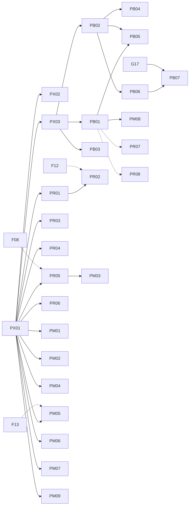

# Tsuzuri 性能改善チケット

Tsuzuri は、C/C++・Rust・Zig を上回る**超高速**な実行、**超省メモリ**、Go を上回る**超高速ビルド・コンパイル**を目指しています。
このディレクトリには、その実現に向けた性能改善を 1 施策 = 1 ファイルのチケットとして置きます。

チケットは計画であり、目標の達成を示すものではありません。
実装では [AGENTS.md](../AGENTS.md) の性能方針と、[_features/GUIDE.md](../_features/GUIDE.md) の規則（意味の保持、テスト、決定的な IR）に従います。
測定の手順と過去の結果は [docs/benchmarks.md](../docs/benchmarks.md) にあります。

- 起票: 2026-09-29。調査時点のコミットは `9012e92`。計測機は Apple M1 Max（10 コア）、macOS 27.0、Apple Clang 21.0.0。
- 状態: `todo`（未着手）／`doing`（実装中）／`done`（完了）／`blocked`（依存待ち・要判断）。
- 配置: `done` のチケットは [_completed/](_completed/) へ移し、この一覧のリンクを更新します。
- ID: **PX** 計測基盤、**PR** 実行速度、**PM** メモリと成果物サイズ、**PB** ビルド速度。
- 優先度・規模の定義は [_features/README.md](../_features/README.md) と同じです（P0 が最優先、S〜XL）。
- どのチケットも独立レビューは未実施です。着手前に、その時点のコードと計測でレビューします。

## 目標

| 目標 | 主な指標 | 比較の基準 |
| --- | --- | --- |
| 超高速な実行 | 同じ仕事の処理時間（中央値）、生成コードの命令 | C／C++／Rust／Zig の最速の実装。C#／Go／JavaScript は参考 |
| 超省メモリ | 最大 RSS、確保回数・確保量、値のサイズ、成果物のサイズ | C／Rust／Zig |
| 超高速なビルド | デバッグビルドとリリースビルドの時間（初回・再ビルド・1 ファイル変更後）、コンパイラの最大 RSS | デバッグは Go、リリースは C／C++／Rust／Zig |

数値目標は各チケットに書きますが、共有 CI の合否条件にはしません。専用の計測機で、同じ仕事・同じ条件の比較を記録して判断します。

## 性能改善の原則

- 意味を変えない。整数の折り返し、飽和、丸め、NaN、符号付きゼロ、評価順序、トラップ、所有権と借用を保つ。fast-math、再結合、暗黙の FMA、二重丸め、データ競合を性能のために導入しない。
- 最適化は型・所有権・借用・不変性から証明できる事実だけに基づける。根拠のない `noalias` などを付けない。
- 同じ仕事で比べる。アルゴリズム、データ構造、確保の方針、安全検査、コンパイラの版と最適化の指定をそろえ、そろえられない差は結果の表に明記する。
- 高速化を主張する前に、生成された IR・アセンブリを確認し、実測する。実装済みの経路と計画を区別して文書に書く。
- ハードウェア依存の経路には能力確認と移植可能な代替経路を持たせる。明示的に要求された経路が使えない場合はエラーにする。
- 既定の出力は、チケットが承認を得て変える場合を除いて変えない。

## 現状（2026-09-29）

### 実行速度

[docs/benchmarks.md](../docs/benchmarks.md) の 36 種目（2026-09-26、M1 Max、`-O3`、3 回の中央値）では、Tsuzuri の相対性能（最速の時間 / Tsuzuri の時間）は次のとおりです。

- 0.99 以上: 25 種目。制御構文・浮動小数点・配列・リスト・タスクの逐次実行など、多くの計算カーネルで C/C++/Rust と同等でした。
- 0.95 以上 0.99 未満: 4 種目（`computations/checked`、`array_for`、`array_bind`、`std_result`）。
- 0.95 未満: 7 種目。`utf16_compare` 0.497（最速は JavaScript）、`utf8_roundtrip` 0.658（C++）、`format_parse` 0.751（C#）、`task_parallel` 0.768（C#）、
  `std_option` 0.873（Rust）、`integer128_mix` 0.891（C）、`std_option_owned` 約 0.09（C++）。
- `integer128_mix` の内側のループは、2026-09-29 の確認で C の参照実装と命令単位で同一でした。
  2026-10-14 の同じ Clang の 3 run でも operand を含む 10 命令が一致し、差の分類は「計測の揺れ」でした。
- 2026-09-26 の `std_option_owned` は参照が定数長で、確保の条件がそろっていません。
  2026-10-14 の PX02 で全実装の連結をそろえ、元の式は std_option_length に分けました。履歴の値は直接比べません。

僅差は一般的な優位性を示しません。C より明確に速い種目はまだありません。

### メモリと成果物サイズ

- hello の実行時の最大 RSS は 1.70 MB（C は 1.67 MB）で、小さなプログラムでは同等でした。データ量の多い処理のメモリ比較はありません。
- hello の実行ファイルは 67,256 bytes（`-O3`）／100,824 bytes（`-O0`）で、C の hello（33,424 bytes）の約 2 倍です。WASM の hello は 59 bytes です。
- 値の表現には改善の余地があります。文字列は UTF-16 で 1 コード単位 2 bytes、関数値は 4 ポインター（32 bytes）、リストは要素ごとのノード、
  ペイロードの型が異なる union は 16 bytes 単位の領域を持ちます。WASM の allocator は 16 bytes のヘッダーと先頭一致の線形探索です。

### ビルド速度

`--no-cache`、各 1 回の 2026-09-29 の参考値です。PX03 の現行の正式な記録は
[ビルド速度](../docs/benchmarks.md#ビルド速度) にあり、生成規則の違うこの表とは直接比較しません。合成プロジェクトは各モジュールに 20 個の関数を持つ生成コードです。

| 対象 | 行数 | check | IR 出力 | 実行ファイル `-O0` | 実行ファイル `-O3` | コンパイラの最大 RSS |
| --- | ---: | ---: | ---: | ---: | ---: | ---: |
| `examples/hello` | 10 | 0.05 s | 0.02 s | 0.33 s | 0.53 s | – |
| 合成 200 モジュール | 24,803 | 0.39 s | 0.46 s | 1.26 s | 2.05 s | 237 MB |
| 合成 1,000 モジュール | 124,003 | 2.12 s | 2.58 s | 約 6.2 s | 約 10.1 s | 1.12 GB |

- C の hello は Clang で 0.07 s です。Tsuzuri の hello の実行ファイルでは、結果の表示が数値ランタイム（`numeric.ll`）全体を IR に含め（464 KB）、その `-O3` コンパイルだけで 0.43 s かかっていました。
- 合成 1,000 モジュールでは、Clang の処理が `-O0` で 3.70 s、`-O3` で 7.62 s でした。フロントエンドは単一スレッドで、1 秒あたり約 5 万行です。
- フロントエンドのサンプリング（1 ms 間隔）では、サンプルの 57% が malloc／free／memmove にありました。型付き IR の複製、所有権検査の 2 回の実行、IR 文字列の生成が主な処理です。

## 第3フェーズ後の変化（2026-10-17）

第3フェーズの 8 件を統合した compiler を、main（`6d15b437`）と、静かな機械（Apple M1 Max。1 分の load average の下限は 8〜13）で前後比較した値です。
表・条件・測っていないことは [docs/benchmarks.md](../docs/benchmarks.md#第3フェーズ統合の最終比較2026-10-17) にあります。
上の「現状（2026-09-29）」は、履歴としてそのまま残します。x86-64・Linux・Windows の測定と専用機の測定はありません。

- 実行速度（PR03）: `std_option` の `Maybe<i64>` の連鎖が native で 5.22 → 4.47 ms（−14.4%、5 run とも改善、A/A 1.003）で、`ce` が `direct` と同じ時間になりました。
  control の 16 種目と、computations のほかの 9 対は差がありません。
- Task（PR06）: 起床の p50 が 0.22〜0.63 倍、CPU 時間が 0.11〜0.60 倍です。粗い粒度と `cpp/task_parallel` は差がありません。
- メモリ（PM01・PM05）: `Color` 4 → 1、`Small` 32 → 2、`Maybe<string>` 24 → 16、`Result`・`Shape` 32 → 24 byte。`benchmarks/layout` の最大 RSS は −33.2%、時間は変わりません。
  WASM の heap は小さい確保の churn が 0.16〜0.17 倍です。native の `--allocator small` は allocation の多い app で 0.39〜0.77 倍ですが、`closure_pipeline` は 1.06 倍で、既定は `system` のままです。
- 成果物（PM08）: native の hello は 50,664 → 33,896 byte（`__text` 13,304 → 2,724）、`--emit object` は 72,032 → 5,024 byte、WASM の hello は 35,714 → 6,833 byte です。
- ビルド（PB03・PB04）: `check` の total が 8 thread で 1.34〜1.61 倍（CPU 時間 +43%、RSS +3〜9%）。`-O0` の実行ファイルは実時間 −69%・CPU 時間 −54%、`-O3` は −45%・−32%。
  同梱 toolchain の識別は 14.6 s → 0.2 s です。
- 整数の範囲証明（PR02）: 旗を書いても生成コードに測れる利得はなく、既定は `off` です。

悪化した点と、期待に届かなかった点:

- 合成 1,000 module で特殊化の予算 1,024 を使い切ると、PR03 の 2 回目の出力が `emit` を 2 倍にします（`--emit llvm` の total が 8 thread で 3,272 → 3,588 ms、`build -O0` の CPU 時間は +25%）。200 module は影響を受けません。
- WASM の `std_option` は 1.27 倍遅くなりました。PR03 が `ce` を `direct` と同じ `select` の形にしたためで、V8 は分岐の形を速く実行します。native は 14.4% 速くなっています。
- `run-cpp.mjs` の `format_parse` は、統合時に main より 12% 遅くなりました（PM08 の `integer.ll` が 1 桁ずつ書くため）。`tz.integer.digits` を 2 桁ずつ書く形にして +2% に戻しました（`__text` は +120 byte）。

## 第4フェーズ後の変化（2026-10-19）

第4フェーズの 7 件を統合した compiler を、main（`9dd0fbbc`）と、静かな機械（Apple M1 Max。1 分の load average の下限は 6〜13）で前後比較した値です。
表・条件・測っていないことは [docs/benchmarks.md](../docs/benchmarks.md#第4フェーズ統合の最終比較2026-10-19) にあります。
上の「現状（2026-09-29）」と「第3フェーズ後の変化」は、履歴としてそのまま残します。x86-64・Linux・Windows の測定と専用機の測定はありません。

- 連結リスト（PM04）: `control/list_sum` が 1.842 → 0.0456 ms（40 倍。9 run とも）。長さ 1,000,000 のリストの構築 18.4 → 0.46 ms、複製 38.5 → 1.0 ms、`for` の走査 34.4 → 2.1 ms、
  最大 RSS 17.8 → 9.7 MB（確保 1,000,000 回 → 1〜261 回）。WASM の既定の 16 MiB の heap に入るリストは 400,000 個 → 1,000,000 個です。control の残り 15 種目と、computations・C++ の suite・実アプリは差がありません。
- 関数値（PM02）: 関数値 32 → 16 bytes、`Maybe<関数値>` 40 → 16 bytes（`closure_pipeline` の配列の確保 128 → 64 bytes）。時間は control・computations・実アプリのどれも変わりません。
- 文字列（PM03、opt-in の `TSUZURI_STRINGS=compact`。既定は `utf16`）: cpp の 5 種目の確保 bytes が −30〜−50%、最大 RSS が −28〜−30%。runtime の IR が +31〜49%、hello の wasm32 が +15% なので、既定にはしていません。
- ビルド（PB05・PB06、opt-in）: `--backend fast` の `-O0` の再ビルド（合成 1,000 module で 1 module の本体を変えた後）は `llvm` の 0.53 倍（native）・0.46 倍（wasm32）。`tsuzuri serve`・`watch` は、
  1 module を変えた後の `check` が 1,000 module で 0.62〜0.70 倍です。
- PGO・LTO（PR07・PR08、opt-in）: `--profile-use` で `closure_*` が 0.83〜0.88 倍の時間（`tail_*` は約 1.20 倍、`match_dispatch` は約 1.64 倍で悪化する種目もあります）、
  `--emit bitcode` の ThinLTO で `tz_add` のような小さな公開関数が host のループへ inline され、リンクは 0.5〜0.6 倍の時間です。

悪化した点と、期待に届かなかった点:

- 既定の IR が全 project で変わります（PM02 の関数値の記述子。IR の text が `-O0` で +2.4%、`-O3` で +2.7%）。hello の `--emit object` は +160 bytes、実行ファイルは +64 bytes です。
- `escape_list`（確保 0 回のリストを作って捨てる処理）は、before が LLVM の閉じた式への畳み込みで 1,000,000 回 0.67 µs だったのに対し、after は 3.29 ms です（確保は 0 回のまま）。小さいリスト（n = 1）は 1.04〜1.18 倍（+2〜10 ns）です。
- `--emit llvm` のフロントエンドは、統合後の最初の測定で `emit` 段が +21〜24%（wall が +10〜12%）でした。PM02 のレビューの修正の `limit_worker_inlining` が IR の全行を検索していたためで、PM04 の修正で戻り、最終の tree の `--emit llvm` の wall は
  main の 0.987 倍（1,000 module）・1.022 倍（200 module）で、差と読めません（`check` も同じ）。最大 RSS は +1.3〜2.0% です（IR の text が +2〜3%）。

## 一覧

### PX. 計測基盤

| ID | チケット | 優先 | 規模 | 依存 | 状態 |
| --- | --- | --- | --- | --- | --- |
| PX01 | [性能指標の拡張と記録の継続](_completed/PX01-metrics.md) | P0 | M | – | done |
| PX02 | [実アプリ型ベンチマークと比較対象の拡充](_completed/PX02-workloads.md) | P0 | L | PX01 | done |
| PX03 | [ビルド速度ベンチマーク](_completed/PX03-build-benchmarks.md) | P0 | M | PX01 | done |

### PR. 実行速度

| ID | チケット | 優先 | 規模 | 依存 | 状態 |
| --- | --- | --- | --- | --- | --- |
| PR01 | [所有権・借用から導く最適化情報の付与](_completed/PR01-ownership-facts.md) | P1 | L | PX01 | done |
| PR02 | [整数範囲の証明による算術フラグとループ最適化](_completed/PR02-integer-ranges.md) | P2 | L | PR01, (F12) | done |
| PR03 | [抽象化コストの除去（計算式・Maybe／Result・関数値）](_completed/PR03-zero-cost-abstractions.md) | P1 | L | PX01 | done |
| PR04 | [数値の表示・解析の高速化](_completed/PR04-number-formatting.md) | P1 | M | PX01 | done |
| PR05 | [UTF 変換・比較・検証の SIMD 化](_completed/PR05-utf-simd.md) | P1 | M | PX01, (F08) | done |
| PR06 | [Task プールの低遅延化と work stealing](_completed/PR06-task-scheduler.md) | P2 | L | PX01 | done |
| PR07 | [プロファイル誘導最適化（PGO）](_completed/PR07-pgo.md) | P2 | M | PX01, (PB01) | done |
| PR08 | [言語間 LTO と bitcode 出力](_completed/PR08-cross-language-lto.md) | P2 | M | (PB01), (E12) | done |

### PM. メモリと成果物サイズ

| ID | チケット | 優先 | 規模 | 依存 | 状態 |
| --- | --- | --- | --- | --- | --- |
| PM01 | [値のレイアウトの最適化（union・niche・フィールド順）](_completed/PM01-value-layout.md) | P1 | L | PX01 | done |
| PM02 | [関数値の表現の縮小](_completed/PM02-closure-representation.md) | P2 | M | PX01 | done |
| PM03 | [コンパクト文字列（Latin-1 の内部表現）](_completed/PM03-compact-strings.md) | P2 | XL | PX01, PR05 | done |
| PM04 | [連結リストの連続表現](_completed/PM04-list-representation.md) | P2 | L | PX01 | done |
| PM05 | [小さい確保のための size-class allocator](_completed/PM05-small-allocator.md) | P1 | L | PX01, (F13) | done |
| PM06 | [確保の除去とスタック化](_completed/PM06-allocation-elimination.md) | P1 | L | PX01 | done |
| PM07 | [複製の除去とバッファ再利用の一般化](_completed/PM07-copy-elision.md)（Phase 2 は [A17](../_features/_completed/A17-last-use-move.md)） | P1 | M | PX01, (A15) | done |
| PM08 | [成果物サイズの最小化](_completed/PM08-binary-size.md) | P2 | M | PB01 | done |
| PM09 | [スタック使用量の削減と末尾呼び出しの保証](PM09-stack-and-tail-calls.md) | P3 | L | PX01 | doing |

### PB. ビルド速度

| ID | チケット | 優先 | 規模 | 依存 | 状態 |
| --- | --- | --- | --- | --- | --- |
| PB01 | [ランタイムの事前ビルドと必要部分だけのリンク](_completed/PB01-prebuilt-runtime.md) | P0 | M | PX03 | done |
| PB02 | [フロントエンドの確保削減と高速化](_completed/PB02-frontend-allocation.md) | P0 | L | PX03 | done |
| PB03 | [LLVM とリンカーへの受け渡しの高速化](_completed/PB03-llvm-handoff.md) | P1 | M | PX03 | done |
| PB04 | [フロントエンドの並列化](_completed/PB04-parallel-frontend.md) | P2 | L | PB02 | done |
| PB05 | [デバッグビルド用の高速バックエンド](_completed/PB05-fast-debug-backend.md) | P2 | XL | PB01, PB02 | done |
| PB06 | [常駐ビルドサーバーと watch モード](_completed/PB06-build-server.md) | P2 | L | PB02, (G17) | done |
| PB07 | [関数単位の増分コード生成と増分リンク](_completed/PB07-incremental-codegen.md) | P3 | XL | PB06, G17 | done |

## `_features` との関係

機能チケットと重なる性能施策は、重複して仕様を書かず、次のように分担します。

| 機能チケット | 分担 |
| --- | --- |
| [F08](../_features/_completed/F08-wide-simd-multiversioning.md) 256-bit SIMD と CPU 多版化 | PR05 は UTF 処理のカーネルに F08 の仕組みを使う |
| [F11](../_features/_completed/F11-wasm-memory-limit.md) WASM メモリ上限 | PM05 の WASM allocator は F11 の上限設定と整合させる |
| [F12](../_features/_completed/F12-bounds-check-elimination.md) 境界検査の除去 | 境界検査は F12、整数範囲と算術フラグは PR02 |
| [F13](../_features/_completed/F13-custom-allocators.md) allocator の差し替え | ホスト提供の allocator は F13、内部 allocator の性能は PM05 |
| [G11](../_features/_completed/G11-incremental-build.md) whole-build cache | PB01 の事前ビルド成果物は G11 と同じ cache の規則を使う |
| [G17](../_features/_completed/G17-incremental-compilation.md) 増分コンパイル | モジュール単位のフロントエンド cache（構文解析の結果と interface の要約、ディスク上）は G17、常駐プロセスと watch は PB06、関数単位の増分コード生成と codegen unit の並列コンパイルは PB07、フロントエンドの並列化は PB04。旧 G17 Phase 0 の計測は PX01・PX03 が持つ |
| [F10](../_features/_completed/F10-concurrency-primitives.md) 並行プリミティブ | `Atomic`・`Mutex` の利用者 API は F10、task プールの実装は PR06。内部可変な型の判定 `Type::has_interior_mutability` は F10、属性への反映（`Type::is_frozen`）は PR01 |
| [E12](../_features/_completed/E12-ffi-extensions.md) FFI の拡張 | `extern` の構文とリンク指定は E12、bitcode 出力と言語間 LTO は PR08 |
| [D07](../_features/_completed/D07-string-interpolation.md) 文字列補間 | 書式指定で `numeric.ll` に関数を足すのは D07（要承認）、数値の表示・解析の高速化は PR04 |
| [G18](../_features/_completed/G18-bench-coverage.md) 言語内ベンチマーク | 利用者向けの `tsuzuri bench` は G18、リポジトリの計測基盤は PX01–PX03 |
| [A15](../_features/_completed/A15-copy-cost-visibility.md) 暗黙の複製の可視化 | 複製の除去そのものは PM07 |
| [A16](../_features/_completed/A16-fixed-arrays.md) 固定長配列 | 値型の配列による確保の削減は A16、既存の型の配置は PM01 |
| [D10](../_features/_completed/D10-f16-hardware.md) f16 のハードウェア経路 | 数値型の演算経路は D10 |

## 推奨フェーズ

### 第5フェーズ2件の実装方針（2026-10-20）

PB07・PM09 は、全フェーズの実装と判断を許可した 2026-10-20 の依頼に基づいて進めます。
起票時の「Phase 1 だけを実装する」「承認前は着手しない」「要承認」の注記は今回の依頼には適用せず（PB07 は D1・D10、PM09 は D1・D6 を承認済み）、
意味の保持と検証の条件は維持します。承認は実装の許可で、測定で効果を確認できない既定の切り替えの許可ではありません。
変更前の基準は `a8875f38`（第4フェーズの PR #28 と dev-velocity の #29 の後）、保存したコンパイラは `target/perf/phase5-baseline/tsuzuri-before` です。
2 チケットはどちらも起票時の `f8dc655` に対して書かれています。着手前に現行のコードと実測で照合し、食い違いを各チケットの
「着手時の再検討（2026-10-20）」に記録して、次のとおり方針を改めました。

共通:

- 第2〜4フェーズ（PB01〜PB06・PM01〜PM08・PR01〜PR08 など）までは実装済みです。旧コードの行番号、未実装を前提とした停止条件、第4フェーズより前の測定値は使わず、
  現行の型・ABI・生成 IR・配布形式を基準にします。チケット内の `_docs/...` は `_tsuzuri/language-reference/...` に読み替えます（GUIDE §8.1）。
- 検証は [AGENTS.md](../AGENTS.md) の T0〜T2 です（`node scripts/slot.mjs -- cargo nextest run --locked`、dev binary での node suite、`node scripts/check-docs.mjs <変更したページ>`）。
  チケットの `cargo test --locked ...` と `target/release/tsuzuri` の確認は、同じ範囲をこの手順で行います。
- 2 チケットは別々の worktree（`perf/p5-PM09`・`perf/p5-PB07`）で並行して開発し、PM09 → PB07 の順に統合します。PB07 の分割器は PM09 が足す IR の行
  （`llvm.lifetime.*`・`musttail`）を読むので、PB07 が後です。統合のたびに全 suite を確認し、既定の出力が変わる箇所を各チケットの宣言と照合します。
- 共有機で並行して進めるため、時間の測定は負荷を記録した参考値とし、静かな機械での正式な前後比較は統合後にまとめて記録します（共有 CI に速度の合否閾値は置きません）。
  実装済みの経路と計画を区別します。

- **PM09**（全フェーズ。Phase 1a・1b・1c、Phase 2a・2b）。現行のコードとの食い違いと、改めた方針:
  - 起票時の「リスト」の見積もりと IR の形は古くなっています。PM04 の後、リストのスタック領域は `alloca { ptr, i64, i64, [N x T] }`（1 chunk。`list_stack_storage`）で、
    起票時の `[4 x { ptr, i64 }]` の例と `frame_bytes` の「要素ごとに `16 + stack_size`」は成り立ちません。テスト 1〜6 の期待値は現行の IR と式から導き直します。
  - PM06 の後、文字列の連結 buffer と closure の環境も entry の alloca で、`MAX_FUNCTION_BUFFER_BYTES`（4 KiB。再帰する関数には置かない）の上限が既にあります。
    `Frame::String` は alloca を持たず constant を指します。寿命の印（Phase 1a）は alloca を持つ frame に付け、関数あたりの上限（Phase 1b、`MAX_FRAME_BYTES`）は
    literal・buffer・環境を合わせた合計に対する上限として、既存の 4 KiB の上限と整合させます。
  - PB05 の fast backend は `llvm.lifetime.*` を読み飛ばしますが、`musttail` は `E2002` で拒否します。Phase 2a で何もしないと、相互再帰を持つ全 project の
    `--backend fast` が壊れます。D1 の保証は `--backend fast` でも成り立たせます（Cranelift の `return_call` と `CallConv::Tail` への翻訳を、先に小さく試して決める）。
    翻訳が成り立たない構成が見つかった場合に限り、その理由と範囲を記録して、`--backend fast` では `musttail` を出さない（保証の対象外として文書に書く）形に退きます。黙って `E2002` にはしません。
  - `--wasm-feature` は `simd128`・`threads`・`jspi`・`webgpu`・`net` の 5 つです。`tail-call` は同じ場所（CLI の解析・help・`BuildOptions`・検証・clang の引数・
    `--emit llvm` の注記・build cache の鍵・README と言語リファレンス）に足します。
  - `tail_groups` は、`llvm_escape.rs` の `references`・`recursive_functions`（再帰を使わない強連結成分）を一般化して使い、2 つ目の SCC を書きません。
  - 文書の置き場所は `_tsuzuri/language-reference/` と `docs/`（起票時の `_docs/language-reference/functions.md` などは旧構成）。
- **PB07**（全フェーズ。Phase 1、Phase 2）。現行のコードとの食い違いと、改めた方針:
  - 現行の既定の最適化は `-O3`（`build`・`run`）で、`-O0` は `test`・`--backend fast` の既定と、利用者の明示指定だけです。分割は D2 のとおり `-O0` だけで、
    `run` は常に `--trap-info` を付けるので、Phase 1（トラップ情報なし）は `tsuzuri run` を対象にしません。`run -O0` の対象化は Phase 2 の trap-info 対応で行います。
  - 起票時の IR にはなかった形が現行の IR にあり、停止条件 1・2 に当たっていました: `internal thread_local global`（Async の slot・lock・thread）、
    `weak hidden global`（`@tsuzuri_trap_hooks`）、`define weak`（`@tsuzuri_alloc`・`@tsuzuri_free`。埋め込みの数値ランタイムの `@tz_soft_*` は `weak hidden`）、
    PM02 の関数値の記述子（関数を指す `@tz.desc.*` の `unnamed_addr constant`）。方針: 定数でない global と `weak` の定義は、持ち主の unit に 1 つだけ置き
    （リンカーの weak の統合に頼らない）、他の unit は `external hidden`（`thread_local` はそのまま）の宣言で参照します。`unnamed_addr` の constant は unit ごとの複写でよい
    （アドレスの同一性を使う constant は複写しません）。実 IR の棚卸し（手順 1）で見つけた形は、設計の表に足してから実装します。
  - 実行時 C と数値・数学ランタイムの別 object は、PB01 の runtime object cache（`compile_runtime_object`）が既に持っています。起票時の unit `c.runtime` は作りません。
    `--no-cache`・`--trap-info`・`-g` では数値ランタイムの IR が module に埋め込まれ、その関数は `g.<x>` の unit に入ります。
  - `--backend fast` は Clang を通らないので分割しません（常に単一 unit）。分割は、driver が IR に足す文面の加工（`without_closure_inlining`・`windows_abi`・`with_no_red_zone`・
    WASM の加工）の後、IR を書く直前に行います。`KEY_ENVIRONMENT` は 22 個で、起票時の 17 個ではありません。
  - 既定の切り替えは測定で決めます。B1 `O0 --no-cache` が悪化しないこと（G3。停止条件 8）が条件で、小さい project で遅くなるなら、測定で決めた大きさ以下は単一 unit にします。
    満たせない場合は、既定を単一 unit にして `TSUZURI_CODEGEN_UNITS=split` の opt-in にし、証拠を残します。
  - Phase 2（起票時は方針だけ）は項目ごとに実装し、どれも次の条件を満たす形で出荷します: 分割ありと `single` で既存の suite が同じ結果、無関係な module の編集で他の unit の
    テキストと鍵が変わらない（トラップ地点の番号・metadata の番号を含む）、生成物が決定的、公開される記号の集合が不変。項目は trap-info（地点番号を unit の編集に対して安定にする）、
    debug-info（unit ごとの compile unit）、WASM（`wasm-ld` に複数 object）、`--emit object`、`$lambda` の置き場所、Windows です。
    Windows は実行できる機械がなく、型検査と `ci:full` の Windows job でだけ確かめられるので、通らず原因を解消できない場合は単一 unit のままにして理由を記録します。

### 第4フェーズ7件の実装方針（2026-10-17）

PB05・PB06・PM02・PM03・PM04・PR07・PR08 は、全フェーズの実装と判断を許可した依頼に基づいて進めます。
起票時の Phase 1 限定と `要承認` の注記は今回の依頼には適用せず、意味の保持と検証の条件は維持します。
変更前の基準は `9dd0fbbc`（第3フェーズの PR #27 の後）、保存したコンパイラは `target/perf/phase4-baseline/tsuzuri-before` です。
7 チケットはどれも起票時の `f8dc655` に対して書かれています。着手前に現行のコードと実測で照合し、食い違いを各チケットの
「着手時の再検討（2026-10-17）」に記録して、次のとおり方針を改めました。

- 第3フェーズ（PM01・PM05・PR03・PB03・PB04・PR06・PM08・PR02）までは実装済みです。旧コードの行番号、未実装を前提とした停止条件、第3フェーズより前の測定値は使わず、
  現行の型・ABI・配布形式・生成 IR を基準にします。
- 効果が測れない最適化と既定の切り替えは行いません。テスト済みの opt-in として出荷するか、証拠を残して段を取り下げます。承認は実装の許可で、既定の切り替えの許可ではありません
  （PB05 の既定のバックエンドは `llvm` のままです）。実装済みの経路と計画、共有機の参考値と静かな機械での正式値を区別します。
- 7 チケットは別々の worktree で並行して開発し、重なる箇所の順に統合します。`src/main.rs`・`src/driver.rs`・`src/cache.rs` を触る PR07 → PR08 → PB06、
  生成 IR と runtime の PM02 → PM04 → PM03、生成 IR を読むため最後に PB05 の順で、統合のたびに全 suite を確認し、既定の出力が変わる箇所をチケットごとに宣言したものと照合します。
  共有機で並行して進めるため、時間の測定は負荷を記録した参考値とし、静かな機械での正式な前後比較は統合後にまとめて記録します（共有 CI に速度の合否閾値は置きません）。

- **PB05**（実装済み。全フェーズ。D12 は行わず、既定は `llvm`）: `--backend fast`（cargo feature `fast-backend`、Cranelift 0.121.2。`=` で固定）が、`-O0` の native（`--emit exe|object`、macOS・Linux の AArch64・x86-64）と
  wasm32（`--emit wasm|object`。D13: Clang を使わず再配置可能な wasm の object を書き、`wasm-ld` でリンク）で、Tsuzuri の出す LLVM IR を Clang に渡さずに翻訳します。
  `build`・`run`・`test`、`--trap-info`、`-g`（行の DWARF。gimli）、`--allocator small|counting`、`--freestanding`、`--trap-mode return` に対応し、範囲外は `E2000`、翻訳できない構成要素は `E2002` です。
  Windows のホストでは `E2000` のままです（実行できる機械がなく、Windows の IR の `__multi3` などの 128 bit の署名を翻訳器が拒むため。MSVC の 2 target は型検査だけ）。
  合成 1,000 module の `build-edit-body` は `llvm` の 0.53 倍（native）・0.46 倍（wasm32）、200 module は 0.53 倍と 0.43 倍（静かな機械での測り直し。共有機の参考値は 0.56・0.47）で、短くなるのは Clang の時間だけです（残りは frontend が約 9 割）。
  生成コードの実行時間は `llvm -O0` の 0.81 倍（native）・1.10 倍（wasm32）、成果物は 15〜17%・40〜43% 大きく、feature つきの `tsuzuri` は 9.47 → 13.5 MiB です（既定の build には入りません）。
  意味の一致: `examples/`・`tests/fixtures/` の実行ファイル 21 個・library 85 個、wasm32 の 96 module、約 820 の演算（Clang と bit 単位。NaN の payload を除く）、既存の 27 suite（compact の 7 suite を含む）が `llvm` と一致し、
  旗なしの出力は PB05 を入れる前の統合 branch（`63a12d4a`）と byte 単位で同じです（576 件）。macOS の AArch64 で全部、Linux は AArch64・x86-64 の Docker コンテナで driver と test を実行しました。
  確認で見つけたこと: Cranelift の x86-64 は署名に `i128` があると panic する、`llvm.fmuladd` は x86-64 で融合しない、Windows 向けの IR の `__multi3` は翻訳器が `E2002` で拒む。
  実装していないこと: D12、Windows のホストでの有効化、`-O1` 以上・`--cpu native`・`--emit shared|bitcode`・`--profile-*`・wasm32 の SIMD・threads などの `E2000`、wasm32 の配列・list の loop の構造化（1.3〜1.5 倍の差が残る）。
  Copilot のレビュー（PR #28）の後、`test --index N -g -o PATH`（デバッガ用の runner）も、`build` と `test` の runner と同じく、fast backend には機械の f16 の経路ではなく `Soft` を渡します（`f16_path_for`。macOS の AArch64 では `half` 命令が `E2002` になっていました）。
  また、x86-64 の Linux の wasm32 の比較で、`Math.copysign` が見せる NaN の符号（f64 の NaN の符号は機械が決めます）が LLVM と fast で食い違ったので、`tests/fixtures/json` の `number_sign` は NaN に 0 を返します。
- **PB06**（実装済み）: `tsuzuri watch check|build|test` と、プロジェクトごとの常駐サーバー `tsuzuri serve DIR`（Unix のソケット）、client の `--no-server` を実装しました。
  `main.rs` は `cli(raw, program_arguments, out, err)` に分け、サーバーは `check` と `build` だけを実行して出力・終了コード・成果物を `--no-server` と同じに返します
  （51 のコマンドと 115 project・345 コマンドで基準と一致）。コンパイラのパス・作業ディレクトリ・環境（`KEY_ENVIRONMENT`・`TSUZURI_*`・ツールとロケールの変数。
  drift test が `src/` の読み取りを走査）・プロジェクトのルートが違う要求は断り、client が黙って自分で実行します。常駐するのはソースの本文と digest（`FileStamp` で検証）と
  起動したコンパイラの識別（`src/resident.rs`）で、G17 が parse の cache だけで `check` の結果を使い回さないため、G1（100 ms 級）は取り下げました。
  共有機（load 19〜48）で、1 module の本文を書き換えた後の `check` は 200 module で 0.87〜0.89 倍（426 → 370、391 → 347 ms）、1,000 module で 0.62〜0.70 倍（1,884 → 1,317、
  1,975 → 1,223 ms。`load` 476〜642 → 18〜29 ms）、`build -O0` は 0.86〜1.00 倍（Clang が支配）で、`watch` は編集から結果まで 200 module で約 368 ms です。
  サーバーの RSS は 1,000 module で約 675 MiB、常駐 bytes は 3.5 MiB。frontend pack の常駐はゲート（`parse`＋`cache` が 10% 超）に届かず（4.9〜8.0%）実装していません。
  LSP と REPL は同じ `ResidentState` を自分のプロセスの中で使います（条件を満たした測定。REPL の cache hit −7〜9%（`-O0`）・約 −30%（`-O3`）、LSP の 1,000 module で −455〜480 ms）。
  Windows の named pipe・socket での LSP と REPL の共有・`build_key` のツール問い合わせの memo は採りませんでした。速度は参考値で、Linux・x86-64・Windows の実機では動かしていません。
- **PM02**（実装済み。P2-a は測って取り下げ、P2-c は取り下げ）: 起票時の `{ 静的記述子, 環境 }`（32 → 16 bytes、wasm32 は 16 → 8）を実装しました。
  記述子 `@tz.desc.<名前>.<捕捉数>`（`%tz.closure.desc = { code, clone, drop }`、`internal unnamed_addr constant`）は `closure_wrappers` が `@tz.apply.*` と一緒に出し、
  コードの読み出しは `closure_parts` に集めました（先に IR 同一の整理を入れ、119 プログラム × native・wasm32 で WP2 とバイト一致）。起票時の見込みから変わった点は 4 つです。
  (1) 即値の捕捉と捕捉なしの関数値の clone／drop を null にする P2-b を Phase 1 に移しました（付けないと `closure_churn` が +28.7%、付けると機械語が基準と同一）。
  (2) 大きさの模型は `layout_bound` の上限 `(16, 8)` と下限 `(8, 4)`（PR01 の `dereferenceable`）の 2 本で、E1010 の見積もりと `stack_size` は 32 のままです（PM01 D4 の前例）。
  (3) 記述子が adapter を参照し続けるので LLVM の「最後の呼び出し」の inline の加点が消え、属性なしの native は hello +14%・`closures` の probe が畳まれませんでした。
  native だけ `@tz.apply.*` と `$lambda` の worker（`-g -O0` を除く）を `alwaysinline` にして hello +3.1%・probe `ret 51`。WebAssembly は付けると +30〜50% になるので付けず、`-O3` は +0.4〜1.4%（tasks の fixture +3.6%）です。
  (4) `Maybe<関数値>` は null の記述子を `None` にして 40 → 16 bytes（P2-d。wasm32 でも使う）。`!invariant.load`（P2-a）は機械語が変わらず入れていません。
  結果は関数値 32→16、2 つの record 64→32、`Result<fn, string>` 40→24、`task_parallel` の確保量 1,024→768 bytes、`closure_pipeline` の配列 128→64 bytes。停止条件 7 の 4 種目の時間は変わらず
  （比 0.999〜1.003。load average 34〜103 の共有機）、機械語が変わる関数は control 1・cpp 3・apps 1 だけです。代償は `-Os`・`-Oz` の小さなプログラムの増加（native の `-Oz` hello +30%）と `-O0` の使われない記述子（+0.2〜1.8%）です。
  この環境の `lldb` は `run` で固まるので、formatter の形の判定は `tests/debugger_static.mjs`（プロセスなし）で確かめました。
- **PM03**（実装済み。`compact` は opt-in、既定は `utf16`）: 起票の D1（長さ語の bit 63）は PM01 の `Maybe<string>` の niche（長さ −1、`icmp slt i64 len, 0`）と衝突するため bit 62 に改め、
  `TSUZURI_STRINGS=utf16|compact`（不正値は `E2000`、ビルドキャッシュの鍵、`serve` の環境の比較）で形式を選ぶ二本立てにしました。`utf16` の IR は統合ブランチ（PM03 なし）と 116 project × 5 variants = 580 build で byte 同一です。
  runtime は追加層（`string_latin1.ll`・`string_compact.ll`・`display_compact.ll`・`character_compact.ll`・`format_compact.ll`・`integer_compact.ll`）で、HEAD の関数 17 個の `define` 行だけを include 時に `.utf16` へ改名して振り分けます。
  生成側は語を `string_length`／`string_is_latin1`／`string_unit` だけで読み（raw-word の lint）、リテラル・連結・数と `char` の表示・補間・`from_code_units`・`slice`／`join`（確保 1 回）・`from_utf8` が Latin-1 を作ります。
  host の ABI は UTF-16 のままで、`export` の結果は `to_utf16`、import の引数は `borrow_utf16` です。LLDB・natvis も両形式を読みます。
  Phase 2 は `generate_utf.py` が書く 128-bit の Latin-1 kernel（native と simd128）と、非 ASCII の Latin-1 も 1 回の確保にする `utf8_scan`、PR05 の差分 harness の拡張です。
  確保 bytes は cpp の 5 種目が −30〜−50%、apps の文字列系が −24〜−39%（calls は同じ）、最大 RSS は `ascii_words` −28%・`latin1_csv` −30% ですが、runtime の IR が約 61 KB（+31〜49%）、hello の wasm32 が +15%、
  clang を含むビルドが +23% 増え、host へ短い文字列を返す呼び出しは約 2 倍になるため既定は `utf16` のままです（D11 の M4 を満たさない）。
  `cjk_lines` の `-O3` の RSS +17% は、確保の列が同じで、baseline でも 24 回に 2 回出る malloc の返却の時機の差でした。
  live の LLDB（この機械では baseline でも `run` が戻らない）・Windows・Linux・x86 は未検証です。
  Copilot のレビュー（PR #28）で、`compact` が utf16 と食い違う 2 点が見つかり、直しました。`for unit in <string>` の loop 変数への参照を反復より長く持つと、Latin-1 の code unit は 16 bit の実体がなく、
  反復ごとに上書きされる widen 用の slot を指します（`-O3` で関数から返すと dangling）。そこで `string` の走査の loop 変数への借用は、その反復で終わるものにしました（持ち越すと utf16・compact のどちらでも `E1013`。
  配列・リスト・Vec と `utf8string` は従来どおり）。これは utf16 の既定にも及ぶ小さな言語の変更です。もう 1 点は、callback を取る host の呼び出しが `ref string` の UTF-16 の複製を引数の評価の途中で作り、
  あとの引数が `raise` すると漏れることで、複製を最後の引数のあと、呼び出しの直前に作るようにしました。
- **PM04**（実装済み。全フェーズ。Phase 2b の `heap_copy` の `memcpy` だけ取り下げ）: リスト `[|T|]` を、要素ごとのノードの連結から、要素を連続して並べた chunk の連結列にしました。`%tz.list = { ptr, i64 }` は据え置き、
  先頭の chunk `{ ptr next, i64 rest, i64 capacity, [0 x T] }`（header 24 bytes。native・wasm32・wasm64 で同じ）を持ちます。一度に作るリスト（`new`・リテラル・複製・`Array.to_list`・`List.map`・`reverse`）は要素数ちょうどの 1 つの chunk、
  `List.cons` は先頭の空き slot に書き、満杯なら 1.5 倍（header 込みで 32 KiB が上限、最初は 32 bytes）の chunk を足します。起票の「倍々」は、macOS の malloc の丸め（1 KiB 超で 23〜25%）と WASM heap の 16 bytes の header を踏まえて改めました（D3'）。
  `List.tail`・パターンの tail は同じ chunk に短い長さを組み合わせた view です。表現を知るのは新しい `src/llvm_list.rs` だけで、表現を変える flag はなく（PM01・PM06 と同じ）、gate を測って残しました。
  走査（`for`・`List.fold_ref`・clone・hash・display・`List.to_array`）は chunk ごとの二重 loop で、内側は配列の loop と同じ形なので LLVM がベクトル化します（`for` の総和は 1.20 → 0.12 ns/要素。cursor を `select` にした版は node と同じ約 1 ns で、slot を `phi` にして 0.58、二重 loop で 0.12）。
  比較は run ごとの loop ですが、要素ごとに早く抜けるのでベクトル化されません。drop 不要な要素の clone・`List.to_array`・`Array.to_list` は `llvm.memcpy` で（`-O3` では loop idiom が先に同じ `memcpy` にするので、効くのは `-O0` と `List.to_array`）、`heap_copy` の `memcpy` は asm が同一で取り下げました。
  結果（n = 1,000,000 の `i64`、native `-O3`、main と交互の 9 標本の中央値）: 構築 19.7 → 0.55 ms、`List.cons` の構築 19.5 → 1.14 ms（確保 1,000,000 → 261 回）、複製 38.6 → 1.08 ms、`for` の総和 34.7 → 2.48 ms、比較 62.3 → 7.69 ms、
  peak RSS 17.0 → 9.3 MB、`index_walk`（n = 10,000）50.4 → 0.016 ms、`control/list_sum` 1.808 → 0.0447 ms（40 倍）。WASM の既定の 16 MiB の heap に入る `i64` のリストは 400,000 個 → 1,000,000 個です。
  悪化も測って記録しました。小さいリストは要求 bytes が増え（`i64` の 1 個で 16 → 32 bytes、`List.cons` の 2 個で 32 → 72、4 個で 64 → 128。257 個以上は node 以下）、要素数が定数の小さなリストを同じ関数で作って使って捨てる処理は、node の連結では LLVM が確保を全部消して 1 回約 1 ns でしたが、
  `List.map`・`List.reverse` で約 25 ns、`List.copy` で約 45 ns、`List.cons` の連鎖で約 55〜65 ns、文字列のリストで約 75〜80 ns かかります（`new` のリテラルの走査は約 1 ns のまま）。2026-10-18 の判断で受け入れ、`list.md`・`docs/language.md`・`docs/benchmarks.md` に数値と原因を書きました。
  デバッガ（G16）は DWARF の `<list>.chunk` と LLDB の `ListProvider` で chunk をたどります（実機の LLDB は未実行で、実際の DWARF の型と模擬の process で検査）。W1006 の文言を配列と同じ形に変えました（D13）。A17 の last-use 解析が `for` の source の局所変数を除外するため、
  同じ関数の `List.cons` の loop と `for` は毎回複製して $O(n^2)$ です（範囲外。`W1006` で見える）。
- **PR07**（実装済み。opt-in）: `--profile-generate DIR`・`--profile-use PATH`（`build` と `run`）。Tsuzuri の IR は変えず、本体の `clang -x ir` に `-fprofile-generate`・`-fprofile-use` を足すだけで、旗なしの成果物と cache の鍵は変わりません（798 件の比較で不一致 0）。
  許可リストは native の `exe`・`object` と wasm32 の `wasm` で、`bitcode`・`--backend fast` などは `E2000` です。`.profraw` のディレクトリは `llvm-profdata merge`（`TSUZURI_LLVM_PROFDATA`、Clang の隣、resource dir の順。PATH は見ない）で 1 つにし、合わない関数は `W2001` の 1 行です。配布物の launcher は旗を落とすので `E2002` にしました。
  効果は一様ではなく、`closure_*` が 0.83〜0.88 倍、`tail_*` が約 1.20 倍、`match_dispatch` が約 1.64 倍の時間で、C・C++・Rust は後者 2 つが変わりません（悪化した種目も記録）。全員が PGO を使うと Tsuzuri は `tail_*` で C の約 1.20 倍、`closure_churn` で 1.57 倍です。
  wasm32 は host が raw profile（Clang 21、version 10）を書く opt-in で、counts は native と一致し、Node 24 の apps で 5〜14% 短く、Node 20 の `closure_capture` は 1.52 倍に悪化します。
  D6（ランタイム object の計装）と D9（trap への `!prof`）は、測定で根拠がなく取り下げました。Linux・x86-64・Windows と ThinLTO との併用は未確認です。
  Copilot のレビュー（PR #28）の後、wasm32 の writer（`<out>.wasm.profile.mjs` の `writeProfile`）は、呼び出しごとに新しい file を排他的に作り（複数の writer や Worker が同じ directory へ書いても上書きしません）、
  書いたあとにその instance の counter を 0 に戻します（各 file は前回からの差になり、`--profile-use DIR` の merge は数えた回数と一致します）。i32 の global は符号なしで読みます（stack が約 2 GiB 以上の module でも profile の section を読めます）。
- **PR08**（実装済み。`--emit bitcode` は新しい opt-in の出力で、既定の出力は変えません）: プログラムと必要な C ランタイムを 1 つの ThinLTO の LLVM bitcode にします。
  native（Windows 以外）と `--target wasm32` で、C・C++ のホストが同じ Clang の `-flto=thin`（Linux は `-fuse-ld=lld`、wasm32 は `wasm-ld`）でリンクすると、
  `tz_add` のような小さな公開関数をホストのループへ inline できます。IR の全 `define` に、同じ Clang が C の関数に付ける `target-cpu`・`tune-cpu` を足します
  （`src/driver/lto.rs`）。起票の「3 鍵を全 define に付ける」案は、group が F08 の `@cpu` 版の `"target-features"` を上書きして消すので、`--cpu native` と
  wasm32 の `simd128` だけ features も付ける形に改めました。C ランタイムは `-S -emit-llvm` → `llvm-link --internalize`（Clang の隣も探す）で内部になり、
  外から見える強い定義は export だけです。出力の magic を検査し、`-flto` を落とす Clang や launcher は `E2002`（同梱の `tsuzuri-clang` は `-flto*` を渡すよう直しました）。
  Windows・wasm64・`--freestanding`・`--strip`・リンク入力は `E2000`、cache は使いません。`lto/small_call`（n = 10 億、9 標本 × 4 回、M1 Max、load 12〜18 の共有機の目安）は、
  `--emit object` のリンク 1021〜1163 ms に対し bitcode 549〜674 ms（範囲は重ならない）で、C で書いた同じ関数（534〜676 ms）とは範囲が重なり差がありません。
  `main` の中の `tz_add` への命令は 1 → 0。Linux・x86-64・Windows の実行と native の Rust のホストは未確認で、wasm32 の Rust は手で確認しました。

### 第3フェーズ8件の実装方針（2026-10-16）

PM01・PM05・PR03・PB03・PB04・PR06・PM08・PR02 は、全フェーズの実装と判断を許可した依頼に基づいて進めます。
起票時の Phase 1 限定と `要承認` の注記は今回の依頼には適用せず、意味の保持と検証の条件は維持します。
変更前の基準は `6d15b437`（第2フェーズの PR #26）、保存したコンパイラは `target/perf/phase3-baseline/tsuzuri-before` です。
8 チケットはどれも起票時の `f8dc655` に対して書かれています。着手前に現行のコードと実測で照合し、食い違いを各チケットの
「着手時の再検討（2026-10-16）」に記録して、次のとおり方針を改めました。

- 第2フェーズ（PB01・PB02・PR01・PM06・PM07・PR04・PR05）と A17 は実装済みです。旧コードの行番号、未実装を前提とした停止条件、
  PM06・PM07・PR01 より前の測定値は使わず、現行の型・ABI・配布形式・生成 IR を基準にします。
- 効果が測れない最適化は既定にしません。テスト済みの opt-in として出荷するか、結果を記録して段を取り下げます。
  実装済みの経路と計画、共有機での参考値と静かな機械での正式値を区別します。

- **PB03**（実装済み）: PB01 の runtime object の事前ビルド・cache で、C runtime の並行 compile（D2）の対象は cold・`--no-cache`・
  常に直接 compile の `threads.c`・`wasi.c`・`stack.c`（`-g`）に縮んだため、これらを `compile_runtime_object` の cache に載せました。
  並行 compile は、cold の build だけの上限が 35〜259 ms で、`compile_runtime_object` を計画・実行・保存に分ける約 400 行の変更が要るため、実施せず数値を記録しました
  （並行する tool は 1 つの `tool.clang` 区間として計上する規約と、`tests/time_passes.rs` の「段の和 ≤ total」は保ったままです）。
  到達関数の剪定（D1）は `emit_native_build` の native 実行ファイル（`Entry::Console`）だけで、`--emit llvm|object|wasm|shared` の出力は変えません
  （W2 の `-O0` の CPU 時間が 8,567 → 2,966 ms、`-O3` が 9,340 → 6,022 ms の参考値）。PB03 の範囲外で見つけた、配布物の同梱 resource を毎ビルド全件ハッシュする費用
  （約 19,600 file・759 MB で、`cache` 段が 40〜51 s の壁時計）は、`src/bundle_identity.rs` で一度だけ計算して stat の署名の背後に memo する形にし、
  cache の鍵は従来と byte 同一にしました（85〜170 ms）。Homebrew の `wasm-ld`（`lld` への symlink）で `--version` が失敗し、wasm の whole-build cache が無効になる問題も直しました。
  リンカー（D6）は配布物の `tsuzuri-clang` が全 OS で zig 内蔵 LLD を使い、macOS では ld64.lld が Apple ld より遅いため、明示的な opt-in `TSUZURI_LINKER=lld` だけです
  （未設定は現行。見つからなければ `E2002`、不正値と Windows は `E2000` で、黙って戻しません）。bitcode の受け渡し（D7）は 1〜2% で採用せず、
  `wasm` の剪定（D9）は出力が byte 同一で採用せず、D8 は 2% 未満で記録だけです。
- **PM05**（実装済み。native の `small` は opt-in）: Phase 1 は WASM の heap（`heap-wasm.ll`・`heap-wasm64.ll`・`heap-wasm-threads.ll`）を 1a（wasm32 と threads）・
  1b（wasm64）・1c（末尾ブロックの in-place 伸長と `memory.copy`）で作り直し、boundary tag・32 本の容量別リスト・即時の結合・末尾の返却を入れました。
  F11 の上限の 3 行と F13 の関数名の置換、`size 0` の容量、threads の OOM trap の種別（`.unlocked` の誤分類）は保ち、後者は直しました。
  ヘッダーが残るため Phase 1 はメモリ量を減らしません。成果は確保・解放の O(1) 化と即時の結合で、ランダムな置換の負荷は共有機の参考値で 0.13〜0.18 倍の時間です。
  heap 単体は 1,819 → 3,699 bytes に増えます。ヘッダーのない小さい確保は別施策（PM05b）として記録しました。
  Phase 2 の native `--allocator small` は C（`src/runtime/heap-small.c`）から `generate_heap.py` で IR を生成して実装し、既定は変えません
  （wasm・`--freestanding`・`--trap-mode return` との併用は `E2000`）。Phase 3 の既定の切り替え（D10）は、複数 OS での測定・sanitizer・全 suite の通過が揃わず
  （Linux の `record_sort` が `small` で 1.75〜2.3 倍遅い、専用機での 2 OS 以上の測定がない）、満たしていない gate と根拠を `docs/benchmarks.md` に記録して opt-in のままにしました。
- **PR02**（実装済み）: F12 の `RangeFacts` は配列の添字専用の表で、区間の仕組みはなかったため、Phase 2 は整数の区間の解析器（`src/interval.rs`・`src/ranges_intervals.rs`）の新設になりました。
  整数の `+ - *` は言語定義で折り返すため、`nsw`／`nuw` は「その命令でその旗の overflow が起きない」証明のある箇所だけに付けます。
  LLVM の IndVarSimplify が同じ旗を自力で付けるので、先に生成コードで証拠を取り（Gate A）、12 の corpus のうち 8 は asm が同一、残りも 1〜8 命令の差で
  ベクトル化と境界検査は変わりませんでした。そのため旗は既定で出さず（`off`）、`TSUZURI_RANGE_FLAGS=proven` と、旗の代わりに `with.overflow` の trap を出す
  テスト専用の `audit` を opt-in として出荷し、全 suite を audit で通しています。演算子形と `Add.add` 形が別の経路になっていた点（`$intrinsic` の呼び出し）は
  旗と独立の欠陥なので、同じチケットで揃え、これは既定で有効です。
- **PR06**（実装済み）: 起票は F10（Channel・Mutex・`Task.scope`）と E14（trap 境界）より前で、D7（`remaining` を消して `helpers` を足す）と
  「解錠してから signal し、その後に claim する」順は F10 のデッドロック検出と white-box テストを壊すため採りませんでした。
  代わりに group ごとの atomic な `next`（claim）、不変の `length`、参加者ごとにまとめて 1 回だけ減らす `remaining`、
  mutex の下の CAS による失敗・trap の停止、release と `busy`／`idle` の更新を同じ critical section に入れる変更（F10 に既にあった、
  group の終わり直後に単一 host の 2 段 pipeline を誤ってデッドロックと判定する競合の修正を含む）で、既存のプール試験を変えずに通しました。deque は使っていません。
  起こす worker は、全員への broadcast をやめ、submit で 1 本、join した worker が最大 2 本ずつ起こす形です。spin は測定のうえ不採用で、既定は 0 のままです。
  WASM threads の pool は 28 byte の `ThreadState`・import・poison bit の規約を保ち、lock-free の claim とまとめた release、長さ 1 の group の inline 実行にしました。
  lock 回数は 257 要素の group で 259／515 回から `2 + (N-1)` 回以下になり、C の試験で assert しています。1 ms 休んだ後の起床は共有機の参考値で 0.17〜0.47 倍です。
  `cpp/task_parallel`（0.768）は 2026-10-13 の集計で 0.94 に更新済みで、Phase 1 では動かない形（16 件 × 約 79 µs）なので、この種目の改善は主張しません（Node 24 での前後測定は未実施）。
- **PM01**（実装済み。Phase 3b は実施せず）: union の tag を読み書きする箇所は起票の 3 か所ではなく 10 か所以上あり（`match_expression` の `load i32`、`case_switch`、
  手書き IR の `Parse.parse`・`Utf8Char.of_u32`、`static_constant`、Async、`Seq.next`、`parallel_result_tasks`）、大きさのモデルも 4 つではなく 6 つでした
  （`Dyn.of` の確保サイズと PR01 の `dereferenceable` の下限を含む）。そこで、先に tag・フィールドの全経路を helper に通す IR 同一の整理
  （`src/llvm_layout.rs`）を行い、その後に tag の幅（`i8`／`i16`／`i32`）、General の領域（`unit = min(最大アラインメント, 16)`、
  B07 の Drop 共用体は `units 0`）、niche の順に切り替えました。niche は `Seq.next` の `zeroinitializer` による空値を明示構築に直してから入れ、
  G16 のデバッガ契約（`$tag`・LLDB・natvis）を保つため DWARF の `$niche` と formatter を入れました。単一ポインターの niche（null）は native だけで、
  wasm32／wasm64 は `--stack-first` でアドレス 0 が有効なため使いません。レコードの並べ替え（Phase 3a）は `record_slots`／`field_slot` を通し、
  `layout_bound` の下限も物理順にしています。結果は `Color` 4→1、`Maybe<bool>` 8→2、`Small` 32→2、`Maybe<string>` 24→16、`Result<i64, string>`・`Shape` 32→24、
  `Mixed` 32→24、`Tagged` 24→16、`Maybe<ref Point>` 16→8（native）で、配列の要素の合計は 188→109 MB、RSS は共有機の目安で 165.9→110.9 MB です。
  `Maybe<i64>`・`Result` の機械語と時間、コンパイル時間は変わりません。タプルの並べ替え（Phase 3b）は、`Mutex` の cell（`(i32u * T)`。offset 0 を C／LL の runtime が lock word として読む）と、
  添字を手書きする約 10 の builtin に衝突するため実施せず、サイズの表と前提を記録しました。`Dyn.of` と vtable の確保サイズはモデルでなく `sizeof` の定数式です。
  E1010 の見積もりと `stack_size` は保守的な上限のままで、「実際の大きさ ≤ モデル」をテストで固定しています。
- **PR03**（実装済み）: 残る問題は、`ce_std_option`・`ce_std_option_owned` に inline 後も残る union の `phi` と `switch`（K1）だけでした。
  residual な利用者呼び出し（K2）と間接呼び出し（K3）は `-O3` の 10 組で出ず、F3（`inlinehint`）は不要でした。起票の F1（全 exit を return slot にする）は
  `Maybe` を返す相互末尾再帰の末尾呼び出しを壊し（`parity_deep(1e8)` が `-O2`／`-O3` で segfault）、1 exit の関数の `memory(none)` も失わせるため採らず、
  循環しうる呼び出しへ転送する exit がない関数で、exit が 2 つ以上・領域が 1 KiB 以下・再帰でも `Enum` でもない union の戻り値だけを
  1 つの slot にまとめる後処理（`src/llvm_return_slot.rs`）を実装しました。`ce_std_option` は `direct` と同じ形（IR 35→22 行、arm64 34→24 命令）になりました。
  特殊化の worker 予算（1,024）は、使い切ったときだけ参照順の depth-first で再生成し（300 連鎖で間接呼び出し 300→0）、予算内のプログラムの出力は変わりません。
  型付き IR での展開（Phase 3、D3）は、`-O3` に差が残らず、`-O0` に残る差（`__text` 3.0 倍、実行 4.3 倍、Clang の compile 3.2 倍）も
  worker の `alwaysinline` では埋まらなかったため、証拠を記録して実施しません（再開の条件は `docs/benchmarks.md`）。
- **PB04**（実装済み）: parse だけの Phase 1 は 1,000 module の `check` の 9.6% で単独の効果が小さく、並列化の本体は所有権（16.9%）・本体検査（13.6%）・
  finish（7.8%）でした。`Send`／`Sync` の障害は 2 つ（`recursive.rs` の `Cache` と `intern.rs` の `Rc<str>`）で、新 crate も `unsafe` も使っていません。
  `src/parallel.rs` の `ordered_for_each`（8 MiB の worker、項目順に結果を渡す）で、所有権 → finish → 本体 → frontend cache の `&self` lookup／`&mut self` commit 分割 → parse の順に
  並列化しました。既定は CLI だけ自動（`min(コア数, 8)`）で、library・LSP・REPL・`publish` は 1、`TSUZURI_THREADS=1` が従来の経路、不正値は `E2000` です。
  診断・IR・pack の byte は thread 数で変わらず、thread 数はキャッシュの鍵に入りません。共有機での参考値は、1,000 module の `check` が 1.39〜1.46 倍、
  hello が 1.48 倍、parse が 4.0 倍で、CPU 時間は 37〜49% 増えます。Linux と Windows の scale は未測定で、G1 は期待値で CI の閾値ではありません。
- **PM08**（実装済み）: PB01 の Phase 3 がリンク時の dead strip を実装済みで、D1 は取り下げでした。hello（`-O3`）は 67,256 bytes ではなく 50,664 bytes（cache あり）、
  wasm の hello は 59 bytes ではなく 35,714 bytes（`IO.write_line` を使うため）で、整数を表示するプログラムの `__text` の約 80% は
  `tz_soft_format` と PR04 の表でした。主な成果は D2（整数の表示・書式指定・`Parse` を手書き IR の `src/runtime/integer.ll` に分け、`numeric.ll` に依存させない変更）で、
  native の hello は 50,664 → 33,896 bytes（`__text` 13,304 → 2,724）、wasm の hello は 35,714 → 6,833 bytes（`-Oz` 3,905）になりました。これは第3フェーズの統合後の値で、PM08 の branch 単体では `__text` 2,604、wasm の hello は 6,357 bytes（`-Oz` 2,587、`-Oz --wasm-opt` 2,156）でした。差は PM05 の WASM ヒープと、統合時の `integer.ll` の 2 つの変更（128 bit の除算をやめた: Windows の x86-64 で桁が壊れたため。`digits` を 2 桁ずつにした: `format_parse` が 10〜18% 遅くなったため）です。
  `-Os`／`-Oz` は build・run だけ（既定の `-O3` は変えず、`test`・`bench` は `E2000`）、`--strip` は opt-in、`wasm-opt` は明示的な `--wasm-opt`（`TSUZURI_WASM_OPT`）だけで、
  自動検出も同梱もせず、使えなければ `E2002` です。embedded 経路（`--no-cache`・`--trap-info`・`-g`）にもリンク時 GC を入れました。
  `numeric.c`・`numeric.ll`・`math.ll`・`numeric_tables.h` は変更せず、`integer.ll` は独立した Python の参照（format 47,029・spec 15,200・parse 71,235 件）と照合しています。
  サイズは利用者が得る cache あり既定を主とし、`--no-cache` は別に表示します。float・decimal の `tz_soft_format` の分割は実施していません。
- 8 チケットは別々の worktree で並行して開発し、重なる箇所の順に統合します。`src/driver.rs` を触る PB03 → PM08 → PB04、runtime の PR06・PM05、
  `src/llvm.rs` の PM01 → PR03 → PR02 の順で、統合のたびに生成 IR の差分（既定の出力が変わらないこと）と全 suite を再確認します。
  共有機で並行して進めるため、時間の測定は排他的な窓で行い、負荷を記録します。各チケットの時間の数値は参考値で、
  静かな機械での正式な前後比較は統合後にまとめて記録します（共有 CI に速度の合否閾値は置きません）。

### 第2フェーズ7件の実装方針（2026-10-14）

PB01・PB02・PR01・PM06・PM07・PR04・PR05 は、全フェーズの実装と判断を許可した依頼に基づいて進めます。
起票時の Phase 1 限定と承認待ちの注記は今回の依頼には適用せず、意味の保持と検証の条件は維持します。
変更前の基準は `a621fada`、保存したコンパイラは `target/perf/phase2-baseline/tsuzuri-before` です。

- PX01〜PX03、F08・F10、C08、A13・A15・A16、B07、G14・G17 は実装済みです。旧コードの行番号や
  未実装を前提とする停止条件ではなく、現行の型・ABI・配布形式を基準にします。
- PR01 は `Type::is_frozen` で凍結を証明し、opaque std・共有可変状態・隠れた環境を不変と推測しません。
  値渡しの slice 記述子に pointer 属性を付けず、alias metadata と TBAA は確定した scalar の由来に限定します。
  byte・aggregate／union payload・未知の pointer 由来に型名だけで metadata を付けず、trap・分岐・反復・未知呼出しの memory effects は推測しません。
- PB02 は本体・Local の所有権移動と子列の確保省略を先に行い、型述語に private TypeId／hash-consed Vec arena を実装します。
  公開 AST・Type・診断順と資源上限を保ち、全面 AST arena 移行や並列化へ範囲を広げません。
- PM07 の旧 Phase 2 は A17 に置き換わっています。古い所有権検査の `live` 集合を渡す方式を復活させず、
  型付き IR の最終使用解析と、所有する match 対象の束縛の移動を同じ実装・複製一覧へ接続します。
- PM06 と PM07 は同じ連結・frame 経路を使うため、frame を持つ左辺には `realloc` を使いません。
  小さな連結・局所環境をスタックへ置く場合も、移送・解放・再帰と Task の制限を保ちます。
- PB01 は現在の Windows と cross target も壊さず、配布 object とローカル cache の鍵に実際の runtime 内容、
  Clang／Zig・配布 resource、target、CPU、最適化・計装・environment を含めます。
  runtime identity はコンパイラ実行ファイル自体に依存させず、`--no-cache` と自己完結した IR 出力は維持します。
- PR04 は既存の数値表示・解析の文字列とビットを維持し、表は整数演算で生成します。PR05 は既定の WASM を
  scalar のまま保ち、SIMD と CPU 多版化を能力確認・境界検査・移植可能な fallback と共に検証します。
- 測定は同時のビルド・テストと分離し、利用できる実機の結果だけを報告します。長期の数値目標と、
  完成した実装・確認できた効果は区別します。

### PX01・PX03・PX02 の実装方針（2026-10-13）

今回の実装は PX01 → PX03 → PX02 の順に、各チケットの全実装フェーズを対象にします。
Phase 1 だけに限定する起票時の注記より、全フェーズの実装と判断を許可した依頼を優先します。
Go・Zig は計測用のローカルなツールとして扱い、既定の名前が見つからない場合は理由付きで skip、
`TSUZURI_GO`・`TSUZURI_ZIG` に明示した実行ファイルが使えない場合はエラーにします。

着手時の `dadc6d8b` と起票時の仕様の差は、次のように扱います。

- G17 の frontend cache は実装済みです。初回の `check` は `TSUZURI_CACHE_DIR=` で両方の cache を無効にし、
  再ビルド・編集後の計測だけ専用の一時 cache を使います。`parse` は cache からの構文木の復号も含み、
  `cache` は frontend cache の準備・保存と whole-build cache の操作を合算します。段は入れ子にしません。
- Apple のリンカーは、変更前のコンパイラでも Mach-O 実行ファイルの `LC_UUID` と、それに依存する署名を
  毎回変えます。既定の成果物を変えないため、この 2 領域だけを除いた SHA-256 で実行ファイルの決定性を検査します。
  コード・データ・その他のメタデータと成果物サイズは照合対象のままです。IR・header・object・WASM は byte 単位で照合します。
- control は `array_index_sum` を含む 16 種目です。既存種目を消さず、件数の検査は現行の種目表に合わせます。
  C#・JavaScript に欠けていた同種目の参照も補い、定数長の追加後は統合 runner が 38 種目になります。
- 合成プロジェクトの `main :: unit -> i32` は現行の IO の記法で `let! line = IO.read_line ()` とします。
  通常の `let` は IO の値を実行しないため、起票時の略記をそのまま生成コードには使いません。
- PX03 Phase 2 は C++ と Rust の single／workspace も含めます。Zig の最適化版は安全検査を保つ
  ReleaseSafe とし、実際のコマンド・ツールの版・Go の環境は補助 manifest に記録します。
  C／C++ の高速な連続編集には GNU make の `--what-if=<変更ファイル>` を使い、最終実行ファイルだけを
  計測前に削除して必ず再リンクします。秒単位の mtime による誤った変更なしビルド・再リンクの省略を防ぎ、
  変更していないソースと object は保持します。
- 現行の LLVM 21（Apple 21.0.0 と upstream 21.1.8 の両方）では、合成 1,000 module の WASM `-O3` が
  10 分の単一プロセス予算を超えます。最適化 pass の sampling と before の出力を残し、これを高速化とは扱いません。
  標準の本計測はその 1 組だけ理由付きで除外し、WASM `-O3` は 200 module と実プロジェクトで測ります。
  `--large-wasm` を明示すれば元の全組を要求でき、timeout はエラーです。native 1,000 module と WASM `-O0` は
  標準の検査・計測に残します。意味や LLVM の最適化指定を変えて通すことはしません。
- 1,000 module の native `-O0` では、変更前から Apple のリンカーが memcpy／bzero などの import stub の
  順序を変え、呼び出しのアドレスと実行ファイルの fingerprint が 2 通りになります。同じ symbol への呼び出し、
  参照値、サイズは一致します。コードの byte を追加で正規化して隠さず、この既存の変動を理由付きの warning と
  補助 manifest の fingerprint 列に残します。IR／WASM と、それ以外の組の厳密な比較は維持します。
- C09・C10・C11・D08 は実装済みですが、PX02 の比較条件は変えません。Map／Set は整列配列、
  spectral norm は規定の逐次加算を用い、追加の HashMap・Arena・JSON 種目は今回の対象外です。
- 旧 `_docs/tools/command-line.md` の更新先は、現在の
  [_tsuzuri/language-reference/compiler/option.md](../_tsuzuri/language-reference/compiler/option.md) と
  [usage.md](../_tsuzuri/language-reference/compiler/usage.md) です。
- データの外部保管先や専用 Linux 実機を新たに契約・調達しません。実装の移植性検査と、実際に利用できる
  macOS 実機の測定を分け、未実測のホストの性能を主張しません。生データは引き続き `target/perf/` に保存します。

| フェーズ | 目的 | チケット（推奨順） |
| --- | --- | --- |
| 1. 計測 | 同じ条件で差を測れる状態にする | PX01 → PX03、PX02 |
| 2. 即効性の高い改善 | 計測で判明した大きな無駄を除く | PB01、PB02、PR01、PM06、PM07、PR04、PR05 |
| 3. 表現と実行基盤 | 値の表現・確保・並列実行を改善する | PM01、PM05、PR03、PB03、PB04、PR06、PM08、PR02 |
| 4. 大型の施策 | 既定の表現や生成方式を変える | PB05、PB06、PM02、PM03、PM04、PR07、PR08 |
| 5. 長期 | 研究開発を伴う施策（2026-10-20 に全フェーズの実装を開始） | PB07、PM09 |

## 依存関係図

## 運用ルール

- 着手時に状態を `doing`、完了時に `done` にし、`done` のチケットは `git mv` で `_completed/` へ移してリンクを更新する。
- 利用者から見える振る舞いや、言語リファレンスに書いた性能特性（計算量、SIMD・並列・GPU の対応、ビルドの速さなど）を変えたら、同じ PR で
  `_tsuzuri/language-reference/` の関連ページを最新にする（[GUIDE §8](../_features/GUIDE.md#8-ドキュメント更新規約)）。
- 計測結果は、日付・計測機・コミット・コンパイラの版・生データの保存先とともに [docs/benchmarks.md](../docs/benchmarks.md) に記録する。
- before／after は PX01 形式で `target/perf/<ID>-before`・`<ID>-after` に保存し、
  `node benchmarks/metrics.mjs report <after> --baseline <before>` の表を完了報告に添える。
  quick の測定は公開せず、比較の判定を CI の合否に使わない。
- 高速化の効果が計測で確認できない場合は、既定の経路にせず、チケットに結果を記録して判断を仰ぐ。
- 言語仕様・内部表現・既定の出力を変える施策は、チケットの「決定事項」で `要承認` とし、承認を得てから実装する。

## 実装担当者へ

各チケットは 2026-09-29 に HEAD `f8dc655` で、小さいモデルでも設計判断なしに実装できる粒度まで詳細化しています（コードの参照は grep で確認済み、
手順ごとに確認コマンド付き）。着手の前に [_features/GUIDE.md](../_features/GUIDE.md) の §0・§1・§3.1・§11.1・§13・§14 を読んでください。
共通の計測手順は GUIDE §14、結果の形式は PX01、ビルド時間の計測は PX03 にあります。
チケット内の `_docs/...` のパスは旧構成です。GUIDE §8.1 の表で `_tsuzuri/language-reference/` のページに読み替えてください。

承認が必要な決定（承認までは該当する Phase／段に着手しない）:

| チケット | 要承認の決定 |
| --- | --- |
| PX01 | D3（生データの長期保管）、D8（専用 Linux 計測機）。ソフトウェアの全フェーズとは別の運用・調達 |
| PR03 | D3（Phase 3 の型付き IR での展開） |
| PR04 | D4（表の追加による約 20 KB の増加） |
| PR05 | D7（Phase 2） |
| PR06 | なし（D1・D4・D7 は起票時の案を置き換える既定案。見直し提案を確認する） |
| PM01 | D1・D2（Phase 1）、D5（Phase 2）、D7（Phase 3a）、D10（Phase 3b） |
| PM02 | D1（関数値の表現） |
| PM03 | D1（チケット全体） |
| PM04 | D1（チケット全体） |
| PM05 | D2（Phase 2）、D10（Phase 3: 既定の切り替え） |
| PM06 | D1（確保失敗・スタック枯渇の文言） |
| PM08 | D8（`wasm-opt`） |
| PM09 | D1（末尾呼び出しの保証）、D6（`--wasm-feature tail-call`） |
| PB01 | D9（Phase 2）、D10（Phase 3） |
| PB02 | D9（Phase 2） |
| PB03 | D6（Linux の既定リンカー）、D7（bitcode の受け渡し） |
| PB04 | D8（Phase 2） |
| PB05 | D1・D2・D3（チケット全体。D12 の既定のバックエンドの変更は本チケットでは行わない） |
| PB06 | D2（Phase 2: 常駐サーバー） |
| PB07 | D1（既定の codegen unit 分割）、D10（Phase 2） |
| PR01・PR02・PR07・PR08・PM07 | なし |

第2フェーズの 7 件（PB01・PB02・PR01・PM06・PM07・PR04・PR05）の `要承認` は 2026-10-14 の依頼で、第3フェーズの 8 件
（PM01・PM05・PR03・PB03・PB04・PR06・PM08・PR02）の `要承認` は 2026-10-16 の全フェーズ実装の依頼で、第4フェーズの 7 件
（PB05・PB06・PM02・PM03・PM04・PR07・PR08）の `要承認` は 2026-10-17 の全フェーズ実装の依頼で、第5フェーズの 2 件（PB07・PM09）の `要承認` は 2026-10-20 の全フェーズ実装の依頼で承認済みです。
承認は実装の許可で、測定で効果を確認できない既定の切り替え（PM05 D10 の native 既定、PB03 D6 の既定リンカー、PR02 の旗の既定出力、PB05 D12 の既定のバックエンド、
PM03 の `TSUZURI_STRINGS` の既定など）を行うものではありません。
