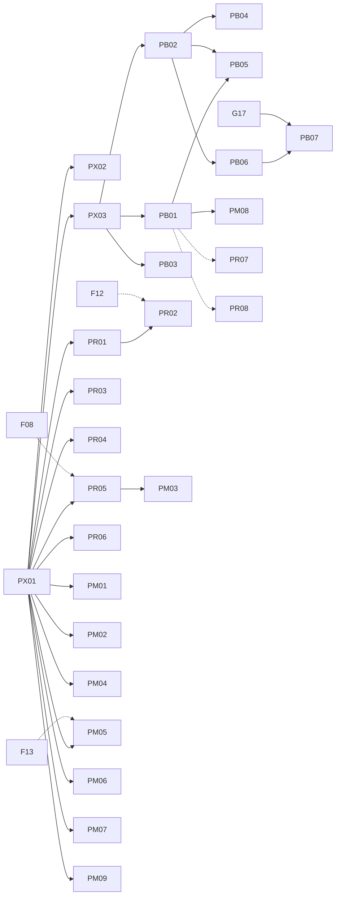

# Tsuzuri 性能改善チケット

Tsuzuri は、C/C++・Rust・Zig を上回る**超高速**な実行、**超省メモリ**、Go を上回る**超高速ビルド・コンパイル**を目指しています。
このディレクトリには、その実現に向けた性能改善を 1 施策 = 1 ファイルのチケットとして置きます。

チケットは計画であり、目標の達成を示すものではありません。
実装では [AGENTS.md](../AGENTS.md) の性能方針と、[_features/GUIDE.md](../_features/GUIDE.md) の規則（意味の保持、テスト、決定的な IR）に従います。
測定の手順と過去の結果は [docs/benchmarks.md](../docs/benchmarks.md) にあります。

- 起票: 2026-09-29。調査時点のコミットは `9012e92`。計測機は Apple M1 Max（10 コア）、macOS 27.0、Apple Clang 21.0.0。
- 状態: `todo`（未着手）／`doing`（実装中）／`done`（完了）／`blocked`（依存待ち・要判断）。
- 配置: `done` のチケットは [_completed/](_completed/) へ移し、この一覧のリンクを更新します。
- ID: **PX** 計測基盤、**PR** 実行速度、**PM** メモリと成果物サイズ、**PB** ビルド速度。
- 優先度・規模の定義は [_features/README.md](../_features/README.md) と同じです（P0 が最優先、S〜XL）。
- どのチケットも独立レビューは未実施です。着手前に、その時点のコードと計測でレビューします。

## 目標

| 目標 | 主な指標 | 比較の基準 |
| --- | --- | --- |
| 超高速な実行 | 同じ仕事の処理時間（中央値）、生成コードの命令 | C／C++／Rust／Zig の最速の実装。C#／Go／JavaScript は参考 |
| 超省メモリ | 最大 RSS、確保回数・確保量、値のサイズ、成果物のサイズ | C／Rust／Zig |
| 超高速なビルド | デバッグビルドとリリースビルドの時間（初回・再ビルド・1 ファイル変更後）、コンパイラの最大 RSS | デバッグは Go、リリースは C／C++／Rust／Zig |

数値目標は各チケットに書きますが、共有 CI の合否条件にはしません。専用の計測機で、同じ仕事・同じ条件の比較を記録して判断します。

## 性能改善の原則

- 意味を変えない。整数の折り返し、飽和、丸め、NaN、符号付きゼロ、評価順序、トラップ、所有権と借用を保つ。fast-math、再結合、暗黙の FMA、二重丸め、データ競合を性能のために導入しない。
- 最適化は型・所有権・借用・不変性から証明できる事実だけに基づける。根拠のない `noalias` などを付けない。
- 同じ仕事で比べる。アルゴリズム、データ構造、確保の方針、安全検査、コンパイラの版と最適化の指定をそろえ、そろえられない差は結果の表に明記する。
- 高速化を主張する前に、生成された IR・アセンブリを確認し、実測する。実装済みの経路と計画を区別して文書に書く。
- ハードウェア依存の経路には能力確認と移植可能な代替経路を持たせる。明示的に要求された経路が使えない場合はエラーにする。
- 既定の出力は、チケットが承認を得て変える場合を除いて変えない。

## 現状（2026-09-29）

### 実行速度

[docs/benchmarks.md](../docs/benchmarks.md) の 36 種目（2026-09-26、M1 Max、`-O3`、3 回の中央値）では、Tsuzuri の相対性能（最速の時間 / Tsuzuri の時間）は次のとおりです。

- 0.99 以上: 25 種目。制御構文・浮動小数点・配列・リスト・タスクの逐次実行など、多くの計算カーネルで C/C++/Rust と同等でした。
- 0.95 以上 0.99 未満: 4 種目（`computations/checked`、`array_for`、`array_bind`、`std_result`）。
- 0.95 未満: 7 種目。`utf16_compare` 0.497（最速は JavaScript）、`utf8_roundtrip` 0.658（C++）、`format_parse` 0.751（C#）、`task_parallel` 0.768（C#）、
  `std_option` 0.873（Rust）、`integer128_mix` 0.891（C）、`std_option_owned` 約 0.09（C++）。
- `integer128_mix` の内側のループは、2026-09-29 の確認で C の参照実装と命令単位で同一でした。
  2026-10-14 の同じ Clang の 3 run でも operand を含む 10 命令が一致し、差の分類は「計測の揺れ」でした。
- 2026-09-26 の `std_option_owned` は参照が定数長で、確保の条件がそろっていません。
  2026-10-14 の PX02 で全実装の連結をそろえ、元の式は std_option_length に分けました。履歴の値は直接比べません。

僅差は一般的な優位性を示しません。C より明確に速い種目はまだありません。

### メモリと成果物サイズ

- hello の実行時の最大 RSS は 1.70 MB（C は 1.67 MB）で、小さなプログラムでは同等でした。データ量の多い処理のメモリ比較はありません。
- hello の実行ファイルは 67,256 bytes（`-O3`）／100,824 bytes（`-O0`）で、C の hello（33,424 bytes）の約 2 倍です。WASM の hello は 59 bytes です。
- 値の表現には改善の余地があります。文字列は UTF-16 で 1 コード単位 2 bytes、関数値は 4 ポインター（32 bytes）、リストは要素ごとのノード、
  ペイロードの型が異なる union は 16 bytes 単位の領域を持ちます。WASM の allocator は 16 bytes のヘッダーと先頭一致の線形探索です。

### ビルド速度

`--no-cache`、各 1 回の 2026-09-29 の参考値です。PX03 の現行の正式な記録は
[ビルド速度](../docs/benchmarks.md#ビルド速度) にあり、生成規則の違うこの表とは直接比較しません。合成プロジェクトは各モジュールに 20 個の関数を持つ生成コードです。

| 対象 | 行数 | check | IR 出力 | 実行ファイル `-O0` | 実行ファイル `-O3` | コンパイラの最大 RSS |
| --- | ---: | ---: | ---: | ---: | ---: | ---: |
| `examples/hello` | 10 | 0.05 s | 0.02 s | 0.33 s | 0.53 s | – |
| 合成 200 モジュール | 24,803 | 0.39 s | 0.46 s | 1.26 s | 2.05 s | 237 MB |
| 合成 1,000 モジュール | 124,003 | 2.12 s | 2.58 s | 約 6.2 s | 約 10.1 s | 1.12 GB |

- C の hello は Clang で 0.07 s です。Tsuzuri の hello の実行ファイルでは、結果の表示が数値ランタイム（`numeric.ll`）全体を IR に含め（464 KB）、その `-O3` コンパイルだけで 0.43 s かかっていました。
- 合成 1,000 モジュールでは、Clang の処理が `-O0` で 3.70 s、`-O3` で 7.62 s でした。フロントエンドは単一スレッドで、1 秒あたり約 5 万行です。
- フロントエンドのサンプリング（1 ms 間隔）では、サンプルの 57% が malloc／free／memmove にありました。型付き IR の複製、所有権検査の 2 回の実行、IR 文字列の生成が主な処理です。

## 一覧

### PX. 計測基盤

| ID | チケット | 優先 | 規模 | 依存 | 状態 |
| --- | --- | --- | --- | --- | --- |
| PX01 | [性能指標の拡張と記録の継続](_completed/PX01-metrics.md) | P0 | M | – | done |
| PX02 | [実アプリ型ベンチマークと比較対象の拡充](_completed/PX02-workloads.md) | P0 | L | PX01 | done |
| PX03 | [ビルド速度ベンチマーク](_completed/PX03-build-benchmarks.md) | P0 | M | PX01 | done |

### PR. 実行速度

| ID | チケット | 優先 | 規模 | 依存 | 状態 |
| --- | --- | --- | --- | --- | --- |
| PR01 | [所有権・借用から導く最適化情報の付与](_completed/PR01-ownership-facts.md) | P1 | L | PX01 | done |
| PR02 | [整数範囲の証明による算術フラグとループ最適化](_completed/PR02-integer-ranges.md) | P2 | L | PR01, (F12) | done |
| PR03 | [抽象化コストの除去（計算式・Maybe／Result・関数値）](_completed/PR03-zero-cost-abstractions.md) | P1 | L | PX01 | done |
| PR04 | [数値の表示・解析の高速化](_completed/PR04-number-formatting.md) | P1 | M | PX01 | done |
| PR05 | [UTF 変換・比較・検証の SIMD 化](_completed/PR05-utf-simd.md) | P1 | M | PX01, (F08) | done |
| PR06 | [Task プールの低遅延化と work stealing](PR06-task-scheduler.md) | P2 | L | PX01 | doing |
| PR07 | [プロファイル誘導最適化（PGO）](PR07-pgo.md) | P2 | M | PX01, (PB01) | todo |
| PR08 | [言語間 LTO と bitcode 出力](PR08-cross-language-lto.md) | P2 | M | (PB01), (E12) | todo |

### PM. メモリと成果物サイズ

| ID | チケット | 優先 | 規模 | 依存 | 状態 |
| --- | --- | --- | --- | --- | --- |
| PM01 | [値のレイアウトの最適化（union・niche・フィールド順）](PM01-value-layout.md) | P1 | L | PX01 | doing |
| PM02 | [関数値の表現の縮小](PM02-closure-representation.md) | P2 | M | PX01 | todo |
| PM03 | [コンパクト文字列（Latin-1 の内部表現）](PM03-compact-strings.md) | P2 | XL | PX01, PR05 | todo |
| PM04 | [連結リストの連続表現](PM04-list-representation.md) | P2 | L | PX01 | todo |
| PM05 | [小さい確保のための size-class allocator](PM05-small-allocator.md) | P1 | L | PX01, (F13) | doing |
| PM06 | [確保の除去とスタック化](_completed/PM06-allocation-elimination.md) | P1 | L | PX01 | done |
| PM07 | [複製の除去とバッファ再利用の一般化](_completed/PM07-copy-elision.md)（Phase 2 は [A17](../_features/_completed/A17-last-use-move.md)） | P1 | M | PX01, (A15) | done |
| PM08 | [成果物サイズの最小化](PM08-binary-size.md) | P2 | M | PB01 | doing |
| PM09 | [スタック使用量の削減と末尾呼び出しの保証](PM09-stack-and-tail-calls.md) | P3 | L | PX01 | todo |

### PB. ビルド速度

| ID | チケット | 優先 | 規模 | 依存 | 状態 |
| --- | --- | --- | --- | --- | --- |
| PB01 | [ランタイムの事前ビルドと必要部分だけのリンク](_completed/PB01-prebuilt-runtime.md) | P0 | M | PX03 | done |
| PB02 | [フロントエンドの確保削減と高速化](_completed/PB02-frontend-allocation.md) | P0 | L | PX03 | done |
| PB03 | [LLVM とリンカーへの受け渡しの高速化](PB03-llvm-handoff.md) | P1 | M | PX03 | doing |
| PB04 | [フロントエンドの並列化](PB04-parallel-frontend.md) | P2 | L | PB02 | doing |
| PB05 | [デバッグビルド用の高速バックエンド](PB05-fast-debug-backend.md) | P2 | XL | PB01, PB02 | todo |
| PB06 | [常駐ビルドサーバーと watch モード](PB06-build-server.md) | P2 | L | PB02, (G17) | todo |
| PB07 | [関数単位の増分コード生成と増分リンク](PB07-incremental-codegen.md) | P3 | XL | PB06, G17 | todo |

## `_features` との関係

機能チケットと重なる性能施策は、重複して仕様を書かず、次のように分担します。

| 機能チケット | 分担 |
| --- | --- |
| [F08](../_features/_completed/F08-wide-simd-multiversioning.md) 256-bit SIMD と CPU 多版化 | PR05 は UTF 処理のカーネルに F08 の仕組みを使う |
| [F11](../_features/_completed/F11-wasm-memory-limit.md) WASM メモリ上限 | PM05 の WASM allocator は F11 の上限設定と整合させる |
| [F12](../_features/_completed/F12-bounds-check-elimination.md) 境界検査の除去 | 境界検査は F12、整数範囲と算術フラグは PR02 |
| [F13](../_features/_completed/F13-custom-allocators.md) allocator の差し替え | ホスト提供の allocator は F13、内部 allocator の性能は PM05 |
| [G11](../_features/_completed/G11-incremental-build.md) whole-build cache | PB01 の事前ビルド成果物は G11 と同じ cache の規則を使う |
| [G17](../_features/_completed/G17-incremental-compilation.md) 増分コンパイル | モジュール単位のフロントエンド cache（構文解析の結果と interface の要約、ディスク上）は G17、常駐プロセスと watch は PB06、関数単位の増分コード生成と codegen unit の並列コンパイルは PB07、フロントエンドの並列化は PB04。旧 G17 Phase 0 の計測は PX01・PX03 が持つ |
| [F10](../_features/_completed/F10-concurrency-primitives.md) 並行プリミティブ | `Atomic`・`Mutex` の利用者 API は F10、task プールの実装は PR06。内部可変な型の判定 `Type::has_interior_mutability` は F10、属性への反映（`Type::is_frozen`）は PR01 |
| [E12](../_features/_completed/E12-ffi-extensions.md) FFI の拡張 | `extern` の構文とリンク指定は E12、bitcode 出力と言語間 LTO は PR08 |
| [D07](../_features/_completed/D07-string-interpolation.md) 文字列補間 | 書式指定で `numeric.ll` に関数を足すのは D07（要承認）、数値の表示・解析の高速化は PR04 |
| [G18](../_features/_completed/G18-bench-coverage.md) 言語内ベンチマーク | 利用者向けの `tsuzuri bench` は G18、リポジトリの計測基盤は PX01–PX03 |
| [A15](../_features/_completed/A15-copy-cost-visibility.md) 暗黙の複製の可視化 | 複製の除去そのものは PM07 |
| [A16](../_features/_completed/A16-fixed-arrays.md) 固定長配列 | 値型の配列による確保の削減は A16、既存の型の配置は PM01 |
| [D10](../_features/_completed/D10-f16-hardware.md) f16 のハードウェア経路 | 数値型の演算経路は D10 |

## 推奨フェーズ

### 第3フェーズ8件の実装方針（2026-10-16）

PM01・PM05・PR03・PB03・PB04・PR06・PM08・PR02 は、全フェーズの実装と判断を許可した依頼に基づいて進めます。
起票時の Phase 1 限定と `要承認` の注記は今回の依頼には適用せず、意味の保持と検証の条件は維持します。
変更前の基準は `6d15b437`（第2フェーズの PR #26）、保存したコンパイラは `target/perf/phase3-baseline/tsuzuri-before` です。
8 チケットはどれも起票時の `f8dc655` に対して書かれています。着手前に現行のコードと実測で照合し、食い違いを各チケットの
「着手時の再検討（2026-10-16）」に記録して、次のとおり方針を改めました。

- 第2フェーズ（PB01・PB02・PR01・PM06・PM07・PR04・PR05）と A17 は実装済みです。旧コードの行番号、未実装を前提とした停止条件、
  PM06・PM07・PR01 より前の測定値は使わず、現行の型・ABI・配布形式・生成 IR を基準にします。
- 効果が測れない最適化は既定にしません。テスト済みの opt-in として出荷するか、結果を記録して段を取り下げます。
  実装済みの経路と計画、共有機での参考値と静かな機械での正式値を区別します。

- **PB03**: PB01 の runtime object の事前ビルド・cache で、C runtime の並行 compile（D2）の対象は cold・`--no-cache`・
  常に直接 compile の `threads.c`・`wasi.c`・`stack.c`（`-g`）に縮みました。先にこれらを cache 化し、並行化は計測ゲートの後に限ります。
  並行する tool は組全体を 1 つの `tool.clang` 区間として計上し、`tests/time_passes.rs` の「段の和 ≤ total」を保ちます。
  到達関数の剪定（D1）は `emit_native_build` 経由の native 実行ファイルだけで、`--emit llvm|object|wasm|shared` の出力は変えません。
  リンカー（D6）は配布物の `tsuzuri-clang` が全 OS で zig 内蔵 LLD を使い、macOS では ld64.lld が Apple ld より遅いため、
  明示的な opt-in `TSUZURI_LINKER=lld` だけにします（未設定は現行。見つからなければエラーで、黙って戻しません）。
  bitcode の受け渡し（D7）は Clang の front end が `-O0` で 5〜9%・`-O3` で 3% のため採用せず、結果だけを記録します。
  PB03 の範囲外で見つけた、配布物の同梱 resource を毎ビルド全件ハッシュする費用（約 19,600 file・759 MB）は、
  manifest に保存した識別子で検証する形へ改めます。
- **PM05**: Phase 1 は WASM の heap（`heap-wasm.ll`・`heap-wasm64.ll`・`heap-wasm-threads.ll`）を 1a（wasm32 と threads）・
  1b（wasm64）に分け、F11 の上限の 3 行と F13 の関数名の置換、`size 0` の容量、threads の OOM trap の種別（`.unlocked` の誤分類）を保ちます。
  ヘッダーが残るため Phase 1 はメモリ量を減らさず、確保・解放の O(1) 化と即時の結合が成果です。ヘッダーのない小さい確保は別施策として記録します。
  Phase 2 の native `--allocator small` は C から IR を生成して実装し、既定は変えません。
  Phase 3 の既定の切り替え（D10）は、複数 OS での測定・sanitizer・全 suite の通過を満たしたときだけ行い、満たさなければ opt-in のまま根拠を記録します。
- **PR02**（実装済み）: F12 の `RangeFacts` は配列の添字専用の表で、区間の仕組みはなかったため、Phase 2 は整数の区間の解析器（`src/interval.rs`・`src/ranges_intervals.rs`）の新設になりました。
  整数の `+ - *` は言語定義で折り返すため、`nsw`／`nuw` は「その命令でその旗の overflow が起きない」証明のある箇所だけに付けます。
  LLVM の IndVarSimplify が同じ旗を自力で付けるので、先に生成コードで証拠を取り（Gate A）、12 の corpus のうち 8 は asm が同一、残りも 1〜8 命令の差で
  ベクトル化と境界検査は変わりませんでした。そのため旗は既定で出さず（`off`）、`TSUZURI_RANGE_FLAGS=proven` と、旗の代わりに `with.overflow` の trap を出す
  テスト専用の `audit` を opt-in として出荷し、全 suite を audit で通しています。演算子形と `Add.add` 形が別の経路になっていた点（`$intrinsic` の呼び出し）は
  旗と独立の欠陥なので、同じチケットで揃え、これは既定で有効です。
- **PR06**: 起票は F10（Channel・Mutex・`Task.scope`）と E14（trap 境界）より前で、D7（`remaining` を消して `helpers` を足す）と
  「解錠してから signal し、その後に claim する」順は F10 のデッドロック検出と white-box テストを壊すため採りません。
  代わりに group ごとの atomic な `next`（claim）、不変の `length`、参加者ごとにまとめて 1 回だけ減らす `remaining`、
  mutex の下の CAS による失敗・trap の停止で、既存のプール試験を変えずに通す設計に改めます。deque は使いません。
  起こす worker の数は、全員への broadcast をやめて 1〜2 本の初期 signal と join 時の連鎖にします。spin は既定 0 のままです。
  `cpp/task_parallel`（0.768）は 2026-10-13 の集計で 0.94 に更新済みで、Phase 1 では動かない形（16 件 × 約 79 µs）なので、
  この種目の改善は主張しません。機械語ではなく lock 回数と signal 回数の assert で受け入れを判定します。
  WASM threads は 28 byte の `ThreadState`・import・poison bit の規約を保ちます。
- **PM01**: union の tag を読み書きする箇所は起票の 3 か所ではなく 10 か所以上あり（`match_expression` の `load i32`、`case_switch`、
  手書き IR の `Parse.parse`・`Utf8Char.of_u32`、`static_constant`、Async、`Seq.next`、`parallel_result_tasks`）、大きさのモデルも 4 つではなく 6 つです
  （`Dyn.of` の確保サイズと PR01 の `dereferenceable` の下限を含む）。そこで、先に tag・フィールドの全経路を helper に通す IR 同一の整理
  （`src/llvm_layout.rs`）を行い、その後に tag の幅（`i8`／`i16`／`i32`）、General の領域（`unit = min(最大アラインメント, 16)`、
  B07 の Drop 共用体は `units 0`）、niche の順に切り替えます。niche は `Seq.next` の `zeroinitializer` による空値を明示構築に直してから入れ、
  G16 のデバッガ契約（`$tag`・LLDB・natvis）を保つため DWARF の `$niche` と formatter を必須にします。単一ポインターの niche（null）は native だけで、
  wasm32／wasm64 は `--stack-first` でアドレス 0 が有効なため使いません。レコードの並べ替え（Phase 3a）は `record_slots`／`field_slot` を通し、
  `layout_bound` の下限も物理順にします。タプルの並べ替え（Phase 3b）は、`Mutex` の cell（`(i32u * T)`。offset 0 を C／LL の runtime が lock word として読む）と、
  添字を手書きする約 10 の builtin に衝突するため実施せず、理由と前提を記録します。`Dyn.of` と vtable の確保サイズはモデルでなく `sizeof` の定数式にします。
  E1010 の見積もりと `stack_size` は保守的な上限のままで、「実際の大きさ ≤ モデル」をテストで固定します。
- **PR03**（実装済み）: 残る問題は、`ce_std_option`・`ce_std_option_owned` に inline 後も残る union の `phi` と `switch`（K1）だけでした。
  residual な利用者呼び出し（K2）と間接呼び出し（K3）は `-O3` の 10 組で出ず、F3（`inlinehint`）は不要でした。起票の F1（全 exit を return slot にする）は
  `Maybe` を返す相互末尾再帰の末尾呼び出しを壊し（`parity_deep(1e8)` が `-O2`／`-O3` で segfault）、1 exit の関数の `memory(none)` も失わせるため採らず、
  循環しうる呼び出しへ転送する exit がない関数で、exit が 2 つ以上・領域が 1 KiB 以下・再帰でも `Enum` でもない union の戻り値だけを
  1 つの slot にまとめる後処理（`src/llvm_return_slot.rs`）を実装しました。`ce_std_option` は `direct` と同じ形（IR 35→22 行、arm64 34→24 命令）になりました。
  特殊化の worker 予算（1,024）は、使い切ったときだけ参照順の depth-first で再生成し（300 連鎖で間接呼び出し 300→0）、予算内のプログラムの出力は変わりません。
  型付き IR での展開（Phase 3、D3）は、`-O3` に差が残らず、`-O0` に残る差（`__text` 3.0 倍、実行 4.3 倍、Clang の compile 3.2 倍）も
  worker の `alwaysinline` では埋まらなかったため、証拠を記録して実施しません（再開の条件は `docs/benchmarks.md`）。
- **PB04**: parse だけの Phase 1 は 1,000 module の `check` の 9.6% で単独の効果が小さく、並列化の本体は所有権（16.9%）・本体検査（13.6%）・
  finish（7.8%）です。`Send`／`Sync` の障害は 2 つ（`recursive.rs` の `Cache` と `intern.rs` の `Rc<str>`）で、新 crate も `unsafe` も要りません。
  試作では 1,000 module の `check` が 1.43〜1.46 倍、hello が 25〜35% 短く、出力は HEAD と byte 一致でした。D8 を承認して全段を実装し、順は
  Sync 化 → 並列の helper と設定 → 所有権 → finish → 本体 → frontend cache の `&self` lookup／`&mut self` commit 分割 → parse です。
  既定は CLI だけ自動（`min(コア数, 8)`）で、library・LSP・REPL は 1、`TSUZURI_THREADS=1` が従来の経路、不正値は `E2000` です。
  小さな入力は段ごとの仕事量で逐次にし、診断・IR・pack の byte は thread 数に依らず同じにします。G1 の「`check` を 1/5」は並列化できる段だけの上限が約 1.9 倍で
  到達できないため、「8 thread で 1,000 module の `check` 1.4 倍以上・`emit-llvm` 1.2 倍以上・hello は悪化しない」に改めます（期待値で、CI の閾値ではありません）。
- **PM08**: PB01 の Phase 3 がリンク時の dead strip を実装済みで、D1 は取り下げです。hello（`-O3`）は 67,256 bytes ではなく 50,664 bytes（cache あり）、
  wasm の hello は 59 bytes ではなく 35,714 bytes（`IO.write_line` を使うため）で、整数を表示するプログラムの `__text` の約 80% は
  `tz_soft_format` と PR04 の表です。主な成果は D2（整数表示の runtime を分けた `integer.ll`）で、native の hello は C の hello と同程度（33,768 bytes）、
  wasm の hello は約 82% 減（6,568 bytes）が見込めます。`-Os`／`-Oz` は build・run だけ（既定の `-O3` は変えない）、`--strip` は opt-in、
  `wasm-opt` は明示的な `--wasm-opt`（`TSUZURI_WASM_OPT`）だけで、自動検出も同梱もせず、使えなければ `E2002` にします。
  D2 は既存の 8 か所のテスト期待値（`display_parse`・`integers`・`prebuilt_runtime`・`targets` の Clang 呼び出し数など）を変えるため、先に一覧を宣言します。
  サイズの測定は、利用者が得る cache あり既定を主とし、`--no-cache` は別に表示します（ファイルの大きさはページ単位なので、受け入れはセクションの bytes で判定）。

- 8 チケットは別々の worktree で並行して開発し、重なる箇所の順に統合します。`src/driver.rs` を触る PB03 → PM08 → PB04、runtime の PR06・PM05、
  `src/llvm.rs` の PM01 → PR03 → PR02 の順で、統合のたびに生成 IR の差分（既定の出力が変わらないこと）と全 suite を再確認します。
  共有機で並行して進めるため、時間の測定は排他的な窓で行い、負荷を記録します。各チケットの時間の数値は参考値で、
  静かな機械での正式な前後比較は統合後にまとめて記録します（共有 CI に速度の合否閾値は置きません）。

### 第2フェーズ7件の実装方針（2026-10-14）

PB01・PB02・PR01・PM06・PM07・PR04・PR05 は、全フェーズの実装と判断を許可した依頼に基づいて進めます。
起票時の Phase 1 限定と承認待ちの注記は今回の依頼には適用せず、意味の保持と検証の条件は維持します。
変更前の基準は `a621fada`、保存したコンパイラは `target/perf/phase2-baseline/tsuzuri-before` です。

- PX01〜PX03、F08・F10、C08、A13・A15・A16、B07、G14・G17 は実装済みです。旧コードの行番号や
  未実装を前提とする停止条件ではなく、現行の型・ABI・配布形式を基準にします。
- PR01 は `Type::is_frozen` で凍結を証明し、opaque std・共有可変状態・隠れた環境を不変と推測しません。
  値渡しの slice 記述子に pointer 属性を付けず、alias metadata と TBAA は確定した scalar の由来に限定します。
  byte・aggregate／union payload・未知の pointer 由来に型名だけで metadata を付けず、trap・分岐・反復・未知呼出しの memory effects は推測しません。
- PB02 は本体・Local の所有権移動と子列の確保省略を先に行い、型述語に private TypeId／hash-consed Vec arena を実装します。
  公開 AST・Type・診断順と資源上限を保ち、全面 AST arena 移行や並列化へ範囲を広げません。
- PM07 の旧 Phase 2 は A17 に置き換わっています。古い所有権検査の `live` 集合を渡す方式を復活させず、
  型付き IR の最終使用解析と、所有する match 対象の束縛の移動を同じ実装・複製一覧へ接続します。
- PM06 と PM07 は同じ連結・frame 経路を使うため、frame を持つ左辺には `realloc` を使いません。
  小さな連結・局所環境をスタックへ置く場合も、移送・解放・再帰と Task の制限を保ちます。
- PB01 は現在の Windows と cross target も壊さず、配布 object とローカル cache の鍵に実際の runtime 内容、
  Clang／Zig・配布 resource、target、CPU、最適化・計装・environment を含めます。
  runtime identity はコンパイラ実行ファイル自体に依存させず、`--no-cache` と自己完結した IR 出力は維持します。
- PR04 は既存の数値表示・解析の文字列とビットを維持し、表は整数演算で生成します。PR05 は既定の WASM を
  scalar のまま保ち、SIMD と CPU 多版化を能力確認・境界検査・移植可能な fallback と共に検証します。
- 測定は同時のビルド・テストと分離し、利用できる実機の結果だけを報告します。長期の数値目標と、
  完成した実装・確認できた効果は区別します。

### PX01・PX03・PX02 の実装方針（2026-10-13）

今回の実装は PX01 → PX03 → PX02 の順に、各チケットの全実装フェーズを対象にします。
Phase 1 だけに限定する起票時の注記より、全フェーズの実装と判断を許可した依頼を優先します。
Go・Zig は計測用のローカルなツールとして扱い、既定の名前が見つからない場合は理由付きで skip、
`TSUZURI_GO`・`TSUZURI_ZIG` に明示した実行ファイルが使えない場合はエラーにします。

着手時の `dadc6d8b` と起票時の仕様の差は、次のように扱います。

- G17 の frontend cache は実装済みです。初回の `check` は `TSUZURI_CACHE_DIR=` で両方の cache を無効にし、
  再ビルド・編集後の計測だけ専用の一時 cache を使います。`parse` は cache からの構文木の復号も含み、
  `cache` は frontend cache の準備・保存と whole-build cache の操作を合算します。段は入れ子にしません。
- Apple のリンカーは、変更前のコンパイラでも Mach-O 実行ファイルの `LC_UUID` と、それに依存する署名を
  毎回変えます。既定の成果物を変えないため、この 2 領域だけを除いた SHA-256 で実行ファイルの決定性を検査します。
  コード・データ・その他のメタデータと成果物サイズは照合対象のままです。IR・header・object・WASM は byte 単位で照合します。
- control は `array_index_sum` を含む 16 種目です。既存種目を消さず、件数の検査は現行の種目表に合わせます。
  C#・JavaScript に欠けていた同種目の参照も補い、定数長の追加後は統合 runner が 38 種目になります。
- 合成プロジェクトの `main :: unit -> i32` は現行の IO の記法で `let! line = IO.read_line ()` とします。
  通常の `let` は IO の値を実行しないため、起票時の略記をそのまま生成コードには使いません。
- PX03 Phase 2 は C++ と Rust の single／workspace も含めます。Zig の最適化版は安全検査を保つ
  ReleaseSafe とし、実際のコマンド・ツールの版・Go の環境は補助 manifest に記録します。
  C／C++ の高速な連続編集には GNU make の `--what-if=<変更ファイル>` を使い、最終実行ファイルだけを
  計測前に削除して必ず再リンクします。秒単位の mtime による誤った変更なしビルド・再リンクの省略を防ぎ、
  変更していないソースと object は保持します。
- 現行の LLVM 21（Apple 21.0.0 と upstream 21.1.8 の両方）では、合成 1,000 module の WASM `-O3` が
  10 分の単一プロセス予算を超えます。最適化 pass の sampling と before の出力を残し、これを高速化とは扱いません。
  標準の本計測はその 1 組だけ理由付きで除外し、WASM `-O3` は 200 module と実プロジェクトで測ります。
  `--large-wasm` を明示すれば元の全組を要求でき、timeout はエラーです。native 1,000 module と WASM `-O0` は
  標準の検査・計測に残します。意味や LLVM の最適化指定を変えて通すことはしません。
- 1,000 module の native `-O0` では、変更前から Apple のリンカーが memcpy／bzero などの import stub の
  順序を変え、呼び出しのアドレスと実行ファイルの fingerprint が 2 通りになります。同じ symbol への呼び出し、
  参照値、サイズは一致します。コードの byte を追加で正規化して隠さず、この既存の変動を理由付きの warning と
  補助 manifest の fingerprint 列に残します。IR／WASM と、それ以外の組の厳密な比較は維持します。
- C09・C10・C11・D08 は実装済みですが、PX02 の比較条件は変えません。Map／Set は整列配列、
  spectral norm は規定の逐次加算を用い、追加の HashMap・Arena・JSON 種目は今回の対象外です。
- 旧 `_docs/tools/command-line.md` の更新先は、現在の
  [_tsuzuri/language-reference/compiler/option.md](../_tsuzuri/language-reference/compiler/option.md) と
  [usage.md](../_tsuzuri/language-reference/compiler/usage.md) です。
- データの外部保管先や専用 Linux 実機を新たに契約・調達しません。実装の移植性検査と、実際に利用できる
  macOS 実機の測定を分け、未実測のホストの性能を主張しません。生データは引き続き `target/perf/` に保存します。

| フェーズ | 目的 | チケット（推奨順） |
| --- | --- | --- |
| 1. 計測 | 同じ条件で差を測れる状態にする | PX01 → PX03、PX02 |
| 2. 即効性の高い改善 | 計測で判明した大きな無駄を除く | PB01、PB02、PR01、PM06、PM07、PR04、PR05 |
| 3. 表現と実行基盤 | 値の表現・確保・並列実行を改善する | PM01、PM05、PR03、PB03、PB04、PR06、PM08、PR02 |
| 4. 大型の施策 | 既定の表現や生成方式を変える | PB05、PB06、PM02、PM03、PM04、PR07、PR08 |
| 5. 長期 | 研究開発を伴う施策 | PB07、PM09 |

## 依存関係図

## 運用ルール

- 着手時に状態を `doing`、完了時に `done` にし、`done` のチケットは `git mv` で `_completed/` へ移してリンクを更新する。
- 利用者から見える振る舞いや、言語リファレンスに書いた性能特性（計算量、SIMD・並列・GPU の対応、ビルドの速さなど）を変えたら、同じ PR で
  `_tsuzuri/language-reference/` の関連ページを最新にする（[GUIDE §8](../_features/GUIDE.md#8-ドキュメント更新規約)）。
- 計測結果は、日付・計測機・コミット・コンパイラの版・生データの保存先とともに [docs/benchmarks.md](../docs/benchmarks.md) に記録する。
- before／after は PX01 形式で `target/perf/<ID>-before`・`<ID>-after` に保存し、
  `node benchmarks/metrics.mjs report <after> --baseline <before>` の表を完了報告に添える。
  quick の測定は公開せず、比較の判定を CI の合否に使わない。
- 高速化の効果が計測で確認できない場合は、既定の経路にせず、チケットに結果を記録して判断を仰ぐ。
- 言語仕様・内部表現・既定の出力を変える施策は、チケットの「決定事項」で `要承認` とし、承認を得てから実装する。

## 実装担当者へ

各チケットは 2026-09-29 に HEAD `f8dc655` で、小さいモデルでも設計判断なしに実装できる粒度まで詳細化しています（コードの参照は grep で確認済み、
手順ごとに確認コマンド付き）。着手の前に [_features/GUIDE.md](../_features/GUIDE.md) の §0・§1・§3.1・§11.1・§13・§14 を読んでください。
共通の計測手順は GUIDE §14、結果の形式は PX01、ビルド時間の計測は PX03 にあります。
チケット内の `_docs/...` のパスは旧構成です。GUIDE §8.1 の表で `_tsuzuri/language-reference/` のページに読み替えてください。

承認が必要な決定（承認までは該当する Phase／段に着手しない）:

| チケット | 要承認の決定 |
| --- | --- |
| PX01 | D3（生データの長期保管）、D8（専用 Linux 計測機）。ソフトウェアの全フェーズとは別の運用・調達 |
| PR03 | D3（Phase 3 の型付き IR での展開） |
| PR04 | D4（表の追加による約 20 KB の増加） |
| PR05 | D7（Phase 2） |
| PR06 | なし（D1・D4・D7 は起票時の案を置き換える既定案。見直し提案を確認する） |
| PM01 | D1・D2（Phase 1）、D5（Phase 2）、D7（Phase 3a）、D10（Phase 3b） |
| PM02 | D1（関数値の表現） |
| PM03 | D1（チケット全体） |
| PM04 | D1（チケット全体） |
| PM05 | D2（Phase 2）、D10（Phase 3: 既定の切り替え） |
| PM06 | D1（確保失敗・スタック枯渇の文言） |
| PM08 | D8（`wasm-opt`） |
| PM09 | D1（末尾呼び出しの保証）、D6（`--wasm-feature tail-call`） |
| PB01 | D9（Phase 2）、D10（Phase 3） |
| PB02 | D9（Phase 2） |
| PB03 | D6（Linux の既定リンカー）、D7（bitcode の受け渡し） |
| PB04 | D8（Phase 2） |
| PB05 | D1・D2・D3（チケット全体。D12 の既定のバックエンドの変更は本チケットでは行わない） |
| PB06 | D2（Phase 2: 常駐サーバー） |
| PB07 | D1（既定の codegen unit 分割）、D10（Phase 2） |
| PR01・PR02・PR07・PR08・PM07 | なし |

第2フェーズの 7 件（PB01・PB02・PR01・PM06・PM07・PR04・PR05）の `要承認` は 2026-10-14 の依頼で、第3フェーズの 8 件
（PM01・PM05・PR03・PB03・PB04・PR06・PM08・PR02）の `要承認` は 2026-10-16 の全フェーズ実装の依頼で承認済みです。
承認は実装の許可で、測定で効果を確認できない既定の切り替え（PM05 D10 の native 既定、PB03 D6 の既定リンカー、PR02 の旗の既定出力など）を
行うものではありません。残りのチケット（PB05・PB06・PB07・PM02・PM03・PM04・PM09・PR07・PR08）は未承認のままです。
