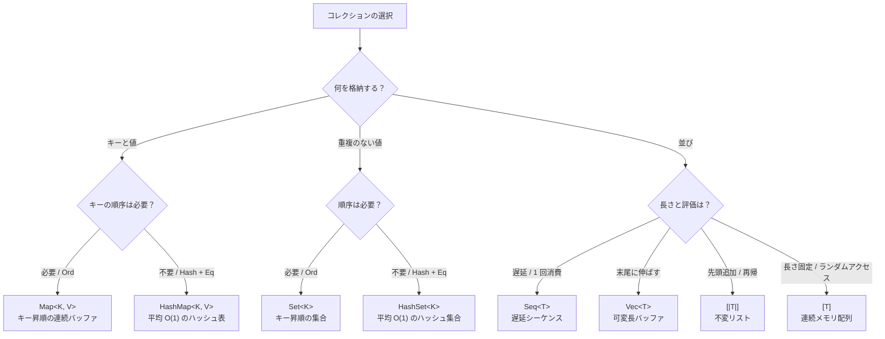

# Array

`Array` は、要素を連続したメモリに置く配列です。型は `[T]` で、`Array<T>` とも書けます。作ったあとの長さは変わりません。添字は `i64` で、読み取りは $O(1)$ です。

`Array` モジュールは、F# の `Array` モジュールと同じ関数を、同じ名前（snake_case）で提供します。配列はどの関数でも最後の引数なので、`Array.map f xs` や `xs |> Array.filter p` のように F# の書き方がそのまま使え、`Array.sort >> Array.rev` のような関数合成もできます。F# で配列が最後にない 9 つの関数だけは、同じ理由で配列を最後に移しました（[引数の順序](#引数の順序)）。所有権のために F# と違う点（失敗の扱い、`Copy`、`r` を付けた関数）は [F# の Array モジュールとの対応](#f-の-array-モジュールとの対応) にまとめました。

長さを型に含む `[T; N]` は別の型です。要素を値の中に持ち、ヒープは確保しません。C スタイルの `T[]` は書けません。`Array` は予約された型名で、同名の宣言は `E1001` です。

## この記事のポイント

- 型は `[T]`（`Array<T>`）。長さは生成後に変わりません。空の `[]` には、要素型が分かる文脈が必要です。
- F# の `Array` モジュールの関数（131 個。`Array.Parallel` を除く）がすべてあります。名前は snake_case です。配列は常に最後の引数で、`|>` でも `>>` でもつなげられます。F# で配列が最後にない関数（`get`、`set`、`sub`、`fill`、`blit`、`fold_back`、`fold_back2`、`scan_back`、`map_fold_back`）だけ、配列を最後に移しています。
- F# が例外を投げる場面（空配列、範囲外、長さの不一致、見つからない `find`）はトラップです。`try_item` や `try_find` のように `try_` が付く関数は `Maybe` を返します。
- コールバックが要素を値で受ける関数（`map`、`filter`、`exists` など）は、要素が `Copy` であることを要求します。`mapr`、`foldr`、`existsr` のように `r` を付けた関数は要素を借用するので、文字列や配列の配列にも使えます。
- 固定長配列 `[T; N]` は `FixedArray.init` か、期待型のあるリテラルで作ります。名前付きの値は `Array.sum xs` のように、`ref [T]` を取る関数へそのまま渡せます。
- 範囲外の添字とスライスはトラップします。範囲内だと証明できた添字だけ、境界検査を省きます。
- 部分の共有参照は `ref xs[a..b]`、その場の更新は `ref mut xs[a..b]` と `Array.set`（`Array.write` と同じ）です。
- 整数 8 型の `Array.sum` / `min` / `max` は、native の実行ファイルとオブジェクトファイルで CPU に応じた kernel を選びます。結果の契約はスカラー版と同じです。

## コレクションの選び方

並び・集合・連想配列のどれが要るかで選びます。`Map` と `HashMap` はどちらも更新で所有権を消費して新しい値を返します。違いは、整列した連続バッファかハッシュ表かです。`Map` は二分探索木ではありません。



| コレクション | 型 | 更新 | 検索・添字 | 追加 | 向いている場面 |
| --- | --- | --- | --- | --- | --- |
| **Array** | `[T]` | 長さは固定。要素の書き換えは排他スライス | 添字 $O(1)$ | 新しい配列を作る | 連続メモリでの走査・数値計算 |
| **List** | `[\|T\|]` | 不変。先頭追加は新しいリスト | 一度に作ったリストは添字 $O(1)$、`List.cons` で伸ばしたリストは先行する chunk の数。長さは $O(1)$ | 先頭 $O(1)$ | パターンマッチと再帰 |
| **Vec** | `Vec<T>` | 所有を消費して返す | 添字 $O(1)$ | 末尾 償却 $O(1)$ | 長さが変わる作業バッファ |
| **Map** | `Map<K, V>` | 所有を消費して返す。中身はキー昇順の連続バッファ | 検索 $O(\log n)$ | $O(n)$ | キー順の走査 |
| **Set** | `Set<K>` | 同上 | 検索 $O(\log n)$ | $O(n)$ | 順序付きの集合演算 |
| **HashMap** | `HashMap<K, V>` | 所有を消費して返す。中身はハッシュ表 | 平均 $O(1)$ | 平均 償却 $O(1)$ | 高速な検索。走査は挿入順（削除は swap-remove） |
| **HashSet** | `HashSet<K>` | 同上 | 平均 $O(1)$ | 平均 償却 $O(1)$ | 高速な包含判定 |
| **Seq** | `Seq<T>` | 1 回消費の遅延列 | ランダムアクセス不可 | 遅延生成 | パイプライン、無限列 |

## 基本の書き方と生成

### リテラルと動的初期化

配列リテラルは角括弧 `[...]` で囲み、各要素をカンマで区切ります。要素はすべて同じ型である必要があります。要素数が静的に決まらない場合は `new [T](count, initializer)` を使用します。

```tsuzuri run=first%3D10%20squares%3D%5B0%2C%201%2C%204%2C%209%5D
let numbers = [10, 20, 30]
let squares = new [i64](4, \i -> i * i)
$"first={numbers[0]} squares={squares}"
```

実行結果:

```text
first=10 squares=[0, 1, 4, 9]
```

`new [T](length, initializer)` は指定された要素数をヒープに一括確保し、インデックス `0` から `length - 1` まで昇順に初期化関数を呼び出します。負の長さやメモリ確保失敗は安全にトラップします。

空配列リテラル `[]` は、周囲の型注釈や関数の引数型から要素型が一意に推論できる場合に記述できます。

### 生成関数

F# と同じ名前の関数でも作れます。`Array.init count f` は `new [T](count, f)` と同じです。

| 関数 | 結果 |
| --- | --- |
| `Array.empty()` | 空の配列。`Seq.empty()` と同じく、呼び出しに `()` が要ります |
| `Array.singleton x` | `[x]` |
| `Array.create n x`、`Array.replicate n x` | `x` を `n` 個並べた配列（同じ関数です）。`x` は `Copy` |
| `Array.zero_create n` | `Default.default()` を `n` 個並べた配列。数値なら 0 |
| `Array.init n f` | `f 0`、`f 1`、…、`f (n - 1)` の配列 |
| `Array.unfold f state` | `f` が `None` を返すまで、`Some (要素, 次の状態)` から配列を作る |

負の個数はトラップです。

### 固定長配列 `[T; N]` と `FixedArray.init`

要素数を型情報の一部として静的に持たせたい場合は、固定長配列 `[T; N]` を使用します。長さ `N` はコンパイル時定数です。

```tsuzuri run=sum%3D160
let triple: [i64; 3] = [10, 20, 30]
let generated: [i64; 4] = FixedArray.init (\i -> (i + 1) * 10)
$"sum={Array.sum triple + Array.sum generated}"
```

実行結果:

```text
sum=160
```

`FixedArray.init` の長さは期待型から決まります。型が決まらないと `E1015` です。`N` は接尾辞のない整数リテラルか `i64` 定数で、1024 を超えると `E1010` です。要素数が期待型と違うリテラルは `E1003` です。

名前付きの固定長配列（束縛・フィールド・参照外し）は、`Array.sum triple` のように `ref [T]` を取る関数へそのまま渡せます。配列全体の共有スライスになります。`Array.sum (ref triple)` とは書きません。`ref triple` は `ref [T; N]` のままで、`ref [T]` にはなりません。一時値は先に `let` で束縛します（束縛しないスライスは `E1005`）。

> [!WARNING]
> 固定長配列は列挙できません。`for x in triple` は `E1005` なので、`for i in 0 .. triple.length - 1` と添字で歩きます。排他スライスは作れず（`E1005`）、パターン分解は `E1020` です。要素を置き換えるときは、`let mut` の束縛へ新しい値を代入します。

## 要素へのアクセスと境界検査

配列の要素にはインデックス添字 `xs[i]` でアクセスできます。インデックスは `i64` 型で、`0` から `.length - 1` の範囲です。

```tsuzuri run=value%3D20%20opt%3D20%20missing%3Dnone
let values = [10, 20, 30]
let second = values[1]
let safe_second = match Array.try_item 1 values with
| Some v -> to_string v
| None -> "none"
let safe_missing = match Array.try_item 99 values with
| Some v -> to_string v
| None -> "none"
$"value={second} opt={safe_second} missing={safe_missing}"
```

実行結果:

```text
value=20 opt=20 missing=none
```

要素を取り出す関数は、F# と同じ組み合わせです。範囲外や空配列では、前者はトラップ、`try_` 付きは `None` を返します。

| トラップする | `Maybe` を返す | 取り出すもの |
| --- | --- | --- |
| `Array.get i xs`、`Array.item i xs` | `Array.try_item i xs` | 添字 `i` の要素（`get` と `item` は同じ関数です） |
| `Array.head xs` | `Array.try_head xs` | 先頭 |
| `Array.last xs` | `Array.try_last xs` | 末尾 |
| `Array.exactly_one xs` | `Array.try_exactly_one xs` | 要素が 1 つだけのときのその要素 |

これらは要素を値で返すので `Copy` が要ります。非 `Copy` の要素への参照は `Array.at i xs` か `ref xs[i]` で借ります。

### 境界外アクセスとトラップ

添字アクセス `xs[i]` や `Array.at i xs` に範囲外のインデックス（負数または `.length` 以上）を指定すると、プログラムは安全にトラップして即座に停止します。安全に失敗をハンドリングしたい場合は、`Maybe<'a>` を返す `Array.try_item` を使用します。

### コンパイラによる境界検査の除去

Tsuzuri コンパイラ（LLVM バックエンド）は、ループ条件やガード条件からインデックスが確実に範囲内であると証明できる場合、実行時の境界検査コードを自動的に除去します。

```text
// ループ範囲が 0 .. values.length - 1 であることが静的に明らかなため、
// ループ内の values[i] の境界検査は最適化によって安全に除去されます
let mut total = 0
for i in 0 .. values.length - 1 do
    total = total + values[i]
```

## 変換・畳み込み・探索

F# の `Array` と同じ道具が揃っています。関数を先に、配列を最後に渡すので、`|>` でつなげます。コールバックは要素を値で受け取ります。

```tsuzuri run=squares%3D%5B1%2C%209%2C%2025%5D%20sum%3D35
let squares =
    [1, 2, 3, 4, 5]
    |> Array.filter (\x -> x % 2 == 1)
    |> Array.map (\x -> x * x)
$"squares={squares} sum={Array.sum squares}"
```

実行結果:

```text
squares=[1, 9, 25] sum=35
```

`find` は見つからないとトラップします。`try_find` は `Maybe` を返し、`find_index` と `try_find_index` は位置を返します。

```tsuzuri run=found%3D15%20missing%3Dnone%20first_23%3D23%20at%3D4
let values = [4, 8, 15, 16, 23, 42]
let found = match Array.try_find (\x -> x > 10) values with
| Some v -> to_string v
| None -> "none"
let missing = match Array.try_find (\x -> x > 100) values with
| Some v -> to_string v
| None -> "none"
let index = Array.find_index (\x -> x == 23) values
$"found={found} missing={missing} first_23={Array.find (\x -> x > 20) values} at={index}"
```

実行結果:

```text
found=15 missing=none first_23=23 at=4
```

分割、グループ化、重複の除去は次のとおりです。`group_by` と `count_by` のキーは、最初に現れた順に並びます。各グループの中は入力の順です。

```tsuzuri run=groups%3D%5B(0%2C%20%5B3%2C%209%2C%206%5D)%2C%20(1%2C%20%5B1%2C%204%2C%201%5D)%2C%20(2%2C%20%5B5%2C%202%5D)%5D%20counts%3D%5B(0%2C%203)%2C%20(1%2C%203)%2C%20(2%2C%202)%5D%20big%3D%5B4%2C%205%2C%209%2C%206%5D%20small%3D%5B3%2C%201%2C%201%2C%202%5D%20distinct%3D%5B3%2C%201%2C%204%2C%205%2C%209%2C%202%2C%206%5D
let words = [3, 1, 4, 1, 5, 9, 2, 6]
let groups = Array.group_by (\x -> x % 3) words
let counts = Array.count_by (\x -> x % 3) words
match Array.partition (\x -> x > 3) words with
| (big, small) -> $"groups={groups} counts={counts} big={big} small={small} distinct={Array.distinct words}"
```

実行結果:

```text
groups=[(0, [3, 9, 6]), (1, [1, 4, 1]), (2, [5, 2])] counts=[(0, 3), (1, 3), (2, 2)] big=[4, 5, 9, 6] small=[3, 1, 1, 2] distinct=[3, 1, 4, 5, 9, 2, 6]
```

`distinct`、`distinct_by`、`except`、`count_by`、`group_by` は、F# と同じく NaN を 1 つの値として扱います。`HashMap` は、自分自身と等しくないキー（NaN、または NaN を含むタプルやレコード）でトラップしますが、これらの関数はそのようなキーをハッシュ表に入れません。代わりに `Hash.hash` が同じキーを同じものとして扱います。`Hash.hash` はどの NaN にも同じ値を返すので、NaN はすべて 1 つのキー（1 つのグループ）になり、`(0, nan)` と `(1, nan)` は別のキーのままです。最初に現れた位置に置かれ、NaN が 1 つだけの配列でもトラップしません。ハッシュ値の一致だけで同じキーとみなすので、64 bit の値が衝突する別のキーは同じキーになります（実際には起きません）。

`scan`、`unfold`、`map_fold` は、途中の状態や生成を扱います。

```tsuzuri run=running%3D%5B0%2C%203%2C%204%2C%208%2C%209%2C%2014%5D%20doubled%3D%5B5%2C%2010%2C%2020%2C%2040%5D%20tens%3D%5B30%2C%2010%2C%2040%2C%2010%2C%2050%5D%20total%3D14
let readings = [3, 1, 4, 1, 5]
let running = Array.scan (\total x -> total + x) 0 readings
let doubled = Array.unfold (\n -> if n > 40 then None else Some (n, n * 2)) 5
match Array.map_fold (\total x -> (x * 10, total + x)) 0 readings with
| (tens, total) -> $"running={running} doubled={doubled} tens={tens} total={total}"
```

実行結果:

```text
running=[0, 3, 4, 8, 9, 14] doubled=[5, 10, 20, 40] tens=[30, 10, 40, 10, 50] total=14
```

2 つの配列を組み合わせる関数（`map2`、`fold2`、`zip`、`unzip`、`all_pairs` など）は、長さが違うとトラップします。

```tsuzuri run=sums%3D%5B11%2C%2022%2C%2033%5D%20dot%3D140%20pairs%3D%5B(1%2C%2010)%2C%20(2%2C%2020)%2C%20(3%2C%2030)%5D%20left%3D%5B1%2C%202%2C%203%5D%20right%3D%5B10%2C%2020%2C%2030%5D%20all%3D%5B(1%2C%203)%2C%20(1%2C%204)%2C%20(2%2C%203)%2C%20(2%2C%204)%5D
let a = [1, 2, 3]
let b = [10, 20, 30]
let sums = Array.map2 (\x y -> x + y) a b
let dot = Array.fold2 (\acc x y -> acc + x * y) 0 a b
let pairs = Array.zip a b
match Array.unzip pairs with
| (left, right) -> $"sums={sums} dot={dot} pairs={pairs} left={left} right={right} all={Array.all_pairs [1, 2] [3, 4]}"
```

実行結果:

```text
sums=[11, 22, 33] dot=140 pairs=[(1, 10), (2, 20), (3, 30)] left=[1, 2, 3] right=[10, 20, 30] all=[(1, 3), (1, 4), (2, 3), (2, 4)]
```

窓、塊、隣り合う組は、新しい配列の配列を返します。

```tsuzuri run=windows%3D%5B%5B1%2C%202%2C%203%5D%2C%20%5B2%2C%203%2C%204%5D%2C%20%5B3%2C%204%2C%205%5D%5D%20chunks%3D%5B%5B1%2C%202%5D%2C%20%5B3%2C%204%5D%2C%20%5B5%5D%5D%20pairs%3D%5B(1%2C%202)%2C%20(2%2C%203)%2C%20(3%2C%204)%2C%20(4%2C%205)%5D%20parts%3D%5B%5B1%2C%202%5D%2C%20%5B3%2C%204%5D%2C%20%5B5%5D%5D
let xs = [1, 2, 3, 4, 5]
let windows = Array.windowed 3 xs
let chunks = Array.chunk_by_size 2 xs
let pairs = Array.pairwise xs
let parts = Array.split_into 3 xs
$"windows={windows} chunks={chunks} pairs={pairs} parts={parts}"
```

実行結果:

```text
windows=[[1, 2, 3], [2, 3, 4], [3, 4, 5]] chunks=[[1, 2], [3, 4], [5]] pairs=[(1, 2), (2, 3), (3, 4), (4, 5)] parts=[[1, 2], [3, 4], [5]]
```

## スライスとインプレース更新

### 共有スライス `ref xs[start..end]`

配列の一部をコピーせずに参照したい場合は、スライス式を使用します。

- `ref xs[start..end]`: `start` から `end - 1` までの半開区間
- `ref xs[start..]`: `start` から末尾まで
- `ref xs[..end]`: 先頭から `end - 1` まで

```tsuzuri run=sliced%3D%5B20%2C%2030%5D%20sum%3D50
let numbers = [10, 20, 30, 40, 50]
let middle = ref numbers[1..3]
let copied: [i32] = deref middle
$"sliced={copied} sum={Array.sum middle}"
```

実行結果:

```text
sliced=[20, 30] sum=50
```

スライスの型は配列の共有参照と同じ `ref [T]` です。スライスが生きている間、元の配列の移動や排他借用は拒否されます。裸の `xs[start..end]` と、両端を省略した `ref xs[..]` は `E0002` です。配列全体は `ref xs` と書きます。

コピーして取り出す F# の関数は、`Array.sub start count xs`、`Array.take n xs`、`Array.skip n xs`、`Array.truncate n xs`、`Array.tail xs`、`Array.split_at i xs` です。`take`、`skip`、`split_at` は、長さを超える個数や位置でトラップします（`skip` の負の個数は 0 として扱います。`truncate` は超えても短い配列を返します）。

### 排他スライスとインプレース更新

要素をその場で書き換えるには、排他スライス `ref mut xs[start..end]`（型は `ref mut [T..]`）を取ります。全体は `ref mut xs[0..]` か、`Array.set` の引数に `ref mut xs` を渡します。`ref mut xs[..]` は `E0002` です。

```tsuzuri run=updated%3D%5B10%2C%2099%2C%2030%5D
let mut numbers = [10, 20, 30]
Array.set 1 99 numbers
$"updated={numbers}"
```

実行結果:

```text
updated=[10, 99, 30]
```

`let mut` の配列は、そのまま渡せば全体の排他スライスになります。書き換える配列は最後の引数で、`ref mut numbers |> Array.set 1 99` のようにパイプで渡すこともできます。F# の破壊的な関数は、次の形です。

- `Array.set index value slice`: 指定位置の要素をその場で上書きする。`Array.write` と同じ関数です
- `Array.fill start count value slice`: `start` から `count` 個を `value` にする
- `Array.blit source_index target_index count source slice`: `source` の一部を `slice` へ写す。排他借用なので、元と先は重なりません
- `Array.sort_in_place slice`: 作業領域を確保しない安定整列
- `Array.sort_in_place_by projection slice`、`Array.sort_in_place_with comparer slice`: キーや比較関数で整列する。同じ長さの一時配列を使います
- `Array.random_shuffle_in_place_by randomizer slice`、`Array.random_shuffle_in_place_with generator slice`: その場でシャッフルする
- `Array.swap_in i j slice`: 2 つの要素をその場で入れ替える
- `Array.split_at_mut index slice`: 指定位置で 2 つの排他スライスに分ける。`0 <= index <= length` を外れるとトラップする

```tsuzuri run=target%3D%5B12%2C%2013%2C%202%2C%20100%2C%20100%2C%209%5D%20words%3D%5B30%2C%2020%2C%2010%5D
let mut target = [0, 1, 2, 3, 4, 5]
Array.fill 3 2 100 target
Array.blit 0 0 2 [12, 13, 14] target
Array.set 5 9 target
let mut words = [30, 10, 20]
Array.sort_in_place_by (\x -> -x) words
$"target={target} words={words}"
```

実行結果:

```text
target=[12, 13, 2, 100, 100, 9] words=[30, 20, 10]
```

範囲外の位置や個数はトラップします。`Array.write` は、境界を見てから古い要素を解放します。

> [!WARNING]
> `ref mut xs[..]` は `E0002` です。配列全体は `ref mut xs[0..]` と書きます。
> `split_at_mut` の 2 つの結果は、元の排他スライスからの 1 つの貸し直しです。片方をさらに貸している間、もう一方を使うと `E1014` です。先に片方を使い切ってから、もう片方を貸します。

```text
match Array.split_at_mut 1 values with
| (left, right) ->
    let inner = ref mut left[0..1]
    Array.write 0 1 right
```

この断片は `E1014` になります。

### 不変配列の関数的更新

所有権を渡して、指定位置を更新した新しい配列を受け取る関数も用意されています。F# の `Array.updateAt` に当たる `Array.update_at index value source` です。

```tsuzuri run=original%3D%5B1%2C%202%2C%203%5D%20modified%3D%5B1%2C%2020%2C%203%5D
let original = [1, 2, 3]
let modified = Array.update_at 1 20 original
$"original={original} modified={modified}"
```

実行結果:

```text
original=[1, 2, 3] modified=[1, 20, 3]
```

- `Array.update_at index value xs`: 指定位置を置き換えた配列を返す
- `Array.insert_at index value xs`、`Array.insert_many_at index values xs`: 位置の前へ挿入した配列を返す
- `Array.remove_at index xs`、`Array.remove_many_at index count xs`: 取り除いた配列を返す
- `Array.update index (\old -> new) xs`: 古い要素に関数を適用した配列を返す（F# にはありません）
- `Array.swap i j xs`: 2 つの位置を入れ替えた配列を返す（F# にはありません）

```tsuzuri run=inserted%3D%5B0%2C%209%2C%201%2C%202%2C%203%5D%20removed%3D%5B0%2C%202%2C%203%5D%20replaced%3D%5B0%2C%201%2C%207%2C%203%5D%20cut%3D%5B0%2C%203%5D%20original%3D%5B0%2C%201%2C%202%2C%203%5D
let xs = [0, 1, 2, 3]
let inserted = Array.insert_at 1 9 xs
let removed = Array.remove_at 1 xs
let replaced = Array.update_at 2 7 xs
let cut = Array.remove_many_at 1 2 xs
$"inserted={inserted} removed={removed} replaced={replaced} cut={cut} original={xs}"
```

実行結果:

```text
inserted=[0, 9, 1, 2, 3] removed=[0, 2, 3] replaced=[0, 1, 7, 3] cut=[0, 3] original=[0, 1, 2, 3]
```

`update_at` と `update`、`swap` は、非 Copy の要素を持つ所有配列をムーブして渡し、内部バッファを再利用します。Copy の要素を持つ配列でも、関数の局所変数で、コンパイラが後続の使用がないと証明できるときは、複製せずにムーブして内部バッファを再利用します。関数の中の `xs = Array.update_at i value xs` というループの再束縛も対象です。ただし、元の配列を後で読む場合、借用・スライスの元となる場合にはコピーが残ります。スクリプトの最上位の `let mut` など、関数の局所変数でない配列も同じです。未対応の式や解析の資源上限でもコピーを残すことがあります。`insert_at`、`remove_at`、`remove_many_at`、`insert_many_at` は借用を受け取り、常に新しい配列を作ります。

## ソートと集計

### ソートと二分探索

```tsuzuri run=sorted%3D%5B1%2C%202%2C%205%2C%208%2C%209%5D%20idx%3D2
let scores = [5, 2, 9, 1, 8]
let ascending = Array.sort scores
let found_idx = match Array.binary_search (ref 5) ascending with
| Some i -> to_string i
| None -> "not found"
$"sorted={ascending} idx={found_idx}"
```

実行結果:

```text
sorted=[1, 2, 5, 8, 9] idx=2
```

F# の並べ替えは、新しい配列を返す関数と、その場で並べる関数に分かれています。

| 新しい配列 | その場（排他スライス） | 順序の決め方 |
| --- | --- | --- |
| `Array.sort xs` | `Array.sort_in_place xs` | `Ord` の昇順 |
| `Array.sort_descending xs` | | `Ord` の降順 |
| `Array.sort_by f xs` | `Array.sort_in_place_by f xs` | キー `f x` の昇順（`Ord`） |
| `Array.sort_by_descending f xs` | | キー `f x` の降順 |
| `Array.sort_with cmp xs` | `Array.sort_in_place_with cmp xs` | `cmp a b` が負・ゼロ・正の `i64` |

どれも安定です。F# は「元の順序が保たれるとは限らない」と書いていますが、保たれる実装はその仕様を満たします。同じキーの要素は、昇順でも降順でも入力の順のままです。`sort_by` と `sort_by_descending` はキーを 1 度だけ計算し、`sort_with` の比較関数は要素を値で受け取ります。

NaN の位置は、関数によって決まる範囲が違います。

| 関数 | NaN の扱い |
| --- | --- |
| `sort`、`sort_descending`、`sort_with`、`sort_in_place_with` | 要素の型が `f32` と `f64` のときだけ、昇順でも降順でも NaN を通常の数値の後ろに置き、NaN どうしは入力の順のままにします。`f16`、`f128`、`decimal` の NaN には、この特別扱いがなく、`Ord` の比較だけで決まるので、位置は決まっていません |
| `sort_by`、`sort_by_descending`、`sort_in_place_by` | キーの型を問わず、自分自身と等しくないキー（NaN）を持つ要素を、昇順でも降順でも最後に、入力の順のまま置きます |
| `sort_in_place` | NaN を特別扱いしません。NaN を含む配列は、`sort` か `sort_in_place_by (\x -> x)` で整列してください |

キーがタプルやレコードのときは、`Ord` で順序が決まる 2 つの要素はその順序のままです（`(0, nan)` と `(1, 0.0)` は 0 < 1 で、`sort` と同じです）。等しくも、どちらが小さいとも言えない 2 つのうち、自分自身と等しくないキー（NaN を含むもの）を持つほうが後ろになります。

```tsuzuri run=by_score%3D%5B(2%2C%2010)%2C%20(4%2C%2020)%2C%20(1%2C%2030)%2C%20(3%2C%2030)%5D%20best_first%3D%5B(1%2C%2030)%2C%20(3%2C%2030)%2C%20(4%2C%2020)%2C%20(2%2C%2010)%5D%20by_id_desc%3D%5B(4%2C%2020)%2C%20(3%2C%2030)%2C%20(2%2C%2010)%2C%20(1%2C%2030)%5D%20desc%3D%5B3%2C%202%2C%201%5D
let scores = [(1, 30), (2, 10), (3, 30), (4, 20)]
let by_score = Array.sort_by (\p -> match p with | (_, score) -> score) scores
let best_first = Array.sort_by_descending (\p -> match p with | (_, score) -> score) scores
let by_id_desc = Array.sort_with (\a b -> match (a, b) with | ((x, _), (y, _)) -> y - x) scores
$"by_score={by_score} best_first={best_first} by_id_desc={by_id_desc} desc={Array.sort_descending [3, 1, 2]}"
```

実行結果:

```text
by_score=[(2, 10), (4, 20), (1, 30), (3, 30)] best_first=[(1, 30), (3, 30), (4, 20), (2, 10)] by_id_desc=[(4, 20), (3, 30), (2, 10), (1, 30)] desc=[3, 2, 1]
```

`Array.sort` と `sort_descending` は `Ord` による安定マージソートで、新しい配列を返します。`Array.binary_search` は、同じ順序で整列済みの配列から、重複の先頭インデックスを返します。`sort_in_place` は排他スライスを、作業領域なしの安定整列で並べます。20 要素ずつ挿入ソートしたあと、回転でマージします。NaN を含まない配列では、結果の順序は `Array.sort` と一致します。`sort_in_place_by` と `sort_in_place_with` は、新しい配列を作ってから書き戻すので、同じ長さの一時配列を使います。

### 集計関数と CPU ディスパッチ

`Array.sum`、`Array.product`、`Array.min`、`Array.max` は配列全体を集計します。空の `sum` は 0、空の `product` は 1 です。空の `min` と `max` は、F# と同じくトラップします。

```tsuzuri run=sum%3D170%20prod%3D24%20min%3D10%20max%3D30
let vals = [10, 20, 30]
let factors = [1, 2, 3, 4]
let total = Array.sum vals * 2 + Array.sum factors * 5
let prod = Array.product factors
$"sum={total} prod={prod} min={Array.min vals} max={Array.max vals}"
```

実行結果:

```text
sum=170 prod=24 min=10 max=30
```

`sum_by`、`average`、`average_by`、`min_by`、`max_by` は F# と同じ引数と結果です。`average` と `average_by` は浮動小数点数（`Float`）の配列を取り、空の配列でトラップします。`min_by` と `max_by` は、同じキーが複数あるとき最初の要素を返します。整数の `sum` と `sum_by` だけは F# と違い、言語の整数の `+` と同じく桁あふれで折り返します。F# は `Checked.(+)` で桁あふれを検査して `OverflowException` にしますが、Tsuzuri の `Array.sum` と `Array.sum_by` はトラップしません（`i64` の `9223372036854775807` と `1` の和は `-9223372036854775808` です）。

> [!NOTE]
> native の実行ファイルとオブジェクトファイルでは、整数 8 型（`i8`〜`i64`、`i8u`〜`i64u`）の `Array.sum`、`Array.min`、`Array.max` が CPU ディスパッチの対象です。x86 では SSE4.2 と AVX2 を、OS が XMM/YMM を保存できるかも見て選びます。自動選択は AVX2 までで、AVX-512 と SVE は `TSUZURI_CPU_FORCE` のときだけ使います。それ以外と WASM はベースラインです。整数の和は桁あふれで折り返すので加算順で値は変わらず、`min` / `max` は最初に現れた位置を返すので、結果はスカラー版と同じ契約です。実機での速度は未測定です。

### 浮動小数点数向けの補正加算・内積

浮動小数点数には、順序を固定した別の集計があります。コンパイラが `Array.sum` をこれらへ勝手に切り替えたり、fast-math を有効にしたりはしません。

- `Array.sum_pairwise`: 隣り合うペアを足す固定の木です。奇数個の末尾はそのまま次の段へ渡します。空なら正のゼロです。
- `Array.sum_kahan`: 左から右への Kahan-Babuška-Neumaier 補償加算です。途中の演算は融合も再結合もしません。
- `Array.dot`: 乗算と加算を別々に丸める内積です。長さが違うと、要素を読む前にトラップします。空なら正のゼロです。
- `Array.dot_fma`: FMA 1 回につき丸め 1 回の内積です。長さの検査と空の扱いは `dot` と同じです。

## 乱数

F# の `random*` の 15 関数は、乱数の取り方で 3 つに分かれます。

| 形 | 乱数の源 | 例 |
| --- | --- | --- |
| `_by` | `unit -> f64` の関数。`[0, 1)` の数を返す。それ以外はトラップ | `Array.random_choice_by randomizer xs` |
| `_with` | `Random.Pcg` の生成器。進んだ生成器を結果と一緒に返す | `Array.random_shuffle_with generator xs` は `(配列 * 生成器)` |
| 接尾辞なし | OS の乱数で種を作る。実行するまで何も起きない `IO<Result<_, Os.Error>>` | `Array.random_shuffle xs` |

シャッフルは Fisher-Yates、標本は先頭から `count` 個を交換して選ぶ方式です。選択は、乱数が `r` なら添字 `floor(r * 長さ)` です。同じ生成器からは同じ結果が出ます。

```tsuzuri run=first%3D10%20last%3D50%20shuffled%3D%5B50%2C%2010%2C%2020%2C%2030%2C%2040%5D%20sample_size%3D3
let xs = [10, 20, 30, 40, 50]
let first = Array.random_choice_by (\() -> 0.0) xs
let last = Array.random_choice_by (\() -> 0.99) xs
let shuffled = Array.random_shuffle_by (\() -> 0.99) xs
let generator = Random.pcg 42i64u 54i64u
match Array.random_sample_with generator 3 xs with
| (sample, _) ->
    let size = sample.length
    $"first={first} last={last} shuffled={shuffled} sample_size={size}"
```

実行結果:

```text
first=10 last=50 shuffled=[50, 10, 20, 30, 40] sample_size=3
```

接尾辞のない形は、配列を値で受け取ります。アクションが排他借用を持てないので、`random_shuffle_in_place` はシャッフルした配列を返します。既定の WASM ターゲットには OS の API がないので、接尾辞のない形を使うと `E2000` です。`--wasm-host wasi` を付けるか、`_by` や `_with` の形を使います。

```tsuzuri run=length%3D5%20sum%3D15
def main :: unit -> i32 = \() ->
    let! shuffled = Array.random_shuffle [1, 2, 3, 4, 5]
    match shuffled with
    | Ok values ->
        let size = values.length
        let total = Array.sum values
        do! IO.write_line $"length={size} sum={total}"
    | Error _ -> do! IO.write_line "no entropy"
    0
```

実行結果:

```text
length=5 sum=15
```

## F# の Array モジュールとの対応

[F# の `Array` モジュール](https://fsharp.github.io/fsharp-core-docs/reference/fsharp-collections-arraymodule.html)の関数は、`Array.Parallel` を除いてすべてあります。名前は camelCase を snake_case にしたもの（`tryFind` は `try_find`、`foldBack2` は `fold_back2`、`sortInPlaceBy` は `sort_in_place_by`）です。配列を最後に渡す点も F# と同じで、F# で配列が最後にない 9 つの関数だけ、配列を最後に移しています（[引数の順序](#引数の順序)）。コンピュテーション式やパイプラインで、F# と同じ形に書けます。

### 型と失敗

| F# | Tsuzuri |
| --- | --- |
| `int`（添字、個数、位置） | `i64`。比較関数（`sort_with`、`compare_with`）の戻り値も `i64` |
| 例外（`ArgumentException`、`KeyNotFoundException`、`IndexOutOfRangeException`、`InvalidOperationException`） | トラップ。`try_` 付きの関数は `Maybe` を返します |
| `option` | `Maybe` |
| `Choice<'T1, 'T2>`（`partition_with` の分け先） | `Result<'b, 'c>`。`Ok` が前の配列、`Error` が後ろの配列になります |
| `seq<'T>` の引数（`concat`、`except`、`insert_many_at`、`transpose`） | 配列（`concat` と `transpose` は配列の配列） |
| `seq<'T>` を作る `to_seq`、受け取る `of_seq` | `Seq<'a>` |
| `list`（`of_list`、`to_list`） | リスト `[\|T\|]` |
| `Random`（`random_*_with`） | `Random.Pcg`。生成器は値なので、進んだものを結果と一緒に返します |
| `Random.Shared`（`random_choice` など接尾辞なし） | `IO<Result<_, Os.Error>>`。OS の乱数で種を作ります |
| `float`（`average`、`average_by`） | `f64` など浮動小数点数（`Float`）。整数は F# と同じく使えません |
| `zeroCreate` の既定値 | `Default<'a>` の `Default.default()` |
| 整数の `sum`、`sum_by`（`Checked.(+)`。桁あふれで `OverflowException`） | 桁あふれで折り返します。言語の整数の `+` と同じで、トラップにはなりません |

トラップになる F# の例外は、空配列（`head`、`last`、`reduce`、`min`、`max`、`average` など）、負の個数（`init`、`create`、`take`、`chunk_by_size`、`windowed`、`split_into` など）、範囲外（`get`、`set`、`update_at`、`insert_at`、`remove_at`、`sub`、`split_at`、`take`、`skip`、`blit`、`fill`）、長さの不一致（`zip`、`map2`、`fold2`、`exists2`、`transpose` など）、見つからない検索（`find`、`find_back`、`find_index`、`pick`）、順列でない `permute` です。

### 引数の順序

操作する配列は、必ず最後の引数です。`xs |> Array.f a` のようにパイプで渡せ、`Array.f a >> Array.g b` のように一部だけ渡した関数を合成できます。F# の `Array` も多くの関数がそうですが、次の 9 つは配列が最後にありません。Tsuzuri では、ほかの引数の順を保ったまま、配列を最後に移しました。

| 関数 | F# | Tsuzuri |
| --- | --- | --- |
| `get` | `Array.get array index` | `Array.get index array`（`item` と同じ関数です） |
| `set` | `Array.set array index value` | `Array.set index value array` |
| `sub` | `Array.sub array start count` | `Array.sub start count array` |
| `fill` | `Array.fill target index count value` | `Array.fill index count value target` |
| `blit` | `Array.blit source sourceIndex target targetIndex count` | `Array.blit sourceIndex targetIndex count source target` |
| `fold_back` | `Array.foldBack folder array state` | `Array.fold_back folder state array` |
| `fold_back2` | `Array.foldBack2 folder array1 array2 state` | `Array.fold_back2 folder state array1 array2` |
| `scan_back` | `Array.scanBack folder array state` | `Array.scan_back folder state array` |
| `map_fold_back` | `Array.mapFoldBack mapping array state` | `Array.map_fold_back mapping state array` |

`folder` と `mapping` の引数の順は F# のままです（`fold_back` の `folder` は `'a -> 'state -> 'state`）。`fold` と同じく、初期値は関数の直後に置きます。複数の配列を取る関数（`zip`、`append`、`fold2` など）は、F# と同じ順に配列を並べるので、最後の配列が最後の引数です。`blit` は添字と個数を先にまとめ、元の配列、先の配列の順に並べます。Tsuzuri だけの関数（`at`、`index_of`、`binary_search`、`update`、`swap`、`write`、`swap_in`、`split_at_mut`）も、配列を最後に取ります。

```tsuzuri run=numbers%3D%5B10%2C%2099%2C%2030%5D%20top%3D%5B9%2C%204%5D%20folded%3D321
let mut numbers = [10, 20, 30]
ref mut numbers |> Array.set 1 99
let sort_down = Array.sort >> Array.rev
let top = [4, 9, 1] |> sort_down |> Array.take 2
let folded = [1, 2, 3] |> Array.fold_back (\x acc -> acc * 10 + x) 0
$"numbers={numbers} top={top} folded={folded}"
```

実行結果:

```text
numbers=[10, 99, 30] top=[9, 4] folded=321
```

`>>` で合成した関数は、前の関数が返した配列を、次の関数が借りて受け取ります。借りた一時の配列の中を指す参照を返す関数（`minr`、`findr` など）につなぐと、参照が一時の配列より長生きしてしまうので `E1013` です。要素を取り出すには、`min` や `find` のように値を返す関数を使うか、配列を `let` に束縛します。

### コールバックと `r` 形

要素を値で受けるコールバックは、要素が `Copy` であることを要求します。文字列や配列の配列は `Copy` ではないので、値を取る形は使えません（`E1005`）。そのための借用形が、関数名の語幹（最初の語）の直後に `r` を付けた関数です。コールバックは要素の共有参照 `ref 'a` を受け取り、要素そのものを返す関数は参照を返すので、どんな要素型にも使えます。`fold_back` の借用形が `foldr_back` になるように、`_back` などの後ろの語は動きません。

| 値で受ける形（F#） | 借用形 | 借用形のシグネチャ |
| --- | --- | --- |
| `map` | `mapr` | `(ref 'a -> 'b) -> ref ['a] -> ['b]` |
| `mapi` | `mapir` | `(i64 -> ref 'a -> 'b) -> ref ['a] -> ['b]` |
| `fold` | `foldr` | `('state -> ref 'a -> 'state) -> 'state -> ref ['a] -> 'state` |
| `fold_back` | `foldr_back` | `(ref 'a -> 'state -> 'state) -> 'state -> ref ['a] -> 'state` |
| `iter` | `iterr` | `(ref 'a -> unit) -> ref ['a] -> unit` |
| `iteri` | `iterir` | `(i64 -> ref 'a -> unit) -> ref ['a] -> unit` |
| `exists` | `existsr` | `(ref 'a -> bool) -> ref ['a] -> bool` |
| `forall` | `forallr` | `(ref 'a -> bool) -> ref ['a] -> bool` |
| `count`（F# にはありません） | `countr` | `(ref 'a -> bool) -> ref ['a] -> i64` |
| `find` | `findr` | `(ref 'a -> bool) -> ref ['a] -> ref 'a` |
| `try_find` | `try_findr` | `(ref 'a -> bool) -> ref ['a] -> Maybe<ref 'a>` |
| `min`、`max` | `minr`、`maxr` | `Ord<'a> => ref ['a] -> ref 'a` |
| `contains` | `containsr` | `Eq<'a> => ref 'a -> ref ['a] -> bool` |
| `to_seq` | `to_seqr` | `ref ['a] -> Seq<ref 'a>` |

`contains` は値を受け取ります。名前付きの文字列などを渡して消費したくないときは `containsr` に参照を渡します。

```tsuzuri run=lengths%3D%5B5%2C%203%2C%206%5D%20total%3D14%20long%3D2%20has_fig%3Dtrue
let names = ["apple", "fig", "banana"]
let lengths = Array.mapr (\s -> s.length) names
let total = Array.foldr (\acc s -> acc + s.length) 0 names
let long = Array.countr (\s -> s.length > 4) names
let has_fig = Array.containsr "fig" names
$"lengths={lengths} total={total} long={long} has_fig={has_fig}"
```

実行結果:

```text
lengths=[5, 3, 6] total=14 long=2 has_fig=true
```

### 配列の更新

F# の配列は参照で、`Array.set` や `Array.fill` はその配列を書き換えます。Tsuzuri の配列は値なので、書き換える関数は排他スライス `ref mut [T..]` を最後の引数に受け取り、`let mut` の配列を渡せば全体の排他スライスになります。`Array.set` は `Array.write` と同じ関数です。F# の `Array.updateAt` は、所有権を受け取って新しい配列を返す `Array.update_at` です。更新した配列を返す `Array.update` と `Array.swap` は F# にはありません。

### F# にない関数

次の関数は Tsuzuri だけのものです。

| 関数 | 説明 |
| --- | --- |
| `at`、`get` の参照版 | `Array.at i xs` は `ref 'a` を返します（`Copy` 不要） |
| `count`、`countr` | 述語を満たす要素の個数 |
| `index_of`、`equal`、`binary_search` | 値で探す、2 つの配列を比べる、整列済み配列を二分探索する |
| `product` | 総乗 |
| `sum_pairwise`、`sum_kahan`、`dot`、`dot_fma` | 順序を固定した浮動小数点の集計 |
| `update`、`swap`、`write`、`swap_in`、`split_at_mut` | 更新と排他スライスの操作 |

## API リファレンス

すべての関数は `std::Array` モジュール（または組み込み）に属しています。`'a` を値で読む関数は `Copy<'a>` を要求します。表では、F# に同名の関数がある行の名前をそのまま載せています。

### 情報取得・要素アクセス

| 関数 | シグネチャ | 説明 |
| --- | --- | --- |
| `length` | `ref ['a] -> i64` | 要素数を返します。`.length` プロパティと同じです |
| `is_empty` | `ref ['a] -> bool` | 要素数が 0 かどうかを返します |
| `get` | `Copy<'a> => i64 -> ref ['a] -> 'a` | 指定位置の要素。範囲外はトラップします。`xs[i]` と同じです |
| `item` | `Copy<'a> => i64 -> ref ['a] -> 'a` | `get` と同じ関数です |
| `try_item` | `Copy<'a> => i64 -> ref ['a] -> Maybe<'a>` | 範囲外は `None` です |
| `at` | `i64 -> ref ['a] -> ref 'a` | 指定位置の要素の共有参照。範囲外はトラップします（F# にはありません） |
| `head`、`last` | `Copy<'a> => ref ['a] -> 'a` | 先頭、末尾の要素。空配列はトラップします |
| `try_head`、`try_last` | `Copy<'a> => ref ['a] -> Maybe<'a>` | 空配列は `None` です |
| `exactly_one` | `Copy<'a> => ref ['a] -> 'a` | 要素が 1 つだけのときのその要素。それ以外はトラップします |
| `try_exactly_one` | `Copy<'a> => ref ['a] -> Maybe<'a>` | 要素が 1 つだけでなければ `None` です |

### 生成・変換

| 関数 | シグネチャ | 説明 |
| --- | --- | --- |
| `empty` | `['a]` | 空の配列。`Array.empty()` と書きます |
| `singleton` | `'a -> ['a]` | 要素が 1 つの配列 |
| `create`、`replicate` | `Copy<'a> => i64 -> 'a -> ['a]` | 同じ値を並べた配列。負の個数はトラップします |
| `zero_create` | `Default<'a> => i64 -> ['a]` | 既定値を並べた配列 |
| `init` | `i64 -> (i64 -> 'a) -> ['a]` | 長さと初期化関数から配列を生成します |
| `unfold` | `('state -> Maybe<('a * 'state)>) -> 'state -> ['a]` | `None` を返すまで要素を生成します |
| `copy` | `Copy<'a> => ref ['a] -> ['a]` | 配列の全要素を複製した新しい所有配列を返します |
| `rev` | `Copy<'a> => ref ['a] -> ['a]` | 要素の並びを反転した新しい配列を返します |
| `permute` | `Copy<'a> => (i64 -> i64) -> ref ['a] -> ['a]` | 元の添字 `i` の要素を `f i` へ移します。順列でなければトラップします |
| `of_list` | `Copy<'a> => ref [\|'a\|] -> ['a]` | リストから配列を作ります |
| `to_list` | `Copy<'a> => ref ['a] -> [\|'a\|]` | 配列から、要素数ちょうどの 1 つの chunk の不変リストを生成します。要素が所有するメモリを持たない型なら、配列全体を 1 回のバイト複写（`llvm.memcpy`）で複写します |
| `of_seq` | `Seq<'a> -> ['a]` | `Seq` から配列を作ります |
| `to_seq` | `Copy<'a> => ref ['a] -> Seq<'a>` | 要素を値で順次列挙する `Seq` を返します |
| `to_seqr` | `ref ['a] -> Seq<ref 'a>` | 要素の共有参照を順次列挙する `Seq` を返します |

### 部分配列・連結・組み合わせ

| 関数 | シグネチャ | 説明 |
| --- | --- | --- |
| `sub` | `Copy<'a> => i64 -> i64 -> ref ['a] -> ['a]` | `sub start count xs` で指定範囲の部分配列を複製して返します |
| `take`、`skip`、`truncate` | `Copy<'a> => i64 -> ref ['a] -> ['a]` | 先頭 n 個、先頭 n 個を除いたもの、最大 n 個。`take` と `skip` は長さを超えるとトラップします |
| `tail` | `Copy<'a> => ref ['a] -> ['a]` | 先頭を除いたもの。空配列はトラップします |
| `split_at` | `Copy<'a> => i64 -> ref ['a] -> (['a] * ['a])` | 位置で 2 つに分けます |
| `take_while`、`skip_while` | `Copy<'a> => ('a -> bool) -> ref ['a] -> ['a]` | 述語が真の間だけ取る、真の間は飛ばす |
| `chunk_by_size` | `Copy<'a> => i64 -> ref ['a] -> [['a]]` | 最大 n 個ずつの塊に分けます。n が正でなければトラップします |
| `split_into` | `Copy<'a> => i64 -> ref ['a] -> [['a]]` | 高々 n 個の塊に、大きさの差が 1 以下になるよう分けます |
| `windowed` | `Copy<'a> => i64 -> ref ['a] -> [['a]]` | 長さ n の窓を 1 つずつずらして返します |
| `pairwise` | `Copy<'a> => ref ['a] -> [('a * 'a)]` | 隣り合う要素の組 |
| `append` | `Copy<'a> => ref ['a] -> ref ['a] -> ['a]` | 2 つの配列を連結した新しい配列を返します |
| `concat` | `Copy<'a> => ref [['a]] -> ['a]` | 配列の配列を 1 つに平坦化して連結します |
| `zip`、`zip3` | `ref ['a] -> ref ['b] -> [('a * 'b)]` | 要素を複製して組にします。要素型は `Copy` が必要です。長さが違うとトラップします |
| `unzip`、`unzip3` | `ref [('a * 'b)] -> (['a] * ['b])` | 組の配列を、成分ごとの配列に分けます |
| `all_pairs` | `(Copy<'a>, Copy<'b>) => ref ['a] -> ref ['b] -> [('a * 'b)]` | すべての組み合わせ。最初の配列が外側のループです |
| `indexed` | `Copy<'a> => ref ['a] -> [(i64 * 'a)]` | 位置と要素の組 |
| `transpose` | `Copy<'a> => ref [['a]] -> [['a]]` | 配列の配列を転置します。長さが揃っていないとトラップします |

### 走査・変換

| 関数 | シグネチャ | 説明 |
| --- | --- | --- |
| `iter`、`iteri` | `Copy<'a> => ('a -> unit) -> ref ['a] -> unit` | 各要素に関数を適用します。`iteri` は位置も渡します |
| `iter2`、`iteri2` | `(Copy<'a>, Copy<'b>) => ('a -> 'b -> unit) -> ref ['a] -> ref ['b] -> unit` | 2 つの配列の対応する要素に適用します |
| `map`、`mapi` | `Copy<'a> => ('a -> 'b) -> ref ['a] -> ['b]` | 各要素に関数を適用した新しい配列を返します |
| `map2`、`mapi2`、`map3` | `(Copy<'a>, Copy<'b>) => ('a -> 'b -> 'c) -> ref ['a] -> ref ['b] -> ['c]` | 2 つ、3 つの配列を同時に変換します |
| `map_fold`、`map_fold_back` | `Copy<'a> => ('state -> 'a -> ('b * 'state)) -> 'state -> ref ['a] -> (['b] * 'state)` | 変換と畳み込みを同時に行います。`map_fold_back` は `('a -> 'state -> ('b * 'state)) -> 'state -> ref ['a] -> (['b] * 'state)` で、末尾から（結果は元の順） |
| `collect` | `(Copy<'a>, Copy<'b>) => ('a -> ['b]) -> ref ['a] -> ['b]` | 各要素が返す配列を連結します |
| `choose` | `Copy<'a> => ('a -> Maybe<'b>) -> ref ['a] -> ['b]` | `Some` の中身だけを集めます |
| `filter`、`where` | `Copy<'a> => ('a -> bool) -> ref ['a] -> ['a]` | 述語を満たす要素を、順序を保って集めます（`where` は同じ関数です） |
| `partition` | `Copy<'a> => ('a -> bool) -> ref ['a] -> (['a] * ['a])` | 述語が真の要素と偽の要素に分けます |
| `partition_with` | `Copy<'a> => ('a -> Result<'b, 'c>) -> ref ['a] -> (['b] * ['c])` | `Ok` の中身と `Error` の中身に分けます |
| `mapr`、`mapir` | `(ref 'a -> 'b) -> ref ['a] -> ['b]` | 要素の参照を受け取る `map`、`mapi` です（非 Copy 要素に対応） |
| `iterr`、`iterir` | `(ref 'a -> unit) -> ref ['a] -> unit` | 要素の参照を受け取る `iter`、`iteri` です |

### 畳み込み

| 関数 | シグネチャ | 説明 |
| --- | --- | --- |
| `fold` | `Copy<'a> => ('state -> 'a -> 'state) -> 'state -> ref ['a] -> 'state` | 先頭から左畳み込みを行います |
| `fold_back` | `Copy<'a> => ('a -> 'state -> 'state) -> 'state -> ref ['a] -> 'state` | 末尾から右畳み込みを行います |
| `fold2`、`fold_back2` | `(Copy<'a>, Copy<'b>) => ('state -> 'a -> 'b -> 'state) -> 'state -> ref ['a] -> ref ['b] -> 'state` | 2 つの配列を同時に畳み込みます。`fold_back2` は `('a -> 'b -> 'state -> 'state) -> 'state -> ref ['a] -> ref ['b] -> 'state` |
| `foldr`、`foldr_back` | `('state -> ref 'a -> 'state) -> 'state -> ref ['a] -> 'state` | 要素の参照を受け取る `fold`、`fold_back` です（`foldr_back` は `(ref 'a -> 'state -> 'state) -> 'state -> ref ['a] -> 'state`） |
| `reduce`、`reduce_back` | `Copy<'a> => ('a -> 'a -> 'a) -> ref ['a] -> 'a` | 先頭の要素を初期値にして畳み込みます。空配列はトラップします |
| `scan`、`scan_back` | `(Copy<'a>, Copy<'state>) => ('state -> 'a -> 'state) -> 'state -> ref ['a] -> ['state]` | 途中の状態も含めて返します。長さは `n + 1` です。`scan_back` は `('a -> 'state -> 'state) -> 'state -> ref ['a] -> ['state]` で、末尾から畳み込みます |

### 探索・判定

| 関数 | シグネチャ | 説明 |
| --- | --- | --- |
| `exists`、`forall` | `Copy<'a> => ('a -> bool) -> ref ['a] -> bool` | いずれかの要素が、すべての要素が述語を満たすか判定します（短絡評価） |
| `exists2`、`forall2` | `(Copy<'a>, Copy<'b>) => ('a -> 'b -> bool) -> ref ['a] -> ref ['b] -> bool` | 対応する要素の組で判定します。長さが違うと、述語を呼ぶ前にトラップします |
| `existsr`、`forallr` | `(ref 'a -> bool) -> ref ['a] -> bool` | 要素の参照を受け取る `exists`、`forall` です |
| `contains` | `Eq<'a> => 'a -> ref ['a] -> bool` | 指定された値が含まれているかを判定します |
| `containsr` | `Eq<'a> => ref 'a -> ref ['a] -> bool` | 値を借用して判定します |
| `find`、`find_back` | `Copy<'a> => ('a -> bool) -> ref ['a] -> 'a` | 述語を満たす最初、最後の要素。なければトラップします |
| `try_find`、`try_find_back` | `Copy<'a> => ('a -> bool) -> ref ['a] -> Maybe<'a>` | なければ `None` です |
| `find_index`、`find_index_back` | `Copy<'a> => ('a -> bool) -> ref ['a] -> i64` | 述語を満たす最初、最後の要素の位置。なければトラップします |
| `try_find_index`、`try_find_index_back` | `Copy<'a> => ('a -> bool) -> ref ['a] -> Maybe<i64>` | なければ `None` です |
| `findr`、`try_findr` | `(ref 'a -> bool) -> ref ['a] -> ref 'a` | 要素の参照を返す `find`、`try_find` です（`try_findr` は `Maybe<ref 'a>`） |
| `pick`、`try_pick` | `Copy<'a> => ('a -> Maybe<'b>) -> ref ['a] -> 'b` | 最初に `Some` を返した結果。`try_pick` は `Maybe<'b>` を返します |
| `count`、`countr` | `Copy<'a> => ('a -> bool) -> ref ['a] -> i64` | 述語を満たす要素の個数（F# にはありません）。`countr` は `ref 'a -> bool` を受けます |
| `index_of` | `Eq<'a> => ref 'a -> ref ['a] -> Maybe<i64>` | 値と等しい最初の要素のインデックスを返します（F# にはありません） |
| `equal` | `Eq<'a> => ref ['a] -> ref ['a] -> bool` | 2 つの配列の全要素が等しいか判定します（F# にはありません） |
| `compare_with` | `Copy<'a> => ('a -> 'a -> i64) -> ref ['a] -> ref ['a] -> i64` | 要素ごとに比べ、違いがなければ短い方を小さいとします |
| `binary_search` | `Ord<'a> => ref 'a -> ref ['a] -> Maybe<i64>` | 整列済み配列に対して二分探索を行います（F# にはありません） |

### 集計・グループ化

| 関数 | シグネチャ | 説明 |
| --- | --- | --- |
| `sum` | `Numeric<'a> => ref ['a] -> 'a` | 全要素の総和を計算します。空配列は 0 |
| `sum_by` | `(Copy<'a>, Numeric<'b>) => ('a -> 'b) -> ref ['a] -> 'b` | 関数の結果の総和 |
| `average`、`average_by` | `Float<'a> => ref ['a] -> 'a` | 平均。空配列はトラップします。`average_by` は `(Copy<'a>, Float<'b>) => ('a -> 'b) -> ref ['a] -> 'b` |
| `product` | `Numeric<'a> => ref ['a] -> 'a` | 全要素の総乗を計算します。空配列は 1（F# にはありません） |
| `min`、`max` | `(Ord<'a>, Copy<'a>) => ref ['a] -> 'a` | 最小、最大の要素。同値は最初の要素です。空配列はトラップします |
| `minr`、`maxr` | `Ord<'a> => ref ['a] -> ref 'a` | 要素の参照を返す `min`、`max` です |
| `min_by`、`max_by` | `(Copy<'a>, Ord<'key>) => ('a -> 'key) -> ref ['a] -> 'a` | キーが最小、最大の要素。同じキーは最初の要素です。空配列はトラップします |
| `sum_pairwise` | `Float<'a> => ref ['a] -> 'a` | ペア加算木による浮動小数点総和 |
| `sum_kahan` | `Float<'a> => ref ['a] -> 'a` | Kahan-Babuška-Neumaier 補償加算 |
| `dot`、`dot_fma` | `Float<'a> => ref ['a] -> ref ['a] -> 'a` | 内積。`dot_fma` は FMA 1 回につき丸め 1 回。長さ不一致はトラップします |
| `distinct` | `(Hash<'a>, Eq<'a>, Copy<'a>) => ref ['a] -> ['a]` | 重複を除きます。最初の要素が残ります |
| `distinct_by` | `(Copy<'a>, Hash<'key>, Eq<'key>) => ('a -> 'key) -> ref ['a] -> ['a]` | キーが重複する要素を除きます |
| `except` | `(Hash<'a>, Eq<'a>, Copy<'a>) => ref ['a] -> ref ['a] -> ['a]` | `except excluded xs`：`excluded` にない要素を、重複を除いて返します |
| `count_by` | `(Copy<'a>, Copy<'key>, Hash<'key>, Eq<'key>) => ('a -> 'key) -> ref ['a] -> [('key * i64)]` | キーごとの個数。キーは最初に現れた順です |
| `group_by` | `(Copy<'a>, Copy<'key>, Hash<'key>, Eq<'key>) => ('a -> 'key) -> ref ['a] -> [('key * ['a])]` | キーごとの要素の配列。キーは最初に現れた順です |

### ソート

| 関数 | シグネチャ | 説明 |
| --- | --- | --- |
| `sort`、`sort_descending` | `Ord<'a> => ref ['a] -> ['a]` | `Ord` に基づく安定ソートを行い新しい配列を返します |
| `sort_by`、`sort_by_descending` | `(Copy<'a>, Ord<'key>) => ('a -> 'key) -> ref ['a] -> ['a]` | キーに基づく安定ソート |
| `sort_with` | `Copy<'a> => ('a -> 'a -> i64) -> ref ['a] -> ['a]` | 比較関数に基づく安定ソート。負・ゼロ・正の `i64` を返します |
| `sort_in_place` | `Ord<'a> => ref mut ['a..] -> unit` | 排他スライスをインプレースで安定ソートします |
| `sort_in_place_by`、`sort_in_place_with` | `(Copy<'a>, Ord<'key>) => ('a -> 'key) -> ref mut ['a..] -> unit` | キー、比較関数による安定ソート。一時配列を使います（`_with` は `('a -> 'a -> i64) -> ref mut ['a..] -> unit`） |

### 更新・インプレース操作

| 関数 | シグネチャ | 説明 |
| --- | --- | --- |
| `update_at` | `i64 -> 'a -> ['a] -> ['a]` | 配列を受け取り、指定位置を置換した配列を返します |
| `insert_at` | `Copy<'a> => i64 -> 'a -> ref ['a] -> ['a]` | 位置の前へ挿入した新しい配列。位置が `0 .. length` を外れるとトラップします |
| `insert_many_at` | `Copy<'a> => i64 -> ref ['a] -> ref ['a] -> ['a]` | 位置の前へ複数の要素を挿入した新しい配列 |
| `remove_at` | `Copy<'a> => i64 -> ref ['a] -> ['a]` | 指定位置を除いた新しい配列 |
| `remove_many_at` | `Copy<'a> => i64 -> i64 -> ref ['a] -> ['a]` | 指定位置から個数ぶんを除いた新しい配列 |
| `update` | `i64 -> ('a -> 'a) -> ['a] -> ['a]` | 指定位置の要素に関数を適用して置換します（F# にはありません） |
| `swap` | `i64 -> i64 -> ['a] -> ['a]` | 指定された 2 つの位置の要素を入れ替えます（F# にはありません） |
| `set`、`write` | `i64 -> 'a -> ref mut ['a..] -> unit` | 排他スライスの指定位置をインプレースで上書きします（同じ関数です） |
| `fill` | `Copy<'a> => i64 -> i64 -> 'a -> ref mut ['a..] -> unit` | 排他スライスの範囲を同じ値で埋めます。`fill start count value slice` |
| `blit` | `Copy<'a> => i64 -> i64 -> i64 -> ref ['a] -> ref mut ['a..] -> unit` | 配列の範囲を排他スライスへ複写します。`blit source_index target_index count source slice` |
| `swap_in` | `i64 -> i64 -> ref mut ['a..] -> unit` | 排他スライスの 2 つの位置をインプレースで入れ替えます |
| `split_at_mut` | `i64 -> ref mut ['a..] -> (ref mut ['a..] * ref mut ['a..])` | 指定位置で 2 つに分ける。範囲外はトラップ。片方の再借用中にもう一方を使うと `E1014` |

### 乱数

| 関数 | シグネチャ | 説明 |
| --- | --- | --- |
| `random_choice_by` | `Copy<'a> => (unit -> f64) -> ref ['a] -> 'a` | 無作為な 1 要素。空配列はトラップします |
| `random_choices_by` | `Copy<'a> => (unit -> f64) -> i64 -> ref ['a] -> ['a]` | 重複を許して n 個選びます |
| `random_sample_by` | `Copy<'a> => (unit -> f64) -> i64 -> ref ['a] -> ['a]` | 重複なしに n 個選びます。n が長さを超えるとトラップします |
| `random_shuffle_by` | `Copy<'a> => (unit -> f64) -> ref ['a] -> ['a]` | シャッフルした新しい配列 |
| `random_shuffle_in_place_by` | `(unit -> f64) -> ref mut ['a..] -> unit` | その場でシャッフルします |
| `random_choice_with`、`random_choices_with`、`random_sample_with`、`random_shuffle_with` | `Copy<'a> => Random.Pcg -> ref ['a] -> (['a] * Random.Pcg)` など | `_by` と同じ結果に、進んだ生成器を添えて返します |
| `random_shuffle_in_place_with` | `Random.Pcg -> ref mut ['a..] -> Random.Pcg` | その場でシャッフルし、進んだ生成器を返します |
| `random_choice`、`random_choices`、`random_sample`、`random_shuffle` | `Copy<'a> => ['a] -> IO<Result<['a], Os.Error>>` など | OS の乱数で種を作る `IO` アクションです |
| `random_shuffle_in_place` | `['a] -> IO<Result<['a], Os.Error>>` | 配列をムーブして受け取り、シャッフルした配列を返します |

## 計算量

| 操作 | 計算量 | 備考 |
| --- | --- | --- |
| インデックス読み取り `xs[i]` / `at` / `get` | $O(1)$ | 連続メモリへの直接アクセス |
| 長さの参照 `.length` / `length` | $O(1)$ | 配列メタデータから即座に取得 |
| スライスの取得 `ref xs[a..b]` | $O(1)$ | コピーなしのポインタ・長さ操作 |
| 要素の上書き `Array.set` / `write` / `swap_in` | $O(1)$ | 排他スライスのインプレース書き換え |
| 所有配列の更新 `Array.update_at` | $O(1)$、コピー時は $O(n)$ | 最後の使用を証明できればバッファを再利用。元の値の後続使用や借用があれば要素を複製 |
| 配列の初期化 `init` / `create` / `new [T]` | $O(n)$ | $n$ 回の初期化関数呼び出し |
| 複製・部分切り出し `copy` / `sub` / `take` / `skip` | $O(n)$ | 要素のディープコピー |
| 挿入・削除 `insert_at` / `remove_at` | $O(n)$ | 新しい配列を作る |
| 線形探索 `contains` / `find` / `exists` / `index_of` | $O(n)$ | 一致した時点で短絡終了 |
| 二分探索 `binary_search` | $O(\log n)$ | 整列済み配列が前提 |
| ソート `sort` / `sort_by` / `sort_with` / `sort_in_place` | $O(n \log n)$ | 安定マージソート。`sort_by` はキーを $n$ 回だけ計算 |
| 重複除去・グループ化 `distinct` / `count_by` / `group_by` | 平均 $O(n)$ | ハッシュ表を使う |
| 組み合わせ `all_pairs` / `transpose` | $O(n \cdot m)$ | 結果の要素数に比例 |
| 窓 `windowed` | $O(n \cdot w)$ | 窓の数 × 窓の幅。各窓は新しい配列 |
| 集約・畳み込み `sum` / `fold` / `map` | $O(n)$ | 全要素を 1 回走査 |

## 所有権と借用

配列自体はヒープまたはスタックに確保されたメモリ領域を所有します。

### Copy 型と非 Copy 型の扱い

- 要素が `Copy`（整数、浮動小数点数、`bool`、全フィールドが `Copy` のレコードなど）なら、`Array.get` や `Array.map` のように要素を複製する関数を使えます。`record Point { x: i64, y: i64 }` は `Copy` です。
- 文字列、`Vec`、非 `Copy` のフィールドを持つレコードは複製できません。要素を共有借用で受け取る `Array.mapr`、`Array.foldr`、`Array.try_findr` を使います。

```tsuzuri run=found_len%3D5%20lengths%3D%5B5%2C%206%5D
let fruits = ["apple", "banana"]
let lengths = Array.mapr (\s -> s.length) fruits
let found_len = match Array.try_findr (\s -> s.length == 5) fruits with
| Some s -> to_string s.length
| None -> "none"
$"found_len={found_len} lengths={lengths}"
```

実行結果:

```text
found_len=5 lengths=[5, 6]
```

## 反復の仕方

### `for ... in` ループ

配列は `for ... in` で直接走査できます。`Array.iter` は要りません。ループ変数は `ref` ではなく、読み取り専用の要素そのものです。非 `Copy` をムーブすると `E1012` です。

```tsuzuri run=sum%3D60
let values = [10, 20, 30]
let mut sum = 0
for x in values do
    sum = sum + x
$"sum={sum}"
```

実行結果:

```text
sum=60
```

`Array.iter f xs` は F# と同じく、各要素に `f` を適用して `unit` を返します。値を集める反復には `for` を使い、副作用だけの呼び出し（`Debug.print` など）には `Array.iter` を使います。

### `Array.to_seqr` による遅延走査

遅延シーケンスとして扱いたい場合は `Array.to_seq xs` か `Array.to_seqr xs` を呼び出します。`to_seq` は要素の値の `Seq<'a>`（要素は `Copy`）、`to_seqr` は要素への共有借用参照を順次生成する `Seq<ref 'a>` を返します。

```tsuzuri run=total%3D11
let words = ["Tsuzuri", "Lang"]
let mut total = 0
for word in Array.to_seqr words do
    total = total + word.length
$"total={total}"
```

実行結果:

```text
total=11
```

## まとめ

- `[T]` は作ったあとに長さが変わらない連続配列です。`[T; N]` は長さが型の一部で、ヒープを確保しません。
- F# の `Array` モジュールの関数がすべてあります。名前は snake_case、配列は常に最後の引数（F# で最後にない 9 つの関数も移しました）、F# の例外はトラップ、`try_` は `Maybe` です。
- 要素を値で受ける関数は `Copy` の要素向けで、非 `Copy` の要素には `mapr`、`foldr`、`existsr` のような `r` 形を使います。
- 名前付きの固定長配列は `Array.sum xs` とそのまま渡せます。`for`、排他スライス、パターン分解はできません。
- その場の更新は排他スライスと `Array.set`（`Array.write`）、所有を渡す更新は `Array.update_at` です。
- 並べ替えは安定で、`sort_by` はキーを 1 度だけ計算します。
- 整数 8 型の `sum` / `min` / `max` は、native の exe / object で CPU に応じた kernel を選びます。結果の契約はスカラー版と同じです。

## 関連項目

- [List](./list.md) — 不変なリスト
- [Vec](./vec.md) — 伸縮可能な所有バッファ
- [Matrix](./matrix.md) — 行優先の連続バッファの行列。`Matrix.as_array` と `Matrix.of_array` で平らな配列と行き来できます
- [MatrixView](./matrix-view.md) — 行列や平らな配列を、転置・部分行列・行・列として借りる窓と、排他スライスで書き込める窓
- [Tensor](./tensor.md) — 形と行優先のバッファを持つ N 次元の配列と、軸の並べ替えなどをする借用の窓
- [Seq](./seq.md) — 遅延シーケンスと明示的な反復
- [Parallel](./parallel.md) — 配列をチャンクに分けるデータ並列 API（F# の `Array.Parallel` に当たります）
- [Random](./random.md) — `Random.Pcg` と OS の乱数
- [スタックとヒープ](../ownership-and-memory/stack-and-heap.md)
- [借用と参照](../ownership-and-memory/borrowing.md)
- [言語リファレンスの目次](../index.md)
