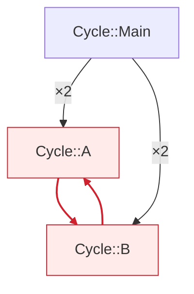
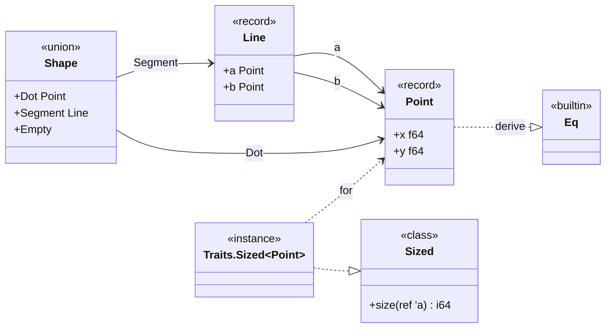
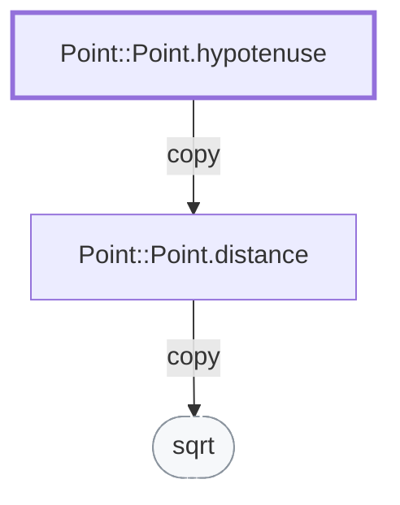
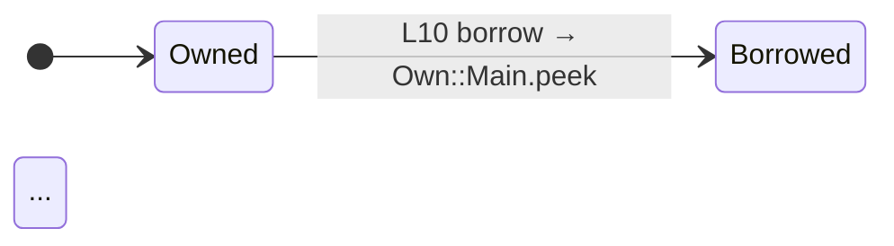
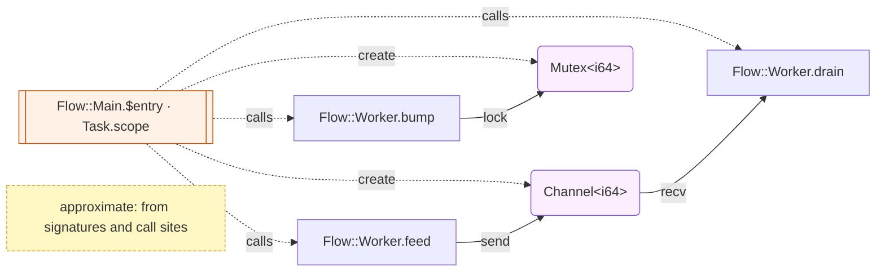
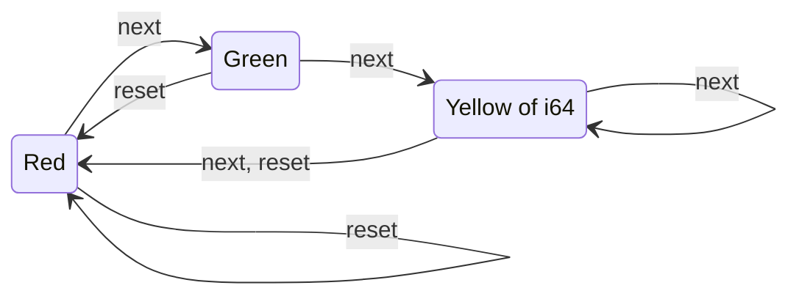

# 図表の生成

`tsuzuri kg diagram` は、プロジェクトの[知識グラフ](kg.md)から図を作ります。モジュールの依存、型の関係、呼び出し、所有権の流れ、並行、メモリの配置、共用体の状態遷移の 7 種類です。図は知識グラフの行だけから決定的に作るので、同じ知識グラフと同じ引数なら 1 byte も変わりません。出力は Mermaid（GitHub や VS Code の Markdown プレビューがそのまま描きます）か Graphviz の DOT、所有権と配置は表を含む Markdown です。

## この記事のポイント

- `tsuzuri kg diagram KIND [ID]` で、KIND は `module`・`types`・`calls`・`ownership`・`concurrency`・`layout`・`transitions` の 7 つです。
- ソースを読むのは `transitions` だけです。ほかの図は知識グラフの行だけから作ります。
- 生成する Mermaid は、ノードの ID を `n1`・`n2` のような番号にし、ラベルを必ず `"…"` で囲んでエスケープするので、予約語（`end`・`call`）や特殊文字で壊れません。
- `kg build`（と知識グラフを書く `check` など）は、ID の要らない 3 つの図を `views/*.mmd` として知識グラフに入れます。
- `concurrency` と `transitions` は近似です。

## `tsuzuri kg diagram`

```text
tsuzuri kg diagram KIND [ID] [--path PATH] [--kg-dir DIR] [--format mermaid|dot] [--max-nodes N] [--depth N] [--no-refresh] [--json]
```

| 引数 | 意味 |
| --- | --- |
| `KIND` | 図の種類（下の表） |
| `ID` | 図の起点。KIND によって必須か任意か決まります。ID は `kg show` と同じに短く書けます（`hypotenuse` は `Point::Point.hypotenuse`。[ID の解決](kg.md#id-の解決)） |
| `--path PATH` | プロジェクト（既定 `.`） |
| `--kg-dir DIR` | 知識グラフの置き場 |
| `--format mermaid\|dot` | 出力の形式。既定は `mermaid` |
| `--max-nodes N` | ノードの上限（5〜200、既定 60）。超えるとモジュールごとにまとめます |
| `--depth N` | `calls` の深さ（1〜6、既定 2） |
| `--no-refresh` | 知識グラフを作り直さず、あるものを読みます（ない・古いときは `E2009`） |
| `--json` | 標準出力に 1 行の JSON `{"kind":…,"format":…,"text":…,"nodes":n,"folded":b}` を出します |

| KIND | `ID` | 出力 | `--format dot` | 図 |
| --- | --- | --- | --- | --- |
| `module` | 任意（モジュール。そのモジュールと隣り合うモジュールだけ） | Mermaid | 可 | モジュールの依存（`flowchart TD`） |
| `types` | 任意（モジュール。そのモジュールの型だけ） | Mermaid | 可 | 型と class の関係（`classDiagram`） |
| `calls` | 必須（関数・メソッド・テスト） | Mermaid | 可 | 呼び出しの木（`flowchart TD`） |
| `ownership` | 必須（関数） | Markdown | 不可 | 変数ごとの状態図と出来事の表 |
| `concurrency` | 任意（モジュール） | Mermaid | 可 | 並行の区画と共有するセル（`flowchart LR`） |
| `layout` | 必須（record・union） | Markdown | 不可 | メモリの配置の表 |
| `transitions` | 必須（union） | Mermaid | 可 | case の遷移（`stateDiagram-v2`） |

標準出力には図だけを出します。終了コードは、出力したとき 0、知識グラフがない・古い・壊れているとき 1（`E2009`）、引数・ID の誤りや図に要る事実がないとき 2（`E2000`）です。`nodes` は図に出した要素の数（注記のノードを除くノード、クラス、変数、表の行、case）、`folded` はノードをまとめたか、辺や変数を省いたときに `true` です。

```sh
tsuzuri kg diagram module
tsuzuri kg diagram calls hypotenuse --depth 3
tsuzuri kg diagram types --format dot | dot -Tsvg > types.svg
```

## 図の種類

### `module`

モジュールの間の呼び出し・型の使用・実装・instance を数えて、依存の辺にします（2 本以上なら `×n`）。`using` で取り込んだだけの名前空間のモジュールへは破線（`using`）です。互いに依存するモジュール（強連結成分）は赤く塗り、その間の辺を赤くします。依存パッケージのモジュールは灰色です。



### `types`

record・union・class・instance をクラスにし、フィールド・case・メソッドを 12 個まで書きます。`deriving` は `derive`、instance は class への実現（`..|>`）と型への `for`、フィールドや case が持つ型は合成（`-->`）です。組み込みの class（`Eq` など）は `<<builtin>>` です。



### `calls`

起点の関数から、呼び出しを `--depth` の段まで幅優先にたどります。辺のラベルは引数の渡し方（`ref`・`copy`・`own`）で、同じ相手を 2 回以上呼ぶと `×n` が付きます。知識グラフにない呼び先（std・組み込み）は丸い灰色、`--depth` で切った先があるノードは末尾に ` …` が付きます。関数は効果で色を分けます: 入出力・タスクなど（青）、確保・複製（黄）、トラップ（赤）、効果がないと分かっているもの（`pure` か、効果の一覧が完全なもの。緑）。起点は太枠です。



### `ownership`

関数の変数ごとに、所有権の出来事（借用・移動・解放）を状態図にします。借用は、その変数の次の出来事まで続くものとして `release` で `Owned` に戻します。移動・解放した状態は赤、借用中は黄です。1 つの状態図の遷移は 400 本までで、それを超える出来事は `N later events of x are not drawn.` と書いて描きません。図の後ろに、全部の出来事の表（200 行まで。残りは `N more events are not listed.`）があり、`diagnostic role` の列は、同じ位置を `E1012`・`E1014` の診断が `moved_here`・`borrowed_here` として引用することを示します。変数が 13 個以上なら、移動か借用のある変数を 12 個まで描きます。

````text
# Ownership of Own::Main.demo

## text



| # | line | var | event | to | diagnostic role |
| --- | --- | --- | --- | --- | --- |
| 1 | 10 | text | borrow | Own::Main.peek | borrowed_here |
````

### `concurrency`

並行の近似です。値の流れは知識グラフにないので、署名の型（`Channel.Sender<T>`・`Channel.Receiver<T>`・`Mutex<T>`・`Atomic<T>`）と呼び出し（`Task.scope`・`Task.parallel`・`Parallel.*`・`Channel.bounded`・`Mutex.create`・`Atomic.create`）から作り、図に「approximate」の注記を必ず付けます。並行の区画を作る関数は二重枠、共有するセルは紫です。生成の呼び出しの型 `T` は、署名に同じ種類のセルの型が 1 つしかないときだけ書き、2 つ以上なら `?` です。ID にモジュールを渡すと、そのモジュールの関数だけを描きます（ほかのモジュールの区画からの呼び出しは描きません）。区画とセルはまとめません: `--max-nodes` に区画とセル、ほかの関数のまとめ 1 つ、注記が収まらなければ `diagram_too_large` です。



### `layout`

record・union のメモリの配置を表にします。数値は 64-bit の native のものだけです（wasm32 ではポインターが 4 byte なので違います）。record のフィールドのオフセットは、大きさの分かる基本型（`i8`〜`i64`・`u8`〜`u64`・`f32`・`f64`・`bool`）が続く間だけ書き、分からない型の後ろは `?` です。

```text
# Layout of Shapes::Shapes.Shape (native, 64-bit)

| item | value |
| --- | --- |
| kind | union |
| size (bytes) | 40 |
| align (bytes) | 8 |
| layout | general |
| tag bytes | 1 |
| niche | none |
| drop flag | no |

| case | payload |
| --- | --- |
| Dot | Shapes.Point |
| Segment | Shapes.Line |
| Empty | - |
```

### `transitions`

共用体 `U` について、最初の引数が `U` で結果も `U` の関数のうち（署名の型の名前は `U` の ID かその後ろの部分。`Shapes.Shape` は `Acme::Kg::Shapes.Shape`。同じ名前の共用体がほかにもあれば、関数と同じモジュールのもの、なければ同じ名前空間でただ 1 つのもの）、本体がその引数の `match` のものを探し、各腕の case から、腕の本体が返す case への遷移を描きます。`_` や小文字の名前の腕は、それまでの腕が名指ししていない case のすべてです。ガードは無視します。この図だけはソースを読み、知識グラフを作ったときのソースと SHA-256 が違えば `E2009`（`kg_stale`）です。

```text
union Light =
    | Red
    | Green
    | Yellow of i64

def next :: Light -> Light
fn next light =
    match light with
    | Red -> Green
    | Green -> Yellow 3
    | Yellow n -> if n > 0 then Yellow (n - 1) else Red

def reset :: Light -> Light
fn reset light =
    match light with
    | Red -> Red
    | _ -> Red
```



## Mermaid の書き方とエスケープ

- ノードの ID は `n1`・`n2`…（状態は `s0`・`s1`…）で、元の名前はラベルに書きます。番号は元の ID の byte 順です。
- ラベルは必ず `"…"` で囲みます。`#`・`"`・`<`・`>`・`&`・`` ` `` はエンティティコード（`#35;`・`#quot;`・`#lt;`・`#gt;`・`#amp;`・`#96;`）にします。`Array<Point>` の `<Point>` が HTML のタグとして消えることはありません。
- `classDiagram` のメンバーの `(`・`)` は `#40;`・`#41;` にします（括弧が裸だと、フィールドがメソッドとして読まれます）。
- 状態図の遷移のラベルの `:` は `#58;` にします（`Own::Main.peek` の `::` を、Mermaid は新しい説明の始まりとして読みます）。
- ラベルは 60 文字（辺は 40 文字、`classDiagram` の関係は 30 文字）で切り、`…` を付けます。切ってからエスケープするので、エンティティコードが途中で切れることはありません。

`tsuzuri::diagram::validate_mermaid` は、生成した Mermaid がこの形だけでできていることを確かめる厳しい検査です。テストは全部の出力をこの検査と、Mermaid 12.1.0 の `parse` に通しています。

## DOT

`--format dot` は、`module`・`types`・`calls`・`concurrency`・`transitions` を Graphviz の DOT にします。色は Mermaid と同じ意味で、`fillcolor` に入ります。

```sh
tsuzuri kg diagram module --format dot | dot -Tpng > modules.png
```

## 知識グラフの `views/`

知識グラフを書くたびに、ID の要らない 3 つの図を作り直して、知識グラフの `views/` に入れます（`manifest.json` の `files` に入り、`kg verify` が確かめます）。作れない図（大きすぎるなど）は入れず、知識グラフの書き込みは失敗しません。

| ファイル | 作るとき | 中身 |
| --- | --- | --- |
| `views/modules.mmd` | モジュールが 2 つ以上 | `kg diagram module` |
| `views/types.mmd` | 型が 1 つ以上 | `kg diagram types` |
| `views/concurrency.mmd` | 並行の証拠がある | `kg diagram concurrency` |

## 上限

| 上限 | 値 | 超えたとき |
| --- | --- | --- |
| ノード | `--max-nodes`（5〜200、既定 60） | モジュール（`calls` の std は `std:<モジュール>`）ごとに 1 つのノードにまとめ、辺の多いものから残し、残りは `…N more groups (M)` の 1 つにします（`types` のクラスも同じ） |
| 辺 | 400 本（`ownership` は状態図ごと） | 整列した先頭 400 本を残し、最後に `%% omitted: N edges`（DOT は `// omitted: N edges`）を書きます。`folded` は `true` です |
| 文字 | 45,000 文字 | ラベルの上限を半分にして 1 回作り直し、それでも超えれば `E2000`（`diagram_too_large`） |

Mermaid の既定の上限（辺 500 本・50,000 文字）より内側に収めるためです。

## 誤り

| kind（`E2000`、終了コード 2） | いつ |
| --- | --- |
| `diagram_usage` | KIND がない、位置引数が 3 つ以上 |
| `diagram_unknown_kind` | KIND が 7 つのどれでもない |
| `diagram_needs_id` | `calls`・`ownership`・`layout`・`transitions` に ID がない |
| `diagram_format_unsupported` | `ownership`・`layout` に `--format dot` |
| `diagram_bad_option` | オプションの値・重複・未知、`calls` 以外への `--depth` |
| `diagram_unknown_id` | ID が見つからない（似た ID を 5 つまで挙げます） |
| `diagram_wrong_id_kind` | ID の種類が違う（`'X' is a record; diagram kind 'calls' needs a function id`） |
| `diagram_unavailable` | 図に要る事実がない（所有権の事実・レイアウトの行・`match` の遷移がない） |
| `diagram_too_large` | 45,000 文字を超える、`concurrency` の区画とセルが `--max-nodes` に収まらない |

知識グラフがない・古い・壊れているとき、`transitions` のソースが知識グラフと違うときは `E2009`（終了コード 1）です。

## 限界

- `concurrency` は署名と呼び出しからの近似で、値がどの関数からどの関数へ流れるかは見ません。
- `transitions` は、最初の引数の `match` の腕が直接返す case だけを見ます（別の関数を呼んで返す case は辿りません）。
- `layout` は native の 64-bit の値だけです。
- 型検査の通らないプロジェクトの図は作れません（知識グラフが不完全なため）。
