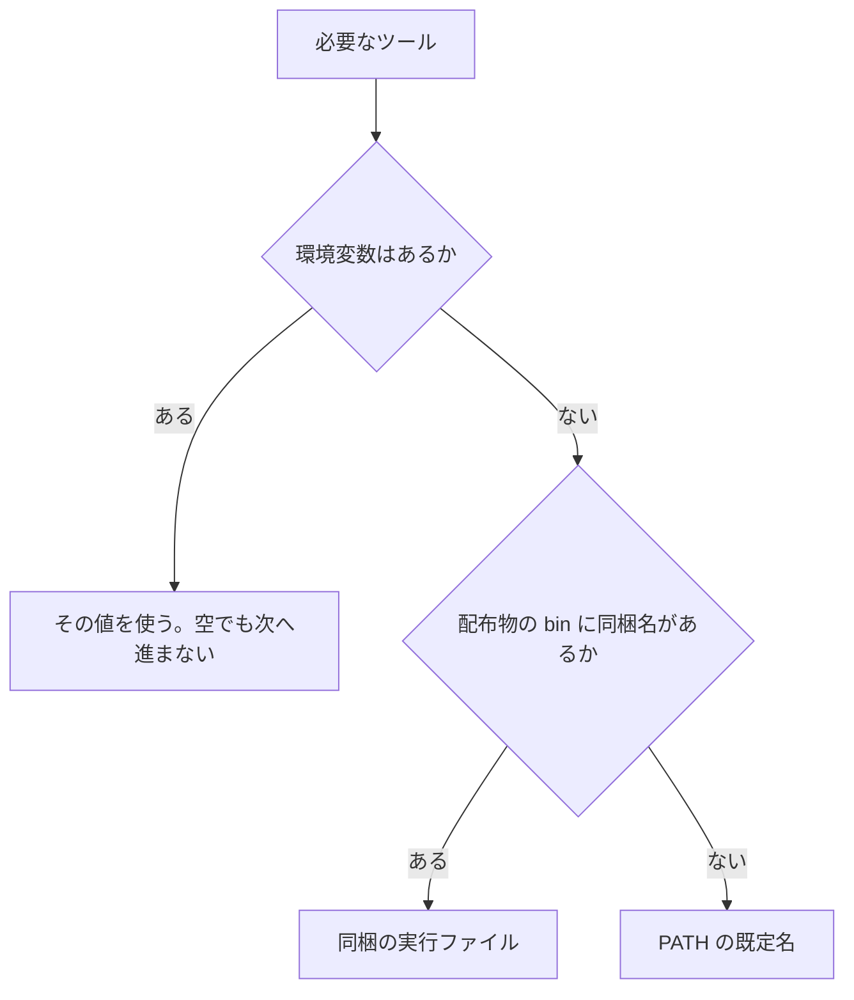

# コンパイラ オプション

`tsuzuri` のフラグは、サブコマンドごとに使えるものが違います。サポートされていないオプションの組み合わせを指定した場合は、コード生成へ進む前に `E2000` でエラーになります。同じソースでも、ターゲットや最適化を変えると成果物が変わるので、既定値を知っておくと再現しやすくなります。

このページの表は、`src/main.rs` のヘルプと引数解析、`BuildOptions::validate` で確認したものです。コマンドの流れ自体は [コンパイラの使い方](usage.md) を見てください。

## この記事のポイント

- 最適化の既定は `-O3` です。`test` と `repl` だけ既定が `-O0` です（`bench` は `-O3`）。fast-math は使いません。成果物を小さくするときは、`build` と `run` に `-Os` か `-Oz` を、`build` の native 実行ファイルに `--strip` を、`build` の WebAssembly に（Binaryen を入れた機械で）`--wasm-opt` を付けます（[成果物を小さくする](#成果物を小さくする)）。
- 実行時の分岐の頻度で最適化するときは、`build` か `run` に `--profile-generate DIR` を付けて計装し、代表的な仕事で動かしてから、`--profile-use PATH` を付けて作り直します。速くなる種目も遅くなる種目もあるので、自分のプログラムで測ってください（[プロファイル誘導最適化](#プロファイル誘導最適化)）。
- `-O0` の native `build`・`run`・`test` と、wasm32 の `build` の待ち時間を短くするときは、`--backend fast` を付けます。LLVM IR を Clang に渡さず、コンパイラ自身が機械語（wasm32 では wasm の命令）にします。既定は `llvm` のままで、`cargo build --release --features fast-backend` でビルドした `tsuzuri` だけが受け付けます（[コード生成器](#コード生成器)）。
- `-O0` の native の実行ファイルと `--emit object`、wasm32 の `--emit wasm` の待ち時間は、IR を決める単位に分けて、変わらない部分の Clang を省くことでも短くなります。既定では分けません（初回のビルドが長くなるためです）。大きなプログラムで、本体を編集したあとのビルドを短くしたいときは、`TSUZURI_CODEGEN_UNITS=auto` か `split` で選びます（[コード生成の単位](#コード生成の単位codegen-unit)）。
- `--emit` の既定は、native なら `exe`、`wasm32` / `wasm64` なら `wasm` です。
- `--target` は `native`、`wasm32`、`wasm64` と、Windows x64/Arm64・Linux x64/Arm64・macOS Arm64 の 9 個の native の名前を受けます。名前の一覧、tier、リンクの手段は [対応プラットフォームとクロスコンパイル](platforms.md) にあります。
- リンク入力は、ネイティブ実行ファイルの `build`、`run`、`test` と、共有ライブラリの `--emit shared` だけが受けます。
- フラグの重複や、サブコマンドとの不一致は終了コード 2 の `E2000` です。
- ツールの場所は、環境変数、配布物の `bin/`、PATH の順です。

## どのサブコマンドが受け付けるか

`lsp` は引数を取りません。`mcp` は `--root DIR` と `--kg-dir DIR`（それぞれ 1 回）だけを受け付け、ほかの引数は `E2000` です（[MCP サーバー](mcp.md)）。`new` はディレクトリと `--namespace` だけ、`toolchain info` は 2 語ぴったりです。`watch` は、次の語（`check`・`build`・`test`）の列と同じオプションを受け付けます。`watch` 自体のオプションはなく、それ以外のコマンドは `E2000` です。`serve` はプロジェクトのディレクトリ 1 つと `--idle-timeout SECONDS`（1〜86400）、または `--status` か `--stop` とディレクトリ 1 つだけを受け付けます（`--status` と `--stop` は同時に使えず、`--idle-timeout` とも組み合わせられません）。`api-diff` は古い版と新しい版の入力 2 つと、`--json`・`--effective` だけを受け付けます。`find` は型の問い合わせ 1 つか、`--result TYPE`（1 回）と `--takes TYPE`（繰り返し可）と、`--project DIR`・`--module NAME`・`--limit N`（1〜100）・`--json`（それぞれ 1 回）だけを受け付けます（[find](usage.md#find)）。`prove` はプロジェクト 1 つ（省略時はカレントディレクトリ）と、`--function NAME`（繰り返し可）、`--prove-timeout SECONDS`（1〜3600）、`--json` だけを受け付けます。`audit` はプロジェクト 1 つ（省略時はカレントディレクトリ）と、`--json`・`--deny-warnings`（それぞれ 1 回）だけを受け付けます。`--effective` は依存込みで型検査して解決後の契約を比較します。既定は構文比較です。`bindgen` はヘッダー 1 つと、`-o`（必須、`.tz`）、`--include-dir DIR`、`--buffer FUNCTION:POINTER:LENGTH`、`--consume FUNCTION:PARAMETER`（この 3 つは繰り返し可）、`--json` だけを受け付けます。`repl` はパスを取らず、`-O0`〜`-O3`、`--cpu`、`--no-cache`、`--timeout SECONDS` だけを受け付けます。`script` は、ファイルより前に置いたものだけをオプションとして読み、ファイルより後ろはすべてプログラムの引数です。それ以外は、次の表のとおりです。`○` が受け付け、空欄は `E2000` です。

| オプション | check | build | run | test | bench | doc | fmt | repl | script |
| --- | --- | --- | --- | --- | --- | --- | --- | --- | --- |
| `--json` | ○ | ○ | ○ | ○ | ○ | ○ | ○ | | ○ |
| `--deny-warnings` | ○ | ○ | ○ | ○ | ○ | ○ | | | ○ |
| `--warn implicit-copy` | ○ | ○ | ○ | ○ | ○ | ○ | | | ○ |
| `--warn untrusted-extern` | ○ | ○ | ○ | ○ | ○ | ○ | | | ○ |
| `--warn canonical` | ○ | ○ | ○ | ○ | ○ | ○ | | | ○ |
| `--edition 2026\|2027` | ○ | ○ | ○ | ○ | | | | | ○ |
| `--contracts off\|check\|test\|prove` | ○（`prove` だけ） | ○（`test` を除く） | ○（`test` を除く） | ○ | | | | | ○（`test` を除く） |
| `--prove-timeout SECONDS` / `--function NAME` | ○ | ○ | ○ | ○ | | | | | |
| `-o` / `--output` | | ○ | | ○（`-g` と） | | ○（必須） | | | |
| `--target` | | ○ | ○（native の target だけ） | ○ | ○（ビルド機の target だけ） | | | | |
| `--emit` | | ○ | | | | | | | |
| `-O0`〜`-O3` | | ○ | ○ | ○ | ○ | | | ○ | ○ |
| `-Os` / `-Oz` | | ○ | ○ | | | | | | |
| `--backend` | | ○ | ○ | ○ | | | | | |
| `--cpu` | | ○ | ○ | | | | | ○ | ○ |
| `--no-cache` | | ○ | ○ | | | | | ○ | ○ |
| `--no-server` | ○ | ○ | | | | | | | |
| `--kg` / `--no-kg` / `--kg-dir DIR` | ○ | ○ | ○ | ○ | | | | | |
| `-g` / `--debug-info` | | ○ | ○ | ○（1 件の `--index` と `-o`） | | | | | |
| `--debug-output` | | ○ | ○ | | | | | | |
| `--trap-info` | | ○ | ○ | | | | | | |
| `--overflow-report` | | ○ | ○ | ○（既定でオン） | | | | | |
| `--allow-overflow` | | | | ○（`-g` を除く） | | | | | |
| `--trap-mode` | | ○ | | | | | | | |
| `--allocator` | | ○ | ○（counting のみ） | ○（counting のみ） | | | | | |
| `--freestanding` | | ○ | | | | | | | |
| `--strip` | | ○ | | | | | | | |
| `--wasm-opt` | | ○ | | | | | | | |
| `--profile-generate DIR` / `--profile-use PATH` | | ○（native の `exe`・`object` と、wasm32 の `wasm`） | ○（native の target だけ） | | | | | | |
| `--wasm-feature` | | ○ | | | | | | | |
| `--wasm-host` | | ○ | | | | | | | |
| `--wasm-max-memory` | | ○ | | ○ | | | | | |
| `--wasm-stack-size` | | ○ | | ○ | | | | | |
| `--link` / `-l` / `-L` | | ○ | ○ | ○ | ○ | | | | ○ |
| `--list` / `--filter` / `--index` | | | | ○ | ○ | | | | |
| `--coverage PATH` | | | | ○ | | | | | |
| `--seed N` | | | | ○ | | | | | |
| `--doc` | | | | ○ | | | | | |
| `--affected BASE` | | | | ○ | | | | | |
| `--check` | | | | | | | ○ | | |
| `--samples N` | | | | | ○ | | | | |
| `--allocs` | | | | | ○ | | | | |
| `--timeout` | | | | | | | | ○ | |

`tsuzuri kg` のサブコマンドのオプション（`--path`・`--budget`・`--depth`・`--no-refresh`・`--format`・`--max-nodes` など）は、この表ではなく [知識グラフ](kg.md) と [図表の生成](diagrams.md) にあります。

`--deny-warnings` と `--warn` は、ヘルプでは `check` / `build` / `run` が中心です。実装では警告の表示が `doc` と `test` の前にも走るので、この 2 つでも効きます。`fmt` は明示的に拒否します。

同じオプションを 2 回以上指定すると `E2000` になります。複数回の指定が許可されているのは `--link`、`-l`、`-L`、`--index`、および異なる機能名を指定した `--wasm-feature` のみです。`--link`、`-l`、`-L` の合計は最大 256 個までです。

<!-- rule: CLI-001 -->
未知のフラグは `unknown option '...'; use --help` です。値を取り忘れると `--output needs a value` のように、そのフラグの名前で止まります。

`guide` の専用オプションは `--level 0|1`・`--topic NAME`・`--list`・`--json`・`--edition YEAR`・`--agents [DIR]`・`--llms-txt [DIR]` と位置引数 `std [MODULE]` で（[コンパイラの使い方](usage.md#guide)）、`new` は `--namespace NAME` と `--no-agent-files` を受け付けます。

`fix` の専用オプションは `--applicability certain|likely|maybe`・`--dry-run`・`--json`、edition の移行では `--edition YEAR`・`--from YEAR` です。
入力はファイルかディレクトリ 1 つで、ビルド用のフラグは受け付けません。`--edition` と `--applicability` は一緒に使えず、`--applicability maybe` は `--dry-run` が要ります。
`--edition` は一般の build/check のオプションではありません（[契約を保つ移行](usage.md#fix)）。

## 出力とターゲット

| オプション | 既定 | 意味 |
| --- | --- | --- |
| `-o` / `--output PATH` | 入力の拡張子を差し替えたパス | 成果物、または `doc` のディレクトリ。親は作られます |
| `--target native\|wasm32\|wasm64\|TRIPLE` | `native` | `wasm64` は 64-bit の線形メモリです。`TRIPLE` は対応する 5 環境の 9 個の native の名前で、`wasm32-unknown-unknown` と `wasm64-unknown-unknown` は `wasm32` と `wasm64` の別名です（[一覧](platforms.md#target-の一覧と-tier)）。`native` と違い、Clang に `--target` を渡します |
| `--emit exe\|object\|llvm\|header\|wasm\|wgsl\|wgsl-relaxed\|spirv\|spirv-relaxed\|shared\|bitcode\|bindings-js\|bindings-cs\|bindings-py\|bindings-cpp` | native は `exe`、WASM は `wasm` | 何を残すか |

拡張子は、native の実行ファイルが Windows の target で `.exe`、ほかで空、オブジェクトが Windows の target で `.obj`、ほかで `.o`、LLVM IR が `.ll`、ヘッダーが `.h`、WASM が `.wasm`、WGSL が `.wgsl`、SPIR-V が `.spv`、共有ライブラリが Mach-O の target（macOS、iOS）で `.dylib`、ほかで `.so`、bitcode が `.bc`、バインディングが JavaScript の `.mjs`、C# の `.cs`、Python の `.py`、C++ の `.hpp` です。`--target native` の target は、ビルド機です。

`--emit bindings-js` は `--target wasm32` だけで使え、`<name>.mjs` の隣に TypeScript 宣言 `<name>.d.mts` も書きます。`-o` は `.mjs` で終わる必要があります。`-O` は受け付けて無視し、`--trap-info`、`--debug-info`、`--debug-output`、`--wasm-feature simd128`、`--wasm-feature tail-call`、`--allocator` は `.wasm` のビルドに付けるよう `E2000` で求めます。`--wasm-feature threads` を付けると、Web Worker のスレッドプールを作るグルーになります。使い方は [WebAssembly への出力](webassembly.md#型付きのバインディングを生成する) にあります。

`--emit shared` は native の共有ライブラリです。Windows の target ではまだ使えません（`E2000`）。`--emit bindings-cs`、`bindings-py`、`bindings-cpp` は native の target（`--target native` か `TRIPLE`）だけで使え、`-o` の拡張子を除いたファイル名がライブラリの名前です。バインディングの中身は target で変わりません。`-O` は受け付けて無視し、`--trap-info`、`--debug-info`、`--debug-output`、`--allocator`、`--freestanding` は共有ライブラリのビルドに付けるよう `E2000` で求めます。`--trap-mode return` は、ライブラリとバインディングの両方に付けます。使い方は [ネイティブ連携](native-interop.md#共有ライブラリと各言語のバインディング) にあります。

`--emit bitcode` は、プログラムと、それが使う C ランタイムを 1 つにまとめた ThinLTO の LLVM bitcode（`.bc`）です。C・C++ のホストが、bitcode を書いた Clang と同じ Clang の `-flto=thin` でリンクすると、小さな公開関数をホストへ inline できます。native の target（Windows を除く。`--target native` か `TRIPLE`）と `--target wasm32` で使え、`wasm64` と Windows の target は `E2000` です。`-O`、`-g`、`--trap-info`、`--trap-mode return`、`--allocator`、`--cpu native` は object と同じ意味で通ります。リンク入力、`--strip`、`--profile-generate`・`--profile-use`、`--freestanding`、`--wasm-feature` の `threads`・`jspi`・`webgpu`・`net`、`--wasm-host`、`--wasm-stack-size` は受けません。ビルドキャッシュは使いません。C ランタイムを使うプログラムは、ランタイムを IR のままで 1 つにまとめるために `llvm-link` が要ります（`TSUZURI_LLVM_LINK`）。使い方は [ネイティブ連携](native-interop.md#言語間-lto-と-bitcode) にあります。

`--emit exe` は `--target native`、`--emit wasm` は `wasm32` か `wasm64` が必要です。逆にすると、次の 1 文で止まります。

```text
<command line>:1:1: error[E2000]: '--emit exe' requires '--target native'; '--emit wasm' requires '--target wasm32' or '--target wasm64'
```

ネイティブの実行ファイル（`--emit exe`。`build` と `run`）に入るのは、入口（`def main` かトップレベルのコード）、`export def`、`Drop` の実装（std のものを含む）と、そこから到達する関数だけです。どこからも呼ばれない公開関数は、実行ファイルの内部関数で外から呼べないので、コンパイルしません。未使用の公開関数も、型検査と所有権の検査は今までどおり受け、型エラーは `check` が報告します。コンパイルしないので、その関数だけが使うものは、実行ファイルのビルドを妨げません。以前は失敗したビルドが、次のように通ります。

- ビルドする target にない OS API、`Net`、`Async.block_on` を、未使用の公開関数だけが使うとき。`File.read_text` だけを使う関数は、`--target x86_64-pc-windows-gnu` で `E2002` でしたが、出ません（[対応プラットフォーム](platforms.md#診断)）。
- どのライブラリにもない `extern` のシンボルを、未使用の公開関数だけが呼ぶとき。リンクが未定義のシンボルで失敗していましたが、通ります（[ネイティブ連携](native-interop.md#ホスト関数を-import-する)）。
- タスク、`Net`、GPU などの C のランタイムを、未使用の公開関数だけが使うとき。そのランタイムのコンパイルもリンクもしません。

入口か `export def` から到達するなら、今までどおり失敗します。`--emit object`、`llvm`、`header`、`wasm`、`shared` は、公開関数をすべて出力するので、今までどおりです。デバッグ情報とトラップ位置への影響は [デバッグ](debugging.md) にあります。

`wgsl`、`wgsl-relaxed`、`spirv`、`spirv-relaxed` は実験的な GPU カーネル用です。`wgsl` は厳密な `i32`／`i32u` のカーネル、`wgsl-relaxed` は `f32` を含む緩いカーネルで、出力の 1 行目に `// tsuzuri-gpu float=relaxed …` を付けます（[Gpu](../built-in-types-and-modules/gpu.md#緩い-f32-カーネル)）。`spirv` は Vulkan 用の厳密なカーネルで、`i32`、`i32u`、`i64`、`i64u`、`f32` を受け、`spirv-relaxed` は緩い `f32`、`i32`、`i32u` のカーネルです。SPIR-V 1.3 のバイナリ（32 bit ワードのリトルエンディアン）を書き、同じソースから、同じバイト列ができます（[Gpu](../built-in-types-and-modules/gpu.md#spir-v-を出す)）。どれも `export` が 1 つの専用プロジェクトを受け、`--target`、`-O`、`--cpu`、デバッグ、WASM 機能とは一緒に使えません。SPIR-V の出力は、ビルドのキャッシュを使いません。

## 最適化と CPU

| オプション | 既定 | 意味 |
| --- | --- | --- |
| `-O0` `-O1` `-O2` `-O3` | `build` / `run` / `script` / `bench` は `-O3`（`--backend fast` を付けると `-O0`）、`test` と `repl` は `-O0` | LLVM の最適化。fast-math や再結合は使いません |
| `-Os` `-Oz` | `-O3`（付けない場合） | 成果物の大きさを優先する LLVM の最適化。`build` と `run` だけ |
| `--cpu generic\|native` | `generic` | native の実行ファイルとオブジェクト。`native` はこの機械の命令セットで、古い CPU では動きません。x86-64 の `native` は、`f16` の変換と演算に F16C と AVX512-FP16 も使います（[`f16` の計算の経路](../types-and-type-inference/basic-types.md#f16-の計算の経路)） |

`check` は最適化も CPU も見ません。型が通れば、どの `-O` でも同じ診断です。`doc` と `fmt` も最適化を受け付けません。`test` は `-O0`〜`-O3` を受け、`--cpu` は拒否します。

`-Os` と `-Oz` は、LLVM のサイズ最適化です。`-Os` は大きさと速さの釣り合いを取り、`-Oz` は大きさを優先します。どちらもプログラムの意味を変えません。`-g` を付けない `--emit llvm` の出力は、WebAssembly では `-O0` から `-Oz` まで同じです。native では `-O1`〜`-O3` が同じで、`-O0`・`-Os`・`-Oz` は、関数値の adapter（`@tz.apply.*`）とラムダの worker（`@tz.fn.$lambda.*`）の `alwaysinline` が外れる点だけが違います。この属性は、既知の関数値の呼び出しへ必ず inline させるためのもので、サイズ最適化と `-O0` では外して、inline を LLVM に任せます。変わるのは、この属性と、IR を機械語にする Clang に渡す最適化レベルだけです。整数の折り返し、NaN、符号付きゼロ、トラップ、`--trap-info` の位置表、`-g` のデバッグ情報、WebAssembly の import は、`-O3` と同じです。代わりに、速度は落ちることがあります。数値と数学のランタイムの object も同じレベルでコンパイルします。配布物の `share/runtime/` には `-O0`〜`-O3` の object だけがあるので、`-Os` と `-Oz` の最初のビルドは Clang でランタイムをコンパイルし、結果を `runtime/` のキャッシュに保存します。`--no-cache` のときはランタイムを IR のままモジュールに埋め込み、毎回いっしょにコンパイルします。

関数値は静的な記述子と環境の 2 ポインターで、記述子が adapter を参照し続けます（[ラムダ式](../values-and-functions/lambda-expressions.md)）。そのためサイズ最適化は、既知の関数値の呼び出しを adapter ごと inline しきれず、関数値を使う小さなプログラムでは adapter と worker が別の関数として残り、コードが大きくなります。関数値を作らない小さな library の `-O3`・`-Os`・`-Oz` の object は変わりません。関数値が 4 ポインターだったコンパイラとの比較は次のとおりです（macOS arm64。native は `--emit object` の `__text`、wasm32 は `.wasm` 全体）。

| 測ったもの | `-Os` | `-Oz` |
| --- | --- | --- |
| native `examples/hello` の `__text` | +15%（3,220 → 3,712） | +21%（3,004 → 3,636） |
| native `examples/functional` | +14%（4,228 → 4,840） | +13%（4,272 → 4,844） |
| native `examples/io` | −1%（20,108 → 19,916） | +2%（17,112 → 17,496） |
| native `tests/fixtures` の 4 本 | +1.5〜3.7% | +1.1〜3.8% |
| wasm32 `examples/hello` | +0.9%（4,493 → 4,534） | +7.8%（3,905 → 4,208） |
| wasm32 `examples/functional` | +8.7%（6,283 → 6,828） | +9.1%（5,278 → 5,758） |
| wasm32 `examples/io` | +0.1%（7,939 → 7,949） | +5.3%（6,878 → 7,244） |

増えるのは native の `hello` で 500〜600 バイト、wasm32 の `hello` で 40〜300 バイトです。native の実行ファイル全体では、`-Oz` の `hello` が 34,008 → 34,376 バイト（+1.1%）です。`-O3` の増えは、native が `hello` で +3.1%（3,208 → 3,308 バイト）、`functional` で +0.9%、wasm32 の `examples` が +1.4% 以内で、`-O0` では使われない記述子が残り、native の `hello` の object が +2.9% です。測定と再現の手順は [性能測定](../../../docs/benchmarks.md#pm02-関数値の表現の縮小) です。

`test` と `bench` は `-O0`〜`-O3` だけを受け付け、`-Os` と `-Oz` は `E2000` です。`repl` と `script` も、`-O0`〜`-O3` だけです。`--emit bindings-js` などの `-O` を無視する出力は、`-Os` と `-Oz` も無視します。

```text
<command line>:1:1: error[E2000]: test supports -O0 to -O3; use -Os or -Oz with build or run
```

`--cpu native` は、native の `exe`、`object`、`bitcode` だけです。`llvm`、`header`、WASM では `E2000` です。`bitcode` では、probe の `target-features` も IR の全関数に付けます。対応するホストは x86、x86_64、arm、aarch64 です。`--target` で別の target を名指しすると、ビルド機の命令セットは別の機械のものなので `E2000` です。その target には `--cpu generic` を使います。

整数の折り返し、NaN、符号付きゼロは、`-O3` でも変えません。次の関数は `-O0` でも `-O3` でも 42 です。

```tsuzuri run=42
def add :: i64 -> i64 -> i64 = \left right ->
    left + right

add 20 22
```

実行結果:

```text
42
```

## 成果物を小さくする

| オプション | 既定 | 意味 |
| --- | --- | --- |
| `-Os` `-Oz` | オフ | LLVM のサイズ最適化（[最適化と CPU](#最適化と-cpu)）。`build` と `run` |
| `--strip` | オフ | native の実行ファイルのリンクで、ローカルシンボルを除く。`build` の `--emit exe` だけ |
| `--wasm-opt` | オフ | wasm32 の `.wasm` のリンク後に、Binaryen の `wasm-opt -Oz` を実行する。`build` の `--emit wasm` だけ。同梱せず、明示したときだけ使う |

`--strip` はリンカーに `-Wl,-x` を渡します。ローカルシンボルだけが消え、グローバルシンボルは残ります。プログラムの動作と `--trap-info` の位置表（`.trap.json`）は変わらず、macOS のコード署名も有効なままです。小さくなるのはシンボル表の分だけで、`examples/hello` の既定のビルドは 33,960 バイトから 33,784 バイト（macOS arm64 で測定）です。`-g` とは組み合わせられず（デバッガーがシンボルを使うため）、`--emit object`・`llvm`・`header`・`shared`、バインディング、WASM は `E2000` です。WASM の出力は `--debug-info` を付けない限り、すでにシンボルを持ちません。Windows のリンクは変えないので、`--strip` を付けても成果物は同じです。`build` 以外のサブコマンドは `--strip` を拒否します。

```text
<command line>:1:1: error[E2000]: --strip cannot be combined with --debug-info: a debugger needs the symbols
```

`--wasm-opt` は、`wasm-ld` が作った `.wasm` を Binaryen の `wasm-opt -Oz` で最適化し直し、その結果を成果物にします。`--target wasm32` の `--emit wasm` だけで使え、`wasm64`、`--wasm-feature threads`、`-g` と、`build` 以外のサブコマンドは `E2000` です。次の点は、付けなくても守られます。

- `wasm-opt` は同梱せず、`--wasm-opt` を付けたときだけ探します。`TSUZURI_WASM_OPT` は実行ファイルの場所で、この変数だけでは何も実行しません。PATH に `wasm-opt` があっても、付けなければ使いません。場所の探し方は他のツールと同じ（変数、配布物の `bin/`、PATH の順）です。
- 要求したのに見つからない、または失敗したときは、ビルドが `E2002` で止まり、成果物は残りません。メッセージはツールの名前と、`install Binaryen or set TSUZURI_WASM_OPT to the wasm-opt executable` というヒントを含みます。黙って最適化なしの成果物を作ることはしません。
- 渡す機能は、このコンパイラのモジュールが使う `bulk-memory`、`sign-ext`、`nontrapping-float-to-int`、`mutable-globals`、`multivalue`、`reference-types` と、`--wasm-feature simd128` のときの `simd`、`--wasm-feature tail-call` のときの `tail-call` だけです。モジュールの import、export（`--trap-info` の `tsuzuri_trap_site` を含む）、メモリの上限は変わりません。
- 成果物キャッシュのキーに `wasm-opt` の実体（パス、内容、`--version`）を含めます。同じソースでも、`wasm-opt` を替えると別のエントリです。

```text
examples/hello/Main.tz:1:1: error[E2002]: cannot execute 'wasm-opt': No such file or directory (os error 2); --wasm-opt runs Binaryen's wasm-opt: install Binaryen or set TSUZURI_WASM_OPT to the wasm-opt executable
```

Binaryen 132 の `wasm-opt -Oz` で、`examples/hello` の WebAssembly モジュールは `-Oz` で 2,587 バイトから 2,156 バイト（−16.7%）、`-O3` で 6,357 バイトから 5,196 バイト（−18.3%）になりました。`examples/io` は `-Oz` で 5,734 から 4,583 バイト、`examples/functional` は 3,960 から 3,094 バイトです（WebAssembly のヒープを作り直す前のモジュールでの値で、いまのモジュール（hello は `-Oz` 4,208、`-O3` 6,860 バイト）では測っていません。測定は [性能測定](../../../docs/benchmarks.md#成果物のサイズ)）。

## プロファイル誘導最適化

| オプション | 既定 | 意味 |
| --- | --- | --- |
| `--profile-generate DIR` | オフ | プログラムを計装する。正常に終了したとき、LLVM の raw profile（`.profraw`）を `DIR` に書く。`build` と `run` |
| `--profile-use PATH` | オフ | プロファイルを使って最適化する。`PATH` は merge 済みの `.profdata` ファイルか、`.profraw` を入れたディレクトリ。`build` と `run` |

2 つは同時に指定できず、どちらも 1 回だけです（`E2000`）。Tsuzuri が出す LLVM IR は、プロファイルの有無で変わりません。Clang が IR を機械語にするときに、計装の旗（`-fprofile-generate`）か使用の旗（`-fprofile-use`）を足すだけで、旗を付けないビルドの成果物とキャッシュのキーは変わりません。

手順は、計装して作る、代表的な仕事で動かす、プロファイルを渡して作り直す、の 3 つです。

```sh
tsuzuri build app -o app.gen --profile-generate prof   # 計装した実行ファイル
./app.gen                                              # 代表的な仕事。正常に終了すると prof/default_*.profraw ができる
tsuzuri build app -o app --profile-use prof            # prof の .profraw を merge して、最適化に使う
```

`prof` には `.profraw` を何回分でも置けます。ディレクトリを渡すと、Tsuzuri が `llvm-profdata merge` をファイル名の順に実行して 1 つにし、その中身をキャッシュのキーに入れます。同じ内容なら、ディレクトリでも merge 済みの `.profdata` でも同じ成果物で、2 回目以降のビルドはキャッシュから返ります。`.profraw` を 1 つだけ直接渡すと `E2000` です。`run` に付けると、同じ旗でビルドしたプログラムをそのまま実行します（`run --profile-generate prof` は計装して実行し、`prof` に書きます）。

**同じ条件でそろえます。** プロファイルは、IR の関数ごとの制御フローに結び付いています。計装と使用は、同じコンパイラ、同じソース、同じ Clang、同じオプション（`-O`、`--cpu`、`--allocator`、`--trap-info`、`-g`、`--no-cache` の有無）で行ってください。違うと、制御フローが変わった関数は合わなくなり、その関数だけがプロファイルなしで最適化されます。ビルドは成功し、合わなかった関数の数を `W2001` の 1 行で知らせます。

```text
profile data does not match 1 function(s) in this build; they are optimized without profile data. Rebuild with --profile-generate and rerun the training workload
```

`run` は `--trap-info` を付けてビルドするので、`run --profile-generate` のプロファイルは `build --trap-info --profile-use` に合います。Apple の Clang と Homebrew の Clang のように、LLVM が違う Clang どうしでは、プロファイルが合わない関数が出ることがあります。コンパイラ、Clang、ソースを替えたら、プロファイルを作り直してください。

**何が対象か。** 対象は、Tsuzuri が出したモジュールの IR です。`--no-cache`、`--emit object`、`--trap-info`、`-g` のビルドと `run` では、数値と数学のランタイムも IR のままモジュールに入るので、その関数もプロファイルに入ります。ほかの既定のビルドでは、これらは別の object で、プロファイルの対象外です。C のランタイム（タスク、IO など）は、どのビルドでも対象外です。数学関数を呼ぶ例（`Math.sin`・`Math.exp` を 3,000 万回）では、数学のランタイムを埋め込んで計装しても、プロファイルを使った成果物は使わないものと差がありませんでした（[性能測定](../../../docs/benchmarks.md#pr07-プロファイル誘導最適化pgo)）。

**`llvm-profdata` と Clang。** ディレクトリを渡すとき、`llvm-profdata` は、環境変数 `TSUZURI_LLVM_PROFDATA`、`TSUZURI_CLANG` の Clang の実行ファイルと同じディレクトリ、Clang が報告する toolchain の `bin/` の順で探します。PATH は探しません。別の LLVM の `llvm-profdata` が、この Clang のプロファイルを読めるのは偶然だからです。見つからないと `E2002` で、使う Clang と同じ LLVM のものを `TSUZURI_LLVM_PROFDATA` に指定します。merge 済みの `.profdata` を渡すときは、このツールを使いません。LLVM 22 以降が作った `.profdata` は、LLVM 21 の Clang が読めません（`E2002`）。`TSUZURI_CLANG` は LLVM の Clang（17 以降）で、同梱の `tsuzuri-clang` は旗を渡さず、プロファイルのランタイムも持たないので、両方の旗を `E2002` で拒否します。計装した実行ファイルのリンクはプロファイルのランタイム（`libclang_rt.profile`。Linux の apt では `libclang-rt-21-dev` など）を読みます。

**実行時。** プログラムは、正常に終了したときだけプロファイルを書きます。トラップやシグナルで終わると、書きません。書き先は環境変数 `LLVM_PROFILE_FILE`（LLVM の規則。`%p` はプロセス ID）で、実行のたびに上書きできます。`DIR` に `%` は使えません（`E2000`）。`run --profile-generate` で、プログラムが正常に終了したのにプロファイルが書かれなかったとき（ディレクトリに書けないなど）は、`W2001` の警告を 1 行出します。

`--emit object` を計装すると、オブジェクトはプロファイルのランタイムを持たないので、最後のリンクに `-fprofile-generate=DIR` を付けます。付けないと、macOS では `___llvm_profile_runtime` が未定義です。

**並列に動くプログラムの回数は少なく数えます。** 計装のカウンターは原子的に更新しません（Clang の既定の `-fprofile-update=single` と同じです）。`Task` や `Parallel` が複数のスレッドで同じ関数を動かすと、更新が重なって失われ、回数が実際より少なくなります（実行ごとに変わります）。4 つの Task が同じ 1 億回のループを回す例では、ループの回数は 4 億ではなく 1 億でした（関数に入った回数は正確に 4）。プログラムの結果とプロファイルの形（`W2001`）には影響しませんが、`--profile-use` は少ない回数をそのまま使います。正確な回数が要るときは、`-fprofile-update=atomic` を足して Clang を呼ぶスクリプトを `TSUZURI_CLANG` に指定して計装してください。その例では回数が 4 億になり、そのプロファイルは通常の Clang の `--profile-use` でそのまま使えました。ただし、計装したプログラムは 0.1 秒から 6 秒へ約 60 倍遅くなったので、Tsuzuri は原子的な更新を付けません（[性能測定](../../../docs/benchmarks.md#pr07-プロファイル誘導最適化pgo)）。

**使えない組み合わせ**は、`E2000` か `E2002` です（[組み合わせがエラーになる場合](#組み合わせがエラーになる場合)）。`--emit` は native の `exe` と `object`、wasm32 の `wasm` だけです。Windows と、ビルド機と違う `--target TRIPLE`（その機械でプログラムを訓練できない）は拒否し、`--profile-generate` と `--freestanding`（ランタイムが C ライブラリを要る）は一緒に使えません。ほかの出力が増えても、許可リストにない形は拒否します。

**速くなるとは限りません。** プロファイルは、Clang の分岐の見積もりを実測に替えるだけで、速くなる種目も遅くなる種目もあります。`benchmarks/control` では、`closure_capture` と `closure_churn` が 12〜17% 速くなり、`tail_mix` 系が約 20%、`match_dispatch` が約 63% 遅くなりました。ほかの種目は −4〜+6% の範囲で、host の配置の揺れの大きさです（`array_*` は C・C++・Rust の同じコードも同じ向きに動きました）。C と C++ に同じ手順の PGO を使うと、`closure_churn` は 43〜44% 速くなり、`tail_mix` 系は変わりません。測定の条件と生データは [性能測定](../../../docs/benchmarks.md#pr07-プロファイル誘導最適化pgo) にあります。使うときは、自分のプログラムで前後を測ってください。

### WebAssembly の module

`--target wasm32`（`--emit wasm`）にも付けられます。WebAssembly の module はプロファイルのランタイムを持たず、ファイルも書けないので、計装した module は数えるだけです。`--profile-generate DIR` は、`app.wasm` の隣に書き出し役の `app.wasm.profile.mjs` を出します。host が仕事を動かしたあとで `writeProfile(instance)` を呼ぶと、`DIR` に raw profile が書かれます（Node。ブラウザでは `profileBytes(instance)` のバイト列を保存します）。

```sh
tsuzuri build app --target wasm32 -o app.wasm --profile-generate prof
node train.mjs                                           # app.wasm を動かし、writeProfile(instance) を呼ぶ
tsuzuri build app --target wasm32 -o app.wasm --profile-use prof
```

```js
// train.mjs
import { readFileSync } from "node:fs";
import { writeProfile } from "./app.wasm.profile.mjs";
const { instance } = await WebAssembly.instantiate(readFileSync("app.wasm"), {});
instance.exports.tz_run(1000n); // 最適化したい仕事
console.log(await writeProfile(instance)); // prof/default_wasm_<pid>_<n>.profraw
```

`writeProfile` は、呼ぶたびに新しいファイルを作り、すでにあるファイルを上書きしません。`<n>` は、そのプロセスですでに使われている番号を飛ばした番号です。ファイルに入るのは、前に呼んだあとから module が数えた分だけです。書き終えると、その instance のカウンターは 0 に戻ります（書くのに失敗したときは、数えた分がカウンターに戻ります）。同じ Node のプロセスで何回呼んでも、いくつの module や Worker から呼んでも、書いたファイルは全部残り、`--profile-use prof` がまとめて merge すると、数えた分がちょうど 1 回ずつ入ります。`profileBytes(instance)` は読むだけで、カウンターを 0 に戻しません。前に呼んだあとから数えた分が全部入っているので、ブラウザのように自分で保存する host は、最後のバイト列だけを保存してください（途中のも merge に入れると、前の分が 2 回数えられます）。

書き出し役は Clang 21 の raw profile（version 10、32 bit）だけを書き、別の版で計装した module は拒否します。WebAssembly には間接呼び出しの対象を数えるランタイムがないので、`-mllvm -disable-vp` を計装と使用の両方に付け、間接呼び出しは最適化の根拠に入りません。`--wasm-feature threads`（カウンターが atomic でない）、`wasm64`、`--emit wasm` 以外、計装と `--wasm-opt` の併用は `E2000` です。`benchmarks/apps` は Node 24 で、`csv_aggregate` が約 14%、`tokenize`・`format_join`・`tree_transform` が 5〜8% 速くなり、`closure_pipeline` が約 5% 遅くなりました。`benchmarks/control` は差がありませんでした。Node 20 では `closure_capture` が約 50% 遅くなったので、使う JavaScript エンジンで測ってください。

## コード生成器

| オプション | 既定 | 意味 |
| --- | --- | --- |
| `--backend llvm\|fast` | `llvm` | `build`・`run`・`test` が、Tsuzuri の出した LLVM IR を機械語にする道具。`llvm` は Clang、`fast` はコンパイラに組み込んだ翻訳器です（native は Cranelift、wasm32 は wasm の命令を直接書きます） |

`--backend fast` は、`-O0` の編集とビルドの待ち時間を短くするためのものです。Tsuzuri が `-O0` で出す LLVM IR（`--emit llvm -O0` と同じテキスト）を、Clang に渡さずにコンパイラの中で機械語の object にし、リンクだけを今までどおり Clang で行います。IR を作る段階は `llvm` と同じなので、プログラムの意味は変わりません。整数の折り返し、NaN、符号付きゼロ、トラップ、`--trap-info` の位置表と `run` の `E2005` の報告、`Drop` の順序は `llvm` のビルドと同じで（`llvm` のビルドを [codegen unit](#コード生成の単位codegen-unit) に分けたときは、位置表の `id` だけが違います）、変わるのは機械語だけです。`--backend` を付けないビルドの IR・object・実行ファイルは、この機能がなかったときと同じです（codegen unit に分けるビルドを除きます）。

使える組み合わせは次のとおりです。これ以外は、ビルドに入る前に `E2000` で、`--backend llvm` を使うよう伝えます。

| | `--backend fast` |
| --- | --- |
| 最適化 | `-O0` だけです。付けないと `-O0` になります（`test` の既定も `-O0`）。`-O1` 以上、`-Os`、`-Oz` は `llvm` |
| target | ビルド機の native（macOS Arm64、Linux x64/Arm64）と `wasm32` です（[fast の WebAssembly](#fast-の-webassemblywasm32)）。`wasm64`・`--target TRIPLE` は `llvm` |
| `--emit` | native は `exe` と `object` だけです。wasm32 は `wasm` と `object` だけです。`llvm`・`header`・`shared`・`bitcode`・GPU カーネル・バインディングは `llvm` |
| 付けられるもの | `--trap-info`、`--strip`（native）、`--no-cache`、`-o`、`--link`・`-l`・`-L`、`--allocator system\|host\|small\|counting`、`--freestanding`、`--trap-mode return`、`--coverage`（`test`）、`-g`（native。関数と行の DWARF。[fast のデバッグ情報](#fast-のデバッグ情報)）、`--wasm-max-memory`・`--wasm-stack-size`（wasm32） |
| `llvm` に残るもの | `--cpu native`、`--profile-generate`・`--profile-use`、wasm32 の `--wasm-feature`（simd128・threads・jspi・webgpu・net・tail-call）・`--wasm-host wasi`・`--wasm-opt`・`-g`、WebAssembly の target の `test` |

`tsuzuri` に Cranelift は既定で入りません。`cargo build --release --features fast-backend` でビルドした `tsuzuri` だけが `--backend fast` を受け付け、入っていない `tsuzuri` は再ビルドの方法を `E2000` で示します。Windows とビルド機が上の表にないものは、`E2000` です。

Tsuzuri の出した IR に翻訳器の知らない命令や型が含まれると、翻訳は `E2002` で止まり、構成要素と関数の名前を示します。別の意味のコードを出すことはありません。そのときは `--backend llvm` で作り直してください。止まるものには、`half`・`x86_fp80`、インラインアセンブリ、`invoke`、外から見える関数（`declare` と、external・weak の `define`）の `byval`・`sret` の引数とその呼び出し、可変引数の関数の呼び出し、表にない `llvm.*` などがあります。`musttail` の呼び出しは止まりません（[保証された末尾呼び出し](#保証された末尾呼び出しの翻訳)）。16 byte を超える alignment の `alloca`（256 bit の vector など）は止まらず、native は stack の slot を余分に取ってアドレスを切り上げ、wasm32 は frame を切り下げて、要求どおりに揃えます。このリポジトリの `examples/` と `tests/fixtures/` のうち `llvm` でビルドできる 102 個には、そのどれも現れず、すべて `fast` でもビルドでき、実行ファイルは同じ出力と終了状態になり、ライブラリは同じ symbol を export します。

```text
<command line>:1:1: error[E2000]: --backend fast supports only -O0; remove -O3 or use --backend llvm
```

同じソースを `llvm` と `fast` の両方で作っても、成果物のキャッシュは取り違えません。`--backend` はキャッシュのキーに入ります（`--backend llvm` は付けないときと同じキーです）。`fast` の object は、並列の worker の数（`TSUZURI_THREADS`）によらず同じバイト列になります。

**性能の目安**（Apple M1 Max の macOS、他の作業が動く共有機での、交互に動かした 7 標本の中央値の比です。条件と生の数値は [性能測定](../../../docs/benchmarks.md#pb05-デバッグビルド用の高速バックエンド)）。

- 待ち時間: 合成プロジェクト（1 モジュール 20 関数）の `-O0` のビルドは、200 モジュールで `llvm` の 0.50〜0.55 倍、1,000 モジュールで 0.55〜0.57 倍でした（`build`、1 モジュールの本体の編集、1 モジュールの export の編集）。短くなるのは Clang の時間（コンパイルとリンク）だけです。200 モジュールで約 1.0 秒だったものが翻訳の約 0.1 秒とリンクに、1,000 モジュールで約 4.5 秒だったものが翻訳の約 0.5 秒とリンクになり、リンクは 0.05〜0.15 秒です。構文解析・型検査・IR の生成は同じです。`examples/hello` のような小さいプログラムの、1 か所を変えた後のビルドは、`llvm` の中央値 285 ms が 251 ms（0.88 倍）になるだけです（変わらない部分が大きいためです）。
- 生成したコードの速さ: `benchmarks/control` の 16 種目の中央値の合計は、`-O0` の Clang の 0.85 倍で、`-O3` の約 3.5 倍です。`float32`・`float64` の 2 種目は約 20% 遅くなりました。結果の checksum は 3 つのビルドで一致しました。
- 大きさ: 合成プロジェクトの実行ファイルは、`-O0` の Clang のものより約 15% 大きくなります。`--emit object` は、使われない関数を翻訳しないので、`-O0` の Clang のものより小さくなります。

### fast の WebAssembly（wasm32）

`--backend fast --target wasm32 -O0` は、wasm32 の `-O0` のビルドでも、Tsuzuri の出した LLVM IR を Clang に渡さずに、コンパイラ自身が WebAssembly の object にします。object は、`numeric`・`math` の runtime の object（Clang が作ったものか、同梱のもの）と一緒に、今までどおり `wasm-ld` でリンクします。IR を作る段階は `llvm` と同じなので、プログラムの意味は変わりません。`--emit wasm`（既定）と `--emit object` が使え、`--wasm-max-memory`・`--wasm-stack-size`・`--trap-info`・`--allocator`・`--no-cache` も `llvm` のときと同じです。付けると `E2000` になるのは、`--wasm-feature simd128|threads|jspi|webgpu|net|tail-call`、`--wasm-host wasi`、`--wasm-opt`、`-g`（wasm の DWARF は `llvm` だけです）、`wasm64`、`wasm` と `object` 以外の `--emit` です。

- 同じになるもの: 出力、トラップ（`unreachable`）、整数の折り返し、`i128`、浮動小数点の結果、import と export の名前（import の並びも Clang の object と同じ、最初に使われた順です。`llvm` のビルドを [codegen unit](#コード生成の単位codegen-unit) に分けたときは、unit の object のリンクの順になります）。`examples/` と `tests/fixtures/` のうち `llvm` で wasm32 にできる 94 個は、`fast` でもすべてビルドでき、すべての export を同じ入力で呼ぶと同じ結果になります。約 970 の演算（整数・`i128`・浮動小数点・vector・メモリ・制御構造。33〜63 bit の幅の overflow の演算と、ポインタ越しの呼び出しの narrow な結果を含みます）は、Clang の object と同じ結果になります。
- 違うもの: module は `llvm` の `-O0` のものより大きくなります（`examples/` と `tests/fixtures/` の 94 個の合計で 1.10 倍、合成プロジェクトで 1.40〜1.43 倍。最適化せず、命令を定型で並べるためで、`llvm` と同じ runtime の object は変わりません）。NaN の符号と payload は、WebAssembly が決めていないので、同じ入力でも `llvm` と一致するとは限りません（`NaN` かどうかは同じです）。暴走する再帰は、`llvm` ではシャドウスタックの境界か V8 のスタックのどちらかで止まりますが、止まる深さと報告の種類（`RuntimeError` か `RangeError`）が `fast` では変わることがあります。
- `E2002` になるもの（翻訳器のコードで確かめた一覧です）: `llvm.fma`（WebAssembly に fused の命令がありません。`llvm.fmuladd` は積と和に分けて翻訳します）、128 bit の積の overflow（`llvm.smul.with.overflow.i128`・`llvm.umul.with.overflow.i128`）、翻訳器の表にない `llvm.*`（`llvm.round`・`llvm.minnum`・`llvm.maxnum`、`llvm.sin` などの数学関数）、整数の load と store で 1〜16・32・64・128 bit 以外の幅（`i24`・`i48`・`i96` など）、可変引数の関数の呼び出し、基本ブロックが 65,521 個を超える関数（V8 が `br_table` の 65,520 個を超える対象を持つ module を拒否するので、翻訳を止めます）、local が 40,000 個を超える関数（数えるのは値の数ではなく、最後の使用のあとで別の値が使い回したあとの local の数です。値が 100,000 個ある連鎖は翻訳できますが、同時に生きている値が 40,010 個ある関数は止まります（39,990 個なら翻訳できます））、外から見える関数（`declare` と、external・weak の `define`）の `byval`・`sret` の引数とその呼び出し、runtime の object が 128 bit の結果を 2 つの値で返すと決めたときの、pointer 越しの 128 bit の結果の呼び出しです。
- 128 bit の整数を返す runtime の関数（`__multi3`・`__ashlti3`・`__udivti3` など）の型は、リンクする runtime の object が import する型で決めます。Clang 21 は `-mmultivalue` を付けても、先頭の pointer に結果を書く型にするので、そのような object が決めなければ（`--emit object` のように runtime の object を渡さないときを含みます）pointer の型にします。`tests/fast_backend.mjs` が、`--emit object` の module を、`__int128` を使う Clang の object とリンクして、`wasm-ld` が型の食い違いの warning を出さず、Clang の呼び出しが正しい結果を得ることを確かめています。
- `fast` の module は、`tsuzuri build` のほかに、`tests/fast_backend.mjs wasm` と `tests/fast_backend_ops.rs` が Clang の module と比べています。Windows のホストでは、`--backend fast` 自体が `E2000` です。

**wasm32 の性能の目安**（同じ条件と合成プロジェクトの、`--target wasm32`）。

- 待ち時間: 200 モジュールで `llvm` の 0.36〜0.42 倍（`build` は 1.79 秒が 0.64 秒、1 モジュールの本体の編集は 2.00 秒が 0.83 秒）、1,000 モジュールで 0.45〜0.47 倍（`build` は 10.2 秒が 4.6 秒）でした。Clang の時間は 1,000 モジュールで 6.0〜6.3 秒が 0 になり、翻訳が約 0.27 秒、`wasm-ld` が約 0.07 秒、残りは構文解析・型検査・IR の生成です。CPU 時間は 0.50〜0.56 倍、メモリの最大値は 3 分の 1 ほど（1,000 モジュールで 2.5 GB が 0.8 GB）です。
- 生成したコードの速さ: V8（Node.js 20）で、`benchmarks/control` の 16 種目の合計は `llvm` の `-O0` の 1.05 倍（`-O3` の約 3.1 倍）です。ループ（scalar）は同じ速さで、配列と list のループが 1.3〜1.5 倍の時間になります（後ろ向きの分岐が dispatch の loop を通るためと考えています）。ループの 1 億回と再帰の `fib 34` は、`llvm` の `-O0` の 1.2 倍の時間です。結果は同じです。
- 大きさ: 合成プロジェクトの module は、`llvm` の `-O0` のものより 40〜43% 大きく（200 モジュールで 1,091 KB が 1,557 KB、1,000 モジュールで 5,655 KB が 7,917 KB）、`examples/` と `tests/fixtures/` の 94 個の合計では 10% 大きくなります。

### fast のデバッグ情報

`--backend fast -g` は、関数の名前と、機械語とソースの行・列の対応を DWARF で書きます。`llvm` の `-g` と同じ DWARF 4 で、`.debug_line` の行表と、関数ごとの `DW_TAG_subprogram`（名前、宣言のファイルと行、アドレス範囲）を持つ 1 つのコンパイル単位です。macOS で `dsymutil --flat` が `<出力>.dwarf` を作ることも、Linux で実行ファイルが DWARF を持つことも、`llvm` と同じです。

- 使えるもの: `file:line` のブレークポイント、関数名のブレークポイント（本体の最初の行で止まります）、バックトレースとステップ実行の行表示。`lldb` の `breakpoint set -f Main.tz -l 5` と `breakpoint set -n Main.sum` は、`llvm` と `fast` のビルドで同じ行に解決します。
- 無いもの: 変数・引数・型の情報と、LLDB の整形表示が読む型。変数を表示して調べるときは `--backend llvm` を使います。
- 行の対応は、`examples/` と `tests/fixtures/` の 21 個の実行ファイルにある 1,393 個の関数で、`llvm` のビルドにある行をすべて持ち、`llvm-dwarfdump --verify` が通ります。`fast` だけにある行が 4 関数にあります（文字列リテラルやクロージャの記述子のアドレスのような定数の組み立てに、Clang はその使い手の行を付けますが、`fast` は組み立てる命令の行を付けます）。`fast` は呼ばれない関数を翻訳しないので、その関数にはデバッグ情報もありません。
- `tsuzuri test --index N -g -o PATH --backend fast` も、同じ DWARF の runner を作ります。

使えない組み合わせは 2 つあります。macOS で C のランタイムが要るプログラムの `--emit object -g` は `E2002` です。`ld -r` が DWARF を捨てるためで、`llvm` はランタイムを IR のまま結合しています。実行ファイルの `-g` は使えます。Windows は、`--backend fast` 自体が `E2000` です（CodeView と PDB は `llvm` だけです）。Linux の x86-64 と AArch64 の object は、`llvm-dwarfdump --verify` が通り、`ld.lld` でリンクした共有ライブラリの行表が正しいアドレスになるところまで確かめました。Linux で実行して、デバッガーで止めてはいません。

### 保証された末尾呼び出しの翻訳

`llvm` の IR にある `musttail` 呼び出し（[保証された末尾呼び出し](../values-and-functions/functions.md#相互再帰の末尾呼び出し)）を、native の `fast` は Cranelift の `return_call` にします。次の条件をすべて満たす関数が対象です。

- このオブジェクトが定義する内部の関数（internal リンケージ）で、外から見える関数ではありません。
- 可変長引数でなく、`byval`・`sret` の引数を持たず、16 個を超える葉を持つ大きな集成体を引数に取らず、結果もメモリ越しではありません。
- アドレスが、呼び出しの名前以外では取られていません。関数ポインタ越しの呼び出しは、プラットフォームの規約を使うためです。

対象の関数は Cranelift の `tail` 呼び出し規約で定義され、その間の `musttail` 呼び出しと直後の `ret` は、1 つの `return_call` になります。macOS arm64 では、機械語が `bl` ではなく `b` で、深さ 10,000,000 の相互再帰がスタックを増やしません。x86-64 の Linux でも、Docker の Rosetta のエミュレーションで同じテストが通りました。`targets.yml` の CI は macOS Arm64・Linux x64/Arm64 の 3 host で実行します。ホストが Windows のときは `--backend fast` が `E2000` で、`windows.yml` に `tests/stack.mjs` の step もないので、この翻訳を実行する Windows の CI はありません。対象でない関数の間の `musttail` 呼び出しは、意味が同じ通常の呼び出しで、スタックは増えます。診断は出ません。

wasm32 の `fast` は、WebAssembly の書き込みが `musttail` を通常の呼び出しにするので、`--wasm-feature tail-call` を `E2000` で拒否します。既定の wasm32 の IR には `musttail` が現れないので、拒否の対象は付けたときだけです。

## コード生成の単位（codegen unit）

| 変数 | 既定 | 意味 |
| --- | --- | --- |
| `TSUZURI_CODEGEN_UNITS=auto\|single\|split` | `single` | `-O0` のビルドが、生成した LLVM IR を codegen unit に分けるか。未設定と空も `single` |

Tsuzuri は `-O0` のビルドでも、生成した LLVM IR を 1 つのモジュールとして Clang に渡すのが基本で、既定のビルドはこれまでと同じです。codegen unit に分けるビルド（`auto` か `split` を選んだもの）は、IR を決定的な unit（モジュールごとに 1 つと、ランタイムなどのための 16 個）に切り、unit ごとの object を [ビルドキャッシュ](usage.md#コード生成単位の-object)の `units/` に内容で保存し、保存していない unit だけを並列にコンパイルして、全 object を 1 回でリンクします。
1 つのモジュールの本体を編集したあとのビルドで Clang がコンパイルし直すのは、そのモジュールの unit だけです。そのモジュールのラムダやジェネリック関数の具体化は同じ unit に入ります。ほかのモジュールの unit は、文字も、`--trap-info` の site の番号も変わりません。
プログラムの意味、`--trap-info` と `run` の報告、`E2005`、公開 symbol（`nm` の大域で定義済みの symbol のうち hidden でないもの）は、分けても変わりません。変わるのは、関数の並びと、hidden な symbol の名前と、`-g` の DWARF の compile unit の数（unit ごとに 1 つ）、wasm32 の module の import の並び（unit の object のリンクの順に従います。import を名前で渡すホストには影響しません）です。hidden な symbol は、1 つのモジュールでは local だった定義（`internal`・`private`）で、名前が `tz.` で始まらないもの（ランタイムを埋め込むビルドの数値ランタイムの補助関数 `power`・`decode`・`store` など）は、`tz.rt.` を付けた名前（`tz.rt.power`）になります。hidden でも object の大域 symbol なので、`--link` するホストの object やライブラリが同じ名前を定義していると、付けない名前はリンクで `duplicate symbol` になるからです。付けたあとは、ホストが `power` を定義していても、1 つのモジュールと同じようにリンクできます。

`auto` か `split` を選んだときに分けるかどうかは、ビルドの種類で決まります。

| ビルド | 分けるか |
| --- | --- |
| native の実行ファイル（`-O0`）。`run`、`--trap-info`、`-g`、`--strip`、`--cpu native`、`--allocator`、`--link` を付けたものを含む | 分ける |
| native の `--emit object`（`-O0`） | 分ける。macOS の `-g` の object（`ld -r` が DWARF を捨てるため）と、局所化の道具（macOS は `nmedit`、ほかは `objcopy`）がない機械では分けない |
| wasm32 の `--emit wasm`（`-O0`）。`--wasm-feature simd128`・`tail-call`、`-g`、`--trap-info` を含む | 分ける |
| `-O1` 以上、`-Os`、`-Oz` | 分けない |
| `--backend fast` | 分けない（翻訳器が IR 全体を自分で翻訳します） |
| `--emit llvm`・`header`・`shared`・`bitcode`、wasm32 の `--emit object`、`wasm64`、`--wasm-feature threads` | 分けない |
| `test` と `bench` の runner | 分けない（`build` とは別の経路で、1 つのモジュールとして作ります） |
| `--profile-generate`・`--profile-use`、`--trap-mode return`、`--freestanding` | 分けない |
| Windows のホスト、ビルド機と違う `--target TRIPLE` | 分けない |

`single`（既定。未設定と空も同じ）は分けません。`split` は分けられるビルドをすべて分け、`auto` は、分けられるビルドのうち IR が 16 MB 以上のものだけを分けます。ほかの値は `E2000` です。分けると、1 つのモジュールの本体を編集したあとのビルドは短くなりますが、初回のビルドは長くなるので、既定にはしていません。unit ごとに Clang のジョブ（約 8 ms の CPU 時間）と繰り返す宣言があり、unit 全体は 1 つのモジュールの 3 倍ほどの CPU 時間を使い、キャッシュには小さい object が数千個入るためです。10 core の機械で、ほかの処理と共有して測った値は [測定](../../../docs/benchmarks.md#pb07-codegen-unit-による増分ビルド) にあります。`auto` の 16 MB は、その機械で、編集後のビルドが短くなる分で初回の分を 2 回ほどのビルドで取り戻せる大きさ（合成 400 module）です。

```text
error[E2000]: invalid TSUZURI_CODEGEN_UNITS value 'fast'; use 'auto', 'single' or 'split'
```

IR に unit が持てない形があると、`split` のビルドも 1 つのモジュールで作ります（常に正しい経路です）。unit の object の保存は `--no-cache` が止めます。保存先は `TSUZURI_CACHE_DIR` の下の `units/` で、上限と掃除の方針は成果物のキャッシュと同じです。保存していない unit は、同時に動かす Clang の数を、`TSUZURI_THREADS`（未設定なら使える core 数）までにして並列にコンパイルします。unit の Clang は unit の一時ディレクトリで動くので、`TSUZURI_CLANG` に `./clang` や `toolchain/bin/clang` のようにディレクトリを含む相対パスを指定したときは、コンパイラの作業ディレクトリからの相対パスとして絶対パスに直して起動します（名前だけのときは PATH で探します）。なお、C のランタイム（`IO` やタスクなど）が要るプログラムをキャッシュ有りでビルドするときの、ランタイムの object は、今も一時ディレクトリで Clang を起動するので、相対パスのままでは `E2002`（`cannot execute './clang'`）になります。その場合は絶対パスを指定してください。

`--trap-info` を付けた分けるビルドは、トラップの site の番号を、ソースファイルのパスとファイルの中の範囲から決めます（分けない `-O0` のビルドは、これまでどおり出現順の通し番号です）。`<出力>.trap.json` の位置表も、コードに書いた番号から作るので、`kind`・`path`・位置は同じで、`id` だけが違います。別のファイルを編集しても、ほかのファイルの番号は変わりません。

`TSUZURI_TIME_PASSES=1` は、分けるビルドに `split` と `units` の段を足し、unit のコンパイルの待ちを `tool.<Clang の名前>` に出します（[段階別時間](#コンパイルの段階別時間)）。

## 診断とデバッグ

| オプション | 既定 | 意味 |
| --- | --- | --- |
| `--json` | オフ | 診断を stderr の 1 行 1 JSON にする |
| `--deny-warnings` | オフ | 警告があれば、コード生成や実行の前に終了コード 1 |
| `--warn implicit-copy` | オフ | 配列とリストの暗黙コピー `W1006` を出す。生成コードは変わらない |
| `--warn canonical` | オフ | edition 2027 が拒否する表記に `W1007` を出す（書き換えの修正案付き）。生成コードは変わらない |
| `--edition 2026\|2027` | `Tsuzuri.toml` があればその `edition`、なければ 2027 | マニフェストのないプロジェクトのソースを読む edition。マニフェストのあるプロジェクトでは `E2000`。std は常に最新 |
| `--warn untrusted-extern` | オフ | ルートのパッケージで宣言して使っている、`@trusted` のない `extern` の関数に `W1010` を出す。生成コードは変わらない |
| `--contracts off\|check\|test\|prove` | `build` は `off`、`run`・`test`・`script` は `check` | 契約の行（`@requires`・`@ensures`）の使い方。`off` は検査コードを出さない、`check` は偽ならトラップ、`test` は性質テストも作る（`test` だけ）、`prove` は先に SMT ソルバーで証明してから `check` として続ける（[契約](../values-and-functions/contracts.md)） |
| `--prove-timeout SECONDS` | 10 | `--contracts prove` と `prove` で、問い 1 つあたりのソルバーの時間（1〜3600） |
| `--function NAME` | すべて | `--contracts prove` と `prove` で、証明する関数（`Module.name`。繰り返し可） |
| `-g` / `--debug-info` | オフ | ソースレベルの DWARF。`header` では不可。Windows の MSVC のリンカーでは CodeView も出し、実行ファイルの隣に PDB を書く。表示とステップ実行は [デバッグ](debugging.md)。`--backend fast` では関数と行だけ（[fast のデバッグ情報](#fast-のデバッグ情報)） |
| `--debug-output` | オフ | WASM の `Debug` 出力 import を有効にする。native は常に書く |
| `--trap-info` | `run` はオン、`build` はオフ | トラップ位置と `<output>.trap.json`。`header` では不可 |
| `--trap-mode return` | オフ | native の `object` / `llvm` / `header` / `shared` / `bitcode` と C#・Python・C++ のバインディング。各 export に `tsuzuri_try_<name>` を足す |
| `--overflow-report` | `test` はオン、`build`・`run` はオフ | 範囲の証明で溢れないと示せない整数の `+ - * ** -x` に検査を足し、折り返した地点を報告する（native は標準エラー、WebAssembly は export と `<output>.overflow.json`）。値は変わらない。`header`・カーネル・バインディングと `--freestanding` では不可（[整数の折り返しの報告](usage.md#整数の折り返しの報告)） |
| `--allow-overflow` | オフ | `test` だけ。折り返したテストを失敗にせず、報告だけを出す |

`--trap-mode return` は、`object`、`llvm`、`shared`、`bitcode` では `--trap-info` も有効にします。`header` では位置表を出さないので、`--trap-info` とは組み合わせません。戻り値は 0 が成功、1 がトラップ、2 が同じスレッドでの再入です。詳しくは [言語仕様のトラップ位置](../../../docs/language.md#トラップ位置) を見てください。

`--json` のフィールドは [診断メッセージとエラーコード](diagnostics.md) にあります。引数エラーも同じコードで、パスは `<command line>` です。`kind` は誤りの種類（`missing_input`、`unknown_option`、`duplicate_option` など）で、`tsuzuri explain <kind>` で説明を読めます。

```text
{"severity":"error","code":"E2000","message":"missing .tz, .tt, or .tc input or project directory; use --help","path":"<command line>","span":{"start":0,"end":0,"line":1,"column":1,"end_line":1,"end_column":1},"kind":"missing_input"}
```

このときの終了コードは 2 でした。

## WebAssembly

| オプション | 既定 | 制約 |
| --- | --- | --- |
| `--wasm-max-memory SIZE` | 16 MiB | `wasm32` は 4 GiB − 64 KiB まで、`wasm64` は 16 GiB まで。64 KiB の倍数 |
| `--wasm-stack-size SIZE` | 1 MiB | WASM 出力だけ。16 の倍数で、64 KiB 以上。メモリ上限はスタック + 64 KiB 以上 |
| `--wasm-feature simd128` | オフ | `wasm32` / `wasm64` の `object`、`llvm`、`wasm` |
| `--wasm-feature threads` | オフ | `wasm32` の `object` か `wasm`。WASI や `--allocator host` とは排他 |
| `--wasm-feature jspi` | オフ | `wasm32` / `wasm64` の `object`、`llvm`、`wasm` と、wasm32 の `bindings-js`。`Async.block_on` 用。threads / WASI とは排他 |
| `--wasm-feature webgpu` | オフ | `wasm32` の `object`、`llvm`、`wasm`。`Gpu.request Gpu.WebGpu` 用。threads / WASI / `bindings-js` とは排他 |
| `--wasm-feature net` | オフ | wasm32 の `object`、`llvm`、`wasm`、`bindings-js`。`jspi` が必要。`Net` のソケットを、Node.js 向けのグルーが実装する `tsuzuri_net` の import にする。threads / WASI / wasm64 とは排他 |
| `--wasm-feature tail-call` | オフ | `wasm32` / `wasm64` の `object`、`llvm`、`wasm`。保証された末尾呼び出しを `return_call` にする。ほかの機能と併用できる。`bindings-js` と `--backend fast` には付けられない |
| `--wasm-host wasi` | オフ | `wasm32` の `object` か `wasm`。既定の wasm32 は OS API を拒否します |

`SIZE` はバイト数か、`KiB` / `MiB` / `GiB` です。`64MB` のような 10 進の単位は受けません。`67108864` と `64MiB` は同じです。

`--wasm-stack-size` は、リンク済みの WASM にだけ埋めます。オブジェクトや LLVM IR を自分でリンクするときは、`wasm-ld -z stack-size` を使います。`test` でメモリやスタックを変えるときは、`--target wasm32` か `wasm64` が必要です。

`Async.block_on` を使う WASM では、`.wasm` と `--emit bindings-js` のどちらを作るときも `--wasm-feature jspi` が必要です。省略は生成前に `E2000` となり、同期型のグルーへ置き換えません。

`--wasm-feature webgpu` は、`Gpu.request Gpu.WebGpu` を使うプログラムのモジュールに、`tsuzuri_gpu.open` と `tsuzuri_gpu.run` の 2 つの import を足します。付けなければ import は増えず、`Gpu.request Gpu.WebGpu` は `Unavailable` です。ホスト側は `src/runtime/webgpu.mjs` の `createGpuImports` が作ります（[WebAssembly への出力](webassembly.md#webgpu-デバイス)）。

`Net` のソケットを使う wasm32 も同じで、`.wasm` と `--emit bindings-js` の両方に `--wasm-feature jspi --wasm-feature net` が要ります。`net` を省略したビルドは、ソケットに到達した時点で `E2000` です。グルーは Node.js 向けです（[WebAssembly への出力](webassembly.md#net-のソケットnodejs)）。

`--wasm-feature tail-call` は、同じ再帰グループのほかの関数への末尾呼び出しで、保証の条件を満たすもの（[関数](../values-and-functions/functions.md#相互再帰の末尾呼び出し)）を、IR の `musttail` 呼び出しにし、Clang に `-mtail-call` を渡して WebAssembly の `return_call` 命令にします。相互再帰の呼び出しの深さが、WebAssembly のコールスタックの上限に届かなくなります。付けないビルドの IR と出力は今までと同じで、Clang には `-mno-tail-call` を明示して渡します。`--emit llvm` の先頭には `; wasm-feature: tail-call; compile this IR with -mtail-call` と書くので、IR を自分でコンパイルするときは `-mtail-call` を付けてください（付けないと Clang が `WebAssembly 'tail-call' feature not enabled` で止まります）。出力した module は、tail call 提案に対応した実行エンジンが必要です（Node.js 20.19.6 で確かめました）。同じプログラムは `--wasm-feature` なしでも WASM で動きますが、`-O0` の相互再帰は深さによっては V8 の `RangeError` になります。ランタイムの object（`numeric`・`math`・`wasi`）はこの機能なしでビルドしたものを使い、`wasm-ld` は混ぜてリンクします。`--wasm-opt` には `--enable-tail-call` を渡します（Binaryen は確かめていません）。キャッシュのキーに入るので、付けたビルドと付けないビルドは別のエントリです。

`Tsuzuri.toml` の `[wasm]` は、コマンドラインが省略した値の既定になります。コマンドラインが優先です。マニフェストの値だけが不正なときは、終了コード 1 で、メッセージの末尾に `(after applying the root package's [wasm])` が付きます。

呼び出し方とメモリの渡し方は [WebAssembly への出力](webassembly.md) にまとめています。

## リンクと allocator

| オプション | 既定 | 意味 |
| --- | --- | --- |
| `--link PATH` | なし | ホストのオブジェクトか静的ライブラリ。繰り返せる |
| `-l NAME` | なし | システムライブラリ名。例は `-l sqlite3`。`lib` や拡張子は付けない |
| `-L DIR` | なし | `-l` の探索ディレクトリ |
| `--allocator system\|host\|counting\|small` | `system` | `object`、`bitcode`、`llvm`、`header`、WASM のヒープ。`shared` は `counting` と `small` まで。`counting` と `small` は実行ファイルにも使えます。`run`・`test` は `counting` だけを受けます |
| `--allocs` | オフ | `bench` の時間測定後、別の counting 実行器で 1 反復あたりの `alloc_calls`・`alloc_bytes` を報告します（[Bench](../built-in-types-and-modules/bench.md#確保数を測る)） |
| `--freestanding` | オフ | C ライブラリ不要の native `object` / `llvm` / `header`。`--allocator host` が必須 |
| `--no-cache` | キャッシュ有効 | `build`・`run`・`script` で、成果物・構文解析・ランタイム object のキャッシュを読まない、書かない。同梱 runtime object も使わずソースからビルドする。`repl` では成果物のキャッシュだけ（`repl` は構文解析の結果のキャッシュを使わない）。ほかのコマンドでは `E2000` |
| `--no-server` | サーバーに尋ねる | `check` と `build` で、`tsuzuri serve` が動いていても、その要求を出さずにこのプロセスで実行する。出力は変わらない。ほかのコマンドでは `E2000`（`--no-server is only valid with check or build`）。2 回書くと `no-server specified more than once`（[serve](usage.md#serve)） |
| `--kg` | プロジェクトなら書く | `check`・`build`・`run`・`test` で、プロジェクト（`Tsuzuri.toml` か `Main.tz` のある根）でない単独のファイルでも、知識グラフを書く（[知識グラフ](kg.md)） |
| `--no-kg` | プロジェクトなら書く | 知識グラフを書かない。`--kg` と同時は `E2000`（`--kg and --no-kg cannot be used together`） |
| `--kg-dir DIR` | `<根>/target/tz/kg` | 知識グラフの置き場。相対パスはカレントディレクトリから。空は `E2000`。`--kg` を含意しない |
| `--affected BASE` | すべてのテスト | `test` で、`BASE`（知識グラフのディレクトリ、プロジェクト、git のリビジョンの順に読む）からの変更に届くテストだけを実行する（[変更の影響](kg.md#変更の影響kg-impact)） |

`[native]` の `link`、`libraries`、`search` が先で、コマンドラインがそのあとに続きます。実行ファイルと `--emit shared` 以外、たとえば `--emit object` や WASM にリンク入力を付けると拒否されます。

```text
link inputs require a native executable; remove --link, -l and -L or build the native target with --emit exe
```

`--allocator host` は、ホストが定義する `tsuzuri_host_alloc`、`tsuzuri_host_free`、`tsuzuri_host_realloc` を呼びます。WASM ではモジュール `tsuzuri_heap` の `alloc`、`free`、`realloc` として import します。`host` は `--emit exe` と `--wasm-feature threads` とも排他です。`host`・`counting` はカーネル出力と `--trap-mode return` とは排他です。

`counting` の値は従来の `tsuzuri_alloc_stats` と、Tsuzuri の [Alloc](../built-in-types-and-modules/alloc.md) から読めます。`test` は選んだテストが `Alloc` に届くときに自動で counting を連結します。`build`・`run` は明示の `--allocator counting` が必要で、指定なしの到達は `E1018`、`host`・`small` との到達は `E2000` です。

`--allocator small` は、native の 64-bit で 0〜512 バイトの確保を 16 バイト刻みの 32 区分から返し、それより大きい確保は C ライブラリの `malloc` に任せます。実行ファイル（`--emit exe`）、`object`、`llvm`、`header`、`shared`、`bitcode` に付けられます。WASM、`wgsl`、`spirv`、`--trap-mode return`、`--freestanding` とは排他です（いずれも `E2000`）。既定ではありません。設計と制限は [スタックとヒープ](../ownership-and-memory/stack-and-heap.md#ネイティブのサイズ区分-allocator) にあります。`run`・`check`・`test` は付けられません（`build` だけです）。

`--freestanding` は IO、OS API、タスク、`Debug`、プログラム引数、`Gpu.WebGpu`・`Gpu.Vulkan`・`Gpu.Auto` のデバイスを `E2000` で拒否します。`--trap-info` と `--debug-output` とも一緒には使えません。トラップは `llvm.trap` だけです。

## 組み合わせがエラーになる場合

引数解析の時点で検出される構文・指定誤りは終了コード 2、ビルド処理中にソースコードや設定を検証して検出されるものは終了コード 1（エラーコードはいずれも `E2000`）になります。遭遇しやすい主な組み合わせエラーを以下にまとめます。

| 条件 | メッセージの要点 |
| --- | --- |
| `--no-cache` を `check` などに付ける | `--no-cache is only valid with build, run, script, or repl` |
| `--no-server` を `check`・`build` 以外に付ける | `--no-server is only valid with check or build` |
| `--kg`・`--no-kg`・`--kg-dir` を `check`・`build`・`run`・`test` 以外に付ける | `--kg, --no-kg, and --kg-dir are only valid with check, build, run, or test` |
| `--kg` と `--no-kg` を両方付ける | `--kg and --no-kg cannot be used together` |
| `--affected` を `test` 以外に付ける | `--affected is only valid with test` |
| `--overflow-report` を `check`・`bench`・`doc`・`fmt` に付ける | `--overflow-report is only valid with build, run, or test` |
| `--overflow-report` と `--emit header`・カーネル・バインディング | `--overflow-report is not valid for header, kernel, or bindings output` |
| `--overflow-report` と `--freestanding` | `--overflow-report cannot be combined with --freestanding: the report is written through the C library` |
| `--allow-overflow` を `test` 以外に付ける | `--allow-overflow is only valid with test` |
| `--allow-overflow` と `-g` のデバッグ用のランナー | `--allow-overflow cannot be combined with -g; a debug runner only builds` |
| `--affected` と `--filter`・`--index` | `--affected cannot be combined with --filter or --index` |
| `--affected` と `--no-kg`・`TSUZURI_KG=0` | `--affected needs the KG; remove --no-kg or TSUZURI_KG=0` |
| `--wasm-feature` を `build` 以外に付ける | `--wasm-feature is only valid with build` |
| `threads` なのに wasm32 の object / wasm でない | `--wasm-feature threads requires wasm32 object or WASM output` |
| `jspi` なのに WASM の object / llvm / wasm / bindings-js でない | `--wasm-feature jspi requires wasm32 or wasm64 object, LLVM IR, WASM, or JavaScript bindings output` |
| `Async.block_on` に `jspi` がない | `Async.block_on on WebAssembly needs --wasm-feature jspi` |
| `jspi` と threads / WASI | `--wasm-feature jspi cannot be combined with --wasm-feature threads or --wasm-host` |
| `webgpu` なのに wasm32 の object / llvm / wasm でない | `--wasm-feature webgpu requires wasm32 object, LLVM IR, or WASM output; the JavaScript bindings do not provide the WebGPU imports, so instantiate the module with createGpuImports of src/runtime/webgpu.mjs` |
| `webgpu` と threads / WASI | `--wasm-feature webgpu cannot be combined with --wasm-feature threads or --wasm-host: its imports suspend the WebAssembly stack with JavaScript Promise Integration` |
| `net` なのに wasm32 の object / llvm / wasm / bindings-js でない | `--wasm-feature net requires wasm32 object, LLVM IR, WASM, or JavaScript bindings output` |
| `net` に `jspi` がない | `--wasm-feature net requires --wasm-feature jspi` |
| `net` と threads / WASI | `--wasm-feature net cannot be combined with --wasm-feature threads or --wasm-host` |
| `net` なしの wasm32 で `Net` のソケットに到達 | `wasm32 output cannot use the Net socket API because the default wasm32 target has no host imports` |
| `simd128` が header や native | `--wasm-feature simd128 requires wasm32 or wasm64 object, LLVM IR, or WASM output` |
| `tail-call` が WASM の object / llvm / wasm でない（native、header、bitcode など） | `--wasm-feature tail-call requires wasm32 or wasm64 object, LLVM IR, or WASM output` |
| `tail-call` と `bindings-js` | `--wasm-feature is not valid for bindings output; pass it when building the .wasm` |
| WASI と threads | `--wasm-host wasi cannot be combined with --wasm-feature threads` |
| WASI が wasm32 の object / wasm でない | `--wasm-host wasi requires wasm32 object or WASM output` |
| メモリ上限が 64 KiB の倍数でない、または上限超え | `at most 4 GiB - 64 KiB on wasm32` / `at most 16 GiB on wasm64` |
| スタックがメモリに収まらない | `must be at least the stack size plus 64 KiB` |
| `--cpu native` が exe / object でない | `'--cpu native' requires native executable or object output` |
| `--cpu native` と、ビルド機と違う `--target TRIPLE` | `'--cpu native' requires the host target; use '--cpu generic' when cross-compiling to <triple>` |
| `--target` の名前が一覧にない（32-bit を含む） | `unknown target '<value>'; use native, wasm32, wasm64, or one of <一覧>`。引数解析で見つかるので終了コード 2 |
| ビルド機と違う `--target TRIPLE` の `run` や `test` に `TSUZURI_RUNNER` がない | `cannot run <triple> programs on this machine; run the program on a <triple> machine, set TSUZURI_RUNNER to a command that runs <triple> executables (such as qemu-user, Wine, or an emulator wrapper), or use 'tsuzuri build --target <triple>'`（`test` は `tests`） |
| MSVC の target に `TSUZURI_SYSROOT` | `TSUZURI_SYSROOT does not apply to <triple>: ...` |
| `--emit bindings-js` が `--target wasm32` でない | `'--emit bindings-js' requires '--target wasm32'` |
| `--emit bindings-js` に `.wasm` 用のオプション | `--trap-info is not valid for bindings output; pass it when building the .wasm`（各オプション名で同じ形） |
| `--emit bindings-js` の `-o` が `.mjs` でない | `bindings output must end with '.mjs'; declarations are written next to it as '<name>.d.mts'` |
| `--emit shared` や `bindings-cs` などが native の target でない（`wasm32`、`wasm64`） | `'--emit shared' requires '--target native'`（`bindings-cs` などは各名前で同じ形） |
| Windows の target で `--emit shared` | `'--emit shared' is not supported on Windows yet (G10); build an object with --emit object and link it into a DLL` |
| `--emit shared` と `--allocator host` | `--allocator host cannot be combined with --emit shared: ...` |
| `--emit bitcode` が native でも wasm32 でもない（`wasm64`） | `'--emit bitcode' requires '--target native' or '--target wasm32'; wasm64 bitcode is not supported` |
| Windows の target で `--emit bitcode` | `'--emit bitcode' is not supported on Windows yet (G10); build an object with --emit object and link it normally` |
| C ランタイムを使うプログラムの `--emit bitcode` で `llvm-link` が動かない | `E2002`: `cannot execute '<llvm-link>': ...; bitcode with the C runtime requires llvm-link matching Clang; set TSUZURI_LLVM_LINK, or put llvm-link next to Clang` |
| Clang が `-x ir -flto=thin -c` で bitcode を書かない | `E2002`: `'<clang>' did not write LLVM bitcode for --emit bitcode; compiling LLVM IR with -x ir -flto=thin -c must give bitcode, so set TSUZURI_CLANG to a Clang that does` |
| `--allocator small` が wasm32 / wasm64 | `--allocator small requires a native target; WebAssembly modules keep their own heap` |
| `--allocator counting` がカーネル出力 | `--allocator counting requires executable, object, shared library, LLVM IR, header, or WebAssembly output` |
| `--allocs` が `bench` 以外 | `--allocs is only valid with bench` |
| `--allocator small` が `wgsl` / `spirv` などのカーネル出力 | `--allocator small requires executable, object, shared library, LLVM IR, or header output` |
| `--backend` を `check`・`bench`・`doc`・`fmt` などに付ける | `--backend applies only to build, run, and test`（終了コード 2） |
| `--backend` が `llvm`・`fast` でない、または 2 回 | `backend must be 'llvm' or 'fast'`、`backend specified more than once` |
| `--backend fast` に `-O1` 以上・`-Os`・`-Oz` | `--backend fast supports only -O0; remove -O3 or use --backend llvm` |
| `--backend fast` に wasm64・`--target TRIPLE` | `--backend fast supports only the native target and wasm32; use --backend llvm for wasm64` |
| `--backend fast` に `exe`・`object` 以外の `--emit`（native） | `--backend fast produces only exe and object outputs; use --backend llvm for --emit llvm` |
| `--backend fast --target wasm32` に `wasm`・`object` 以外の `--emit` | `--backend fast produces only wasm and object outputs for wasm32; use --backend llvm for --emit llvm` |
| `--backend fast --target wasm32` に SIMD・threads・jspi・webgpu・net・tail-call・`--wasm-host`・`--wasm-opt`・`-g` | `--backend fast does not support --wasm-feature simd128 for wasm32; remove it or use --backend llvm` |
| `--backend fast` の `test` に `--target wasm32`（wasm64 も） | `--backend fast tests only the native target; use --backend llvm to test a WebAssembly target` |
| `--backend fast` に、`--target` が出せない `--emit`（`--target wasm32 --emit exe`、native の `--emit wasm`、`--target wasm32 --emit shared`、native の `--emit bindings-js` など。どのバックエンドでも誤りです） | `llvm` のときと同じ（`'--emit exe' requires '--target native'; '--emit wasm' requires '--target wasm32' or '--target wasm64'` など）。`--backend llvm` を勧めることはありません |
| `--backend fast` に `--cpu native` | `--backend fast does not support --cpu native yet; remove it or use --backend llvm` |
| `--backend fast` に `--profile-generate`・`--profile-use` | `--backend fast cannot instrument or optimize with a profile; use --backend llvm with --profile-generate and --profile-use` |
| macOS で `--backend fast -g --emit object`、C のランタイムが要るプログラム | `--backend fast cannot put the C runtime that this program needs into a macOS debug object, because the relocatable link drops the DWARF; build an executable, drop -g, or use --backend llvm`（`E2002`） |
| `--backend fast` で、ビルド機が macOS Arm64・Linux x64/Arm64 でない | `--backend fast is not available on windows-x86_64; use --backend llvm` |
| `--backend fast` を、feature なしでビルドした `tsuzuri` に | `this tsuzuri was built without the fast backend; rebuild with cargo build --release --features fast-backend or use --backend llvm` |
| `bindings-cs` などに共有ライブラリ用のオプション | `--trap-info is not valid for bindings output; pass it when building the shared library`（各オプション名で同じ形） |
| `bindings-cs` などの `-o` の拡張子が違う | `bindings output must end with '.cs'; its file name, without the extension, names the shared library`（`.py`、`.hpp` も同じ形） |
| `--freestanding` が exe | `--freestanding requires object, LLVM IR, or header output` |
| `--freestanding` なのに allocator が host でない | `--freestanding requires --allocator host` |
| `fmt` に `-O` や `--deny-warnings` | `fmt does not use optimization, CPU tuning, or compiler warning options` |
| `check` に `-O` | `check does not use an optimization level` |
| `test` に `--cpu` | `test does not use CPU tuning` |
| `doc` に `-o` が無い | `doc requires -o or --output with an output directory` |
| `--filter` を `test`・`bench` 以外に付ける | `--filter, --list, and --index are only valid with test or bench` |
| `test` に `-g` と `-o` の片方だけ | `debugging a test needs both -g and -o with the runner's path` |
| `test -g` の `--index` が 1 つでない、または `--list`・`--filter` と組み合わせる | `debugging a test needs exactly one --index, without --list or --filter` |
| `test -g` に WASM のターゲット | `debugging a test requires the native target` |
| `test -g` にビルド機と違う `--target TRIPLE` | `debugging a test needs a target this machine runs; use 'tsuzuri test --index N -g -o PATH' on a machine of that target` |
| `--samples` を `bench` 以外に付ける | `--samples is only valid with bench` |
| `--seed` を `test` 以外に付ける | `--seed is only valid with test` |
| `--seed` が 0〜18446744073709551615 の整数でない | `property seed must be an integer between 0 and 18446744073709551615` |
| `--doc` を `test` 以外に付ける | `--doc is only valid with test` |
| `--doc` を 2 回付ける | `doc specified more than once` |
| `test --doc` に `--coverage`／`--seed`／`--affected` | `--doc cannot be combined with --coverage`（`--seed`・`--affected` も同じ形） |
| `test --doc` に `-g` か `-o` | `--doc cannot be combined with -g or -o` |
| `test --doc` に `--target` | `--doc does not use --target; examples run on this machine` |
| `test --doc` に `--link`・`-l`・`-L` | `--doc does not use --link, -l, or -L; list native inputs in Tsuzuri.toml` |
| `test --doc` に `--contracts` | `--doc does not use --contracts; examples check contracts as run does` |
| `test --doc --index N` が例の番号の範囲外（解析のあと。終了コード 1） | `doc example index is out of range; refresh the list` |
| `--samples` が 1〜1000 の整数でない | `bench samples must be an integer between 1 and 1000` |
| `bench` に `--target wasm32`／`wasm64` | `tsuzuri bench supports only the native target` |
| `bench` にビルド機と違う `--target TRIPLE` | `tsuzuri bench measures the machine it runs on and cannot run <triple> benchmarks here; run 'tsuzuri bench' on a <triple> machine` |
| `bench` に `--cpu` | `bench does not use CPU tuning` |
| `--coverage` を `test` 以外に付ける | `--coverage is only valid with test` |
| `test --coverage` と `--target wasm32`／`wasm64` | `test coverage supports only the native target` |
| `test --coverage` にビルド機と違う `--target TRIPLE` | `test coverage needs a target this machine runs; run 'tsuzuri test --coverage' on a <triple> machine` |
| `test --coverage` と `--list` | `coverage cannot be combined with --list` |
| `test --coverage` と `-g` | `coverage cannot be combined with -g; a debug runner only builds` |
| 入力が 2 つ | `pass one .tz, .tt, or .tc file or project directory` |
| WASM 機能名が `relaxed-simd` など | `supported WASM features are 'simd128', 'threads', 'jspi', 'webgpu', 'net', and 'tail-call'; relaxed SIMD is not supported` |
| `TSUZURI_LINKER` が `default`・`lld` 以外（ネイティブ実行ファイルと共有ライブラリ） | `TSUZURI_LINKER must be 'default' or 'lld', not '<value>'` |
| `--profile-generate` と `--profile-use` を両方付ける、または重複させる | `--profile-generate and --profile-use cannot be combined; build once with each` / `profile generation specified more than once` / `profile use specified more than once`。終了コード 2 |
| `--profile-generate`・`--profile-use` に値がない、空 | `--profile-generate needs a value`（`--profile-use` も同じ形） |
| `--profile-generate`・`--profile-use` を `build`・`run` 以外に付ける | `--profile-generate and --profile-use are only valid with build or run` |
| プロファイルの旗が `exe`・`object`（native）と `wasm`（wasm32）以外の出力（`--emit bitcode`・`llvm`・`shared` など） | `profile-guided optimization needs --emit exe or object; remove the profile option for other output kinds`（WebAssembly は `... needs --emit wasm for WebAssembly; ...`） |
| プロファイルの旗が `wasm64` | `profile-guided optimization supports --target wasm32 only; remove --target wasm64 or the profile option` |
| プロファイルの旗と `--wasm-feature threads` | `--profile-generate and --profile-use cannot be combined with --wasm-feature threads: the counters are not atomic` |
| `--profile-generate` と、wasm32 の `--wasm-opt` | `--profile-generate cannot be combined with --wasm-opt: Binaryen may drop what the profile writer reads` |
| Windows の host か target にプロファイルの旗 | `--profile-generate and --profile-use are not supported on Windows yet; build on macOS or Linux` |
| ビルド機と違う `--target TRIPLE` にプロファイルの旗 | `--profile-generate and --profile-use apply to the machine that builds; remove --target <triple> for another machine` |
| `--profile-generate` と `--freestanding` | `--profile-generate cannot be combined with --freestanding: the profile runtime needs the C library` |
| `--profile-generate` のディレクトリに `%` | `--profile-generate directory must not contain '%'; choose another directory` |
| `--profile-use` が `.profraw` 1 つ、または profile でないファイル | `'<path>' is a raw profile; pass its directory to --profile-use or merge it with llvm-profdata` / `--profile-use expects an indexed .profdata file or a directory of .profraw files; '<path>' is neither`。終了コード 1 |
| `--profile-use` のディレクトリに `.profraw` がない | `--profile-use directory '<path>' has no .profraw files; run the program built with --profile-generate first` |
| 同梱の `tsuzuri-clang` にプロファイルの旗（`E2002`） | `profile options need an LLVM Clang: the bundled Clang launcher (tsuzuri-clang) passes no profile options to LLVM Clang and has no profile runtime or llvm-profdata; set TSUZURI_CLANG to an LLVM 21 Clang` |
| `llvm-profdata` が見つからない（`E2002`） | `cannot find llvm-profdata; set TSUZURI_LLVM_PROFDATA to the llvm-profdata that belongs to the Clang in TSUZURI_CLANG` |
| Windows の target で `TSUZURI_LINKER=lld` | `TSUZURI_LINKER=lld is not supported for Windows targets; unset it` |
| Mach-O の target で `TSUZURI_LINKER=lld` と `-Os`／`-Oz` | `TSUZURI_LINKER=lld cannot be combined with -Os for a Mach-O target (Clang passes the size level to ld64.lld, which rejects it); use -O2 or unset TSUZURI_LINKER` |

ビルドがソースを読んでから出す `E2000` には、既定の wasm32 で `File` や `Env` などに到達した場合と、`--freestanding` で IO やタスクに到達した場合があります。前者は、native にするか、`--wasm-host wasi` にするか、ホスト不要の `Path` と `Random.Pcg` に限る、というメッセージです。

> [!WARNING]
> 終了コード 2 の `E2000` は、まだファイルを書いていません。終了コード 1 の `E2000` は、解析やリンクの途中です。既存の成果物は、コンパイルエラーでは置き換えません。

## 環境変数

ツールは次の順で決まります。空の環境変数も「設定済み」なので、そのときは配布物や PATH へ進みません。



| 変数 | 既定の名前 | 同梱の名前 | 用途 |
| --- | --- | --- | --- |
| `TSUZURI_CLANG` | `clang` | `tsuzuri-clang` | コンパイルとリンク、`bindgen` のヘッダー解析。LLVM 17 以降 |
| `TSUZURI_WASM_LD` | `wasm-ld` | `wasm-ld` | WebAssembly のリンク |
| `TSUZURI_LLVM_LINK` | `llvm-link` | `llvm-link`（macOS の配布物だけ） | macOS で、タスクを含むデバッグ用オブジェクト。`--emit bitcode` で、C ランタイムを IR のまま 1 つにまとめる（探す順は環境変数、配布物、Clang と同じディレクトリ、PATH）。Clang と同じ LLVM のものを使う |
| `TSUZURI_DSYMUTIL` | `dsymutil` | `dsymutil` | macOS のデバッグ実行ファイル |
| `TSUZURI_WASM_OPT` | `wasm-opt` | なし（同梱しない） | `--wasm-opt` が実行する Binaryen の `wasm-opt`。この変数だけでは何も実行しない |
| `TSUZURI_LLVM_PROFDATA` | Clang の隣、Clang の toolchain の `llvm-profdata`（PATH は探さない） | なし（同梱しない） | `--profile-use` にディレクトリを渡すとき、`.profraw` を merge する `llvm-profdata`。`TSUZURI_CLANG` の Clang と同じ LLVM のものを使う |
| `TSUZURI_LINKER` | 未設定（Clang の既定のリンカー） | なし | ネイティブ実行ファイルと共有ライブラリの最終リンクのリンカー。`lld` は Clang に `-fuse-ld=lld` を渡す（下記）。`default`・空・未設定は Clang に任せる |
| `TSUZURI_CACHE_DIR` | OS ごとのキャッシュ | なし | ビルドキャッシュと構文解析の結果のキャッシュ（`frontend/`）のルート。空ならどちらも使わない |
| `TSUZURI_SERVER_DIR` | macOS は `$HOME/Library/Caches/tsuzuri/server`、Linux は `$XDG_RUNTIME_DIR/tsuzuri` | なし | `tsuzuri serve` のソケットのディレクトリ（絶対パス。`0700`）。空なら、サーバーを使わない（`serve` は `E2000`）。相対パスは、`serve` では `E2000`、`check`・`build` では使わない（[serve](usage.md#serve)） |
| `TSUZURI_TIME_PASSES` | 無効 | なし | 値が `1` のときだけ、終了時に段階別時間の JSON を stderr の最後へ 1 行出す。成果物・診断・終了コードは変わらない |
| `TSUZURI_RANGE_FLAGS` | `off` | なし | `off`・`proven`・`audit`。整数の `+ - *` に、コンパイラが範囲を証明できたときだけ LLVM の `nsw`／`nuw` を書くかを選ぶ。空は既定、ほかの値は `E2000`。計算の結果は変わらない。ビルドキャッシュのキーに入る（[整数の範囲証明の旗](#整数の範囲証明の旗)） |
| `TSUZURI_STRINGS` | `utf16` | なし | `utf16`・`compact`。`string` の内部表現を選ぶ。`compact` は、全コード単位が 0xFF 以下の文字列を 1 単位 1 byte（Latin-1）で保存する。空は既定、ほかの値は `E2000`。値・順序・hash・出力・host との ABI は変わらない。ビルドキャッシュのキーに入る（[コンパクト文字列の旗](#コンパクト文字列の旗)） |
| `TSUZURI_KG` | 未設定（プロジェクトなら書く） | なし | `0` は知識グラフを書かない、`1` は単独のファイルでも書く。空は既定、ほかの値は `E2000`（`TSUZURI_KG must be 0 or 1`）。`--kg`・`--no-kg` が優先する（[知識グラフ](kg.md)） |
| `TSUZURI_KG_DIR` | 未設定（`<根>/target/tz/kg`） | なし | 知識グラフの置き場。空は未設定。`--kg-dir` が優先する。`tsuzuri mcp` は読まない |
| `TSUZURI_SMT` | `z3`、なければ `cvc5` | なし（同梱しない） | `prove` と `--contracts prove` の SMT ソルバー。見つからなければ `E1034`（[契約](../values-and-functions/contracts.md#証明tsuzuri-prove--contracts-prove)） |
| `TSUZURI_THREADS` | 使える core 数（最大 8） | なし | コンパイラ自身が使うスレッド数の上限（1 から 32 の整数）。`1` は 1 スレッド。範囲外や整数でない値は `E2000`（`lsp`・`mcp` も起動の前に検査する）。成果物・診断・終了コードは変わらない |
| `TSUZURI_CODEGEN_UNITS` | `single` | なし | `auto`・`single`・`split`。`-O0` のビルドを codegen unit に分けるか（[コード生成の単位](#コード生成の単位codegen-unit)）。未設定と空は `single`、ほかの値は `E2000`。成果物の意味は変わらない。`auto` か `split` のときだけ、whole-build キャッシュのキーに入る |
| `TSUZURI_NMEDIT` / `TSUZURI_OBJCOPY` | `nmedit`（macOS）/ `llvm-objcopy`、なければ `objcopy` | なし | codegen unit に分けた `--emit object` が、unit が `hidden` にした定義を局所化する道具。macOS は Xcode の `nmedit`、ほかは `objcopy`（GNU でも LLVM でも）。見つからなければ、その `--emit object` は 1 つのモジュールで作る |

### コンパイラのスレッド数

`TSUZURI_THREADS=4 tsuzuri check Main.tz` のように指定します。CLI のフラグではありません。
コンパイラが型検査などで使うスレッドの上限で、作ったプログラムが使うスレッド（`Task`）には作用しません。

| 値 | 意味 |
| --- | --- |
| 未設定、空 | `check`・`build`・`run`・`script`・`test`・`bench`・`doc` は使える core 数（最大 8）。`repl`・`lsp`・`publish` とライブラリ API は 1 |
| `1` | 呼び出したスレッドだけで実行する |
| `2` から `32` | その数まで。仕事の量が少ない段は、これより少ないスレッド（1 を含む）で実行する |
| それ以外（`0`、`33`、`abc`、`1.5`、`-1`、`+4`、空白だけ） | `E2000`（終了コード 2）。`check`・`build`・`run`・`script`・`test`・`bench`・`doc`・`repl`・`lsp` と `api-diff --effective` は、ソースを読む前に失敗する。`fmt`・`new`・`toolchain info`・既定の `api-diff` など、検査しないコマンドは値を読まない |

数は 10 進の ASCII 数字で書きます。前後の空白と先頭の 0 は許します。

並列に実行する段は、現在は次の 4 つです。どれもソースや関数ごとに独立した仕事で、`parse`・`check`・`ownership` の段に含まれます。

- ソースの構文解析（frontend cache の照合と復号を含む。標準ライブラリのソースも数えます）
- 関数の本体の型検査（式の型付けと、`computation` 式の展開）
- 関数ごとの型検査の仕上げ（型変数の解決、`match` の網羅性の検査と到達不能の警告、使われない局所変数とシャドーイングの警告）
- 所有権の検査（`check` の中の借用と Copy の推論と、具体化後の `ownership`）

ソースの合計が 64 KiB に満たない、または 4 個に満たないときの構文解析と、検査する関数（標準ライブラリのものを含む）が 128 個に満たない段は、1 スレッドで実行します。
並列に動くスレッドは、それぞれ 8 MiB のスタックを持ちます（macOS と Linux のメインスレッドの既定と同じ）。

診断の順序と重複の除去、1,000 件の上限、50 件の表示、IR、警告、終了コードは、スレッド数で変わりません。
段の結果は入力の順に取り込み、並列でない実行と同じ処理を同じ順で通すためです。
スレッド数はキャッシュのキーに入りません。同じソースは、スレッド数を変えてもキャッシュに当たります。
言語サーバーとライブラリ API は、この変数を指定しない限り 1 スレッドで解析します。

`TSUZURI_LINKER=lld` は、macOS と Linux のネイティブ実行ファイル（`-g` の別リンクを含む）と `--emit shared` の最終リンクだけに
`-fuse-ld=lld` を足します。コンパイルだけの Clang、`--emit object` と relocatable な `-r` のリンク（`ld64.lld` は未対応）、
WebAssembly（`wasm-ld`）、`--emit llvm` には足しません。ビルド機のリンカーでは書けない target にはもともと `-fuse-ld=lld` が付くので、
重複はしません。LLD は Clang が見つけられる場所（Linux は `ld.lld`、macOS は `ld64.lld`。Homebrew の `lld` など）に要ります。
無いと Clang の `invalid linker name in argument '-fuse-ld=lld'` が `E2002` になり、ヒントに LLD が要る旨を足します。
Mach-O の target では `-Os`／`-Oz` と併用できません。最終リンクがコンパイルと同じ Clang の実行で、Apple の Clang が `-Os` を `ld64.lld` へ渡し、
`ld64.lld` が拒否するためで、実行の前に `E2000` で止まります（`-O2` を使うか、変数を外します）。
黙って既定のリンカーへは戻しません。`default`・空・未設定以外の `lld` でない値、Windows の target の `lld` は、ツールを起動する前に `E2000` です。
成果物キャッシュのキーはこの値を含むので、リンカーを替えても別のエントリです（未設定と `default` のキーは変わりません）。
配布物の `tsuzuri-clang` は常に LLD でリンクし `-fuse-ld=lld` を捨てるので、そのときは何も変わりません。
既定を `lld` にはしていません。macOS では Apple の `ld` より遅く（1,000 モジュールのオブジェクトで 84 ms に対し 109 ms）、Linux では測っていません。

### コンパイルの段階別時間

`TSUZURI_TIME_PASSES=1 tsuzuri check Main.tz` のように指定します。CLI のフラグではありません。
`1` 以外（未設定、`0`、`true`）は無効です。`--json` の診断とは別に、最後の行として次の形の JSON が増えます。

```json
{"time_passes":1,"phases":[{"name":"load","ms":0.412},{"name":"parse","ms":1.903}],"total_ms":7.702}
```

値はミリ秒、小数 3 桁です。段は `load`・`parse`・`check`・`specialize`・`closures`・`ownership`・`emit`・`cache` と、
外部ツールの `tool.<実行ファイル名（拡張子を除く）>` です。[知識グラフ](kg.md)を書くときは、`kg-capture`（`check` と `specialize` の間。宣言の視点）、`ownership` の後の `kg-model`（事実）・`kg-write`（ノード・辺・テスト・診断）・`kg-facts`（モジュールごとの事実とレイアウト）・`kg-brief`（カード）・`kg-views`（`views/*.mmd` の図）・`kg-publish`（ファイルの作成と置換）が入ります。知識グラフが新しいときは入りません。[codegen unit](#コード生成の単位codegen-unit) に分けるビルドには、`emit` と `tool.*` の間に `split`（IR の分割）と
`units`（unit の鍵の計算、unit cache の読み書き、ファイルの書き出し）が入り、unit のコンパイルの待ちは `tool.<Clang の名前>` です。
そのコマンドが通った段だけを、最初に通った順に出します。
tool 名の空白・日本語などもそのまま保持し、性能レコードの読み手も同じ名前を受け付けます。
同じ段は合算し、入れ子の二重計上はしません。並列に実行する段（[コンパイラのスレッド数](#コンパイラのスレッド数)）も、
呼び出したスレッドの経過時間（wall-clock）を測るので、段の合計が `total_ms` を超えることはありません。`parse` は frontend cache からの復号も、
`cache` は frontend cache の準備・保存と成果物 cache の操作も含みます。
`emit` は LLVM IR・header・GPU カーネルの生成に加え、Windows ABI・CodeView・no-red-zone、
WASM の heap／host／runtime の IR 変換と、freestanding header の IR の検査も含みます。
Clang・リンカーの実行は `emit` に含めず、それぞれの `tool.*` に分けます。
`total_ms` は引数解析、成果物の書き出し、`run` の実行先など、個別の段に入れない時間も含みます。

失敗したコマンドでも、元の診断と終了コードを保ったまま最後に出します。LSP ではサーバーの終了時です。`watch` は 1 回ごとに（状態行の前に）、`serve` が引き受けた要求は 1 要求ごとに（応答の標準エラーの最後に付き、クライアントが書きます）、その回の分だけを出します。サーバーとクライアントで `TSUZURI_TIME_PASSES` が違うと、サーバーは断ります。
IR・header・object・WASM の生成には作用しません。macOS の実行ファイルで毎回変わる UUID と署名は、
計測を付ける前からあるリンカーの性質です。native Windows の標準 COFF object には Clang が現在時刻を
`TimeDateStamp` として書きます。成果物の比較は、この header の 4 bytes だけを除き、ほかの byte とサイズを厳密に照合します。
生成物自体や compiler flags は変えません。再現の手順は [性能測定](../../../docs/benchmarks.md#性能指標の記録) にあります。

`node` は PATH だけです。WASM テスト用の環境変数はありません。

`--target TRIPLE` には、ツールの名前ではない変数が 2 つあります。どちらも `--target native` の出力には効きません（`TSUZURI_SYSROOT` は、値が違えば別のキャッシュエントリになるだけです）。

| 変数 | 意味 |
| --- | --- |
| `TSUZURI_SYSROOT` | 名前を付けた target のランタイムの C のコンパイルとリンクに渡す sysroot。Linux と MinGW は `--sysroot=DIR`、macOS は `-isysroot DIR`（SDK）。空は未設定。MSVC の target では `E2000`、同梱ツールチェーンでは `E2002`。キャッシュのキーに入る |
| `TSUZURI_RUNNER` | ビルド機で動かせない target の `run` と `test` が、実行ファイルを起動する前置コマンド。空白で区切った語の並びで、実行ファイルのパスが最後に付く。空は未設定で、ビルド機の target では読まない |

使い方と例は [対応プラットフォームとクロスコンパイル](platforms.md#実行ファイルをリンクする) にあります。

`TSUZURI_CPU_FORCE` はコンパイル時のオプションではなく、生成されたネイティブバイナリが実行開始時に CPU 機能を自動判定する際に読み込む実行時環境変数です。指定可能な値は `baseline`、`sse4.2`、`avx2`、`avx512`、`sve`、`sve2` です。未知の名前や現在の CPU が対応していない機能レベルを指定した場合は、`Tsuzuri CPU runtime: requested variant is unavailable or unknown` を出力してプログラムを終了します。テスト目的で実行バージョンを固定したい場合を除き、通常は設定不要です。

`Gpu.request Gpu.WebGpu` を使う native のプログラムは、実行時に `TSUZURI_WEBGPU_LIBRARY`（読み込む wgpu-native のパス。設定すればそれだけを書いたとおりに試し、空なら WebGPU を無効にする。設定がなければ、システムの場所の絶対パスだけを探し、作業ディレクトリは探さない）と `TSUZURI_GPU_DEBUG`（空でなければ、`Unavailable` の理由とデバイスでの実行を標準エラーに出す）を読みます。コンパイル時のオプションでもキャッシュのキーでもありません。詳しくは [Gpu](../built-in-types-and-modules/gpu.md#native-wgpu-native-を実行時に読み込む) にあります。

`Gpu.Vulkan` か `Gpu.Auto` を使う native のプログラムは、実行時にさらに `TSUZURI_VULKAN_LIBRARY`（読み込む Vulkan のローダーのパス。設定すればそれだけを書いたとおりに試し、空なら Vulkan を無効にする。設定がなければ、システムの場所の絶対パスだけを探し、作業ディレクトリは探さない）と `TSUZURI_GPU_AUTO_MIN_WORK`（`Gpu.Auto` の規則を「lane 数 × カーネルの重みが指定の数以上」に置き換える。`0` は、デバイスが使えるなら常に Vulkan）を読みます。ローダーが見つけるドライバは、Vulkan のローダー自身の変数（`VK_DRIVER_FILES` など）に従います。どれも、コンパイル時のオプションでもキャッシュのキーでもありません。詳しくは [Gpu](../built-in-types-and-modules/gpu.md#native-vulkan-のローダーを実行時に読み込む) と [Gpu.Auto](../built-in-types-and-modules/gpu.md#gpuauto-で呼び出しごとに選ぶ) にあります。

キャッシュのキーには、上の 4 つのツール変数に加えて `PATH`、`SDKROOT`、`MACOSX_DEPLOYMENT_TARGET`、Windows の `INCLUDE` / `LIB`、`SOURCE_DATE_EPOCH`、`DEVELOPER_DIR`、`TSUZURI_SYSROOT`、`TSUZURI_RANGE_FLAGS`、`TSUZURI_STRINGS` などが入り、`--target` の名前もオプションとして入ります。同じソースでも、ツールや target や sysroot を替えるとキャッシュは別エントリになります。

### 整数の範囲証明の旗

`TSUZURI_RANGE_FLAGS=proven tsuzuri build Main.tz --emit llvm` のように指定します。CLI のフラグではありません。
整数の `+`・`-`・`*` は、どのモードでも型の幅で折り返し、計算の結果、診断、終了コードは変わりません。変わるのは LLVM の IR に書く
`nsw`（符号付きのオーバーフローがない）と `nuw`（符号なしのオーバーフローがない）だけです。

| 値 | 書くもの | 使いどころ |
| --- | --- | --- |
| `off`（既定。空と未設定も同じ） | 旗を書きません | 通常のビルド |
| `proven` | 範囲から「その向きでオーバーフローしない」と証明できた命令にだけ旗を書きます | LLVM に範囲を伝えます |
| `audit` | 旗を書きません。`proven` なら旗を書く向きごとに、オーバーフローしたら trap する検査を書きます | 証明が誤っていないかを試験で確かめます |

ほかの値は、IR を出すコマンドで `E2000` です（`check` と `lsp` は IR を出さないので読みません）。値はビルドキャッシュのキーに入ります。

証明できるのは、ステップ 1 または -1 の `for` のカウンターの増分、配列・リスト・文字列の `for ... in` の添字、リテラル・型・`as`・`&` のマスク・`%`・
`/`・定数のシフト・長さから決まる範囲、`for` のカウンターと不変の `let` と `if` の then 枝の条件が絞った範囲での `+ - *` です。`let mut` の変数、
代入される変数、関数の呼び出しの結果、`@checked` の中、128-bit の整数は証明の対象になりません。証明できない演算は旗のない折り返しのままです。
旗を書くと、その関数の戻り値には、PR01 が純粋な関数へ付ける `noundef` が付かなくなります。

既定が `off` なのは、旗が LLVM の出力を変えたかを `benchmarks/run-range-flags.mjs` で測った結果によります。12 の corpus の多くで、`-O1`〜`-O3` の arm64 と x86_64 の
assembly と wasm32 の module は `off` と同じでした（[整数の範囲証明と overflow フラグ](../../../docs/benchmarks.md#整数の範囲証明と-overflow-フラグpr02)）。
`audit` で既存のテストを通すと、証明が誤っていればその場で trap します。

### コンパクト文字列の旗

`TSUZURI_STRINGS=compact tsuzuri build Main.tz` のように指定します。CLI のフラグではありません（PM03）。
`string` が観測できる意味は、どちらのモードでも変わりません。コード単位の列としての値・長さ・添字・順序・等しさ・hash・表示・
`Maybe<string>` の表現・host との ABI（常に UTF-16）は同じで、変わるのは内部表現と、それを読み書きするコードだけです（確保に失敗する大きさだけが、下の規則のとおり少し違います）。

| 値 | 表現 | 使いどころ |
| --- | --- | --- |
| `utf16`（既定。空と未設定も同じ） | すべての `string` が 1 単位 2 bytes の UTF-16。IR は PM03 より前と byte 単位で同じ | 通常のビルド |
| `compact` | 全コード単位が 0xFF 以下の文字列を 1 単位 1 byte（Latin-1）で保存し、そうでない文字列は UTF-16 のまま | ASCII・Latin-1 が中心で、host へ短い文字列を頻繁に返さない文字列処理 |

ほかの値は、IR を出すコマンドで `E2000` です（`check` と `lsp` は IR を出さないので読みません）。値はビルドキャッシュのキーに入り、
`tsuzuri serve` は、server と client で値が違う要求を断ります（[serve](usage.md#serve)）。

`compact` のときの規則:

- `string` は `{ ptr, i64 }` のままで、長さの語の bit 62 が立っていれば Latin-1（低位 62 bit が byte 数）、立っていなければ UTF-16（語が単位数）です。bit 63 は常に 0 なので、
  `Maybe<string>` の「なし」を表す長さ −1 は変わりません。空の文字列は語が 0 で、どちらの形式でもありません。
- Latin-1 を作るのは、0xFF 以下の単位だけのリテラル、その形式同士の連結・`append`・`slice`・`join`・補間、整数・浮動小数点数・`char` の表示（`to_string`）、`to_ascii_*`・`repeat`・`replace` などが
  `from_code_units` で作る結果、全 scalar が U+00FF 以下の UTF-8 から作る `String.from_utf8`（ASCII だけでなく、`é` のような Latin-1 の文字も 1 byte になります）です。
  UTF-16 の文字列を切り出したものは、全単位が 0xFF 以下でも UTF-16 のままです。形式に正準形はなく、同じ単位の列はどちらの形式でも
  `==`・`<`・`hash`・`HashMap` の key・連結の結果で同じ値になります（形式が混ざった連結は、Latin-1 の側を広げて UTF-16 を作ります）。
- host との境界は UTF-16 のままです。`export` の `string` の結果は host へ返す前に UTF-16 へ広げ（`realloc` と widen）、host から受けた `ref string` は UTF-16 の文字列として扱い、host の import へ渡す
  引数は UTF-16 の複製（呼び出し後に解放）を渡します。複製は、残りの引数をすべて評価し終えてから呼び出しの直前に作るので、コールバックを取る import の、あとの引数が `try` の中で例外を投げても残りません。短い文字列を頻繁に返すと、この変換が目立ちます（[測定](../../../docs/benchmarks.md#pm03-コンパクト文字列)）。
- `String.to_code_units`・`String.from_code_units` は、UTF-16 の値ではバッファの所有権を移すだけですが、Latin-1 の値では全単位を広げる（バッファを `realloc` で 2 倍にして、その場で広げる。伸ばせなければ新しいバッファへ移る）・狭める（その場で詰めて `realloc` で縮める）O(n) の変換になります。
  結果の値は変わりません。
- 確保量は Latin-1 の文字列で半分になります。native と `--wasm-feature simd128` を付けた WebAssembly は、Latin-1 の走査・比較・変換に 128-bit の vector の kernel を使い、
  simd128 なしの WebAssembly は scalar の kernel を使います（PR05 の UTF の kernel と同じ選び方です）。
- 確保の失敗は、起きる大きさが形式で少し違います。WebAssembly の heap は 1 つの block に上限があり（`--wasm-max-memory`。既定では 16,777,184 bytes）、Latin-1 の文字列もその上限を
  UTF-16 の大きさ（1 単位 2 bytes）で数えるので、上限を超える長さは `utf16` と同じ呼び出しで確保の失敗（`AllocationFailure`）の trap になります（1 つの block が 8,388,592 単位まで）。
  上限を超えない長さで heap の空きや native の malloc が足りるかは、Latin-1 の文字列が半分の bytes で済むぶん、`compact` のほうが大きな文字列を作れる状況があります。
  `--allocator host` の WebAssembly は、host の allocator が決めます。
- `for unit in text` の `unit` は、文字列の中の場所ではなく反復ごとの値です。Latin-1 の文字列には 16 ビットのコード単位がメモリ上にないので、`ref unit` を反復のあとまで持ち越すことは `E1013` です。
  この規則は `utf16` にも同じに適用され、2 つのモードで受け入れるプログラムは同じです（[for ... in](../loops-and-conditionals/for-in.md#所有権と借用ルール)）。
- LLDB の formatter と natvis は、両方の形式の文字列を読みます。natvis は Latin-1 を UTF-8 として表示するので、ASCII でない Latin-1 の文字は文字化けします（[デバッグ](debugging.md)）。

代償として、runtime の IR が約 60 KB（native の hello で 148 KB から 210 KB）増え、clang の時間と、WebAssembly の小さなモジュールの大きさ（hello の wasm32 は 6,860 から 8,058 bytes）が増えます。
既定を `utf16` のままにしているのは、この代償と、host へ短い文字列を返す呼び出しが 2 倍近くになる場合があるためです。測定と判断の理由は
[PM03 コンパクト文字列](../../../docs/benchmarks.md#pm03-コンパクト文字列)にあります。

`tests/compact_strings_modes.mjs`（既存の node のテストを両方の形式で実行する）と、`TSUZURI_STRINGS=compact cargo test --locked`（IR を出す Rust のテスト全体を `compact` で）で、
プログラムが文字列の表現に依存していないことを確かめられます。IR の形そのものを固定するテストは、形式を自分で選びます。

## まとめ

- 使えるフラグはサブコマンドで決まります。迷ったら `tsuzuri --help` と、この表の空欄を見てください。
- 既定は native、`-O3`、generic CPU、system allocator、キャッシュ有効です。`test` だけ `-O0` です。
- WASM のメモリとスタックは、コマンドラインが `[wasm]` より優先します。
- 組み合わせの `E2000` は、引数なら終了コード 2、ソースを見たあとなら 1 です。
- ツールは環境変数、配布物、PATH の順です。空の環境変数も優先されます。

## 関連項目

- [コンパイラの使い方](usage.md)
- [コンパイラ ディレクティブ](directives.md)
- [診断メッセージとエラーコード](diagnostics.md)
- [WebAssembly への出力](webassembly.md)
- [対応プラットフォームとクロスコンパイル](platforms.md)
- [ネイティブ連携 (C ABI)](native-interop.md)
- [言語仕様の公開 ABI](../../../docs/language.md#公開-abi)
- [言語リファレンスの目次](../index.md)
