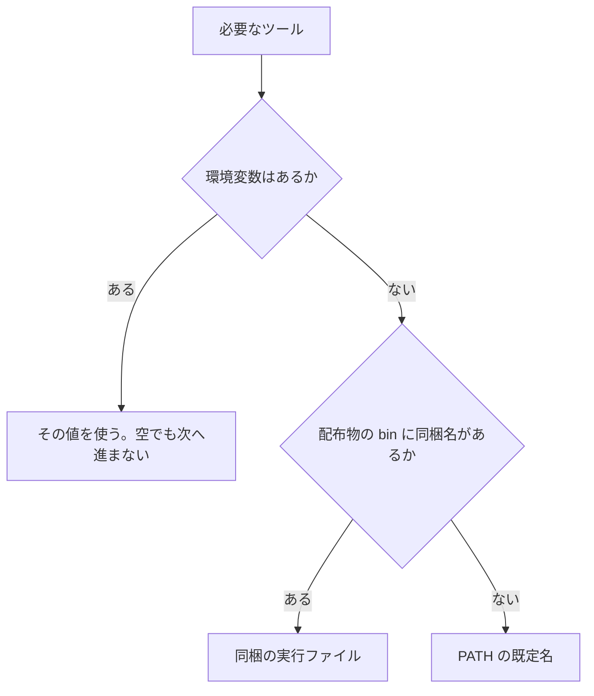

# コンパイラ オプション

`tsuzuri` のフラグは、サブコマンドごとに使えるものが違います。サポートされていないオプションの組み合わせを指定した場合は、コード生成へ進む前に `E2000` でエラーになります。同じソースでも、ターゲットや最適化を変えると成果物が変わるので、既定値を知っておくと再現しやすくなります。

このページの表は、`src/main.rs` のヘルプと引数解析、`BuildOptions::validate` で確認したものです。コマンドの流れ自体は [コンパイラの使い方](usage.md) を見てください。

## この記事のポイント

- 最適化の既定は `-O3` です。`test` と `repl` だけ既定が `-O0` です（`bench` は `-O3`）。fast-math は使いません。成果物を小さくするときは、`build` と `run` に `-Os` か `-Oz` を、`build` の native 実行ファイルに `--strip` を、`build` の WebAssembly に（Binaryen を入れた機械で）`--wasm-opt` を付けます（[成果物を小さくする](#成果物を小さくする)）。
- `--emit` の既定は、native なら `exe`、`wasm32` / `wasm64` なら `wasm` です。
- `--target` は `native`、`wasm32`、`wasm64` と、`aarch64-unknown-linux-musl` のような 22 個の native の名前を受けます。名前の一覧、tier、リンクの手段は [対応プラットフォームとクロスコンパイル](platforms.md) にあります。
- リンク入力は、ネイティブ実行ファイルの `build`、`run`、`test` と、共有ライブラリの `--emit shared` だけが受けます。
- フラグの重複や、サブコマンドとの不一致は終了コード 2 の `E2000` です。
- ツールの場所は、環境変数、配布物の `bin/`、PATH の順です。

## どのサブコマンドが受け付けるか

`lsp` は引数を取りません。`new` はディレクトリと `--namespace` だけ、`toolchain info` は 2 語ぴったりです。`watch` は、次の語（`check`・`build`・`test`）の列と同じオプションを受け付けます。`watch` 自体のオプションはなく、それ以外のコマンドは `E2000` です。`api-diff` は古い版と新しい版の入力 2 つと、`--json` だけを受け付けます。`bindgen` はヘッダー 1 つと、`-o`（必須、`.tz`）、`--include-dir DIR`、`--buffer FUNCTION:POINTER:LENGTH`、`--consume FUNCTION:PARAMETER`（この 3 つは繰り返し可）、`--json` だけを受け付けます。`repl` はパスを取らず、`-O0`〜`-O3`、`--cpu`、`--no-cache`、`--timeout SECONDS` だけを受け付けます。`script` は、ファイルより前に置いたものだけをオプションとして読み、ファイルより後ろはすべてプログラムの引数です。それ以外は、次の表のとおりです。`○` が受け付け、空欄は `E2000` です。

| オプション | check | build | run | test | bench | doc | fmt | repl | script |
| --- | --- | --- | --- | --- | --- | --- | --- | --- | --- |
| `--json` | ○ | ○ | ○ | ○ | ○ | ○ | ○ | | ○ |
| `--deny-warnings` | ○ | ○ | ○ | ○ | ○ | ○ | | | ○ |
| `--warn implicit-copy` | ○ | ○ | ○ | ○ | ○ | ○ | | | ○ |
| `-o` / `--output` | | ○ | | ○（`-g` と） | | ○（必須） | | | |
| `--target` | | ○ | ○（native の target だけ） | ○ | ○（ビルド機の target だけ） | | | | |
| `--emit` | | ○ | | | | | | | |
| `-O0`〜`-O3` | | ○ | ○ | ○ | ○ | | | ○ | ○ |
| `-Os` / `-Oz` | | ○ | ○ | | | | | | |
| `--cpu` | | ○ | ○ | | | | | ○ | ○ |
| `--no-cache` | | ○ | ○ | | | | | ○ | ○ |
| `-g` / `--debug-info` | | ○ | ○ | ○（1 件の `--index` と `-o`） | | | | | |
| `--debug-output` | | ○ | ○ | | | | | | |
| `--trap-info` | | ○ | ○ | | | | | | |
| `--trap-mode` | | ○ | | | | | | | |
| `--allocator` | | ○ | | | | | | | |
| `--freestanding` | | ○ | | | | | | | |
| `--strip` | | ○ | | | | | | | |
| `--wasm-opt` | | ○ | | | | | | | |
| `--wasm-feature` | | ○ | | | | | | | |
| `--wasm-host` | | ○ | | | | | | | |
| `--wasm-max-memory` | | ○ | | ○ | | | | | |
| `--wasm-stack-size` | | ○ | | ○ | | | | | |
| `--link` / `-l` / `-L` | | ○ | ○ | ○ | ○ | | | | ○ |
| `--list` / `--filter` / `--index` | | | | ○ | ○ | | | | |
| `--coverage PATH` | | | | ○ | | | | | |
| `--seed N` | | | | ○ | | | | | |
| `--check` | | | | | | | ○ | | |
| `--samples N` | | | | | ○ | | | | |
| `--timeout` | | | | | | | | ○ | |

`--deny-warnings` と `--warn` は、ヘルプでは `check` / `build` / `run` が中心です。実装では警告の表示が `doc` と `test` の前にも走るので、この 2 つでも効きます。`fmt` は明示的に拒否します。

同じオプションを 2 回以上指定すると `E2000` になります。複数回の指定が許可されているのは `--link`、`-l`、`-L`、`--index`、および異なる機能名を指定した `--wasm-feature` のみです。`--link`、`-l`、`-L` の合計は最大 256 個までです。

未知のフラグは `unknown option '...'; use --help` です。値を取り忘れると `--output needs a value` のように、そのフラグの名前で止まります。

## 出力とターゲット

| オプション | 既定 | 意味 |
| --- | --- | --- |
| `-o` / `--output PATH` | 入力の拡張子を差し替えたパス | 成果物、または `doc` のディレクトリ。親は作られます |
| `--target native\|wasm32\|wasm64\|TRIPLE` | `native` | `wasm64` は 64-bit の線形メモリです。`TRIPLE` は、`aarch64-apple-darwin` や `x86_64-unknown-linux-musl` のような 22 個の native の名前で、`wasm32-unknown-unknown` と `wasm64-unknown-unknown` は `wasm32` と `wasm64` の別名です（[一覧](platforms.md#target-の一覧と-tier)）。`native` と違い、Clang に `--target` を渡します |
| `--emit exe\|object\|llvm\|header\|wasm\|wgsl\|wgsl-relaxed\|spirv\|spirv-relaxed\|shared\|bindings-js\|bindings-cs\|bindings-py\|bindings-cpp` | native は `exe`、WASM は `wasm` | 何を残すか |

拡張子は、native の実行ファイルが Windows の target で `.exe`、ほかで空、オブジェクトが Windows の target で `.obj`、ほかで `.o`、LLVM IR が `.ll`、ヘッダーが `.h`、WASM が `.wasm`、WGSL が `.wgsl`、SPIR-V が `.spv`、共有ライブラリが Mach-O の target（macOS、iOS）で `.dylib`、ほかで `.so`、バインディングが JavaScript の `.mjs`、C# の `.cs`、Python の `.py`、C++ の `.hpp` です。`--target native` の target は、ビルド機です。

`--emit bindings-js` は `--target wasm32` だけで使え、`<name>.mjs` の隣に TypeScript 宣言 `<name>.d.mts` も書きます。`-o` は `.mjs` で終わる必要があります。`-O` は受け付けて無視し、`--trap-info`、`--debug-info`、`--debug-output`、`--wasm-feature simd128`、`--allocator` は `.wasm` のビルドに付けるよう `E2000` で求めます。`--wasm-feature threads` を付けると、Web Worker のスレッドプールを作るグルーになります。使い方は [WebAssembly への出力](webassembly.md#型付きのバインディングを生成する) にあります。

`--emit shared` は native の共有ライブラリです。Windows の target ではまだ使えません（`E2000`）。`--emit bindings-cs`、`bindings-py`、`bindings-cpp` は native の target（`--target native` か `TRIPLE`）だけで使え、`-o` の拡張子を除いたファイル名がライブラリの名前です。バインディングの中身は target で変わりません。`-O` は受け付けて無視し、`--trap-info`、`--debug-info`、`--debug-output`、`--allocator`、`--freestanding` は共有ライブラリのビルドに付けるよう `E2000` で求めます。`--trap-mode return` は、ライブラリとバインディングの両方に付けます。使い方は [ネイティブ連携](native-interop.md#共有ライブラリと各言語のバインディング) にあります。

`--emit exe` は `--target native`、`--emit wasm` は `wasm32` か `wasm64` が必要です。逆にすると、次の 1 文で止まります。

```text
<command line>:1:1: error[E2000]: '--emit exe' requires '--target native'; '--emit wasm' requires '--target wasm32' or '--target wasm64'
```

ネイティブの実行ファイル（`--emit exe`。`build` と `run`）に入るのは、入口（`def main` かトップレベルのコード）、`export def`、`Drop` の実装（std のものを含む）と、そこから到達する関数だけです。どこからも呼ばれない公開関数は、実行ファイルの内部関数で外から呼べないので、コンパイルしません。未使用の公開関数も、型検査と所有権の検査は今までどおり受け、型エラーは `check` が報告します。コンパイルしないので、その関数だけが使うものは、実行ファイルのビルドを妨げません。以前は失敗したビルドが、次のように通ります。

- ビルドする target にない OS API、`Net`、`Async.block_on` を、未使用の公開関数だけが使うとき。`File.read_text` だけを使う関数は、`--target x86_64-pc-windows-gnu` で `E2002` でしたが、出ません（[対応プラットフォーム](platforms.md#診断)）。
- どのライブラリにもない `extern` のシンボルを、未使用の公開関数だけが呼ぶとき。リンクが未定義のシンボルで失敗していましたが、通ります（[ネイティブ連携](native-interop.md#ホスト関数を-import-する)）。
- タスク、`Net`、GPU などの C のランタイムを、未使用の公開関数だけが使うとき。そのランタイムのコンパイルもリンクもしません。

入口か `export def` から到達するなら、今までどおり失敗します。`--emit object`、`llvm`、`header`、`wasm`、`shared` は、公開関数をすべて出力するので、今までどおりです。デバッグ情報とトラップ位置への影響は [デバッグ](debugging.md) にあります。

`wgsl`、`wgsl-relaxed`、`spirv`、`spirv-relaxed` は実験的な GPU カーネル用です。`wgsl` は厳密な `i32`／`i32u` のカーネル、`wgsl-relaxed` は `f32` を含む緩いカーネルで、出力の 1 行目に `// tsuzuri-gpu float=relaxed …` を付けます（[Gpu](../built-in-types-and-modules/gpu.md#緩い-f32-カーネル)）。`spirv` は Vulkan 用の厳密なカーネルで、`i32`、`i32u`、`i64`、`i64u`、`f32` を受け、`spirv-relaxed` は緩い `f32`、`i32`、`i32u` のカーネルです。SPIR-V 1.3 のバイナリ（32 bit ワードのリトルエンディアン）を書き、同じソースから、同じバイト列ができます（[Gpu](../built-in-types-and-modules/gpu.md#spir-v-を出す)）。どれも `export` が 1 つの専用プロジェクトを受け、`--target`、`-O`、`--cpu`、デバッグ、WASM 機能とは一緒に使えません。SPIR-V の出力は、ビルドのキャッシュを使いません。

## 最適化と CPU

| オプション | 既定 | 意味 |
| --- | --- | --- |
| `-O0` `-O1` `-O2` `-O3` | `build` / `run` / `script` / `bench` は `-O3`、`test` と `repl` は `-O0` | LLVM の最適化。fast-math や再結合は使いません |
| `-Os` `-Oz` | `-O3`（付けない場合） | 成果物の大きさを優先する LLVM の最適化。`build` と `run` だけ |
| `--cpu generic\|native` | `generic` | native の実行ファイルとオブジェクト。`native` はこの機械の命令セットで、古い CPU では動きません。x86-64 の `native` は、`f16` の変換と演算に F16C と AVX512-FP16 も使います（[`f16` の計算の経路](../types-and-type-inference/basic-types.md#f16-の計算の経路)） |

`check` は最適化も CPU も見ません。型が通れば、どの `-O` でも同じ診断です。`doc` と `fmt` も最適化を受け付けません。`test` は `-O0`〜`-O3` を受け、`--cpu` は拒否します。

`-Os` と `-Oz` は、LLVM のサイズ最適化です。`-Os` は大きさと速さの釣り合いを取り、`-Oz` は大きさを優先します。どちらも Tsuzuri が出す LLVM IR を変えません。`--emit llvm` の出力は、`-O0` から `-Oz` まで同じです。変わるのは、IR を機械語にする Clang に渡す最適化レベルだけです。整数の折り返し、NaN、符号付きゼロ、トラップ、`--trap-info` の位置表、`-g` のデバッグ情報、WebAssembly の import は、`-O3` と同じです。代わりに、速度は落ちることがあります。数値と数学のランタイムの object も同じレベルでコンパイルします。配布物の `share/runtime/` には `-O0`〜`-O3` の object だけがあるので、`-Os` と `-Oz` の最初のビルドは Clang でランタイムをコンパイルし、結果を `runtime/` のキャッシュに保存します。`--no-cache` のときはランタイムを IR のままモジュールに埋め込み、毎回いっしょにコンパイルします。

`test` と `bench` は `-O0`〜`-O3` だけを受け付け、`-Os` と `-Oz` は `E2000` です。`repl` と `script` も、`-O0`〜`-O3` だけです。`--emit bindings-js` などの `-O` を無視する出力は、`-Os` と `-Oz` も無視します。

```text
<command line>:1:1: error[E2000]: test supports -O0 to -O3; use -Os or -Oz with build or run
```

`--cpu native` は、native の `exe` と `object` だけです。`llvm`、`header`、WASM では `E2000` です。対応するホストは x86、x86_64、arm、aarch64 です。`--target` で別の target を名指しすると、ビルド機の命令セットは別の機械のものなので `E2000` です。その target には `--cpu generic` を使います。

整数の折り返し、NaN、符号付きゼロは、`-O3` でも変えません。次の関数は `-O0` でも `-O3` でも 42 です。

```tsuzuri run=42
def add :: i64 -> i64 -> i64 = \left right ->
    left + right

add 20 22
```

実行結果:

```text
42
```

## 成果物を小さくする

| オプション | 既定 | 意味 |
| --- | --- | --- |
| `-Os` `-Oz` | オフ | LLVM のサイズ最適化（[最適化と CPU](#最適化と-cpu)）。`build` と `run` |
| `--strip` | オフ | native の実行ファイルのリンクで、ローカルシンボルを除く。`build` の `--emit exe` だけ |
| `--wasm-opt` | オフ | wasm32 の `.wasm` のリンク後に、Binaryen の `wasm-opt -Oz` を実行する。`build` の `--emit wasm` だけ。同梱せず、明示したときだけ使う |

`--strip` はリンカーに `-Wl,-x` を渡します。ローカルシンボルだけが消え、グローバルシンボルは残ります。プログラムの動作と `--trap-info` の位置表（`.trap.json`）は変わらず、macOS のコード署名も有効なままです。小さくなるのはシンボル表の分だけで、`examples/hello` の既定のビルドは 33,896 バイトから 33,784 バイト（macOS arm64 で測定）です。`-g` とは組み合わせられず（デバッガーがシンボルを使うため）、`--emit object`・`llvm`・`header`・`shared`、バインディング、WASM は `E2000` です。WASM の出力は `--debug-info` を付けない限り、すでにシンボルを持ちません。Windows のリンクは変えないので、`--strip` を付けても成果物は同じです。`build` 以外のサブコマンドは `--strip` を拒否します。

```text
<command line>:1:1: error[E2000]: --strip cannot be combined with --debug-info: a debugger needs the symbols
```

`--wasm-opt` は、`wasm-ld` が作った `.wasm` を Binaryen の `wasm-opt -Oz` で最適化し直し、その結果を成果物にします。`--target wasm32` の `--emit wasm` だけで使え、`wasm64`、`--wasm-feature threads`、`-g` と、`build` 以外のサブコマンドは `E2000` です。次の点は、付けなくても守られます。

- `wasm-opt` は同梱せず、`--wasm-opt` を付けたときだけ探します。`TSUZURI_WASM_OPT` は実行ファイルの場所で、この変数だけでは何も実行しません。PATH に `wasm-opt` があっても、付けなければ使いません。場所の探し方は他のツールと同じ（変数、配布物の `bin/`、PATH の順）です。
- 要求したのに見つからない、または失敗したときは、ビルドが `E2002` で止まり、成果物は残りません。メッセージはツールの名前と、`install Binaryen or set TSUZURI_WASM_OPT to the wasm-opt executable` というヒントを含みます。黙って最適化なしの成果物を作ることはしません。
- 渡す機能は、このコンパイラのモジュールが使う `bulk-memory`、`sign-ext`、`nontrapping-float-to-int`、`mutable-globals`、`multivalue`、`reference-types` と、`--wasm-feature simd128` のときの `simd` だけです。モジュールの import、export（`--trap-info` の `tsuzuri_trap_site` を含む）、メモリの上限は変わりません。
- 成果物キャッシュのキーに `wasm-opt` の実体（パス、内容、`--version`）を含めます。同じソースでも、`wasm-opt` を替えると別のエントリです。

```text
examples/hello/Main.tz:1:1: error[E2002]: cannot execute 'wasm-opt': No such file or directory (os error 2); --wasm-opt runs Binaryen's wasm-opt: install Binaryen or set TSUZURI_WASM_OPT to the wasm-opt executable
```

Binaryen 132 の `wasm-opt -Oz` で、`examples/hello` の WebAssembly モジュールは `-Oz` で 2,587 バイトから 2,156 バイト（−16.7%）、`-O3` で 6,357 バイトから 5,196 バイト（−18.3%）になりました。`examples/io` は `-Oz` で 5,734 から 4,583 バイト、`examples/functional` は 3,960 から 3,094 バイトです（WebAssembly のヒープを作り直す前のモジュールでの値で、いまのモジュール（hello は `-Oz` 3,905、`-O3` 6,833 バイト）では測っていません。測定は [性能測定](../../../docs/benchmarks.md#成果物のサイズ)）。

## 診断とデバッグ

| オプション | 既定 | 意味 |
| --- | --- | --- |
| `--json` | オフ | 診断を stderr の 1 行 1 JSON にする |
| `--deny-warnings` | オフ | 警告があれば、コード生成や実行の前に終了コード 1 |
| `--warn implicit-copy` | オフ | 配列とリストの暗黙コピー `W1006` を出す。生成コードは変わらない |
| `-g` / `--debug-info` | オフ | ソースレベルの DWARF。`header` では不可。Windows の MSVC のリンカーでは CodeView も出し、実行ファイルの隣に PDB を書く。表示とステップ実行は [デバッグ](debugging.md) |
| `--debug-output` | オフ | WASM の `Debug` 出力 import を有効にする。native は常に書く |
| `--trap-info` | `run` はオン、`build` はオフ | トラップ位置と `<output>.trap.json`。`header` では不可 |
| `--trap-mode return` | オフ | native の `object` / `llvm` / `header` / `shared` と C#・Python・C++ のバインディング。各 export に `tsuzuri_try_<name>` を足す |

`--trap-mode return` は、`object`、`llvm`、`shared` では `--trap-info` も有効にします。`header` では位置表を出さないので、`--trap-info` とは組み合わせません。戻り値は 0 が成功、1 がトラップ、2 が同じスレッドでの再入です。詳しくは [言語仕様のトラップ位置](../../../docs/language.md#トラップ位置) を見てください。

`--json` のフィールドは [診断メッセージとエラーコード](diagnostics.md) にあります。引数エラーも同じコードで、パスは `<command line>` です。

```text
{"severity":"error","code":"E2000","message":"missing .tz, .tt, or .tc input or project directory; use --help","path":"<command line>","span":{"start":0,"end":0,"line":1,"column":1,"end_line":1,"end_column":1}}
```

このときの終了コードは 2 でした。

## WebAssembly

| オプション | 既定 | 制約 |
| --- | --- | --- |
| `--wasm-max-memory SIZE` | 16 MiB | `wasm32` は 4 GiB − 64 KiB まで、`wasm64` は 16 GiB まで。64 KiB の倍数 |
| `--wasm-stack-size SIZE` | 1 MiB | WASM 出力だけ。16 の倍数で、64 KiB 以上。メモリ上限はスタック + 64 KiB 以上 |
| `--wasm-feature simd128` | オフ | `wasm32` / `wasm64` の `object`、`llvm`、`wasm` |
| `--wasm-feature threads` | オフ | `wasm32` の `object` か `wasm`。WASI や `--allocator host` とは排他 |
| `--wasm-feature jspi` | オフ | `wasm32` / `wasm64` の `object`、`llvm`、`wasm` と、wasm32 の `bindings-js`。`Async.block_on` 用。threads / WASI とは排他 |
| `--wasm-feature webgpu` | オフ | `wasm32` の `object`、`llvm`、`wasm`。`Gpu.request Gpu.WebGpu` 用。threads / WASI / `bindings-js` とは排他 |
| `--wasm-feature net` | オフ | wasm32 の `object`、`llvm`、`wasm`、`bindings-js`。`jspi` が必要。`Net` のソケットを、Node.js 向けのグルーが実装する `tsuzuri_net` の import にする。threads / WASI / wasm64 とは排他 |
| `--wasm-host wasi` | オフ | `wasm32` の `object` か `wasm`。既定の wasm32 は OS API を拒否します |

`SIZE` はバイト数か、`KiB` / `MiB` / `GiB` です。`64MB` のような 10 進の単位は受けません。`67108864` と `64MiB` は同じです。

`--wasm-stack-size` は、リンク済みの WASM にだけ埋めます。オブジェクトや LLVM IR を自分でリンクするときは、`wasm-ld -z stack-size` を使います。`test` でメモリやスタックを変えるときは、`--target wasm32` か `wasm64` が必要です。

`Async.block_on` を使う WASM では、`.wasm` と `--emit bindings-js` のどちらを作るときも `--wasm-feature jspi` が必要です。省略は生成前に `E2000` となり、同期型のグルーへ置き換えません。

`--wasm-feature webgpu` は、`Gpu.request Gpu.WebGpu` を使うプログラムのモジュールに、`tsuzuri_gpu.open` と `tsuzuri_gpu.run` の 2 つの import を足します。付けなければ import は増えず、`Gpu.request Gpu.WebGpu` は `Unavailable` です。ホスト側は `src/runtime/webgpu.mjs` の `createGpuImports` が作ります（[WebAssembly への出力](webassembly.md#webgpu-デバイス)）。

`Net` のソケットを使う wasm32 も同じで、`.wasm` と `--emit bindings-js` の両方に `--wasm-feature jspi --wasm-feature net` が要ります。`net` を省略したビルドは、ソケットに到達した時点で `E2000` です。グルーは Node.js 向けです（[WebAssembly への出力](webassembly.md#net-のソケットnodejs)）。

`Tsuzuri.toml` の `[wasm]` は、コマンドラインが省略した値の既定になります。コマンドラインが優先です。マニフェストの値だけが不正なときは、終了コード 1 で、メッセージの末尾に `(after applying the root package's [wasm])` が付きます。

呼び出し方とメモリの渡し方は [WebAssembly への出力](webassembly.md) にまとめています。

## リンクと allocator

| オプション | 既定 | 意味 |
| --- | --- | --- |
| `--link PATH` | なし | ホストのオブジェクトか静的ライブラリ。繰り返せる |
| `-l NAME` | なし | システムライブラリ名。例は `-l sqlite3`。`lib` や拡張子は付けない |
| `-L DIR` | なし | `-l` の探索ディレクトリ |
| `--allocator system\|host\|counting\|small` | `system` | `object`、`llvm`、`header`、WASM のヒープ。`shared` は `counting` と `small` まで。`small` は native の 64-bit のサイズ区分で、実行ファイルにも付けられる |
| `--freestanding` | オフ | C ライブラリ不要の native `object` / `llvm` / `header`。`--allocator host` が必須 |
| `--no-cache` | キャッシュ有効 | `build`・`run`・`script` で、成果物・構文解析・ランタイム object のキャッシュを読まない、書かない。同梱 runtime object も使わずソースからビルドする。`repl` では成果物のキャッシュだけ（`repl` は構文解析の結果のキャッシュを使わない）。ほかのコマンドでは `E2000` |

`[native]` の `link`、`libraries`、`search` が先で、コマンドラインがそのあとに続きます。実行ファイルと `--emit shared` 以外、たとえば `--emit object` や WASM にリンク入力を付けると拒否されます。

```text
link inputs require a native executable; remove --link, -l and -L or build the native target with --emit exe
```

`--allocator host` は、ホストが定義する `tsuzuri_host_alloc`、`tsuzuri_host_free`、`tsuzuri_host_realloc` を呼びます。WASM ではモジュール `tsuzuri_heap` の `alloc`、`free`、`realloc` として import します。`counting` は `tsuzuri_alloc_stats` で回数を読めます。どちらも `--emit exe`、`wgsl`、`spirv`、`--trap-mode return` とは排他です。`host` は `--wasm-feature threads` とも排他です。

`--allocator small` は、native の 64-bit で 0〜512 バイトの確保を 16 バイト刻みの 32 区分から返し、それより大きい確保は C ライブラリの `malloc` に任せます。実行ファイル（`--emit exe`）、`object`、`llvm`、`header`、`shared` に付けられます。WASM、`wgsl`、`spirv`、`--trap-mode return`、`--freestanding` とは排他です（いずれも `E2000`）。既定ではありません。設計と制限は [スタックとヒープ](../ownership-and-memory/stack-and-heap.md#ネイティブのサイズ区分-allocator) にあります。`run`・`check`・`test` は付けられません（`build` だけです）。

`--freestanding` は IO、OS API、タスク、`Debug`、プログラム引数、`Gpu.WebGpu`・`Gpu.Vulkan`・`Gpu.Auto` のデバイスを `E2000` で拒否します。`--trap-info` と `--debug-output` とも一緒には使えません。トラップは `llvm.trap` だけです。

## 組み合わせがエラーになる場合

引数解析の時点で検出される構文・指定誤りは終了コード 2、ビルド処理中にソースコードや設定を検証して検出されるものは終了コード 1（エラーコードはいずれも `E2000`）になります。遭遇しやすい主な組み合わせエラーを以下にまとめます。

| 条件 | メッセージの要点 |
| --- | --- |
| `--no-cache` を `check` などに付ける | `--no-cache is only valid with build, run, script, or repl` |
| `--wasm-feature` を `build` 以外に付ける | `--wasm-feature is only valid with build` |
| `threads` なのに wasm32 の object / wasm でない | `--wasm-feature threads requires wasm32 object or WASM output` |
| `jspi` なのに WASM の object / llvm / wasm / bindings-js でない | `--wasm-feature jspi requires wasm32 or wasm64 object, LLVM IR, WASM, or JavaScript bindings output` |
| `Async.block_on` に `jspi` がない | `Async.block_on on WebAssembly needs --wasm-feature jspi` |
| `jspi` と threads / WASI | `--wasm-feature jspi cannot be combined with --wasm-feature threads or --wasm-host` |
| `webgpu` なのに wasm32 の object / llvm / wasm でない | `--wasm-feature webgpu requires wasm32 object, LLVM IR, or WASM output; the JavaScript bindings do not provide the WebGPU imports, so instantiate the module with createGpuImports of src/runtime/webgpu.mjs` |
| `webgpu` と threads / WASI | `--wasm-feature webgpu cannot be combined with --wasm-feature threads or --wasm-host: its imports suspend the WebAssembly stack with JavaScript Promise Integration` |
| `net` なのに wasm32 の object / llvm / wasm / bindings-js でない | `--wasm-feature net requires wasm32 object, LLVM IR, WASM, or JavaScript bindings output` |
| `net` に `jspi` がない | `--wasm-feature net requires --wasm-feature jspi` |
| `net` と threads / WASI | `--wasm-feature net cannot be combined with --wasm-feature threads or --wasm-host` |
| `net` なしの wasm32 で `Net` のソケットに到達 | `wasm32 output cannot use the Net socket API because the default wasm32 target has no host imports` |
| `simd128` が header や native | `--wasm-feature simd128 requires wasm32 or wasm64 object, LLVM IR, or WASM output` |
| WASI と threads | `--wasm-host wasi cannot be combined with --wasm-feature threads` |
| WASI が wasm32 の object / wasm でない | `--wasm-host wasi requires wasm32 object or WASM output` |
| メモリ上限が 64 KiB の倍数でない、または上限超え | `at most 4 GiB - 64 KiB on wasm32` / `at most 16 GiB on wasm64` |
| スタックがメモリに収まらない | `must be at least the stack size plus 64 KiB` |
| `--cpu native` が exe / object でない | `'--cpu native' requires native executable or object output` |
| `--cpu native` と、ビルド機と違う `--target TRIPLE` | `'--cpu native' requires the host target; use '--cpu generic' when cross-compiling to <triple>` |
| `--target` の名前が一覧にない（32-bit を含む） | `unknown target '<value>'; use native, wasm32, wasm64, or one of <一覧>`。引数解析で見つかるので終了コード 2 |
| ビルド機と違う `--target TRIPLE` の `run` や `test` に `TSUZURI_RUNNER` がない | `cannot run <triple> programs on this machine; run the program on a <triple> machine, set TSUZURI_RUNNER to a command that runs <triple> executables (such as qemu-user, Wine, or an emulator wrapper), or use 'tsuzuri build --target <triple>'`（`test` は `tests`） |
| bare-metal の target が `--freestanding --allocator host` の object・llvm・header でない | `<triple> has no operating system: build it with --freestanding --allocator host and --emit object, llvm, or header` |
| MSVC か bare-metal の target に `TSUZURI_SYSROOT` | `TSUZURI_SYSROOT does not apply to <triple>: ...` |
| `--emit bindings-js` が `--target wasm32` でない | `'--emit bindings-js' requires '--target wasm32'` |
| `--emit bindings-js` に `.wasm` 用のオプション | `--trap-info is not valid for bindings output; pass it when building the .wasm`（各オプション名で同じ形） |
| `--emit bindings-js` の `-o` が `.mjs` でない | `bindings output must end with '.mjs'; declarations are written next to it as '<name>.d.mts'` |
| `--emit shared` や `bindings-cs` などが native の target でない（`wasm32`、`wasm64`） | `'--emit shared' requires '--target native'`（`bindings-cs` などは各名前で同じ形） |
| Windows の target で `--emit shared` | `'--emit shared' is not supported on Windows yet (G10); build an object with --emit object and link it into a DLL` |
| `--emit shared` と `--allocator host` | `--allocator host cannot be combined with --emit shared: ...` |
| `--allocator small` が wasm32 / wasm64 | `--allocator small requires a native target; WebAssembly modules keep their own heap` |
| `--allocator small` が `wgsl` / `spirv` などのカーネル出力 | `--allocator small requires executable, object, shared library, LLVM IR, or header output` |
| `bindings-cs` などに共有ライブラリ用のオプション | `--trap-info is not valid for bindings output; pass it when building the shared library`（各オプション名で同じ形） |
| `bindings-cs` などの `-o` の拡張子が違う | `bindings output must end with '.cs'; its file name, without the extension, names the shared library`（`.py`、`.hpp` も同じ形） |
| `--freestanding` が exe | `--freestanding requires object, LLVM IR, or header output` |
| `--freestanding` なのに allocator が host でない | `--freestanding requires --allocator host` |
| `fmt` に `-O` や `--deny-warnings` | `fmt does not use optimization, CPU tuning, or compiler warning options` |
| `check` に `-O` | `check does not use an optimization level` |
| `test` に `--cpu` | `test does not use CPU tuning` |
| `doc` に `-o` が無い | `doc requires -o or --output with an output directory` |
| `--filter` を `test`・`bench` 以外に付ける | `--filter, --list, and --index are only valid with test or bench` |
| `test` に `-g` と `-o` の片方だけ | `debugging a test needs both -g and -o with the runner's path` |
| `test -g` の `--index` が 1 つでない、または `--list`・`--filter` と組み合わせる | `debugging a test needs exactly one --index, without --list or --filter` |
| `test -g` に WASM のターゲット | `debugging a test requires the native target` |
| `test -g` にビルド機と違う `--target TRIPLE` | `debugging a test needs a target this machine runs; use 'tsuzuri test --index N -g -o PATH' on a machine of that target` |
| `--samples` を `bench` 以外に付ける | `--samples is only valid with bench` |
| `--seed` を `test` 以外に付ける | `--seed is only valid with test` |
| `--seed` が 0〜18446744073709551615 の整数でない | `property seed must be an integer between 0 and 18446744073709551615` |
| `--samples` が 1〜1000 の整数でない | `bench samples must be an integer between 1 and 1000` |
| `bench` に `--target wasm32`／`wasm64` | `tsuzuri bench supports only the native target` |
| `bench` にビルド機と違う `--target TRIPLE` | `tsuzuri bench measures the machine it runs on and cannot run <triple> benchmarks here; run 'tsuzuri bench' on a <triple> machine` |
| `bench` に `--cpu` | `bench does not use CPU tuning` |
| `--coverage` を `test` 以外に付ける | `--coverage is only valid with test` |
| `test --coverage` と `--target wasm32`／`wasm64` | `test coverage supports only the native target` |
| `test --coverage` にビルド機と違う `--target TRIPLE` | `test coverage needs a target this machine runs; run 'tsuzuri test --coverage' on a <triple> machine` |
| `test --coverage` と `--list` | `coverage cannot be combined with --list` |
| `test --coverage` と `-g` | `coverage cannot be combined with -g; a debug runner only builds` |
| 入力が 2 つ | `pass one .tz, .tt, or .tc file or project directory` |
| WASM 機能名が `relaxed-simd` など | `supported WASM features are 'simd128' and 'threads'; relaxed SIMD is not supported` |
| `TSUZURI_LINKER` が `default`・`lld` 以外（ネイティブ実行ファイルと共有ライブラリ） | `TSUZURI_LINKER must be 'default' or 'lld', not '<value>'` |
| Windows の target で `TSUZURI_LINKER=lld` | `TSUZURI_LINKER=lld is not supported for Windows targets; unset it` |
| Mach-O の target で `TSUZURI_LINKER=lld` と `-Os`／`-Oz` | `TSUZURI_LINKER=lld cannot be combined with -Os for a Mach-O target (Clang passes the size level to ld64.lld, which rejects it); use -O2 or unset TSUZURI_LINKER` |

ビルドがソースを読んでから出す `E2000` には、既定の wasm32 で `File` や `Env` などに到達した場合と、`--freestanding` で IO やタスクに到達した場合があります。前者は、native にするか、`--wasm-host wasi` にするか、ホスト不要の `Path` と `Random.Pcg` に限る、というメッセージです。

> [!WARNING]
> 終了コード 2 の `E2000` は、まだファイルを書いていません。終了コード 1 の `E2000` は、解析やリンクの途中です。既存の成果物は、コンパイルエラーでは置き換えません。

## 環境変数

ツールは次の順で決まります。空の環境変数も「設定済み」なので、そのときは配布物や PATH へ進みません。



| 変数 | 既定の名前 | 同梱の名前 | 用途 |
| --- | --- | --- | --- |
| `TSUZURI_CLANG` | `clang` | `tsuzuri-clang` | コンパイルとリンク、`bindgen` のヘッダー解析。LLVM 17 以降 |
| `TSUZURI_WASM_LD` | `wasm-ld` | `wasm-ld` | WebAssembly のリンク |
| `TSUZURI_LLVM_LINK` | `llvm-link` | `llvm-link` | macOS で、タスクを含むデバッグ用オブジェクト |
| `TSUZURI_DSYMUTIL` | `dsymutil` | `dsymutil` | macOS のデバッグ実行ファイル |
| `TSUZURI_WASM_OPT` | `wasm-opt` | なし（同梱しない） | `--wasm-opt` が実行する Binaryen の `wasm-opt`。この変数だけでは何も実行しない |
| `TSUZURI_LINKER` | 未設定（Clang の既定のリンカー） | なし | ネイティブ実行ファイルと共有ライブラリの最終リンクのリンカー。`lld` は Clang に `-fuse-ld=lld` を渡す（下記）。`default`・空・未設定は Clang に任せる |
| `TSUZURI_CACHE_DIR` | OS ごとのキャッシュ | なし | ビルドキャッシュと構文解析の結果のキャッシュ（`frontend/`）のルート。空ならどちらも使わない |
| `TSUZURI_TIME_PASSES` | 無効 | なし | 値が `1` のときだけ、終了時に段階別時間の JSON を stderr の最後へ 1 行出す。成果物・診断・終了コードは変わらない |
| `TSUZURI_RANGE_FLAGS` | `off` | なし | `off`・`proven`・`audit`。整数の `+ - *` に、コンパイラが範囲を証明できたときだけ LLVM の `nsw`／`nuw` を書くかを選ぶ。空は既定、ほかの値は `E2000`。計算の結果は変わらない。ビルドキャッシュのキーに入る（[整数の範囲証明の旗](#整数の範囲証明の旗)） |
| `TSUZURI_THREADS` | 使える core 数（最大 8） | なし | コンパイラ自身が使うスレッド数の上限（1 から 32 の整数）。`1` は 1 スレッド。範囲外や整数でない値は `E2000`。成果物・診断・終了コードは変わらない |

### コンパイラのスレッド数

`TSUZURI_THREADS=4 tsuzuri check Main.tz` のように指定します。CLI のフラグではありません。
コンパイラが型検査などで使うスレッドの上限で、作ったプログラムが使うスレッド（`Task`）には作用しません。

| 値 | 意味 |
| --- | --- |
| 未設定、空 | `check`・`build`・`run`・`script`・`test`・`bench`・`doc` は使える core 数（最大 8）。`repl`・`lsp`・`publish` とライブラリ API は 1 |
| `1` | 呼び出したスレッドだけで実行する |
| `2` から `32` | その数まで。仕事の量が少ない段は、これより少ないスレッド（1 を含む）で実行する |
| それ以外（`0`、`33`、`abc`、`1.5`、`-1`、`+4`、空白だけ） | `E2000`（終了コード 2）。`check`・`build`・`run`・`script`・`test`・`bench`・`doc`・`repl`・`lsp` は、ソースを読む前に失敗する。`fmt`・`new`・`toolchain info`・`api-diff` など、検査しないコマンドは値を読まない |

数は 10 進の ASCII 数字で書きます。前後の空白と先頭の 0 は許します。

並列に実行する段は、現在は次の 4 つです。どれもソースや関数ごとに独立した仕事で、`parse`・`check`・`ownership` の段に含まれます。

- ソースの構文解析（frontend cache の照合と復号を含む。標準ライブラリのソースも数えます）
- 関数の本体の型検査（式の型付けと、`computation` 式の展開）
- 関数ごとの型検査の仕上げ（型変数の解決、`match` の網羅性の検査と到達不能の警告、使われない局所変数とシャドーイングの警告）
- 所有権の検査（`check` の中の借用と Copy の推論と、具体化後の `ownership`）

ソースの合計が 64 KiB に満たない、または 4 個に満たないときの構文解析と、検査する関数（標準ライブラリのものを含む）が 128 個に満たない段は、1 スレッドで実行します。
並列に動くスレッドは、それぞれ 8 MiB のスタックを持ちます（macOS と Linux のメインスレッドの既定と同じ）。

診断の順序と重複の除去、1,000 件の上限、50 件の表示、IR、警告、終了コードは、スレッド数で変わりません。
段の結果は入力の順に取り込み、並列でない実行と同じ処理を同じ順で通すためです。
スレッド数はキャッシュのキーに入りません。同じソースは、スレッド数を変えてもキャッシュに当たります。
言語サーバーとライブラリ API は、この変数を指定しない限り 1 スレッドで解析します。

`TSUZURI_LINKER=lld` は、macOS と Linux のネイティブ実行ファイル（`-g` の別リンクを含む）と `--emit shared` の最終リンクだけに
`-fuse-ld=lld` を足します。コンパイルだけの Clang、`--emit object` と relocatable な `-r` のリンク（`ld64.lld` は未対応）、
WebAssembly（`wasm-ld`）、`--emit llvm` には足しません。ビルド機のリンカーでは書けない target にはもともと `-fuse-ld=lld` が付くので、
重複はしません。LLD は Clang が見つけられる場所（Linux は `ld.lld`、macOS は `ld64.lld`。Homebrew の `lld` など）に要ります。
無いと Clang の `invalid linker name in argument '-fuse-ld=lld'` が `E2002` になり、ヒントに LLD が要る旨を足します。
Mach-O の target では `-Os`／`-Oz` と併用できません。最終リンクがコンパイルと同じ Clang の実行で、Apple の Clang が `-Os` を `ld64.lld` へ渡し、
`ld64.lld` が拒否するためで、実行の前に `E2000` で止まります（`-O2` を使うか、変数を外します）。
黙って既定のリンカーへは戻しません。`default`・空・未設定以外の `lld` でない値、Windows の target の `lld` は、ツールを起動する前に `E2000` です。
成果物キャッシュのキーはこの値を含むので、リンカーを替えても別のエントリです（未設定と `default` のキーは変わりません）。
配布物の `tsuzuri-clang` は常に LLD でリンクし `-fuse-ld=lld` を捨てるので、そのときは何も変わりません。
既定を `lld` にはしていません。macOS では Apple の `ld` より遅く（1,000 モジュールのオブジェクトで 84 ms に対し 109 ms）、Linux では測っていません。

### コンパイルの段階別時間

`TSUZURI_TIME_PASSES=1 tsuzuri check Main.tz` のように指定します。CLI のフラグではありません。
`1` 以外（未設定、`0`、`true`）は無効です。`--json` の診断とは別に、最後の行として次の形の JSON が増えます。

```json
{"time_passes":1,"phases":[{"name":"load","ms":0.412},{"name":"parse","ms":1.903}],"total_ms":7.702}
```

値はミリ秒、小数 3 桁です。段は `load`・`parse`・`check`・`specialize`・`closures`・`ownership`・`emit`・`cache` と、
外部ツールの `tool.<実行ファイル名（拡張子を除く）>` です。そのコマンドが通った段だけを、最初に通った順に出します。
tool 名の空白・日本語などもそのまま保持し、性能レコードの読み手も同じ名前を受け付けます。
同じ段は合算し、入れ子の二重計上はしません。並列に実行する段（[コンパイラのスレッド数](#コンパイラのスレッド数)）も、
呼び出したスレッドの経過時間（wall-clock）を測るので、段の合計が `total_ms` を超えることはありません。`parse` は frontend cache からの復号も、
`cache` は frontend cache の準備・保存と成果物 cache の操作も含みます。
`emit` は LLVM IR・header・GPU カーネルの生成に加え、Windows ABI・CodeView・no-red-zone、
WASM の heap／host／runtime の IR 変換と、freestanding header の IR の検査も含みます。
Clang・リンカーの実行は `emit` に含めず、それぞれの `tool.*` に分けます。
`total_ms` は引数解析、成果物の書き出し、`run` の実行先など、個別の段に入れない時間も含みます。

失敗したコマンドでも、元の診断と終了コードを保ったまま最後に出します。LSP ではサーバーの終了時です。
IR・header・object・WASM の生成には作用しません。macOS の実行ファイルで毎回変わる UUID と署名は、
計測を付ける前からあるリンカーの性質です。native Windows の標準 COFF object には Clang が現在時刻を
`TimeDateStamp` として書きます。成果物の比較は、この header の 4 bytes だけを除き、ほかの byte とサイズを厳密に照合します。
生成物自体や compiler flags は変えません。再現の手順は [性能測定](../../../docs/benchmarks.md#性能指標の記録) にあります。

`node` は PATH だけです。WASM テスト用の環境変数はありません。

`--target TRIPLE` には、ツールの名前ではない変数が 2 つあります。どちらも `--target native` の出力には効きません（`TSUZURI_SYSROOT` は、値が違えば別のキャッシュエントリになるだけです）。

| 変数 | 意味 |
| --- | --- |
| `TSUZURI_SYSROOT` | 名前を付けた target のランタイムの C のコンパイルとリンクに渡す sysroot。非 Apple の target は `--sysroot=DIR`、Apple の target は `-isysroot DIR`（iOS は SDK のパス）。空は未設定。MSVC と bare-metal の target では `E2000`、同梱ツールチェーンでは `E2002`。キャッシュのキーに入る |
| `TSUZURI_RUNNER` | ビルド機で動かせない target の `run` と `test` が、実行ファイルを起動する前置コマンド。空白で区切った語の並びで、実行ファイルのパスが最後に付く。空は未設定で、ビルド機の target では読まない |

使い方と例は [対応プラットフォームとクロスコンパイル](platforms.md#実行ファイルをリンクする) にあります。

`TSUZURI_CPU_FORCE` はコンパイル時のオプションではなく、生成されたネイティブバイナリが実行開始時に CPU 機能を自動判定する際に読み込む実行時環境変数です。指定可能な値は `baseline`、`sse4.2`、`avx2`、`avx512`、`sve`、`sve2` です。未知の名前や現在の CPU が対応していない機能レベルを指定した場合は、`Tsuzuri CPU runtime: requested variant is unavailable or unknown` を出力してプログラムを終了します。テスト目的で実行バージョンを固定したい場合を除き、通常は設定不要です。

`Gpu.request Gpu.WebGpu` を使う native のプログラムは、実行時に `TSUZURI_WEBGPU_LIBRARY`（読み込む wgpu-native のパス。設定すればそれだけを書いたとおりに試し、空なら WebGPU を無効にする。設定がなければ、システムの場所の絶対パスだけを探し、作業ディレクトリは探さない）と `TSUZURI_GPU_DEBUG`（空でなければ、`Unavailable` の理由とデバイスでの実行を標準エラーに出す）を読みます。コンパイル時のオプションでもキャッシュのキーでもありません。詳しくは [Gpu](../built-in-types-and-modules/gpu.md#native-wgpu-native-を実行時に読み込む) にあります。

`Gpu.Vulkan` か `Gpu.Auto` を使う native のプログラムは、実行時にさらに `TSUZURI_VULKAN_LIBRARY`（読み込む Vulkan のローダーのパス。設定すればそれだけを書いたとおりに試し、空なら Vulkan を無効にする。設定がなければ、システムの場所の絶対パスだけを探し、作業ディレクトリは探さない）と `TSUZURI_GPU_AUTO_MIN_WORK`（`Gpu.Auto` の規則を「lane 数 × カーネルの重みが指定の数以上」に置き換える。`0` は、デバイスが使えるなら常に Vulkan）を読みます。ローダーが見つけるドライバは、Vulkan のローダー自身の変数（`VK_DRIVER_FILES` など）に従います。どれも、コンパイル時のオプションでもキャッシュのキーでもありません。詳しくは [Gpu](../built-in-types-and-modules/gpu.md#native-vulkan-のローダーを実行時に読み込む) と [Gpu.Auto](../built-in-types-and-modules/gpu.md#gpuauto-で呼び出しごとに選ぶ) にあります。

キャッシュのキーには、上の 4 つのツール変数に加えて `PATH`、`SDKROOT`、`MACOSX_DEPLOYMENT_TARGET`、Windows の `INCLUDE` / `LIB`、`SOURCE_DATE_EPOCH`、`DEVELOPER_DIR`、`TSUZURI_SYSROOT`、`TSUZURI_RANGE_FLAGS` などが入り、`--target` の名前もオプションとして入ります。同じソースでも、ツールや target や sysroot を替えるとキャッシュは別エントリになります。

### 整数の範囲証明の旗

`TSUZURI_RANGE_FLAGS=proven tsuzuri build Main.tz --emit llvm` のように指定します。CLI のフラグではありません。
整数の `+`・`-`・`*` は、どのモードでも型の幅で折り返し、計算の結果、診断、終了コードは変わりません。変わるのは LLVM の IR に書く
`nsw`（符号付きのオーバーフローがない）と `nuw`（符号なしのオーバーフローがない）だけです。

| 値 | 書くもの | 使いどころ |
| --- | --- | --- |
| `off`（既定。空と未設定も同じ） | 旗を書きません | 通常のビルド |
| `proven` | 範囲から「その向きでオーバーフローしない」と証明できた命令にだけ旗を書きます | LLVM に範囲を伝えます |
| `audit` | 旗を書きません。`proven` なら旗を書く向きごとに、オーバーフローしたら trap する検査を書きます | 証明が誤っていないかを試験で確かめます |

ほかの値は、IR を出すコマンドで `E2000` です（`check` と `lsp` は IR を出さないので読みません）。値はビルドキャッシュのキーに入ります。

証明できるのは、ステップ 1 または -1 の `for` のカウンターの増分、配列・リスト・文字列の `for ... in` の添字、リテラル・型・`as`・`&` のマスク・`%`・
`/`・定数のシフト・長さから決まる範囲、`for` のカウンターと不変の `let` と `if` の then 枝の条件が絞った範囲での `+ - *` です。`let mut` の変数、
代入される変数、関数の呼び出しの結果、`@checked` の中、128-bit の整数は証明の対象になりません。証明できない演算は旗のない折り返しのままです。
旗を書くと、その関数の戻り値には、PR01 が純粋な関数へ付ける `noundef` が付かなくなります。

既定が `off` なのは、旗が LLVM の出力を変えたかを `benchmarks/run-range-flags.mjs` で測った結果によります。12 の corpus の多くで、`-O1`〜`-O3` の arm64 と x86_64 の
assembly と wasm32 の module は `off` と同じでした（[整数の範囲証明と overflow フラグ](../../../docs/benchmarks.md#整数の範囲証明と-overflow-フラグpr02)）。
`audit` で既存のテストを通すと、証明が誤っていればその場で trap します。

## まとめ

- 使えるフラグはサブコマンドで決まります。迷ったら `tsuzuri --help` と、この表の空欄を見てください。
- 既定は native、`-O3`、generic CPU、system allocator、キャッシュ有効です。`test` だけ `-O0` です。
- WASM のメモリとスタックは、コマンドラインが `[wasm]` より優先します。
- 組み合わせの `E2000` は、引数なら終了コード 2、ソースを見たあとなら 1 です。
- ツールは環境変数、配布物、PATH の順です。空の環境変数も優先されます。

## 関連項目

- [コンパイラの使い方](usage.md)
- [コンパイラ ディレクティブ](directives.md)
- [診断メッセージとエラーコード](diagnostics.md)
- [WebAssembly への出力](webassembly.md)
- [対応プラットフォームとクロスコンパイル](platforms.md)
- [ネイティブ連携 (C ABI)](native-interop.md)
- [言語仕様の公開 ABI](../../../docs/language.md#公開-abi)
- [言語リファレンスの目次](../index.md)
