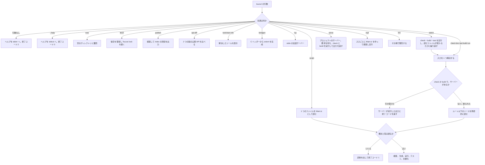

# コンパイラの使い方

`tsuzuri` は、`.tz` / `.tt` / `.tc` を型検査し、LLVM でネイティブ実行ファイルか WebAssembly を出すコマンドです。サブコマンドは少なく、入力はファイルかディレクトリの 1 つだけです。暗黙の探索を減らし、同じソースから同じ成果物が出るようにするためです。

このページでは、配布物とソースからの導入、各サブコマンド、入力の決まり方、キャッシュ、終了コードを扱います。フラグの一覧は [コンパイラ オプション](option.md) に分けています。

## この記事のポイント

- 配布物を使うときは、`bin/` 全体ではなく `tsuzuri` だけを PATH に足します。
- ディレクトリを渡すと `Main.tz` が入口になります。ファイルを渡すと、その親がプロジェクトルートです。
- `check` はコードを出しません。`run` は実行し、`build` はファイルを残します。`build` は `--target` で、ビルド機とは別の OS や CPU 向けの成果物も作れます（[対応プラットフォーム](platforms.md)）。
- `repl` は、宣言と式を 1 つずつ受け取り、入力ごとにプログラムを作り直して検査し、実行します。
- `script` は、名前を問わない 1 つのファイルを `Main.tz` として `run` と同じように実行し、後ろの引数をプログラムへ渡します。先頭の `#!` 行で、ファイル自体を実行できます。
- `watch` は、`check`・`build`・`test` を実行し、そのコマンドが読むファイルが変わるたびにもう一度実行します。各回の出力は、そのコマンドを単独で実行したときと同じです。
- `serve`（macOS と Linux）は、1 つのプロジェクトの常駐ビルドサーバーです。同じコンパイラ・作業ディレクトリ・環境で起動した `check` と `build` は、サーバーが実行して出力を返し、サーバーがなければ（断られても）黙って自分で実行します。出力はサーバーがなくても同じです。`--no-server` でサーバーを使わずに実行できます。
- 成果物のキャッシュは `build`・`run`・`script`・`repl`、構文解析の結果のキャッシュは `check`・`build`・`run`・`script`・`test`・`bench`・`doc` の既定です。`TSUZURI_CACHE_DIR` と `--no-cache` で制御します。
- `-O0` のビルドは、`TSUZURI_CODEGEN_UNITS=auto`（IR が大きいときだけ）か `split` を選ぶと、codegen unit に分け、変わった unit だけを Clang でコンパイルし直します。既定（`single`）は分けません（[コード生成の単位](option.md#コード生成の単位codegen-unit)、[unit の object のキャッシュ](#コード生成単位の-object)）。
- 実行時の分岐の頻度で最適化するには、`build` と `run` に `--profile-generate DIR` を付けて計装し、動かして集めたプロファイルを `--profile-use` で渡して作り直します（[プロファイル誘導最適化](option.md#プロファイル誘導最適化)）。速くなる種目と遅くなる種目があるので、前後を測ります。
- コンパイラ自身は、使える core 数（最大 8）のスレッドで、構文解析・関数ごとの型検査・所有権の検査を並列に実行します（ソースや関数が少ない入力は 1 スレッドです）。`TSUZURI_THREADS` で上限を変えられ、`1` なら 1 スレッドです。出力はスレッド数で変わりません（[コンパイラのスレッド数](option.md#コンパイラのスレッド数)）。
- git と registry の依存は `fetch` だけが取得します。`publish` は registry に載せる項目を出力します。ほかのサブコマンドは `git` もネットワークも使いません。
- `api-diff` は、パッケージやプロジェクトの 2 つの版の公開 API を比べ、1 変更 1 行で出します。互換性のない変更があると終了コード 1 です。
- 引数の誤りは終了コード 2、ソースや実行の失敗は 1、成功は 0 です。

## コマンドの流れ

`script` は、ファイルより後ろの引数をプログラムのものとして最初に取り分けます。引数なしと `--help` は、解析に入る前に分かれます。`new`、`fetch`、`publish`、`api-diff`、`bindgen`、`repl`、`toolchain info` も、ほかのサブコマンドの引数の解析に入る前に分かれます。`watch` は、次の語（`check`・`build`・`test`）以降をそのコマンドの引数として読み、そのコマンドの流れを繰り返します。`serve` は、自分の引数（ディレクトリ、`--idle-timeout`、`--status`、`--stop`）を読み、要求を待つか、動いているサーバーに問い合わせます。`check` と `build` は、引数の検査のあと、プロジェクトを読む前に、そのプロジェクトのサーバーがあれば要求を渡します。`new`、`bindgen`、`toolchain info` はソースを読む前に終わります。`repl` はプロジェクトを読まず、標準入力と `:load` のファイルから受け取ったソースだけを検査します。`api-diff` は 2 つの入力のソースを構文解析だけして比べます。



`build` は省略できます。先頭が既知のサブコマンドでなければ、その引数は `build` として扱われます。

## 配布物を使う

LLVM を自分で入れずにコンパイラを使うときは、ホスト別の配布物を展開します。macOS と Linux は `tsuzuri-<version>-<host>.tar.gz`、Windows は同じ名前の `.zip` です。`<version>` は `0.1.0` のように、`tsuzuri --version` の版です。`<host>` は `darwin-arm64`、`linux-x64`、`linux-arm64`、`win32-x64`、`win32-arm64` の 5 つだけです。Intel Mac と、ほかの OS・CPU は対象外です（[対応プラットフォーム](platforms.md)）。

アーカイブの最上位には、ディレクトリ `tsuzuri-<version>-<host>/` だけが含まれます。コンパイラは、自分の実行ファイルから 2 つ上に `manifest.json` があるとき、そこを配布物のルートとみなします。Clang や `wasm-ld` は、環境変数、この `bin/`、PATH の順で探します。

```text
tsuzuri-0.1.0-darwin-arm64/
  manifest.json
  bin/       tsuzuri  tsuzuri-clang  clang  wasm-ld  llvm-link  dsymutil
  lib/
  share/     lldb/tsuzuri_lldb.py  natvis/tsuzuri.natvis
  zig/
  licenses/
```

Linux の `bin/` には `llvm-link` と `dsymutil` はありません。C ランタイムを使うプログラムの `--emit bitcode` は、ランタイムを `llvm-link` で 1 つにまとめるので、Linux の配布物では `llvm-link` を別に入れます（Clang と同じ LLVM のもの。C ランタイムを使わないプログラムと wasm32 には要りません。[言語間 LTO と bitcode](native-interop.md#言語間-lto-と-bitcode)）。Windows の共有ライブラリは `bin/` にあります。`share/lldb/tsuzuri_lldb.py` は LLDB に Tsuzuri の値を表示させる formatter です（[デバッグ](debugging.md#lldb-で-tsuzuri-の値を表示する)）。`share/natvis/tsuzuri.natvis` は、`-g` の object を MSVC のリンカーでリンクするときに `/NATVIS` で PDB へ埋め込む Visual Studio 用の表示です（[Windows（PDB と natvis）](debugging.md#windowspdb-と-natvis)）。

同じディレクトリに置いた `<archive>.sha256` は、`shasum -a 256 -c`（Linux は `sha256sum -c`）で読めます。これはダウンロード時の破損を検査するものです。配布元そのものの真正性の検証は別の手段で行います。

macOS と Linux では、PATH に追加するのは `tsuzuri` へのシンボリックリンクだけにします。`bin/` ディレクトリ全体を PATH に追加すると、同梱の `clang` や `wasm-ld` がシステムのツールを覆い隠してしまうためです。

```sh
v=0.1.0
host=darwin-arm64
shasum -a 256 -c "tsuzuri-$v-$host.tar.gz.sha256"
mkdir -p "$HOME/.local/share/tsuzuri" "$HOME/.local/bin"
tar -xzf "tsuzuri-$v-$host.tar.gz" -C "$HOME/.local/share/tsuzuri"
ln -sf "$HOME/.local/share/tsuzuri/tsuzuri-$v-$host/bin/tsuzuri" "$HOME/.local/bin/tsuzuri"
tsuzuri toolchain info
```

`$HOME/.local/bin` が PATH にないときは、シェルの設定に足してください。`host` は、自分の OS と CPU に合わせます。Linux では `sha256sum -c` を使い、archive 名の `darwin-arm64` を `linux-x64` などに変えます。

ブラウザーで保存した macOS のファイルには隔離属性が付くことがあります。チェックサムの確認後に、展開したディレクトリへ `xattr -dr com.apple.quarantine` を実行してください。`curl` で取ったファイルには、通常この属性は付きません。

Linux の同梱 LLVM は、配布を作った Ubuntu 24.04 以上の glibc を要求します。コンパイラが出すネイティブ実行ファイルは musl で静的にリンクされます（`--target` に `*-unknown-linux-gnu` を渡すと glibc の動的リンクです。[対応プラットフォーム](platforms.md#実行ファイルをリンクする)）。

Windows は `.zip` です。`Get-FileHash -Algorithm SHA256` の値を `.sha256` と比べ、`%LOCALAPPDATA%\Tsuzuri\` へ展開し、その `bin` を利用者の PATH に足します。symlink は権限が要るため、macOS のような `tsuzuri` だけのリンクは使いません。`bin` を PATH に足すと、同梱ツールがシステムの `clang` を隠す点は同じです。この展開手順は配布物の契約で、Windows 上での実行確認は CI が担当します。

アンインストール時は、シンボリックリンクまたは PATH の設定と、展開したディレクトリを削除します。バージョンごとにディレクトリが分かれているため、シンボリックリンクの向き先を変えるだけでバージョンを切り替えられます。

`tsuzuri toolchain info` は、選ばれたツールを標準出力へ書きます。開発用ビルドでは `distribution: none` になります。

```text
tsuzuri 0.1.0
distribution: none
TSUZURI_CLANG: path /usr/bin/clang (Apple clang version 21.0.0 (clang-2100.3.34.2))
TSUZURI_WASM_LD: path /opt/homebrew/Cellar/lld/23.1.1/bin/lld (unavailable)
TSUZURI_LLVM_LINK: path llvm-link (not found)
TSUZURI_DSYMUTIL: path /usr/bin/dsymutil (Apple LLVM version 21.0.0)
TSUZURI_WASM_OPT: path wasm-opt (not found)
node: path /opt/homebrew/Cellar/node@20/20.19.6/bin/node (v20.19.6)
```

各行の `env` / `bundled` / `path` は、ツールが環境変数、配布物の同梱バイナリ、PATH のどれによって解決されたかを示します。見つからないツールは `(not found)`、`--version` の取得に失敗したツールは `(unavailable)` と表示されます。このコマンド自体はツールの場所を確認するだけでビルドは行わず、終了コード 0 で完了します。`--emit bitcode` は、`llvm-link` を PATH より前に、Clang と同じディレクトリでも探します。この探索はここには出ないので、`TSUZURI_LLVM_LINK: path llvm-link (not found)` でも、`llvm-link` が Clang の隣にあれば bitcode は作れます。

## ソースからビルドする

リポジトリからコンパイラを作るときの要件は次のとおりです。

ビルドホストも Windows x64/Arm64、Linux x64/Arm64、macOS Arm64 に限ります。それ以外は Rust のコンパイルエラーです。WebAssembly への出力は、対応ホスト上のコンパイラで引き続き使えます。

| もの | 版の目安 | 用途 |
| --- | --- | --- |
| Rust | 1.85 以降 | コンパイラ本体。`Cargo.toml` の `rust-version` |
| LLVM / Clang | 17 以降 | ネイティブのリンクと、WASM のオブジェクト |
| `wasm-ld` | Clang と同じ世代の LLD | WebAssembly のリンク |
| Node.js | 20 以降 | WASM のテストと、このリファレンスの検証 |

`tsuzuri test --target wasm64` は、Node.js 24 以降の memory64 を要求します。Python 3.9 以降は、リポジトリの参照実装テスト用です。コンパイラを使うだけなら要りません。

ツールの場所は `TSUZURI_CLANG`、`TSUZURI_WASM_LD`、`TSUZURI_LLVM_LINK`、`TSUZURI_DSYMUTIL`、`TSUZURI_WASM_OPT` で指定できます。未設定なら PATH の `clang`、`wasm-ld`、`llvm-link`、`dsymutil`、`wasm-opt` です。`wasm-opt`（Binaryen）は `--wasm-opt` を付けたときだけ使います。

### macOS

Apple シリコン（Arm64）だけが対象です。

Rosetta の x64 環境ではなく、arm64 の Rust・Node.js・LLVM を使用してください。ツールチェーンの作成と再検証では、Clang の `-dumpmachine` が Apple Silicon を示すことも確認します。

```sh
brew install llvm lld
export PATH="$(brew --prefix llvm)/bin:$(brew --prefix lld)/bin:$PATH"
cargo build --release
```

成果物は `target/release/tsuzuri` です。Apple の `clang` だけでは WASM ターゲットが足りないことがあるので、Homebrew の LLVM を PATH の前に置きます。

### Linux

Ubuntu / Debian では、パッケージの Clang と LLD で足ります。

```sh
sudo apt-get update
sudo apt-get install clang lld
cargo build --release
```

### Windows

Windows SDK と、Visual Studio Build Tools の MSVC C++ ツールセット、それに LLVM の `clang` を用意します。Developer PowerShell で `cargo build --release` します。

コンパイラがネイティブコードを出すとき、ホストが Arm64 なら `--target=aarch64-pc-windows-msvc`、x64 なら `--target=x86_64-pc-windows-msvc` を Clang に渡します。CI の [Windows MSVC](../../../.github/workflows/windows.yml) は、x64 の `windows-2022` と Arm64 の `windows-11-arm` で、LLVM 21.1.8、MSVC 14.44、Windows SDK 10.0.26100 を使い、`cargo test`、native とホストの MSVC triple の `-O0`・`-O3`、ビルドキャッシュ、例、WASM threads を検証します。Visual Studio は x64 が 2022、Arm64 が 2026 で、いずれも 14.44 toolset を指定します。

- PowerShell を使ってください。Git Bash では、Git 付属の `link` が MSVC の `link.exe` より先に見つかり、リンクが失敗することがあります。
- リポジトリは `git clone -c core.autocrlf=false` で取得してください。既定の `core.autocrlf=true` は、テストの入力とランタイムの IR を CRLF にします（CI は無効にしています）。
- `TSUZURI_CLANG` には、LLVM の `clang.exe` の絶対パスを指定します。Visual Studio や runner には別の版の Clang があります。

## VS Code 拡張

拡張機能を入れると、コンパイラ、LLVM、リンカーが同梱されます。追加のランタイムは要りません。対応は VS Code 1.103 以降で、macOS Arm64、Linux（glibc）x64/Arm64、Windows x64/Arm64 です。Windows Arm64 以外はデバッガーも同梱します。Windows Arm64 は編集・診断・ビルド・実行・テストに対応し、ソースデバッグは未対応です。

拡張機能は起動時に拡張ホストの OS／CPU を検査します。対象外では対応ホストの一覧を示すエラーで停止し、言語サーバーやコンパイラを起動しません。開発用の `compilerPath`・`toolchainPath` を設定しても対象環境は増えません。VSIX の作成と再検証も、対応する 5 環境だけで行えます。

コマンドパレットの **Tsuzuri: New Project** は、同梱コンパイラの `tsuzuri new` で `Main.tz`、`Tsuzuri.toml`、`.gitignore` を作ります。エディター右上の実行は、未保存のファイルを保存してからビルドします。検査、WebAssembly のビルド、Test Explorer、ブレークポイントも拡張側の操作です。設定の `tsuzuri.optimization` の既定は 3 で、デバッグ実行は常に 0 です。

信頼していないフォルダーでは、コンパイラもユーザーのプログラムも起動しません。詳しい操作は [VS Code 拡張の README](../../../vsc/README.md) を見てください。

## サブコマンド

版の確認は `tsuzuri --version` です。現在の出力は次の 1 行で、終了コードは 0 です。

```text
tsuzuri 0.1.0
```

### new

空のディレクトリに、パッケージ、入口、gitignore を作ります。

```sh
tsuzuri new demo --namespace Acme::Demo
```

```text
Created demo/Tsuzuri.toml
Created demo/Main.tz
Created demo/.gitignore
```

`Tsuzuri.toml` は名前、版、言語版（`edition`）、名前空間を持ちます。`--namespace` を省略すると、フォルダー名から名前空間を導きます。導けない名前のときは、自分で渡してください。

```toml
[package]
name = "demo"
version = "0.1.0"
edition = "2026"
namespace = "Acme::Demo"
```

作られる `Main.tz` は、標準出力へ 1 行書いて終了コード 0 を返します。`test` は実行ファイルには入らず、`tsuzuri test` だけが実行します。

```tsuzuri run=Hello%2C%20Tsuzuri%21
namespace Acme::Demo

def main :: unit -> i32 = \() ->
    do! IO.writeln "Hello, Tsuzuri!"
    0

test "adds numbers" = assert (1 + 2 == 3)
```

実行結果:

```text
Hello, Tsuzuri!
```

`.gitignore` は、ビルド結果を置く `.tsuzuri/` を除外します。ディレクトリが空でない、名前空間が識別子を `::` でつないだ形でない、といった失敗は終了コード 1 です。引数の形が `tsuzuri new directory [--namespace NAME]` と違うときは、終了コード 2 です。

### fetch

`Tsuzuri.toml` の git 依存（`{ git = "...", rev = "..." }`）と registry 依存（`{ version = "1.2.3" }`）を取得し、内容の SHA-256 と registry で選んだ版を `Tsuzuri.lock` に記録します。PATH の `git`（2.32 以降）で取得し、成功すると何も出さず、終了コード 0 です。registry 依存があると、ルートの `[registry]` の index を毎回取得して最小版選択で版を選びます。

```sh
tsuzuri fetch demo
```

引数はプロジェクトのディレクトリ 1 つと、任意の `--json` だけです。ファイル、複数の入力、ビルドオプションを渡したときと、ディレクトリに `Tsuzuri.toml` がないときは `E2000` で、終了コード 2 です。取得や検証の失敗は `E2007` などの診断を出して終了コード 1 で、そのとき `Tsuzuri.lock` は書きません。

取得したパッケージは、キャッシュの保存先の下の `packages/git/<sha256>/` に置きます。ストアの内容が一致している依存は、取得し直しません。ほかのサブコマンドは `Tsuzuri.lock` とこのストアだけを読みます。規則の詳細は [パッケージ](../organizing-tsuzuri/packages.md#git-依存と-tsuzurilock) と [registry 依存と版の解決](../organizing-tsuzuri/packages.md#registry-依存と版の解決) にあります。

### publish

registry に公開するパッケージを検査し、index の `index/<name>.json` に足す項目を標準出力へ出します。index リポジトリへの書き込みや push はしません。

```sh
tsuzuri publish geometry-core --git https://example.org/geometry-core.git --rev 0123456789abcdef0123456789abcdef01234567
```

`check` と同じ検査、公開できるマニフェスト（`MAJOR.MINOR.PATCH` の版、版の要求だけの依存、`[native]` なし）の確認、`--git` と `--rev` の commit の取得、その内容とディレクトリの内容の一致の確認を行います。引数はディレクトリ 1 つ、`--git URL`、`--rev COMMIT`、任意の `--json` で、形の誤りは `E2000`、終了コード 2 です。前の版との API の互換性は検査しません。公開の前に [api-diff](#api-diff) で確かめます。詳細は [registry の運用と tsuzuri publish](../organizing-tsuzuri/packages.md#registry-の運用と-tsuzuri-publish) にあります。

### check

コードを出さず、構文、型、公開 ABI、モジュール規則を検査します。入口の有無や LLVM は見ません。成功すると何も出さず、終了コード 0 です。

```sh
tsuzuri check demo
```

警告があっても、既定では終了コードは 0 のままです。`--deny-warnings` を付けると、警告だけで終了コード 1 になり、その後の処理へ進みません。

### run

`Main.tz` のトップレベルの式、または `def main` を実行します。トップレベルの式の結果が数値、`bool`、文字列（`string` / `utf8string`）、文字（`char` / `utf8char`）のときは標準出力に表示されます。`unit` のときは何も出力されません。`def main :: unit -> i32` または `def main :: Array<string> -> i32` を定義した場合は標準出力への自動表示は行われず、関数の戻り値がプロセスの終了コードになります。`Array<string>` を受け取る形式では、コマンドライン引数の配列が渡されます。`run` はプログラムへ引数を渡さないので空の配列で、引数を渡すときは [`script`](#script) を使います。

`run` は `--trap-info` が既定で有効です。トラップすると、理由とソース位置を `E2005` として報告します。最適化の既定は `-O3` で、fast-math は使いません。成果物の大きさを優先するときは `-Os` と `-Oz` も付けられます（[最適化と CPU](option.md#最適化と-cpu)）。編集と実行を繰り返すときは `--backend fast` を付けると、`-O0` の LLVM IR を Clang に渡さずコンパイラの中で機械語にします。トラップの `E2005`（signal と位置）は同じです（[コード生成器](option.md#コード生成器)）。

先の `demo` を実行すると、標準出力は `Hello, Tsuzuri!` で、終了コードは 0 でした。

`run` は `--target TRIPLE` も受け付けます（native の target だけで、WebAssembly は `E2000`）。ビルド機で動かせない target は、`TSUZURI_RUNNER` に実行器（qemu-user など）を指定したときだけ、その実行器を通して実行します。指定がなければ、ビルドの前に `E2000` です（[ほかの target の実行ファイルを動かす](platforms.md#ほかの-target-の実行ファイルを動かす)）。

`run` に `--profile-generate DIR` を付けると、計装したプログラムを実行し、正常に終了したときに `DIR` へ LLVM の raw profile を書きます。トラップした実行は書きません。`--profile-use PATH` を付けると、プロファイルで最適化したプログラムを実行します。`run` は `--trap-info` でビルドするので、その IR に合うプロファイルは `run` か `build --trap-info` で作ります（[プロファイル誘導最適化](option.md#プロファイル誘導最適化)）。

### repl

宣言、トップレベルの `let`、式を 1 つずつ入力して、型と値をすぐ確かめます。F# の `dotnet fsi` に近い使い方ですが、JIT はありません。入力ごとに、それまでに受け付けた宣言と `let` の後ろへ入力を足した `Main.tz` を作り、`run` と同じ経路（解析、LLVM IR、Clang、実行）で検査して実行します。数値の意味やトラップは `run` と同じで、最適化レベルは時間だけを変えます。

```sh
tsuzuri repl [-O0|-O1|-O2|-O3] [--cpu generic|native] [--no-cache] [--timeout SECONDS]
```

次の入力を標準入力から渡すと、

```text
def square :: i64 -> i64 = \x -> x * x
let base = 6
square base
:type square
def square :: i64 -> i64 = \x -> x + x
square base
"hi"
square
let word = (
    match base with
    | 6 -> "six"
    | _ -> "other"
)

word
let broken = 10 / (base - 6)
do! IO.write_line "hello"
:list
:quit
```

標準出力はこうなります。終了コードは 0 です。

```text
base: i32
it: i64 = 36
i64 -> i64
it: i64 = 12
it: string = hi
it: i64 -> i64
word: string
it: string = six
hello
def square :: i64 -> i64 = \x -> x + x
let base = 6
let word = (
    match base with
    | 6 -> "six"
    | _ -> "other"
)
```

`broken` の行は 0 除算でトラップするので、標準エラーに `input:1:14: error[E2005]: ...` が出て、`broken` はセッションに入りません。

#### 入力の区切り

入力は 1 行ずつ読みます。1 行で完結しない入力は、1 行目を `(` や `=` で終えるなど未完の形にし、空行で終えます。1 行目の構文解析が入力の末尾で失敗したときだけ次の行へ続けるので、完結した 1 行の次の行は別の入力です。`:` で始まる行はコマンドです。空白だけの行は読み飛ばします。

#### 表示

| 入力 | 動作 | 標準出力 |
| --- | --- | --- |
| 宣言（`def`、`record`、`union`、`type`、`const`、`class`、`instance`） | 検査だけ | なし |
| `let`（式なし） | 検査して実行する。トラップすれば受け付けない | 新しい `let` ごとに `名前: 型` |
| 式 | 検査して実行する | `it: 型 = 値`。`Display` のインスタンスがない型は `it: 型` だけ、`unit` は何も出さない |
| `let!`、`do!`、`match!` を含むコード | 検査して 1 回だけ実行する | プログラムの標準出力そのまま |

型は言語サーバーのホバーと同じ表記です。値は `Display.display` の結果です。`IO<T>` の値は式として入力しても実行せず、`it: IO<unit>` のように型だけを出します。実行するのは `do!` などのアクションだけで、アクションはセッションに残りません。

#### セッション

受け付けた宣言と `let` の**ソース**だけがセッションに残ります。実行中の値は持ち越さず、評価のたびに新しいプロセスで、受け付けた `let` をすべて最初から実行し直します。

- 同じ名前の宣言や `let` を入力すると、元の位置で置き換えます。置き換えた後のセッション全体を検査し直すので、依存する宣言がエラーになれば入力全体を拒否します。拒否した入力はセッションを変えません。
- `let` の再実行は値を変えませんが、`Debug.print` と `Debug.trace` の出力は評価のたびに標準エラーへ出ます。
- `;` で終わる式（`c = c + 1;` など）は文としてセッションに残ります。`;` のない最後の式は 1 回評価するだけで残りません。`it` も残りません。値を残すときは `let` にします。
- セッション全体を毎回検査するので、型も毎回推論し直します。接尾辞のない整数リテラルの `let base = 6` は単独なら `i32` ですが、後の入力で `i64` を受け取る関数に渡すと、その入力の中では `i64` になります。
- 評価するプログラムの標準入力は空です。`IO.read_line ()` は常に `None` を返します。
- `extern`、`test`、`bench`、`main` の定義、`namespace` と `using` は受け付けません（`E2000`）。作業ディレクトリの `.tz` も読みません。警告は表示しません。

#### コマンド

| コマンド | 動作 |
| --- | --- |
| `:type 式` | 式の型を出します。実行はしません |
| `:load パス` | `.tz` ファイル全体を 1 つの入力として扱います。診断の位置はそのパスで示します |
| `:list` | セッションの宣言と `let` を出します |
| `:reset` | セッションを空にします |
| `:quit` | 終了します。標準入力の終わりでも終了します |

#### 診断と制限

診断の位置は、入力の中なら `input:行:列`（`:load` ではそのパス）、セッションの項目の中なら `:list` の行で `session:行:列` です。トラップの理由を示す `trap: ... at <repl>/Main.tz:行:列` の 1 行だけは、生成したプログラムの位置です。

| 対象 | 上限 | 超えたとき |
| --- | --- | --- |
| 1 つの入力、生成した `Main.tz` | 4 MiB（ソースの上限 `MAX_SOURCE_BYTES`） | `E0003` |
| 1 回の評価の実行時間（Clang は含まない） | `--timeout`。既定は 10 秒、`0` は無制限、最大 3600 | プログラムを止めて `E2005` |
| 評価するプログラムの標準出力 | 16 MiB | プログラムを止めて `E2005` |

評価のたびに Clang でコンパイルしてリンクし、新しい実行ファイルを起動するので、1 回の評価は `-O0` の新しい式で 0.5〜0.7 秒ほどかかります（Apple M1 Max の macOS で計測。macOS が新しい実行ファイルを初めて起動するときの検査の約 0.2 秒を含みます。[性能測定](../../../docs/benchmarks.md#repl-の-1-入力の待ち時間g13)）。同じプログラムをもう一度評価するときは whole-build cache が当たり、`-O0` で約 0.2 秒です。REPL のプロセスは、キャッシュ鍵のためのコンパイラ自身の SHA-256（9 MB。約 45 ms）を、ファイルの `stat` が前と同じ間は覚えているので、2 回目の評価から計算しません（Unix。`stat` が変われば計算し直します）。`:type` と宣言だけの入力は検査だけで、約 0.05 秒です。

既定の最適化は `-O0` です。ターゲットは native だけで、`--target`、パス、ほかのビルドオプションは終了コード 2 の `E2000` です。入力のエラーでは終了せず、`:quit` か標準入力の終わりで終了コード 0 です。標準入力が端末のときだけ、見出しと `> `（続きの行は `. `）のプロンプトを出します。標準出力は入力だけで決まるので、入力をファイルから流せばテストにも使えます。行の編集と履歴はありません。

### script

名前を問わない 1 つのファイルを、ほかのファイルも依存もないプロジェクトの `Main.tz` として読み、`run` と同じように検査して実行します。ファイルより後ろの引数は、`--help` のようにオプションに見えるものも含めてそのままプログラムへ渡り、`def main :: Array<string> -> i32` が受け取ります。

```sh
tsuzuri script [-O0|-O1|-O2|-O3] [--cpu generic|native] [--no-cache] [--json] FILE [arguments...]
```

ファイルの前に置けるのは `-O0`〜`-O3`、`--cpu`、`--no-cache`、`--json`、`--deny-warnings`、`--warn implicit-copy`、`--link`、`-l`、`-L` で、意味と既定（`-O3`、キャッシュ有効）は `run` と同じです。名前が `-` で始まるファイルは `--` の後に置きます。

ファイルの先頭の `#!` 行は、どのソースでも行コメントとして読み飛ばされます（[特殊文字](../values-and-functions/tokens.md#コメントの構文と入れ子)）。そのため、実行権限を付けたファイルを、そのままコマンドとして実行できます。

```tsuzuri
#!/usr/bin/env -S tsuzuri script
def main :: Array<string> -> i32 = \args ->
    do! IO.write_line ("hi " + String.join (ref " ") (ref args))
    0
```

この内容を `greet` に保存して `chmod +x greet` し、`./greet x y` を実行すると、標準出力は `hi x y` です。`env -S` は、shebang 行の残りを 1 つの引数として渡す Linux でも `tsuzuri` と `script` を分けるために要ります。macOS は自分で分けるので `#!/usr/bin/env tsuzuri script` でも動きます。シンボリックリンクを経由した実行もできます。

- 読むのは指定したファイルだけです。同じディレクトリのほかの `.tz`、`Tsuzuri.toml`、`Tsuzuri.lock` は読まず、std は `run` と同じく、ソースが名前（`Async` の別名 `async` を含む）を書いた opt-in のモジュールだけを足します。依存やほかのモジュールを使うなら、プロジェクトを作って `run` を使います。
- 拡張子はなくてもかまいません。`.tt` と `.tc` は型クラスとビルダーのモジュールなので `E2000` です。
- 標準入力と標準出力はプログラムと共有し、標準エラーと警告、`E2005`、終了コードは `run` と同じです。`def main` が 0 以外を返すと `E2005` で、`tsuzuri script` の終了コードは 1 です。
- 診断とトラップの位置は、shebang 行を 1 行目として数えた、指定したパスのファイルの行と列です。
- キャッシュのキーには指定したパスも入るので、同じパスで同じ内容のファイルを再び実行すると、Clang を通さずに前回の実行ファイルを使います。

### build

成果物を残します。`-o` を省略すると、入力の拡張子を差し替えたパスです。macOS で `Main.tz` をネイティブ実行ファイルにすると、拡張子のない `Main` になります。Windows では `Main.exe` です。親ディレクトリは作られます。

```sh
tsuzuri build demo/Main.tz -o demo/hello
```

既定のターゲットは `native`、既定の `--emit` は `exe` です。WASM では既定が `wasm` になります。`--target` には、`aarch64-unknown-linux-musl` のような名前も渡せ、ビルド機とは別の OS や CPU 向けのオブジェクトと実行ファイルを作れます（[対応プラットフォームとクロスコンパイル](platforms.md)）。ライブラリであれば `Main.tz` がなくても、`--emit object` や `--emit header` で生成できます。実行ファイルにしたいのに入口がないときは `E2004` です。実行ファイルには、入口、`export def`、`Drop` の実装から到達する関数だけが入り、どこからも呼ばれない公開関数だけが使う OS API や `extern` のシンボルは、ビルドを妨げません（[出力とターゲット](option.md#出力とターゲット)）。`--target wasm32 --emit bindings-js` は、`.wasm` を型付きで呼ぶ JavaScript のグルー `<name>.mjs` と TypeScript 宣言 `<name>.d.mts` を出します（[WebAssembly への出力](webassembly.md#型付きのバインディングを生成する)）。`--wasm-feature threads` を足すと、ブラウザの Web Worker でスレッドプールを作るグルーになります。`--emit shared` は native の共有ライブラリ（macOS の `.dylib`、Linux の `.so`）を出し、`--emit bindings-cs`、`bindings-py`、`bindings-cpp` はそれを呼ぶ C#、Python、C++ のバインディングを出します（[ネイティブ連携](native-interop.md#共有ライブラリと各言語のバインディング)）。共有ライブラリとバインディングも、`export def` が無いと `E2004` です。

```text
scalar/Main.tz:1:1: error[E2004]: an executable requires top-level entry-point code or 'def main' in Main.tz; use '--emit object' for a library
```

成果物を小さくするには、`-Os` か `-Oz` を付け、native の実行ファイルでは `--strip` も付けます。どちらもプログラムの動作は変わりません（[成果物を小さくする](option.md#成果物を小さくする)）。`-O0` のビルドを速くするには `--backend fast` を付けます。Tsuzuri の IR を Clang ではなくコンパイラ自身が機械語にし、リンクだけを Clang に任せます。native の `--emit exe` と `--emit object`、wasm32 の `--emit wasm` と `--emit object` で、`cargo build --release --features fast-backend` でビルドした `tsuzuri` が要ります（[コード生成器](option.md#コード生成器)）。wasm32 では、Clang の代わりにコンパイラが wasm の命令を直接書き、リンクだけを `wasm-ld` に任せます（[fast の WebAssembly](option.md#fast-の-webassemblywasm32)）。

実行時の分岐の頻度で最適化するには、`--profile-generate DIR` で計装した実行ファイルを代表的な仕事で動かし、`DIR` を `--profile-use` に渡して作り直します。`DIR` の `.profraw` は `llvm-profdata` で merge されます（merge 済みの `.profdata` も渡せます）。

```sh
tsuzuri build demo/Main.tz -o demo/hello.gen --profile-generate demo/prof
demo/hello.gen
tsuzuri build demo/Main.tz -o demo/hello --profile-use demo/prof
```

native の `exe` と `object`、wasm32 の module だけで、Windows と別の機械の `--target` は `E2000` です。プロファイルの中身（merge したバイト列）が成果物キャッシュのキーに入ります（[プロファイル誘導最適化](option.md#プロファイル誘導最適化)）。

### test

`test "名前" = 式` を、別プロセスで実行します。通常の実行ファイルにはテストは入りません。既定の最適化は `-O0` です。1 件の上限は 30 秒で、並列度は論理 CPU 数と 32 の小さい方までです。`--backend fast` を付けると、テストの runner の IR を Clang に渡さずコンパイラの中で機械語にします（結果、失敗の本文、property テストの反例、`--coverage` の報告は `llvm` と同じです。[コード生成器](option.md#コード生成器)）。

```text
ok 1 - Main adds numbers

1 passed; 0 failed; 0 ignored
```

`--list` は実行せず、番号、モジュール、名前を出します。`--filter` は `モジュール.名前` に部分文字列が含まれるものだけを残し、外れた件数は ignored です。`--index` は `--list` の番号で、範囲外は `E2000` です。失敗すると各行が `not ok` になり、最後に `E2006` で終了コード 1 になります。`assert` の失敗は、テストプロセスのトラップとして報告されます。

```text
not ok 1 - Main two plus two
  failure: trapped or terminated by signal

0 passed; 1 failed; 0 ignored
```

WASM のテストは PATH の `node` を使います。配布物の `bin/` からは探しません。ビルド機で動かせない native の target（`--target TRIPLE`）のテストは、`TSUZURI_RUNNER` を通して各テストを起動します。指定がなければ `E2000` です。

`--index N -g -o PATH` は、テスト N だけをデバッグ情報付きのランナーとして `PATH` にビルドし、実行しません。デバッガーでランナーを引数 `0` で起動します（[テストをデバッグする](debugging.md#テストをデバッグする)）。`-O1` から `-O3` を付けると最適化したランナーになり、テストの行とブレークポイントは残ります（変数は消えることがあります）。

失敗したテストが標準エラーに書いた内容は、失敗理由の下に字下げして出ます（成功したテストの出力は出ません）。プロパティテスト（[Gen](../built-in-types-and-modules/gen.md)）の反例もここに出ます。`--seed N` はプロパティテストの seed を変えます。既定は固定の `11400714819323198485` で、同じ seed なら同じ値を試します。

`--coverage PATH` は、成功したテストが通った利用者のコードの行と関数を、lcov 形式で `PATH` に書きます。テストの要約の後に `coverage: 3/4 lines (75.0%), 1/2 functions` のような 1 行が出ます。ネイティブだけで、`--list` や `-g` とは組み合わせられません。数え方は [Test のカバレッジ](../built-in-types-and-modules/test.md#カバレッジ) にあります。

### bench

`bench "名前" = 本体` を、bench ごとに別プロセスで 1 件ずつ計測します。既定の最適化は `-O3`、標本は 11 個（`--samples N` で 1〜1000）です。1 標本が 10 ms になるまで反復回数を倍にし、予熱の 1 標本の後に測った 1 回あたりの中央値・最小・最大を出します。速さの合否はありません。

```text
bench 0 Speed.total 1e6: median 312.408 us (min 305.917 us, max 330.142 us; 11 samples of 32 iterations)

1 benchmark; 0 failed; 0 ignored
```

`--list`、`--filter`、`--index`、`--json` は `test` と同じ使い方です。ネイティブだけで、`--target wasm32` は `E2000` です。`--target` に別の機械の target を渡しても、ビルド機を測れないので `E2000` です。トラップ・300 秒の時間切れ・負の時間は失敗で、`E2005` と終了コード 1 になります。書き方と出力の詳細は [Bench](../built-in-types-and-modules/bench.md) にあります。

### fmt

`.tz`、`.tt`、`.tc` をその場で整形します。意味は変えません。`--check` は書き戻さず、差分があるファイルを `パス: not formatted` と出して終了コード 1 にします。CI 向きです。最適化や警告のフラグは受け付けません。入力のディレクトリ（ファイルなら親）に `Tsuzuri.toml` があれば、その `edition` の予約語でソースを読みます。上位のディレクトリは探さず、マニフェストがなければ最新の edition です。`edition` が対応する値でなければ `E0002` で、ファイルは書き換えません。

### doc

`///` から公開 API の Markdown を出します。`-o` が必須で、出力先はディレクトリです。

```sh
tsuzuri doc demo -o demo-docs
```

`demo-docs/index.md` がモジュール一覧、`demo-docs/Main.md` が各宣言です。印の `.tsuzuri-docs` も置きます。`Main.tz` がないライブラリディレクトリでも生成できます。

### fix

旧版の値渡しの契約を保って edition を移行します。所有する引数を `own` で明示し、
Array／List の値 callback と消費する `Vec.push` を `_owned` 入口へ変更します。
同名の利用者定義や依存パッケージは書き換えません。

```sh
tsuzuri fix --edition 2027 --from 2026 --dry-run app/
tsuzuri fix --edition 2027 --from 2026 app/
```

`--edition YEAR` は移行先、`--from YEAR` は旧版です。既存 manifest の旧版と違う `--from` は拒否し、
manifest のない旧入力には `--from 2026` を使います。`--dry-run` は書かずに差分を確認し、
`--json` は決定的な変更一覧を JSON で出します。所有権が不要そうな本体でも、勝手に読み取りへ変更しません。
全体を対象版で再検査し、誤りがあれば何も書きません。通常ファイルと内容の一致を確認して atomic に置換し、
manifest の edition は最後に更新します。途中の書き込み失敗は既に置換したファイルを戻します。
単一ファイルの入力では、そのファイルだけを変え、package の版は変えません。
埋め込みソースに一致する開発用 std の移行も検査できますが、依存の std コピーを変更する操作ではありません。
これは一般の警告修正や、非正準形を拒否する A22 の移行ではありません。

### api-diff

パッケージやプロジェクトの 2 つの版の公開 API を比べ、1 変更 1 行で標準出力へ出します。版を上げる前や公開の前に、互換性のない変更を見つけるためのコマンドです。

```sh
tsuzuri api-diff geometry-1.2.0 geometry
```

引数は、古い版の入力、新しい版の入力、任意の `--json`・`--effective` です。入力はそれぞれディレクトリか、そのルートの中のファイルで、[入力の解決](#入力の解決) と同じに決まります。`Main.tz` は要りません。フラグは入力の前後に書けます。`--` 以降はすべてパスです。引数が 2 つでないとき、同じフラグを 2 回書いたとき、ほかのオプションを渡したときは `E2000` で、終了コード 2 です。

既定は構文だけの比較です。`--effective` を付けると、両方のプロジェクトを `doc` と同じ依存の読み込みで型検査してから比べます。ロック・ストア・path 依存が必要な場合は、比較前に用意します。このコマンド自体は依存を取得しません。型エラーや依存の読み込みエラーがあれば診断を出して終了コード 1 で止まり、部分的なレポートや構文だけの比較は出しません。

```sh
tsuzuri api-diff geometry-1.2.0 geometry --effective --json
```

比べる版の例です。2 つの版は、同じパッケージの 1.2.0 と 1.3.0 で、`Shapes.tz` だけが違います。

```toml
[package]
name = "geometry"
version = "1.2.0"
edition = "2026"
```

```tsuzuri project=api-v1 file=Shapes.tz
/// The area of a circle of the given radius.
def area :: f64 -> f64 = \r -> 3.14159 * r * r

record Point { x: f64, y: f64 }

union Light = Red | Green

def twice :: i64 -> i64 = \n -> n * 2

def scale :: Ord<'a> => own 'a -> own 'a -> 'a = \a b -> if a < b then b else a
```

1.3.0 の `Tsuzuri.toml` は `version = "1.3.0"` だけが違います。

```tsuzuri project=api-v2 file=Shapes.tz
/// The area of a circle of the given radius.
def area :: f64 -> f32 = \r -> (3.14159 * r * r) as f32

record Point { x: f64, y: f64, z: f64 }

union Light = Red | Green | Blue

/// @deprecated use double
def twice :: i64 -> i64 = \n -> n * 2

def double :: i64 -> i64 = \n -> n * 2

def scale :: Ord<'t> => own 't -> own 't -> 't = \a b -> if a < b then b else a
```

2 つのディレクトリを比べると、次のように出ます。互換性のない変更があるので、終了コードは 1 です。

```text
breaking: added case Geometry::Shapes.Light.Blue: `Blue` (exhaustive matches over the union stop compiling)
breaking: added field Geometry::Shapes.Point.z: `z: f64` (constructions of the record without it stop compiling)
breaking: changed def Geometry::Shapes.area: `def area :: f64 -> f64` => `def area :: f64 -> f32`
non-breaking: added def Geometry::Shapes.double: `def double :: i64 -> i64`
non-breaking: deprecated def Geometry::Shapes.twice: use double
summary: 3 breaking, 2 non-breaking
note: version 1.3.0 is compatible with 1.2.0, so registry dependents that accept 1.2.0 would take it; raise the major version (the minor version before 1.0.0) for a breaking change
```

`scale` は、型変数の名前が `'a` から `'t` に変わっただけなので、出ません。

#### 何を比べるか

- **公開宣言**: ルートのパッケージの、`private` でない `def`、`extern def`、`extern type`、`record`、`union`、`type`、`const`、すべての `class`、`instance`、ビルダーの別名（`@alias`）です。マニフェストのない入力では、すべてのソースが 1 つのパッケージです。`test`、`bench`、`private` の宣言、本体、トップレベルの式は見ません。依存パッケージの宣言も、API には入れません。
- **既定は構文解析だけ**: 型検査はしません。本体に型エラーがあっても、構文が正しければ比べられます。構文エラーは、その場所への診断で終了コード 1 です。git と registry の依存は取得せず、`Tsuzuri.lock` も読みません。
- **`--effective` は解決後の API**: alias を展開し、型変数・高階型・長さパラメーターを名前によらず比較します。引数の実際の値渡し／共有借用／可変借用、入れ子の純粋関数型、純粋な factory の呼び出し段階、制約、型検査済みの region の対応も比較します。`extern def` の引数全体に付く `own` も通常の型検査と同じく引数規約として解決します。入れ子や結果の不正な `own` は受理しません。標準ライブラリ自身のディレクトリも入力にでき、仮想ソース名 `std/Name.tz` の区切りは Windows でも `/` です。依存の宣言は API に含めません。パッケージの内部識別子ではなく公開名を使うので、版番号だけの変更は型の変更になりません。メッセージには両方のソースの署名をそのまま出します。
- **実効 class 制約**: `--effective` の関数比較は明示した `@'a : Ord` だけでなく、`Ord<'a>` の inline 表記と alias の展開で現れる要求も型検査済みの集合から取り出します。同じ要求の表記・順序・重複は差分にせず、すでに満たされた具体型の要求は含めません。モジュール関数の制約は、型検査で推論・呼び出し先から伝播した署名も含みます。たとえばソースの `@'T : #distance` が同じでも、必要な `distance` の引数が増えれば変更です。すでに具体型のモジュールで解決した要求は含めません。公開 alias 自体の inline 制約も、ローカル関数が使っていなくても比較します。所有権の検査で推論した `Copy` と、呼び出し先から伝播する class 要求も含め、generic 特殊化の直前に確定した要求を比較します。たとえば `'a -> bool` を `Ord<'a> -> bool` に変えると、引数の解決後の型が同じでも breaking な制約変更です。制約の変更は除去も含めて既存の保守的な分類に従います。
- **名前**: `名前空間::モジュール.宣言` です（`Geometry::Shapes.area`）。record の field、union の case、class のメソッドは、宣言の名前の後ろに `.名前` を付けます（`Geometry::Shapes.Point.z`）。`instance` も宣言したモジュールで修飾し（`Geometry::Shapes.Show<Box<i64>>`。同じ綴りの instance が別のモジュールにあっても区別するためで、instance を別のモジュールへ移すと削除と追加として報告します）、アクティブパターンは `(|Even|Odd|)` が名前です。
- **署名**: `tsuzuri doc` が出す形を、型変数と region と、宣言した長さパラメーター（`const N: i64`）の名前を、最初に出てきた順の連番に置き換えて比べます。`'a` と `'t` の違いも、`Grid<const N: i64>` と `Grid<const M: i64>` の違いも変更ではありません。宣言していない名前が長さの位置にあれば定数なので、`[i64; Small]` と `[i64; Large]` は別の型です。制約の順序と、定義のラムダが受け取る引数の個数（`\x y ->` と `\x -> \y ->`）も違いにしません。メッセージには、それぞれの版で書かれたとおりの署名を出します。
- **引数規約**: 既定の構文比較では、通常の `def` に無印・非可変の引数があり、edition による既定が変わる場合は、
  署名の綴りが同じでも保守的に breaking とします。型や alias は解決しないため、実際には値渡しのままの
  scalar や generic な引数にも出ることがあります。明示の `own`／`ref`、region の契約、
  `const def` のように既定を使わない引数はこの判定の対象にしません。`--effective` では補完後の型を比べるため、edition が変わっても値渡しのままの Copy record や scalar は breaking にせず、実際に借用へ変わる `string` などを区別します。
- **純粋性**: 通常の関数へ `pure` を加えることは、引数の契約も特殊化の証明義務も変わらなければ non-breaking、外すことは breaking です。`--effective` では generic template への追加を保守的に breaking とします。たとえば `def inspect :: own 'a -> i64 = \value -> 0` に `pure` を加えると、ABI が同じでも `inspect (Rc.new 1)` は plain-data の所有条件で `E1029` になります。共有の型変数も不透明な通常 callback などを受け取れなくなり、generic な結果や呼び先にも特殊化時の効果検査があります。通常の generic 関数内でも、明示的な純粋 callback の型・capture・実行する本体の型に由来する保留義務を比較します。たとえばローカルな `k: 'a -> i64` を `k: pure ('a -> i64)` に変えて `k x` を呼ぶと、`x` に `Rc` を渡せなくなり、その関数の breaking な変更です。返す通常 callback の後の実行は純粋な factory の保証に含めません。非公開 helper を経由する保留義務も、型引数の対応に沿って公開 wrapper へ伝播します。たとえば private な `helper :: own 'a -> i64` へ `pure` を加え、公開の `f` が同じ型変数でそれを呼ぶと、`f (Rc.new 1)` も新しく拒否されるため `f` の breaking な変更として報告します。複数段や相互再帰でも伝播し、具体型で充足した義務を無関係な型変数へ転嫁せず、型変数の改名では差分を出しません。class の既定実装や instance のメソッドにも残る義務を型引数の代入後に比較し、メソッドの宣言順は変更にしません。既定実装の新設自体は non-breaking のままです。完全に具体化した generic 参照、静的に選ばれる class／演算子の呼び出し、具体 instance のメソッドと既定実装は、未使用 template 内や途中の通常 helper も含め実際に特殊化して検査します。所有条件や選択した class メソッドの効果が不正なら、充足したことにせず解析エラーを返します。この追加検査は明示した `--effective` だけで、通常コンパイルの未使用 template の特殊化を増やしません。解決済みの scalar・Copy record などへの追加と区別します。純粋性が保証される呼び出し段階を変えることも breaking です。たとえば `pure def f :: i64 -> (i64 -> i64)` が保証するのは factory の実行だけで、返った関数の実行は含みません。class メソッドへの純粋性の追加は既存 instance に新しい義務を課すため breaking です。
- **名前空間や名前の変更**: モジュールの名前空間とパッケージの `namespace` は宣言の名前の一部です。変えるとすべての宣言が削除と追加になり、`changed namespace` の行が 1 行足されます。モジュールの改名も削除と追加で、改名は検出しません。マニフェストのない入力は、ディレクトリ名で決まる名前空間を持たないものとして比べます。

#### 変更の分類

| 変更 | 分類 |
| --- | --- |
| 公開宣言の削除（`private` にした場合を含む） | breaking |
| 署名の変更（型、制約、region、型パラメーター、`export` と `const`（`const def`）の取り消し） | breaking |
| record の field の追加、削除、型・`mut`・`@json` の変更、並べ替え | breaking |
| union の case の追加、削除、ペイロードや `@json` の変更、並べ替え | breaking |
| class のメソッドの追加（既定の実装なし）、削除、署名の変更、既定の実装の削除、superclass の変更 | breaking |
| `deriving` の削除、`instance` の削除と変更 | breaking |
| 宣言の追加、`export` の追加、`def` を `const def` にすること、`instance` の追加、`deriving` の追加 | non-breaking |
| class のメソッドの追加（既定の実装あり）、既定の実装の追加 | non-breaking |
| 説明（`///`）の変更、`@deprecated` の追加と削除 | non-breaking |

record の field の追加は、構築式を壊すので breaking です。union の case の追加は、網羅的な `match` を壊します。既定の実装のないメソッドの追加は、既存の `instance` にその実装がないので breaking です。

#### 出力

- **テキスト**: 1 行が `breaking: ` か `non-breaking: ` で始まり、`<action> <kind> <name>` が続きます。`: ` の後ろに、宣言（変更は `旧 => 新`、`deprecated` と `undeprecated` は `@deprecated` の案内）が付きます。理由が自明でない breaking には、行末に `(理由)` が付きます。最後に `summary: N breaking, M non-breaking` が出ます。`note:` の行は、省略した件数と、版の注記です。
- **並び**: breaking が先で、それぞれ名前順です。同じ入力からは同じ出力が出ます。
- **件数の上限**: 出す行は 1000 行までで、breaking を先に出します。超えた分は `note: 400 more changes not shown` のように数え、JSON の `omitted` にも入ります。`summary` の件数は、省略した分も含みます。
- **版の注記**: 両方のマニフェストの `version` が `MAJOR.MINOR.PATCH` の形で、新しい版が古い版の互換の範囲（1.0.0 以降は同じ `MAJOR`、それより前は同じ `0.MINOR`）に入っているのに breaking な変更があるときは、`note: version ... is compatible with ...` を出します。`compatible_versions` はその判定（`true`、`false`、または `null`）です。
- **`--json`**: 1 行 1 JSON オブジェクト（JSON Lines）を標準出力へ出します。変更ごとに 1 行、最後に集計の 1 行です。

```json
{"type":"change","severity":"breaking","action":"changed","kind":"def","name":"Geometry::Shapes.area","old":"def area :: f64 -> f64","new":"def area :: f64 -> f32","note":null}
{"type":"summary","breaking":3,"non_breaking":2,"omitted":0,"old_version":"1.2.0","new_version":"1.3.0","compatible_versions":true}
```

`severity` は `breaking` か `non-breaking`、`action` は `added`、`removed`、`changed`、`deprecated`、`undeprecated`、`documented` のどれかです。`kind` は `def`、`extern def`、`extern type`、`record`、`union`、`type`、`const`、`class`、`instance`、`alias`、`field`、`case`、`method`、`derive`、`order`、`namespace` です。`deprecated` では `new` に、`undeprecated` では `old` に、`@deprecated` の案内が入ります。値のない項目は `null` です。キーは、増えることはあっても、消えたり名前が変わったりしません。

終了コードは、互換性のない変更がなければ 0、あれば 1 です。入力が読めない、構文エラーがある、シンボリックリンクの入力（`E1011`）、ソースが大きすぎる（`E0003`）、ソースの数が上限を超える（`E1017`）といった失敗も、診断を標準エラー出力へ出して 1 で、標準出力には何も出しません。

#### 限界

どちらのモードも、関数の本体の挙動、性能、`const` の値の変更そのものは比較しません。`--effective` は本体を型検査しますが、実行結果の互換性を証明するものではありません。既定の構文比較だけでは、型エイリアスを同じ型を指す別のエイリアスや型に置き換えた変更も報告します。`--effective` は alias を解決してから比較するため、この違いは報告しません。

`tsuzuri publish` は `api-diff` を実行しません。公開の前に、前の版のチェックアウトと比べてください（[公開前の互換性の確認](../organizing-tsuzuri/packages.md#公開前の互換性の確認)）。保証の考え方は [安定性と互換性の方針](../../../docs/stability.md) にあります。

### bindgen

C のヘッダーから、リンク名付きの `extern "シンボル" def`、定数（整数の `#define` を含む）、レコード、`extern type`、型エイリアスを 1 つのモジュールとして書き出します。ヘッダーはちょうど 1 つで、`-o` は必須です。モジュール名は出力のファイル名で決まるので、`Zlib.tz` のように英大文字で始めます。

```sh
tsuzuri bindgen vendor/zlib.h -o Zlib.tz --include-dir vendor
```

ヘッダーは `TSUZURI_CLANG`（既定は `clang`）で解析します。生成するのはヘッダー自身の宣言とマクロだけで、`#include` 先のものは出しません。`--include-dir DIR` は include の解決にだけ使い、何回でも指定できます。`--buffer 関数:ポインター:長さ` は C のポインターと長さの組を 1 つの `ref [T]` 引数に、`--consume 関数:引数` は不透明な struct のハンドルをムーブで渡す引数にする注釈で、どちらも何回でも指定できます。ほかに受け付けるのは `--json` だけで、ターゲットや最適化のフラグは `E2000` です。

C の ABI が Tsuzuri のホスト ABI と一致すると確かめられた宣言だけを生成し、それ以外の宣言は理由付きの `// skipped` 行と警告 `W2002` にします。警告があっても終了コードは 0 で、標準出力には何も出しません。変換の規則は [ネイティブ連携の C ヘッダーからの生成](native-interop.md#c-ヘッダーから-extern-を生成する) にあります。

対応するのは Linux x64/Arm64 と macOS の Apple Silicon（LP64）だけで、`clang -dumpmachine` が Intel macOS・Windows・32-bit を示すと `E2002` です。ヘッダーの構文エラーも、Clang の出力を含む `E2002` になります。既存の出力は、1 行目が `// Generated by tsuzuri bindgen. Do not edit.` のファイルだけを上書きします。手書きのファイル、シンボリックリンク、ヘッダー自身へは書かず、`E2003` で止まります。失敗したときは何も書きません。

### lsp

`tsuzuri lsp` は、標準入出力の言語サーバーです。パスもビルドオプションも取りません。エディターは未保存のバッファを渡し、診断、ホバー、定義、補完、参照、リネームを受け取ります。`shutdown` のあと入力が終わると終了コード 0、`shutdown` なしで入力が閉じるかプロトコルに失敗すると 1 です。変更のたびにプロジェクトを読み直しますが、ディスク上のソースは、`stat` が前に読んだときと同じなら、開き直さずにメモリの本文を使います（Unix。[watch](#watch) と同じ規則で、書き換えられたファイルは必ず読み直します。それ以外のプラットフォームでは毎回読みます）。1,000 module のプロジェクトで、1 回の変更の応答の最小は 4.1〜4.2 秒から 3.6〜3.7 秒になりました（Apple M1 Max の macOS、ほかの作業と共有する機械で 12 回の変更の最小。ファイルを開く費用はこの機械のセキュリティ agent の性質で、環境によって大きく違います。[ベンチマーク](../../../docs/benchmarks.md)の PB06 の節）。

診断の見た目は [診断メッセージとエラーコード](diagnostics.md) に分けています。

### watch

`tsuzuri watch` は、`check`・`build`・`test` のどれかを 1 回実行し、そのコマンドが読むファイルが変わるたびにもう一度実行します。保存してから結果を見るまでの手間を省くコマンドで、1 回ごとの仕事は、新しく `tsuzuri check` などを実行するのと同じです。

```sh
tsuzuri watch check demo
tsuzuri watch build demo -O0 -o demo/hello
tsuzuri watch test demo --filter parse
```

- コマンド名は必須です。`tsuzuri watch` だけ、`run`・`fmt`・`lsp` などほかのコマンド、コマンド名のない入力（`tsuzuri watch demo`）は、終了コード 2 の `E2000`（`watch runs check, build, or test; use tsuzuri watch check <path>`）です。引数の検査はそのコマンドと同じなので、`tsuzuri watch check demo --no-cache` も `check` と同じ `E2000` です。`watch` という名前のディレクトリは、`tsuzuri build watch` のようにサブコマンドを書いて渡します。
- 各回の診断、警告、テストの結果、成果物は、同じ引数で単独のコマンドを実行したときと同じです。各回の終わりに、標準エラーへ `watch: run N finished with exit code C` を書きます。`--json` を付けると、同じ行が `{"type":"watch","run":N,"exit":C}` の 1 行の JSON になります。
- 失敗しても止まりません。止めるのは Ctrl-C などで、後片付けは要りません（ファイルを作らず、socket も開きません）。実行は同じプロセスの中なので、環境変数と作業ディレクトリは最初から最後まで同じです。`TSUZURI_THREADS` が不正なときは、監視を始める前に終了コード 2 です。
- 見るのは、その回の読み込みが開いたファイルです。ユーザーのソース（`.tz`・`.tt`・`.tc`）、`Tsuzuri.toml`、`Tsuzuri.lock`、パス依存のパッケージのファイルが入り、標準ライブラリと成果物は入りません。隠しファイルや、ほかの拡張子のファイルを足しても実行されません。入力が読めないとき（ディレクトリがまだない、など）は、その診断を出して待ち、直ったら実行します。
- ファイルの追加と削除、新しいディレクトリは 1 秒以内、書き換えは 100 ms ほどで見つかります。実行中に保存すると、その回が終わったあとにもう一度実行します。

見つけ方は、ファイルを開かずに `stat` で見る方法です。100 ms ごとに、読んだファイルの大きさと更新時刻を比べます（Unix では、これに inode と状態変更時刻を足します。状態変更時刻はカーネルが書き込み・名前の付け替え・`utimes` のたびに更新し、プログラムからは戻せないので、同じ長さで更新時刻を元に戻した書き換えも見つかります）。1 秒ごとに、ディレクトリを探し直して追加と削除を調べます。`stat` が変わったファイルだけを読み直し、本文が同じなら実行しません。`touch` や、内容を変えない保存で実行が走らないのはこのためです。更新時刻の粒度に収まるほど新しいファイル（2 秒以内に書かれたもの）は、その時間が過ぎたあとにもう一度だけ読み直して確かめます。Unix 以外では状態変更時刻を使えないので、1 秒ごとにすべてのファイルを読み直して比べます。

`watch` のプロセスは、実行のあいだに読んだものを覚えています。ソースの本文と、`build` のキャッシュ鍵が使うファイルの内容ハッシュ（コンパイラ自身の実行ファイルを含みます）を、読んだ時点の `stat` といっしょに持ち、次の回で `stat` が同じなら、ファイルを開かずに使います。開くのは、書き換えられたファイルだけです。覚えたものを使うのは、読み始めたのが `stat` の時刻から 2 秒以上あとのときだけで、それより新しいファイルは次の回でもう一度読みます。読みに失敗したものは覚えません。Unix 以外では `stat` が書き込みをすべて示さないので、何も覚えず、毎回すべて読みます。覚えたものの合計が 1 GiB を超えたら、すべて捨てて読み直します。200 module のプロジェクトで 1 module の本文を書き換えた `check` は、`load` が 17〜26 ms から 2.2 ms になり、段の total が 292〜297 ms から 264〜267 ms になりました（Apple M1 Max の macOS、`TSUZURI_TIME_PASSES=1`。[ベンチマーク](../../../docs/benchmarks.md)の PB06 の節）。結果と出力は、覚えていないときと同じです。

`watch` を始めたコンパイラのファイルが、動いているあいだに差し替えられた（再ビルドされた）ときは、次の回を始める前に `watch: the compiler binary changed; stopping (start tsuzuri watch again)`（`--json` では `{"type":"watch","stopped":"compiler-changed"}`）を標準エラーに書き、終了コード 1 で止まります。待っているあいだも 100 ms ごとにコンパイラのファイルを見るので、ソースを変えなくても、差し替えに気づいたところで止まり、古いコンパイラの回は始まりません（差し替えのときに実行中の回は、そのまま終わります）。新しいコンパイラは、もう一度 `tsuzuri watch` を始めて使います。止めるのは、再ビルドしたコンパイラの結果を待っている利用者に、古いコンパイラの結果を出し続けないためです。`build` のキャッシュ鍵に入るコンパイラ自身のハッシュ（SHA-256）も、動いているコンパイラのファイルの最初の読み取りで決めて持ち続けるので、実行中に差し替えられても、古いコンパイラの成果物が新しいファイルの鍵で残ることはありません（差し替えのあとで最初の鍵を作る回は、キャッシュを使わず、`build cache disabled: the compiler binary was replaced while this process was running` と書きます）。Windows は実行中のファイルを上書きできないので、この停止は macOS と Linux のためのものです。`TSUZURI_TIME_PASSES=1` の報告は、`watch` では 1 回ごとに、その回の分だけを標準エラーに 1 行書きます。

1,000 module のプロジェクトで何もしていないときの CPU は、Apple M1 Max の macOS で 1 core の約 2% でした（`stat` が 1 秒に 10 回、1,000 ファイルです）。

### serve

`tsuzuri serve` は、1 つのプロジェクトの常駐ビルドサーバーです（macOS と Linux。Windows では終了コード 2 の `E2000` です）。前面で動き続け、`check` と `build` の要求を待ちます。コンパイラの起動、ファイルの読み込み、`build` のキャッシュ鍵のためのコンパイラ自身のハッシュ計算を、要求ごとに繰り返さないための常駐プロセスです。

```sh
tsuzuri serve demo &
tsuzuri check demo
tsuzuri build demo -O0 -o demo/hello
tsuzuri build demo -O0 -o demo/hello --no-server
tsuzuri serve --status demo
tsuzuri serve --stop demo
```

- 要求を出すのは `check` と `build` だけです。オプションは、`--emit bitcode`・`--profile-generate`・`--profile-use` を含めて、要求の引数としてそのままサーバーに渡り、サーバーが同じ引数の解析で解釈します。サーバーが引き受けた要求の標準出力・標準エラー・終了コード・成果物は、`--no-server` を付けて単独で実行したときと同じです。サーバーがなければ、ソケットが残っているだけなら、サーバーでないものが答えたなら、応答が壊れているなら、`check` と `build` は何も表示せずに自分で実行します（サーバーの有無で出力は変わりません）。`--no-server` は、`check` と `build` でサーバーに尋ねずに実行します（ほかのコマンドでは終了コード 2 の `E2000` です）。`watch` と `serve` の中の実行は、サーバーに尋ねません。
- サーバーは、次のすべてが同じ要求だけを実行します。違うときは断り、クライアントが自分で実行します。(1) コンパイラのファイル（正規化したパス）。(2) 作業ディレクトリ。(3) コンパイラとそのツールが読む環境変数: `PATH`、`TSUZURI_*`（あとで増える設定も含みます）、`SDKROOT`・`DEVELOPER_DIR`・`*_DEPLOYMENT_TARGET`、`HOME`・`XDG_CACHE_HOME`・`TMPDIR` などのキャッシュと一時ディレクトリ、`LANG`・`LC_*`、`LD_*`・`DYLD_*`・`CLANG_*`・`ZIG_*`・`LLVM_*` など。端末のセッションを表す変数のように、何も読まない変数は比べません。サーバーと要求で、片方にしかない変数、値が違う変数があれば `env` で断ります。(4) プロジェクトのルート（ルートが違うサーバーには届きません）。(5) コマンドが `check` か `build` で、`--no-server` がないこと。ほかに、待っている要求が 16 件を超えたとき（`busy`）、出力が 16 MiB を超えるとき（`too-large`）、要求が読めないとき（`protocol`）、サーバーの中で panic したとき（`internal`。状態を捨てます）も断ります。断った回数は `serve --status` の `refusals` と、サーバーの標準エラーのログに出ます。
- サーバーは要求を 1 つずつ、起動したスレッドで実行します。別のスレッドが接続を受けて要求の行を読み（1 つの接続が 1 つの要求で、行は 1 MiB まで、2 秒以内に届く必要があります）、`status` と `--stop` はその場で答えるので、要求が実行中でも待ちません。実行する要求は待ち行列（16 件まで）に入り、前の要求が終わるまで待ちます。クライアントは、返事を読み終わるまで接続を閉じません。待っているあいだに閉じられた（Ctrl-C で止められたなど）要求は、順番が来ても実行せず、`serve: request N skipped: its client went away while it waited` と書いて、`status` の `abandoned` に数えます。サーバーが `umask`・資源の上限など、プロセスの属性を持つので、成果物の権限はサーバーを起動した環境のものです。
- ログ: サーバーは、起動・要求ごとの結果・断り・終了を、標準エラーに `serve: ...` の行で書きます。書くのは専用のスレッドで、1 行を 1 回の書き込みで、行が起きた順に書きます。1 行は 4096 byte までに切り（切った行は `...` で終わります）、クライアントが送った文字列に含まれる改行は `\n` と書くので、1 行に 1 つの出来事しか入りません。標準エラーが詰まっても（読む人のいないパイプ、止められた端末）、要求・`status`・`--stop` はログを待ちません。待ち行列（256 行）に入らない行は捨てて数え、次に書ける行の前に `serve: N log lines dropped` を書き、`status` の `log_dropped` にも出します。終了するときは、ソケットを消してから、書いていない行を 1 秒まで待って書き、まだ書けなければ捨てて終わります。コマンドがパニックしたときの標準のメッセージだけは、パニックしたスレッドが標準エラーに直接書くので、標準エラーが詰まっていればそこで待ちます。
- 要求のあいだに、読んだソースの本文と、`build` のキャッシュ鍵のためのファイルの内容ハッシュを覚えます（`watch` と同じ規則です。[watch](#watch)）。`stat` が同じファイルは開き直さないので、数百のファイルを持つプロジェクトの `load` の時間が減ります。結果は、覚えていないときと同じです。覚えた量が 1 GiB を超えるとすべて捨てます。`TSUZURI_TIME_PASSES=1` のときは、1 要求ごとの報告が応答の標準エラーの最後に付き、クライアントは自分の報告を出しません。サーバーとクライアントで `TSUZURI_TIME_PASSES` が違うときは `env` で断ります。
- 終わり方: `--idle-timeout SECONDS`（1〜86400、既定 1800）のあいだ要求がないと、`serve: idle for N s; stopping` を書いて終了コード 0 で終わります（接続も要求も、実行が終わった時刻も、最後の動きとして数えます）。`tsuzuri serve --stop DIR` は、サーバーが何も実行していなければ、終了コード 0 で終わらせ、ソケットがなくなるまで待ちます。要求を実行中なら、その要求は途中で止めず、終わってから止まります（待っている要求は実行せず、クライアントが自分で実行します）。このとき `--stop` は待たずに、終了コード 1 の `E2001`（`the build server for ... (pid N) is running request N (for S s) and stops when it ends`）で答えます。止まらない要求は、`serve --status` の `pid` で終わらせます。コンパイラのファイルが差し替えられたあと、次の要求を `compiler-changed` で断って、`serve: the compiler binary changed; stopping (start tsuzuri serve again)` を書いて終了コード 1 で終わります。終了するとソケットは消えます。強制終了（SIGKILL）で残ったソケットは、答えるプロセスがなければ、次の `serve` が引き取ります。同じプロジェクトのサーバーは 1 つで、2 つ目は終了コード 1 の `E2001`（`a build server is already running for this project`）です。同時に始めた 2 つのサーバーも 1 つになります。サーバーはソケットの隣の `<名前>.lock` に OS のロックを、終わるまで持ちます（ロックは強制終了でも外れ、空のファイルは残ります。ロックのないファイルシステムでは、サーバーがそう書いて、ロックなしで始まります）。
- `tsuzuri serve --status DIR` は、サーバーの状態を JSON で標準出力に書きます（`pid`・`root`・`compiler`・`compiler_sha256`・`idle_seconds`・`uptime_seconds`・`requests`・`served`・`abandoned`・`refused`・`refusals`・`running`・`queued`・`log_dropped`・`resident_bytes`・`source_hits`・`source_reads`・`digest_hits`・`digest_reads`）。`running` は実行中の要求の `{"request": 番号, "seconds": 実行してからの秒}` か `null`、`queued` は待っている要求の数、`log_dropped` は書けずに捨てたログの行の数です（次の項目）。`resident_bytes` からあとの値は、最後に終わった要求のあとのものです。実行中の要求があっても、すぐに答えます。サーバーがなければ終了コード 1 の `E2001`（`no build server is running for ...`）です。`DIR` はプロジェクトのディレクトリか、そのファイルです。
- ソケットの置き場所は `TSUZURI_SERVER_DIR`（絶対パス）で決まります。空にするとサーバーを使いません（`serve` は `E2000`）。既定は、macOS では `$HOME/Library/Caches/tsuzuri/server`、Linux では `$XDG_RUNTIME_DIR/tsuzuri`（なければ `$XDG_CACHE_HOME` か `$HOME/.cache` の下の `tsuzuri/server`）です。ディレクトリは `0700` で作られ、すでにあるものは、シンボリックリンクでなく、グループにも他人にも開かれておらず、自分のものでなければ `E2001` です。ソケットは `0600` で、名前はプロジェクトのルートの SHA-256 の先頭 16 桁と `.sock` です。クライアントは、ディレクトリがこの条件を満たさなければ尋ねません。サーバーが信頼するのは同じ利用者だけで、相手の資格は確かめません（`0700` のディレクトリが唯一の防御です）。ソケットのパスが長すぎる（macOS で 103 byte、Linux で 107 byte を超える）ときは `E2000` で、より短いディレクトリを `TSUZURI_SERVER_DIR` に指定します。
- 速さは、`TSUZURI_TIME_PASSES` の段で見ると、サーバーが減らすのは起動と `load`（ファイルを開く）と `cache` の一部だけで、型検査・単相化・所有権の検査は 1 要求ごとに全体をやり直します。1 module の本文を書き換えた `check` の実時間は、Apple M1 Max の macOS（ほかの作業と共有する機械）で、200 module が 0.87〜0.89 倍、1,000 module が 0.62〜0.70 倍、`build -O0` が 200 module で 0.95〜1.00 倍、1,000 module で 0.86〜0.87 倍でした（Clang の時間は減りません）。サーバー自身の RSS は、1,000 module で約 0.7 GiB です。条件と生の値は [ベンチマーク](../../../docs/benchmarks.md)の PB06 の節にあります。
- `serve` という名前のディレクトリは、`tsuzuri build serve` のようにサブコマンドを書いて渡します。引数は `serve DIR [--idle-timeout SECONDS]`、`serve --status DIR`、`serve --stop DIR` で、それ以外は終了コード 2 の `E2000` です。

### toolchain info

上の「配布物を使う」で見たとおり、`tsuzuri toolchain info` の 2 語だけがこのモードです。`toolchain` という名前のディレクトリをビルドしたいときは、`tsuzuri build toolchain` のようにサブコマンドを書いてください。

## 入力の解決

渡せる入力は 1 つです。ファイルなら親ディレクトリがルート、ディレクトリならそのディレクトリがルートです。ルート以下の `.tz`、`.tt`、`.tc` を、相対パス順に再帰的に読みます。

| 拡張子 | 中身 |
| --- | --- |
| `.tz` | レコード、共用体、関数、インスタンス。`Main.tz` だけトップレベルの実行式を書けます |
| `.tt` | 型クラスの宣言。本体やレコードは置けません |
| `.tc` | コンピュテーション式のビルダー 1 つ |

ファイル名は大文字の ASCII で始まります。モジュール名はファイル名です。同じディレクトリに `Checked.tz` と `Checked.tc` のように、拡張子だけが違う同名は置けません。

ソースは、そのパッケージの言語版（edition）の予約語で読みます。`Tsuzuri.toml` の `edition` を省略した値は `2026` で、マニフェストのないプロジェクトと標準ライブラリは最新の edition です（[言語版](../organizing-tsuzuri/packages.md#言語版edition)）。

`namespace Sample::Shapes` をファイルの最初に書くと、そのファイルの名前空間になります。書かなければ、`Tsuzuri.toml` の `namespace`、それもなければパッケージ名かフォルダー名に、サブディレクトリを足したものです。`Geometry/Point.tz` は `App::Geometry::Point` のようになります。

`check`、`build`、`run` にディレクトリを渡すと、直下の `Main.tz` を入口にします。無いときは、そのパスを見にいって `E2001` になります。ライブラリとして検査するときは、`.tz` ファイルを直接渡してください。`test` と `doc` は入口を要求しないので、ソースがあるディレクトリなら `Main.tz` なしでも読めます。

隣のファイルは、入口から見えるモジュールになります。同じディレクトリの `Price.tz` と `Main.tz` は、こう呼べます。

```tsuzuri project=shop file=Price.tz
export def price :: i64 = 120
```

```tsuzuri project=shop file=Main.tz run=120
Price.price()
```

実行結果:

```text
120
```

シンボリックリンクの入力は `E1011` で拒否します。残りの引数をパスとして扱いたいときは、`--` のあとに置きます。

## ビルドキャッシュ

`build` と `run` は、成果物を既定でキャッシュします。キーはソース、コンパイラのバイナリ、オプション（`--target` の名前を含む）、ツールのパスと `--version`、リンクに効く環境変数（`TSUZURI_SYSROOT` を含む）、`--profile-use` のプロファイルの中身、`--profile-generate` のディレクトリをまとめた SHA-256 です。同じキーなら、LLVM からやり直さずキャッシュを返します。target や sysroot が違えば、キーも違います。`--backend fast` もオプションの 1 つとしてキーに入るので、同じソースを `llvm` と `fast` で作っても成果物を取り違えません（`--backend llvm` は付けないときと同じキーです）。プロファイルの旗を付けないビルドのキーは、旗がなかったときと同じです。`TSUZURI_LLVM_PROFDATA` と `LLVM_PROFILE_FILE` はキーに入りません（前者の結果はプロファイルの中身に、後者は実行時だけに効きます）。

保存先は `TSUZURI_CACHE_DIR` です。空でなければそのパスを使います。未設定のときは次です。

| OS | 既定 |
| --- | --- |
| macOS | `~/Library/Caches/tsuzuri/build-cache` |
| Linux | `$XDG_CACHE_HOME/tsuzuri/build-cache`。無ければ `~/.cache/tsuzuri/build-cache` |
| Windows | `%LOCALAPPDATA%\Tsuzuri\Cache\build-cache` |

成果物キャッシュの上限は 2 GiB、未使用の期限は 30 日、1 エントリは 256 MiB までです。同じ保存先の `packages/` には `tsuzuri fetch` が取得した git と registry のパッケージが入り、上限と期限による削除の対象外です。`--no-cache` は読み書きの両方を止めます。`build`・`run`・`script`・`repl` 以外では `E2000` です。ツールの `--version` が失敗すると、ビルドは続けつつ `build cache disabled: ...` を標準エラーへ出します。`--json` では、この種のツール警告は `W2001` です。

### ランタイム object

通常の native 実行ファイルと wasm32 モジュールは、大きい数値・数学ランタイムを別の object として
コンパイルし、同じ保存先の `runtime/` で再利用します。キーは実際のランタイムソース、target、
最適化レベル、CPU／SIMD 機能、Clang の内容と版、SDK に関係する環境変数から作ります。
利用者のソースを編集して成果物キャッシュが外れても、同じランタイムの再コンパイルは不要です。
C ランタイム（native のタスク・OS・非同期など、`--wasm-feature threads` の WASM スレッド、`--wasm-host wasi` の WASI、
`-g` の実行ファイルのスタック検査）も、連結するソースとコンパイル引数が同じなら再利用します。
`runtime/` は成果物・構文解析のキャッシュとは独立して掃除し、上限 2 GiB、未使用 30 日、
1 エントリ 256 MiB の同じ方針を使います。部分的な保存や checksum の不一致は再コンパイルします。

配布物には generic CPU の native と、scalar／SIMD128 の wasm32 の `-O0`〜`-O3` の object が
`share/runtime/` に入ります。`-Os` と `-Oz` の object は入れず、最初のビルドで作って `runtime/` に保存します。同梱 Clang を使い、ソース・引数・ツール・環境と SHA-256 が一致する
組だけを選びます。`TSUZURI_CLANG`・`TSUZURI_LLVM_CLANG`・`TSUZURI_ZIG` を上書きした場合、
未収録の組、破損した同梱物は
埋め込みソースのコンパイルへ戻ります。配布物がなくてもビルドできます。

同梱ツールチェーン（`bin/tsuzuri-clang`）の識別は、配布物の全ファイル（macOS の開発用配布物で約 2 万個、約 760 MB）の
SHA-256、同梱 Clang と Zig の SHA-256、ランチャーの `--version` の出力から作り、成果物キャッシュとランタイム object の
キーに入ります。これを毎回計算すると CPU を数秒使うので、最初のビルドで並列に計算して保存先の `bundle/` に控え、
以後は配布物の署名が変わらない間、その控えを使います（キー自体は控えの有無で変わりません）。
署名は、最上位のファイル、`bin`・`lib`・`zig` 直下のファイル、`manifest.json`、2 階層目までのディレクトリそれぞれの
大きさ・更新時刻・状態変更時刻・inode（Windows では大きさ・更新時刻・作成時刻）です。同梱ツールの入れ替え、
それらのディレクトリへのファイルの追加と削除、配布物の展開し直し（新しい `manifest.json`）は署名を変えるので、
次のビルドで全体を計算し直します。見えないのは、`include/` や `zig/lib/libc/` のヘッダーのように上記以外の
場所でファイルをその場で書き換えた場合と、3 階層目より下のファイルの追加・削除です。その編集のあとは
保存先の `bundle/` を消すと、次のビルドが全体を計算し直します。署名を取った時刻の 2 秒以内に更新されたファイルが
あるときは、時計の粒度の内側で起きる次の変更を見逃さないよう控えません（直後のビルドが控えます）。`TSUZURI_LLVM_CLANG` か `TSUZURI_ZIG` を設定した場合は
配布物の外のツールを使うので控えを使わず、従来どおり毎回読みます。

`--no-cache` はランタイムキャッシュも同梱 object も使わず、従来どおり埋め込みソースから
ビルドします。`--emit llvm`・header・object・shared の数値／数学 IR、debug、トラップ位置の計装、
WASM threads、memory64、スタック検査のある数値／数学 IR は分離しません。
native 実行ファイルは、ランタイムをモジュールに埋め込む形式（`--no-cache`、`--trap-info`、`run`）でも、未使用の関数とデータをリンク時に除去します（`-g` は除く）。
macOS は `-dead_strip`、Linux と Windows の GNU 系リンカーは `--gc-sections` で、それに合わせて関数とデータを別々の section に出します。MSVC のリンカーは `/OPT:REF` です。
公開した `export` の関数は残します。`examples/point` を `--no-cache` でビルドしたときの `__text` は 40,552 byte から 10,844 byte に、`examples/io` は 27,316 byte から 9,780 byte になりました（macOS arm64 の `-O3`。[性能測定](../../../docs/benchmarks.md#リンク時の-gc埋め込みのビルド)）。
数学の小さい sqrt／fabs wrapper は IR に残すので、LLVM の intrinsic へのインライン化を保ちます。
数値の丸め・NaN・符号付きゼロ・トラップ・公開 ABI・WASM の import は変わりません。

整数（`i8`〜`i128`、`i8u`〜`i128u`）の `to_string`、`Display`、文字列補間（書式指定の `{n:+}`、`{n:x}`、`{n:X}`、`{n:o}`、`{n:b}` を含む）、
トップレベルの式の結果の表示と、整数の `Parse.parse` は、数値ランタイムを使いません。整数専用のテキスト生成と解析（`runtime/integer.ll`）を
モジュールの IR に入れて処理し、最適化後には使った関数だけが残るので、整数だけを扱うプログラムには数値 object も、その表（約 10 KB の読み取り専用データ）も入りません。
`Parse.parse` は UTF-16 の文字列を直接読むので、ASCII への複写も 4 KiB の一時バッファも使いません（`TSUZURI_STRINGS=compact` の Latin-1 の文字列は、同じ手続きの byte を読む版が読みます）。
`examples/hello` の native 実行ファイルは 50,664 byte から 33,960 byte に、wasm32 は 35,714 byte から 6,860 byte になりました。
整数を `Parse` し書式指定する `benchmarks/size/parse` の wasm32 モジュールは 76,023 byte から 16,762 byte になります
（macOS arm64 の `-O3`。測定は [性能測定](../../../docs/benchmarks.md#成果物のサイズ)）。
`f16`・`f32`・`f64`・`f128`・decimal の表示、精度つきの書式指定（`{x:.2}` など）、それらの `Parse` は、これまでどおり数値ランタイムを使います。
どちらの処理も、出力の文字列と `Parse` が受け付ける構文・範囲は同じです。

### コード生成単位の object

`-O0` のビルドのうち、[codegen unit に分けるもの](option.md#コード生成の単位codegen-unit)は、unit ごとの object を同じ保存先の `units/` に保存します。成果物のキャッシュ（保存先の直下）とは独立した置き場で、数千個の小さい object が成果物のエントリを押し出さないようにしています。保存のしくみ（所有者のマーカー、`0700`、原子的な rename、大きさと SHA-256 の検証、破損は再コンパイル）は成果物のキャッシュと同じです。

- 鍵は、unit の LLVM IR のテキスト、Clang に渡す引数（target、`-O0`、`-g`、CPU・SDK の旗）、Clang の実行ファイルの内容と版の SHA-256 です。コンパイラ自身の識別は入りません（IR が変われば unit のテキストが変わります）。ソースのパスも、unit のテキストの中にあるもの（`--trap-info` のメッセージと `-g` の DWARF）以外は入らないので、IR が同じ unit は、ほかのモジュールを編集しても、同じ内容の別のプロジェクトでも同じ object に当たります。
- ビルドは、まず成果物のキャッシュ（whole-build）を引き、外れたときだけ unit に分けます。1 つのモジュールの本体を編集したあとは、そのモジュールの unit だけが外れ、リンクだけが毎回走ります（リンクは成果物のキャッシュに当たらないので、オプションだけ変えた再ビルドも、object を読んでリンクし直します）。
- 上限と期限は成果物のキャッシュと同じ 2 GiB と 30 日で、掃除は保存したビルドのあとに 10 分に 1 回までです。`--no-cache` と空の `TSUZURI_CACHE_DIR` は、`units/` を読み書きしません。同時に動く複数のビルドは、同じ保存先を安全に共有します（unit ごとの排他ロックで、取れなければ保存を飛ばします）。
- 警告を出した unit の object は保存しません（次のビルドが同じ警告を出し直せるようにするためです）。

### 構文解析の結果

`check`、`build`、`run`、`script`、`test`、`bench`、`doc` は、ソースを構文解析した結果を同じ保存先の `frontend/` に保存し、次の実行では内容が同じソースを構文解析し直さずに使います。保存するのはプロジェクトのルートとコマンドの種類（`check`・`build`・`run`・`script`、`test`・`bench`、`doc` の 3 つ）ごとに、結果の束 `p-<64 桁の 16 進>.tzp` とモジュールの一覧 `m-<64 桁の 16 進>.json` の 2 ファイルです。標準ライブラリのソースも含みます。照合のキーはソースの byte 列、そのソースを読む言語版（edition）、コンパイラ（版と実行ファイルの同一性。Unix では大きさ、更新時刻、device、inode、状態変更時刻、Windows ではパス、大きさ、作成時刻、更新時刻）で、ソースのパスや拡張子は含みません。`Tsuzuri.toml` の `edition` だけを変えると、同じ byte 列のソースも構文解析し直します。コンパイラを入れ替えると、最初の実行ですべてを構文解析し直します。

型検査、特殊化、IR の生成は毎回すべて行うので、出力（IR、診断とその順序、警告、終了コード）はキャッシュの有無で変わりません。保存した結果が壊れている、読めない、別のコンパイラのもの、というときは黙って構文解析し直し、次に構文解析がすべて成功した実行で書き直します。構文エラーのあるソースは保存しません。`frontend/` は合計 1 GiB まで、更新から 30 日で消します。

`--no-cache` は `build`・`run`・`script` で両方のキャッシュを止め、`repl` ではビルド成果物のキャッシュを止めます（`repl` は構文解析の結果のキャッシュを使いません）。`check`、`test`、`bench`、`doc` は `--no-cache` を受け付けない（`E2000`）ので、使いたくないときは `TSUZURI_CACHE_DIR=`（空）にします。言語サーバーはこのキャッシュを使いません。

## 終了コード

コンパイルのどの段に時間がかかるかは、`TSUZURI_TIME_PASSES=1` で調べられます。
終了時に stderr の最後へ JSON が 1 行増えるだけで、元の診断、成果物、終了コードは変わりません。
指定する値と段の範囲は [コンパイルの段階別時間](option.md#コンパイルの段階別時間) を参照してください。

| コード | いつ |
| --- | --- |
| 0 | 成功。警告だけでも、`--deny-warnings` が無ければ 0 |
| 1 | ソースの診断、読み書き、リンカー、実行時の失敗、テスト失敗、`fmt --check` の差分、`--deny-warnings`、`api-diff` の互換性のない変更 |
| 2 | 引数の不足や組み合わせ。引数なしでヘルプを出したときも 2 |

`def main` が 0 以外を返した場合は、コンパイラから見ると実行の失敗 `E2005` になり、`tsuzuri run` 自体の終了コードは 1 になります。プログラム自身の戻り値がそのまま `tsuzuri run` の終了コードになるわけではありません（`tsuzuri build` で生成したバイナリを直接実行した場合は、`def main` の戻り値がプロセスの終了コードになります）。

> [!NOTE]
> `tsuzuri new --namespace 1bad` のように、サブコマンドは認識できて中身が不正なときは 1 です。サブコマンドの形自体が違うときは 2 です。どちらもコードは `E2000` のことがあります。

## まとめ

- 配布物では `tsuzuri` だけを PATH に足し、`toolchain info` で同梱ツールが見えているか確認します。
- 日常の流れは `new`、`check`、`run`、必要なときだけ `build` です。git や registry の依存があれば、最初と依存を変えたときに `fetch` します。公開の前には `api-diff` で、前の版との互換性を確かめます。
- ディレクトリは `Main.tz`、ファイルはその親以下の全ソース、が入力の基本です。
- キャッシュは既定で有効です。消したいビルドだけ `--no-cache` を付けます。`check` などでは `TSUZURI_CACHE_DIR=` にします。
- コンパイラのスレッド数は `TSUZURI_THREADS` です。出力は変わらないので、`TSUZURI_THREADS=1` で 1 スレッドの経路と比べられます。
- 終了コード 2 は引き方、1 は中身か実行、0 は成功です。

## 関連項目

- [コンパイラ オプション](option.md)
- [コンパイラ ディレクティブ](directives.md)
- [診断メッセージとエラーコード](diagnostics.md)
- [WebAssembly への出力](webassembly.md)
- [対応プラットフォームとクロスコンパイル](platforms.md)
- [ネイティブ連携 (C ABI)](native-interop.md)
- [パッケージ](../organizing-tsuzuri/packages.md)
- [安定性と互換性の方針](../../../docs/stability.md)
- [言語仕様のエントリーポイント](../../../docs/language.md#アプリケーションのエントリーポイント)
- [言語リファレンスの目次](../index.md)
