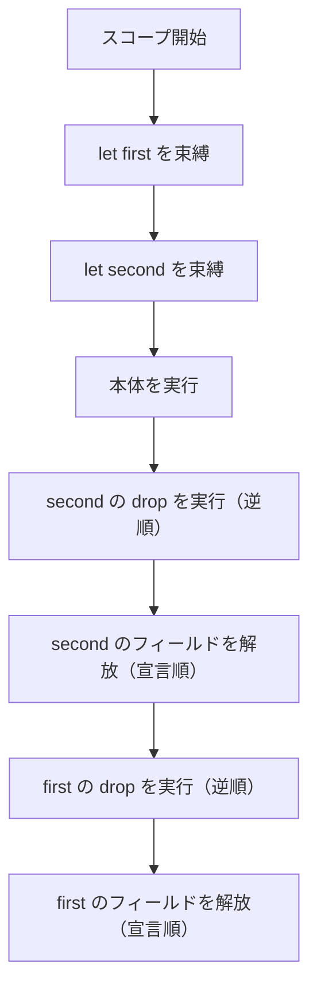

# Drop とリソースの解放

Tsuzuri は、スコープを抜けた変数のメモリを自動で解放します。ファイル記述子や、C ライブラリの不透明ハンドルのように、メモリ以外の資源を閉じたいときは、値の破棄に後始末を足します。

<!-- rule: OWN-023 -->
組み込みの型クラス `Drop` のインスタンスを書くと、値が破棄されるときにクリーンアップが 1 回走ります。トラップで止まったときは走りません。その例外は後半で説明します。

## この記事のポイント

- 文字列やコレクションなどの標準メモリは、スコープ終了時に自動解放されます。
- ユーザー定義の `record` や `union` に `instance Drop<T>` を実装して独自の解放処理を定義できます。
- `drop` メソッドのシグネチャは `drop :: ref mut 'a -> unit` です。
- 解放はスコープ終了、再代入、`return` / `break` / `continue`、保証された末尾呼び出しの直前のときに 1 回呼ばれます。ムーブ済みの領域と、トラップで止まったあとは呼ばれません。
- 解放順序はスコープ内の束縛の逆順（LIFO）で、フィールドは宣言順に解放されます。
- `use` キーワードを使うと、`Drop` 実装型であることをコンパイル時に検証して束縛できます。
- 早期に解放したい場合は `Owned.drop` を呼び出します。
- 同じ値を複数の所有者で共有するときは参照カウントの [Rc と Arc](../built-in-types-and-modules/rc.md) を、循環する構造は [Arena](../built-in-types-and-modules/arena.md) を使います。

## メモリとリソースの自動解放

Tsuzuri では、所有権システムによってすべての値の寿命が静的に管理されています。

`string`、`utf8string`、配列 `[T]`、リスト `[|T|]`、`Vec<T>`、クロージャが捕捉した環境などのヒープメモリは、所有者がスコープを抜けたとき、コンパイラが入れた解放コード（drop glue）で解放されます。回収を待つ GC の停止はありません。

## 利用者定義の解放（Drop 型クラス）

ファイル記述子や外部ハンドルなど、メモリ以外の資源をカプセル化する場合は、型クラス `Drop` のインスタンスを定義します。

```tsuzuri run=3%0Adrop%202%0Adrop%201
record Ticket { id: i64 }

instance Drop<Ticket> {
    fn drop value = do! IO.write_line ("drop " + to_string value.id)
}

def main :: unit -> i32 = \() ->
    let first = Ticket { id: 1 }
    let second = Ticket { id: 2 }
    do! IO.write_line (to_string (first.id + second.id))
    0
```

実行結果:

```text
3
drop 2
drop 1
```

### Drop 実装のルール

- **対象型**: ソースコード上で明示宣言した `record` または `union` のみ指定できます。組み込み型（`i64` や `string` など）への実装や、一部の型引数のみを具体化した宣言は `E1016` です。また `deriving (Drop)` による自動導出は `E1025` です。利用者が std の型（`DataChannel.Sender` など）に `Drop` の instance を書くことも `E1016` です。std のモジュールは、自分が宣言した型にだけ `Drop` の instance を書けます。`Channel` の `Sender` と `Receiver` は、これで、drop のときにチャンネルを閉じます（[Channel](../built-in-types-and-modules/datachannel.md)）。
- **メソッドシグネチャ**: `drop :: ref mut 'a -> unit` です。Copy なフィールドは読めます。非 Copy なフィールドは `ref value.field` のように借ります。自己の field・要素への代入、引数全体の置換、引数全体を別の関数へ `ref mut` で渡すことは全版で `E1012` です。2027 の一般の射影代入も、この固定プロトコルの禁止は変えません。destructor の外では可変な所有者の field を置換でき、破棄時には置換後の field が解放されます。
- **直接呼び出しの禁止**: `Drop.drop` を自分で呼ぶと `E1016` です。二重解放を防ぐため、コンパイラの解放処理からだけ実行されます。 <!-- rule: OWN-027 -->

## 解放が呼ばれるタイミング

`Drop` を実装した値は、次のタイミングで **1 回だけ** 解放されます。トラップで止まったときは呼ばれません。

1. **スコープの終了時**: `let` や `use` で束縛されたブロックを抜けるとき
2. **制御構文による脱出時**: `break`、`continue`、`return` でスコープを抜けるとき
3. **上書き代入時**: 可変変数への再代入や、参照先への `deref r = new_value` で古い値が上書きされるとき <!-- rule: OWN-025 -->
4. **一時値の破棄時**: 式の評価のために作られ、束縛されずに終わった一時値
5. **コレクションの破棄時**: 要素を含む配列やリスト、再帰 union が解放されるとき
6. **保証された末尾呼び出しの直前**: 同じ再帰グループのほかの関数への末尾呼び出しで、呼び出し元がまだ持っている値を、引数の評価の後、呼び出しの前に解放します（スコープの終了時と同じ逆順です）

<!-- rule: OWN-024 -->
所有権を別の変数や関数へムーブした領域には、`drop` は呼ばれません。非再帰の Drop 型は末尾に 1 バイトの生存フラグを持ち、ムーブ済みの領域では 0 になります。これで二重解放を防ぎます。

6 の保証された末尾呼び出しは、呼び出し元のフレームがなくなるので、`drop` を呼び出しの後に回せません。通常の呼び出しは戻ってから解放します。そのため、`drop` に副作用があると、呼ばれた関数の副作用との順序が、保証された末尾呼び出しとそうでない呼び出しで逆になります。WASM の既定のビルドは保証せず、`--wasm-feature tail-call` を付けるとネイティブと同じ順序になります。条件は [関数](../values-and-functions/functions.md#相互再帰の末尾呼び出し) にあります。

```text
def rec bounce :: i64 -> i64
    def and rebound :: i64 -> i64
fn rec bounce n =
    let held = Resource { id: 100 + n, name: "held" }   // Drop を実装した record
    if n == 0 then held.id else rebound (n - 1)
and rebound n =
    let held = Resource { id: 200 + n, name: "held" }
    if n == 0 then held.id else bounce (n - 1)
// bounce 2 の drop の順序: 保証された末尾呼び出しは 102、201、100。通常の呼び出しは 100、201、102
```

## 解放の順序（LIFO と宣言順）

解放の順序は、ソースの並びから決まります。

- **スコープ内の変数**: 宣言された順序とは **逆の順序（LIFO: 後入れ先出し）** で解放されます。後から作ったリソースが、先に作ったリソースに依存しているケースが多いためです。
- **関数とラムダの仮引数**: 本体の変数を解放した後で、仮引数を宣言の逆順に解放します（`fn keep c s` では `s`、`c` の順）。`ref` の仮引数（edition 2027 の読み取りの仮引数を含む）は呼び出し元の値への参照なので、解放するものはありません。
- **`match` の腕のパターンの変数**: 腕の終わりで、束縛の逆順に解放します（`| (c, s) ->` では `s`、`c` の順）。参照の先をその場で見る変数（[借用先からの分解](../pattern-matching/pattern-matching.md#借用先からの分解)）は照合した値の一部なので、腕の後で照合した値とともに解放されます。
- **文の一時値**: 文の終わりで、作った順に解放します。引数は左から順に評価し、パイプラインは左辺を先に評価するので、`f (ref (T { id: 1 })) (ref (T { id: 2 }))` は 1、2 の順です。
- **レコードの中**: まず自分の `drop` が呼ばれ、そのあとフィールドが **宣言の左から順** に解放されます。タプルの要素、配列などの要素も先頭から順に解放されます。



次の例で順序を確認できます。

```tsuzuri run=main%20done%0Aouter%20drop%0Ainner%20drop
record Inner { name: string }

instance Drop<Inner> {
    fn drop _value = do! IO.write_line "inner drop"
}

record Outer { inner: Inner }

instance Drop<Outer> {
    fn drop _value = do! IO.write_line "outer drop"
}

def main :: unit -> i32 = \() ->
    let _obj = Outer { inner: Inner { name: "test" } }
    do! IO.write_line "main done"
    0
```

実行結果:

```text
main done
outer drop
inner drop
```

`Outer` の `drop` が呼ばれた後に、フィールドである `Inner` の `drop` が呼ばれていることがわかります。

借用の検査は、どの種類の値にも同じ 1 つの規則を当てはめます。**借用を読みうる `drop` を実行する値は、その値より後に解放される値（か、自分自身の部分のうち、借用を読みうる部分より後に解放される部分）の借用しか持てません。** どの値がいつ解放されるかは、上の順序から次のように決まります。

| 値 | 解放される位置と順序 |
| --- | --- |
| ブロックの変数 | ブロックの終わり。宣言の逆順（一部の経路でだけムーブした値も、ムーブしなかった経路で解放されます） |
| 変数へ値全体を代入したときの古い値 | 代入の位置、新しい値を作った後 |
| 関数とラムダの仮引数（値で受け取るもの） | 本体の終わり、本体の変数の後。宣言の逆順 |
| ラムダが捕捉した値（`Owned.function` のラムダを含む） | 関数値の環境が持ち、関数値とともに解放されます。呼び出しは、捕捉した値をその呼び出しのフレームへコピーして使います |
| `ref`・`ref mut` の仮引数の先 | 呼び出し元の値なので、呼び出し元でその値として解放されます（呼び出し先は解放しません）。ビュー（`ref mut [Pair..]`）の先は、その後ろの配列の要素です |
| `match` の腕のパターンの変数とパターンの一時値 | 腕の終わり。束縛の逆順 |
| `break`・`continue`・`try` が受け止める例外で抜けるスコープの変数 | その位置。束縛の逆順 |
| 文の一時値 | 文の終わり、文の後も使う変数より先。作った順 |
| 呼び出し先が関数値へ渡す値（一時値の要素など） | 呼び出し先が仮引数をそのまま渡すなら、呼び出し元の実引数の一時値です。それ以外は位置が分からないので、渡す値が指す一時値（参照なら参照の先）の型の `drop` が借用を読みうるかで判断します |
| レコードのフィールド、タプルの要素 | 値自身の `drop` の後。宣言順、先頭から |
| `Rc`・`Arc` のブロックの中の値 | 最後の持ち主を解放したとき。その値の部分は、上の順序で解放されます |
| 配列・`Vec` などの要素、共用体の中身、`Mutex` などの中身 | 値自身の `drop` の後（検査は要素の順序を区別しません） |

宣言の逆順で解放されるので、先に宣言した変数は、後に宣言した変数より後に解放されます。そのため、借用を読みうる `drop` を実行する値（借用を持ちうる利用者の `Drop` 型の値と、それを持つ配列・`Vec`・`Mutex`・`Rc`・`Arc`・レコード、それを環境に持ちうる関数値など。弱参照の先は数えません）は、同じブロックで後に宣言した変数の借用を持てません。持つと、`drop` が先に解放された変数を読みうるので、ブロックの終わりで `E1013`（`'holder' keeps a borrow of a value that is dropped before it, and dropping 'holder' may run a Drop.drop that uses the borrow`）です。借用をどう得たか（代入、`Array.write`・`Array.set`・`Vec.push_mut` などのその場の書き込み、ロックのコールバック、セルを所有するレジストリの呼び出し、値をムーブして渡した関数による書き込み）は問いません。借用される変数を先に宣言します。そうした値の借用は、後の文で値を使わなくても、`drop` が使うのでスコープの終わりまで生きます。

- **一部の経路でだけムーブした値**: `if`・`match` の片方の枝やループの中でだけムーブした値は、ムーブしなかった経路ではスコープの終わりで解放されるので、ムーブしていない値と同じく検査し、借用もスコープの終わりまで生かします。すべての経路でムーブした値だけが、ここでは解放されません。
- **仮引数**: 仮引数も同じく、借用を読みうる `drop` を実行する仮引数は、後に宣言した仮引数の借用を持てません（`fn keep mut c s` で `c = Caller { f: \() -> String.length t }`（`t = ref s`）とすると、本体の始まりを指す `E1013`）。`Array.write`・`Vec.push_mut` で仮引数の配列やベクタへ書き込んだ借用も同じです。借用される仮引数を先に宣言するか（`fn keep s mut c`）、`ref` の仮引数にします。
- **`break`・`continue`・例外での脱出**: `break`・`continue` や、`try` が受け止める例外は、抜けるスコープの変数をその場で宣言の逆順に解放するので、その位置でも同じ検査をします（`E1013` はその `break` などを指します）。脱出の後で変数に借用を持たない値を代入しても、脱出した経路の解放は変わりません。内側の `try` のハンドラーに、どの例外にも合う腕（ガードの無い `| e -> e`）があるときは、例外が外側の `try` へ届かないので、内側で起きうる例外について外側のスコープの解放は検査しません。ハンドラーの腕がどれも例外を選ぶ（ガードの付いた腕や `| e is OverflowException -> e`）ときは、選ばれなかった例外が外側へ進みうるものとして検査します。`@checked` の演算が起こしうる例外の種類までは見ないので、`OverflowException` だけを選ぶハンドラーでも外側へ進む経路を数えます（どの例外にも合う腕を足すと受理されます）。
- **`match` の腕のパターンの変数**: 腕の終わりでも同じ検査をします。`| (c, s) ->` で、ロックのコールバックが `s` の借用を `c` の `Mutex` へ書き込むと、腕の本体の始まりを指す `E1013` です。借用される変数を先に束縛するか（`| (s, c) ->`）、借用を保持する値を腕の中でムーブします。
- **文の一時値**: 呼び出しが一時値の引数の借用を、それより後に作った一時値（かその一時値自身）に保持させ、その一時値の `drop` が借用を読みうると、呼び出しを指す `E1013`（`cannot keep a borrow of a temporary value in itself or in a temporary made after it: ...`）です。`keep (ref (to_string n)) (ref (Holder { ... }))` で `keep` が文字列の借用を `Holder` の `Mutex` へ書き込むと、文字列が先に解放されます。保持する側の一時値を先に作るか、借用される値を `let` で束縛します。
- **値の自分自身の部分**: 値が自分の部分の借用を持つとき（ロックのコールバックで `p.s` の借用を `p.h` の `Mutex` へ書き込むなど）は、借用した部分より後に解放される部分（後に宣言したフィールド、後のタプルの要素）か借用した部分自身の `drop` が借用を読みうると、`E1013`（`self_referential_store`、`'p' keeps a borrow of a part of itself, ...`）です。借用を書き込んだ場所は見ないので、借用した部分より後のどの部分も読みうるものとして扱います。配列などの要素は添字を区別しないので、要素の型の `drop` が借用を読みうるなら、どの要素の借用でも拒否します。ビュー（`ref mut [Pair..]` の仮引数の先）の要素も、その後ろの配列の要素として同じく扱うので、`ps[0].s` の借用を `ps[0].h` へ書き込む関数は、部分の順序によらず呼び出し元で拒否されます（安全側の扱いです）。`Rc`・`Arc` のブロックの中の値は 1 つで、ブロックを解放するときにその値の部分を順に解放するので、`ref (Rc.get (ref rc)).s` を同じブロックの `h` へ書き込む形は、レコードの中と同じくフィールドの順序で判断します。借用されるフィールドを、借用を読む値を持つフィールドより後に宣言するか、借用される値を値より先に別の変数として宣言します。`ref` の仮引数の先の部分の借用（`let t = ref p.s`）を同じ値へ書き込む関数は、関数の中で部分の順序を検査し、呼び出し元は実引数の場所より外側だけを検査します。仮引数そのものを捕捉した関数値（`\() -> look (ref p.s)` で `p` を捕捉）を書き込んだときは、値全体の借用として扱います（安全側の扱いです）。
- **`ref mut` の仮引数を通した自分自身の部分**: `ref mut` の仮引数の先の部分の借用（`let t = ref p.s`）を同じ値へ書き込む関数（`def target :: ref mut Pair -> i64`）も同じです。呼び出し元の値は、関数が借用した部分（`p0.s`）の借用を持つので、`ref mut p0` を新しく書いた呼び出しでも、`ref mut` の変数を渡す呼び出しでも、仮引数を別の関数へ渡す関数、パイプライン、関数値の仮引数、ラムダ、部分適用を通した呼び出しでも、部分の順序が逆（`record Pair { s: string, h: Holder }`）なら `E1013`（`self_referential_store`）です。呼び出しの後で借用された部分を書き換える（`p0.s = ...`）と `E1014` で、借用されていない部分の書き換え（`p0.n = 9`）は受理します（関数が借用した場所が 4 段より深いときは 4 段目までの部分の借用として、1 つの仮引数で 5 つ以上の場所を借用したときや、ビューを通した借用は、値全体の借用として扱います）。同じ値へもう一度 `ref mut p0` を渡す呼び出しも、呼び出し先が借用された部分を書き換えうるので、呼び出し先が実際には書き換えなくても `E1014` です（安全側の扱いです。`ref p0` なら渡せます）。本体の見えない関数値（配列から読んだ関数値、実行時に選んだ関数など）へ `ref T` か `ref mut T` を渡す呼び出しは、プログラムのどれかの関数が `ref T`・`ref mut T` の仮引数を通してそうした `T` の値へ自分の部分の借用を書き込むときだけ、同じ部分の借用を値に残すものとして扱います（そうした関数がどれも部分の順序を守るなら、順序は守られたものとします。仮引数そのものを捕捉した関数値を書き込む関数があれば、値全体の借用です）。そうした関数が無ければ、本体の見えない関数値も、渡された値の借用を同じ値へは残しません。ただし、書き込むセルを自分で所有する関数値を作るプログラムでは、本体の見えない関数値は渡された値の借用をその環境へ残しうるので、そうした環境を持ちうる値（関数値を入れた `Mutex` を持つ値など）を参照で渡すと、値はどの部分か分からない自分の借用を持つものとして扱い、部分の `drop` が借用を読みうるなら、部分の順序によらず `E1013` です（安全側の扱いです）。
- **値全体の代入**: 変数へ値全体を代入する（`p1 = mkp 7`）と、新しい値を作った後で古い値を解放します。古い値が持つ自分の部分の借用（ロックのコールバックや呼び出し先が `p1.s` の借用を `p1.h` の `Mutex` へ書き込んだもの）は、その解放で読まれて古い値とともに終わるので、代入とは競合しません。部分の順序が逆なら、古い値を解放する代入の位置で `E1013`（`self_referential_store`）です。同じ借用を別の値（後で使う `ref p1.s` など）がまだ持つなら、代入は `E1014` です。
- **呼び出し先が関数値へ渡す値**: 呼び出し先が仮引数をそのまま関数値へ渡す（`fn apply2 f a b = f a b`）なら、渡す値は呼び出し元の実引数なので、その一時値の作った順で判断します（`apply2 put2 (ref (Mutex.create [...])) (ref (String.repeat ...))` はセルを先に作るので受理され、逆の順は `E1013`）。`Array.map` などが関数値へ渡す要素のように、それ以外の値は、解放の位置が分からないので、その値が指す一時値の型（参照やビューなら参照の先、借用を持たない値ならその値自身の型）の `drop` が借用を読みうるときだけ数えます。借用を持つそれ以外の値（参照を捕捉したクロージャなど）は、何を借用しているか分からないので数えます。`Array.map ({ calls = calls + 1; owned_inc }) [1, 2, 3]` が渡すのは `i64` なので、`Drop` の instance があるプログラムでも受理されます。`fn apply f p = f p` に `ref (Pair { ... })` を渡すと、渡すのは一時値の `Pair` への参照なので、`Pair` の部分の `drop` が読みうるかで判断します。
- **ラムダが捕捉した値**: ラムダが捕捉した値は関数値の環境が持ち、呼び出しはそれを自分のフレームへコピーして使います。そのため、`Owned.function` のラムダが値で捕捉した `Mutex` などのセルへ書き込む値は、関数値の環境に残ります: `Owned.call (ref w) g` で渡した `g` が借用を持つなら、その借用は `w` に残り、借用される値を `w` より後に宣言すると `E1013` です。ラムダの中の局所値の借用や、捕捉した値の借用（呼び出しのフレームのコピーを指す）を捕捉したセルへ書き込むと、呼び出しが終わった後に読まれうるので `E1013`（`store_local_borrow_through_reference`）です。借用ではなく、所有する値（捕捉した値のコピーなど）を書き込みます。
- **借用を持てない `Drop` 型**: `Drop.drop` が受け取るのは自分の値だけなので、参照・関数値・dyn 値・`Owned.Function` などの借用を持ちうる値を（フィールド・要素・セル・`Rc` や弱参照の先のどこにも）格納しない `Drop` 型（`record Guard { id: i64 }`）の `drop` は、隣のフィールドの借用を読めません。`record Ctx { guard: Guard, label: ref string }` の値は `label` の借用を `drop` で読まない値として扱い、借用される変数を後に宣言しても、値を使い終えた後で変更しても構いません。

```text
record Caller { f: unit -> i64 }
instance Drop<Caller> {
    fn drop c = do! IO.write_line ("drop " + to_string (c.f ()))
}
def run :: i64 -> i64
fn run n =
    let mut holder = Caller { f: \() -> 0 }   // E1013: holder は text0 より後に解放される
    let text0 = to_string n
    let t = ref text0
    holder = Caller { f: \() -> String.length t }
    0
```

## use 束縛による解放保証

`use` キーワードは、`Drop` を実装した値を不変で束縛する専用構文です。

```text
use ticket = Ticket { id: 1 }
```

解放のタイミングは `let` と同じくスコープの終端です。右辺が `Drop` を実装していないと `E1005` になります。末尾の型が無い整数リテラルは `i32` なので、メッセージの型名も `i32` です。

```text
use n = 1
```

コンパイル結果:

```text
error[E1005]: 'use' needs a value whose type implements Drop; i32 does not, so bind it with 'let'
```

`use mut` は文法エラー `E0002` です。`use` は不変の束縛だけです。

`Drop` を実装している型だけを束縛したいときに使います。実装漏れはコンパイル時に分かります。詳細は [use キーワード](../exception-handling/use.md) を見てください。

## 早期解放（Owned.drop）

スコープの終わりを待たずに、手動でリソースを即座に解放したい場合は、標準組み込み関数 `Owned.drop` を呼び出します。

```tsuzuri run=drop%207%0Aafter
record Ticket { id: i64 }

instance Drop<Ticket> {
    fn drop value = do! IO.write_line ("drop " + to_string value.id)
}

def main :: unit -> i32 = \() ->
    let ticket = Ticket { id: 7 }
    Owned.drop ticket
    do! IO.write_line "after"
    0
```

実行結果:

```text
drop 7
after
```

`Owned.drop` は対象値の所有権を消費し、その場で `drop` デストラクタを実行します。渡した後の変数 `ticket` はムーブ済みとなり、以降はアクセスできません。

## Drop 型に課される制約

外部リソースの安全性を保つため、`Drop` を実装した型にはいくつかの重要な制約が課されます。

- **非 Copy**: `Drop` を実装した型は、フィールドの構成にかかわらず自動的に Copy 型ではなくなります。
- **通常のクロージャへの捕捉禁止（E1005）**: 通常の関数値は Copy です。Drop 型を捕捉すると、複製のたびに同じ資源を解放しかねません。そのため `E1005` になります。1 回だけ走る `tzroutine { ... }` の本体へは、所有権を渡せます。
  > [!TIP]
  > Drop 型を捕捉して持ち運ぶ関数値が必要なときは、[Owned](../built-in-types-and-modules/owned.md) モジュールの `Owned.function` を使用します。
- **部分ムーブの禁止（E1012）**: Drop 型から非 Copy フィールドだけを取り出すことはできません。途中までムーブした値に `drop` が呼ばれるのを防ぐためです。メッセージは `cannot move a field or payload out of a value whose type implements Drop` です。
- **レコード更新の禁止（E1012）**: Drop 型に対して `{ value with ... }` の更新構文を適用することはできません。
- **`drop` 本体での全体置換・排他貸出の禁止（E1012）**: `deref value = ...` で引数全体を置き換えると、古い値の解放が同じ `drop` を再帰します。別の関数へ `ref mut` で渡すと、呼び出し先が中身を置換できます。どちらも `E1012` です。メッセージは `cannot replace the whole value inside Drop.drop` と `cannot pass the value on as 'ref mut' inside Drop.drop` です。
- **公開境界**: `export` や `extern` の引数・戻り値に Drop 型を置くと `E1008` です。
- **関数の結果が持つ借用**: `drop` は本文に呼び出しを書かずに実行されます。どれかの `drop` の本体が、`Mutex.with_lock` などのロックや、値が持つ関数値の呼び出しを通して、解放する値の中身をほかのコードへ渡すときは、借用を持ち、破棄でコードを実行しうる値（Drop 型の値と、それを持ちうる関数値・dyn 値・`Owned.Function` を格納された値として持つ値）を受け取る・作る関数の結果は、その値が持つ引数の借用も持ちます（[関数値の共有借用の寿命](../values-and-functions/lambda-expressions.md#共有借用の寿命)、[現在の制限](lifetimes.md#現在の制限)）。その関数の中の `Rc.share` なども、所有者の借用を持ちます（[所有者を増やした値の借用](../built-in-types-and-modules/rc.md#所有者を増やした値の借用)）。次の `pass` は `_s` を使いませんが、`_s` の解放が `text` を借用する関数を `w` へ渡すので、`leak` の結果は `text` の借用を持ち、`E1013` です。`drop` が何もしない（`fn drop _s = ()`）なら受理されます。

  ```text
  record Stash { w: (unit -> i64) -> unit, f: unit -> i64 }
  instance Drop<Stash> {
      fn drop s = { let w = s.w; let g = s.f; w g }
  }
  def pass :: own Stash -> own (unit -> i64) -> (unit -> i64)
  fn pass _s r = r
  def leak :: own ((unit -> i64) -> unit) -> own (unit -> i64) -> own i64 -> (unit -> i64)
  fn leak w r n =
      let text = to_string n
      let borrowed = ref text
      pass (Stash { w: w, f: \() -> String.length borrowed }) r   // E1013
  ```

- **解放が書き込む借用**: どれかの `drop` の本体が `Array.write` などで値の中身を値の中の `Mutex` などへ書き込みうるときは、破棄でコードを実行しうる値を束縛する・代入で捨てる所と、束縛しない値（`match` の対象、関数へ貸す・値で渡す値、フィールドを読むだけのレコード、配列リテラルの要素などの一時値）を評価する所で、その値が持つ借用を、値の中のセル（とそれが指す持ち主）へ書き込んだものとして検査します（[現在の制限](lifetimes.md#現在の制限) の「その場の書き込み」と同じ規則）。位置は、`let` の値とその中の一時値は宣言、呼び出しの引数は呼び出しの式です。関数値の破棄が実行するコードは、関数値を作った式で決めます。ラムダは捕捉した値を、部分適用は束縛した引数を破棄し、名前付き関数は何も持たないので、参照だけを捕捉したラムダ（`\() -> Mutex.with_lock rm (...) + String.length bt`）は、束縛しても値で渡しても何も書き込みません。配列・リスト・タプル・レコード・共用体のリテラルは要素を破棄し（レコードと共用体は、その型自身の `drop` も実行します）、不変な局所値は束縛した値と同じものを破棄します（共有セルに届く型の値は、中身が後から変わりうるので型で決めます）。そのため `fill_with (Ctx { buf: ref mut arr, cb: \() -> String.length nr })` は何も書き込みません。呼び出された関数が引数の一部（`c.cb` など）を破棄するときの書き込みは、呼び出し元の実引数がそうした値を持つときだけ当てはめます。呼び出す関数値を場所から読むだけの呼び出し（`c.cb ()`）は、関数値を複製しないので何も破棄しません。関数の中で束縛して捨てる値の書き込みは、その関数の呼び出しの書き込みとして呼び出し元でも検査します（`build a f` が `Stash` を束縛して `unit` を返す形）。`drop` の本体が、破棄する値そのものの借用（`let nm = ref s.name` を捕捉した関数など）を書き込むときは、束縛した局所値の借用を書き込んだものとして検査し、一時値や関数へ値で渡す値がセルをほかの持ち主と共有していれば `E1013` です（値が先に解放され、借用がセルに残るため）。次の `leak` は、局所値 `text` の借用を持つ `Stash` を、呼び出し元と共有する `a` と一緒に持ちます。`_s` の解放は `text` の借用を `a` のセルへ残し、呼び出し元の `r` が `leak` の後でそれを読めるので、`_s` の宣言の位置で `E1013`（`cannot store a borrow of a local value through a reference parameter`）です。

  ```text
  record Stash { cell: Arc<Mutex<[unit -> i64]>>, f: unit -> i64 }
  instance Drop<Stash> {
      fn drop s = { let g = s.f; Mutex.with_lock (Arc.get (ref s.cell)) (\slot -> Array.write 0 g slot) }
  }
  def leak :: own Arc<Mutex<[unit -> i64]>> -> own (unit -> i64) -> own i64 -> (unit -> i64)
  fn leak a r n =
      let text = to_string n
      let borrowed = ref text
      let _s = Stash { cell: a, f: \() -> String.length borrowed }   // E1013
      r
  ```

  `drop` の本体が、値の中の関数値を呼んで値の中身を渡し、その関数値が書き込むセルを自分で所有する（`Arc<Mutex<...>>` を値で捕捉したラムダのコピー）ときは、セルを共有するほかのコピーは借用を持たないので、上の「値の中のセル」では足りません。そこで、そうした関数値を作るプログラムでは、値を束縛する・代入で捨てる・一時値として評価する所と、束縛の後で値のセルへ書き込んだ所で、値が持つ借用を、そうした関数値を持ちうる型か共有セルに届く型のすべての局所値へ書き込んだものとして検査します（[現在の制限](lifetimes.md#現在の制限) の、セルを所有する関数値の呼び出しと同じ規則）。値そのものの借用を渡す `drop` は、束縛した局所値の借用を同じように書き込み、一時値や関数へ値で渡す値は `E1013`（`cannot drop this value here: its Drop.drop hands a borrow of the dropped value to a function value ...`）です。値の出どころから、そうした関数値もセルも持ちえないと分かる値（捕捉の無いラムダだけを持つレコードなど）は対象外です。次の `run` は、`text0` の借用を持つ `Stash` を、レジストリ `reg` のコピーと一緒に持ちます。`_s` の解放は借用を `reg` のセルへ残し、`reg` の後の呼び出しがそれを読むので、`text0` を宣言したブロックの位置で `E1013`（`assignment lets a reference outlive its owner`）です。

  ```text
  record Stash { f: unit -> i64, out: (unit -> i64) -> i64 }
  instance Drop<Stash> {
      fn drop s = { let o = s.out; let _k = o s.f; () }
  }
  def run :: i64 -> i64
  fn run n =
      let reg = make_registry ()   // Arc<Mutex<...>> を値で捕捉したラムダを返す
      { let text0 = to_string n; let t = ref text0; let _s = Stash { f: \() -> String.length t, out: reg }; () }   // E1013
      reg (\() -> 1)
  ```

  `drop` の中で `Arc.share (ref s.out)` などで作った共有はブロックの所有者で、破棄する値そのものの借用ではありません。それを通して値の中身を別のセルへ移す `drop`（`s.inbox` の要素を `s.out` のセルへ移すもの）は、値そのものの借用を書き込む `drop` には数えません。

  `Rc.share`・`Arc.share` で作った共有を破棄すると、最後の所有者ならブロックの値の `drop` を実行します。そのときに渡るのはブロックが持つ借用で、元の `Rc` の借用ではないので、元の `Rc` を内側のブロックで宣言しても、レジストリが外側にあることは誤りになりません（ブロックの値が持つ借用がレジストリより長く生きる必要はあります）。弱参照（`Rc.downgrade` の結果）の破棄はブロックの値の `drop` を実行しないので、何も渡しません。

## トラップ時の挙動

- **トラップ時の巻き戻し**: `assert` の失敗やゼロ除算でトラップしたときは、スタックを巻き戻しません。まだ実行していない `drop` は呼ばれません。後始末の完了をトラップに頼らないでください。`drop` の中でトラップしたときは、通常のトラップとして処理されます。

## 外部リソースと File.Handle の注意点

Tsuzuri の標準ライブラリにおけるファイル操作型 `File.Handle` は、意図的に `Drop` を実装していません。

書き込みのフラッシュやクローズは、ディスク満杯などの I/O エラーを返すことがあります。戻り値のない `drop` では、そのエラーを呼び出し元へ返せません。

ファイルは `File.close` で明示的に閉じるか、スコープの終わりに閉じてエラーも返す `File.with_open` を使います。

## 共有と循環する構造

同じデータを複数の場所から読みたいときは、所有者を親のスコープに残し、共有借用（`ref T`）を渡します。

同じ値を複数の所有者で持ちたいときは、参照カウントの [Rc と Arc](../built-in-types-and-modules/rc.md) を使います。`Rc.share` で所有者を明示的に増やし、最後の所有者がスコープを抜けたときに値の drop が 1 回走ります。`Arc` は計数が atomic で、複数の tzroutine やスレッドで共有できます。共有した値は共有されている間は変わらないので、`Rc`／`Arc` だけでは循環は作れません。共有した値を書き換えるには [Atomic](../built-in-types-and-modules/atomic.md) か [Mutex](../built-in-types-and-modules/mutex.md) を入れます。`Arc` を `Mutex` に入れると循環を作れて、解放されないので、循環の一方は `Arc.Weak` で持ちます。

グラフやキャッシュのように、複数の値から同じ値を指す構造や、循環する構造は [Arena](../built-in-types-and-modules/arena.md) で表します。値は arena がまとめて所有し、ほかの値は Copy のハンドル `Arena.Handle<T>` で指します。ハンドルは値の寿命を延ばさないので、循環しても解放漏れは起きず、arena の drop で循環を含むすべての値が再帰なしで解放されます。削除済みや別の arena のハンドルは、実行時に世代と arena ID で検出します。

## 他の言語との比較

| 項目 | Tsuzuri | Rust | C# | C++ |
| --- | --- | --- | --- | --- |
| リソース解放 | `Drop` 型クラス | `Drop` トレイト | `IDisposable` | デストラクタ（RAII） |
| メソッドの引数 | `ref mut 'a` | `&mut self` | なし（`Dispose()`） | 暗黙の `this` |
| 解放順序 | LIFO（逆順） | LIFO（逆順） | GC 依存（`using` はスコープ末尾） | LIFO（逆順） |
| 静的検査構文 | `use` 束縛 | 通常の `let` | `using` 宣言 / ステートメント | なし |
| 早期解放 | `Owned.drop` | `drop(x)` | `x.Dispose()` | スコープブロック |
| 共有所有ポインタ | `Rc` / `Arc`（`share` で明示） | `Rc` / `Arc`（`clone`） | 参照型（GC） | `shared_ptr` |
| 循環する構造 | `Arena` とハンドル | `slotmap`、`Weak` | 参照型（GC） | `weak_ptr` |

## まとめ

- `Drop` 型クラスを実装すると、スコープ終了時にリソースを 1 回解放できます。トラップ時は例外です。
- 解放順序はスコープ内の束縛の逆順（LIFO）で、フィールドは宣言順に解放されます。
- `use` 束縛は、対象の型が `Drop` を実装していることを静的に検査します。
- 早期解放には組み込み関数 `Owned.drop` を使用します。
- Drop 型は非 Copy であり、通常のクロージャへの捕捉や部分ムーブは禁止されます。
- トラップ時にはスタック巻き戻しによる解放は行われません。
- `File.Handle` は自分で閉じます。共有は `Rc` / `Arc`、循環する構造は `Arena` とハンドルで表します。

## 関連項目

- [所有権とムーブ](ownership.md)
- [借用と参照](borrowing.md)
- [ライフタイムと region](lifetimes.md)
- [スタックとヒープ](stack-and-heap.md)
- [use キーワード](../exception-handling/use.md)
- [Owned](../built-in-types-and-modules/owned.md)
- [言語仕様: 利用者定義の解放（Drop）](../../../docs/language.md#利用者定義の解放drop)
- [言語リファレンスの目次](../index.md)
