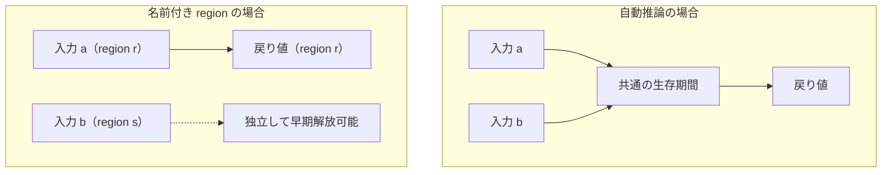

# ライフタイムと region

借用（参照）を使用する際、最も重要な安全規則は「参照は、参照先の所有者よりも長生きしてはならない」ということです。所有者がスコープを抜けて破棄されたあとに参照が残ると、不正なメモリアドレスを指すダングリングポインタになってしまいます。

関数の内部では、ライフタイムをコンパイラが推論します。関数の境界をまたいで複数の借用を扱うときや、レコードに借用を持たせるときは「名前付き region」を書きます。戻り値がどの入力の借用なのかを、コンパイル時に検査するためです。

## この記事のポイント

- 参照は常に所有者の生存期間（ライフタイム）の範囲内でのみ有効です。
- ローカルスコープで破棄される値への参照を外へ返そうとするとコンパイルエラー `E1013` になります。
- 名前付き region は `def f {r s} :: ref {r} T -> ref {s} U -> ref {r} T` のように波括弧で宣言します。
- 複数の region を使い分けることで、不要な借用の拘束を防ぎ、無関係な変数を早期に変更・解放できます。
- レコードのフィールドに借用を格納でき、排他借用フィールドには `ref mut {r} T` と明記します。
- 参照経由で借用レコードを置換する場合、参照先の region（`ref mut {r} Note {s}`）で追跡します。
- 名前付きの静的ライフタイム（`'static` のような記法）は言語仕様として存在しません。例外は、平たいデータの定数への借用です。読み取り専用の静的データを指すので、実行全体で有効です。

## ライフタイムの基本原則

<!-- rule: OWN-014 -->
Tsuzuri では、スコープを抜けると値が破棄されます。ローカルで生成した値への参照を関数の外やブロック式の外へ返却することはできません。

```text
def invalid_ref :: unit -> ref string = \() ->
    let local = "temporary"
    ref local
```

コンパイル結果:

```text
error[E1013]: borrowed value does not live long enough to leave this block
```

`tsuzuri check` は、所有者の宣言と、それがいつ破棄されるかも示します。

```text
./Main.tz:3:5: error[E1013]: borrowed value does not live long enough to leave this block
  3 |     ref local
    |     ^
  note: 'local' is declared here and dropped at the end of this block
    --> ./Main.tz:2:9
  2 |     let local = "temporary"
    |         ^
  help: return the value itself instead of a reference to it, or declare it in an outer scope
```

借用が主の位置と別の場所で作られたとき（代入やパターンの束縛）は、`note: value borrowed here` も続きます。関数の戻り値・代入・パターンと反復の束縛では、所有者の説明がそれぞれ `is dropped when the function returns`・`dropped at the end of this block`・`ends with this arm or iteration` になります。

`local` のメモリは関数が終了した瞬間に解放されるため、その参照を返すことはコンパイラによって拒絶されます。参照を返却できるのは、呼び出し元から受け取った引数の参照に由来する場合だけです。

## なぜ名前付き region が必要なのか

1 つの参照を受け取って 1 つの参照を返す関数では、コンパイラが自動的に入力と出力の生存期間を関連付けます。

しかし、2 つ以上の参照を受け取ってそのうちの 1 つを返す場合、何も指定しないと「両方の入力の共通の生存期間」に出力が拘束されてしまいます。その結果、返却されなかった無関係な入力変数まで借用中とみなされ、早期の変更や破棄ができなくなってしまいます。



名前付き region を使うことで、戻り値が具体的にどの入力のライフタイムに紐づいているかを型シグネチャ上で明示できます。

## 名前付き region の構文

region 名は、互いに違う小文字の ASCII 識別子です（`r`、`s`、`a` など）。大文字は `E1013` になります。型変数とは別の名前空間で、`def` の関数名の直後に `{r s}` と書きます。カンマ区切りの `{r, s}` も同じです。宣言したのに使わない region も `E1013` です。

```text
def 関数名 {region1 region2} :: 引数型 -> 戻り値型
```

参照型に region を付与するときは `ref {r} T`（または記号形式 `&{r} T`）、排他参照では `ref mut {r} T`（`&mut {r} T`）と書きます。

## 複数の region で借用元を分離する

次の例では、`first` 関数が 2 つの文字列参照を受け取り、1 つ目の参照だけを返します。

```tsuzuri run=5
def first {r s} :: ref {r} string -> ref {s} string -> ref {r} string = \left right ->
    assert (right.length > 0)
    left

let left = "hello"
let mut right = "temporary"
let selected = first (ref left) (ref right)
right = "changed"
selected.length
```

実行結果:

```text
5
```

シグネチャで `{r s}` を宣言し、戻り値を `ref {r} string` と指定しています。これにより、`selected` が借用しているのは `left` だけであり、`right`（`s`）とは無関係であることが保証されます。

そのため、関数呼び出しの直後に `right = "changed"` と可変変数を更新しても、`selected` は安全に有効なまま利用できます。もし region を指定しなければ `right` の更新は借用競合 `E1014` と判定されます。

> [!NOTE]
> 関数本体が宣言と違う借用を返すと `E1013` です。たとえば戻り値を `ref {r}` と書いて `right` を返すと、`returned borrow does not match the declared result region` になります。region は注釈ではなく、コンパイラが検査する契約です。

## レコードの共有借用フィールド

レコードのフィールドに共有借用を保持させることができます。レコード宣言時に名前付き region を宣言し、借用を内包する集約型として定義します。

```tsuzuri run=42
record View<'a> {r} { value: ref {r} 'a }

def view {r} :: ref {r} i64 -> View<i64> {r} = \value -> View { value: value }

let owner = 42
let borrowed = view (ref owner)
deref borrowed.value
```

実行結果:

```text
42
```

`View<i64> {r}` は「region `r` に属する借用を保持するレコード」を表します。このレコード自身をコピーしたりムーブしたりしても、元の所有者 `owner` への借用関係は維持されます。`owner` より長く生き残るスコープへ `borrowed` を持ち出そうとすると `E1013` になります。

レコードに書ける region は 16 個までです。17 個目は `E1017` になります。関数の `{r s ...}` は 128 個までで、それを超えるのも `E1017` です。複数の region を持つレコードは、宣言の順に同じ個数の名前を書きます。

```tsuzuri run=7
record Pair {r s} { left: ref {r} string, right: ref {s} string }

def make_pair {r s} :: ref {r} string -> ref {s} string -> Pair {r s} = \left right ->
    Pair { left: left, right: right }

def left_of {r s} :: Pair {r s} -> ref {r} string = \pair -> pair.left

let long = "abcdefg"
let kept = {
    let short = "xy";
    left_of (make_pair (ref long) (ref short))
}
kept.length
```

実行結果:

```text
7
```

`left_of` の結果は `long`（`r`）の借用のみを引き継ぐため、短命な `short`（`s`）が破棄される内側のブロックを抜けて安全に外側へ返却できます。

## 排他借用フィールド（ref mut {r} T）

レコードのフィールドに排他借用を持たせることも可能です。作業バッファへの排他参照を状態と一緒に持ち運ぶ view 構造などに活用できます（Rust の `struct Counter<'a> { value: &'a mut i64 }` に相当）。

排他借用フィールドを宣言する際は、region の指定が必須です（省略すると `E1013`）。

```tsuzuri run=22
record Counter {r} { value: ref mut {r} i64, step: i64 }

def add_to :: ref mut i64 -> i64 -> unit = \target amount ->
    deref target = deref target + amount

let mut total = 1
let counter = Counter { value: ref mut total, step: 20 }
add_to counter.value counter.step
let again = ref mut counter.value
deref again = deref again + 1
total
```

実行結果:

```text
22
```

### 排他借用フィールドの規則

- **再借用**: `counter.value` を排他参照を受け取る関数へ渡す操作は一段の再借用になります。レコード変数 `counter` 自体を `let mut` で束縛する必要はありません。
- **部分ムーブ**: `let taken = counter.value` は再借用ではなく、フィールドの部分ムーブです。そのあと `counter` 全体は使えません。
- **Copy ではない**: 排他借用フィールドを含むレコードは Copy になりません。通常のクロージャへの捕捉は `E1005`、`task` への送信は `E1013` です。
- **共有参照経由の変更禁止**: `ref Counter` を通して排他フィールドの参照先を変更したり、排他再借用したりすると `E1014` です。読み出しはできます。
- **排他スライスも置ける**: `ref mut {r} [i64..]` のように、可変スライスをフィールドにできます。配列・リスト・タプル・共用体・共有参照の内側に排他借用を置くことはできません（`E1013`）。

## 参照先の region と参照経由の置換

借用を保持しているレコードへの排他参照（`ref mut`）を経由して、そのレコードを新しい値で上書き代入したい場合があります。

このとき、参照自体の region と、参照先が内包する借用の region を区別して記述します。

```text
ref mut {r} Note {s}
```

ここで `{r}` は参照自体の生存期間、`{s}` は参照先の `Note` が保持している借用の生存期間です。

```tsuzuri run=65
record Note {r} { text: ref {r} string }

def swap_text {r s} :: ref mut {r} Note {s} -> ref {s} string -> ref {s} string = \target text ->
    let old = (deref target).text
    deref target = Note { text: text }
    old

let first = "alpha"
let second = "beta!!"
let mut note = Note { text: ref first }
let old = swap_text (ref mut note) (ref second)
note.text.length * 10 + old.length
```

実行結果:

```text
65
```

`swap_text` では、参照先へ新しい `Note { text: text }` を書き込んでいます。これが安全に行えるのは、書き込む新しい借用（`text`）が、参照先の保持する借用と同じ region `{s}` を持っているためです。呼び出し側では、`second` の生存期間が `note` に関連付けられます。

## region 量化関数

高階関数の引数において、「渡された関数が特定のライフタイム契約を満たしていること」を型で要求できます。関数型の直前に波括弧で region リストを記述します。

```tsuzuri run=7
def keep {r} :: ({s t} ref {s} string -> ref {t} string -> ref {s} string) -> ref {r} string -> ref string -> ref {r} string = \f kept other -> f kept other
def first {s t} :: ref {s} string -> ref {t} string -> ref {s} string = \left _right -> left

let long = "abcdefg"
let mut other = "xy"
let kept = keep first (ref long) (ref other)
other = "changed"
kept.length
```

実行結果:

```text
7
```

`({s t} ref {s} string -> ref {t} string -> ref {s} string)` は「1 番目の引数だけを借用して返す関数」という契約です。`keep` の本体で `f` を全引数で呼んだ結果は `kept`（`r`）の借用だけを持つので、呼び出し後に `other` を変更できます。

## 典型的なエラーと解決策

### E1013: 借用が所有者より長生きしている

```text
error[E1013]: borrowed value does not live long enough to leave this block
```

- **原因**: ローカルスコープで破棄される変数への参照を外へ持ち出そうとしています。
- **対処法**: 所有値そのものを返すか、外側のスコープで変数を `let` 束縛してから参照を渡します。

### E1013: 未宣言または不整合な region

```text
error[E1013]: undeclared region 'r'; add it after the declaration name
```

- **原因**: `def` の直後で宣言されていない region 名をシグネチャ内で使用しています。
- **対処法**: `def my_func {r} :: ...` のように波括弧内で region を明示宣言します。

### E1014: 借用中の競合

```text
error[E1014]: access conflicts with a live borrow; use the reference or end its last use before moving, replacing, or borrowing exclusively
```

- **原因**: 参照がまだ生きている間に、元の所有値を変更またはムーブしようとしています。
- **対処法**: 参照の使用を先に終わらせるか、必要な値を先に読み出してから変更します。

## 現在の制限

名前付き region は、入力と戻り値の対応を関数の直接呼び出しで分けるための仕組みです。次の場合は、安全側にまとめて扱います。

| 状況 | 扱い |
| --- | --- |
| 名前付き関数の直接の完全適用、不変な束縛、`if` / `match` の合流、レコードの作成とフィールド読み出し | region ごとに分ける |
| `let mut`、ループで合流する値、関数値、部分適用、クロージャの捕捉、配列・リスト・タプル・共用体への格納 | 関係する region をすべて保持する |
| 型エイリアス、共用体、`const`、ローカルの型注釈への region | `E1013`。書けません |
| 1 つの引数や戻り値に複数 region を混ぜる | 型全体が `Pair {r s}` のような複数 region レコードの直接適用なら可。`ref Pair {r s}` や `(ref {r} T, ref {s} U)` は `E1013` |
| region 量化した関数型 | 名前付き関数の引数の型全体だけ。その関数は直接呼び出しだけができ、関数値や部分適用は `E1013` |
| 静的ライフタイム | 名前付きの記法はありません。平たいデータの定数への借用（`ref Table`）だけが実行全体で有効で、region の検査を受けません（[値](../values-and-functions/values.md#定数の借用と静的データ)） |

「直接呼ぶと `right` をすぐ書き換えられるのに、関数値として渡すと借用が残る」ときは、この制限です。呼び出しを直接にするか、所有値を返す API にします。

名前付き region がない関数の結果は、型が参照を含むなら、すべての参照引数の借用を持ちます。本体がどの引数を返すかは見ませんが、本体が借用をまったく返さないと示せるとき（`fn nothing _x = Maybe.None` の `Maybe<ref i64>` など）だけは、結果は何も借用しません。そのため本体を借用を返しうる形に変えると、呼び出し側が `E1014` などになることがあります。型が参照を含まず、借用を関数の環境にだけ持ちうる結果（関数値、関数を値に持つ `HashMap` など）は、名前付き関数の直接の完全適用（それを完成させるパイプライン `x |> f a`、1 引数の関数への `x |> f` を含む）なら、呼び出す関数の本体が結果に入れうる引数の借用だけを持ちます（[共有借用の寿命](../values-and-functions/lambda-expressions.md#共有借用の寿命)）。`Rc.share`・`Arc.share` などの結果は、`shared` の借用ではなく、`shared` が持つ借用だけを持ちます（[所有者を増やした値の借用](../built-in-types-and-modules/rc.md#所有者を増やした値の借用)）。この 2 つの規則は、本体の値が持つ借用を検査がすべて追えているときだけ正しいので、次の場合は以前の規則のまま、結果はすべての引数の借用を、`Rc.share` などの結果は `shared` の借用を持ちます。

- `shared` の値が呼び出し元から来たとき（借用を持ちうる型の引数、ラムダの捕捉、それらを受け取った局所値）: `Rc.share` などの結果は `shared` の借用を持ちます。その値が持つ借用は呼び出し元の値のもので、この関数の本体からは見えないためです。
- 本体が、借用を持ちうる値を入れた `Mutex`・`RwMutex` などの共有セル（それを持つ `Arc`・レコード、それを引数や結果に持つ関数値を含む）を、呼び出し・パイプライン・演算子・ラムダの捕捉へ渡す関数: その本体と、その中で作るラムダの本体の `Rc.share` などは読み通しません（そうしたラムダを作る関数も同じ）。セルは `Rc`・`Arc` が共有するブロックの中にありえ、ある所有者を通してセルへ書き込んだ借用は、別の所有者から読み通した値には届かないためです。中身が借用を持てないセル（`Atomic<i64>`、`Mutex<i64>`）は数えません。結果の規則はそのまま使います。
- 本体が、借用を持ちうる値を本体の見えないコード（名前付き関数でない関数値の呼び出し、dyn 値のメソッド、`Owned.call`、`Array.map`・`Mutex.with_lock`・`Parallel.*` などコールバックを実行する組み込み関数、列が持つ step 関数を実行する `Seq.next`、そうしたコードへ渡す関数）へ渡す関数: どちらの規則も使いません。関数の型・dyn 型・`Owned.Function` は環境を表さないので、そのコードが自分の捕捉した `Mutex` などへ入れた借用を、本体の別の入力が読めるためです（[共有借用の寿命](../values-and-functions/lambda-expressions.md#共有借用の寿命)）。借用を持つ引数を渡さずに関数値を呼ぶだけの関数（`t ()`）は、結果がすべての引数の借用を持ち、`Rc.share` などは読み通します。
- 値の破棄: 破棄は本文に呼び出しを書かずに `Drop.drop` を実行するので、プログラムのどれかの `Drop.drop` が、`Mutex.with_lock` などのロックや捕捉した関数値の呼び出しで、値の中身を値の中の `Mutex` などへ入れうるときは、本体が受け取る・作る値で、借用を持ち、破棄でコードを実行しうるもの（利用者の `Drop` 型の値と、それを持ちうる関数値・dyn 値・`Owned.Function` を格納された値として持つ値）の借用は結果へ届くとみなし、その本体の `Rc.share` なども読み通しません（[Drop とリソースの解放](drop.md#drop-型に課される制約)）。
- 本体が書き込める場所（排他借用、上の共有セル、それらを引数や結果に持つ関数値）を呼び出しなどへ渡し、かつ本体か、本体が呼ぶ関数が、借用を持ちうる具体的な型の値を `Array.write`・`Vec.push_mut`・`SyncMap` の書き込みで書き込むか、コールバックを実行する組み込み関数や関数値を呼ぶ関数: どちらの規則も使いません。generic な関数の型変数を残したまま本体を検査する段（Copy の制約を推論する段）は、下の「その場の書き込み」を追跡しないので、念のため以前の規則を保ちます。generic な関数の中の書き込み（`Array.set` の中の `Array.write` など）は型変数の値の書き込みなので数えません。そのため、局所の配列を `ref mut` で渡して `Array.set 0 (\() -> 2) (ref mut g)` と書く関数は規則を使い、同じ書き込みを `Array.write 0 (\() -> 2) (ref mut g)` と書く関数は使いません。

その場の書き込み（`Array.write`、それで書き込む std の関数 `Array.set`・`Array.fill`・`Array.blit` や `MatrixView.write`・`MatrixView.fill` など、`Vec.push_mut`、`SyncMap` の値の書き込み）は、`arr[0] = v` の代入と同じく、書き込んだ値の借用（借用を捕捉した関数、`ref string` の要素など）を書き込み先の持ち主に残します。そのため、書き込み先が生きている間に借用元をムーブ・変更すると `E1014`、借用元より長く書き込み先を使うと `E1013` です。書き込み先は、可変スライスなら元の配列、`MatrixView.Mut` の窓なら窓が借りている配列、`Mutex.with_lock`・`RwMutex.with_write`・`Cond.wait_with` のコールバックが受け取った中身ならロックの持ち主です。呼び出す関数の本体が引数の先へ書き込むときは、呼び出しの位置で、その関数の本体から求めた書き込み（どの引数の借用がどの引数の先へ入りうるか）を当てはめます。直接の呼び出し、パイプライン、部分適用、名前付き関数・ラムダをコールバックや関数値の引数にした呼び出しのどれでも同じです。

```text
def leak :: i64 -> (unit -> i64)
fn leak n =
    let text = to_string n
    let borrowed = ref text
    let mut arr = [\() -> 1]
    Array.write 0 (\() -> String.length borrowed) (ref mut arr)
    arr[0]                 // E1013: arr[0] は text の借用を持つ（text は leak の終わりで解放される）
```

不変な `let` がラムダ・名前付き関数・部分適用（それらを `if` で選んだもの、`Owned.function` に渡したものを含む）に束縛されているときは、その局所値の呼び出し（`w x`、`Owned.call (ref w) x`、関数値の引数として渡した先での呼び出し）にも、束縛した本体から求めた書き込みを当てはめます。そのため `let w = Array.set 0 (\() -> String.length borrowed)` の後の `w (ref mut arr)` は、`arr` に `borrowed` の借用を残します。不変な `let` が、そうした値だけを要素に持つ配列リテラル（`let hs = [\f -> f () + 1, \f -> f () * 2]`）や、そうした値をフィールドに持つレコードリテラルに束縛されているときは、その要素（`hs[i] f`）やフィールド（`h.run s`）の呼び出しにも、要素・フィールドの本体から求めた書き込みを当てはめます。`==`・`!=`・`<` などの演算子と文字列補間・`to_string` は、利用者の instance のメソッドの呼び出しとして同じ規則で検査し、配列・リスト・タプルの比較・ハッシュ・表示は、要素の型の instance のメソッドを要素への参照で呼ぶものとして検査します。dyn 値のメソッドの呼び出しには、そのメソッドを実装するすべての instance の本体から求めた書き込みを合わせて当てはめます。

本体が見えない関数値（フィールド・要素・呼び出しの結果・`let mut` の関数値、引数で受け取った関数値を別名にしたもの、`Owned.Function` など）の呼び出しは、関数の型が環境を表さないので、次のように安全側に扱います。`Seq.next` は列が持つ step 関数を `()` で呼ぶので、列を関数値とする同じ呼び出しとして扱います（`Seq.to_array`・`Seq.map` など std の関数、`for x in seq` の繰り返しも `Seq.next` を呼びます）。step 関数が捕捉した `Mutex` へ借用を書き込むと、その借用は `Mutex` の持ち主に残ります。列を引数で受け取る関数の中の `Seq.next` は、その関数の呼び出しの書き込みとして呼び出し元で検査します。

- 関数値と引数が持つ借用は、引数が指す書き込める場所（排他借用と、借用を持ちうる値を入れた共有セル）のすべての先へ入りうるとみなします。借用を持てない場所（`ref mut [i64..]`、`ref mut i64` など）は書き込み先に数えません。dyn 値を持つ場所は、その dyn 型の vtable のメソッドのどれかが書き込みうるか、書き込める場所（`Mutex` への参照など）を返すときだけ書き込み先に数えます。`area` が何も書き込まない `[dyn Shape]` を借用した文字列と一緒に渡しても、文字列の借用は残りません。
- プログラムのどこかに、受け取った値か自分の環境の値を自分の環境が届く場所へ書き込む関数値があるときは、そうした関数値でありうる型の関数値の呼び出しでは、関数値と引数が持つ借用が、関数値の環境が借用している場所にも入りうるとみなします。そうした関数値を作るのは、次の所です。
  - 書き込み先（借用を持ちうる値を入れた共有セル、排他借用など）を捕捉してそこへ書き込むラムダ（`\g -> Mutex.with_lock m (\slot -> Array.write 0 g slot)`）と、書き込み先を束縛した部分適用。
  - 捕捉・束縛した値を関数値の呼び出しへ渡すラムダと部分適用のうち、渡す値の型を通して書き込みが届きうるもの（共有セルへの参照、排他借用、dyn 値・`Owned.Function` を持つ値）。std の `Array.map`・`Array.mapi` のラムダ（`\index -> transform values[index]`）は要素を、`Array.mapr` のラムダは要素への共有参照を渡すだけなので、`[i64]` などの要素では数えません。捕捉した関数値を渡すだけのラムダ（`twice h g = h (\() -> h g)` の `\() -> h g`）も数えません。関数値の環境へ書き込めるのはその関数値自身のコードだけで、そのコードを作る所はそれ自体で数え、それを捕捉したラムダはその型を受け継ぐ（下の「環境に持ちうる関数値」）ためです。
  - コールバックを受ける組み込み関数の部分適用のうち、束縛した引数の型を通して書き込みが届きうるもの。`Mutex.with_lock (ref m)` は `m` の中身が借用を持ちうるときだけで、`Mutex<i64>` では数えません。
  - 本体の見えない関数値に、書き込み先になりうる引数（共有セルへの参照、排他借用、dyn 値・`Owned.Function` を持つ値）か関数値を持つ引数を渡して関数を得る呼び出し（`let g = h.put (ref m)`）。引数を束縛した関数値を作りうるためです。借用を持つだけの引数（edition 2027 の読み取りの仮引数へ貸した `ref i64` など）は、書き込める場所ではないので数えません。

  関数の型は環境を表しませんが、環境を持つ関数値はどれもこうした所で作るので、その型と、そうした関数値を環境に持ちうる関数値の型だけが対象です（型は純粋性、引数の規約、引数の型を囲む参照を除いて比べます）。関数値を値として持つ型の場所も、そうした型の関数値を持ちうるときだけ書き込み先に数えます。そのため、参照越しに受け取った配列やレコードの中の関数値を呼ぶ形（`ws[0] f`、`h.w f`、`Array.iter (\w -> w f) (ref ws)`）では、要素やフィールドがそうした型のときに、関数値が借用している `Mutex` の持ち主に `f` の借用が残ります。関数値は自分の環境の値も書き込みうるので、借用とセルを捕捉した関数値（`\() -> { Mutex.with_lock mr (\slot -> Array.write 0 (\() -> String.length text) slot); 1 }`）を本体の見えない形で呼ぶと、`text` の借用がセルの持ち主に残ります。呼び出し先が自分の局所値を捕捉した関数を渡し、関数値がそれを引数なしで呼ぶだけ（`\get -> get () * 2`）なら、何も書き込みません。
- さらに、書き込むセルを自分で所有する関数値（`Arc<Mutex<...>>` を値で捕捉したラムダや部分適用、そうした値を入れた dyn 値）を作るプログラムでは、関数値のコピーが借用を持たずに同じセルを共有します。そこで、そうした関数値でありうる型の関数値（とそれを環境に持ちうる関数値）の呼び出しと、そうした関数値を持ちうる型か共有セルに届く型の値を引数に渡す見えない呼び出しは、関数値と引数の借用を、そうした関数値を持ちうる型か共有セルに届く型のすべての局所値（と、その文で評価した値を後から束縛した局所値）に残します。`ref string` だけを捕捉したクロージャや、そうした関数値と型の違うハンドラーは数えません。型が同じでも、値の出どころからそうした関数値を持ちえないと分かる値も数えません。名前付き関数、そうした値だけを捕捉したラムダと束縛した部分適用、そうした値だけからなる配列・レコード・タプル・共用体のリテラル、それらを束縛した不変な局所値とその要素・フィールド、`match` のパターンでそうした値から取り出した値（OR パターンでは、どの選択肢で取り出す値もそうした値のとき）、`for` で取り出したその要素、名前付き関数の呼び出しの結果のうち関数の本体がそうした値しか返さないもの（`fn handlers _u = [\f -> f () + 1]`、`Array.map (\k -> \f -> f () + k) ks` の結果など）、`Rc.new`・`Arc.new` で包んだそうした値と、それを `Rc.get`・`Rc.share`・`Rc.try_unwrap`・`Rc.downgrade`・`Rc.upgrade`（`Arc` の同じ名前の関数も）で取り出したもの（`Rc.try_unwrap` の `Result`、`Rc.upgrade` の `Maybe` からは `match` で取り出します）です（ブロックの値は作った後に置き換わらないため）。これはこの規則で数えないというだけです。借用を持つ値を本体の見えないコードへ渡す本体では、`Rc.share`・`Rc.upgrade` などの結果は元の `Rc` の借用を持つので（この節の初めの、関数の結果の借用の段落）、そうした結果から `Rc.get` で読んだハンドラーの呼び出しは、2 つめの規則で、渡した借用を元の `Rc` に残します。たとえば `match Rc.upgrade (ref w) with | Maybe.Some s -> deref (Rc.get (ref s)) | Maybe.None -> ...` で取り出したハンドラーへ、ハンドラーより先に解放する値の借用を渡すと `E1013` です（`Rc.get (ref r)` で元の `Rc` から直接読めば受理されます）。関数の本体で、仮引数の値を呼び出し元の実引数の値とみなすのは `mut` の付かない仮引数だけで、`mut` の仮引数（`fn renew mut a`、`\mut a -> ...`）は本体が何でも代入しうるので、出どころを追えない値に数えます。共有セルに届く型の値は、中身が後から変わりうるので数えます。呼び出し元の値がそうした型のときは、呼び出し元でも同じ規則を当てはめ、自分の局所値の借用を呼び出し元の値へ残しうる呼び出しは `E1013`（`cannot store a borrow of a local value through a reference parameter; ...`）です。値の破棄も同じ規則で検査します: 破棄が実行する `drop` の本体が、値の中のそうした関数値（`s.out`）を呼んで値の中身を渡すときは、値が持つ借用を、値を束縛する・代入で捨てる・一時値として評価する所（と、束縛の後で値のセルへ書き込んだ所）で、そうした型のすべての局所値に残し、値そのものの借用（`ref s.name` を捕捉した関数）を渡すときは、束縛した局所値の借用を残します（一時値や関数へ値で渡す値は `E1013`。[Drop](drop.md) の「解放が書き込む借用」）。プログラムのどこかで、そうした関数値を持ちうる値を、後で実行するコードへ渡している（tzroutine の捕捉、チャネルの要素、`Routine.go` などへ渡す `Owned.Function`、`OnceValue` の初期化関数の結果、コールバックを取る host 関数の引数、region のない dyn 値）ときは、渡した値は渡した時点で借用を持たないことしか検査されないので、借用を持つ値をそうした環境へ書き込みうる呼び出しは `E1013`（`task_capture_retains_borrow`: `cannot store a borrow in the environment of a function value here: ...`）です。所有する値か、コピーを捕捉した関数を渡します。

```text
def mk :: own Arc<Mutex<[unit -> i64]>> -> ((unit -> i64) -> i64)
fn mk a = \f -> Mutex.with_lock (Arc.get (ref a)) (\slot -> { let old = slot[0]; Array.write 0 f slot; old () })
def run :: i64 -> i64
fn run n =
    let w = mk (Arc.new (Mutex.create [\() -> 0]))
    let first = { let text0 = to_string n; let text = ref text0; w (\() -> String.length text) }   // E1013
    first + w (\() -> 1)        // w のセルは text0 の借用を持つ関数を持ったまま
```

1 つめと 2 つめの規則が 3 つめより弱いのは、プログラムのすべての関数値の本体を検査が見ているためです。環境へ書き込む関数値を作る所が 1 つもなければ、どの関数値を呼んでも、書き込みは引数の先にしか起きません。この判定はプログラム全体で、関数値の型ごとに行うので、離れた所にそうした関数値を足すと、同じ型の関数値（とそれを持ちうる値）の見えない呼び出しの検査が厳しくなります。たとえば、セルを所有する `(unit -> i64) -> i64` の関数値を作るプログラムでは、同じ型のハンドラーを、出どころを追えない所（`let mut` の局所値、`mut` の仮引数、引数とそのフィールド、関数値の呼び出しの結果、`Rc`・`Arc` の関数と `Owned.function` を除く組み込み関数の結果、列（`Seq`）から読んだ値、共有セルから読んだ値）から取り出して呼ぶと、そのハンドラーが何も書き込まなくても、渡した借用がハンドラーを持つ局所値に残ります。不変な配列リテラルやレコードリテラルに束縛したハンドラーは、本体が見えるので対象外で、関数の結果や `Array.map` の結果のハンドラーは、上の出どころの規則で対象外です。列の要素（`Seq.to_array (Seq.once h)` や `Seq.map` で作った列から読んだハンドラー）は、列が持つ step 関数の結果として読むので、出どころを追えません。そうしたハンドラーは配列リテラルに入れるか、名前付き関数の結果として受け取ります。引数のフィールドの関数値を呼ぶ関数（`fn fill_with c = { let v = c.cb (); Array.write 0 (\() -> v) c.buf }`）は、呼び出し元が渡した値のそのフィールドの関数値（レコード・タプルのリテラルの要素、それを束縛した不変な局所値の要素）の書き込みを当てはめます。そうした値でない実引数（`let mut` の値や関数の結果など）では、環境へ書き込む `unit -> i64` の関数値を作るプログラムなら、フィールドの関数値の環境を実引数全体で近似するので、実引数の借用を実引数の書き込み先へ残します。edition 2027 で `twice h g = h (\() -> h g)` のような組み合わせ関数に、読み取りの仮引数を持つラムダを渡す形も、同じ型の環境へ書き込む関数値があると `E1013` になります。

関数が、自分の局所値の借用を、`ref mut` の引数の先へ `Array.write` などで書き込むと、その位置で `E1013`（`cannot store a borrow of a local value through a reference parameter; the caller's data would outlive it`）です。呼び出し元のデータは関数より長く生きるので、関数が終わった後に解放された局所値を読むことになるためです。値で受け取った仮引数（`own m`、edition 2026 の値の仮引数）は関数が所有するので、その中のセル（`Mutex` など）へ局所値の借用を書き込んでも呼び出し元のデータには届きません。仮引数の解放の順序で検査します（[Drop とリソースの解放](drop.md#解放の順序lifo-と宣言順)）。仮引数の中でも、参照や `Rc`・`Arc` の先のセルは呼び出し元と共有しうるので、この `E1013` です。ラムダが捕捉した値はこれと違い、関数値の環境が所有し、呼び出しのたびにそのフレームへコピーされます。そのため、`Owned.function` のラムダが値で捕捉したセルは呼び出しより長く生きる環境のデータで、局所値の借用や、捕捉した値の借用（呼び出しのフレームのコピーを指す）を書き込むと同じ `E1013` です。呼び出す関数が自分の局所値の借用を関数値の仮引数へ渡し、実引数がそれを呼び出し元のデータへ書き込む（か、上の規則で書き込みうる、本体の見えない）関数値のときは、局所値が呼び出し先のものなので、呼び出し元の呼び出しの位置で `E1013`（`cannot pass this function value here: 'leak' passes it a borrow of a local value of its own, ...`）です。読み取りの仮引数（edition 2027）や演算子が借りた一時値への参照そのものを、呼び出す関数が引数の先へ書き込むときは、一時値が文の終わりで解放されるので `E1013`（`cannot store a borrow of a temporary value: ...`）です。値を `let` で束縛してから渡します。

関数が、`ref` か `ref mut` の引数の先の部分の借用（`let t = ref p.s`）を、同じ引数の先（`p.h` の `Mutex` など）へ書き込むのは、呼び出し元の値が自分の部分の借用を持つことです。`ref mut` の引数でも、関数が書き込んだのは共有の借用なので、呼び出し元の値はその後も共有の借用を持ちます。`ref mut p0` を新しく書いた呼び出しでも、`ref mut` の変数（`let r = ref mut p0; target r`）や仮引数を渡す呼び出し、パイプライン（`ref mut p0 |> target`）、関数値の仮引数、ラムダ、部分適用を通した呼び出しでも同じで、呼び出し元の値は関数が借用した部分（`p0.s`）の共有の借用だけを持ちます（`ref` の変数やパイプラインで `ref p0` を渡す呼び出しも同じです）。呼び出し元では値の部分の解放の順序を検査し（[Drop とリソースの解放](drop.md#解放の順序lifo-と宣言順)）、借用された部分の書き換えや、もう一度の `ref mut p0`（変数 `r` をもう一度渡す呼び出しも）は `E1014` です。借用されていない部分の書き換え（`p0.n = 9`）と、値全体の代入（古い値を、その借用とともに解放します。代入の後は値をムーブしても構いません）は受理します。関数の中で `deref p = mkp 7` と先を丸ごと置き換えると、関数がその値へ書き込んだ自分の部分の借用は古い値とともに終わります。本体の見えない関数値は、プログラムのどれかの関数が同じ型の値の参照を通して同じ書き込みをするときだけ、その書き込みをしうるものとし、そうした関数が借用した部分と順序を使います。

借用を読みうる `drop` を実行する値がセルの借用を持つと（`let c = Caller { f: read_cell (ref m) }`）、その `drop` は借用を通してセルの中身を読みえます。そのため、ロックのコールバックや呼び出し先が後でそのセルへ書き込んだ借用も、`c` が持つ借用として解放の順序を検査し、`c` より後に宣言した値の借用なら `E1013` です（[Drop とリソースの解放](drop.md#解放の順序lifo-と宣言順)の「借用の先の値が持つもの」）。

```text
def bad :: ref mut [(unit -> i64)..] -> unit
fn bad target =
    let s = to_string 123456789
    let b = ref s
    Array.write 0 (\() -> String.length b) target   // E1013
```

型注釈やパターンを書いたラムダの仮引数（`\(use: (unit -> i64) -> unit) -> ...`、`\(use, z) -> ...`）、仮引数を `match` で取り出した値（タプル・レコードのフィールド、共用体の中身。OR パターンでは、どの選択肢も同じ所から取り出すとき）、仮引数のフィールド（`p.handler`）も、関数値の仮引数として扱います。呼び出し元が渡した値のその部分の関数値で検査するので、何も書き込まない関数を渡す呼び出しは受理され、呼び出し先の局所値の借用を書き込む関数を渡す呼び出しは、呼び出しの位置で上の `E1013`（`cannot pass this function value here: ...`）です。その部分が分からない実引数では、実引数全体を本体の見えない関数値として扱います。フィールドと中身を 6 段より深くたどる呼び出し（再帰的な値の一部を自分へ渡す再帰関数の中など）も、本体の見えない関数値の呼び出しとして扱います。

`match` のパターンが照合した値をその場で見る変数（参照の先の `Maybe<string>` を `match m with | Maybe.Some s -> ...` で取り出した `s` など、[借用先からの分解](../pattern-matching/pattern-matching.md#借用先からの分解)）の借用は、照合した値の借用です。共有参照の仮引数（edition 2027 の読み取りの仮引数を含む）の先を照合したなら呼び出し元のデータの借用なので、`ref mut` の引数の先へ書き込めます。`ref r.name` と同じく、呼び出し元の値が書き込み先より長く生きるかを呼び出しの位置で検査します。関数の局所値や一時値を照合した変数の借用は、局所値の借用なので `E1013` です。書き込める仮引数（`ref mut` など）の先を照合した変数の借用も、関数がその後で照合した値を置き換えうる（`deref m = Maybe.None` の後は、借用が別のケースの中身を指す）ので、局所値の借用として `E1013` です。

関数が、書き込める仮引数の先の借用（`ref v[0]`、`ref r.name` など）を呼び出し元のデータか、呼び出し元の値と共有しうる関数値の環境へ書き込むと、その借用は関数の残りの間も生きているものとして検査します。その後で同じ仮引数を通して、借用した場所に届く書き込みをする（`Vec.push_mut` で要素を動かす、`r.name = ...` で置き換える、仮引数を書き込む関数へ渡すなど）と `E1014` です。借用した場所に届かない書き込み（`ref r.name` の後の `r.count = 5`）は、局所値に残した借用と同じく受理します。可変スライスやベクタへの `Array.write` は全体を排他借用するので、別の要素への書き込みでも `E1014` です。呼び出し元は、新しく作った `ref mut` の借用（`put (ref mut v0) (ref mut arr)`）を渡し、関数がその先の共有の借用だけを書き込むときは、`v0` の共有の借用を書き込み先に残します。そのため書き込み先が生きている間も `v0` を読めますが、変更・ムーブは `E1014` です。関数が共有の借用を、受け取ったものを残す関数値の仮引数（`Mutex` へ書き込むラムダ、セルを所有するレジストリ、配列の要素から読んだ関数値）へ渡すときも同じです。`ref mut` の変数や仮引数をそのまま渡すときは、その借用が呼び出しの後も続くので、排他の借用を残します。

関数が、書き込める仮引数の先の借用を関数値の仮引数へ渡し（`use (\() -> String.length sr)`）、その後で同じ仮引数を通して借用した場所に届く書き込みをすると、書き込みが借用の指す先を解放しうるので、呼び出し元は、受け取った値を呼び出しの後まで残しうる関数値をそこへ渡せません。渡すと呼び出しの位置で `E1013`（`cannot pass this function value here: 'put' passes it a borrow of what one of its own 'ref mut' parameters points at and writes there afterwards, ...`）です。受け取った関数を呼ぶだけの関数値（`\g -> g ()`）は受理されます。関数値の仮引数を別の関数へそのまま渡す関数（`fn relay v use = put v use`。edition 2027 で読み取りの仮引数として貸す形を含む）も、仮引数を渡した関数値の仮引数として扱うので、同じく呼び出し元で検査します。

関数の中で作った `Rc`・`Arc` の共有を呼び出し元のデータへ書き込むと（`Array.write 0 (Rc.share (ref lr)) slot`）、共有したブロックは関数が終わっても呼び出し元に残ります。そこで、共有はその時点で `lr` が持つ借用を持ち、ブロックがセル（`Mutex` など）を持つなら、関数がその後でブロックのセルへ書き込む借用も、呼び出し元のデータへ書き込んだものとして検査します。`lr` を通しても、別の共有、`Rc.get` で得た中身の参照、弱参照から `Rc.upgrade` で戻した値、`lr` をムーブした先（局所値、`lr` を値で受け取る関数、本体の見えない関数値や関数値の仮引数）を通しても同じです。検査はブロックの型で判定するので、同じ型のブロックを持つ関数の別の局所値へ書き込んでも同じに数えます。セルを所有する関数値の環境へ共有を渡したときも同じです。関数値の仮引数へ共有を渡すとき（`use (Arc.share (ref lr))`）も、共有は `lr` の借用ではなくブロックの所有者なので、呼び出し元は共有を残す関数値を渡せます。その後で関数がブロックのセルへ書き込む借用は、その関数値と、関数値が所有しうるセルへ渡したものとして検査します（局所値の借用なら `E1013`）。次の `put` は、`slot` へ共有を書き込んだ後で局所値 `local` の借用をブロックのセルへ書き込むので、その位置で `E1013` です。

```text
def put :: ref mut [Rc<Mutex<[unit -> i64]>>..] -> unit
fn put slot =
    let lr = Rc.new (Mutex.create [\() -> 0])
    Array.write 0 (Rc.share (ref lr)) slot
    let local = to_string 123456789
    let lt = ref local
    Mutex.with_lock (Rc.get (ref lr)) (\cell -> Array.write 0 (\() -> String.length lt) cell)   // E1013
```

複数 region のレコードを `let mut` で束縛すると、region は 1 つにまとまります。共有フィールドの読み出しと排他フィールドの再借用を同じ式で行うと `E1014` になることがあるので、先に `let` で読み出します。

## 他の言語との比較

| 項目 | Tsuzuri | Rust | C# |
| --- | --- | --- | --- |
| ライフタイムの指定 | 名前付き region `{r s}` | ジェネリックライフタイム `'a, 'b` | `ref struct` / lifetime 注釈 |
| 構文 | `ref {r} T` / `&{r} T` | `&'a T` | `ref T` |
| 排他参照の指定 | `ref mut {r} T` | `&'a mut T` | `ref T` |
| static ライフタイム | なし（明示的な region のみ） | `'static` | 静的参照 |
| レコード内の借用 | `record R {r} { v: ref {r} T }` | `struct S<'a> { v: &'a T }` | `ref struct` |
| 引数の暗黙関連付け | 1 引数は自動推論 | ライフタイム省略規則 | コンパイラ推論 |

## まとめ

- 参照は常に所有者のスコープ内で安全に管理され、ダングリング参照はコンパイル時に遮断されます。
- 複数の参照を扱う関数では、名前付き region `{r s}` で戻り値の借用元を明示します。
- レコードのフィールドに共有借用（`ref {r} T`）や排他借用（`ref mut {r} T`）を格納できます。
- 参照先が借用を持つ場合は `ref mut {r} Note {s}` のように参照先 region を分離します。
- region 量化した引数で、高階関数が返す借用を入力のどれかに限定できます。関数値として渡すと、この区別は残りません。

## 関連項目

- [所有権とムーブ](ownership.md)
- [借用と参照](borrowing.md)
- [スタックとヒープ](stack-and-heap.md)
- [Drop とリソースの解放](drop.md)
- [Record](../built-in-types-and-modules/record.md)
- [言語仕様: 名前付き Region](../../../docs/language.md#名前付き-region)
- [言語仕様: 排他借用フィールド](../../../docs/language.md#排他借用フィールド)
- [言語リファレンスの目次](../index.md)

