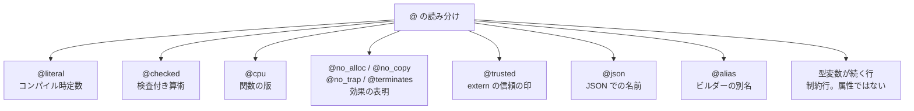

# 属性

`@` で始まる属性は、コンパイル時定数、検査付き算術、CPU ごとの関数の版、関数の効果の表明、`extern` の信頼の印、JSON での名前、コンピュテーション式ビルダーの別名をコンパイラへ伝えます。型変数の `@'a : 制約` は同じ記号で始まりますが、属性ではなく制約行です。

このページでは、10 個の属性の位置と効果、未知の属性がエラーになること、制約行との違いを説明します。関数の本体の先頭に書く契約の行 `@requires`・`@ensures` は、[契約](./contracts.md) を見てください。

## この記事のポイント

- 属性は `@literal`、`@checked`、`@cpu`、`@no_alloc`、`@no_copy`、`@no_trap`、`@terminates`、`@trusted`、`@json`、`@alias` の 10 個です。ユーザー定義の属性はありません。
- `@literal` は `def` の前に付け、`const` と同じコンパイル時定数にします。
- `@checked` は直後の式や文の整数演算を検査し、溢れると `OverflowException` になります。
- `@cpu` はトップレベル関数の `def` の前に付け、命令セットごとの版を作ります。ビルド先で選べない名前は無視されます。
- `@no_alloc`・`@no_copy`・`@no_trap`・`@terminates` はトップレベル関数の `def` の前に付け、「確保しない」「暗黙に複製しない」「論理のトラップをしない」「停止する」をコンパイラに検査させます。生成コードは変わりません。
- `@trusted` は `extern` の宣言の前に付け、人がその外部関数の契約を確かめたことを記録します。コンパイラは確かめず、生成コードも変わりません。性質（`pure` など）を添えると、`pure def` や効果の表明から呼べます。
- `@json "名前"` はレコードのフィールドや共用体の case の前に付け、導出した `Encode` / `Decode` が使う JSON の名前を変えます。
- `@alias 名前` は `.tc` のトップレベルに書き、`名前 { ... }` でそのビルダーを呼べるようにします。標準の `Async` は `@alias async` を宣言済みです。
- `@'a : 制約` は制約行です。属性の一覧には入りません。

## 属性の一覧と適用対象



| 属性 | 書ける位置 | 主な効果 | 関連ページ |
| --- | --- | --- | --- |
| `@literal` | `def` の直前。`private` はその前後 | `const` と同じコンパイル時定数 | [値](./values.md) |
| `@checked` | 式、または対応する文の直前 | `+` `-` `*` `**` と単項 `-` の桁あふれ検査 | [演算子と式](./op-and-expressions.md) |
| `@cpu` | `private` や `export` より前、トップレベル `def` の直前 | 命令セットごとの関数の版 | [関数 / 高階関数 / 再帰関数](./functions.md) |
| `@no_alloc` `@no_copy` `@no_trap` `@terminates` | `private` や `export` より前、トップレベル `def` の直前（`@cpu` と任意の順序） | 関数の効果の検査。違反は `E1031` | [効果の表明](#効果の表明no_allocno_copyno_trapterminates) |
| `@trusted` | `extern` の宣言の直前（`private` より前）。性質は同じ行 | 人が確かめた `extern` の印。性質は `pure` と効果の表明に効く | [信頼の印](#trusted-extern-の信頼の印) |
| `@json` | レコードのフィールドの直前、共用体の case の直前 | 導出した `Encode` / `Decode` のキーとタグ | [Json](../built-in-types-and-modules/json.md) |
| `@alias` | `.tc` のトップレベルの 1 行 | `名前 { ... }` で呼べるビルダーの別名 | [コンピュテーション式](../computation-expressions/computation-expressions.md#ビルダーの別名) |

## @literal (コンパイル時定数)

`@literal` は、関数定義構文 `def` を使ってコンパイル時定数を宣言する属性です。

```text
@literal [private] def 名前 :: 型 = 式
```

この記法は `const 名前: 型 = 式` と同じです。名前と型の間は `::` です。`private @literal def` も `@literal private def` も非公開定数になります。

```tsuzuri run=200
@literal
def BaseLimit :: i64 = 100

BaseLimit * 2
```

実行結果:

```text
200
```

### 書ける位置とエラー

- `@literal` の直後には `def` または `private def` が続く必要があります。`@literal const def` は構文エラー `E0002` です。ループや再帰が要る計算は `const def` です。
- `record` や `union`、通常関数の実装 `fn` に `@literal` を付けると構文エラー `E0002` になります。
- `const` と同様に、同一ファイル内での前方参照や他モジュールからの参照（`モジュール名.定数名`）が可能です。

## @checked (検査付き算術)

整数演算は既定で型の幅に折り返します。金額や件数のように、溢れを失敗として受け取りたい式に `@checked` を付けます。

```text
@checked 式
@checked let 変数名 = 式
```

検査されるのは、注釈が付いた式や文が直接評価する整数の `+`、`-`、`*`、`**`、単項 `-` です。溢れると折り返さず `OverflowException` になります。呼び出した関数の中までは及びません。

```tsuzuri run=caught%20overflow
def safe_calc :: i32 -> i32 -> Result<i32, Exception> = \x y ->
    try
        @checked (x + y)
    with
    | e is OverflowException -> e

let status = match safe_calc 2147483647 1 with
| Ok _ -> "ok"
| Error _ -> "caught overflow"

status
```

実行結果:

```text
caught overflow
```

### 対象外となる演算と注意点

- **除算と剰余**: `/` と `%` のゼロ除算、符号付き最小値の `-1` による除算は `@checked` の対象外です。`try` でも捕捉できず、言語トラップになります。
- **式に付けられる属性**: `@checked` だけです。ほかの `@名前` を式に付けると `E0002` です。
- **`const def`**: 本体に `@checked` は書けず、`E1026` です。例外は定数式に形がないので、折り返しの算術で書きます。
- **波括弧ブロックと `task`**: 次の `let`、`use`、または式に付きます。`return` と `do` には付けられず、`E0002` です。
- **コンピュテーション式**: `let`、`let!`、`do!`、`return`、`yield` と式に付けられます。`if`、`for`、`while`、`match!` には直接付けられず、中の文に書きます（`E0002`）。

## @cpu (CPU 命令セットごとの関数の版)

`@cpu` は、1 つの関数から命令セットごとの版を同時に作る属性です。`private` や `export` より前、トップレベル `def` の直前に置きます。

```text
@cpu ["ターゲット名", ...]
[private | export] def 関数名 :: 型 = 実装
```

ネイティブの実行ファイルとオブジェクトは、ポータブルな基準版に加えて、指定した命令セットの版を出力します。実行時には、その関数の最初の呼び出しで対応する版を 1 回だけ選びます。WASM、`--emit llvm`、`--freestanding`、対応する命令セットのないビルド先（macOS の AArch64 など）では基準版だけを作ります。ビルド先で選べない名前はエラーにせず無視します。

```tsuzuri run=42
@cpu ["avx2", "sse4.2"]
def compute :: i64 -> i64 = \x -> x * 2

compute 21
```

実行結果:

```text
42
```

### 有効な CPU ターゲット名

`@cpu` の配列内には、以下の文字列リテラルのみを指定できます。

| ターゲット名 | アーキテクチャ | 対象の拡張命令セット |
| --- | --- | --- |
| `"sse4.2"` | x86_64 | SSE 4.2 |
| `"avx2"` | x86_64 | AVX2 / FMA |
| `"avx512"` | x86_64 | AVX-512 Foundation |
| `"sve"` | AArch64 | ARM Scalable Vector Extension |
| `"sve2"` | AArch64 | ARM Scalable Vector Extension 2 |

未知の名前（`"avx3"` など）、重複、空の並びは `E0002` です。選べないだけの名前は無視されます。

### @cpu 関数の制限事項

- **付けられる対象**: トップレベル関数の `def` だけです。レコード、共用体、型クラス、ローカル関数に付けると `E0002` です。`const def` にも付けられません（`E0002`）。`cpu` 自体は予約語ではありません。
- **256 bit ベクトル**: 引数と戻り値に 256 bit ベクトル（`i32x8` や `f64x4` など）を置けません。レコード、共用体、タプル、固定長配列の中に含めても `E1005` です。本体から、256 bit ベクトルを渡す関数値を呼ぶこともできません。128 bit のベクトル、スライス参照、スカラーを使います。

## 効果の表明（@no_alloc・@no_copy・@no_trap・@terminates）

この 4 つの属性は、関数が**しないこと**を表明し、コンパイラに検査させます。コンパイラは関数ごとに、本体とそこから呼ぶ関数がしうること（効果）を型付きの中間表現から推論し、表明した性質を破る効果がないかを確かめます。属性は検査だけで、生成コードを 1 byte も変えません。付けない関数は今までどおりで、検査の費用もかかりません。

```text
@no_alloc
@no_trap
[private | export] [const | pure] def 関数名 :: 型 = 実装
```

| 属性 | 約束 | 破る効果 |
| --- | --- | --- |
| `@no_alloc` | ヒープを確保しない | `alloc`、`extern` の呼び出し、たどれない呼び出し |
| `@no_copy` | 長さに比例する暗黙の複製をしない | `copy`、たどれない呼び出し |
| `@no_trap` | プログラムの論理によるトラップをしない | `trap`、`extern` の呼び出し、たどれない呼び出し |
| `@terminates` | 停止する（構造的な十分条件） | `diverge`、`extern` の呼び出し、たどれない呼び出し |

```tsuzuri run=1026
@no_alloc
@no_trap
@terminates
def checksum :: ref [i64] -> i64 = \values ->
    let mut sum = 0
    for i in 0 .. values.length - 1 do
        sum = sum * 31 + values[i]
    sum

checksum [1, 2, 3]
```

実行結果:

```text
1026
```

`values[i]` は `for i in 0 .. values.length - 1` の範囲の添字なので、範囲外にならないことが証明でき、`@no_trap` を満たします。確保もループの外への脱出もありません。

### 各効果の判定

- **`alloc`**: `new`、`Array.init` などの確保する関数、捕捉のあるクロージャの生成、部分適用、文字列の連結と補間、再帰的な共用体のノードの生成、タスクの生成、暗黙の複製です。空でない配列・リスト・文字列のリテラルは、その場で読むだけなら確保しません。返す・値として渡す・パターンで取り出すとヒープへ移るので `alloc` です。64 KiB を超えるリテラルも `alloc` です。最適化の水準に依らない言語の規則で決まり、`-O0` と `-O3` で結果は同じです。
- **`copy`**: 配列やリストを含む値の、長さに比例する暗黙の複製です（`--warn implicit-copy` の `W1006` と同じ箇所）。`Array.copy`・`List.copy` で明示した複製は `copy` ではありません（`alloc` ではあります）。
- **`trap`**: 論理によるトラップです。ゼロかもしれない整数の除数（`0` でも `-1` でもない整数リテラルは除く）、負かもしれない符号付きの指数、範囲が証明できない添字とスライス、刻みがリテラルでない `for`、負かもしれない長さの `new`、`@checked`、`assert`、`Array.get` などのトラップしうる組み込み関数です。添字は、`for i in 0 .. xs.length - 1` の範囲、`if i >= 0 && i < xs.length then` の `then` 側、`if i < 0 || i >= xs.length then ... else` の `else` 側で証明できます。`Array.try_item` は範囲を確かめてから読むので `trap` になりません。確保の失敗やスタックの枯渇（資源の枯渇）、網羅された `match` は含めません。
- **`diverge`**: `while`、直接または相互の再帰、外部の事象を待つ組み込み関数（入出力の読み・ファイルを開くことと書くこと（FIFO は相手を待ちます）・`accept`・チャネル・ロック）です。`for` と、配列・リスト・`Vec`・文字列の `for x in` は有界なので含めません。`@terminates` は停止性の証明ではなく、この構造的な十分条件だけを検査します。
- **利用者の `Drop`**: 値を捨てる関数は、その型の `Drop` の実装の効果を持ちます。本体が使わずに捨てる `own` の引数も含みます（`ref` の引数は呼び出し元が捨てます）。
- **たどれない呼び出し**: `dyn` の呼び出しと、呼び出し元が選ぶ関数値の呼び出しです。関数値を引数に取らない関数の中で作ったラムダを呼ぶのは、たどれる呼び出しです。

### 関数を引数に取る関数

属性を付けた関数が、関数型の引数を呼ぶとき、その引数の効果は呼び出し側で検査します。呼び出しが渡すラムダや名前付き関数が、属性の禁じる効果を持てば、その呼び出しが `E1031` です。呼び出し元が自分の引数をそのまま渡すなら、呼び出し元にも同じ属性が要ります（検査の義務が呼び出し元の呼び出し側へ移ります）。`let invoke = apply` のような不変の別名や、`apply f` のような部分適用、`(if c then apply else twice)` のような `if`・`match` の分岐を通した呼び出しも、直接の呼び出しと同じに検査します（分岐のすべての関数に対して検査します）。関数を受け取る引数は、レコードや `Owned.Function` の中にあっても同じです。65 番目以降の引数（捕捉を含む）を呼ぶ関数は、その呼び出しを追えないものとして扱い、属性を付けると `E1031` です。

そのため、引数の関数を呼ぶ属性つきの関数は、それが呼ぶ引数を渡して呼ぶ位置でだけ使えます。レコードに入れる、返す、ほかの関数へ渡す、ラムダに捕捉させるなど、値として外へ出すと、後の呼び出しが渡す関数を検査できないので、その位置が `E1031`（`effect_unknown_callee`）です。不変の別名は、その使い方がすべて呼び出しなら構いません。呼ぶ引数を部分適用で渡し終えた値（`apply (\y -> y + 1)`）は外へ出せます。

```text
@no_trap
def apply :: (i64 -> i64) -> i64 -> i64 = \f x -> f x

record Runner { run: (i64 -> i64) -> i64 -> i64 }
def make :: unit -> Runner = \() -> Runner { run: apply }
```

```text
Main.tz:5:51: error[E1031]: 'Main.apply' is marked '@no_trap' and calls the functions it is given, but here it is used as a value whose calls are not checked; call 'Main.apply' with the functions it calls, directly or through a 'let' that is only called
```

```tsuzuri run=8
@no_alloc
def apply :: (i64 -> i64) -> i64 -> i64 = \f x -> f x + 1

apply (\x -> x * 3 + 1) 2
```

実行結果:

```text
8
```

### 書ける位置とエラー

- トップレベル関数の `def` の直前だけです（`private`・`export`・`const`・`pure` より前）。`@cpu` と任意の順序で並べられ、同じ属性は 1 回だけです。2 回目は `E1032` です。
- `record`・`union`・`type`・`const` の値・実装の `fn`・式に付けると `E1032` です。`extern` の関数には本体がないので `E1032` です。`extern` の関数の性質は [`@trusted`](#trusted-extern-の信頼の印) で書きます。ラムダ・ローカル関数・型クラスのメソッド・インスタンスのメソッドには付けられません。
- 表明を破ると `E1031` です。メッセージは、効果の生じる式、または関数から外へ出る最初の呼び出しを示し、呼び出しの連鎖と属性の位置を添えます。

```text
Main.tz:4:15: error[E1031]: 'Main.fill' is marked '@no_alloc' but this call reaches 'Array.init', which allocates an array or list; write into an existing buffer ('ref mut [T..]' with 'Array.write'), or remove the attribute
```

- ジェネリックな関数は、型引数ごとのインスタンスを検査します。インスタンスが 1 つもないと何も検査されないので、警告 `W1008` です。`const def` にも付けられ、実行時の本体を検査しますが、`W1008` で知らせます。
- `no_alloc`・`no_copy`・`no_trap`・`terminates` は予約語ではありません。`@` の直後に書いたときだけ属性の名前として読みます。
- `tsuzuri doc` と言語サーバーの hover は属性を表示し、hover は推論した効果（`inferred effects: ...`）も表示します。hover の効果は属性と関係なくすべての効果を推論した結果で、追えない関数値の呼び出しがあれば `(and calls that the analysis cannot follow)` を添えます。`tsuzuri api-diff` は属性を足すことを互換、外すことを互換のない変更として報告します。ただし、関数を受け取りうる引数（関数型・`dyn`・`Task`、関数を持ちうる名前の型）を持つ関数に属性を足すのは、呼び出し側が渡す関数にも同じ属性を求めるので、互換のない変更です。型変数を含む関数（ジェネリックな関数）に足すのも、呼び出し側が選ぶ型のインスタンスごとに検査するので、互換のない変更です。

### 精密さの限界

規則は生成コードより保守的です。確保しないコードを `alloc` と判定することがあります（捕捉した値を即値で持つクロージャ、関数値の環境の複製、タスクの生成など）。そのときは属性を外すか、名前付き関数や借用に書き換えます。`Vec`・`List`・文字列の添字とスライスの範囲は証明しないので、`@no_trap` では `trap` です。

## @trusted (extern の信頼の印)

`@trusted` は、`extern` で宣言した C の関数の ABI・所有権・寿命の約束を人が確かめた、という印です。コンパイラはその約束を確かめず、生成コードも変えません。印のない `extern` を使うと、`--warn untrusted-extern` を付けた `check`・`build`・`run`・`test` と、`tsuzuri audit` が警告 `W1010` を出します。

```tsuzuri
@trusted pure no_trap
extern "abs" def c_abs :: i32 -> i32

pure def distance :: i32 -> i32 -> i32 = \a b -> c_abs (a - b)

def main :: unit -> i32 = \() -> distance 3 7
```

`@trusted` と同じ行に、その関数について人が確かめた性質を書けます。性質は検査に効きますが、確かめるのは書いた人です。

| 性質 | 意味 | 効く検査 |
| --- | --- | --- |
| `pure` | 外の世界にも共有状態にも触れない | `pure def` から呼べる。契約の条件（`@requires`・`@ensures`）で呼べる |
| `no_alloc` | ヒープを確保しない | `@no_alloc` の関数から呼べる |
| `no_copy` | 長さに比例する複製をしない | なし（`@no_copy` は `extern` を禁じない） |
| `no_trap` | トラップしない | `@no_trap` の関数から呼べる |
| `terminates` | 停止する | `@terminates` の関数から呼べる |

性質は属性ごとに独立です。`@trusted no_alloc` の関数は `@no_alloc` からは呼べますが、`pure def` や `@no_trap` からは呼べません（`E1029`・`E1031`）。性質のない `@trusted` は印だけで、どの検査も緩めません。

性質は C の関数についての約束で、呼び出しの受け渡しには及びません。`string` の引数は、ホストへ渡すために複製されることがある（文字列がコンパクト形式のとき UTF-16 に広げる）ので、`@trusted no_alloc` の関数でも `string` を渡す呼び出しは `@no_alloc` の確保です（`E1031`）。

### 書ける位置とエラー

- `extern` の関数（`extern "sym" def`・`extern "mod" "sym" def`・`extern def`）と `extern type` の直前だけです。`private` より前に書きます。`extern type` には性質を付けられません。
- 誤りはすべて `E1037` です: `extern` でない宣言への `@trusted`（`trusted_wrong_target`）、未知の性質（`trusted_unknown_property`）、同じ性質を 2 回（`trusted_duplicate_property`）、`extern type` の性質（`trusted_type_property`）、1 つの宣言に `@trusted` を 2 回（`trusted_repeated`）。
- `trusted` と性質の名前は予約語ではありません。`@trusted` の直後の同じ行だけで性質として読みます。
- `@trusted` は権限を変えません。`extern` の呼び出しは、印があってもなくても権限 `ffi` を使います（[パッケージ](../organizing-tsuzuri/packages.md#権限capabilities)）。`tsuzuri api-diff` は `@trusted` を API の変更として扱いません。
- `tsuzuri bindgen` は `@trusted` を付けません。生成したファイルの 5 行目は、宣言を確かめてから `@trusted` を足すように促す注意書きです（[ネイティブ相互運用](../compiler/native-interop.md)）。

## @json (JSON での名前)

`@json "名前"` は、レコードのフィールドか共用体の case の前に付けます。`deriving (Encode, Decode)` で生成するコードが、宣言した名前の代わりにこの名前を JSON のキーやタグに使います。Tsuzuri のコードから見た名前は変わりません。

```tsuzuri run=%7B%22user_id%22%3A7%2C%22name%22%3A%22Ann%22%7D%20%22done%22
record User { @json "user_id" id: i64, name: string } deriving (Encode, Decode)
union State = Pending | @json "done" Finished deriving (Encode, Decode)

let user = User { id: 7, name: "Ann" }
let text = Result.get (Json.serialize (ref user))
let state = Result.get (Json.serialize (ref Finished))
$"{String.from_utf8 (ref text)} {String.from_utf8 (ref state)}"
```

実行結果:

```text
{"user_id":7,"name":"Ann"} "done"
```

### 書ける位置とエラー

- 名前は普通の文字列リテラル `"..."` です。`u8"..."`、補間文字列、数値などは `E0002` です。1 つのフィールドや case に `@json` は 1 つだけで、2 つ目も `E0002` です。
- フィールドと case の前に置けるのは `@json` だけです。`@literal` などは `E0002` です。
- その型が `deriving (Encode)` も `deriving (Decode)` も持たないと `E1025` です。
- 名前を変えた結果、2 つのフィールドや 2 つの case が同じ JSON の名前になると `E1025` です。
- `tsuzuri fmt` は `@json "名前"` の空白を整え、`tsuzuri doc` は属性を付けたまま表示します。言語サーバーでフィールドや case の名前を変えても、属性の名前は変わりません。

## @alias (ビルダーの別名)

`@alias 名前` は、ビルダーの `.tc` ファイルのトップレベルに 1 行で書きます。`名前 { ... }` が、そのビルダーの名前を書いた `Builder { ... }` と同じ計算になります。標準の `Async.tc` は `@alias async` を宣言しているので、`async { ... }` と `Async { ... }` は同じです。

```text
@alias identity

def Return :: 'a -> 'a
fn Return value = value
```

規則の全体と実行できる例は、[コンピュテーション式](../computation-expressions/computation-expressions.md#ビルダーの別名)にあります。

### 書ける位置とエラー

- `.tc` だけです。`.tz` と `.tt` に書くと `E1018` です。
- 名前は同じ行に置きます。小文字の ASCII で始まる識別子で、予約語と、`finally`、`is`、`namespace`、`of`、`try`、`using`、`where` は使えません。同じファイルで同じ名前を 2 回宣言しても、ドキュメントコメントを付けても、名前のあとに同じ行で別の語が続いても `E0002` です。
- `alias` 自体は予約語ではありません。`@` の直後に書いたときだけ属性の名前として読みます。
- `tsuzuri fmt` は `@alias 名前` の空白を整え、`tsuzuri doc` はモジュールのページに `Builder alias: ...` の行を出します。

## 制約行は属性ではない

`def` の次の行に、より深くインデントして `@'a : Eq` と書くのは制約行です。コンパイラはこれを `@literal` などの属性とは別に読みます。インデントが足りないと `E0002` です。

書き方は [制約 と 属性](../types-and-type-inference/constraints.md) と [ジェネリック関数と型パラメータ制約](./generics-functions.md) を参照してください。制約行の位置に `@literal` や `@checked` を混ぜても、制約にはなりません。

## ユーザー定義の属性はない

Tsuzuri 0.1.0 に、独自の属性やデコレータはありません。`@literal`、`@checked`、`@cpu`、`@no_alloc`、`@no_copy`、`@no_trap`、`@terminates`、`@trusted`、`@json`、`@alias` と、本体の先頭の契約の行 `@requires`・`@ensures`（`@ensures` の中の `@old`）以外の `@名前`（`@serialize` など）は `E0002` です。動作を属性の裏側に隠さないための制限です。

## まとめ

- 属性は `@literal`、`@checked`、`@cpu`、`@no_alloc`、`@no_copy`、`@no_trap`、`@terminates`、`@trusted`、`@json`、`@alias` の 10 個です。
- `@'a : 制約` は制約行であり、属性ではありません。
- ユーザー定義の属性はありません。
- `@literal` は `const` と同じコンパイル時定数です。
- `@checked` は直後の式や文の整数演算を検査し、溢れると `OverflowException` になります。
- `@cpu` は命令セットごとの関数の版を作ります。選べない名前は無視され、未知の名前は `E0002` です。
- `@no_alloc`・`@no_copy`・`@no_trap`・`@terminates` は推論した効果を検査する表明で、違反は `E1031`、置き場の誤りは `E1032` です。生成コードは変わりません。
- `@trusted` は人が確かめた `extern` の印で、誤りは `E1037` です。性質は `pure def` と効果の表明に効きます。
- `@json` は導出した `Encode` / `Decode` が使うフィールドや case の名前を変えます。
- `@alias` は `.tc` のビルダーに小文字の別名を足し、`async { ... }` のような書き方を可能にします。

## 関連項目

- [値](./values.md)
- [演算子と式](./op-and-expressions.md)
- [関数 / 高階関数 / 再帰関数](./functions.md)
- [コンピュテーション式](../computation-expressions/computation-expressions.md)
- [制約 と 属性](../types-and-type-inference/constraints.md)
- [ジェネリック関数と型パラメータ制約](./generics-functions.md)
- [例外処理](../exception-handling/exception-handling.md)
- [Json](../built-in-types-and-modules/json.md)
- [言語仕様: 検査付き算術と例外](../../../docs/language.md#検査付き算術と例外)
- [言語仕様: CPU ごとの関数の版](../../../docs/language.md#cpu-ごとの関数の版cpu)
- [言語リファレンスの目次](../index.md)

