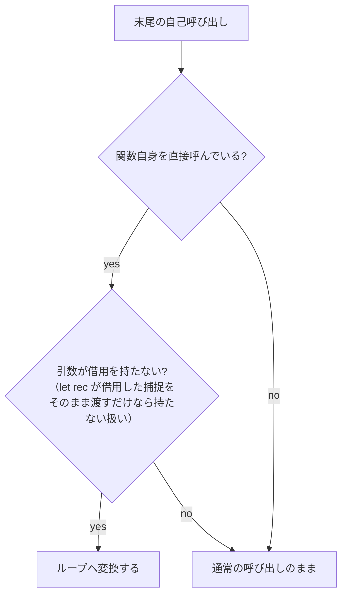

# 関数 / 高階関数 / 再帰関数

関数は Tsuzuri の基本的な値です。`def` で名前と型を書き、右辺のラムダ式で実装します。すべての関数はカリー化されているため、引数を一部だけ渡すと、残りの引数を待つ関数値が返ります。

このページでは関数の宣言、部分適用、パイプと合成、高階関数、再帰、関数ガードを扱います。ラムダ式の捕捉は[ラムダ式](./lambda-expressions.md)、型変数と制約は[ジェネリック関数と型パラメータ制約](./generics-functions.md)で詳しく解説します。

## この記事のポイント

- 宣言は `def name :: 型 = ラムダ式` が基本です。`::` を `:` にはできません。
- 引数なしの `answer()` と、`unit` を 1 つ渡す `accept ()` は別の関数です。
- `add 20 22` は `(add 20) 22` です。`20 |> add 22` のようにパイプでも渡せます。
- 標準ライブラリの高階関数は、関数を最初の引数に取ります。操作する値（コレクション、文字列、`Maybe` など）はどのモジュールでも最後の引数なので、`|>` と `>>` でつなげます（[標準ライブラリの引数の順序](../built-in-types-and-modules/argument-order.md)）。
- 再帰は `def rec` と、相互再帰の `and` で明示します。直接の末尾再帰は `-O0` でもループになり、同じ再帰グループのほかの関数への末尾呼び出しは、ネイティブでは保証された末尾呼び出しです。関数やブロックの中では、`let rec`（相互再帰は `and`）で補助関数を定義できます。
- `def` の前に `const` を付けた `const def` は、`const` の初期化式から呼ばれると、コンパイラが評価します。実行時にも呼べる普通の関数です。詳しくは[値](./values.md#コンパイル時に評価する関数-const-def)を参照してください。
- 同じ名前のオーバーロードはありません。型で振り分けるときは型クラスを使います。

## 基本の書き方

### 引数の所有権（`own` と edition 2027）

全 edition で `own T` は所有権を受け取る引数です。非 Copy 値は移動し、
Copy のコレクションは必要に応じて複製されます。`own` は予約語ではありません。
署名の引数型全体の前だけに書け、それ以外の位置は `E1005` です。
class メソッドの引数にも書け、class／instance の既存の値渡しの契約は変わりません。
LSP の hover・signature help・document symbol も `own` を保ちます。

```tsuzuri run=6
def append_mark :: own string -> string = \text -> $"{text}!"
(append_mark "hello").length
```

edition 2027 の通常の `def` では、無印の
`string`・配列・リスト・`Vec`・解放が必要な record／union／tuple などは共有借用になります。
`def length :: string -> i64` は、引数を `ref string` と書いた場合と同じです。
読み取りは複製も移動も起こさず、実引数は呼び出し後も使えます。返すために所有権が必要なら `own` を書きます。

裸の型変数と関数型も共有借用です。本体では値の読み取り view を使うため、引数を読むたびに
`*` を書く必要はありません。借用した型変数の値を返す場合は `Copy` が必要です。
消費して返す恒等関数は `def identity :: own 'a -> 'a = \value -> value` と書きます。
数値などの小さな具体型、`Task`、`dyn`、SIMD と可変束縛引数は値渡しのままです。
明示の `ref`／`ref mut` と region を指定した引数は変わらず、返却型やコールバックの中の引数も補完しません。
`const def`・入口の `main`・`extern`・instance のメソッドは従来の契約を使います。
2026 のパッケージの引数の契約は従来どおりです。
edition の指定は[パッケージ](../organizing-tsuzuri/packages.md#言語版edition)を参照してください。

```tsuzuri run=22
def inspect :: 'a -> i64 = \value -> 7
def twice :: (ref 'a -> i64) -> 'a -> i64 = \f value -> f value + f value
def length :: string -> i64 = \text -> text.length
let text = "hello"
twice length text + inspect text + text.length
```

矢印で書いた callback の型は、引数規約を暗黙に書き換えません。上の `ref 'a` は
読み取り callback の明示契約です。2027 の `Array`／`List` の `map`・`mapi`・`iter`・
`iteri`・`fold`・`fold_back` は読み取り callback を使い、非 Copy の要素も扱えます。
`map_owned` などの `_owned` 入口は 2026 の値 callback を保ちます。
`mapr`／`foldr` などの入口も残り、その callback では従来どおり参照を明示します。
一時 callback の借用は、一段で完全適用し、結果が借用を持たない呼び出しに限ります。
関数値を返す結果も保守的に借用を持ち得るため、一時値を渡すと `E1013` です。
先に `let` で束縛するか、関数値の所有権を受け渡す署名なら `own (T -> U)` を使います。

### 書き換える引数（`mut T`）

2027 の whole-parameter `mut T` は、排他参照の ABI と値 view を使います。
呼び出し側では `let mut` の所有値か既存の排他参照を渡します。引数そのものに `*` は不要です。
`mut T` は返却型や、入れ子の callback 型には書けません。そこでは明示の `ref mut T` を使います。

```tsuzuri run=42
record Counter { value: i64 }
def bump :: i64 -> mut Counter -> unit = \step counter ->
    counter.value = counter.value + step
let mut counter = Counter { value: 40 }
counter |> bump 2
counter.value
```

可変な所有者または排他参照を通じて、record の field と配列・リスト・Vec・固定長配列の
要素を代入できます。文字列の要素は不変です。右辺、代入先（添字を含む）、古い値の drop、
store の順に評価し、範囲外は従来と同じトラップになります。移動済みの field の再初期化と
要素単位の排他借用は、この構文では許しません。保持する借用は兄弟の field も含めて保守的に追跡します。
固定プロトコルの `Drop.drop` 内の自己の field・要素への代入は全版で `E1012` です。
`const def` の field・要素への代入も const 評価の対象外（`E1026`）です。

`Vec.push value values` も 2027 では対象を排他借用して `unit` を返します。
消費して新しい Vec を返す 2026 の操作は `Vec.push_owned value values` です。
借用を含む値を push する場合は、格納した借用の契約を保つため、直接、全引数で呼びます。
対象は最後なので `Vec.push (values[0] + 1) values` は可能ですが、
先に対象を貸す `values |> Vec.push (values[0] + 1)` は `E1014` です。

```text
def name :: 引数型 -> ... -> 返却型 = \引数 ... ->
    本体
```

名前と型の間は `::` です。単一の `:` は `let`、`const`、レコードのフィールド用で、`def` に使うと `E0002` になります。

```tsuzuri run=42
def add :: i64 -> i64 -> i64 = \left right ->
    left + right

def answer :: i64 = add 20 22

def bonus :: unit -> i64 = \() -> 0

answer() + bonus ()
```

実行結果:

```text
42
```

`add` は 2 引数の関数です。`\left right ->` と `\left -> \right ->` は同じカリー化関数になります。型の `->` は右結合なので、`i64 -> i64 -> i64` は `i64 -> (i64 -> i64)` と同じです。関数を引数に取るときは `(i64 -> i64) -> i64` のように左を括弧で囲みます。

`answer` は引数を取りません。本体を直接書き、呼び出すときは `answer()` です。この関数値の型は `fn() -> i64` と書けます。`bonus` は `unit` を 1 つ受け取る通常の関数で、呼び出しは `bonus ()` です。空の `bonus()` は引数 0 個の適用になり、`E1006` になります。

> [!WARNING]
> `f()` と `f ()` は別です。前者は引数なし、後者は `unit` 値を 1 つ渡します。

名前は `calculate_total` のようなスネークケースを推奨します。構文上の強制ではありません。他の Tsuzuri モジュールから呼ぶために `export` は不要です。`export` はホスト向けの公開で、付けるなら `def` 側です。

式を引数にするときは括弧が必要です。適用はどの二項演算子よりも強く結合します。負のリテラルも `shift (-1)` のように括ります。

```text
add (base + 1) (step * 2)
```

## 純粋関数（`pure def`）

`pure def` は、外部への副作用がなく、引数の値だけで結果が決まることを検査する関数です。
全 edition で使えます。`pure` は `def` の直前、instance メソッドの `fn` の前、純粋な関数型の前で読む文脈キーワードなので、変数名や関数名にも使えます。
`private pure def`、`export pure def`、`pure def rec ... and ...` も書けます。

```tsuzuri run=60
pure def total :: [i64] -> i64 = \values -> Array.sum values
let values = [10, 20]
total values + values[0] + values[1]
```

無印の解放が必要な引数は共有借用です。上の `[i64]` は `ref [i64]` と同じで、
呼び出し後も元の値を使えます。数値、`bool`、`unit`、解放不要な Copy record などは値渡しのままです。
明示の `ref T` はそのままです。引数を書き換える `ref mut` と可変束縛引数は使えません。
本体の局所変数の変更、配列の生成や複製は許されます。
借用した値そのものを返すには所有権がないので、文字列は `clone_string`、
配列は `Array.copy`、リストは `List.copy` で明示的に複製します。

所有権が必要な引数には `own T` を書きます。

```tsuzuri run=6
pure def shout :: own string -> string = \text -> $"{text}!"
(shout "hello").length
```

`own` でも通常の所有権規則を使います。消費した非 Copy の `string` は再使用できず、
Copy コレクションは必要なら複製されます。`own` の型は、数値・文字列・コレクションと、
それらからなる record／union／tuple などの**平たいデータ**に限ります。
参照、`Rc`／`Arc`、外部ハンドル、関数、`dyn`、`Task`、利用者の `Drop` を、
入れ子のフィールドや要素に持つ `own` も拒否します。
参照先を書き換えたり、参照カウントや `Drop` の実行を呼び出し側から観測できたりするためです。
`ref Rc<T>` のように借用する署名は可能ですが、参照カウントを調べる操作などは本体で使えません。
排他参照を field に持つ record も共有借用して読めます。ただし、この共有 view を通した書き換えや
排他的な再借用は通常の所有権検査で `E1014` です。

本体と、通常の `def` を含めてそこから到達する関数・コールバックを検査します。
関数を呼ばずに残しておいても、宣言した `pure def` は検査されます。

| 禁止する効果 | 例 |
| --- | --- |
| 外部世界との入出力 | `IO` の実行、ファイル、OS、ネットワーク、extern の呼び出し |
| デバッグ出力・時計・実行時の乱数 | `Debug.print`、ベンチの時計、OS の乱数。明示的な seed の `Random.pcg` は許可 |
| 共有可変状態 | `Atomic`、`Mutex`、`Channel`、`Rc`／`Arc` の操作 |
| 不透明なタスク・非同期実行器 | 入力から受け取る Task、非同期実行器の操作 |
| GPU・動的ディスパッチ | `Gpu` の操作、`dyn` の構築と呼び出し |
| 利用者の破棄処理 | 利用者の `Drop` を持つ値の保持・破棄 |

署名や本体が規則に違反すると `E1029`、到達する関数が 4,096 個または式が 2,097,152 個を超えると `E1017` です。

### ジェネリックな純粋関数

型変数と型クラスの制約を使えます。無印の型変数の引数は共有借用で、`own 'a` は所有値です。
未使用の generic な本体も検査し、特殊化のたびに純粋性と `own` の平たいデータの条件を確かめます。
型変数だから未知の副作用を許すわけではありません。

```tsuzuri run=42
pure def identity :: own 'a -> 'a = \value -> value
identity 42
```

`@cpu` を付けた純粋関数も使え、すべての版が同じ純粋性の契約を持ちます。
class のメソッドに `pure def` と書くと、既定の実装とすべての instance にその義務がかかります。
instance のメソッドだけに `pure fn name ...` と書くこともできます。instance の外の単独の `pure fn` は受け付けません。
これによって未知の `dyn` dispatch が許可されるわけではありません。

### 純粋な関数型と呼び出しの段階

`pure (T -> U)` は、その関数値の呼び出しが純粋であるという型です。通常の矢印型と物理的な引数規約は同じです。
たとえば `pure def size :: string -> i64` の実効型は `pure (ref string -> i64)` であり、`pure (string -> i64)` とは違います。
矢印型の中には `own` を書きません。純粋な関数値を通常の関数値へ弱めることはできます。
逆向きは、閉じた関数や lambda の本体を検査できる場合だけです。不透明な通常の callback を純粋と仮定しません。

```tsuzuri run=42
pure def apply :: pure (i64 -> i64) -> i64 -> i64 = \callback value -> callback value
pure def increment :: i64 -> i64 = \value -> value + 1
apply increment 41
```

関数を作る段階と、返った関数を呼ぶ段階は別です。次の `pure` が保証するのは `factory` の実行だけで、
戻り値の通常の関数型にまで保証を広げません。`pure def f :: A -> B -> C` は両引数の適用までを保証しますが、
`pure def f :: A -> (B -> C)` は最初の段階だけです。これは class メソッドの署名でも同じです。

```tsuzuri run=42
pure def factory :: i64 -> (i64 -> i64) = \offset -> { \value -> offset + value }
let callback = factory 40
callback 2
```

戻った関数の実行も保証したい場合は、結果に `pure (B -> C)` を書きます。

### IO アクションの構築

標準の `IO` の遅延アクションは、実行しなければ構築できます。`IO.map` などへ渡す callback の本体は後で実行されるので、
構築時の効果には含めません。一方、捕捉値を作るときの入出力や利用者の `Drop` などは、通常どおり検査します。
同名の利用者 record を特別扱いするものではありません。`IO.Run` や不透明な thunk の実行は許可しません。

```tsuzuri run=42
pure def deferred :: i64 -> IO<i64> = \n ->
    IO.map (\value -> { Debug.print (ref value); value }) (IO.pure n)
let _action = deferred 42
42
```

### 明示した並行処理

本体で作る閉じた Task と、明示した `Parallel.*` は使えます。呼び出し側から不透明な
Task・通常の関数・dyn を受け取らず、参照するコールバック全体の純粋性が検査される場合に限ります。
利用者の共有可変状態を許すわけではありません。自動並列化は行わず、
既存の並行 API の待機・トラップの意味はそのままです。失敗の順序や停止が逐次実行と同じだとは保証しません。

```tsuzuri run=42
pure def answer :: i64 -> i64 = \n ->
    let job = task { n + 1 }
    Task.run job
answer 41
```

### 保証と局所的な最適化

`pure` は「必ず停止する」「トラップしない」という意味ではありません。
添字範囲外や 0 除算は通常どおりトラップし、純粋という理由だけで未使用の呼び出しを消しません。
`pure` だけから LLVM の `memory(none)`、停止性、投機実行の属性を導くこともありません。

局所的な再利用は、**明示の純粋契約**と、独立した既存の **`memory(none)` の証明**が両方ある整数 scalar 関数だけです。
同じ基本ブロックで、同じ引数ですでに実行した 2 回目以降の呼び出しを再利用します。最初の呼び出しは残し、
分岐をまたいだ移動や投機実行はしません。引数も結果も値の整数に限り、参照・浮動小数点・所有コレクションは対象外です。
関数の外へ逃げない整数の局所スロットは、同じブロック内の書き込みを追跡します。借用されるスロット、atomic、volatile は使いません。
巨大・未対応の IR では再利用を省略するだけで、意味は変わりません。永続的な memo cache は作らず、所有する結果は独立したままです。

[Char の ASCII 関数](../built-in-types-and-modules/char.md)の 6 関数と、[seed を明示する PCG](../built-in-types-and-modules/random.md#種から再現する) の 3 関数は、
標準 API としても `pure` を宣言しています。既存の通常の callback を取る API を、純粋な callback 専用へ変えたわけではありません。
GPU の効果検査も純粋性の問い合わせを共有しますが、`pure` は GPU 対応の保証ではなく、既存の型・演算・backend の制限は残ります。
`const def` は定数初期化式からの評価を許す別の契約であり、`pure` と同時には書けません。

## 宣言と実装を分ける

型だけを `def` で書き、実装を同じファイルの `fn` または `let` に分ける書き方も受理されます。隣接している必要はありません。`export` は `def` 側に付けます。

```tsuzuri run=42
def add :: i64 -> i64 -> i64
fn add left right = left + right

def identity :: i64 -> i64
let identity = \value -> value

identity (add 20 22)
```

実行結果:

```text
42
```

実装のない `def` は、ホスト関数を宣言する `extern def` や型クラスのメソッド宣言を除いてコンパイルエラーになります。同じ名前の宣言が重複している場合も `E1001` エラーになります。新しいコードでは、型宣言と実装を 1 つの `def` にまとめる書き方を推奨します。

`fn` 側で一部の引数だけを名前で受けると、本体はその時点までの計算を行い、残りの引数を待つ関数を返します。`\left right -> 本体` の本体は、両方の引数が揃ってから評価されます。途中に束縛を置くと、最初の引数を適用した時点でそこまでが評価されます。後続の引数を、この段階より前へ動かしてよい規則はありません。途中で束縛してから関数を返す形は、[ラムダ式](./lambda-expressions.md)の `scaled` が動く例です。

## カリー化と部分適用

```tsuzuri run=42
def add :: i64 -> i64 -> i64 = \left right -> left + right

let add_twenty = add 20
22 |> add_twenty
```

実行結果:

```text
42
```

`add 20 22` は `(add 20) 22` と同じです。`add 20` は `i64 -> i64` の関数値であり、レコードのフィールドや配列の要素にも配置できます。組み込み関数、型クラスのメソッド、部分適用そのものも同一の規則に従います。ただし、借用や捕捉の制限が消えるわけではありません。排他借用を受け取る関数はその場で完全に適用する必要があり、部分適用した関数値を後から呼び出す値として保存することはできません。

引数は左から右に評価します。空白による適用は改行をまたぎません。行頭の `|>`、`>>`、`<<`、`||`、`&&` は前の行から続く演算として読まれます。

## パイプと合成

`value |> transform` は、値を関数の次の引数として渡します。`f >> g` は `\x -> g (f x)`、`f << g` は `\x -> f (g x)` です。ビットシフトではありません。シフトは `<<<` と `>>>` です。

```tsuzuri run=32
def multiply :: i64 -> i64 -> i64 = \factor value -> factor * value

let double = multiply 2
let quantities = [3, 5, 8]
let piped = quantities |> Array.map double |> Array.sum
let composed = quantities |> (Array.map double >> Array.sum)
if piped == composed then piped else 0
```

実行結果:

```text
32
```

`double` が `i64` を受け取るので、`quantities` は `[i64]` になります。`Array.map` は変換関数を先に取るため、`quantities |> Array.map double` と書けます。合成はパイプより強く結合しますが、上のように括弧でまとめると、パイプへ渡す関数が読みやすくなります。

`Array.sort >> Array.rev` のように、`ref` を受け取る関数どうしも合成できます。前の関数が返した配列を、次の関数が呼び出しの間だけ借りて受け取ります。借りた配列の中を指す参照を返す関数（`Array.minr` など）につなぐと、参照が配列より長生きするので `E1013` です。

値を捨てて `unit` にする組み込み関数が `ignore` です。`bool` の否定を関数として渡すときは `not` を使えます。`!` も論理否定です。

## 高階関数

関数を受け取る、または返す関数が高階関数です。標準ライブラリは F# と同じく、関数を最初の引数に取ります。対象のコレクションは、`Array.write` のようにその場で書き換える関数も含めて最後なので、パイプの右に置きやすい並びです。`Map.insert key value map`、`String.sub first count text`、`Maybe.bind f maybe` のように、`Array` 以外のモジュールでも対象が最後です（[標準ライブラリの引数の順序](../built-in-types-and-modules/argument-order.md)）。

| 関数 | 引数の並び |
| --- | --- |
| `Array.map` | 変換、配列 |
| `Array.mapr` | `ref` を受け取る変換、配列 |
| `Array.fold` | 畳み込み、初期値、配列 |
| `Array.fold_back` | 畳み込み、初期値、配列 |

2027 の `Array.map` は要素を読み取り view で callback へ渡すため、文字列のような非 Copy の要素も扱えます。
その要素を callback が所有値として取り出す場合は Copy が必要です。2026 の `Array.map` と
全版の `Array.map_owned` は値 callback の契約を使います。`Array.mapr` は参照を明示する互換入口です。
末尾の `r` は、要素を `ref` で借用して関数に渡す版の印で、`foldr`、`existsr` などにもあります。

```tsuzuri run=4321
let numbers = [1, 2, 3, 4]
let total = Array.fold (\acc value -> acc + value) 0 numbers
let texts = ["a", "bcd"]
let lengths = texts |> Array.mapr (\text -> text.length)
if total == 10 && lengths[1] == 3 then
    Array.fold_back (\value digits -> digits * 10 + value) 0 numbers
else
    0
```

実行結果:

```text
4321
```

呼び出しの引数に書いたラムダ式は、ほかの引数より後に型検査されます。`texts |> Array.mapr (\text -> text.length)` では左の `texts` が先に検査されるので、`text` の型注釈は要りません。評価順は変わりません。引数は左から右です。

ローカルな `let` に束縛した関数値は単相です。同じ値を `i64` 用と `string` 用の両方には使えません。複数の型で使う処理は、型変数を持つ `def` にします。詳しくは[ジェネリック関数と型パラメータ制約](./generics-functions.md)です。

## 再帰

自分自身を呼ぶ関数には `rec` が必要です。付け忘れると `E1019` になります。関数値、メソッド、演算子を経由する循環も検査されます。

```tsuzuri run=5050
def rec sum :: i64 -> i64 -> i64 = \remaining total ->
    if remaining <= 0 then total
    else sum (remaining - 1) (total + remaining)

sum 100 0
```

実行結果:

```text
5050
```

相互再帰は `def rec` に続けて `and` を書きます。`and` は直前の再帰グループを引き継ぐので、単独では使えません。型付きの `and` には `= 本体` が必要です。

```tsuzuri run=42
def rec even :: i64 -> bool = \value ->
    if value == 0 then true else odd (value - 1)
and odd :: i64 -> bool = \value ->
    if value == 0 then false else even (value - 1)

if even 42 then 42 else 0
```

実行結果:

```text
42
```

宣言と実装を分ける場合も、`rec` の有無を両方に揃えます。

```text
def rec sum :: i64 -> i64 -> i64
fn rec sum remaining total =
    if remaining == 0 then total
    else sum (remaining - 1) (total + remaining)
```

名前は `def rec` が束縛します。ラムダの先頭に自分の名前を引数として足す必要はありません。非再帰の前方参照に `rec` は不要です。`rec` を付けた関数が実際には自分を呼ばなくても、余分な再帰コードにはなりません。

分離形式の実装側は、`fn rec sum remaining total =` の代わりに `let rec sum = \remaining total ->` とも書けます。関数本体やブロックの中の補助関数は、[ローカルな `let rec`](#ローカルな-let-rec)で定義します。

自分自身への直接の末尾呼び出しは、`-O0` でもループへ変換されます。`if`、`match`、関数ガード、末尾のブロックも対象です。引数は古い環境で先に計算され、その後まとめてループ変数へ更新されます。呼び出し、副作用、トラップの順序は維持されます。

パイプライン演算子 `|>` による末尾再帰のループ化は、単項関数の `value |> self` のみサポートされています。複数引数の再帰呼び出しを `next |> self other` のようにパイプで書くとループ化されずスタックフレームを消費するため、`self other next` のように直接呼び出してください。



借用を引数に持つ関数や、借用を保持し得る関数値を引数に持つ関数は、参照先のフレームを再利用できないためループ化しません。例外は、ローカルな `let rec` が借用して捕捉した値を、そのまま渡し直す自己呼び出しです。その参照は関数自身のフレームの外を指すので、ループになります。関数値経由の再帰と、末尾でない再帰に、スタックが一定である保証はありません。停止性も保証されません。ネイティブのスタック上限は OS の設定に依存します。詳しい上限は[言語仕様の再帰とスタック](../../../docs/language.md#再帰とスタック)を参照してください。

### 相互再帰の末尾呼び出し

同じ再帰グループのほかの関数への末尾呼び出しは、次の条件を満たすとき**保証された末尾呼び出し**です。呼び出し元のフレームは呼ばれた関数が動く前になくなるので、ネイティブでは `-O0` でも、相互再帰がスタックを使い切りません。

```tsuzuri run=10000000
def rec ping :: i64 -> i64 -> i64 = \n acc ->
    if n == 0 then acc else pong (n - 1) (acc + 1)
and pong :: i64 -> i64 -> i64 = \n acc ->
    if n == 0 then acc else ping (n - 1) (acc + 1)

ping 10000000 0
```

実行結果:

```text
10000000
```

| 条件 | 内容 |
| --- | --- |
| 位置 | 末尾位置の呼び出しです。`if`、`match`、関数ガード、末尾のブロックの末尾と、1 引数の `value \|> f` を含みます |
| 呼び方 | 名前で直接呼び、引数をすべて渡します。関数値を介した呼び出しと部分適用は対象外です |
| 関数 | どちらも環境を捕捉せず、`task` の本体ではなく、`@cpu` で版を分けていません。捕捉のないローカルな `let rec` のグループも対象です |
| 引数 | 内部表現が同じで、借用（`ref T`、`ref mut T`、借用を保持し得る関数値）を含まず、呼び出し先の結果にも借用がありません |
| 結果 | 型が `bool`、`unit`、`char`、`utf8char`、または幅が 64 bit 以下の数（整数、`f16`・`f32`・`f64`、`d32`・`d64`）のどれかです。関数の型だけで決まり、値の機械表現には依りません。`i128`、`string`、配列、リスト、レコード、タプル、関数値、`Rc`・`Arc`、すべての共用体（再帰する共用体を含む）の結果は対象外です |

条件を満たさない呼び出しは、診断なしの通常の呼び出しで、深さに比例してスタックを使います。たとえば `string` や共用体を返す相互再帰は、その呼び出しが戻ってから所有値を解放します。

呼び出しの前に、呼び出し元がまだ所有している値（ローカルの文字列やレコードなど）を解放します。引数は左から右へ 1 回ずつ評価した後です。このため、`Drop` を実装した値のデストラクタは、保証された末尾呼び出しでは呼ばれた関数が動く前に実行され、通常の呼び出しでは呼び出しが戻った後に実行されます（自己呼び出しのループが、次の反復の前に解放するのと同じです）。

WebAssembly の既定のビルドは、この保証をしません。tail call 命令に対応しない実行エンジンがあるためです。`--wasm-feature tail-call` を付けると `return_call` 命令になり、WASM でも相互再帰のスタックが一定です。`--backend fast`（`-O0`）の native は、内部の関数どうしの呼び出しを同じように末尾呼び出しにします。条件は [コード生成器](../compiler/option.md#コード生成器) にあります。呼び出し元のフレームがなくなるので、デバッガのバックトレースにその呼び出し元は現れません。

### ローカルな `let rec`

関数の本体やブロックの中でも、`let rec` で自分自身を呼ぶ関数を定義できます。補助関数の名前がモジュールに現れず、外側のローカル値を引数で渡し直す必要もありません。

```tsuzuri run=5050
def triangle :: i64 -> i64 = \limit ->
    let rec go = \n acc -> if n > limit then acc else go (n + 1) (acc + n)
    go 1 0

triangle 100
```

実行結果:

```text
5050
```

`let rec name = \x -> ...` の右辺は、ラムダ式そのものです。`name` は自分の本体と、その文より後ろのブロックで使えます。`rec` を付けないと、本体の中の `name` は `E1002`（`unknown value`）です。型は単相で、本体の中で別の型として使うと `E1003` です。自分を呼ばない `let rec` も受理されます。波括弧のブロック、インデントのブロック、`Main.tz` のトップレベルの文、コンピュテーション式の通常の `let` の位置に書けます。

自分自身への直接の末尾呼び出しは、`def rec` と同じくループになります。`limit` が 1,000,000 でも、`-O0` でスタックを使い切りません。`n |> go` も同じです。末尾でない再帰（`go (k - 1) + go (k - 2)` など）は、`def rec` と同じく関数呼び出しです。

外側のローカル値は、捕捉して読めます。値のコピーで済む型（数値、`bool`、`char`、共有参照 `ref T`、それらだけからなる組・レコード・固定長配列）は値で渡します。それ以外の型は借用で捕捉します。

| 捕捉する値 | `let rec` の関数 |
| --- | --- |
| `i64`、`bool`、`char`、`ref T`、数値だけのレコードなど | 値を持つ |
| `string`、`[T]`、`Vec<T>`、解放処理を持つ値を含むレコード、関数値など | 共有借用を持つ（`let r = ref x` と同じ） |

```tsuzuri run=3
def count_above :: i64 -> i64 = \limit ->
    let values: [i64] = [5, 1, 9, 3, 7]
    let rec go = \index found ->
        if index == values.length then found
        elif values[index] > limit then go (index + 1) (found + 1)
        else go (index + 1) found
    go 0 0

count_above 4
```

実行結果:

```text
3
```

借用した値は、再帰呼び出しで参照を渡し直すだけで、複製もムーブもしません。配列を読む深い再帰も、末尾呼び出しならループです。ただし、通常のラムダ式が非 Copy の値を環境へ move するのとは異なります。

- 借用した捕捉を本体の中でムーブすると `E1012`（`cannot move 'text' out of a 'let rec' function, which borrows it; borrow it with 'ref' instead`）です。入れ子のクロージャが捕捉してムーブする場合も同じで、エラーはそのクロージャを書いた位置を指します。`match` は、一致させる値を読むだけです。`string` などの非 Copy の値を取り出して束縛するパターン（`Maybe.Some s` など）を書いたときだけムーブになるので、`match ref found with ...` と書きます。
- 借用を持つ関数は、捕捉した値の持ち主より長く生きられません。関数から返すと `E1013`（`cannot return a reference to a local value`）です。数値だけを捕捉する関数は返せます。
- 型変数（`'a`）を含む型の値は捕捉できません（`E1005`）。多相な関数の中の `let rec` には、その値を引数で渡します。
- `Drop` を実装した型や `Rc` など、通常のラムダ式が捕捉できない値は、`let rec` でも `E1005` です。

相互再帰は `and` でつなぎます。`and` は直前の `let rec` のグループに入り、どのメンバーの本体からも、グループの後ろのブロックからも、グループの全員が見えます。同じ名前を 2 度書くと `E1001` です。

```tsuzuri run=true
def parity :: i64 -> bool = \n ->
    let rec even = \m -> if m == 0 then true else odd (m - 1)
    and odd = \m -> if m == 0 then false else even (m - 1)
    even n

parity 10
```

実行結果:

```text
true
```

グループの関数は、同じ捕捉をまとめて持ちます。グループのほかのメンバーへの末尾呼び出しは、グループが何も捕捉しないとき（上の `parity`）に限り、[保証された末尾呼び出し](#相互再帰の末尾呼び出し)です。捕捉のあるグループでは、ループではなく通常の関数呼び出しです。前に定義した `let rec` 関数や外側の `let rec` 関数を呼ぶときも、捕捉を引き継げるなら、閉包は作らず直接呼びます。引き継げるのは、グループが、その関数と同じ関数本体（ループの本体を含む）で定義されているときと、その関数を直接呼ぶグループの本体の中で定義されているときです。ラムダ式やコンピュテーション式の継続の中のグループは、前の関数をほかのローカル値と同じ関数値として捕捉し、閉包を通して呼びます。前の関数が値で捕捉した変数に代入がある場合も同じです。閉包は作ったときの値を持つので、直接呼ぶと今の値を渡してしまうからです。どちらの呼び方でも、結果は変わりません。ただし、関数値として捕捉したグループは、その関数値を借用するので、関数から返すと `E1013` です（前の関数が数値だけを捕捉していても同じです）。関数を値として使う（ほかの関数へ渡す、返す）ときは、閉包を作ります。

次の書き方は、構文の誤りとして `E0002` になります。

| 書き方 | 理由 |
| --- | --- |
| `let rec x = n + 1` | 右辺がラムダ式ではない |
| `let rec mut go = ...` | `let rec` に `mut` は付けられない |
| `use rec`、`let! rec`、`and! rec` | 解放や束縛の展開が変わる位置には書けない |
| 関数ガードの `where` の `rec` | `where` の束縛は再帰しない |
| `@checked let rec go = ...` | `@checked` は `let rec` に付けられない（中の文に付ける） |

`const def` の中は、関数値を持てないので `E1026` です。自分の本体の中でしか使わない `let rec` の関数は `W1001`（`unused local`）で、グループでは、グループの外から使われないメンバーが対象です。`tsuzuri fmt` は `rec` と `and` を保ち、LSP は自己呼び出しとグループの呼び出しを束縛へ解決します。

## 関数ガード

ラムダの `->` の直後に `|` 節を並べると、関数ガードになります。`fn` 形式では `=` を置かずに節を並べても同じです。

```tsuzuri run=%E5%9C%A7%E5%8B%9D
def judge :: i64 -> i64 -> string = \left right ->
    | diff > 10 -> "圧勝"
    | diff > 5 -> "接戦"
    | otherwise -> "互角"
    where
        diff = Int.abs (left - right)

judge 30 18
```

実行結果:

```text
圧勝
```

`diff > 10` のような比較は、引数を参照できる条件です。`otherwise` と `_` は無条件の節です。条件だけの節は網羅性に数えられないので、末尾に `otherwise` などが必要です。足りないと `E1021` になり、最初の `|` の位置に報告されます。

複数引数のパターン節は、引数のタプルに対する `match` です。条件だけの節では、このタプルは作られず、元の引数名をそのまま使えます。非 Copy の引数を分解したあとは、消費された元の名前ではなく、パターンで束縛した名前を使います。

`where` は `|` と同じインデントの独立した行に置きます。その下に `名前 = 式` を、より深く同じ深さで並べます。`let` は書きません。初期化はガードの判定より前に、書いた順で 1 回ずつ評価されます。使われなくても評価されます。遅延評価でも相互再帰でもありません。前の束縛と引数は参照できます。後ろの束縛や、節の中で束縛した名前は参照できません。スコープは、そのガード本体の中だけです。

パターン節の網羅性、所有権、借用は通常の [`match`](../pattern-matching/match.md) と同じです。

## 関数値はコピーできる

関数値自体は `Copy` です。捕捉が無い関数は環境を確保せず、既知の関数の完全適用は直接の呼び出しへ落とせる場合があります。

環境を持つ関数値を複製すると、捕捉した文字列や配列を含む独立したコピーが作られます。呼び出しのときも同じ規則で環境を取り出すので、捕捉した所有値を返す関数でも繰り返し呼べます。大きな捕捉の複製が軽いとは限りません。関数値が不要になると環境は解放され、GC や参照カウントは使いません。

```tsuzuri run=44
def add :: i64 -> i64 -> i64 = \left right -> left + right

let add_two = add 2
let also = add_two
add_two 20 + also 20
```

実行結果:

```text
44
```

捕捉の寿命、`ref mut` と `Task` を保存できない理由は[ラムダ式](./lambda-expressions.md)で説明します。

## オーバーロードはない

同じ名前を、引数の型だけ変えて複数定義することはできません。次は `E1001`（duplicate function signature）です。

```text
def add :: i64 -> i64 = \value -> value
def add :: string -> string = \text -> text
```

型に応じた演算は[型クラス](../types-and-type-inference/type-classes.md)へまとめます。`+` が数値でも文字列でも使えるのは、オーバーロードではなく `Add` のインスタンスです。

引数を関数の中で再代入するときは `\mut value ->` と書きます。これは別のオーバーロードではなく、その引数だけを可変にする印です。外側の `let mut` をラムダから代入し直すことはできません。捕捉された変数は環境の中で不変です。

## 他の言語との比較

| | Tsuzuri | F# | Rust |
| --- | --- | --- | --- |
| 宣言 | `def name :: 型 = \x ->` | `let name x =` | `fn name(x: T) -> R` |
| カリー化 | すべての関数 | すべての関数 | なし。クロージャで部分適用する |
| 再帰 | `rec` が必要。関数の中は `let rec` | `let rec` | 名前があれば再帰できる |
| 高階関数の引数順 | 関数が先 | 関数が先 | トレイトやクロージャが先のことが多い |
| オーバーロード | なし。型クラス | なし。静的メンバー制約など | トレイト |

互換のため、`fn name(left: i64, right: i64) -> i64 { left + right }` や `add(20, 22)` も受理されます。`fn name :: 型` は受理されず、`def name :: 型` へ移します。バックスラッシュ無しの `value -> 式` も互換構文です。新しいコードでは `\value -> 式` と空白適用を使ってください。

## 注意点

- 関数ではない値へ引数を渡すと `E1005` エラーになります。
- 改行の後へ空白適用は継続しません。複数行にわたる演算は行頭に演算子を置きます。
- 末尾再帰のループ化は、直接の自己呼び出しと単項の `value |> self` が対象です。複数引数のパイプライン呼び出しはループ化されません。
- 同じ再帰グループのほかの関数への末尾呼び出しは、条件を満たすと保証された末尾呼び出しですが、`string` や配列、共用体を返す相互再帰、借用を引数に持つ相互再帰、WASM の既定のビルドは対象外です（[相互再帰の末尾呼び出し](#相互再帰の末尾呼び出し)）。保証された末尾呼び出しでは、`Drop` を実装した値は呼ばれた関数が動く前に解放されます。
- 停止しない再帰はループ化されても終了しません。基底条件を確実に記述してください。

## まとめ

- `def name :: 型 = ラムダ式` で宣言と実装を一緒に書けます。
- `answer()` は引数なし、`accept ()` は `unit` を 1 つ渡す呼び出しです。
- 部分適用、`|>`、`>>`、`<<` は通常の関数値の操作です。
- 標準ライブラリは関数を先に取るので、コレクションをパイプで渡せます。
- 再帰は `def rec` と `and` で明示し、直接の末尾再帰はループに、同じグループの別の関数への末尾呼び出しは条件つきで保証された末尾呼び出しになります。関数の中の補助関数は `let rec`（相互再帰は `and`）で書けます。
- 同名のオーバーロードはなく、型による分岐は型クラスです。

## 関連項目

- [ラムダ式](./lambda-expressions.md)
- [ジェネリック関数と型パラメータ制約](./generics-functions.md)
- [演算子と式](./op-and-expressions.md)
- [型クラス](../types-and-type-inference/type-classes.md)
- [制約 と 属性](../types-and-type-inference/constraints.md)
- [match 式](../pattern-matching/match.md)
- [所有権とムーブ](../ownership-and-memory/ownership.md)
- [Array](../built-in-types-and-modules/array.md)
- [標準ライブラリの引数の順序](../built-in-types-and-modules/argument-order.md)
- [関数の宣言と適用](../../../docs/language.md#関数の宣言と適用)
- [関数ガード](../../../docs/language.md#関数ガード)
- [再帰とスタック](../../../docs/language.md#再帰とスタック)
- [言語リファレンスの目次](../index.md)
