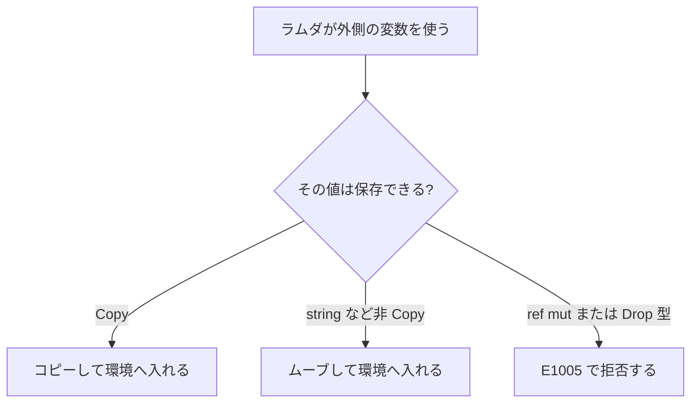

# ラムダ式

ラムダ式は名前を持たない匿名関数です。その場で高階関数へ変換処理を渡したい場合や、外側の変数を捕捉して利用したい場合に使用します。本体コードはラムダ式を定義した瞬間ではなく、実際に呼び出された時点で評価されます。

名前付き関数の宣言、カリー化、再帰関数の詳細は[関数 / 高階関数 / 再帰関数](./functions.md)で扱います。このページでは、ラムダ式の引数の記述方法と、外側の値を捕捉（キャプチャ）するセマンティクスを中心に解説します。

## この記事のポイント

- 基本形は `\引数 -> 本体` です。複数引数は空白で並べても、ネストしても同じカリー化です。
- `\(left, right) ->` はタプル 1 つの分解で、2 引数関数ではありません。
- `()` は `unit` を 1 つ受け取るパターンです。引数なし関数の `f()` とは違います。
- Copy の値はコピーされ、`string` などの非 Copy は関数値へムーブされます。
- `ref mut` と、`Drop` を実装した型の値は、後から何度も呼ぶ関数値へ保存できません。

## 基本の書き方

```text
\引数 引数 -> 本体
\引数 ->
    インデントした本体
```

```tsuzuri run=42
let total = \left right -> left + right
total 20 22
```

実行結果:

```text
42
```

`\left right ->` は `\left -> \right ->` と同じです。引数が揃うまで本体は評価されません。

```tsuzuri run=42
let add = \x -> \y -> \z -> x + y + z
add 10 20 12
```

実行結果:

```text
42
```

`add 10` は残りの 2 引数を待つ関数、`add 10 20` は残りの 1 引数を待つ関数です。型の `->` も右結合なので、`i64 -> i64 -> i64` は `i64 -> (i64 -> i64)` と同じです。

本体を複数行にするときは、`->` の次の行を深くインデントします。波括弧のブロックも使えます。

```tsuzuri run=positive
def describe :: i64 -> string = \value ->
    let label = if value > 0 then "positive" else "other"
    label

describe 3
```

実行結果:

```text
positive
```

最初の引数を受けた時点で途中の束縛を評価し、残りの関数を返したいときは、ネストしたラムダを返します。

```tsuzuri run=42
def scaled :: i64 -> i64 -> i64 = \factor ->
    let base = factor * 2
    \amount -> base + amount

scaled 10 22
```

実行結果:

```text
42
```

`base` の初期化は `scaled 10` の時点で行われ、返った関数が `22` を受け取ります。

## 型注釈とパターン引数

引数の型は、呼び出し、束縛側の注釈、本体から推論されます。明示するときは引数を括弧で囲みます。

```text
\(value: i64) -> value + 1
\(transform: i64 -> i64) amount -> transform amount
let shift: i64 -> i64 = \value -> value + 1
```

```tsuzuri run=42
let add = \(left: i64) right -> left + right
add 20 22
```

実行結果:

```text
42
```

注釈には参照の型（`\(text: ref string) -> …`、`\(counter: ref mut Counter) -> …`、参照の型の別名）も書けます。edition 2027 の `def text_length :: string -> i64` の値のように、引数規約 `[Read]`・`[Mut]` を持つ関数型が期待される位置へ直接書いても、`let` で束縛してから使っても、その引数は注釈のとおり参照になり、ラムダの型も同じです。注釈の無い引数と、`\(text: string) -> …` のように値の型を注釈した引数は、その位置では参照先の値を読みます（[引数の所有権](./functions.md#引数の所有権own-と-edition-2027)）。2027 の `Array`／`List` の `map`・`fold` などの読み取り callback へ直接書くラムダ（`texts |> Array.map (\(text: ref string) -> …)`）も同じです。参照の注釈が引数の型と合わないとき（`[Read]` の `string` の引数への `ref [string]` や `ref mut string`）は、引数は参照先の値を読むので、`E1003 expected ref [string], found string` のように、注釈に書いた型と参照先の値の型の食い違いとして報告されます。

```tsuzuri run=5005
def text_length :: string -> i64 = \text -> text.length

def pick :: i64 -> i64 = \n ->
    let chosen = if n > 0 then text_length else \(text: ref string) -> text.length * 10
    let text = "hello"
    chosen (ref text)

pick 3 + pick (-3) * 100
```

実行結果:

```text
5005
```

数値リテラルの配列やリストの読み取り callback（`[1, 2, 3] |> Array.map (\(x: ref i64) -> …)`、`let xs = [1, 2, 3]` の後の `xs |> Array.fold …`）では、callback を検査する時点で要素の型がまだリテラルの型のままです。リテラルの型は参照になりえないので、注釈の参照先がリテラルの取れる数値型（整数のリテラルなら `i64` や `i8u`）なら、引数は注釈のとおり参照になり、要素の型もその型に決まります。`let` で束縛したラムダと同じ型です。リテラルの取れない参照先（`ref string`、整数のリテラルへの `ref f64`、負のリテラルへの `ref i8u`）や、ほかの制約（その要素を渡した関数が求める class の instance）を満たさない参照先では、引数は参照先の値を読むので、リテラルの位置に `E1003 expected an integer, found ref string` のように報告されます。リテラルが要素の内側にあるとき（`[[1, 2], [3]] |> Array.map (\(x: ref [i64]) -> …)` の `[i64]`、タプルの中の配列）も、リテラルの取れる注釈なら参照になり、要素の型が決まります。取れない注釈（`ref [string]`、整数のリテラルへの `ref [f64]`）では引数は参照先の値を読み、注釈したパターンの位置に `E1003 expected ref [string], found [an undetermined type]` と報告されます。

```tsuzuri run=615
let doubled = [1, 2, 3] |> Array.map (\(x: ref i64) -> deref x * 2)
let xs = [4, 5, 6]
let total = xs |> Array.fold (\sum (x: ref i64) -> sum + deref x) 0
doubled[2] * 100 + total
```

実行結果:

```text
615
```

期待型の引数がまだ決まっていない型の参照のとき（`def inspect :: 'a -> i64` の値と並べた `if`）は、今も注釈を参照先の値と比べます。`\(text: ref string) -> …` の型は `ref ref string -> i64` になり、`ref string` を渡す呼び出しは `E1003` です。ラムダを先に `let` で束縛すると `ref string -> i64` になります。規約の無い関数型の引数（`def apply :: (string -> i64) -> i64` の `apply (\(text: ref string) -> …)`）は値の引数なので、`ref string` の注釈は `E1003` です。`let` で束縛した関数値なら、値の引数へ合わせる adapter が作られるので渡せます。

次の場合も、注釈を参照先の値と比べます。

- 期待型の引数が参照の参照のとき。たとえば `[ref string]` を `Array.map` に渡すときの callback の要素の引数です。直接書いた `Array.map (\(r: ref (ref string)) -> r.length) rs` は `E1003` で、文言は内側の食い違いの `expected ref string, found string` です。参照先の値の型で `\(r: ref string) -> …` と書くか、ラムダを先に `let` で束縛します。
- 読み取り引数の型が、型変数を型構築子に適用した型のとき。たとえば `def probe :: Functor<'container> => 'container<i64> -> i64` の `'container<i64>` です。`\(value: ref 'container<i64>) -> …` は `E1015`（`type constructor application has an incompatible kind`）です。注釈を書かないか、値の型で `\(value: 'container<i64>) -> …` と書きます。
- 期待型の引数の参照先の内側にまだ決まっていない型があり、その型に掛かる class の制約が、注釈で決まらないほかの型も含むとき（その型にモジュール関数制約が掛かるときも同じです）。たとえば `let h = \p q -> …` の本体で `(p, q) == (p, q)` と比べた後の `[[p]] |> Array.map (\(x: ref [i64]) -> …)` は、`E1003 expected ref [i64], found [an undetermined type]` です。ラムダを先に `let` で束縛します。

注釈で参照を束縛した引数は、`let` で束縛したラムダの引数と同じ所有権検査を受けます。`Array.write` と、それで書き込む std の関数（`Array.set`・`Array.fill`・`Array.blit` など）で、その引数の借用を持つ値（引数を捕捉した関数など）を書き込み先へ書き込むと、書き込み先の持ち主はその借用を持ちます。そのため、借用元より長く書き込み先を使うと、注釈を書かない綴りと同じく `E1013` です（[その場の書き込み](../ownership-and-memory/lifetimes.md#現在の制限)）。同じページの残りの規則も、`ref` の型の引数を持つ名前付き関数と同じです。`ref mut` と注釈した引数の先の借用を書き込み先へ残した後で、借用した場所へ届く書き込み（そのフィールドの置き換え、`Vec.push_mut`）は `E1014` で、別のフィールドへの書き込みは受理されます。`ref` と注釈した引数の先を `match` で照合した変数の借用は呼び出し元のデータの借用で、`((use, z): ref (A * B))` のようなパターンで取り出した関数は引数の関数として呼び出し元で検査します。ロックのコールバックの中身の借用を、注釈した引数を通してコールバックの外へ残す呼び出しも `E1013` です（[結果とロック](../built-in-types-and-modules/mutex.md#結果とロック)）。注釈した引数を通して呼び出し元のセルや値の部分へ残した借用と、読み取りの引数へ貸した一時値は、同じ規約の名前付き関数と同じく破棄の順序で検査します。`(p: ref mut Pair)` と注釈した引数の先の部分の借用（`let t = ref p.s`）を同じ値の `Mutex` へ書き込むラムダも、`def target :: ref mut Pair -> i64` の名前付き関数と同じく、`ref mut` の変数を渡す呼び出しでも、引数を別の関数へ渡すラムダでも、部分の順序が逆（`record Pair { s: string, h: Holder }`）なら `E1013`（`self_referential_store`）です（[解放の順序](../ownership-and-memory/drop.md#解放の順序lifo-と宣言順)）。参照が 2 つの値のどちらかを指す呼び出し（`target (if n > 0 then ref mut a else ref mut b)`）でも、注釈したラムダは名前付き関数と同じく、受け取った値にその値自身の部分の借用だけを残すので、`a` と `b` の宣言の順序は問いません。`(a: ref PairOk) (b: ref PairOk)` と注釈した引数の一方の先の部分の借用（`let t = ref b.s`）をもう一方の先（`a.h` の `Mutex`）へ書き込むラムダも、`def cross :: ref PairOk -> ref PairOk -> unit` の名前付き関数と同じく、書き込み先の値に実引数が指す値のその部分の借用だけを残します。`p1` を先に宣言した `cross (ref p2) (ref p1)` は、パイプライン・部分適用・参照の変数を渡す呼び出しでも、引数を名前付き関数へ中継するラムダでも受理され、逆の `cross (ref p1) (ref p2)` は `E1013`（`assignment_extends_borrow`）です。`deref p = v` で注釈した引数の先を置き換えたときに、本体がその値へ書き込んだ自分の部分の借用が終わるかどうかも、`ref mut` の型の名前付き関数と同じです（セルの中身を別の引数の先へ写した後や、セルが値の中の `Arc` のブロックにあるときは終わらず、置き換えが `E1014` です）。ループの中の書き込みも名前付き関数と同じで、ループの本体がセルの中身を別の引数の先へ写すか、セルが持つ借用を別の引数の先へ格納した後の `deref p = v` は、ループの後でも `E1014` です。注釈した引数の先の借用を、書き込むセルを自分で所有する関数値へ渡すループも、名前付き関数と同じくループの本体の位置の `E1017`（`loop_ownership_limit`）です（[現在の制限](../ownership-and-memory/lifetimes.md#現在の制限)）。ただし、注釈した引数を本体がそのまま関数値の引数へ渡す `def apply2 :: (ref PairOk -> ref PairOk -> unit) -> PairOk -> PairOk -> i64 = \f (a: ref PairOk) (b: ref PairOk) -> { f a b; 0 }` では、呼び出し元がその引数へ貸した一時値の解放の順序を区別しないので、名前付き関数や注釈を書かないラムダでは受理される安全な順序の `apply2 cross (ref (mkpo ())) (ref (mkpo ()))` も `E1013` です。`ref` の型の署名に注釈したラムダを書いた形も同じで、安全側の扱いです（[A33](../../../_features/A33-remaining-store-soundness-holes.md)）。注釈を書かない `\f a b -> …` か、名前付き関数で書きます。

`\mut (pattern)` の `mut` は、パターンで束縛する名前ではなく、分解する前の引数を可変にします。`def` の右辺では可変束縛引数は値渡しなので、そのパターンへ参照の型を注釈すると `E1003` です（`def size :: 'a -> i64 = \mut (v: ref 'a) -> 3` は `expected ref 'a, found 'a`）。規約を持つ関数型が期待される位置のラムダと、`def` の `mut T` の引数では、`mut` を付けても引数の型は変わりません。そのため `\mut (text: ref string) -> …` や `\mut (counter: ref mut Counter) -> …` と書けます。

排他借用 `ref mut T` は Copy でないので、`\((c as d): ref mut Counter) -> …` のように `as`（または `&`）で同じ参照を 2 つの名前に束縛すると `E1012` です。所有値の `\((s as t): string) -> …` と同じで、診断は引数のパターンを指し、`use of moved or partially moved value: this parameter's pattern binds the value, or a part of it, to more than one name` と報告します。名前を 1 つにして `\(c: ref mut Counter) -> …` と書きます（[as パターンによる全体束縛](../pattern-matching/pattern-matching.md#as-パターンによる全体束縛)）。

パターンの引数の `->` の後に [関数ガード](./functions.md#関数ガード)の `|` 節を続けると、節はパターンで分解した名前ではなく引数そのものをもう一度照合します。そのため、Copy でない値（所有値や排他借用 `ref mut`）では、`\(s: string) -> | t when t.length > 3 -> 1 | _ -> 0` や `\(c: ref mut Counter) -> | d -> …` は、パターンが値をムーブした後の照合として `E1012` です。診断は最初の `|` の節を指し、`use of moved or partially moved value: these clauses match the parameter again after its pattern moved the value` と報告します（`value moved here` の注記は引数のパターンを指します）。本体で `match s with | t when … -> …` のようにパターンの名前を照合するか、`| s.length > 3 -> 1` のような条件だけの節にします。条件だけの節は引数を照合しないので、そのまま書けます。

`\(left, right) ->` はタプルを 1 つ受けて分解します。カリー化された 2 引数関数ではないので、呼び出しは `total (20, 22)` です。

```tsuzuri run=42
let total = \(left, right) -> left + right
total (20, 22)
```

実行結果:

```text
42
```

`\() -> 42` は `unit` パターンです。呼び出しは `answer ()` で、引数なしの `answer()` ではありません。

```tsuzuri run=42
let answer = \() -> 42
answer ()
```

実行結果:

```text
42
```

引数パターンの網羅性は、`match` と違ってコンパイル時には検査されません。適用時に一致しなければ実行時トラップです。定数だけのパターンを引数に書くときは、その値以外が来ないことを呼び出し側で保証してください。

## when ガード

引数の直後に `when` 条件を書くと、条件が false の適用もパターン不一致としてトラップします。

```text
\value when value > 0 -> value / 2
```

```tsuzuri run=42
let half = \value when value > 0 -> value / 2
half 84
```

実行結果:

```text
42
```

> [!WARNING]
> `half 0` や `half (-1)` は、型エラーではなく実行時トラップです。失敗を値で返したいときは `Maybe` や `Result` を返す関数にするか、[関数ガード](./functions.md)の `otherwise` で受けてください。

関数ガードの `|` 節は、名前付き関数の本体向けの書き方です。ラムダの `when` は、その引数 1 つに対する追加条件です。

## 捕捉

ラムダを作るとき、本体が使う外側の変数は環境へ取り込まれます。Copy の値はコピーされます。`string` のように Copy でない値は、関数値へムーブされます。

```tsuzuri run=42
let offset = 2
let increment = \value -> value + offset
increment 20 + increment 18
```

実行結果:

```text
42
```

`offset` は `i64` なのでコピーです。元の `offset` もそのまま使えます。`string` を捕捉すると元の変数はムーブ済みになり、その後の使用は `E1012` です。

```text
let label = "answer"
let show = \() -> label
let again = label
```

この `again` は `E1012`（use of moved or partially moved value）になります。

関数値自体は Copy です。環境ごと複製されるので、捕捉した文字列を返す関数でも二度呼べます。呼び出しのときも環境のコピーを取り出すためです。大きな配列や文字列の複製が無料になるわけではありません。関数値がスコープを出ると環境は解放され、GC は使いません。

捕捉の無い関数値は環境を確保しません。ポインタ幅に収まるスカラーを一つだけ捕捉した場合は、ヒープ確保を省く実装上の最適化があります。意味は、独立したコピーのままです。

関数値そのものの大きさは、ポインター 2 つです（ネイティブは 16 バイト、wasm32 は 8 バイト）。1 つ目は、呼び出す関数と環境の複製・解放のしかたを持つ静的な表（関数と捕捉の数ごとに 1 つ）への参照で、2 つ目は環境です。環境を確保しない関数値と、スカラーを 1 つだけ環境の欄に入れた関数値は、複製も解放も何もしません。`Maybe<i64 -> i64>` のように、関数値だけをペイロードに持つ option はタグを持たず、関数値と同じ大きさです（[Union](../built-in-types-and-modules/union.md#メモリ上の大きさ)）。値のインラインレイアウトの上限（`E1010`）の検査は、関数値を 32 バイトと数える保守的な見積もりのままです。



外側の `let mut` を捕捉しても、ラムダの中からその変数へ代入し直すことはできません。環境の中では不変です。代入したいローカルは、引数を `\mut value ->` で受けるか、ラムダの内側で `let mut` します。

## 共有借用の寿命

`ref` を捕捉した関数値は、参照先の所有者より長く生きられません。コピー、関数の引数、レコードのフィールドを経由しても、この依存は追跡されます。

```tsuzuri run=6
let text = "answer"
let borrowed = ref text
let measure = \() -> borrowed.length
measure ()
```

実行結果:

```text
6
```

`measure` は `text` が生きている間だけ使えます。所有者のブロックを出る関数値として返そうとすると、`E1013`（borrowed value does not live long enough to leave this block）になります。

関数値を返す関数の呼び出しでは、関数の型が環境の借用を表さないので、コンパイラーは呼び出す関数の本体を見ます。全引数を渡す呼び出しの結果が持つのは、本体が結果に入れうる引数（捕捉する、返す、そうしうる関数へ渡す）の借用だけです。次の `pass` は `key` を結果に入れないので、`wrap` は自分の `key` を借用して渡した呼び出しの結果を返せます。同じ型の `def keep :: ref string -> (unit -> i64)` でも、`fn keep text =` に続けて `let g = \() -> String.length text` と `g` を書けば、結果は `text` の借用を持ち、`keep (ref text)` を `text` の所有者の外へ返すと `E1013` です。パイプライン `f |> pass (ref key)` は `pass (ref key) f` と同じ扱いです。

```tsuzuri run=42
def pass :: ref i64 -> own (unit -> i64) -> (unit -> i64)
fn pass _key f = f

def wrap :: i64 -> (unit -> i64)
fn wrap key = pass (ref key) (\() -> 42)

let f = wrap 1
f ()
```

実行結果:

```text
42
```

この規則は、呼び出しの結果の型が参照を含まないとき（関数値、関数を持つレコード、`Maybe<unit -> i64>`、関数を値に持つ `HashMap` など）だけです。本体が局所の配列や `Mutex` へ `Array.write`・`Array.set` などで書き込んだ値の借用は、代入と同じく書き込み先の持ち主に残るので、それを結果に入れる関数の結果はその借用を持ちます（[現在の制限](../ownership-and-memory/lifetimes.md#現在の制限)）。本体が書き込める場所（排他借用、借用を持ちうる値を入れた `Mutex` などの共有セル）を呼び出しへ渡し、かつ本体か本体が呼ぶ関数が、借用を持ちうる具体的な型の値を `Array.write` などで書き込むか、コールバックを実行する組み込み関数や関数値を呼ぶ関数は、念のため以前の規則のままで、結果はすべての引数の借用を持ちます（同じ節）。本体が借用を持ちうる値を、本体の見えないコードへ渡す関数の結果も、すべての引数の借用を持ちます。見えないコードとは、名前付き関数でない関数値（引数・捕捉・局所値・フィールド・要素・部分適用を入れた値）の呼び出し、dyn 値のメソッド、`Owned.call`、コールバックを実行する組み込み関数（`Array.map`・`Array.iter`・`Array.fold`・`Mutex.with_lock`・`Parallel.*` など）、またはそうしたコードへ渡す関数を、関数値などと一緒に呼ぶことです。関数の型・dyn 型・`Owned.Function` は環境を表さないので、そのコードは受け取った値を自分が捕捉した `Mutex` などへ入れられ、本体の別の入力（同じ `Arc<Mutex<…>>` を捕捉した読み出しの関数値）が後でそれを読めます。`w (\() -> String.length text)` を呼んでから `\() -> r () + 1` を返す関数の結果は `text` の借用を持ちます。借用を持つ引数を渡さない呼び出し（`t ()`）でも、呼ぶ関数値は捕捉したものを入れられるので、その関数の結果はすべての引数の借用を持ちます。値の破棄も、本文に呼び出しを書かずに `Drop.drop` を実行するので、プログラムのどれかの `Drop.drop`（`Drop.drop` の本体が `Mutex.with_lock` などのロックや捕捉した関数値の呼び出しで、値の中身を値の中の `Mutex` などへ入れうるとき）、借用を持ち、破棄でコードを実行しうる値（利用者の `Drop` 型の値と、それを持ちうる関数値・dyn 値・`Owned.Function` を格納された値として持つ値）の借用は、その値を受け取る・作る関数の結果へ届くとみなします（[Drop とリソースの解放](../ownership-and-memory/drop.md#drop-型に課される制約)）。部分適用の結果は、渡した引数をすべて捕捉します。`fn keep2 text = \() -> String.length text` のように本体をラムダで書くと、そのラムダの引数 `()` も関数の引数になるので、`keep2 (ref text)` は部分適用で、本体が `text` を使わなくても（`fn keep2 _text = \() -> 42`）結果は `text` の借用を持ちます。結果の型が参照を含むとき（`ref T`、`Maybe<ref T>` など）は、名前付き region がなければ、結果はすべての参照引数の借用を持ちます。例外は、本体が借用をまったく返さないと示せる関数（`fn nothing _x = Maybe.None` など）で、その結果は何も借用しません（[ライフタイムと region](../ownership-and-memory/lifetimes.md#現在の制限)）。

```text
def leak :: unit -> unit -> i64 = \() ->
    let text = "answer"
    let borrowed = ref text
    \() -> borrowed.length
```

共有借用を閉じ込めた関数は、その借用が有効な範囲でその場で呼んでください。

## 保存できない値

排他借用 `ref mut T` と、`Drop` を実装した型の値は、再利用できる関数値の環境へ保存できません。`Capture` 制約で拒否され、`E1005` になります。関数値は複製されることがあり、複製すると排他借用が 2 つになったり、同じ資源を 2 回解放したりするからです。

```text
let mut text = "answer"
let borrowed = ref mut text
let later = \() -> borrowed
```

```text
record Ticket { id: i64 }

instance Drop<Ticket> {
    fn drop value = do! IO.write_line ("drop " + to_string value.id)
}

let ticket = Ticket { id: 1 }
let later = \() -> ticket.id
```

どちらも `cannot capture ... in a reusable function; fully apply exclusive borrows, or move the value into a tzroutine body, which runs once` です。排他借用は、その場で完全に適用します。`Drop` 型の値は、1 回だけ走る `tzroutine { ... }` の本体へムーブするか、[Owned](../built-in-types-and-modules/owned.md) の `Owned.function` で包みます。`Drop` を持つ std の型（`Channel` など）と `Owned.Function` も捕捉できません。`Atomic` と `Mutex` も、複製すると別のカウンターやロックになるので捕捉できません。

`Rc<T>` と `Rc.Weak<T>`、それを持つ値も捕捉できません（`E1005`）。関数値はほかの tzroutine やスレッドへも渡せるので、atomic でない計数がスレッドをまたぐのを防ぐためです。`Arc<T>` は、`T` が `Rc`、extern ハンドル（`extern type`）、Copy でない `dyn` 値、`Owned.Function` を持たなければ捕捉でき、関数値を複製すると `Arc.share` と同じく所有者が増えます（[Rc と Arc](../built-in-types-and-modules/rc.md)）。

`Drop` 型の値を関数として扱う方法は [Drop](../ownership-and-memory/drop.md) と [Owned](../built-in-types-and-modules/owned.md) を参照してください。

引数の型が `ref T` であることと、関数値が `ref` を捕捉していることは別の検査です。`String.length` のような関数値自体は、呼び出しのあいだだけ借用します。

## 型検査の順序

実引数として渡したラムダは、同じ呼び出しのほかの引数より後に型検査されます。`texts |> Array.mapr (\text -> text.length)` のように、左の値から要素型が決まれば、ラムダの引数注釈は要りません。これは型検査の順序であり、実行時に引数を右から評価する規則ではありません。

束縛側に型を書く方法もあります。

```text
let shift: i64 -> i64 = \value -> value + 1
```

通常の `let` に束縛したラムダは、本体の中で自分の名前を参照できません（`E1002`）。自分を呼ぶ関数は `def rec` か、関数の中の `let rec` で書きます。`let rec` の関数は、非 Copy の値を move せずに借用して捕捉します（[ローカルな `let rec`](./functions.md#ローカルな-let-rec)）。ローカルな `let` は単相です。

## 他の言語との比較

| | Tsuzuri | F# | Rust |
| --- | --- | --- | --- |
| 構文 | `\x -> x + 1` | `fun x -> x + 1` | `\|x\| x + 1` |
| 複数引数 | カリー化。タプル分解は別 | カリー化 | クロージャの引数リスト |
| 捕捉 | Copy はコピー、他はムーブ（`let rec` は借用） | 参照の捕捉が中心 | `move` で所有権を取る |
| 可変な外側 | 捕捉後は代入できない | 可変セルを捕捉できる | `Fn` / `FnMut` / `FnOnce` で分かれる |

## 注意点

> [!NOTE]
> edition 2026 は、バックスラッシュのない旧ラムダ `x -> e` も受理します。`x -> y -> e` と `x -> \y -> e` は 1 つの 2 引数ラムダ `\x y -> e` になります（`\x -> \y -> e` とは生成コードが違います）。edition 2027 では `E0004`（`'x -> y ->' is not allowed in edition 2027; write '\x y ->'`）で、edition 2026 では `--warn canonical` が `W1007` で書き換えを示します。引数が `_` の旧ラムダ（`_ -> 0`）は `\_ -> 0` になります（意味は同じですが、`\_` がパターンとして引数を照合するので LLVM の最適化前の IR が違い、書き換えの確度は `likely` です）。

- `\()` は `unit` 型の値を受け取る引数パターンです。引数なし関数の呼び出し `f()` とは明確に区別されます。
- `\(left, right)` はタプル 1 つを受け取って分解するパターンであり、カリー化された 2 引数関数ではありません。
- `when` 条件が false になった場合は実行時トラップが発生します。失敗を値として処理したい場合は `Maybe` や `Result` を使用してください。
- 非 Copy の値を捕捉するとムーブされます。元の変数はそれ以降使用できません。`let rec` の関数は共有借用するので、元の変数を読み続けられます。
- 共有借用を捕捉した関数値は、参照先の所有者スコープより外側へ返却できません。

## まとめ

- ラムダは `\引数 -> 本体` で、複数引数もネストも同じカリー化です。
- 型注釈、タプル分解、`unit` パターン、`when` を引数位置に書けます。
- Copy はコピー、非 Copy はムーブです。関数値の複製は環境の独立したコピーです。
- 共有借用の捕捉は、所有者の寿命に束縛されます。
- `ref mut` と `Drop` 型の値は再利用可能なラムダへ保存できません。

## 関連項目

- [関数 / 高階関数 / 再帰関数](./functions.md)
- [ジェネリック関数と型パラメータ制約](./generics-functions.md)
- [制約 と 属性](../types-and-type-inference/constraints.md)
- [所有権とムーブ](../ownership-and-memory/ownership.md)
- [借用と参照](../ownership-and-memory/borrowing.md)
- [tzroutine 式](../async-tasks-and-lazy/tzroutine.md)
- [匿名関数と捕捉](../../../docs/language.md#匿名関数と捕捉)
- [言語リファレンスの目次](../index.md)

