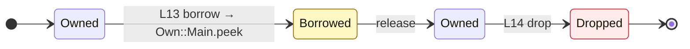

# Ownership of `Own::Main.demo`

## text

```mermaid
stateDiagram-v2
    direction LR
    state "Owned" as s0
    [*] --> s0
    state "Borrowed" as s1
    s0 --> s1 : L10 borrow → Own#58;#58;Main.peek
    state "Owned" as s2
    s1 --> s2 : release
    state "Borrowed" as s3
    s2 --> s3 : L11 borrow → Own#58;#58;Main.consume
    state "Owned" as s4
    s3 --> s4 : release
    state "Dropped" as s5
    s4 --> s5 : L14 drop
    s5 --> [*]
    classDef moved fill:#ffebe9,stroke:#cf222e
    classDef borrowed fill:#fff8c5,stroke:#9a6700
    class s5 moved
    class s1,s3 borrowed
```

## label

| # | line | var | event | to | diagnostic role |
| --- | --- | --- | --- | --- | --- |
| 1 | 10 | text | borrow | Own::Main.peek | borrowed_here |
| 2 | 11 | text | borrow | Own::Main.consume | borrowed_here |
| 3 | 13 | label | borrow | Own::Main.peek | borrowed_here |
| 4 | 14 | label | drop | - | - |
| 5 | 14 | text | drop | - | - |
