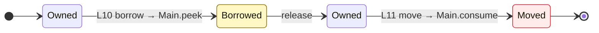
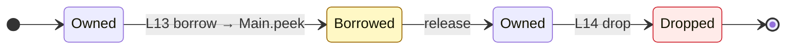

# Ownership of `Main.demo`

## text

## label

| # | line | var | event | to | diagnostic role |
| --- | --- | --- | --- | --- | --- |
| 1 | 10 | text | borrow | Main.peek | borrowed_here |
| 2 | 11 | text | move | Main.consume | moved_here |
| 3 | 13 | label | borrow | Main.peek | borrowed_here |
| 4 | 14 | label | drop | - | - |
